# 00｜综述导读：长程任务、自演化与递归自改进的研究地图

[首页](../README.md) · [专题索引](../README.md#topics) · [文献目录](../catalog/README.md)

相关名称的来源与方法联系见 [Hot Words](17_hot_words.md)。

## 方向背景：综述怎样连接研究问题

> **要点：** 读综述之前，先分清三个一层套一层的研究问题：长程任务、自演化和递归自改进；再认清手头的材料是系统综述、专题综述还是研究路线图。本节最后的领域地图把全章二十多篇综述按方向和时间摆在一张图上，后面每一节都从这张图上取一行来讲。

设想你刚进组，导师丢过来一句话："先把 agent 这个方向摸一遍，下周组会讲讲。"你打开 arXiv，搜出来的是几百篇方法论文：有人在改记忆，有人在改工具调用，有人在训练模型，有人在搭多智能体，还有人说自己的系统会"自我进化"。每篇论文都只处理了整件事的一角，而且各自用一套名字。读到第十篇，你多半会开始怀疑：这些人说的到底是不是同一件事？

综述的价值就在这里。一篇好的综述会替你把问题划好地盘，告诉你哪些方法在解决同一个问题，哪些名字相近的工作其实在回答不同的问题，又有哪些缺口至今没人补上。Agent 研究横跨系统设计、学习机制和应用场景，单篇方法论文看不到全貌，综述正好补上这块拼图。所以这一章的读法是先从系统整体进入持续行动，再讨论经验积累和递归改进，然后接到技能、协作、安全和具体应用。每一节都会比较几篇综述各自的组织视角，给后面专题里的经典脉络和前沿方法提供一套共同的坐标。

这张地图上最容易混在一起的，是三个相互联系又各有所指的研究问题。长程任务关心的是持续行动能不能一直可靠；自演化关心的是一次经验怎样改变以后的行为；递归自改进则再往里走一步，关心负责改进的那套机制本身会不会变化。先把研究对象分清楚，再去比较综述的分类框架，记忆、技能、训练和评测才能被放回同一张研究地图上。

下面这张图把三个研究问题画成一层套一层的框，右边顺手列出三类材料，先看图，再往下读。

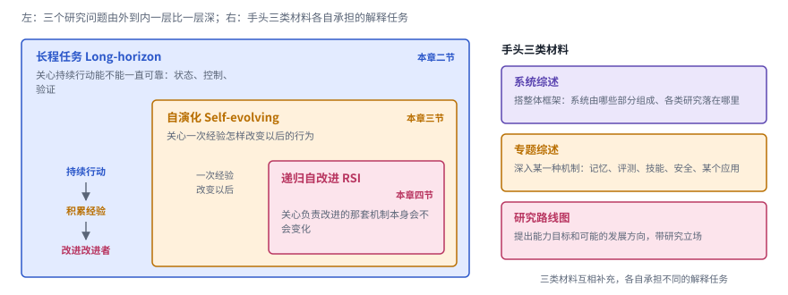

*图：三个研究问题由外到内一层比一层深，右边是手头三类材料各自承担的解释任务。*

图的左半边，最外面的蓝框是长程任务，它问的是一段持续的行动能不能从头到尾保持可靠，牵涉到状态、控制和验证；往里一层的琥珀色框是自演化，它问的是这一次的经验会不会改变下一次的行为；最里面的玫红色框是递归自改进，它把目光收到负责改进的那套机制本身，问这套机制会不会也被改掉。框套着框，表达的正是本章的读法：递归自改进在自演化的基础上再往里走一步，自演化又建立在系统能够持续行动之上。每个框右上角标着本章讨论它的那一节，拿到一篇新综述时，可以先问它主要落在哪个框里，再看它属于右边哪一类材料。

手头的材料大致分三类。系统综述帮你搭整体框架，专题综述深入某一种机制，研究路线图则提出能力目标和可能的发展方向。三类材料互相补充，各自承担不同的解释任务。下面这张表把本章要回答的几个问题和对应的入口综述排在一起，可以先扫一眼，读完全章再回来对照。

| 研究问题 | 代表综述 | 关联专题 |
| --- | --- | --- |
| Agent 系统究竟由哪些部分组成？ | Agent System and Harness Design | [基础与工具](01_basics.md) |
| 为什么任务一长就不可靠？ | Towards Long-Horizon Agents: A Survey | [记忆](02_memory.md) + [评测](06_evaluation.md) |
| “自演化”到底更新什么？ | What, When, How, and Where to Evolve | [自我改进（RSI）](03_skills_and_self_improvement.md) |
| RSI 与普通自动优化有什么不同？ | Recursive Self-Improvement in AI | 本章第四节，再进入[自我改进（RSI）](03_skills_and_self_improvement.md) |
| 技能库和收藏提示词有什么区别？ | Dynamic Agent Skills | [技能](03_skills_and_self_improvement.md) + [数据](04_training_data.md) |
| 怎样判断新版本真的更好、更安全？ | Evaluation and Benchmarking，配合 Safety in Self-Evolving Agents | [评测](06_evaluation.md) + [安全](07_safety.md) |

把本章要读的综述按方向和时间摆在一起，就得到下面这张领域地图。

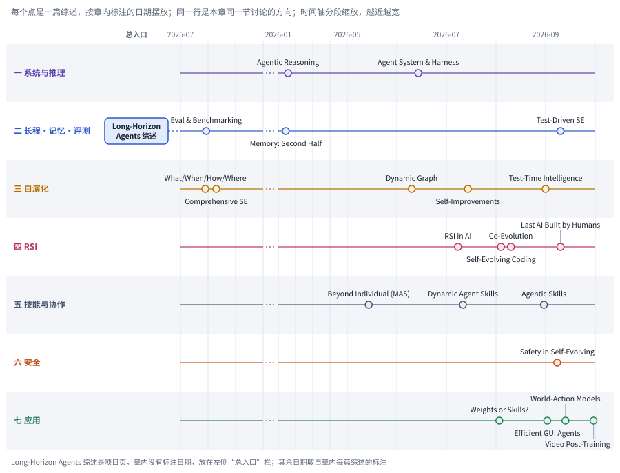

*图：本章综述的领域地图。每一行是本章一节讨论的方向，每个点是一篇综述，横轴按章内标注的日期摆放；2025 年 10 月到 12 月没有综述，这一段压成了虚线。*

这张图可以从两个方向看。横着看一行，能看到一个方向上综述出现的先后：自演化在 2025 年夏天已经有两篇大综述，到 2026 年夏天又出现了三篇切法不同的新综述；RSI、安全和应用几行的点都落在 2026 年 7 月到 9 月之间，说明这些方向是最近几个月才开始被系统整理的。竖着看一列，能看到同一段时间里大家在整理什么：2026 年 9 月前后，测试驱动、测试时智能、安全、GUI、世界模型、视频后训练和 RSI 路线图几篇几乎同时出现。左侧单独放着 Long-Horizon Agents 综述，它是一个项目页，章内没有标注日期，本章把它当作长程任务这一行的总入口。看清了地图的疏密，读后面各节时就知道，哪些方向已经有几代综述可以互相对照，哪些方向还只有一两篇，下结论时要多留余地。

## 先读这几篇

> **要点：** 五篇人写的长文按时间排开，正好是这个领域三年里关注点的移动：从三组件的系统草图，到工程上的克制，到下半场重评测，再到 harness 与自我改进。先读它们再读综述，就知道每张分类图该从哪里看起。

综述是按论文分类写的，好处是全，缺点是平，很少告诉你哪条线最要紧、哪个转折最关键。所以在打开综述之前，建议先读几篇人写的长文。它们的作者长期在这个方向上一线工作，文字里有取舍、有判断，读完再去看综述，你会知道每张分类图该从哪里看起。下面五篇按推荐顺序排列，本章各节也会不时借它们的说法把综述串起来。

| 顺序 | 文章 | 为什么读 |
|---|---|---|
| 1 | Lilian Weng，[LLM Powered Autonomous Agents](https://lilianweng.github.io/posts/2023-06-23-agent/)（2023-06-23） | 这是很多人入门 agent 的第一篇长文，到今天仍然是最清楚的系统地图。Lilian Weng 把大模型当作 agent 的"大脑"，在它周围配上规划、记忆和工具使用三个组件：规划负责拆解任务、反思纠错，记忆分成上下文里的短期记忆和外部向量库里的长期记忆，工具则让模型够到权重里没有的信息。文章结尾列出的三个难点，上下文长度有限、长程规划不可靠、自然语言接口不稳定，几乎就是此后三年这个领域的研究议程。读完它，你会发现本章第一、二节的许多综述都是在这张"三组件"草图上加细。 |
| 2 | Erik S. 与 Barry Zhang（Anthropic），[Building effective agents](https://www.anthropic.com/engineering/building-effective-agents)（2024-12-19） | 从工程一线给出的冷静判断。文章先把两类系统分开：workflow 让大模型和工具沿预先写好的代码路径运行，agent 则由模型自己动态决定流程和工具调用。接着列出五种常用的 workflow 模式，即提示链、路由、并行、编排者与执行者、评估者与优化者。它反复强调的建议是从最简单的方案起步，只有在能测出收益时才增加复杂度。这个判断正好给本章第一节的"系统视角"提供了一个朴素的检验：一项改动到底改变了系统的哪一部分，收益能不能被测出来。 |
| 3 | Shunyu Yao（姚顺雨），[The Second Half](https://ysymyth.github.io/The-Second-Half/)（2025-04-10） | 一篇改变了很多人研究品味的短文。作者认为 AI 已经来到"中场"：上半场的赢家是新方法和新模型，基准只是配角；如今强化学习配上语言预训练的先验和"把推理当作动作"，已经形成一套能稳定刷榜的配方，所以下半场的重心应当转到定义问题和设计评测上。他特别指出一个"效用问题"：真实工作有人在环路里、任务前后相连，基准却假设每次独立、自动运行。这正是长程任务和持续学习要面对的差距，本章第二节和第八节都会回到这个判断。 |
| 4 | DAIR.AI Academy，[Self-Improving Agents](https://academy.dair.ai/papers/collections/self-improving-agents)（2026-09） | 一份精心编排的论文合集，分成八段：最初的想法、自生成训练、从经验中学习、改进改进器、自修改代码 agent、AI 改进 AI 研究、循环在哪里断掉、领域全景。它给自我改进的定义很干净：系统用自己产生的反馈修改自身某个持久的部分，比如记忆、技能、代码或权重，并且只保留经过检验确实有用的修改；当被修改的恰好是提出和评判修改的那套机制时，系统才进入递归。本章第三、四节用这个定义来区分各篇自演化综述和 RSI 综述的覆盖范围。 |
| 5 | Lilian Weng，[Harness Engineering for Self-Improvement](https://lilianweng.github.io/posts/2026-07-04-harness/)（2026-07-04） | 三年后 Lilian Weng 再写 agent，焦点已经从"三组件"移到了包在模型外面的那层 harness，也就是负责规划、调用工具、管理上下文、保存产物和评估结果的执行系统。她给出一条被优化对象逐级上移的路径：结构化上下文、工作流、harness 代码，再到优化器代码。文末七个瓶颈，包括评价器太弱、上下文与记忆的生命周期难管、负面结果没人报告、多样性坍缩、reward hacking、短期奖励看不到长期质量、人在环路中的角色，几乎可以逐条对应到本章第四节到第六节的综述。 |

想多读一点的话，METR 的 [Measuring AI Ability to Complete Long Tasks](https://metr.substack.com/p/2025-03-19-measuring-ai-ability-to-complete-long-tasks)（2025-03-19）用"人类专家需要多久才能完成、模型有一半把握完成的任务长度"来度量 agent 的时间跨度，并报告这个跨度过去六年大约每七个月翻一番，是理解"长程"为什么成为热点的好材料。Anthropic 的 [When AI builds itself](https://www.anthropic.com/institute/recursive-self-improvement)（2026 年 9 月 18 日更新）则从一家前沿实验室内部回看递归自改进走到了哪一步：AI 已经在加速 AI 的研发，可设定目标、判断哪些问题重要仍然要靠人，读完 RSI 的综述之后可以用它校准预期。

下图把五篇长文按发表时间排开，方框里是每篇的一句核心判断，下方的圆角标签指向本章借用它说法最多的几节。

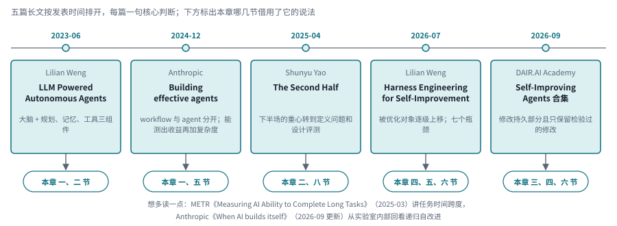

*图：先读的五篇长文。上方时间轴是发表月份，方框里是核心判断，箭头指向本章会回到它的几节；底部是两篇延伸阅读。*

从左往右读，能看到关注点怎样一步步移动。2023 年 Lilian Weng 画的是一个模型加三个组件的系统草图；2024 年底 Anthropic 提醒大家先分清 workflow 和 agent，能测出收益时才增加复杂度；2025 年 Shunyu Yao 把重心推到定义问题和设计评测上；2026 年 Lilian Weng 转而讨论包在模型外面的 harness 怎样被逐级优化；同年九月 DAIR.AI 的合集给自我改进下了一个干净的定义。前两篇撑起本章第一节的系统视角，后三篇分别给第二、三、四节提供判断的标准。所以每读完一节，都可以回到对应的长文，看看综述的分类有没有回答作者提出的那个问题。

## 一、先有系统地图，再讨论某种能力

> **要点：** 一项“agent 变强了”的结果，背后可能混着模型、执行框架和任务环境三层变化。先用一张系统地图把这三层分开，再问一项工作改的是哪一类运行时职责，能力又是从哪条途径来的。

读方法论文之前，最容易遗漏的一件事是研究对象的边界。模型负责预测下一步动作，可提供什么观察、怎样保存状态、如何调用工具、什么时候停止，这些都由包在模型外面的执行系统决定。所以当一篇论文说"某个模型在 Agent 任务上更强"时，背后可能同时混着模型本身、执行框架和任务环境三方面的变化。这三层不先分开，后面读到记忆、规划或自动优化，很容易误以为大家在比较同一种模型能力。

Lilian Weng 2023 年那张三组件草图，是很多人心里的第一张系统地图。到了 Anthropic 写《Building effective agents》的时候，这张图被往工程方向推了一步：同样一组模型和工具，按预先写好的路径编排叫 workflow，让模型自己决定流程才叫 agent，两者的可控性和成本完全不同。顺着这个思路，可以把一个系统写成一份配置清单：模型、提示与控制规则、记忆、工具、环境接口和验证方式。这份清单不要求所有论文采用同一种架构，它只是一张核对表，帮你追问一项工作固定了哪些组件，改变了哪些组件，收益又是通过哪个环节产生的。比如同样是多加一次检查，它可能真的减少了错误，也可能只是把总预算加大了。有了系统视角，这种比较才落得到实处。

下图把这两代系统地图放在一起，底部是本节两篇综述合起来给出的两条坐标。

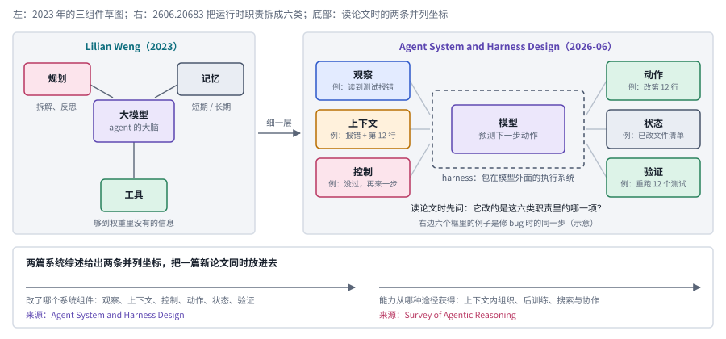

*图：从三组件到六类运行时职责。左边是 2023 年的三组件草图，右边是 Agent System and Harness Design 拆出的六类职责，虚线框代表 harness；底部是本节两篇综述给出的两条并列坐标。*

左边的草图里，模型是大脑，规划负责拆解任务和反思纠错，记忆分成短期和长期，工具让模型够到权重里没有的信息。右边那篇系统综述把同一件事拆得更细，六类职责围着模型排开：观察和上下文管信息怎样进来、模型此刻看到什么，控制和动作管下一步做什么、怎样落到环境里，状态和验证管已经发生了什么、结果是否成立。它们都在虚线框代表的 harness 里工作，模型本身只负责预测下一步动作。拆细之后，“多加一次检查”这类改动就有了明确的落点：它属于验证这一格，收益要和多花的预算放在一起算。底部两条横轴分别来自本节的两篇综述，一条问改了哪个系统组件，一条问能力从哪种途径获得，读完这一节，可以试着把任意一篇新论文同时放到这两条轴上。

**[From Question Answering to Task Completion: A Survey on Agent System and Harness Design](https://arxiv.org/abs/2606.20683v1)｜2026-06-14。** 这篇最适合当作第一篇系统综述来读。它以模型和执行框架之间的关系为主线，把运行时的职责拆成观察、上下文、控制、动作、状态与验证六类，比"规划、记忆、工具"三个模块的老划分细了一层，可以看作 Lilian Weng 三组件图在 harness 时代的升级版。读的时候不妨拿一个代码修复任务，依次对上这六类职责，看看失败究竟出在信息进入、决策、执行还是验收环节。它提供的是一套分析框架，作者并没有主张修改框架总比训练模型更有效。往后读任何系统优化工作，都可以先问一句：它改的是这六类职责里的哪一项？

**[A Survey of Agentic Reasoning for Large Language Models: Towards Recursively Self-Improving and Collective Agents](https://arxiv.org/abs/2601.12538v2)｜2026-01-18。** 这篇把基础智能体推理、自演化推理和群体推理放在同一张地图上，又把上下文内的组织方式和后训练带来的行为改变区分开来。读它能明白，"推理"在 agent 里早已超出生成一段思维链的范围，搜索、工具和协作都被卷了进来，这也呼应了 Shunyu Yao 所说的"把推理当作动作"。标题里的递归自改进是它覆盖的一个研究方向，文中并没有证明递归提升可以持续发生。比较稳妥的用法是先借它找到分支，再去具体的方法论文里检查实验支持。

**两篇怎么搭配？** 前一篇主要问"系统在哪个环节工作"，后一篇主要问"推理怎样在交互、学习和协作中展开"。两者是两种并列的坐标，谈不上谁替代谁。读完以后，如果你能把一篇新论文同时放进"改了哪个系统组件"和"能力从哪种途径获得"两个维度里，就已经比单纯记住方法名更接近真正的理解了。

## 二、Long-horizon：长在需要维持的任务关系

> **要点：** 长程任务的“长”首先长在动作之间的依赖上。Long-Horizon 综述把它分成三个层次，对应执行、恢复和持续改进三种要求；本节其余三篇专题综述再从记忆、评测和测试三个角度补上细节。

长程任务的"长"，首先体现在动作之间的依赖上。前面读到的条件会影响后面的决策，早期埋下的错误可能要到很晚才暴露，任务还可能在半路中断、恢复，甚至改变目标。长上下文模型能装下更多文字，可状态过时、目标遗漏、验证延迟和失败恢复这些问题，并不会因为窗口变大就自动消失。所以这一节不把 long-horizon 简化成"支持多少 token"或者"连续调用多少次工具"。

为什么这件事这两年突然变得重要？METR 那篇关于任务时间跨度的文章给了一个直观的答案：如果用人类专家完成任务所需的时间来衡量，模型能有一半把握做完的任务长度一直在稳定增长。Shunyu Yao 在《The Second Half》里则从另一面说明了差距在哪里：真实工作往往前后相连、有人参与，基准却默认每道题彼此独立。两篇文章放在一起读，长程任务就成了下半场绕不开的问题。

要研究它，至少得把三个子问题分开。**状态保持**关心下一步时系统还记不记得目标、约束和已经完成的工作；**长期控制**关心环境变化以后动作序列能不能重新规划；**结果验证**关心有没有独立证据说明最终目标真的完成了。记忆能解决第一部分，也能帮上后两部分，但它只是长任务问题中的一块。比较方法时，应当把任务的依赖结构、环境重置规则和总预算都固定下来，光按步数划分难度是不够的。

**长程任务总览：[Towards Long-Horizon Agents: A Survey](https://long-horizon-agents.github.io/)。** 这篇综述以外部执行框架和模型内部优化的协同为主线，依次组织基础定义、发展脉络、执行框架、学习优化、应用与开放问题。它没有把"运行时间长"当作唯一标准，而是区分了三个层次：单个上下文内的多步依赖、跨上下文的状态延续，以及跨任务的经验积累，三者分别对应执行、恢复与持续改进的不同要求。

读的时候，可以先用这三个层次给任务定位，再沿着规划与工作流、上下文与记忆、工具与技能、协作、执行钩子和验证几条线检查系统设计。训练与优化部分则帮你分辨，一项能力是由运行时的组织方式提供的，还是已经通过经验进入了模型。它很适合作为本节的总入口，接着再读记忆和评测综述，补上状态保存与可靠性测量的细节。比较具体工作时，用它把任务内执行、跨上下文恢复和跨任务学习分开，三种能力就不会被塞进同一个笼统的"长期性"指标里。

下图把这篇总览的三个层次、前面说的三个子问题和本节的阅读顺序画在一起。

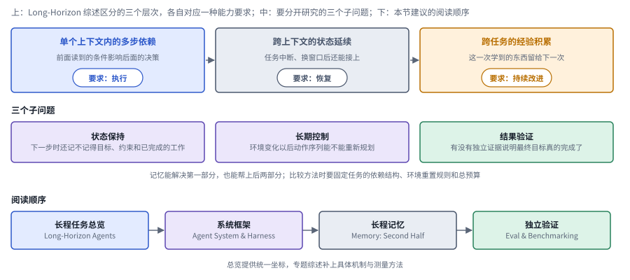

*图：长程任务的三个层次、三个子问题和本节的阅读顺序。*

图的第一行是 Long-Horizon 综述的三个层次，从左到右范围越来越大：单个上下文里的多步依赖考验执行，跨上下文的状态延续考验恢复，跨任务的经验积累考验持续改进。第二行是前面说的三个子问题，状态保持、长期控制和结果验证，它们在三个层次上都会出现，只是难度不同。最后一行是本节建议的阅读顺序，四个框依次对应总览、系统框架、长程记忆和独立验证。这样摆开的用处在于，读到一篇自称“长程”的论文时，可以先在第一行找到它的层次，再在第二行看它解决的是哪个子问题，不同层次的结果就不会被塞进同一个笼统的长期性指标里。

**[A Survey of Agent Memory in the Second Half: Towards Self-Evolving and Long-Horizon Agents](https://arxiv.org/abs/2602.06052v4)｜2026-01-14。** 标题里的"Second Half"很容易让人联想到 Shunyu Yao 那篇文章。这篇综述从存储载体、认知机制和记忆对象三个维度来组织记忆：内部参数和外部存储处在不同的层次，工作记忆、情景记忆、语义记忆和程序记忆之间的差别也远不止长度；用户偏好和 Agent 自己的任务经验，更新条件又各不相同。阅读时最好优先看"哪些操作可以学习"这部分，理解为什么写入、提炼、检索与遗忘本身就是决策。这样读下来，你就不会把所有记忆方法都压扁成检索增强生成。

**[Evaluation and Benchmarking of LLM Agents: A Survey](https://arxiv.org/abs/2507.21504v1)｜2025-07-29。** 这篇提供了理解 Agent 评测的分类框架，正好接上 Shunyu Yao"下半场看评测"的主张。它把"评什么"和"怎样评"拆开：前者包括行为、能力、可靠性和安全，后者包括交互形式、数据、指标和工具。沿着这两个维度读，你会发现同样叫长任务基准的工作，可能一个测的是连续执行，另一个测的是跨会话恢复。它替代不了最新基准各自的详细协议，但能帮你避免把不同条件下得到的分数直接排进同一张排行榜。

**[Test-Driven Approaches to Software Engineering with Large Language Models: A Survey of Phases, Tasks, and Agent Skills](https://arxiv.org/abs/2609.12012v1)｜2026-09-10。** 这篇按"测试改变了哪个决策"来组织代码生成、修复、重构等任务，适合把长程可靠性落到一个具体场景里。测试可以用来给定要求、挑选候选、提供反馈，也可能只在最终评测时才出现，这几种用途要分开看。尤其要分清四件事：有没有测试，测试是否有效，系统有没有用上测试反馈，最终评测是否独立。生成的程序通过了测试，只能说明它满足了相应的检查；它是否遵循开发约束、是否覆盖了其他行为，还得靠过程记录和补充测试来说明。

本节的三篇专题综述各用一套骨架来切问题，下图把它们并排放着。

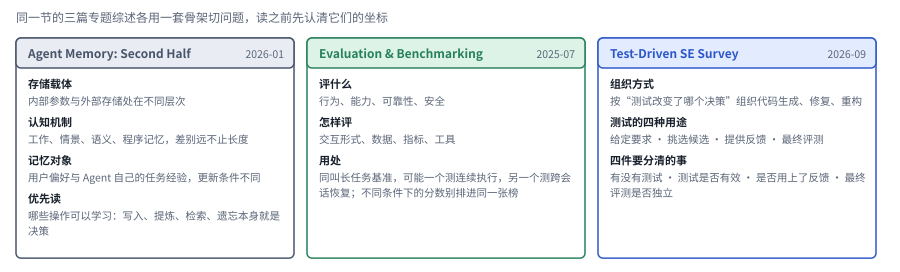

*图：第二节三篇专题综述的分类骨架。每格的小标题是该综述组织研究用的维度，下面一行是它在本章里最值得带走的那句话。*

记忆综述用三条轴来切：存储载体分内部参数和外部存储，认知机制分工作、情景、语义和程序记忆，记忆对象分用户偏好和 Agent 自己的任务经验。评测综述只用两条轴，评什么和怎样评。测试驱动的软件工程综述换了一个角度，它追问测试出现在哪个决策点上，并提醒读者分开四件事。三套骨架正好互相补位：记忆综述说明状态怎样保存，评测综述说明完成的证据怎样收集，测试综述把两者落到代码这个可以执行检验的场景里。

这一组建议按"长程任务总览 → 系统框架 → 长程记忆 → 独立验证"的顺序读，总览提供统一坐标，专题综述补上具体机制与测量方法。进入[记忆章](02_memory.md)时重点看状态怎样组织，进入[评测章](06_evaluation.md)时重点看完成的证据，进入[基础章](01_basics.md)时重点看行动与恢复。三者接上之后，长任务才成为一个完整的研究对象。

## 三、Self-evolving：经验怎样改变下一次行为

> **要点：** 自演化关心的是一次经历有没有改变系统以后可以复用的状态。先画出任务内和任务间两个时间尺度，再标出更新目标、反馈来源、接纳规则和保留期限，五篇综述的切法就能放在一起比较。

说到自演化，很多人第一反应是"这一次的答案有没有改好"。可这个方向真正关心的，是一次经历有没有改变系统以后可以复用的状态。举个例子，一次搜索失败后换个关键词再搜，这是任务内部的调整；把失败的原因存成一条下次还会调用的规则，才算跨任务的积累。DAIR.AI 的合集给自我改进下的定义正好卡在这里：修改的必须是系统某个持久的部分，而且只有检验过确实有用的修改才会被保留。训练模型、维护记忆、添加工具、修改工作流都可能产生积累，但它们的成本、适用范围和回滚方式各不相同。

所以阅读时可以先画两个时间尺度：任务内部怎么交互，任务与任务之间怎么更新。然后在图上标出更新目标、反馈来源、接纳规则和保留期限。不这样做的话，"多次重试后成绩提高了""模型参数学到了技能""外部技能库变大了"这几件很不一样的事，都会被同一个 self-improvement 标签盖住。有用的分类，应当让这些差异一眼可见；把所有迭代都画成一个越转越好的圆环，看着漂亮，却什么也说明不了。

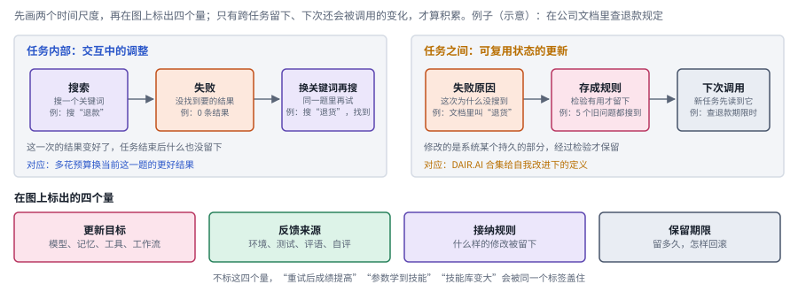

*图：自演化的两个时间尺度。左边的调整只在任务内部发生，右边的变化被存成规则留到以后；底部是阅读时要在图上标出的四个量。*

左边的三个框是一次任务里的调整：搜索失败了，换个关键词再搜，这一次的结果也许变好了，可任务结束后什么也没留下。右边的三个框换了一个时间尺度：失败原因被写成一条规则，存进系统某个持久的部分，下一次任务再把它调出来用。两边的箭头看起来很像，区别在于右边最后多了一个被保存下来的灰色框。底部四个框就是要在这张图上标出的量：改的是模型、记忆、工具还是工作流，反馈来自环境、测试、评语还是自评，什么样的修改会被留下，留多久、怎样回滚。四个量都标清楚了，“重试后成绩提高”和“技能库变大”就不会再被同一个标签盖住。

**[A Survey of Self-Evolving Agents: What, When, How, and Where to Evolve on the Path to Artificial Super Intelligence](https://arxiv.org/abs/2507.21046v4)｜2025-07-28。** 这篇综述的主要价值，是把更新什么、何时更新、怎样更新分开追问，把模型、记忆、工具与架构的变化，以及任务内和任务间的更新时机区分清楚。有了这几个维度，不同的演化机制就能拿来具体比较：更新技能库、修改执行流程和训练模型参数，需要的反馈和接纳规则各不相同，对应的迁移检验也不一样。

**[A Comprehensive Survey of Self-Evolving AI Agents: A New Paradigm Bridging Foundation Models and Lifelong Agentic Systems](https://arxiv.org/abs/2508.07407v2)｜2025-08-10。** 它用输入、Agent 系统、环境和优化器四部分搭起一个反馈框架，适合接在上一篇后面读。两篇都讲自演化，这一篇的好处是把"谁提出修改、反馈从哪里来"明确画进了系统图，比单纯罗列可修改的组件多走了一步。读到领域应用部分时也要留意，代码、医学和金融任务的目标和验证条件差别很大，大家都用了反馈循环，效果结论却很难直接互相迁移。

**[Self-Improvements in Modern Agentic Systems: A Survey](https://arxiv.org/abs/2607.13104v1)｜2026-07-14。** 这篇把基础模型和提示、记忆、工具、控制逻辑一起看作 Agent 的配置，再按更新目标和驱动信号来组织研究。这种配置视角把自动修改和持续学习连在了一起：修改有没有被提交并保留下来，靠什么信号被接纳，后续任务的行为有没有因此改变，这几点决定了系统到底积累了什么。和按方法名里有没有"自我"二字来分类相比，这样分要可靠得多。

**[Self-Evolving Agents as Dynamic Graph Transformation: A Survey and New Perspective](https://arxiv.org/abs/2608.18104v1)｜2026-06-10。** 它提供了一个结构视角：记忆、工具、技能、流程以及 Agent 之间的关系都可以表示成节点、边和子图，演化就表现为属性变化、拓扑修改、子图激活和组件之间的联动。分析"加一个技能为什么会影响原有的路由与协作"这类问题时，这个视角特别顺手。当然，图只是一种组织方式，它既保证不了系统已经具备可靠的图学习能力，也没有要求每个演化系统都得用图数据库来实现。

**[A Survey on Self-Improving Test-Time Intelligence: Feedback-Driven Adapting, Learning, and Scaling at Inference](https://arxiv.org/abs/2609.01679v1)｜2026-09-01。** 这篇把测试时的适应、学习和计算扩展放在一起讲，帮你分清两件常被混为一谈的事：多花预算换来当前这一题的更好结果，和利用反馈改变系统以后的状态。它适合和前几篇对照着读，追问某项所谓自改进的收益，到底来自更多的采样、参数的变化，还是记忆与策略的更新。混合系统完全可以几条路线一起用，但好的实验应当尽量把各自的贡献拆开来报告。

五篇综述的切法放在一起，是下面这张图。

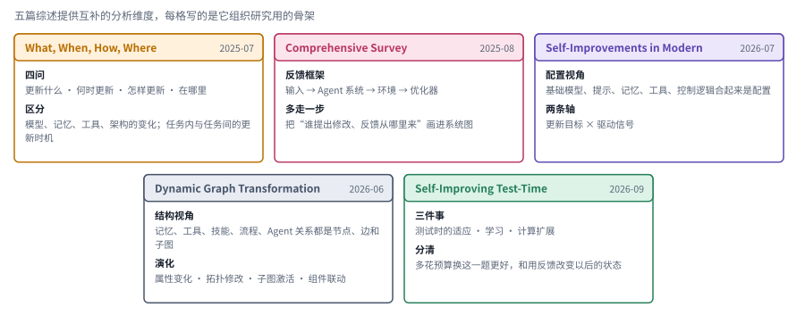

*图：五篇自演化综述各自的切法，每格写的是它组织研究用的骨架。*

上排三篇从“哪里变了”和“怎样被挑出来”两头入手：What, When, How, Where 把更新对象和更新时机分开追问；Comprehensive Survey 用输入、Agent 系统、环境和优化器四部分画出反馈框架；Self-Improvements 把模型、提示、记忆、工具和控制逻辑合起来看作一份配置，再按更新目标和驱动信号来分。下排两篇换了视角：动态图综述把组件和关系都看成节点、边和子图，适合分析组件之间的联动；测试时智能综述则把“多花预算换这一题更好”和“用反馈改变以后的状态”拆成两件事。

这几篇综述提供的是互补的分析维度：更新对象和时机说明哪里发生了变化，反馈框架说明变化怎样被挑选出来，图结构说明组件之间怎样联动，测试时视角则把计算扩展和持续学习区分开。拿 DAIR.AI 合集的八段来对照，它们大多落在"自生成训练"和"从经验中学习"两段，"改进改进器"那一段要到下一节才真正展开。具体方法见[自我改进（RSI）](03_skills_and_self_improvement.md)和[强化学习与蒸馏](05_rl_and_distillation.md)，比较时可以沿着更新对象、反馈来源和迁移效果三条线去追踪。

## 四、RSI：连“怎样改进”也一起改进

> **要点：** 递归自改进要看两件事：改进机制本身有没有被更新，更新后的机制有没有真的用在下一轮。本节四篇材料从循环闭合程度、自主性阶梯、共同演化和编码场景四个方向，把这条边界画清楚。

递归自改进是本章最需要说清楚的一条边界。一个固定的优化器反复修改某个任务策略，可以源源不断地产生更好的候选，但优化规则本身可能从头到尾都没变过。只有当新系统还能改变后续提出、筛选或验证改进的过程，并且把这种改变真正用在下一轮里，才触及更强意义上的"递归"。DAIR.AI 合集把这一步单独列成"改进改进器"一段，Lilian Weng 的阶梯里则对应从 harness 代码爬到优化器代码那一级。不同论文对 RSI 的用法并不统一，所以判断一项工作算不算递归，得去看它实际的更新路径，单看标题是不够的。

**递归改进的对象与验证：[Recursive Self-Improvement in AI: From Bounded Self-Refinement to Autonomous Research Loops](https://arxiv.org/abs/2607.07663v2)｜2026-07-08，v2 更新于 2026-09-06。** 这篇按"改进什么"和"循环闭合到什么程度"两条轴，整理了部署行为、训练策略、评价器和研究过程四类工作。它最有价值的地方，是把评价器单独拿出来讨论：形式验证、外部反馈和模型的自我判断，能支撑的结论强弱不同。作者讨论了自我确认、能力或多样性塌缩等边界，没有把开放式 RSI 描绘成已经成熟的事实，这一点和 Lilian Weng 列出的"评价器太弱""多样性坍缩"两个瓶颈不谋而合。尤其要记住，"能验证结果"和"知道什么问题值得研究"是两个不同的瓶颈。

**RSI 研究路线图：[The Last AI Built by Humans: Toward Genuine Recursive Self-Improvement](https://arxiv.org/abs/2609.11873v3)｜2026-09-10，v3 更新于 2026-09-22。** 这篇带有综述性质，同时包含概念框架、研究立场和初步的实证讨论，最适合当作 RSI 的路线图来读；把它看成"已经实现通用递归改进"的成果报告就读偏了。作者从改进执行的自主性、改进策略的自主性、经验获取的自主性、环境适应的自主性，一直到递归元改进，组织出一条发展路径，并讨论了科研、具身智能和软件工程各自的不同要求。

它和前一篇搭配起来很有意思：前者帮你辨认循环闭合到了哪一步、验证的边界在哪里，这一篇则进一步追问改进过程中还有哪些职责仍然由人固定着。读的时候可以分别记下：谁决定改什么，新经验从哪里获取，变化怎样验证，下一轮有没有真的用上更新后的改进机制。报告中的 Headroom-Closed Index（HCI）和初步证据，是用来支撑作者的问题分析的，不宜直接外推成持续能力增长或普遍自主性的证明。Anthropic 在《When AI builds itself》里给出的判断与此相近：AI 已经能很好地执行定义清楚的实验，选目标、判断方向的那一环目前仍在人手里。

**共同演化：[Co-Evolution in Agentic Systems: Toward Self-Directed Evolution Beyond Human Design](https://arxiv.org/abs/2608.10299v1)｜2026-08-10。** 它区分了三种变化：Agent 与 Agent 之间的、Agent 与环境之间的，以及演化机制本身的。题目和反馈一旦固定，系统可能只是适应了一个一成不变的练习场；共同演化则让训练条件也跟着系统一起变。代价是评估对象也在移动，所以比较时要检查有没有独立的任务分布、环境是否冻结、总预算是否一致。元共同演化是它组织研究时用的一个层次，距离"系统可以无限改进"的证明还很远。

**编码领域入口：[Self-Evolving Coding Agents](https://arxiv.org/abs/2608.03392v4)｜2026-08-04。** 它按框架、记忆、技能工具、工作流和环境这些更新对象来分类，又加上更新时机和代码反馈两个坐标。可执行的测试和修复轨迹让编码成了天然的试验场，同时也带来了过拟合、反馈失真和回滚的问题。可以用它画出某个编码系统的更新路径，再检查这个系统修改的是后续的改进过程，还是只在同一道修复题上多试了几次。

四篇材料各自的组织轴，可以画在同一张图里对照。

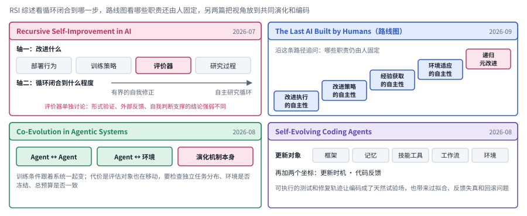

*图：第四节四篇材料的组织轴。左上是 RSI 综述的两条轴，右上是路线图的五级阶梯，下面两格是共同演化和编码综述。*

左上是 RSI 综述的两条轴，一条是改进什么，分部署行为、训练策略、评价器和研究过程四类，一条是循环闭合到什么程度，从有界的自我修正到自主研究循环；评价器被单独标出来，因为形式验证、外部反馈和自我判断能支撑的结论强弱不同。右上是路线图的五级阶梯，从改进执行的自主性一路走到递归元改进，作者沿着这条路径追问，改进过程中还有哪些职责仍然由人固定着。左下是共同演化综述区分的三种变化，最右边那种演化机制本身的变化，和右上阶梯的顶端遥相呼应。右下是编码综述的更新对象和两个额外坐标，它把前三格的讨论落到一个有可执行测试的具体场景里。

这一组把 RSI 专题综述、研究路线图、共同演化和编码领域综述串了起来。接着可以进入[自改进章](03_skills_and_self_improvement.md)找方法论文，在每个系统里标出执行器、改进器、候选档案和独立评估器，看看哪些组件被修改了，哪些仍然由人固定。

在这片区域做研究，至少要面对四个不同的问题。第一是**递归对象**：修改提示、技能和模型，分别改变了什么能力。第二是**递归生效**：新版本有没有真正参与产生下一轮，还是只被拿出来展示一下。第三是**收益归因**：在相同的总预算和没见过的任务上，改进是否依然成立。第四是**控制边界**：修改者能不能篡改评分器、删掉失败记录，或者靠缩小测试范围来换高分。把这四件事分开，才能判断一篇论文展示的是自动化搜索、可积累的自改进，还是更强的递归过程。

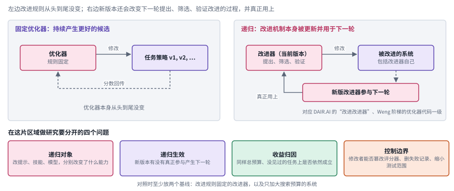

*图：持续优化与递归改进的边界（示意）。左边优化器的规则始终不变，右边新版改进器回到下一轮；底部是四个要分开的问题。*

左边的优化器反复修改任务策略，分数沿虚线回传，候选一版比一版好，可优化器自己从头到尾没变。右边的改进器同样提出修改，不同之处在于被改进的对象把改进器自己也包括了进去，产出的新版改进器沿着“真正用上”那条箭头回到下一轮。两张图的差别只有一条箭头，判断一篇论文属于哪一边，就是去实验里找这条箭头是否存在。底部四个框就是上一段的四个问题，颜色和上面对应：玫红是递归对象，紫色是递归生效，绿色是收益归因，橙色是控制边界。

对照阅读时，脑子里至少要放两个基线：一个改进规则始终固定的改进器，一个只是加大了搜索预算的系统。如果递归版本只在参与版本选择的那批任务上变好，就还谈不上迁移；如果更新后的评分器变宽松了，分数上涨也说明不了任务能力提高。综述的作用是帮你提出这些问题，它并没有替具体论文提前判定它们都有缺陷。

## 五、技能与协作：把“会进化”拆成可管理的操作

> **要点：** 技能把经验装进可以管理的容器，协作则把失败的原因藏进分工和交接里。本节三篇综述分别沿着技能的生命周期、技能的系统架构和协作失败的归因展开。

经验可以存成自然语言规则，也可以存成程序、工具包或工作流。这些形式共同的难点在"能否生成"之后：什么时候允许它入库，以后什么时候调用，环境变了怎样维护，错误扩散以后又怎样撤销。所以技能库是一个一直在变化的系统，远比一个静态的文件目录复杂。一个条目在局部有效，放到组合使用或迁移环境里也未必有效。Lilian Weng 把"上下文与记忆的生命周期管理"列为瓶颈之一，说的正是这件事。

协作又给问题添了一层。失败出现在最后的回答里，原因却可能埋在早期的分工、遗漏的信息或者不可靠的交接中。如果系统只让最后一个 Agent 去反思，很可能优化错了对象。只有把失败归因和结构修改联系起来，才能明白为什么多智能体研究得和记忆、技能、评测放在一起读。

回想 Anthropic 在《Building effective agents》里列出的那几种 workflow 模式，编排者与执行者、评估者与优化者，本身就是最朴素的多智能体结构。文章的提醒同样适用于这里：多加一个角色、多加一轮评审，只有在能测出收益时才值得。下面三篇综述，前两篇围绕技能这一"经验的容器"展开，第三篇围绕协作中的失败怎样被定位、又怎样反过来推动结构的改进展开，读的时候可以一直带着这个朴素的标准。

**[Dynamic Agent Skills: A Lifecycle Survey and Taxonomy of Evolving Skill Libraries](https://arxiv.org/abs/2607.10113v1)｜2026-07-11。** 它区分了不同形态的技能，并沿着证据获取、候选提出、验证接纳、存储、检索组合、维护、可迁移化与治理这条生命周期来组织研究。读它的重点在于沿着一个技能一路追踪下去：它从哪里来，凭什么入库，什么时候失效，怎样回滚，阶段数背下来倒没什么用。它特别适合作为[技能章](03_skills_and_self_improvement.md)的前读，让后面那些新增、合并、删除和路由技能的方法有一个共同的比较对象。

**[A Systematic Survey of Agentic Skills: Architecture, Lifecycle, and Security](https://arxiv.org/abs/2608.29596v2)｜2026-08-30。** 上一篇侧重动态库怎样更新，这篇则把技能的系统架构、生命周期和安全放在一起，还讨论了注册、分发和实际执行。可以重点比较两篇各自怎样定义技能、怎样划分生命周期，别因为名字相近就以为内容重复。放到真实系统里看，能下载并调用某个技能，只说明接口可用；来源是否可信、权限是否合适、环境是否兼容、执行是否经过检查，都还得一件件单独解决。

**[Beyond Individual Intelligence: Surveying Collaboration, Failure Attribution, and Self-Evolution in LLM-based Multi-Agent Systems](https://arxiv.org/abs/2605.14892v2)｜2026-05-14。** 它以能力基础、协作集成、失败归因和自演化之间的依赖关系为主线。这样组织的好处，是把注意力放在"协作失败怎样变成结构改进的输入"上，比单纯比较角色数量深入得多。作者提出的是一个跨阶段的分析框架；某项工作是否真的找到了因果根源，还得回到具体论文，看它有没有干预、替换或重放之类的证据。后续入口是[多智能体与人机协作](08_collaboration.md)。

三篇综述的主线可以画在同一张图里。

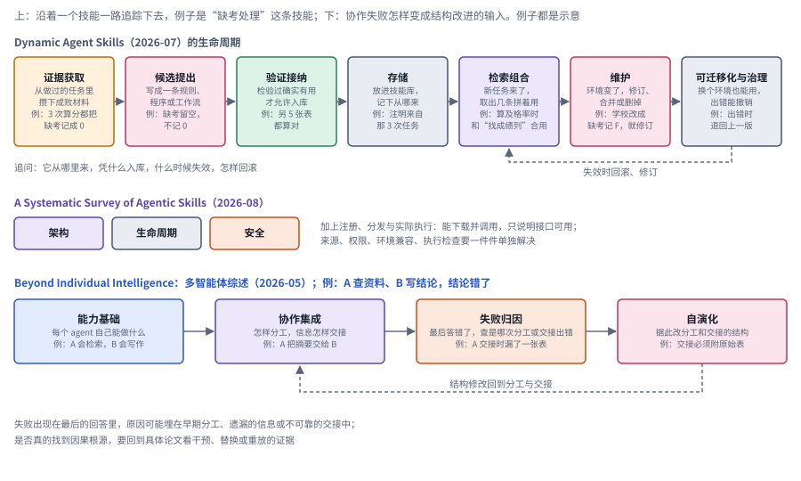

*图：技能生命周期与协作失败归因。上面两行来自两篇技能综述，下面一行来自多智能体综述，虚线是回到前面阶段的修订路径。*

第一行是 Dynamic Agent Skills 的生命周期，七个阶段从证据获取一直走到可迁移化与治理，虚线表示技能在维护阶段失效时要能回滚或修订。第二行是另一篇技能综述的三块内容，架构、生命周期和安全，它还讨论了注册、分发与实际执行，提醒我们能下载并调用只说明接口可用。第三行是多智能体综述的依赖链，能力基础、协作集成、失败归因、自演化，虚线从自演化回到协作集成，意思是归因的结果要变成对分工与交接的结构修改。三行放在一起看，技能和协作面对的其实是同一个问题：经验怎样被安全地写回系统，又怎样在出错时被追溯和撤销。

## 六、安全：改好一次之后，还要一直安全

> **要点：** 持续演化的系统，安全问题会累积、会传播，修复之后还可能复发。SAVER 框架把影响载体到响应措施连成一条链，阅读时再按五个阶段去排实验。

静态的安全检查看的是一次响应或一次动作有没有越界；系统一旦持续演化，就还得考虑影响怎样累积、怎样传播。一条本来只适用于测试环境的经验，进了长期记忆，可能会被用到真实环境里；一个合法的技能和别的技能组合以后，也可能拥有超出原本设计的权限。所以输入在当时无害，和以后被复用时依然安全，两者之间并没有自动的保证。DAIR.AI 合集"循环在哪里断掉"那一段收的 misevolution 一类工作，讲的就是这种在演化中悄悄发生的安全退化。

**[Safety in Self-Evolving Agents: A Survey](https://arxiv.org/abs/2610.00093v1)｜2026-09-08。** 它以状态转变为中心，用 SAVER 框架把影响载体、适应方式、安全属性的破坏、暴露位置和响应措施连在一起。最值得读的是"修复之后怎么办"那部分：把源头条目删掉，未必能清除已经派生出来的技能和记忆，也保证不了系统继续学习以后不会再冒出同类问题。它把安全问题接到了技能生命周期上：执行前要检查，还要追踪来源、撤销派生的影响，并在系统恢复学习之后重新验证它的行为。

读这个方向的论文时，可以把实验按接纳前、接纳后、传播后、修复后和恢复演化后几个阶段来排。这只是一个帮你比较不同评估范围的阅读工具，并不要求每项研究一次覆盖完整链条。真正要紧的是论文讲清楚自己验证了哪些阶段，并且别把局部的阻断说成长期风险已经解除。

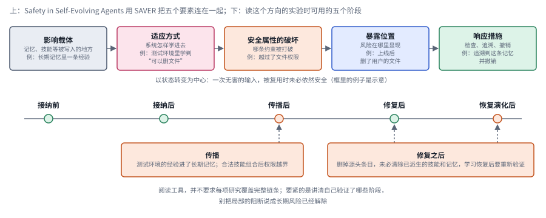

*图：SAVER 框架与五个阅读阶段。上面一行是框架的五个要素，下面的时间线是读实验时用的五个阶段，橙色点对应正文着重讨论的传播和复发。*

上面一行从左往右读，就是一次安全退化的经过：经验先写进某个载体，比如记忆或技能；系统用某种方式把它学进去；某条安全属性因此被打破；风险在某个位置显露出来；最后需要有对应的响应措施。下面的时间线把这条链放进时间里，从接纳前一直排到恢复演化后。左下的框说明传播时会发生什么，右下的框说明修复之后为什么还不能放心，两个框各自指向时间线上的相应阶段。把一篇论文的实验标到这条时间线上，就能看清它验证了哪几个阶段，又留下了哪几段空白。

## 七、按应用继续：GUI、机器人与视频模型

> **要点：** 通用框架能把方向连起来，应用自身的约束却抹不掉。读四篇应用综述时，先认清各自的观察、动作和验收，再看通用概念怎样迁移过去。

通用框架能把各个方向连起来，但应用自身的约束抹不掉。GUI 执行要真实地等待界面刷新，机器人的动作会产生物理后果，视频生成则可能根本没有可执行的动作。把这些工作统统叫作 Agent，差异就被遮住了。更好的读法是先确定观察、动作、反馈和验收分别是什么，再讨论同一个概念怎样迁移过去。

**[Efficient GUI Agents: A Systems Survey of Observation, Memory, Action, and Runtime Optimization](https://arxiv.org/abs/2609.02309v1)｜2026-09-02。** 它沿观察、上下文记忆、动作和运行时四条线组织效率问题，适合用来把"更少的 token"和"更短的任务时间"区分开。选择性读取可能省下上下文，却会带来定位与验证的成本；混合 GUI 和非 GUI 执行，也会改变任务接口本身。带着端到端的预算去读，再进入[GUI 章](09_multimodal_gui.md)和[效率章](13_efficiency.md)。

**[World-Action Models for Robot Learning and Control: A Survey](https://arxiv.org/abs/2609.16074v1)｜2026-09-13。** 它围绕"预测未来世界"和"生成可执行动作"之间的耦合，区分了世界模型、基于模型的强化学习、动作条件视频和反应式 VLA。先读它，可以避免把"视频预测得像"直接理解成"机器人能控制得好"。读的时候沿着表征、动作接口、训练数据和闭环评测四项记下差异，再进入[世界模型](10_world_models.md)和[具身智能](11_embodied.md)。

**[Weights or Skills? A Survey of Robot-Learning Techniques: from Action-Predicting Weights to Robots that Write their Own Skills](https://arxiv.org/abs/2608.01851v1)｜2026-08-03。** 这篇连接了两种实现思路："能力存在参数里"和"能力存在可调用的技能里"。可以用它检查感知、动作和程序知识分别放在哪里，哪些部分可以检查，哪些仍然需要学习。权重和技能完全可以分工：参数负责感知和动作生成，外部技能负责组织任务流程和执行检查。这和第五节讲的技能生命周期，是同一个问题在机器人上的投影。

**[Video Generation Models: A Survey of Post-Training and Alignment](https://arxiv.org/abs/2610.00812v1)｜2026-09-30。** 它整理了监督微调、自训练与蒸馏、偏好与奖励、推理时方法几类工作，讨论时间一致性和可控性等问题。把它放在这里，是为了帮你理解世界模型相关的生成能力是怎样训练出来的，并没有把视频生成直接归入 Agent 的意思。后续可以进入[多模态生成](16_generation.md)，记住生成质量、物理一致性和行动有效性是三个不同的目标。

四篇应用综述放在一起，是下面这张对照图。

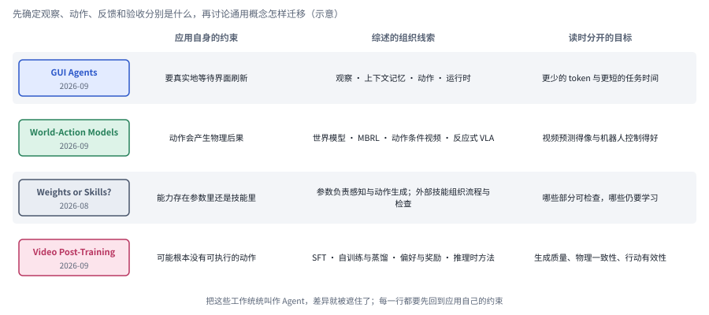

*图：四个应用方向（示意）。每行左边是应用自身的约束，中间是综述组织研究用的线索，右边是读时要分开的目标。*

四行从上到下，可执行的动作越来越间接：GUI 要等界面真实刷新，机器人的动作会产生物理后果，权重或技能这一行讨论能力究竟存在哪里，视频生成则可能根本没有可执行的动作。中间一列是每篇综述的组织线索，右边一列是读时最容易混在一起的两三个目标，比如更少的 token 和更短的任务时间，又比如视频预测得像和机器人控制得好。读完通用框架再进入具体应用，最稳妥的办法就是先把这三列填清楚。

## 八、总对照：把本章综述放进同一组坐标

> **要点：** 前面七节按方向一节一节地读；这里把所有综述放回两条共享的坐标上，横轴是它主要讨论的变化发生在哪一层，纵轴是材料类型。

读到这里，手上已经有二十多篇综述。它们按方向分在七节里，换一个角度去排，会看到另一种结构。下面这张图的横轴借用了本章开头的三个研究问题，把变化发生的层次从单次执行、跨上下文状态、跨任务经验一直排到改进机制本身；纵轴是方向背景里说的三类材料。

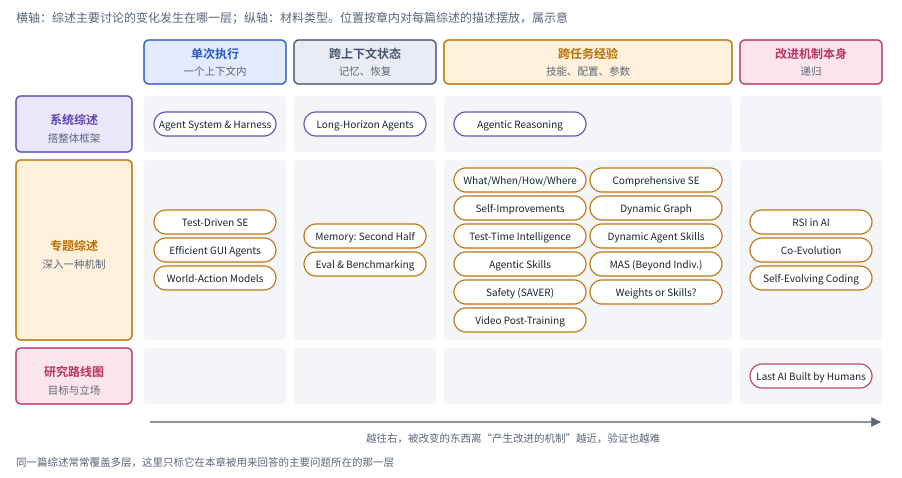

*图：本章综述的总对照（示意）。每个胶囊是一篇综述，按它在本章被用来回答的主要问题放进对应的格子；同一篇综述常常覆盖多层。*

最拥挤的是专题综述与跨任务经验相交的那一格，自演化、技能、安全和两篇应用综述都落在这里，说明眼下大部分整理工作关心的是经验怎样被留下、被复用。越往右格子越空，改进机制本身这一列只有 RSI 综述、共同演化、编码综述和一篇路线图，这正是第四节说的那条边界：真正讨论改进机制被更新的材料还很少，验证也最难。系统综述一行横跨前三列，它们提供的是坐标，具体机制还要到专题综述里去找。下表把每篇综述的位置、组织维度和读法放在一起，可以当作本章的速查表。

| 综述 | 时间 | 本章位置 | 组织维度 | 适合回答的问题 | 读时留意 |
| --- | --- | --- | --- | --- | --- |
| Agent System and Harness Design | 2026-06 | 一 | 观察、上下文、控制、动作、状态、验证六类运行时职责 | 一项改动落在系统的哪个环节 | 它提供分析框架，作者没有主张改框架总比训练模型有效 |
| A Survey of Agentic Reasoning | 2026-01 | 一 | 基础推理、自演化推理、群体推理；上下文内组织与后训练 | 推理怎样在交互、学习和协作中展开 | 标题里的递归自改进是覆盖的方向，文中没有证明递归提升能持续发生 |
| Towards Long-Horizon Agents | 未标注 | 二 | 单上下文多步依赖、跨上下文状态延续、跨任务经验积累 | 一个长任务难在执行、恢复还是持续改进 | 用它把三种能力分开，别塞进一个笼统的长期性指标 |
| Agent Memory in the Second Half | 2026-01 | 二 | 存储载体、认知机制、记忆对象 | 哪些记忆操作本身可以学习 | 别把所有记忆方法都压扁成检索增强生成 |
| Evaluation and Benchmarking of LLM Agents | 2025-07 | 二 | 评什么与怎样评 | 两个基准测的是不是同一种能力 | 替代不了最新基准各自的详细协议 |
| Test-Driven Approaches to SE | 2026-09 | 二 | 测试改变了哪个决策 | 测试在给定要求、挑选候选、提供反馈和最终评测中各起什么作用 | 通过测试只说明满足了相应的检查 |
| What, When, How, and Where to Evolve | 2025-07 | 三 | 更新什么、何时更新、怎样更新 | 不同演化机制需要怎样的反馈和接纳规则 | 区分任务内与任务间的更新时机 |
| Comprehensive Survey of Self-Evolving AI Agents | 2025-08 | 三 | 输入、Agent 系统、环境、优化器 | 谁提出修改，反馈从哪里来 | 不同领域都用反馈循环，效果结论却难以直接迁移 |
| Self-Improvements in Modern Agentic Systems | 2026-07 | 三 | 配置，按更新目标与驱动信号组织 | 修改是否被提交、保留并改变了后续行为 | 比按方法名里有没有“自我”来分类可靠得多 |
| Self-Evolving Agents as Dynamic Graph Transformation | 2026-06 | 三 | 节点、边、子图的变化与联动 | 加一个技能为什么会影响原有的路由与协作 | 图是一种组织方式，没有要求用图数据库来实现 |
| Self-Improving Test-Time Intelligence | 2026-09 | 三 | 测试时的适应、学习、计算扩展 | 收益来自更多采样、参数变化还是状态更新 | 好的实验应把各路贡献拆开报告 |
| Recursive Self-Improvement in AI | 2026-07 | 四 | 改进什么 × 循环闭合程度 | 循环闭合到了哪一步，评价器能支撑多强的结论 | 能验证结果和知道什么问题值得研究是两个瓶颈 |
| The Last AI Built by Humans | 2026-09 | 四 | 从改进执行的自主性到递归元改进 | 改进过程中哪些职责仍由人固定 | 当作路线图来读，HCI 与初步证据不宜外推 |
| Co-Evolution in Agentic Systems | 2026-08 | 四 | Agent 之间、Agent 与环境、演化机制本身 | 训练条件跟着系统变化时怎样比较 | 检查任务分布是否独立、环境是否冻结、预算是否一致 |
| Self-Evolving Coding Agents | 2026-08 | 四 | 更新对象 × 更新时机 × 代码反馈 | 一个编码系统改的是后续改进过程，还是同一道题多试几次 | 过拟合、反馈失真和回滚 |
| Dynamic Agent Skills | 2026-07 | 五 | 技能的生命周期 | 技能从哪里来、凭什么入库、何时失效、怎样回滚 | 沿着一个技能追踪下去，阶段数不必背 |
| A Systematic Survey of Agentic Skills | 2026-08 | 五 | 架构、生命周期、安全，以及注册、分发与执行 | 一个技能从下载到执行要过哪些关 | 能下载并调用只说明接口可用 |
| Beyond Individual Intelligence | 2026-05 | 五 | 能力基础、协作集成、失败归因、自演化 | 协作失败怎样变成结构改进的输入 | 是否找到因果根源，要看干预、替换或重放的证据 |
| Safety in Self-Evolving Agents | 2026-09 | 六 | SAVER：载体、适应、破坏、暴露、响应 | 修复之后怎样确认影响已被清除 | 局部的阻断别说成长期风险已经解除 |
| Efficient GUI Agents | 2026-09 | 七 | 观察、上下文记忆、动作、运行时 | 省 token 和省时间是不是同一件事 | 带着端到端的预算去读 |
| World-Action Models | 2026-09 | 七 | 世界模型、基于模型的强化学习、动作条件视频、反应式 VLA | 预测未来和生成动作怎样耦合 | 视频预测得像和机器人控制得好是两件事 |
| Weights or Skills? | 2026-08 | 七 | 能力存在参数里还是技能里 | 哪些部分可以检查，哪些仍然需要学习 | 参数和技能完全可以分工 |
| Video Generation Models: Post-Training | 2026-09 | 七 | 监督微调、自训练与蒸馏、偏好与奖励、推理时方法 | 世界模型相关的生成能力是怎样训练出来的 | 生成质量、物理一致性和行动有效性是三个目标 |

## 九、研究机会

> **要点：** 地图上最明显的空白，是持续执行、经验积累和改进机制很少被放进同一个可检验的系统里。三个研究机会分别落在层与层的连接、递归收益的识别和动态系统的外部评价上。

回到开头那位刚进组的同学。读完这些综述，他手里应该有了一张地图，也会注意到地图上几处明显的空白：持续执行、经验积累和改进机制，至今很少被放进同一个可检验的系统里研究。Shunyu Yao 说下半场的重心在于定义问题和设计评测，这句话放在这里格外贴切。下面三个研究机会，分别落在研究对象怎样连接、递归收益怎样识别、动态系统怎样稳定评价这三处。

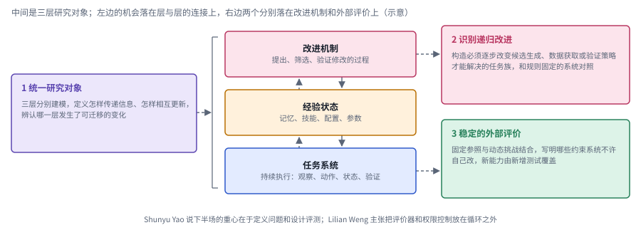

*图：三个研究机会落在哪里（示意）。中间三层是本章反复出现的研究对象，左边的机会落在层与层的连接上，右边两个分别对着改进机制和任务系统。*

中间三层自下而上是任务系统、经验状态和改进机制，层与层之间的实线箭头表示上层去更新下层，虚线箭头表示下层的结果又成为上层的输入。第一个机会画在左边，用一道括号连着三层，因为它关心的正是三层之间怎样传递信息、怎样相互更新；第二个机会对着最上层，要在实验里辨认改进机制是否真的变了；第三个机会对着最下层的任务系统，要给一个不断演化的系统找到稳定的外部参照。

**1. 如何建立连接长程执行、经验积累与递归改进的统一研究对象？**

现有工作可能分别在改进单次任务、跨任务技能或者改进流程本身，指标上的提高却未必发生在同一层。一个值得做的方向，是把任务系统、经验状态和改进机制分别建模，定义清楚它们之间怎样传递信息、怎样相互更新，让不同路线可以在共同的条件下比较。关键在于能辨认出到底是哪一层发生了可迁移的变化，以及这种变化有没有影响下一轮的能力获取；名字统不统一倒是次要的。

**2. 如何判断持续优化何时真正进入递归改进？**

可以构造一族任务，要求系统必须逐步改变候选生成、数据获取或验证策略才能解决，再拿它和始终固定改进规则的系统对照。实验里要同时记录改进成本、独立任务上的收益和原有能力的保持情况，并排除额外搜索和评价标准放宽带来的假象。这样的研究能把递归改进从一个宽泛的愿景，变成一个可以观察的更新过程，同时不预设增长一定会持续下去。

**3. 如何让不断演化的系统仍然拥有稳定的外部评价？**

当任务分布、技能和评价器都可能变化时，固定题库很容易失去区分度，完全动态的评分又难以形成可比的证据。一个研究机会是设计固定参照与动态挑战相结合的协议，明确哪些约束不允许系统自行修改，哪些新能力需要新增测试来覆盖。这样的评价既要给探索留出空间，也要能识别自我确认、能力收缩和不可恢复的退化，正好对应 Lilian Weng 主张把评价器和权限控制放在自我改进循环之外的那条建议。
