# 01｜基础、规划与工具：从回答问题到完成任务

[首页](../README.md) · [专题索引](../README.md#topics) · [文献目录](../catalog/01_basics.md)

前置阅读：如果还不熟悉模型参数、训练与推理、token 和上下文这些概念，可以先看[大模型前置知识](../docs/llm_primer.md)。本章在这些概念之上解释一个系统怎样行动起来，读之前不需要学过任何 Agent 框架。

## 方向背景：为什么需要从语言模型走向行动系统

设想周五晚上，你想让一个 AI 助手帮忙做一件很日常的事：把服务器上过去一周跑过的二十几组训练实验整理成一张周报表格，标出哪几组崩了，和基线比一比，最后把表格发给导师。如果你把这句话丢给一个普通的聊天模型，它会给你一段相当靠谱的回答：先用某条命令列出日志目录，再写个脚本解析每个日志里的验证集指标，崩掉的实验通常会在末尾留下报错，记得和基线对齐随机种子……每一步都说得头头是道，可表格并没有出现，邮件也没有发出去。它说出了做法，事情却还原封不动地摆在那里。

真要把这件事做完，系统得真的去列目录、打开文件，发现有三组实验的日志格式和别的不一样，回头改解析方式；发现其中一组只跑了一半，要判断它算崩溃还是还在跑；算完数字还要自己核对一遍，确认没有把训练集指标抄成验证集指标；最后发邮件这一步会改变外部世界，发错了收不回来，最好先停下来让你确认。模型参数里存着大量知识，可它看不到你服务器的当前状态；生成一段正确的操作描述，和那段操作真的被执行、执行结果真的被检查过，是两回事。Agent 研究的出发点，就是把语言推理和可执行的动作接起来，让系统能在反馈中一步步推进目标，交付一件做完了的事。

这样一来，研究对象就从单次生成变成了一个闭环：观察环境，选择动作，调用工具，接收反馈，更新状态，再判断是否完成。闭环里任何一环出了岔子，每一步看起来都对的输出也拼不成可靠的结果。任务越长，这个问题越明显：第三步读错了一列，第十五步算出的平均值就是错的，而到那时已经很难追溯。规划、观察管理和错误恢复因此都成了这个方向的基础问题。

本章先把最小的工作循环拆开，再沿着几篇写得很好的长文梳理这个领域怎样一路走来，最后把近期论文放进工具接口、规划、观察、执行框架、训练适配和持续执行这六个分支里讨论。贯穿全章有一个提醒：一个系统表现更好，可能来自更合适的动作空间、更充分的反馈或者更多的预算，模型本身未必变强了。把这几种来源分开，是读懂这个方向论文的第一步。

## 先读这几篇

这一章的主线借自几篇人写的长文。它们的作者有的在一线做研究，有的在一线搭系统，叙事里有取舍，也有明确的判断，比从论文分类里倒推出来的脉络可靠得多。建议按下面的顺序读，读完再回来看各分支的新论文，会轻松很多。

| 顺序 | 文章 | 为什么读 |
|---|---|---|
| 1 | Lilian Weng，[LLM Powered Autonomous Agents](https://lilianweng.github.io/posts/2023-06-23-agent/)（2023-06） | 这是很多人入门 Agent 的第一篇文章，到今天仍然是最清楚的一张地图。Lilian Weng 把大模型看作 agent 的大脑，围绕它搭出三个组件：规划（包括任务分解和自我反思）、记忆和工具使用，每个组件下面都挂着当时的代表论文，从思维链、Tree of Thoughts、LLM+P 到 ReAct、Reflexion，再到 MRKL、Toolformer、HuggingGPT 和 API-Bank。本章发展主线的前三个阶段就以这张地图为骨架。文末列出的三个挑战，有限的上下文长度、长程规划和遇到意外时调整计划的困难、自然语言接口不够可靠，三年后读来几乎每一条都还是本章前沿分支在处理的问题。 |
| 2 | Erik S. 与 Barry Zhang（Anthropic），[Building effective agents](https://www.anthropic.com/engineering/building-effective-agents)（2024-12） | 这篇工程文章最大的贡献，是把"工作流"和"agent"分开了：前者由预先写好的代码路径来编排模型和工具，后者让模型自己动态决定流程和工具的使用。作者总结了与几十个团队合作的经验，结论很朴素，最成功的系统用的都是简单、可组合的模式，复杂框架反倒少见。文章依次介绍了增强型大模型这一基本单元，以及提示链、路由、并行化、编排者与工作者、评估者与优化者五种工作流模式，并建议从最简单的方案出发，只有在复杂度能带来可测量的收益时才往上加。附录里关于"agent 与计算机接口"的讨论尤其值得读：工具定义应当和主提示词一样认真打磨。 |
| 3 | Chip Huyen，[Agents](https://huyenchip.com/2025/01/07/agents.html)（2025-01） | 改编自她的书《AI Engineering》，是一篇偏工程视角的系统梳理。她按工具、规划、失败模式与评估三块来组织全文，把工具分成只读的感知动作和会改变环境的写入动作，并提醒写入动作需要更谨慎的信任与安全机制。她把规划看作一个搜索问题，主张把规划和执行解耦，先校验计划再执行；对于基础模型到底能不能规划，她保持了坦率的怀疑。失败模式那一节把规划失败细分成无效工具、无效参数、参数值错误和目标失败，还点出一个很常见的现象：agent 以为自己完成了任务，其实并没有。本章第二节规划阶段和第三节第 6 个分支都借用了她的分类。 |
| 4 | Anthropic，[Writing effective tools for agents](https://www.anthropic.com/engineering/writing-tools-for-agents)（Ken Aizawa 等，2025-09）与 [Effective context engineering for AI agents](https://www.anthropic.com/engineering/effective-context-engineering-for-ai-agents)（Prithvi Rajasekaran 等，2025-09） | 这两篇可以连起来读，它们分别回答"给 agent 什么样的工具"和"让什么信息进入它的上下文"。前一篇的核心判断是，直接把现成 API 包一层交给 agent 往往不合适，工具更多也未必效果更好；工具应该围绕高价值的工作流设计，返回有信号量的信息，用分页、过滤和截断控制返回量，并用贴近真实的多步任务来评测和迭代。后一篇把上下文看作有限且边际收益递减的资源，提出"上下文腐化"的说法，并给出即时检索、压缩、结构化笔记和子 agent 四类做法。本章第三节的工具接口和观察两个分支，基本就在这两篇划出的问题空间里。 |
| 5 | Ryan Lopopolo（OpenAI），[Harness engineering: leveraging Codex in an agent-first world](https://openai.com/index/harness-engineering/)（2026-02） | 一篇来自一线的实践报告。OpenAI 一个团队用大约五个月时间，在不手写代码的前提下由 Codex 完成了一个内部产品，作者报告了约 1,500 个合并的 PR 和约一百万行代码。文章的主张可以浓缩成一句话："人来掌舵，agent 来执行"。工程师的工作从写代码变成设计环境、表达意图和搭建反馈回路：AGENTS.md 只当作一张指向结构化文档的地图，架构约束由 linter 和结构测试机械地执行，后台 agent 定期清理代码中的熵。它让人直观地看到 harness 这一层为什么会在 2025 到 2026 年成为研究对象。作者也坦言，这套做法高度依赖该仓库的工具链投入。 |
| 6 | Jianyuan Guo、Zhiwei Hao、Yunhe Wang 等，[From Question Answering to Task Completion: A Survey on Agent System and Harness Design](https://arxiv.org/abs/2606.20683)（2026-06） | 读完前面几篇长文，再用这篇 2026 年 6 月的综述把视野拉到 2026 年。它的题目几乎就是本章的题目：从回答问题走到完成任务。作者把一个基于大模型的 agent 定义为基础模型加上一层执行框架（harness），再把执行框架拆成六项彼此耦合的运行时职责：把终端输出、代码差异、截图和网页结构这些原始信号变成模型能读的观察；决定什么信息在什么时候、以什么形式进入上下文；编排"观察、推理、行动、反馈"的控制循环，包括何时停止、重试和委派；把模型输出映射成函数调用、命令行和浏览器操作这样的可执行动作；保存计划、检查点、日志和文件这些状态与产物；以及用测试、验证模型、沙箱策略和权限关卡去检查、约束和修复执行。它还把 agent 工程的演进归纳成四种范式：提示工程，工作流与上下文工程，执行框架工程，以及通过交互环境把 agent 行为训练进参数、让模型与框架共同演化的智能体原生训练，并特别说明这四种范式至今同时存在。全文追问的核心问题是，性能瓶颈到底落在基础模型上、执行框架上，还是两者的耦合上；作者的回答是，成功率、效率、安全和泛化来自模型能力、运行时设施、任务结构和评测设计的相互作用，把 agent 看成"模型外挂几件工具"会看漏很多东西。本章第二节的第五阶段和第三节的六个分支，都能在它这张地图上找到自己的位置。 |
| 7 | 姚顺雨（Shunyu Yao），[The Second Half](https://ysymyth.github.io/The-Second-Half/)（2025-04） | ReAct 和 Tree of Thoughts 的作者回头看整个领域。他认为 AI 已经来到中场：上半场比拼的是新模型和新方法，评测只是配角；当语言预训练、规模和"推理加行动"组成的配方普遍奏效之后，下半场比拼的是怎样定义问题、怎样设计评测。他把基准成绩很高、现实经济影响却有限的落差称为"效用问题"，并指出两种与现实脱节的评测习惯：让 agent 完全自主地跑，不与人交互；把任务当作彼此独立同分布的样本，忽略了经验随时间积累。适合放在最后读，用来校准本章各种"成绩提升"到底意味着什么。 |

如果还想多读一点，Addy Osmani 的 [Agent Harness Engineering](https://addyosmani.com/blog/agent-harness-engineering/)（2026-04）汇集了业界关于 harness 的许多讨论，其中"agent 等于模型加 harness"这个说法流传很广；他的判断是，模型变强以后 harness 会转移位置，并不会消失。

## 一、先看全景：把工作循环拆开

> **本节要点：** 一个 agent 的每一轮都在转同一个循环：模型提出动作，执行框架校验并执行，观察再回到模型。先把这个循环、计划与动作与观察的区别、工作流与 agent 的分界看熟，再看五个阶段和一条时间轴，后面读到任何一篇论文，都能很快说出它改动的是循环里的哪一环。

先把一个 agent 每一轮在做什么摊开来看。输入里有用户的目标、当前已知的状态、可用工具的说明，以及还剩多少预算。模型据此提出下一步动作；执行框架先检查工具名、参数和权限是否合法，再真正调用工具；工具要么改变了环境，要么返回了一些信息；系统把这些观察送回模型，开始下一轮。当系统达到明确的成功条件、发现无法继续，或者预算用完时，循环停止。

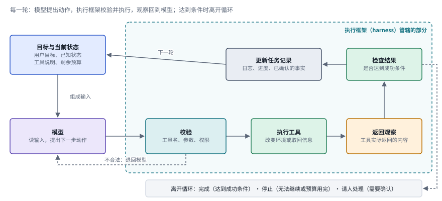

*图：一轮工作循环。青色虚线框是执行框架管辖的部分，目标和模型在框外；两条虚线分别是参数或权限不合法时退回模型，以及达到条件时离开循环。*

图从左上角读起。蓝色的框是这一轮的输入，用户目标、当前已知的状态、可用工具的说明和剩余预算都在里面，它们一起组成模型看到的上下文。紫色的模型读完以后只做一件事：提出下一步动作，通常是一次带参数的工具调用。从这里开始就进了青色虚线框，也就是执行框架的地盘。第一站是校验，执行框架先看工具名存不存在、参数合不合格式、这个动作有没有权限，任何一项不合格，调用就不会发出去，错误信息沿着下方的虚线退回模型。通过校验的动作交给绿色的执行工具，它要么改变了环境，要么取回了信息；琥珀色的观察，就是工具实际返回的内容。观察先经过检查，看是否已经达到成功条件，再写进灰色的任务记录，记录里保存着日志、进度和已经确认的事实，下一轮的输入就从这里重新组装。右侧那条虚线通向底部的出口，完成、停止和请人处理三种情况都会让循环结束。整张图里，模型只占了一个框，其余几个框都由执行框架负责，这也是为什么后面会反复说到，只改框架、不训练模型，系统行为就可能大不一样。

图里有三样东西最容易混在一起。"规划"负责组织步骤、协调依赖，并根据反馈调整后面的行动；"工具调用"是从可执行操作中选出一个并给出参数；"观察"是工具实际返回的信息。拿开头那份周报来说，任务是让助手把一周的二十几组训练实验整理成表格发给导师。模型在计划里写下"解析全部日志"，这只是一个意图；它生成了一条读取文件的调用，这是一次动作；文件内容真正返回到上下文里，才是观察。模型写出"已经运行了测试"，测试并没有因此被运行；计划里列着"修复错误"，也说明不了检查已经通过。读论文时如果分不清某个数字衡量的是哪一样，就很容易高估一个系统。

下图把这三样东西放回周报的例子里并排比较。左边粉色的计划是一句意图，写下它的时候，服务器上什么也没有发生；中间紫色的动作是一次具体的调用，带着要读的文件路径，执行框架会把它真正发出去；右边琥珀色的观察是文件返回的内容，读到第 12 个 epoch 的 loss 变成了 nan，系统才第一次真正知道 exp07 崩了。底部橙色的框提醒的是最常见的一种误读：模型输出里的一句陈述，和环境里真的发生了一件事，是两回事，评测时要去查的是后者。

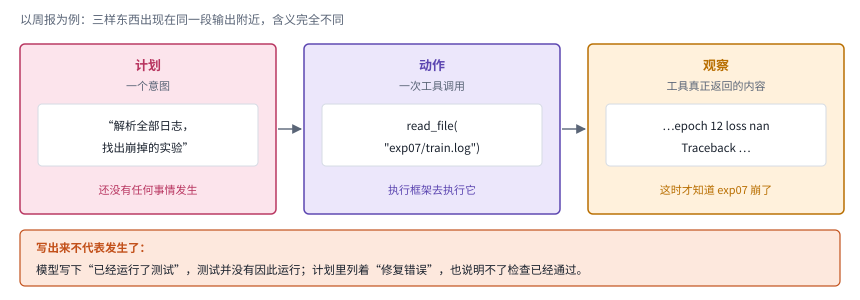

*图：计划、动作和观察常常出现在同一段输出附近，含义却完全不同。只有右边那一栏来自环境，前两栏都还是模型写下的文字。*

图中负责接住模型、工具和环境的那一层，英文叫 *harness*，本章译为"执行框架"。它管理循环本身，也管理日志、预算和停止条件。执行框架和模型是两样东西：不训练模型，只改框架，系统行为就可能大不一样。Anthropic 在 [工作流与 Agent 的工程区分](https://www.anthropic.com/engineering/building-effective-agents) 一文里把由代码预先编排的系统叫作工作流，把由模型动态决定下一步的系统叫作 agent；这条线画在哪里，很大程度上也是由执行框架决定的。分清一项改进来自框架还是来自模型训练，是读近期论文的第一道门槛。

Anthropic 那篇文章划的这条线，可以用下图来看。左半边是工作流：开发者事先写好代码路径，第一次模型调用的输出交给一段代码检查，通过了再进入第二次调用，没通过就按写好的规则重来，每一步走向哪里都是确定的。右半边是 agent：模型拿到观察以后自己决定下一步调用哪个工具，也自己判断什么时候停下，步数事先无法预知。两种方式没有高下之分，作者的建议是从最简单的方案出发，任务定义清楚、需要可预测时用工作流，只有面对步数无法预知的开放问题时才交给 agent。

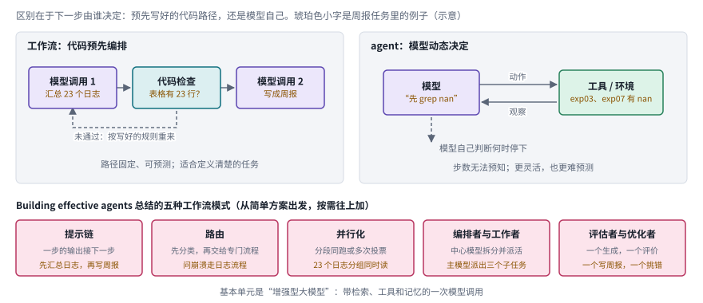

*图：工作流与 agent 的区别在于下一步由谁决定。下排是 Building effective agents 总结的五种工作流模式，它们都由增强型大模型这个基本单元组合而成。*

图下方那一排是作者总结的五种工作流模式，它们都由同一个基本单元搭起来，也就是带检索、工具和记忆的增强型大模型。提示链把任务切成前后相接的几步，前一步的输出就是后一步的输入；路由先给输入分类，再交给专门的流程；并行化让几段子任务同时跑，或者对同一个问题多次作答再投票；编排者与工作者由一个中心模型动态拆分任务，再派给工作者去做；评估者与优化者让一个模型负责生成，另一个模型负责评价并给出反馈。从左往右，模型自己决定的东西越来越多，越来越接近右上角那个 agent。

### 一张阶梯和一条时间轴

有了这个循环，再回头看这个领域的历史就清楚多了。下面两张总图是第二节的目录。第一张把发展主线画成五级阶梯，从下往上读：第一阶段让语言接上行动，模型先想再做；第二阶段让模型学会使用工具；第三阶段处理多个调用之间的依赖，以及失败以后怎样纠错；第四阶段把整个循环放进真实环境里检验，接口和动作空间成了变量；第五阶段，研究者的注意力移到了模型外面的执行框架和上下文。左边的箭头表示关注点一路从模型移向系统，最下面的橙色框是贯穿各个阶段的边界问题。每一级右端标出了本章第三节对应的前沿分支，读到某个分支时，可以回到这里看它继承了哪一级的问题。

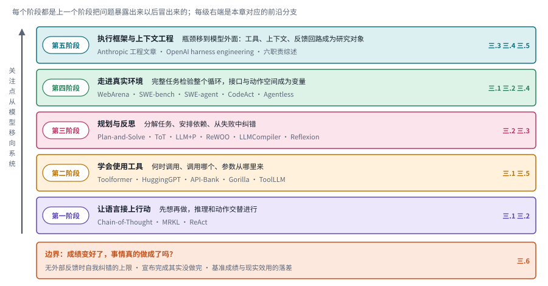

*图：发展主线的五个阶段与边界。每一级写着这一阶段新增的能力和代表工作，右端是第三节对应的分支。*

第二张图把同一批工作按时间排开。最上面灰色的一行是本章先读的几篇长文，它们差不多每隔一段时间就为这个领域重新画一次地图；下面五行对应五个阶段，最后一行是边界。可以看到，2023 年这一栏格外拥挤，工具学习、规划和反思几乎同时爆发，环境型基准也在这一年密集出现；2024 年以后，新的经典论文变少，工程文章变多，第五阶段的问题主要由一线团队的长文提出，到 2026 年才出现系统整理它的综述。

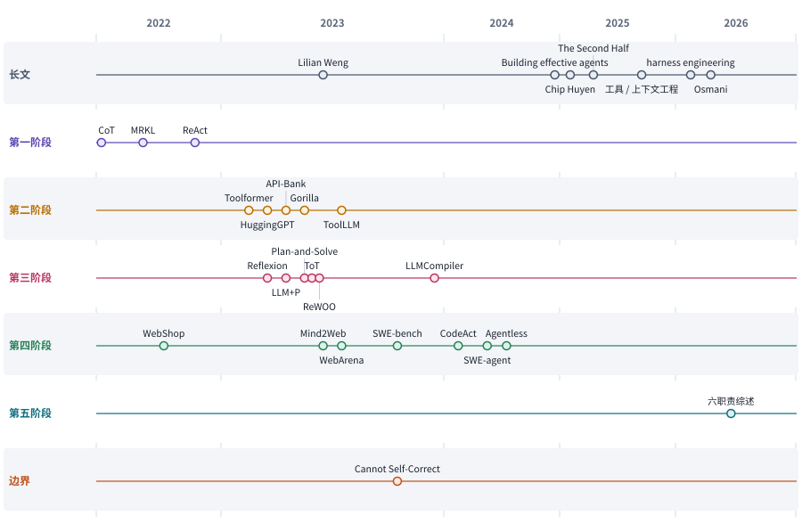

*图：主线上的代表工作按阶段分行排开。2023 年一栏放宽了，以便排开同年密集出现的工作；年月取自 arXiv 编号或文章的发布日期。*

## 二、发展主线：从会说，到会做，再到在真实环境里持续地做

这条主线把几篇长文的视角叠在了一起。Lilian Weng 在 2023 年画下的"大脑加三组件"地图，回答了一个 agent 由哪些部分组成；Chip Huyen 在 2025 年用工具、规划、失败模式重新组织了同一片领域，补上了工程上的教训；Anthropic 和 OpenAI 的几篇工程文章则记录了此后的一个重要转向，研究者和工程师的注意力从"让模型学会调用工具"慢慢移到了"模型外面那整套执行系统该怎么设计"。顺着时间读下来，这个领域大致走过了五个阶段，每一个阶段都是上一个阶段把问题暴露出来之后自然冒出来的。

> **本节要点：** 每个阶段先用一张解说图讲清代表方法怎样运转，再用一排同一画法的结构卡把同族方法并排，最后用一张对照表写明每种做法补上了什么、又留下了什么代价。第二节末尾的总对照，把五族方法和第三节六个分支放进同一组坐标。

| 阶段 | 内容 | 代表工作 | 本章对应分支 | 速查卡 |
|---|---|---|---|---|
| 第一阶段：让语言接上行动 | 模型先想再做，推理和动作交替进行 | Chain-of-Thought、MRKL、ReAct | 三.1、三.2 | R1 至 R3 |
| 第二阶段：学会使用工具 | 何时调用、调用哪个、参数从哪里来 | Toolformer、HuggingGPT、API-Bank、Gorilla、ToolLLM | 三.1、三.5 | T1 至 T5 |
| 第三阶段：规划与反思 | 分解任务、安排依赖、从失败中纠错 | Plan-and-Solve、Tree of Thoughts、LLM+P、ReWOO、LLMCompiler、Reflexion | 三.2、三.3 | P1 至 P6 |
| 第四阶段：走进真实环境 | 完整任务检验整个循环，接口设计成为变量 | WebShop、Mind2Web、WebArena、SWE-bench、SWE-agent、CodeAct、Agentless | 三.1、三.2、三.4 | E1 至 E4，I1 至 I3 |
| 第五阶段：执行框架与上下文工程 | 模型之外的工具、上下文、反馈回路本身成为研究对象 | Anthropic 工具与上下文工程文章、OpenAI harness engineering | 三.3、三.4、三.5 | H1 至 H4 |
| 边界 | 自我纠错的上限、评测与现实效用的落差、长期运行的安全 | Cannot Self-Correct Reasoning Yet、The Second Half | 三.6，第四至七节 | |

### 第一阶段：先想一想，再动手

> **要点：** 先让模型把推理写在纸面上，再让它把问题分派给外部模块，最后把思考和动作交替起来。新观察能改变下一步的选择，今天几乎所有 agent 的主循环都从这里长出来。

下图把这一阶段的三步并排画出来。三行用同一套颜色，从上往下读，变化集中在中间那几个框，下面三段再依次细说。

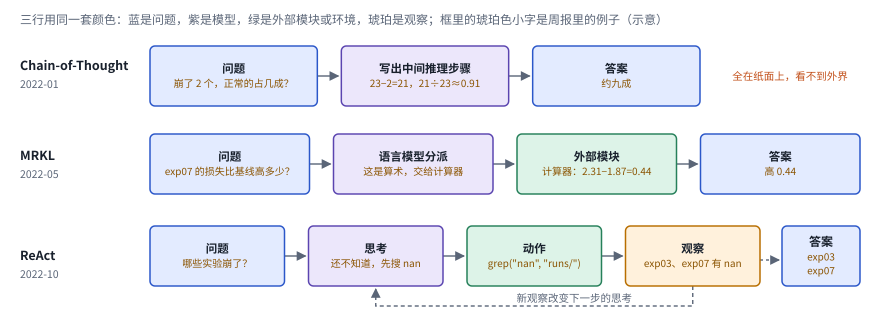

*图：Chain-of-Thought、MRKL、ReAct 三行同一画法。只有最下面一行带着从观察回到思考的虚线。*

最上面一行是 Chain-of-Thought，问题进来，模型先写出一段中间推理，再给出答案，整个过程都在纸面上完成，模型看不到外界的任何新信息。中间一行是 MRKL，模型的角色变成了分派者，它判断问题该交给哪个外部模块，知识源也好，计算器也好，由擅长的模块算出结果，再组合成答案。最下面一行是 ReAct，思考、动作、观察三个框首尾相接，琥珀色的观察沿着下方的虚线回到思考，这条虚线就是三行之间最关键的差别：外界的反馈第一次能够改变模型下一步想什么。

故事的起点其实是推理。2022 年的 [Chain-of-Thought](https://arxiv.org/abs/2201.11903) 发现，只要在提示里给出几个带中间推理步骤的示例，大模型在算术和常识推理上的表现就会明显变好。模型第一次在输出最终答案之前"想"了一段，这段思考写在纸面上，人可以读，也可以检查。

可光想是不够的。模型想得再好，也没法知道今天的汇率、某个文件里写了什么。同一年，AI21 Labs 的 [MRKL Systems](https://arxiv.org/abs/2205.00445) 提出了一种模块化架构，让语言模型和外部知识源、计算器这类离散推理模块协作，由模型负责把问题分派给合适的模块。这是"语言模型加外部工具"思路较早的系统化表述。

真正把两件事拧在一起的是 [ReAct](https://arxiv.org/abs/2210.03629)。它让模型交替写出"思考"和"动作"：先想一想当前缺什么信息，再发出一次搜索，读到返回结果之后接着想，再决定下一步。新观察因此能够改变下一步的选择，这正是第一节那张工作循环图的雏形：模型提出动作，执行框架去执行，观察再送回模型，决定下一轮做什么。Lilian Weng 把 ReAct 放在规划组件的"自我反思"一节里介绍，姚顺雨在 The Second Half 里则把"推理加行动"视为让 agent 获得泛化能力的关键配方之一：语言通过推理在 agent 中实现泛化。今天几乎所有 agent 框架的主循环，都可以看作 ReAct 的某种变体。

把 ReAct 的循环用到开头那个任务上，也就是让助手读一周二十几组训练实验的日志、整理成周报，大致是下图这个样子。这是一张示意图，文件名和轮数都是为了说明而编的。第一轮，模型想到先要知道有哪些日志，于是发出列目录的动作，观察告诉它一共有二十几个子目录。第二轮，它按计划逐个解析，可 exp07 的解析失败了，返回的报错说明这个文件的格式和别的不一样。如果系统手里只有一份事先写好的计划，它会在这里卡住，或者给出错误的数字；ReAct 的第三轮思考读到了这条报错，改用另一种格式重新解析，才发现这组实验从第 12 轮起 loss 就变成了 nan。图里两条虚线就是观察流回思考的路径，计划正是在这里拐了弯。

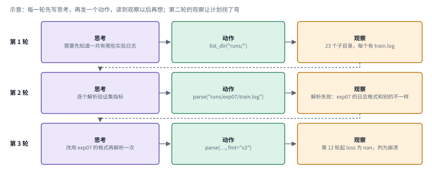

*图：示意。ReAct 在周报任务上的三轮，每轮依次是思考、动作、观察；第二轮的报错改变了第三轮的思考。*

**速查：第一阶段的三种做法。** 下面三张结构卡用同一种画法，从左往右是一轮流程。并排看，差别集中在中间：推理写在纸上，推理交给模块，还是推理和外界的观察交替进行。

 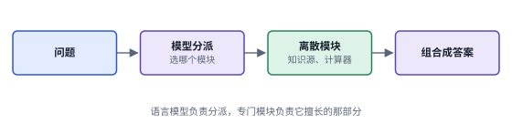

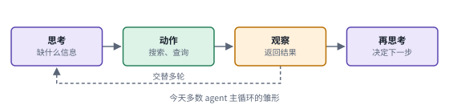

*图：第一阶段三种做法的结构卡，每张卡对应下表的一行。*

| code | 名称 | 年份 | 代表 | 怎么做 | 解决了什么 | 代价 |
|---|---|---|---|---|---|---|
| R1 | 思维链 | 2022 | [Chain-of-Thought](https://arxiv.org/abs/2201.11903) | 提示里给几个带中间推理步骤的示例，模型照着先写推理、再给答案 | 算术和常识推理明显变好，因为模型在作答前把中间步骤显式写了出来，人也可以逐步检查 | 推理全在纸面上完成，模型拿不到外界的新信息，用错的事实也无从核对 |
| R2 | 模块化分派 | 2022 | [MRKL Systems](https://arxiv.org/abs/2205.00445) | 语言模型和外部知识源、计算器等离散推理模块协作，由模型把问题分派给合适的模块 | 精确计算和外部知识交给专门模块，较早把"语言模型加外部工具"的思路系统化 | 模块要事先准备好；分派之后没有根据返回结果再调整的回路 |
| R3 | 推理加行动 | 2022 | [ReAct](https://arxiv.org/abs/2210.03629) | 模型交替写出思考和动作，读到工具返回的观察后接着思考，再决定下一步 | 新观察能改变下一步选择，系统可以边做边修正，这是今天多数 agent 主循环的雏形 | 每一步都要等观察回来再想，提示和调用随步数反复累积（第三阶段的 ReWOO 正是针对这一点） |

### 第二阶段：学会用工具

> **要点：** 模型从"被提示着用工具"走到"学会用工具"。一条路把工具使用训进模型，一条路让模型当调度者；工具一多，"会不会用"就成了需要专门测量的能力。

ReAct 证明了模型可以在提示的引导下使用工具，下一个问题随之而来：模型能不能通过训练真正学会用工具，知道什么时候该调用、调用哪一个、参数从哪里来？

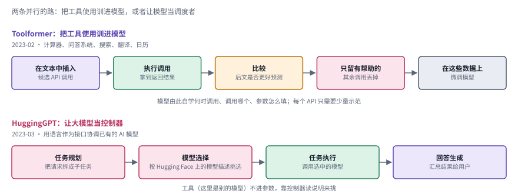

*图：上半部分是 Toolformer 自监督造训练数据的五步，下半部分是 HuggingGPT 的四步。前者把工具使用训进参数，后者让大模型留在外面当调度者。*

上半部分是 Toolformer 的做法，五个框从左往右是一条造训练数据的流水线。模型先在普通文本里插入候选的 API 调用，比如在一句涉及计算的话里插一个计算器调用；接着执行这些调用，拿到返回结果；然后做一次比较，把结果放回文本以后，后面的文字是不是更容易预测了；只有让预测变容易的调用会被留下，其余的丢掉；最后用这些自动筛出来的数据微调模型。整个过程几乎不需要人工标注，每个 API 只要少量示范。下半部分是 HuggingGPT 的四步：ChatGPT 先把用户请求拆成子任务，再根据 Hugging Face 上的模型描述为每个子任务挑一个模型，调用这些模型去执行，最后把结果汇总成回答。两条路的区别一眼就能看出来：上面那条，工具使用进了模型参数；下面那条，工具始终在模型外面，靠控制器读说明来挑。

2023 年初 Meta 的 [Toolformer](https://arxiv.org/abs/2302.04761) 给出了一个漂亮的回答。它让模型自己在文本中插入候选的 API 调用，执行之后看返回结果能不能让后续文本更容易预测，只把有帮助的调用留下来作为训练数据。模型由此自学了何时调用计算器、搜索引擎和翻译工具。同年浙江大学和微软的 [HuggingGPT](https://arxiv.org/abs/2303.17580) 走的是另一条路：让 ChatGPT 当控制器，把用户请求拆成子任务，根据模型描述从 Hugging Face 上挑选合适的模型去执行，再把结果汇总成答案。一个是把工具使用训进模型，一个是把模型当成调度者，这两种思路后来一直并行发展。

工具多了，"会不会用"就成了需要认真测量的能力。[API-Bank](https://arxiv.org/abs/2304.08244) 把工具增强的对话组织成可评测的任务；[Gorilla](https://arxiv.org/abs/2305.15334) 针对大量真实 API 研究调用的准确性；[ToolLLM](https://arxiv.org/abs/2307.16789) 则收集了大规模真实 API 并构造训练数据。从这时起，"能调用一个工具"的演示，逐渐变成了"面对陌生接口能否正确选择和执行"的能力问题。想更系统地了解这一阶段，可以读 [工具学习综述](https://arxiv.org/abs/2304.08354)。

Chip Huyen 在她的文章里给这一阶段补上了一个很实用的视角。她把工具分成两类：只读的工具用来感知环境，比如搜索和读文件；写入类工具会改变环境，比如发邮件、改数据库。前者扩展了模型能看到的东西，后者扩展了它能做的事，风险也随之陡增。回到开头那份周报，助手要列目录、读日志、整理表格，最后把表格发邮件给导师。其中列目录和读日志都是只读的，发给导师的那封邮件才是写入动作，值得多一道确认。

下图把这个划分画了出来。左边绿色的只读动作，列目录、读日志、搜报错关键词，做错了通常只是浪费一次调用，可以放心让 agent 反复去做；右边橙色的写入动作，发邮件、删旧日志、改数据库，做错了可能收不回来。右下角那道确认点，对应方向背景里的那句提醒：发邮件会改变外部世界，发错了收不回来，所以最好先停下来让你确认。执行框架在写入动作发出之前，把控制权交还给人。

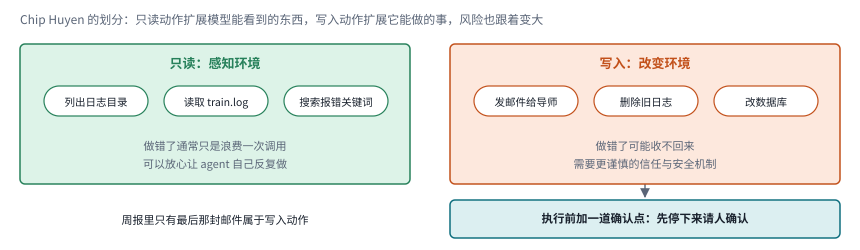

*图：Chip Huyen 的两类工具。只读动作扩展模型能看到的东西，写入动作扩展它能做的事，写入之前加一道确认点。*

**速查：第二阶段的五种做法。** 五张卡里，前两张是"怎样让模型用上工具"的两条路，后三张是"怎样测量和训练工具能力"。它们的差别主要在中间那几个框：调用是模型自己学会的、控制器挑出来的，还是从文档和大规模真实 API 里学来的。

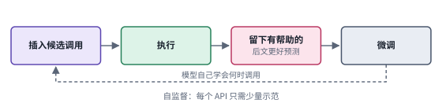 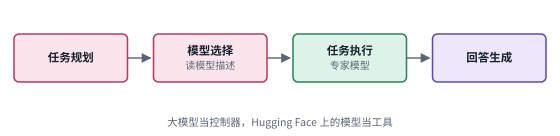

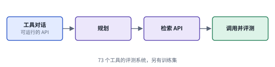 

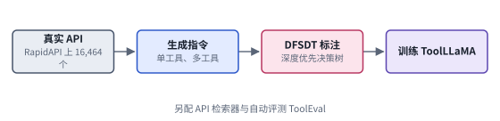

*图：第二阶段五种做法的结构卡，每张卡对应下表的一行。*

| code | 名称 | 年份 | 代表 | 怎么做 | 解决了什么 | 代价 |
|---|---|---|---|---|---|---|
| T1 | 自监督学用工具 | 2023 | [Toolformer](https://arxiv.org/abs/2302.04761) | 模型在文本中插入候选 API 调用并执行，只保留让后文更容易预测的调用，用这些数据微调自己 | 何时调用、调用哪个、参数怎么填由模型自学，因为筛选标准来自语言建模本身，几乎不需要人工标注 | 用到的是计算器、问答、搜索、翻译、日历这类简单 API；换一批工具就要重新造数据、重新训练 |
| T2 | 大模型当控制器 | 2023 | [HuggingGPT](https://arxiv.org/abs/2303.17580) | ChatGPT 规划子任务，按模型描述从 Hugging Face 挑模型执行，再汇总结果 | 用语言当接口，把许多现成模型串起来处理跨模态、跨领域的任务，不必为每个工具训练控制器 | 挑得对不对取决于模型描述写得好不好；一个请求要多次调用大模型 |
| T3 | 工具使用评测 | 2023 | [API-Bank](https://arxiv.org/abs/2304.08244) | 搭一个含 73 个可运行 API 的评测系统和 314 段标注对话，分别测规划、检索和调用；另建训练集 | 把"会不会用工具"拆成可以分项测量、可以互相比较的能力 | 评测里的 API 是事先准备好的，规模和变化速度都比真实世界小 |
| T4 | 检索文档写调用 | 2023 | [Gorilla](https://arxiv.org/abs/2305.15334) | 微调 LLaMA 写 API 调用，配合文档检索器，在 HuggingFace、TorchHub、TensorHub 的 API 上评测 | 针对参数写错、凭空编造 API 用法的幻觉；检索文档让模型在测试时也能跟上版本更新 | 准确率依赖检索到的文档是否对得上；评测覆盖的是机器学习模型库的 API |
| T5 | 大规模真实 API | 2023 | [ToolLLM](https://arxiv.org/abs/2307.16789) | 从 RapidAPI 收集 16,464 个真实 API 生成指令，用深度优先的决策树标注调用链，训练 ToolLLaMA 并配 API 检索器 | 训练数据来自真实接口，模型面对没见过的 API 也能泛化，开源模型的工具能力接近 ChatGPT | 指令和调用链由 ChatGPT 自动生成和标注，数据质量受它影响 |

### 第三阶段：规划与反思

> **要点：** 一次调用成功以后，问题变成多次调用怎样拼成一件完整的工作。任务分解这一侧，计划从清单变成树、变成交给规划器的形式化描述，再变成依赖图；反思这一侧，失败的经验被写下来带到下一次，可反思本身也会出错。

一次调用成功了，多次调用却未必能拼成一件完整的工作。前一个调用的结果可能是后一个调用的参数；有些步骤可以同时跑，有些必须等前面的反馈。系统必须决定怎样分解目标，以及什么时候推翻原来的安排。Lilian Weng 把这些问题都放在"规划"组件之下，又细分为任务分解和自我反思两部分。

下图把任务分解这一侧的五项工作排成五行，从上往下读，图后先按行走一遍，再看各篇论文的出处。

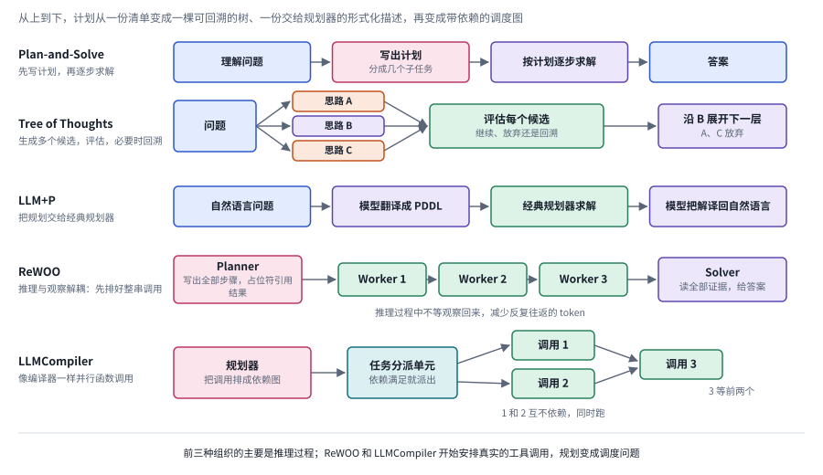

*图：五种组织计划的方式。前三行组织的是推理过程，后两行开始安排真实的工具调用，规划变成了调度问题。*

Plan-and-Solve 最直接，模型先写出一份分成几个子任务的计划，再照着计划一步步求解。Tree of Thoughts 不满足于一条路，它在每一步生成好几个候选思路，交给绿色的评估框判断哪个值得继续，被放弃的思路就此打住，必要时还可以回溯到上一层。LLM+P 换了一个思路，模型只负责翻译，把自然语言问题写成 PDDL 交给经典规划器求解，再把解翻译回来，求解的正确性由规划器保证。从第四行开始，计划里安排的是真实的工具调用。ReWOO 的 Planner 一次写出全部步骤，后面步骤要用的结果先用占位符代替，几个 Worker 执行调用，Solver 最后读全部证据给出答案，推理过程不必停下来等每一个观察返回。LLMCompiler 再进一步，把调用排成依赖图，互不依赖的调用 1 和调用 2 同时发出，调用 3 等它们都回来再执行。

任务分解这一侧，[Plan-and-Solve](https://arxiv.org/abs/2305.04091) 让模型先写出计划再逐步求解；[Tree of Thoughts](https://arxiv.org/abs/2305.10601) 把推理组织成一棵树，在每一步生成多个候选思路，评估之后再决定往哪条分支走，必要时回溯。还有一条思路干脆把规划交给专门的工具：[LLM+P](https://arxiv.org/abs/2304.11477) 让大模型把自然语言描述的规划问题翻译成经典规划语言 PDDL，交给传统规划器求解，再把解翻译回自然语言。这几项工作打下了任务分解与候选选择的基础，不过它们组织的大多是推理过程，离外部行动还隔着一层。[ReWOO](https://arxiv.org/abs/2305.18323) 接着处理推理与工具观察之间的关系，先规划好整串调用再统一执行，减少了反复往返；[LLMCompiler](https://arxiv.org/abs/2312.04511) 更进一步，像编译器一样分析函数调用之间的依赖，把能并行的调用并行起来。到这里，规划已经从"写一份待办清单"变成了一个带依赖关系的调度问题。

反思这一侧的代表是 [Reflexion](https://arxiv.org/abs/2303.11366)。任务失败之后，它让模型用自然语言写下一段反思，下一次尝试时把反思带上。它改变的是下一次尝试能拿到的信息，这和在当前回合里多想一会儿是不同的机制。可反思本身也可能出错。DeepMind 等机构 2023 年的 [Large Language Models Cannot Self-Correct Reasoning Yet](https://arxiv.org/abs/2310.01798) 发现，在没有外部反馈的情况下，模型自我纠错后，推理题上的表现有时反而会下降。这条结论划定了反思的边界：记忆可以保存经验，判断经验是否真的改善了结果，还得靠环境和独立的验收机制。

下图上半部分是 Reflexion 的一轮：行动者尝试任务，评估给出成败或分数，模型据此用自然语言写一段反思，反思存进记忆，下一次尝试时带上，这个过程可以重复多轮。模型的权重从头到尾没有变，变的是下一次尝试能读到的那段文字。下半部分把这一机制的边界画在了两边：左边有外部反馈，测试结果、环境返回或标准答案告诉系统这次到底对不对，反思有了依据，经验才能积累；右边只有模型自查，Cannot Self-Correct Reasoning Yet 发现，这种情况下推理题的表现有时反而下降。Chip Huyen 的提醒也写在右边，反思即便有用，也会带来额外的延迟和成本。

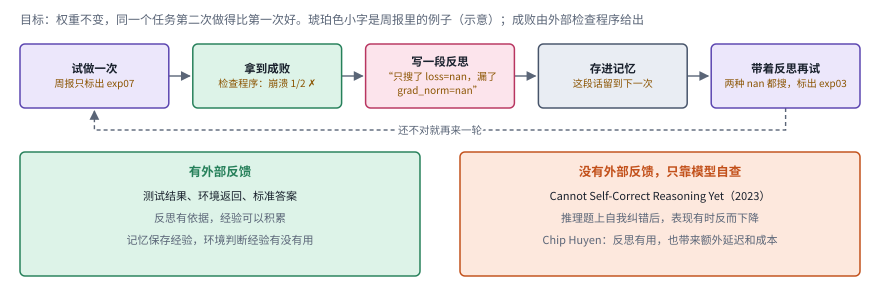

*图：Reflexion 的一轮，以及反思靠不靠得住的两种情况。左边的绿色框有外部反馈，右边的橙色框只靠模型自查。*

Chip Huyen 对这一阶段的评价很冷静。她主张把规划和执行解耦，先用启发式规则或另一个模型检查计划是否合理，再去执行；她也直言，基础模型到底能不能规划仍有争议，因为规划需要预判每个动作的后果。反思和纠错在她看来很有用，却也不是必需的，它们会带来额外的延迟和成本。Lilian Weng 在文末同样把"长程规划和任务分解"列为当时的主要挑战之一：模型遇到意外错误时，很难调整原来的计划。

**速查：第三阶段的六种做法。** 前五张卡属于任务分解，最后一张属于反思。并排看，前五张的差别在于"谁来组织计划"：模型自己写清单、模型加搜索、经典规划器，还是一个负责调度的规划器。

 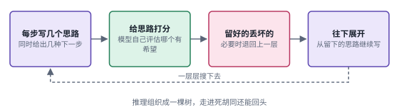

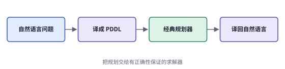 

 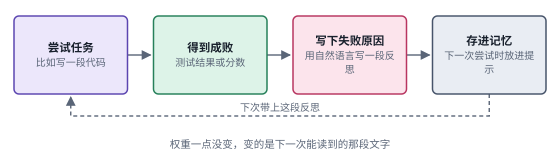

*图：第三阶段六种做法的结构卡，每张卡对应下表的一行。*

| code | 名称 | 年份 | 代表 | 怎么做 | 解决了什么 | 代价 |
|---|---|---|---|---|---|---|
| P1 | 先计划后求解 | 2023 | [Plan-and-Solve](https://arxiv.org/abs/2305.04091) | 在提示里要求模型先写出计划、把任务分成子任务，再按计划逐步求解 | 步骤先被摆到纸面上，直接作答时容易漏掉的中间步骤有了位置 | 计划一次写定，执行中发现前提错了也不会自动修改 |
| P2 | 思维树搜索 | 2023 | [Tree of Thoughts](https://arxiv.org/abs/2305.10601) | 每一步生成多个候选思路，由模型评估后选择往哪条分支走，可以广度或深度优先搜索并回溯 | 推理可以同时探索多条路线、放弃死路，适合需要试错和前瞻的问题 | 每一层都要生成和评估多个候选，模型调用次数成倍增加 |
| P3 | 交给经典规划器 | 2023 | [LLM+P](https://arxiv.org/abs/2304.11477) | 模型把自然语言规划问题翻译成 PDDL，经典规划器求解，再译回自然语言 | 求解交给有正确性保证的规划器，模型只做它擅长的翻译 | 问题要能写成 PDDL 这样的形式化描述，翻译错了规划器也救不回来 |
| P4 | 推理与观察解耦 | 2023 | [ReWOO](https://arxiv.org/abs/2305.18323) | Planner 一次写出全部步骤并用占位符引用结果，Worker 执行调用，Solver 汇总证据作答 | 推理不必等每个观察返回，省掉反复往返的冗余提示，作者在 HotpotQA 上报告约 5 倍的 token 效率 | 计划在看到观察之前就写好，中途发现情况不对时很难临时改路线 |
| P5 | 并行函数调用 | 2023 | [LLMCompiler](https://arxiv.org/abs/2312.04511) | 规划器把调用排成依赖图，分派单元在依赖满足时派出任务，执行器并行运行 | 互不依赖的调用同时跑，作者报告相对 ReAct 时延最多降低 3.7 倍、成本最多节省 6.7 倍 | 收益取决于调用之间有多少能并行；依赖图本身要规划正确 |
| P6 | 语言反思 | 2023 | [Reflexion](https://arxiv.org/abs/2303.11366) | 失败后让模型用自然语言写反思存进记忆，下次尝试时带上 | 不改权重也能从失败里学，改变的是下一次尝试能拿到的信息 | 反思本身可能出错，没有外部反馈时自我纠错可能变差；还会增加延迟和成本 |

### 第四阶段：走进真实环境

> **要点：** 只有放进完整任务，各个环节之间的接缝才会暴露。一批环境型基准把整个循环拿去检验，SWE-agent、CodeAct 和 Agentless 又说明，接口和动作空间是和模型能力并列的研究变量。

只有放进完整的任务里，各个环节连接处的问题才会暴露出来。2022 到 2023 年，一批环境型基准相继出现。[WebShop](https://arxiv.org/abs/2207.01206) 搭了一个网上购物环境，让 agent 根据描述找到并买下合适的商品；[Mind2Web](https://arxiv.org/abs/2306.06070) 收集了大量真实网站上的任务作为学习材料；[WebArena](https://arxiv.org/abs/2307.13854) 用可以本地复现的网站承载各种操作任务。在这些环境里，模型必须把观察和多步动作串起来，单独答对一道工具问题已经不够了。

下图把这一阶段的四个环境并排比较，每张卡片从上往下依次是任务从哪里来、agent 要做什么、成功怎么判。WebShop 是一个模拟购物网站，agent 要按文字描述去搜索、浏览、选规格并下单，买到的商品是否符合描述决定得分，作者还把训练出的 agent 放到 amazon 和 ebay 上试过。Mind2Web 的任务来自 137 个真实网站、31 个领域，共两千多个任务，每个任务都配有人工完成的动作序列；真实网页的 HTML 太长，作者先用一个小模型筛选，再交给大模型选动作。WebArena 搭了电商、论坛、代码协作和内容管理四类可以本地部署的网站，还配了地图等工具和使用手册，按功能是否正确来判定任务完成，论文报告最好的 GPT-4 agent 端到端成功率只有 14.41%，人类是 78.24%。SWE-bench 的任务来自真实开源仓库里的问题，agent 交出的补丁要能通过测试才算数。四个环境有一个共同点：成功由环境来判，模型自己说做完了不算。

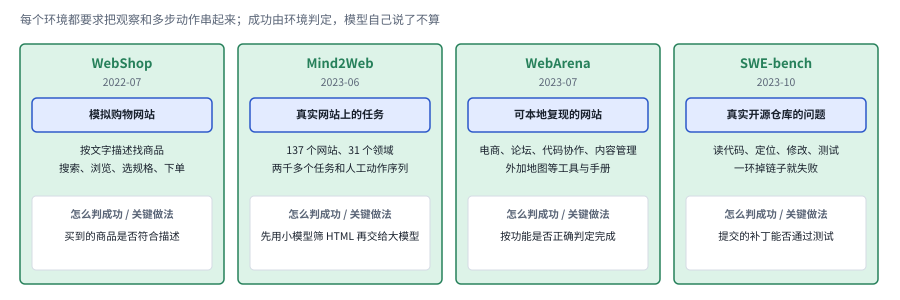

*图：四个环境型基准。每张卡片写着任务来源、agent 要做的事，以及成功怎么判或关键做法。*

软件工程方向的 [SWE-bench](https://arxiv.org/abs/2310.06770) 要求 agent 修复真实开源仓库里的问题，读懂代码、定位问题、修改和测试彼此依赖，任何一环掉链子都会失败。它很快成为衡量 agent 的标志性基准。2024 年的 [SWE-agent](https://arxiv.org/abs/2405.15793) 提出了"agent 与计算机接口"（ACI）的概念：同一个模型，给它设计得更好的文件查看、搜索和编辑命令，修复成功率就会明显提升。同年的 [CodeAct](https://arxiv.org/abs/2402.01030) 从动作格式入手，让 agent 直接写可执行的 Python 代码作为动作，作者在 17 个模型上报告，相比常见的动作格式，成功率最多高出 20%。接口和动作空间从此成了与模型能力并列的研究变量。

下图把这一阶段处理接口的三种思路放在一起。最上面一行是 SWE-agent，模型每一步从一组为它专门设计的命令里选一条：按窗口翻看的文件查看器、在仓库里搜索、编辑文件、运行测试和程序。中间一行是 CodeAct，动作直接是一段 Python 代码，解释器执行以后把结果或报错还给模型，模型可以在多轮里修改代码，一段代码里还能写循环、存变量、调用多个工具。最下面一行是下一段要讲的 Agentless，定位、修复、验证三步是固定的，模型在每一步里干活，却不决定下一步做什么。三行里的模型可以完全一样，变的只是交给模型的动作空间。

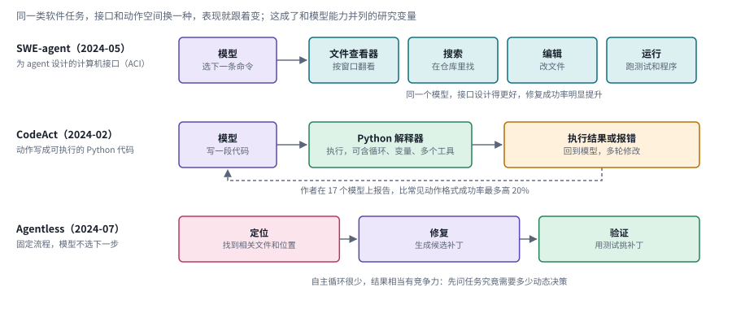

*图：SWE-agent 的专用命令、CodeAct 的代码动作和 Agentless 的固定三步。三行的模型可以相同，变化的是动作空间。*

也有工作反过来问：真的需要那么多自主性吗？[Agentless](https://arxiv.org/abs/2407.01489) 用一条结构化的、自主循环很少的流程（先定位、再修复、再验证）去做同样的软件任务，结果相当有竞争力。这提醒大家，研究的目标应当落在判断任务究竟需要哪些动态决策上，一味提高自治程度未必划算。

Anthropic 在 2024 年底的 Building effective agents 里，把这一阶段的经验总结得很到位。作者建议先找最简单的方案，很多应用只要优化好单次模型调用、配上检索和示例就足够；任务定义清楚、需要可预测性时用工作流；只有面对步数无法预知的开放问题时，才交给 agent 自己决定。他们分享了一个很有画面感的例子：在为 SWE-bench 搭 agent 时，模型离开根目录后经常把相对路径用错，他们把工具改成必须使用绝对路径，模型随后就用得毫无差错。作者因此主张，给 agent 设计接口，应该和给人设计界面投入同样多的心思。

**速查：第四阶段的四个环境与三种接口。** 这一阶段的卡分成两组。前四张是环境，最右边那个框都是绿色的判定，成功由环境说了算；后三张是接口，差别集中在第二个框，也就是交给模型的动作长什么样。

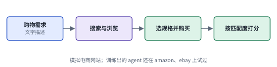 

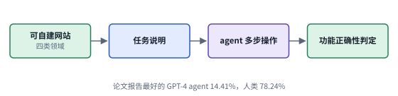 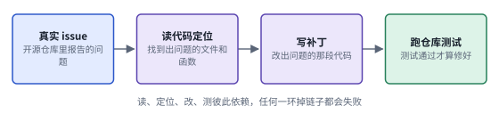

*图：第四阶段四个环境的结构卡，每张卡对应下表的一行。*

| code | 名称 | 年份 | 代表 | 怎么做 | 解决了什么 | 代价 |
|---|---|---|---|---|---|---|
| E1 | 模拟购物环境 | 2022 | [WebShop](https://arxiv.org/abs/2207.01206) | 搭一个模拟电商网站，agent 按文字描述搜索、浏览、选规格并购买，按商品与描述的匹配程度打分 | 把"读网页、做多步决策"放进可以大规模训练和评测的环境，训练出的 agent 还在真实购物网站上试过 | 网站是模拟的，页面结构和交互比真实网站简单 |
| E2 | 真实网站任务集 | 2023 | [Mind2Web](https://arxiv.org/abs/2306.06070) | 从 137 个真实网站、31 个领域收集两千多个任务和人工动作序列；先用小模型筛 HTML，再交给大模型选动作 | 任务来自真实网站，可以检验 agent 在没见过的网站和领域上能否泛化 | 动作序列是事先采集的，评测按步骤和人工序列比对，网站不会真的响应 agent 的操作 |
| E3 | 可复现网站环境 | 2023 | [WebArena](https://arxiv.org/abs/2307.13854) | 部署电商、论坛、代码协作、内容管理四类真实可用的网站，配地图等工具与手册，按功能正确性判定完成 | 环境可以本地复现，结果按功能检查，暴露出很大的端到端差距：最好的 GPT-4 agent 为 14.41%，人类为 78.24% | 网站限定在四类领域，部署和重置环境都要额外的工程投入 |
| E4 | 真实仓库修复 | 2023 | [SWE-bench](https://arxiv.org/abs/2310.06770) | 给 agent 真实开源仓库里的问题，要求交出能通过测试的补丁 | 读代码、定位、修改、测试彼此依赖，任何一环掉链子都会失败，能检验整个循环 | 只衡量有测试可判的修复任务 |

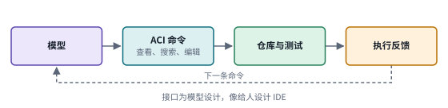 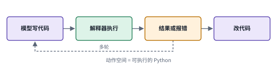

*图：第四阶段三种接口的结构卡，每张卡对应下表的一行。*

| code | 名称 | 年份 | 代表 | 怎么做 | 解决了什么 | 代价 |
|---|---|---|---|---|---|---|
| I1 | agent 与计算机接口 | 2024 | [SWE-agent](https://arxiv.org/abs/2405.15793) | 为模型设计专门的文件查看、搜索、编辑和运行命令，模型每一步从中选一条 | 同一个模型，接口设计得更好，修复成功率明显提升，说明接口本身就是研究变量 | 接口要为每一类环境专门设计和打磨 |
| I2 | 代码动作 | 2024 | [CodeAct](https://arxiv.org/abs/2402.01030) | 动作写成可执行的 Python 代码，解释器执行后把结果或报错交回模型，多轮修改 | 代码能直接表达循环、变量和多个工具的组合，作者在 17 个模型上报告成功率最多高出 20% | 代码能表达的动作越多，执行环境越要把它们限制住（见三.1） |
| I3 | 固定流程 | 2024 | [Agentless](https://arxiv.org/abs/2407.01489) | 先定位、再修复、再验证，三步固定，模型不决定下一步 | 自主循环很少也有相当的竞争力，提醒大家先判断任务究竟需要多少动态决策 | 流程是为软件修复设计的，换到步数无法预知的开放任务就不够用 |

### 第五阶段：执行框架与上下文工程

> **要点：** 基础模型普遍能可靠地调用工具以后，瓶颈移到了模型外面。工具怎么写、什么信息进入上下文、反馈回路怎么搭，这些执行框架层面的问题成了研究对象；2026 年的综述把它们整理成六项运行时职责。

到了 2025 年，基础模型已经普遍能可靠地调用工具，瓶颈慢慢转移到了模型外面。同样的模型，放进不同的执行框架里，表现可以差得很远；工具说明多写一句、返回内容少给一半，结果也会跟着变。于是"执行框架"本身，连同它管理的工具和上下文，成了需要专门研究的对象。

Anthropic 2025 年 9 月的两篇文章是这个转向的标志。Writing effective tools for agents 指出，把现成 API 端点直接包装成工具往往不合适；工具应该围绕少数高价值的工作流来设计，用命名空间划清边界，优先返回人能读懂的名字，少给低层标识符，并用分页、过滤和截断控制返回量。文中提到 Claude Code 默认把工具返回限制在 25,000 个 token 以内。Effective context engineering for AI agents 则把视角从工具扩展到整个上下文：上下文是有限的资源，越长越容易出现"上下文腐化"，模型从中准确回忆信息的能力会下降；工程上的目标是找到"能最大化期望结果概率的最小一组高信号 token"，常用手段有即时检索、压缩、结构化笔记和子 agent。

下图左半边是上下文工程那篇文章的图景。四路信息都想挤进同一个窗口：系统提示、工具说明、历史消息和工具返回；窗口是有限的，放得越满，模型从中准确找回信息的能力越弱。中间那一列粉色框是文章给出的四种做法：即时检索先只留下文件路径这类轻量的标识，用到时再读；压缩把旧的历史总结成摘要；结构化笔记让 agent 把要点写到窗口外面，需要时再取回；子 agent 分头去探索，只把摘要交回主 agent。右半边是工具那篇文章的几条原则，围绕高价值的工作流设计少数几个工具，用命名空间划清边界，返回人读得懂的名字，用分页、过滤和截断控制返回量，再用贴近真实的多步任务来评测和改进。两边说的是同一件事：每个进入上下文的 token 都要带着信号。

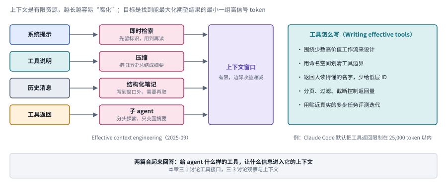

*图：左边是几路信息争用有限的上下文窗口，以及上下文工程的四种做法；右边是写工具的几条原则。*

OpenAI 在 2026 年 2 月的 harness engineering 报告把这件事推到了极致。团队在不手写代码的前提下，由 Codex 写出了整个产品，工程师的精力全部花在设计环境上：让应用对 agent 可读，能启动、能看日志和指标；用一个简短的 AGENTS.md 当作指向文档目录的地图，替代一份上千页的手册；把架构规则写进 linter，报错信息里直接附上修复建议；再让后台 agent 定期扫描代码中逐渐积累的坏模式，像垃圾回收一样清理。作者特别提到，agent 失败时，修复办法通常是补上缺失的工具、抽象或结构，单纯让它再试一次很少奏效。

下图把这份报告里的工作方式画成一条回路。工程师表达意图、设计环境；AGENTS.md 只是一张短地图，指向结构化的文档目录；Codex 读地图写代码；写出来的代码要过 linter 和结构测试这一关，架构规则由它们机械地执行，报错信息里直接附上修复建议，沿着虚线回到 agent。下排是三件容易被忽略的事：agent 失败时，团队的第一反应是补上缺失的工具、抽象或结构；后台 agent 定期扫描代码里逐渐积累的坏模式，像垃圾回收一样清理；应用本身被做得对 agent 可读，能启动，能看日志和指标。

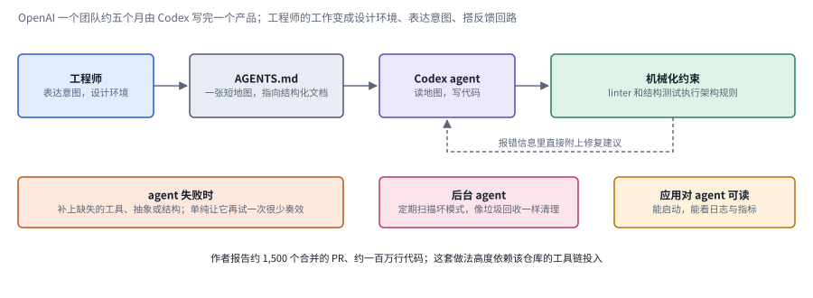

*图：OpenAI harness engineering 报告中的反馈回路。上排是一次写代码的主路径，下排是让这条路径持续可用的三件事。*

到 2026 年 6 月，Jianyuan Guo 等人的综述 [From Question Answering to Task Completion](https://arxiv.org/abs/2606.20683) 把这一阶段的经验整理成了一张完整的地图。他们把 agent 看作基础模型与执行框架的组合，把执行框架拆成观察、上下文、控制、动作、状态和验证六项职责，并把 agent 工程的演进归纳为提示工程、工作流与上下文工程、执行框架工程和智能体原生训练四种并存的范式。按照他们的叙述，瓶颈先从提示的措辞转到上下文与工作流的组织，再转到执行过程的控制；本节讲的正是后面这一步。他们也指出了下一步的方向：借助交互环境把 agent 行为训练进模型参数，让模型、执行框架和改进循环一起演化，同时强调这样做并不会让执行框架消失。

下图是这篇综述的核心地图。紫色的基础模型在中间，外面青色虚线框是执行框架，六个框是它承担的六项职责：观察把终端输出、代码差异、截图和网页结构变成模型能读的形式；上下文决定什么信息在什么时候、以什么形式进入窗口；控制编排观察、推理、行动、反馈的循环，决定何时停止、重试和委派；动作把模型输出映射成函数调用、命令行和浏览器操作；状态保存计划、检查点、日志和文件；验证用测试、验证模型、沙箱策略和权限关卡去检查和约束执行。把这张图和第一节的工作循环对照着看，循环里除模型以外的每个框，都能在这里找到负责它的那项职责。底部一排是作者归纳的四种范式，箭头表示出现的先后，作者特别说明四者至今同时存在，后来的范式并没有取代先前的。

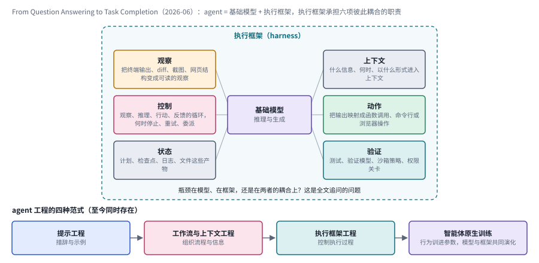

*图：From Question Answering to Task Completion 的地图：执行框架的六项运行时职责环绕基础模型，下方是 agent 工程的四种并存范式。*

这一阶段正是本章前沿分支的主战场。三.1 讨论工具接口该怎样表达动作，三.3 讨论观察和上下文该怎样筛选，三.4 讨论执行框架本身怎样被理解和自动改进，三.5 讨论模型训练怎样和执行框架对齐。

**速查：第五阶段的四份工作。** 这一阶段的代表多是工程文章，它们讲的是做法，形式上和前几个阶段的论文不同，所以卡片画的是各自建议的工作流程。

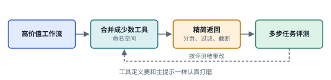 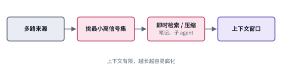

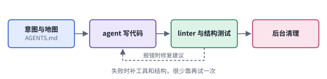 

*图：第五阶段四份工作的结构卡，每张卡对应下表的一行。*

| code | 名称 | 年份 | 代表 | 怎么做 | 解决了什么 | 代价 |
|---|---|---|---|---|---|---|
| H1 | 为 agent 写工具 | 2025 | [Writing effective tools for agents](https://www.anthropic.com/engineering/writing-tools-for-agents) | 围绕高价值工作流合并出少数工具，用命名空间划边界，返回可读的名字，用分页、过滤、截断控制返回量，再用真实多步任务评测迭代 | 现成 API 直接包装给 agent 往往不合适，围绕工作流设计能减轻模型的选择负担，也减少无用的返回 | 工具要跟着评测结果反复修改，前提是有一套贴近真实的评测任务 |
| H2 | 上下文工程 | 2025 | [Effective context engineering for AI agents](https://www.anthropic.com/engineering/effective-context-engineering-for-ai-agents) | 把上下文看作有限资源，用即时检索、压缩、结构化笔记、子 agent 维持一组最小的高信号 token | 应对上下文腐化：窗口越满，模型准确找回信息的能力越弱 | 压缩和筛选都可能丢掉后面才用得上的信息（见三.3） |
| H3 | 执行框架工程 | 2026 | [Harness engineering](https://openai.com/index/harness-engineering/) | 人设计环境、表达意图，AGENTS.md 当地图，linter 和结构测试执行架构规则，后台 agent 定期清理 | agent 失败时补上缺失的工具和结构，让一个团队在不手写代码的前提下完成了产品 | 高度依赖该仓库的工具链投入，作者自己也这样说 |
| H4 | 六职责地图 | 2026 | [From Question Answering to Task Completion](https://arxiv.org/abs/2606.20683) | 把 agent 定义为基础模型加执行框架，执行框架拆成观察、上下文、控制、动作、状态、验证六项职责 | 为"瓶颈在模型、在框架还是在两者的耦合上"这个问题提供了一套共同的词汇 | 这是一张综述地图，各项职责之间怎样取舍，还要靠具体实验回答 |

### 边界：成绩变好了，事情真的做成了吗？

> **要点：** 每往前走一个阶段，"怎么知道真的变好了"就更难回答。断点可能出在自我纠错、出在完成判定、出在工具返回的文字上，也可能出在评测设定和现实之间。

下图把第一节的工作循环缩成四个框再画一遍，四个橙色框标出循环最常断掉的地方，箭头指向它出问题的那一环。左上角，没有外部反馈的自我纠错落在模型提出动作这一环，模型以为自己改对了，推理题上的表现却可能下降。左下角，宣布完成落在检查这一环，agent 以为自己完成了任务，事情其实没做完。右边，工具返回的文字落在观察这一环，返回的内容可能出错，甚至夹带诱导越权的指令。最下面一条横跨整个循环，是下一段要讲的效用问题。底部那一排是 Chip Huyen 对失败的分类，评测时可以按这几类分别计数，比只报告一个总的成功率更能看清问题出在哪里。

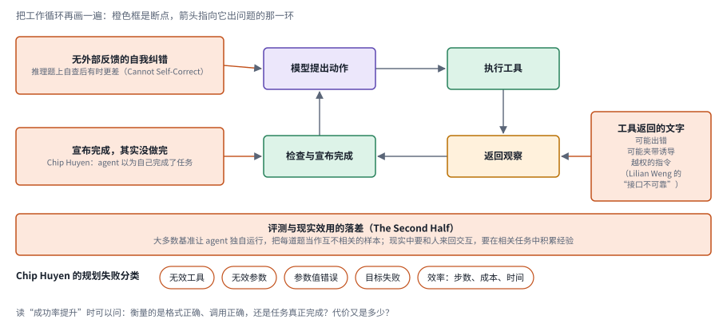

*图：橙色框是断点，箭头指向它出问题的那一环；底部是 Chip Huyen 的失败分类。*

每往前走一个阶段，"怎么知道真的变好了"就更难回答。Chip Huyen 在文章里专门留了一节讲失败模式和评估：规划会失败在无效工具、无效参数和错误的参数值上，工具会返回错误的结果，效率也会在步数、成本和时间上出问题；最微妙的一种，是 agent 自信地宣布完成，事情其实没做完。她建议为规划单独建数据集，为每个工具单独测试，并且把效率和一个基线放在一起比较。

姚顺雨在 The Second Half 里从更高处提出了同样的疑问。当一套配方能把各种基准一个个刷上去，新方法打败旧基准就不再稀奇；真正要紧的，是评测设定和现实之间的差距。现实中的 agent 要和人来回交互，要在一连串相关任务中积累经验，而大多数基准让 agent 独自运行，把每道题当作互不相关的样本。他把这个落差称为效用问题，认为这是 AI 当下最重要的问题。Lilian Weng 在 2023 年列下的"自然语言接口不可靠"，到今天则变成了另一个形态：工具返回的文字可能出错，甚至夹带诱导越权的指令。

这些边界问题在本章三.6 和第四到七节里反复出现。读任何一篇报告"成功率提升"的论文时，都可以问一句：这个提升衡量的是格式正确、调用正确，还是任务真正完成？代价又是多少？

### 总对照：五族方法放在同一组坐标上

> **要点：** 把第二节的五族速查卡放进一张表，按同样几个维度比较；再把第三节六个分支放回主线，就能看清每个分支在继承哪一个阶段的问题。

最后把这一节的五族方法放进一张表。想快速判断一篇新论文属于哪一族，先问它改的是什么、下一步由谁决定、反馈从哪里来；表格只放结论，每一格背后的原因写在前面同编号的速查卡和对照表里。

| 家族 | 对应阶段 | 改的是什么 | 下一步由谁决定 | 反馈从哪里来 | 主要优点 | 主要代价 | 本章分支 |
|---|---|---|---|---|---|---|---|
| R | 第一阶段 | 模型怎样组织一次推理和行动 | 模型 | 环境返回的观察（ReAct） | 简单，不需要训练，马上能用 | 每一步都要等观察，往返次数多 | 三.1、三.2 |
| T | 第二阶段 | 模型对工具的掌握，或模型调度工具的方式 | 模型或控制器 | 调用的执行结果、工具基准 | 工具能力可以训练，也可以分项测量 | 训练数据和工具集绑在一起，换工具要重来 | 三.1、三.5 |
| P | 第三阶段 | 计划的组织方式与失败的经验 | 计划、搜索过程或依赖图 | 评估器、规划器、外部反馈 | 能处理依赖，可以回溯，也可以并行 | 额外的计划和评估调用；没有外部反馈的反思可能出错 | 三.2、三.3 |
| E、I | 第四阶段 | 检验用的环境与交给模型的接口 | 模型，或固定流程 | 环境判定（测试、功能检查） | 检验整个循环，接口成为可以调节的变量 | 搭建环境成本高，结论受环境设定影响 | 三.1、三.2、三.4 |
| H | 第五阶段 | 模型之外的执行框架 | 执行框架控制循环，模型在其中决策 | 测试、linter、验证器、权限关卡 | 不训练模型也能大幅改变系统行为 | 依赖工具链投入，收益未必能换个仓库照搬 | 三.3、三.4、三.5 |

下图换一个角度，把第三节的六个分支放回这条主线。横轴是五个阶段和边界，纵轴是六个分支；实心格来自每个分支开头那行"主线位置"，虚线空心格是第二节开头总表里另列的关联。第五阶段那一列最密，观察、执行框架改进、训练与框架三个分支都以它为主线位置；工具接口和训练与框架两个分支还连着第二阶段的工具学习；只有三.6 完全落在边界上。

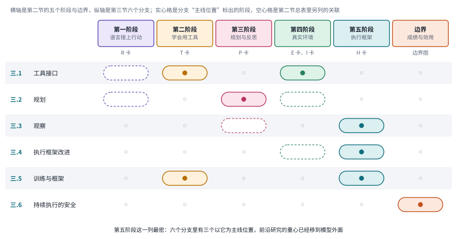

*图：六个前沿分支在五个阶段上的位置。表头下方注明每一阶段对应第二节的哪一组速查卡。*

## 三、前沿研究方向

经典工作搭起了工具和反馈相连的执行循环，前沿研究要追问的是：这个循环在哪些环节仍然不可靠。下面六个分支按模型面对的决策顺序展开，先看工具怎样表达动作，再看任务怎样规划、观察怎样筛选，接着讨论执行框架和模型训练如何配合，最后检查一次行动结束之后系统能否安全地继续运转。它们分别对应接口、决策、信息、系统、学习和运行边界。每个分支开头先交代它要回答的问题，再标出它在上一节主线上的位置，近期论文按它们解决的瓶颈放在一起比较，发布日期反倒是次要的。读这些论文时，建议始终带着两个问题：它改的是模型、接口还是框架？它用什么证据说明改进是真的？

> **本节要点：** 六个分支收录的都是 2026 年的新论文，按模型面对的决策顺序排开。每个分支先讲问题怎么来的，用一行"主线位置"挂回第二节的阶段，再用一张图把本分支几篇论文的做法摆在一起；第二节末尾那张矩阵图可以当作本节的目录。

### 1. 工具接口决定了模型能够怎样行动

给 agent 设计工具，很像给新同事配一套办公权限和操作手册。工具接口同时规定了动作空间和信息空间：它决定模型可以调用什么，也决定模型能看到多细的参数说明、每次返回多少结果、失败时收到怎样的报错。接口越通用，模型要承担的选择和解释负担就可能越重；接口越专用，换一个环境又可能失灵。所以这个分支先要把三件事分开：接口怎样设计，工具怎样选择，调用序列怎样组织。输出了合法的 JSON、调用了正确的工具、最终完成了任务，是三个不同层次的指标，混在一起报告很容易让人误判。

> 主线位置：第二阶段与第四阶段的交汇处。接 Toolformer、Gorilla 的工具学习，SWE-agent 的 agent 与计算机接口，以及 CodeAct 的代码动作；工程上对应 Anthropic《Writing effective tools for agents》。

> **要点：** 工具接口同时规定了模型能做什么和能看到什么。这一节的论文分别拧动三个旋钮：动作的表达形式、动作的启动时机，以及模型对工具的先验理解。

下图顶部先放了一个实验设计上的参照：The Harness Effect 固定任务和模型，只替换编排层，看成本和时延怎样变化。下面三行是这一节讨论的三个旋钮，每个旋钮的左端更简单、更容易审计，往右拧表达力更强，执行环境要承担的约束也更多。表达形式从一次一个的原生 JSON 调用拧到程序式调用，对应 The Bitter Lesson of Tool Calling 和 Harness as a Language；启动时机从生成完再执行拧到边生成边启动，对应 Speculative Programmatic Tool Calling；先验理解从只读工具说明拧到在训练里学会用工具，对应 MidTool 和 Salesforce Koa。比较两个系统时，最好先确认它们只在其中一个旋钮上有差别。

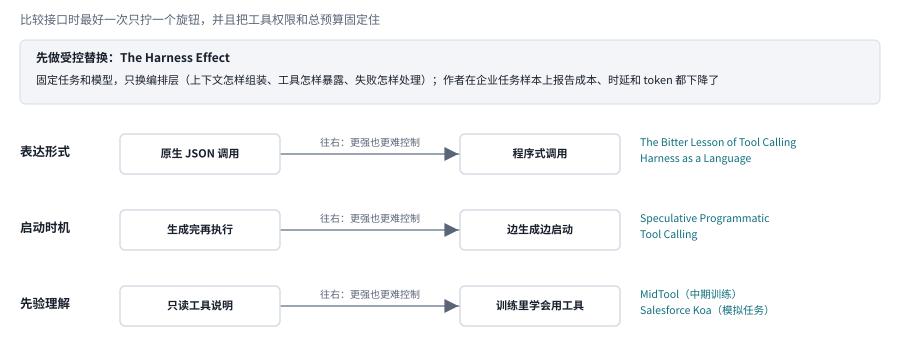

*图：工具接口的三个旋钮，右侧是本节对应的论文；顶部是 The Harness Effect 的受控替换。*

先看一个直接的对照实验。**[The Harness Effect](https://arxiv.org/abs/2607.06906)** 在固定任务和模型的条件下替换编排层，考察上下文怎样组装、工具怎样暴露、失败怎样处理，会怎样改变任务成本。作者报告，在其企业任务样本上，成本、时延和 token 使用都下降了，质量的变化则受模型能力影响。这项工作很适合用来说明，工具的包装方式会改变整个交互过程，这一点和 Anthropic 搭 SWE-bench agent 时的经历是同一个道理：模型离开根目录后经常把相对路径用错，他们把工具改成必须使用绝对路径，错误就消失了。它的样本是小规模的固定任务，收益能否推广到其他企业流程，还要另外检验，换个框架也未必总比旧框架好。

拿开头的周报任务来体会一下接口的差别。助手要读取二十几组实验的日志文件，接口可以只允许一次读一个文件，也可以接受一组文件名，还可以让模型写一段程序，用循环把文件挨个读进来。三种接口都能完成检查，交给模型的动作空间却很不一样。第一种最容易逐步审计，代价是来回次数多；第三种表达力最强，可一段写错的程序会同时影响很多步。接口设计因此同时牵动着能力、代价和可控性。

下图把这三种接口画在一起。左边一次读一个文件，二十几次来回，每一步都能单独审计，错一步也只影响这一步；中间一次读一组文件，来回次数少了，一次返回的内容却变多了，返回量就要靠分页和截断去控制；右边写一段程序，循环、变量和依赖都能直接表达，可要读懂整段程序才能审计，一段写错的程序会影响很多步。

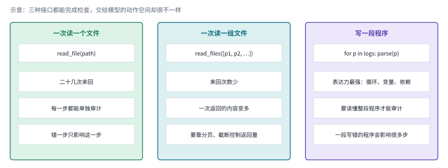

*图：示意。读二十几个日志的三种接口，从左到右表达力越来越强，单步审计越来越难。*

近期的 [The Bitter Lesson of Tool Calling](https://arxiv.org/abs/2608.06370) 比较了原生 JSON 调用和程序式调用，正好接着第四阶段的 CodeAct 读，那项工作让 agent 直接写可执行的 Python 代码当作动作。关键在于代码能直接表示循环、变量和依赖，这并不说明代码天然就更聪明。需要连续取多个返回值时，这种表达方式可以减轻模型反复组织同一段逻辑的负担；然而代码能表达的动作越多，执行环境就越要把它们限制住，部署时还要根据每个工具的权限，约束程序能执行哪些操作。这篇论文在第五节还有更详细的介绍。

[Harness as a Language](https://arxiv.org/abs/2609.26891) 把这个想法再往前推了一步。它研究能否用一个足够小的可编程执行原语来表达复杂的 agent 行为，从而省掉为记忆、委派和递归分别堆叠的专门模块。读这篇时可以追问一句：被简化的是哪一层？核心原语少了，运行时的行为未必就更容易理解；程序可以递归调用模型以后，预算、监控和终止条件都要定得更清楚。它和前一篇工具接口比较一脉相承，研究目标却更接近执行系统本身的表达方式。

还有一类改进关心的是动作什么时候开始。[Speculative Programmatic Tool Calling](https://www.alphaxiv.org/abs/2608.spec-ptc) 讨论在程序还在生成的时候，就提前启动那些已经能够解析出来的工具调用，让生成和等待重叠起来，有点像 CPU 的流水线。这和选工具、排依赖是两类问题：前者决定调用什么，执行调度决定已经确定的调用何时启动。调度能省多少时间，取决于工具的延迟、调用之间的依赖，以及提前执行是否安全。

工具接口还有学习的一面。[MidTool](https://arxiv.org/abs/2608.20314) 从中期训练数据入手，组织真实的 API、文档和工作流，让模型学到工具能做什么、参数从哪里来、调用怎样组合。[Salesforce Koa](https://arxiv.org/abs/2609.15066) 则把工作流规格扩展成多轮的模拟任务，再用任务结果形成训练信号。这两篇和第二阶段的 Toolformer、ToolLLM 一脉相承，都想通过训练把工具使用学进模型，它们共同说明了一件事：一次工具调用失败，未必改改接口就能解决，它也可能暴露出模型没学会理解工具，或者没学会从上下文里找到参数的依据。具体的训练方法在[第 04 章](04_training_data.md)和[第 05 章](05_rl_and_distillation.md)展开。

把这一节串起来看，接口设计至少有三个旋钮：动作的表达形式（JSON 还是程序），动作的启动时机（串行还是投机执行），以及模型对工具的先验理解（靠说明文档还是靠训练）。比较时最好一次只拧一个，并且把工具权限和总预算固定住。

### 2. 规划：把待办清单写长之后，还缺什么

把一个大任务拆成很多小任务，听上去总是更稳妥，可经验丰富的人都知道，拆解本身就可能出错。规划要解决的是行动之间的依赖：哪些步骤可以独立进行，哪些必须等前面的结果出来，发现某个假设错了以后又该怎样修改计划。拆出更多子任务并不必然降低难度，拆解时可能漏掉约束，执行者还得把结果按约定的接口交回来。所以比较规划方法时，分解质量、执行成本和重新规划的触发条件要一起看，计划写得详细只是表面。

> 主线位置：第三阶段。接 Plan-and-Solve、Tree of Thoughts、LLM+P、LLMCompiler 的分解与调度，以及 Anthropic 文中的编排者与工作者模式；Chip Huyen 主张的"规划与执行解耦"是这一节的默认参照。

> **要点：** 规划的必要性来自任务的不确定性。这一节的论文分别研究哪个角色需要大模型、规划在什么条件下值得、什么时候才该开始分解，以及组合多个单元时整体表现怎样预测。

下图把这一节的三个实验视角上下排开。最上面是 Think Big, Search Small 的角色拆分：委派负责拆问题、派子查询，检索执行负责检索和抽取证据，回答生成保持固定作为对照；作者分别调整前两个角色的模型规模，发现结果对委派模型的规模更敏感。中间是 An Empirical Study of Harness Design 的实验框架，执行循环固定，只改规划、动作空间和上下文管理三个组件，三个框里写着作者在所测设置下的主要发现。最下面是 Stellar Colosseum 的流程：先探索候选策略，过一道准备度检查，路线还不成熟就回去继续探索，成熟了才分解成小节子问题，验证中的发现再送回受影响的部分。底部灰框是组合这一面的两项工作，以及这一节对规划研究提出的要求。

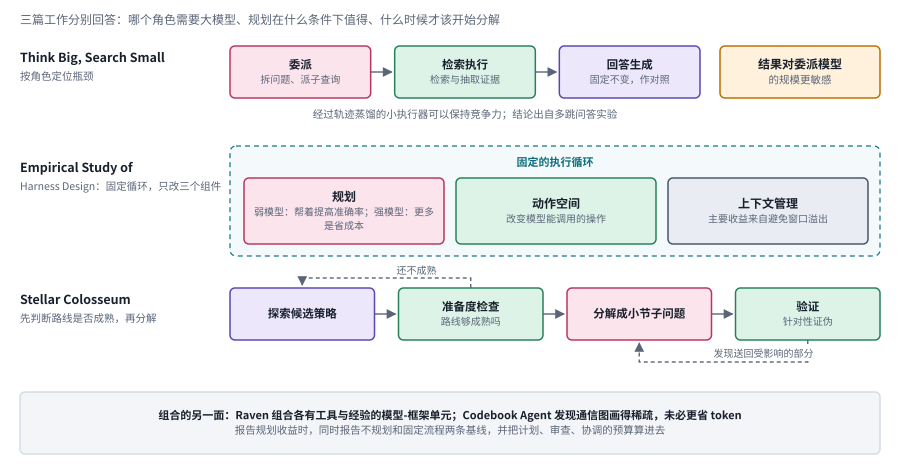

*图：上：按角色拆分搜索 agent；中：固定执行循环、只改三个组件的受控实验；下：先判断路线是否成熟再分解。*

先看一个关于分工的实验。**[Think Big, Search Small](https://arxiv.org/abs/2607.07548)** 把分层搜索中的任务委派、检索执行和答案生成拆开，固定负责回答的角色，比较前两个角色需要多大的模型。作者报告，在其多跳问答实验中，结果对委派模型的规模更敏感，而经过轨迹蒸馏的小执行器可以保持竞争力。最值得借鉴的是这种按角色定位瓶颈的实验设计：并非每个环节都需要同样大的模型。至于这个分工结论能不能推广到操作类、证明类或机器人任务，还得另行验证。

那么，什么时候真的需要规划？一个计划至少要回答三件事：当前要解决哪个子问题，依赖哪些已经确认的事实，以及怎样知道这一步做完了。回到周报的例子，如果日志格式统一、检查规则已知，一段固定程序通常就够了；只有当文件格式、依赖关系和异常情况要读过之后才能确定时，系统才更需要根据观察调整步骤。规划的必要性来自任务的不确定性，任务描述看起来复杂与否倒在其次。这也正是 Anthropic 区分工作流和 agent 的出发点。

[An Empirical Study of Harness Design for Coding Agents](https://arxiv.org/abs/2609.20804) 把这个问题放进了受控实验。它没有拿几个完整框架互相比，转而在固定的执行循环下分别改变规划、动作空间和上下文管理，把系统表现拆成可以分别检验的变量。作者在所测模型和编码任务上报告：上下文管理的主要收益来自减少窗口溢出；规划对较弱的模型更像是在帮忙提高准确率，对较强的模型则更多体现为节约成本；让已经卸载出去的内容可以重新取回，在该设置下并没有额外提高准确率。这些结果说明，组件的作用会随模型和预算变化，有规划、有恢复接口的系统未必就更好。更值得研究的问题是，在什么条件下值得规划，又值得为它付出多少成本。

困难任务还要决定什么时候开始分解。一个还不可靠的方案如果过早被拆成许多子任务，后面的执行就会围绕一个错误的前提忙个不停。[Stellar Colosseum](https://arxiv.org/abs/2609.15983) 面向数学和理论计算机研究，先探索候选策略，用一道"准备度检查"决定何时进入证明分解，再把验证中的发现送回受影响的部分。它让人看到，规划除了分解，还包含对路线是否成熟的判断，这和 Tree of Thoughts 先评估再展开的思路遥相呼应。当然，这套设计出自特定的科研场景，它的复杂程度不适合当作所有 agent 的默认模板。

规划和模块组合也会互相影响。[Raven](https://arxiv.org/abs/2609.33439) 把由模型和专用执行框架组成的单元用于跨领域分工，由上层负责协调子任务、处理执行依赖和整合结果。这和把同一个模型调用很多次不一样，被组合的单元可能各有不同的工具和经验，有点像第二阶段 HuggingGPT 的思路在 agent 层面的再现，HuggingGPT 让 ChatGPT 当控制器，把子任务分派给不同的外部模型去执行。这样的系统要检查接口是否兼容、错误怎样传播、整合要花多少成本，单凭各个子 agent 的成功率很难预测整体表现。

[Codebook Agent](https://arxiv.org/abs/2609.02264) 从另一个角度研究多 agent 组织：怎样为任务选择通信结构，又怎样衡量这个结构的实际代价。通信图画得稀疏，未必就能减少 token 或提高效率；能否把局部工作转化成最终结果，才是要验证的目标。把它和 [Mo' Models, Mo' Problems](https://arxiv.org/abs/2609.17306) 一起读，可以把"多 agent 更强"拆成两个问题：选哪些模型，以及让它们怎样协作。两者的深入比较放在[协作章](08_collaboration.md)。

这一节的几篇工作合起来，给规划研究提了一个朴素的要求：报告规划带来的收益时，要同时报告不规划、固定流程这两条基线，并且把计划、审查和协调额外花掉的预算算进去。

### 3. 观察：下一步需要什么，就去看什么

工具把内容返回来之后，系统并没有自动得到可用的证据。观察选择和普通的文本摘要也不一样：摘要想保留整体内容，决策用的观察则必须留下下一步要用的证据，包括还没解决的约束，以及可能推翻当前假设的信息。删掉重复内容可以省成本，可如果只保留看起来相关的片段，系统也可能把自己的错误解释越描越深。所以这个分支要同时比较信息量、证据覆盖和后续决策的质量，尤其要检查失败信息有没有在"清理"时被一起扔掉。

> 主线位置：第五阶段的上下文工程。接 ReAct 把观察送回模型的循环，回应 Lilian Weng 列出的"有限上下文长度"挑战；工程上对应 Anthropic《Effective context engineering for AI agents》里的即时检索与压缩。

> **要点：** 工具返回的内容不会自动变成证据。决策用的观察要留下下一步用得上的东西，包括还没解决的约束和可能推翻当前假设的信息；这一节的论文分别研究先看哪里、留下什么，以及收益到底来自新信息还是来自调用本身。

下图左边是三种典型的"太多"：一百处搜索匹配、几小时的音视频、一大批执行轨迹。中间四个粉色框是这一节论文给出的四种选择方式：A New Role for Relevance 让相关性决定先搜哪里、先给模型看哪些片段；OmniReasoner 先低成本地粗看全局，必要时再放大某一段；Online Video Agent Harness 和 AdaVDR 按需调度专门工具，中间结果不可靠时再回退；STRACE 在批次层面减少重复的失败，在单条轨迹里沿依赖保留可能解释失败的步骤。它们最后都要交出右边那个紫色框里的东西，也就是下一步决策真正要用的证据。中间一行是 Thinking With Tools, Not With Pixels 的对照设计：保留调用时写下的文字，把返回的图像换成占位符，如果效果依然保留，起作用的可能是调用时写下的目标和位置。最下面一行讲观察以什么形式进入后面的状态，三篇工作分别对应压缩、经验重组和过时指令的治理。

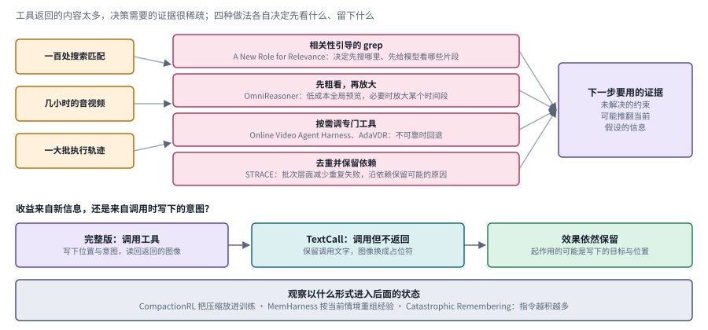

*图：左边是三种返回太多的情况，中间是四种选择方式，右边是下一步要用的证据；下方是 TextCall 的对照设计和观察进入状态的三种形式。*

先看一个面向执行轨迹的工作。**[STRACE](https://arxiv.org/abs/2607.07702)** 处理的是用来优化 agent 的执行轨迹：它先在批次层面减少重复出现的失败，再沿着文本之间的依赖结构，保留那些可能解释失败原因的步骤。和简单截断相比，它想保住的是诊断所需的结构，最近的文本只占其中一部分。论文报告的因果定位，要结合它的干预方式和评测设定来理解；依赖图上被保留下来的节点，光看名字还不能当作已经证明了的真实根因。

再回到周报的例子。假设一次搜索返回了一百处匹配，模型还得判断哪些和问题有关，要不要打开上下文细看，不同文件之间能否互相印证。如果把所有结果原样贴进窗口，检索问题只是变成了一个更贵的阅读问题。这正是 Anthropic 说的上下文腐化：窗口塞得越满，模型从中准确找回信息的能力就越弱。

[A New Role for Relevance](https://arxiv.org/abs/2607.24223) 研究相关性如何参与到与语料的交互之中，它的用途也从一次性选出若干文档扩展了开来。它把相关性估计和类似 grep 的细粒度探索联系起来，关注搜索的顺序以及优先呈现哪些证据片段。由此引出一个重要的区分：检索器找到了"可能相关的文件"，离 agent 完成证据的定位、组合和验证还差好几步。这也是检索增强问答走进多步研究任务以后冒出来的新问题。

多模态任务让这个问题更加突出，因为一段长视频的信息量远远超过上下文能装下的范围。[OmniReasoner](https://arxiv.org/abs/2607.19339) 先用较低的成本粗看一遍长音视频，再决定要不要放大某个时间段，强调的是在时间轴上选择观察位置。[Online Video Agent Harness for Long Video Understanding](https://arxiv.org/abs/2609.12818) 从给定的视频和用户问题出发，按需调度专门的工具并汇合证据。[AdaVDR](https://arxiv.org/abs/2608.25559) 进一步把视频理解和外部检索结合起来，并在中间结果不可靠时考虑回退。三者关心的共同问题，是下一次观察能消除哪一种不确定性；看完更多帧本身算不上目标。

不过，调用工具后成绩变好了，并不能直接说明收益来自工具返回的新信息。[Thinking With Tools, Not With Pixels](https://arxiv.org/abs/2608.09682) 设计了一个巧妙的对照：保留工具调用时写出的结构化文字，却把返回的图像去掉，以此检查收益的来源。这个方法很值得学：如果删掉被认为关键的信息以后效果依然保留，真正起作用的可能是调用时写下的目标、位置或意图。这并不能推出所有视觉工具都没用，它提醒我们把"获得新证据"和"帮模型理清思路"分开测量。

长期任务还要决定观察以什么形式进入后面的状态。[CompactionRL](https://arxiv.org/abs/2607.05378) 把上下文压缩放进训练过程。Anthropic 上下文工程那篇文章里的压缩，是由工程师把旧的历史总结成摘要，两者形成了从工程到学习的对照；[MemHarness](https://arxiv.org/abs/2607.28272) 讨论经验在当前任务中怎样重新组织；[Catastrophic Remembering](https://arxiv.org/abs/2608.11095) 则提醒我们，持续积累下来的指令也可能变成负担。三篇分别涉及压缩、经验使用和过时信息的治理。基础章把它们放在一起，是想说明"保留全部历史"远远算不上完整的状态管理方案；具体机制在[记忆章](02_memory.md)。

### 4. 执行框架本身怎样被理解和改进？

当一个 agent 只有几十行循环代码时，开发者对每个行为由哪里控制一清二楚；等系统长大了，同一个行为可能同时牵涉提示词、工具包装、错误重试和状态存储。修改框架和修改模型也不是一回事：前者通常改变的是模型被要求怎样工作，模型内部存储的知识并没有动。可两者又会相互影响，更严格的控制规则可能帮了小模型，也可能限制了强模型的探索空间。研究框架优化，首先要标出哪些部分可以修改、候选修改由谁提出、用什么独立标准挑选，然后区分是在固定任务上做适配，还是获得了跨任务的迁移，避免把"挑出最好看的演示配置"当成通用的改进。

> 主线位置：第五阶段。接 SWE-agent 与 Agentless 的框架对照，对应 OpenAI《Harness engineering》里"失败时补上缺失的工具和结构"的做法；更激进的自动改写与递归改进见[第 03 章](03_skills_and_self_improvement.md)。

> **要点：** 执行框架长大以后，改进它先要回答三个问题：哪些部分可以改，谁来提出修改，用什么独立标准挑选。自动改进最常见的坑，是修改只适应了开发任务。

下图上排是一轮框架改进的流程：从失败轨迹和运行诊断出发，先定位某个行为对应哪段代码，再提出对指令、工具或循环的修改，交给独立验证，最后提交或回退，新的运行又会产生新的诊断。下排三个框把这一节的论文按它们回答的问题归了类。哪些部分可以改：MemoHarness 把框架拆成六个可编辑的控制维度，Harness Handbook 把行为和源代码位置联系起来，Recursive Experiential-Working Memory Evolution 让失败定位到具体的记忆组件。谁来提出修改：Better Harnesses, Smaller Models 用元 agent 从失败轨迹里找适配，SoL-Pi 用自动研究循环筛出可复用的机制，HarnessDev 则测量模型本身能不能搭建和演化框架。用什么标准挑：HarnessCompass 只允许任务无关的修改，并且分组件优化，以减少组件之间的干扰。底部橙色框就是这一节反复提醒的那个坑。

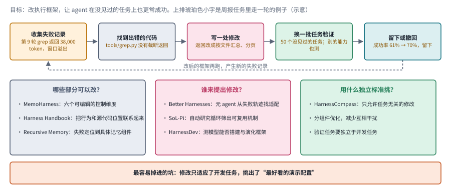

*图：上排是一轮框架改进的流程，下排把本节论文按"哪些可改、谁来提、用什么挑"三个问题归类。*

**[Better Harnesses, Smaller Models](https://arxiv.org/abs/2607.08938)** 把自动的框架适配和模型成本选择放在一起研究，适合接在三.1 的 The Harness Effect 后面读，那项工作固定任务和模型、只替换编排层，看成本和时延怎样变化。标题里的成本降幅对应论文特定的任务和计费条件，拿来估算自己的部署预算并不合适。这里值得追问的是：小模型在怎样的执行安排下，能够接手原本交给大模型的任务？搜索框架本身花掉的开销有没有被计入？选出来的框架到了新任务上还有没有效？

框架长大以后，让模型"优化一下这个 agent"往往无从下手，它得先找到某个行为对应的实现在哪里。[Harness Handbook](https://arxiv.org/abs/2607.13285) 把这一步当作研究问题来做。它用静态分析加上模型辅助，把行为和源代码的位置联系起来，再引导 agent 一步步找到相关的实现。读这篇时可以把"找到了正确的修改位置"和"改完以后任务表现真的提高了"分开看：前者是框架维护的重要前提，离后者还有一段距离。它也说明，代码搜索之外，让系统结构对维护者可读同样重要，这和 OpenAI 报告里"让应用对 agent 可读"的思路不谋而合。

[MemoHarness](https://arxiv.org/abs/2607.14159) 关注另一种改进：它不给所有任务套同一个固定配置，转而保存运行诊断和跨任务经验，再为新案例挑选合适的控制方式。它可以和 [Recursive Experiential-Working Memory Evolution](https://arxiv.org/abs/2608.24876) 对照着读：后者区分当前进度和经验技能，让失败更容易定位到具体的记忆组件，再做带验证的局部更新。两者都在利用经验，经验决定的却是不同的对象，用一句"加了记忆"概括它们会丢掉太多信息。

自动改进最容易掉进的坑是过拟合。[HarnessCompass](https://arxiv.org/abs/2608.01918) 正面处理这个问题：如果修改只是适应了开发任务，就很难说系统获得了通用能力。作者提出任务无关的约束、更主动的反馈和分组件优化，试图减少走错方向以及组件之间的互相干扰。读这篇时最重要的实验条件是验证任务是否独立，以及修改之后有没有把其他能力一起弄坏，迭代了多少轮反倒是次要的。

还有两篇工作把框架设计本身当成了被测量和被探索的对象。[HarnessDev](https://arxiv.org/abs/2609.01437) 把"创建和改进一个能运行的执行框架"作为评价对象，区分从最小起点搭建系统和根据反馈演化系统两种情形。它帮我们看到旧评价习惯的一个盲点：一个模型在现成框架里干活很好，未必就擅长设计框架。[SoL-Pi](https://arxiv.org/abs/2609.20519) 则在自动研究循环中筛选可以复用的机制，涉及动作执行、上下文压缩、观察处理和委派阅读。两篇分别偏重能力测量和机制探索，读的时候别把它们当成同一张排行榜。

[Language model harnesses are compositional generalizers](https://www.alphaxiv.org/abs/2607.language-model-harnesses) 从框架与组合泛化的关系提出问题；[The Evolution of AI Office](https://www.alphaxiv.org/abs/2609.evolution-ai-office-agents) 则把办公 agent 的目标放在可检查、可修改的交付物上。两者连起了框架设计的两个层面：内部怎样组织可复用的行动，外部怎样定义任务算完成。由此比较系统时，既要看流程能不能迁移，也要看产出物能不能被继续使用和修改。周报做完以后，导师下周想加一列新指标，这张表能不能被顺手改好，同样是衡量一个 agent 的标准。

### 5. 训练模型与修改框架，能不能各做各的？

前面几个分支大多默认模型不动、只改框架。可模型总要训练，而训练用的轨迹是在某一套工具和上下文规则下产生的；部署时的框架又决定了模型会遇到哪些状态。如果两边各自变化，训练时有效的动作格式、对反馈的理解，甚至什么时候该停下来的习惯，都可能在部署时失效。这个分支要把三件事分开研究：接口是否兼容，状态分布有没有变化，模型和框架能否联合优化。第一件靠约定就能解决，后两件通常要重新收集轨迹或检验迁移，一次工具调用成功远远不足以宣布适配完成。

> 主线位置：第二阶段的工具学习与第五阶段的执行框架在这里交汇。接 Toolformer、ToolLLM 的训练路线；模型与框架共同演化的更多讨论见[第 03 章](03_skills_and_self_improvement.md)和[第 05 章](05_rl_and_distillation.md)。

> **要点：** 训练用的轨迹是在某一套框架下产生的，部署时的框架又决定模型会遇到哪些状态。这一节的论文要么让训练直接接在原生框架上，要么把框架带来的好行为学进模型。

下图上半部分是 ClawGym II、Agent Lightning v1.0 和 LEGO-RL 共用的思路。部署时的执行框架照常运行，它会截断历史、合并请求、改变返回格式；环境放在隔离的沙箱里；一个代理设在模型调用的边界上，把每次请求和响应转给被训练的模型，同时记录下来交给训练器。训练器拿到的只是这些记录，它要重建出每次决策当时实际看到了什么，重新分词、重算概率、计算优势，再去更新模型。下半部分是这一节建议的四组对照条件：原始系统、只更新模型、只更新框架、两者同时更新，比较时把工具权限和总预算对齐；最底下一行是另一条路线的两篇代表。

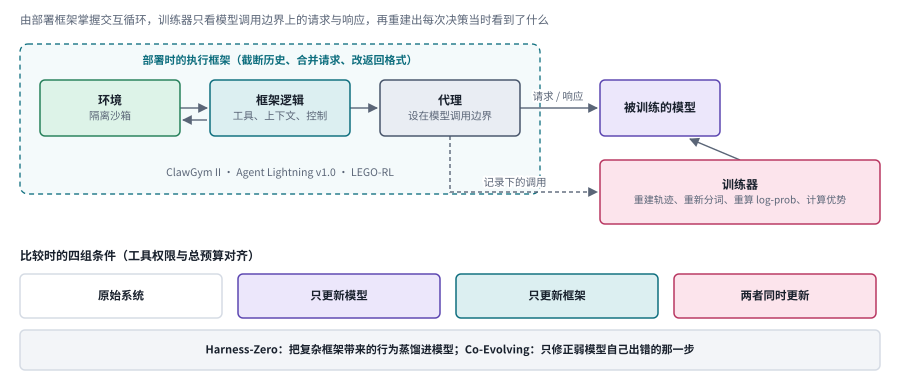

*图：上：部署框架掌握交互循环，代理设在模型调用边界，训练器据记录重建轨迹；下：比较时的四组条件。*

对齐还牵涉训练记录本身。框架截断了历史、合并了请求，或者改变了工具返回的格式以后，训练器仍然得还原出每一次决策当时实际看到了什么，并把奖励对应到正确的模型输出上。否则，即使动作接口是兼容的，训练也可能在优化部署时根本不会出现的状态。这就像用一份排版过的笔记去复盘一场考试，复盘时看到的内容和考场上看到的并不一样。

有三篇工作专门处理这个工程落差。[ClawGym II](https://arxiv.org/abs/2608.16798) 以黑箱方式把复杂的框架和强化学习连起来，用隔离的执行环境和设在模型调用边界上的代理来收集交互。[Agent Lightning v1.0](https://arxiv.org/abs/2608.17528) 强调由部署框架掌握环境交互的循环，训练器只观察模型的请求和响应；这样做就得处理轨迹重建、分词和优势计算等一致性问题。[LEGO-RL](https://arxiv.org/abs/2608.17393) 同样关注原生编码框架和策略优化的连接，还把环境崩溃、奖励漏洞以及训练与执行之间的差异纳入了讨论。三篇可以放在一组读，它们都想减少"为了训练而重写一个不同的 agent"带来的落差，只是工程上的切入点各不相同。

另一条路线问的是：复杂框架带来的好行为，能不能学进模型里，部署时就不必保留那么多专门的逻辑？[Harness-Zero](https://arxiv.org/abs/2609.24974) 研究框架蒸馏，特别处理了源框架和目标框架在动作空间和可见信息上不一致的问题。它学的东西要能在目标系统里执行，照抄教师的文字行不通。与它相邻的 [Co-Evolving Harnesses and Models](https://arxiv.org/abs/2609.09134) 讨论为什么让弱模型直接模仿强模型的完整轨迹未必有效，并研究同策略纠正的作用：先在弱模型自己的轨迹里找到出错的那一步，只修正那一处。

这组工作让"模型强还是框架强"这种二选一的问法显得过于简单，模型、接口和训练信号会相互适应。比较时可以设置四组条件：原始系统，只更新模型，只更新框架，两者同时更新，并且把工具权限和总预算对齐。没有这样的区分，就很难知道增益能不能迁移到另一个部署环境。

### 6. 一次行动成功之后，系统还能安全继续吗？

完成了当前这个动作，整个任务未必就结束了，后续行动也未必仍然得到授权。写对了一个文件之后，系统可能接着去覆盖别的文件；一次查询有权限，查到的敏感信息却不一定可以随意传播。所以这里要先讨论停止条件、后续授权和可撤销性，然后才轮到动作的正确率。一个合理的工作循环应当能区分三种状态："还需要更多证据""需要人来决定"和"任务已经完成"，否则继续执行这件事本身就会成为失败的来源。

> 主线位置：边界。接 Chip Huyen 对写入动作风险的提醒，以及 Anthropic 在沙盒中充分测试、配好护栏的建议；OpenAI 报告里的机械化约束和后台清理也属于这一层。

> **要点：** 完成当前动作之后，系统要先判断该继续、该请人决定还是该停下，然后才谈动作的正确率。这一节的论文分别研究修改能否撤回、风险出现在生命周期的哪个阶段，以及安全怎样和任务完成一起优化。

下图左上角是一次动作完成之后的三个出口：还需要更多证据就继续观察，遇到不可逆的操作就停下来请人决定，任务已经完成就记录下实际状态再退出。右上角是 EvoUndo 的问题：自我修改可能留下持久的副作用，作者在不同于创建时的反事实状态下验证这些修改能否恢复，在 600 个未见过的任务里，找到了 197 个提升了能力、却没有通过可恢复性验证的修改。中间一排是 HarnessRisk 按生命周期划分的六个阶段，从配置、能力扩展、运行、状态保存、动作控制一直到事件恢复，风险可能出现在任何一个阶段，也可能沿着状态一路延续。底部是两篇把安全当作优化目标的工作，以及这一节最后的那条要求。

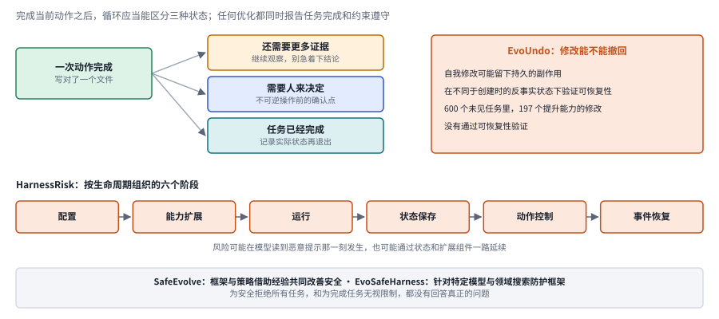

*图：左上是一次动作之后的三个出口，右上是 EvoUndo 的可恢复性验证，中间是 HarnessRisk 的六个生命周期阶段。*

完成眼前的任务和保持长期可用是两件事。让 agent 自动修改工具配置，可能让这一次任务快了，却破坏了以后的权限检查；让它删除旧文件，可能腾出了空间，却把恢复所需的证据也删掉了。回到周报的例子，如果助手为了让表格好看，顺手清理掉几组"看起来没用"的崩溃日志，周报是交了，下周排查问题时却无从下手。所以检查最终答案之外，还要问：系统改了什么？改动能不能撤回？失败之后由谁来处理？

[EvoUndo](https://arxiv.org/abs/2608.28363) 把自动修改之后能否恢复当作一个独立的条件来研究，考察修改在不同状态下的可逆性。这和"保存一份旧提示词"不一样，修改可能产生持久的副作用，恢复过程得覆盖这些变化。[HarnessRisk](https://arxiv.org/abs/2608.17597) 则按生命周期来组织安全测试，把配置、能力扩展、运行、状态保存、动作控制和事件恢复放在一起。它表明，风险可能发生在模型刚读到恶意提示的那一刻，也可能通过状态和扩展组件一路延续下去。

[SafeEvolve](https://arxiv.org/abs/2609.02786) 研究执行框架和策略怎样利用经验共同改善安全性；[EvoSafeHarness](https://arxiv.org/abs/2609.05903) 关注针对特定模型和领域来优化防护框架。这些思路都没法简化成"再加一句安全提示"。任何优化都应当同时报告任务完成情况和约束遵守情况：一个为了安全拒绝所有任务的系统，和一个为了完成任务无视限制的系统，都没有回答真正的问题。更完整的威胁与评价分类在[安全章](07_safety.md)。

持续执行可以先从明确的运行边界入手：工具声明自己接受的输入范围，不可逆操作前设置确认点，任务保留预算和退出条件，失败之后记录下实际的状态。这几样机制分别限制无效调用、控制副作用、支持事后恢复，再和任务所需的规划与学习方法组合起来。

## 四、把不同路线放在同一张比较表里

读完六个分支，很容易被几十篇论文的名字淹没。其实它们改动的对象来来回回就那么几类：工具的表达形式，推理和规划的安排，观察的筛选，框架的配置与自动修改，训练与部署的连接，以及运行生命周期中的约束。下面这张表把这些对象和各自想解决的困难、要付出的代价、必须保留的对照放在一起。真实的系统往往同时用到好几行，比较时最好一行一行分开检查，别把整套系统的收益全记在某一个组件头上。最右边一列也可以拿来审自己的实验设计。

> **本节要点：** 六个分支改动的对象归成八行，每行写明想解决的困难、要付出的代价和必须保留的对照。它和第二节末尾的总对照互为补充：那边按方法家族比较，这边按改动的对象比较。

| 改变什么 | 代表入口 | 主要想解决的困难 | 通常要付出的代价 | 必须保留的对照 |
|---|---|---|---|---|
| 工具表达形式 | Bitter Lesson、Harness as a Language | 多次调用的依赖与组合不易表达 | 更复杂的执行与权限检查 | 同模型、同工具能力、同预算 |
| 规划与组件安排 | Empirical Harness Study、Stellar Colosseum | 步骤依赖不清，过早分解 | 额外计划、审查和协调 | 无规划或固定流程基线 |
| 观察与证据选择 | A New Role for Relevance、OmniReasoner、Online Video Agent Harness | 有用证据稀疏，返回内容太多 | 选择观察的决策与工具开销 | 随机或固定取样、去掉新观察 |
| 经验与局部配置 | MemoHarness、Recursive Experiential-Working Memory Evolution | 一个固定框架不适合所有情况 | 存储、检索、经验失效处理 | 无记忆、错误记忆、未见任务 |
| 框架的自动修改 | HarnessCompass、SoL-Pi | 手工调整慢，组件相互干扰 | 搜索与验证成本，回归风险 | 固定模型、独立验证集 |
| 训练与部署连接 | ClawGym II、Lightning、LEGO-RL | 训练轨迹与原生运行不一致 | 轨迹重建和训练基础设施 | 相同部署框架的训练前后对照 |
| 框架行为内化 | Harness-Zero、Co-Evolving | 专用框架复杂且难迁移 | 蒸馏数据与额外训练 | 同一个目标框架、纠正与模仿对照 |
| 生命周期约束 | EvoUndo、HarnessRisk | 一次改进留下难恢复副作用 | 恢复验证、权限与记录成本 | 完成率和风险同时报告 |

这些路线可以组合，组合本身也需要证据。比如"程序式调用加记忆加多 agent 加反思"，就有四个可能增加成本的部分，只看最后分数高，说明不了每个部分都必要。Anthropic 那篇文章反复强调从最简单的方案出发，道理也在这里。做组件消融，目的是让研究结论能被理解、能被迁移，系统显得简单只是附带的效果。

## 五、代表研究：接口、计算与团队组成

工具接口、模型内部的计算方式和团队的组成，都会影响任务表现，它们改变的却是不同的层次。下面三项研究正好各占一层，读的时候可以练习一件事：先认出论文真正改动的变量是什么，再把任务质量和执行成本放进同一套比较条件里。

> **本节要点：** 三项研究各占一层，分别是接口形式、模型内部的计算和团队的组成。读的时候先认出论文真正改动的变量，再把任务质量和执行成本放进同一套比较条件。

### The Bitter Lesson of Tool Calling｜2608.06370

[原文](https://arxiv.org/abs/2608.06370)。它比较两种接口：模型一次次生成结构化的 JSON 调用，或者生成一段调用工具的程序。程序可以自然地表达循环、依赖和并行，也带来了代码执行和错误处理的额外要求。作者在 BFCL v4 上比较了 14 个模型，报告程序式调用在其中 11 个上与原生 JSON 调用持平或更好，并另外考察了并行分支和上下文干扰。这是一个有条件的实证方向：收益并非在每个模型上都一致，复杂调用场景也没法用一个总分完全概括。题目借用了 Rich Sutton 那篇著名短文《The Bitter Lesson》的名字。

**研究意义：** 它说明，模型能力之外，接口形式本身也会影响任务表现。这和第四阶段的两项发现一脉相承：SWE-agent 给同一个模型换上更好用的命令，修复成功率明显提升；CodeAct 让动作写成代码，成功率最多高出 20%。**比较条件：** 要保持工具权限一致，统计失败的调用，并把代码运行的成本算进去，才能判断收益确实来自接口的表达能力。

### Looped Language Models Improve Compositional Tool Calling｜2608.18171

[原文](https://arxiv.org/abs/2608.18171)。它研究让模型在内部进行循环计算，是否有助于完成彼此依赖的多步工具调用。研究区分了孤立的 API 调用和组合任务，并讨论了自适应计算在性能和成本之间的权衡。

**研究意义：** "循环"可以发生在模型内部，也可以发生在模型和工具之间，两者是不同的机制，前者改的是模型的计算，后者就是第一节那张工作循环图里模型提出动作、工具执行、观察再送回模型的来回。此文的主问题属于[效率与架构](13_efficiency.md)，在本章作为交叉阅读。**局限：** 要核对训练配方和计算预算是否匹配，计算量更大带来的收益，没法全部归功于架构本身。

### Mo' Models, Mo' Problems: How to best select model pools when designing Multi-Agent Systems｜2609.17306

[原文](https://arxiv.org/abs/2609.17306)。作者比较了模型池的几种选择策略，区分生成前的路由和生成后的聚合，并在其设置中观察到，扩大模型池未必带来改善。

**研究意义：** 模型池应当按成员之间的互补性来构建，成员数量多少只是表面。实验应当比较新加入的成员是否提供了独有的能力，以及路由和聚合能否利用这种差异，这可以和 Anthropic 文中的路由模式对照着看，路由就是先给输入分类，再交给专门的流程去处理。**局限：** 候选模型、聚合器、任务类型和预算都会影响结论，本章不把论文中关于特定模型家族的结论推广到所有系统。进一步阅读见[协作专题](08_collaboration.md)。

这三篇合在一起，提出了一个可以检验的问题：改进究竟来自更好的模型、更多的计算，还是更合适的系统接口？本指南建议把这三者分开比较，别把所有增益都笼统地记作"agent 更强了"。

## 六、系统设计中的关键区分

最后，把本章反复出现的几组容易混淆的概念收拢到一张表里。它们看起来都是常识，可在读论文和做实验时，一不留神就会把左边一列当成右边一列来报告。Chip Huyen 提到的"agent 以为自己完成了任务"，很大程度上就是这几组区分没有守住的结果。

> **本节要点：** 五组容易混淆的概念，左边一列常被当成右边一列来报告。守住这几组区分，读论文时才说得清一次成功究竟依赖了什么。

| 容易混淆 | 正确的区分 |
|---|---|
| Agent 与固定工作流 | 看下一步是否由模型动态决定，用没用大模型说明不了问题 |
| 规划与执行 | 计划只是候选步骤；工具结果才说明动作有没有发生 |
| 工具会返回文字与工具可信 | 外部文字可能错误，甚至包含诱导系统越权的指令 |
| 调用格式正确与任务完成 | 参数符合格式只是起点，结果与约束还要检查 |
| 多尝试几次与方法更好 | 重试提高成本，比较时应一起报告预算 |

这些维度共同决定了系统的执行行为。不同系统的实现千差万别，但只要没有完整的执行记录，就很难定位一次成功究竟依赖了什么。

## 七、研究机会

回到开头那份周报：助手要把一周二十几组训练实验整理成表格，标出崩溃的实验，和基线比较，再发给导师；开头那个普通聊天模型只说出了做法，表格和邮件都没有出现。从"说出怎么做"到"把周报真正交到导师手里"，中间其实跨过了三道坎：先要把一句模糊的请求变成一串可以执行、可以修正的步骤，再要让执行系统根据实际遇到的情况调整自己，最后还得保证每一步做完以后，系统仍然处在一个可以恢复、可以继续的状态。这三道坎分别对应主线上的规划阶段、执行框架阶段和边界问题，也正好是姚顺雨所说的效用问题落到基础系统上的样子：基准上的成功率很高，真实工作流里的事情却未必做成了。下面三个问题按这个顺序排列，每一个都还有大片空白。

> **本节要点：** 三个研究问题依次对应周报的三道坎：开放目标怎样变成任务结构，执行框架怎样按任务状态自适应，长任务里的行动单元怎样做到可恢复、可组合。

下图把这三道坎画成一条路。一句模糊的请求先要变成可执行、可修正的步骤，这是规划阶段留下的问题；执行系统接着要按实际遇到的情况调整自己，这是执行框架阶段的问题；每一步做完以后，系统还得处在可以恢复、可以继续的状态，这是边界上的问题。每道坎下面挂着下面要讲的一个研究问题。

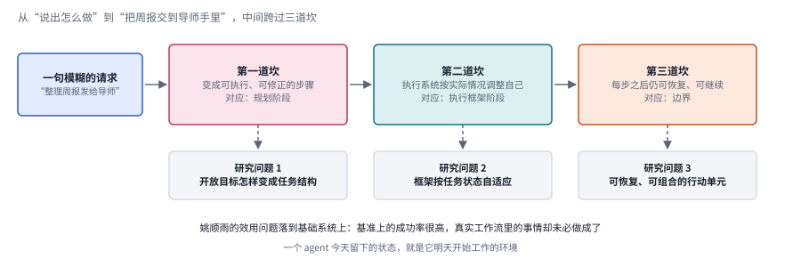

*图：周报从"说出怎么做"到交到导师手里的三道坎，分别对应规划阶段、执行框架阶段和边界，下面挂着本节的三个研究问题。*

**1. 如何把开放目标转化为可执行、可修正的任务结构？**

真实的目标往往没有完整的规格，依赖关系也常常要等工具执行以后才显现出来。周报的例子里，"哪些实验算崩溃"这件事，要读过日志才知道该怎么定义。这里的研究空间在于设计一种任务表示，能够逐步补全前提、发现缺失的步骤并更新计划，预先生成的清单只能当作起点。Lilian Weng 在 2023 年就把"遇到意外时调整计划"列为难点，Chip Huyen 也对模型的规划能力存疑，这个问题至今没有很好的答案。关键的评价方式，是看系统在新环境和不完整信息下，能否减少对人工流程设计的依赖，同时让目标和状态始终可以被检查。

**2. 如何让执行框架根据任务状态自适应，摆脱固定配方？**

工具暴露多少、观察粒度多细、重试和停止规则怎样定，这些通常都是开发者预先设好的，不同任务需要的组合却并不相同。研究机会在于把框架的选择变成一个受约束的决策问题，同时分清收益来自减少交互、改善依赖的表达，还是仅仅多花了预算。Anthropic 的工具与上下文工程文章给出了大量手工经验，OpenAI 的报告展示了人怎样一点点把环境调到适合 agent；把这些经验变成系统可以自己做出的选择，是很自然的下一步。实验上应当在未见过的任务和不同的模型上检验配置能否迁移，避免只是对固定基准搜出了一套更合适的提示。

**3. 如何在长任务中形成可恢复、可组合的行动单元？**

单次工具调用缺少对前提、后果和失败恢复的统一描述，多个局部正确的动作组合起来也未必可靠。可以研究带"状态契约"的行动接口，也就是每个动作都声明自己需要什么前提、会造成什么改变、失败了怎样回退，再在执行过程中动态核查这些契约。周报助手在删除任何一个日志之前，如果都能说清这一步可不可以撤回，很多事故就不会发生。研究的重点是，面对工具失败、环境变化和不可逆操作时，系统能否定位受影响的依赖，恢复必要的状态，然后继续完成目标。这也回应了姚顺雨的另一个观察：真实世界里的任务是一个接一个连续发生的，一个 agent 今天留下的状态，就是它明天开始工作的环境。

## 相关主题

这一章只搭了一个基础的骨架，其中好几个环节在别的章节有更深入的展开。如何保存和使用长期任务状态，见[记忆与上下文](02_memory.md)；任务跨度、场景覆盖与能力组合怎样被测量，见[评测与能力基准](06_evaluation.md)；怎样把权限与约束落实到执行过程中，见[安全与对齐](07_safety.md)；想系统了解工具学习的问题、方法与应用，可以读[工具学习综述](https://arxiv.org/abs/2304.08354)。
