# 02｜记忆：怎样记得住、用得对，也忘得掉

[首页](../README.md) · [专题索引](../README.md#topics) · [文献目录](../catalog/02_memory.md)

## 方向背景：为什么智能体需要记忆

设想你请一个助手陪你写毕业论文，前后要写好几个月。第一周你告诉它：导师要求所有图的坐标轴都用英文，实验结果统一放在 results_v2 文件夹里，引用格式用 ACL。第三周导师改了主意，结果改放 results_v3，因为 v2 里有一组数据跑错了。到了第六周，你让它帮你重画第四章的图。一个好的助手应当记得坐标轴要用英文，记得去 v3 里取数据，也记得 v2 那组数据为什么作废；它还应当知道你上个月随口说过的"先用柱状图凑合一下"只是权宜之计，早就不算数了。

今天的很多系统会在这里栽跟头。最常见的情况是它什么都没记住，每次对话都从头开始，你得把要求重新讲一遍。稍好一些的系统把聊天记录全存了下来，可它从记录里检索出来的，很可能恰好是第一周那句"结果放在 results_v2"，于是它信心十足地画出了一张用错数据的图。还有一种情况更隐蔽：系统记住的东西越来越多，提示越来越长，模型反而开始忽略夹在中间的关键约束，回答变慢、变贵，也变得更不可靠。

所以记忆研究要回答的问题，远比"把历史存下来"复杂。目标、约束、已完成的步骤和外部环境都会随时间变化；交互一旦超出上下文窗口，或者任务跨越多个会话，系统就得自己决定保留什么、以什么形式保留、什么时候取回、取回之后信不信，以及什么时候该把旧的东西忘掉。存得越多，检索和推理的负担越重；压缩得越狠，又越可能丢掉以后才派得上用场的证据。一个可靠的记忆系统，要能让任务延续下去，能接受纠正，也能说清楚自己的每条判断依据从何而来。

本章就沿着这条线索展开：先讲清几个基本概念，再借几篇写得很好的长文，把记忆研究从"查资料"一路走到"在上下文里持续学习"的发展脉络串起来，最后把 2026 年的新论文放到这条脉络上，按状态结构、经验整理、上下文压缩、读写策略、模型内部记忆、成本和多模态七个分支来读。

## 先读这几篇

这一章的主线借自下面几篇长文。它们出自长期在一线做 agent 和记忆系统的研究者与工程团队，叙事里有取舍、有立场，比从论文分类里倒推出来的脉络更可靠。建议按顺序读完，再回来看各分支的新论文。

| 顺序 | 文章 | 为什么读 |
|---|---|---|
| 1 | Lilian Weng，[LLM Powered Autonomous Agents](https://lilianweng.github.io/posts/2023-06-23-agent/)（2023-06） | 这篇经典长文把 agent 拆成规划、记忆和工具三个部件，其中的记忆一节至今仍是最好的入门。她借用人类记忆的分类做了一张对照表：感觉记忆对应原始输入的嵌入表示，短期记忆对应上下文里的学习，长期记忆对应一个可以随时查询的外部向量库，并顺手介绍了 LSH、ANNOY、HNSW、FAISS、ScaNN 这几种近似最近邻检索算法。文中对 Generative Agents 记忆流的讲解也很清楚：按新近程度、重要程度和相关程度给记忆打分，再定期把观察提炼成更高层的反思。读完能带走一套最基本的词汇，后面所有讨论都建立在这套词汇上。 |
| 2 | Letta，[Agent Memory: How to Build Agents That Learn and Remember](https://www.letta.com/blog/agent-memory/)（2025-07） | MemGPT 原班人马创办的 Letta 写的记忆总论，也是本章发展主线的骨架。文章把 agent 的记忆分成四层：最近消息组成的缓冲区，固定放在上下文里、可以被 agent 自己改写的核心记忆块，存在窗口外面、可以检索的完整对话历史，以及经过加工、建了索引的归档知识。它的核心判断有两条：记忆说到底是决定"此刻往上下文窗口里放哪些 token"的问题；检索只是支撑记忆的一种工具，它本身算不上记忆。文章顺着无状态模型、有状态 agent、MemGPT、sleep-time 智能体这条线往下讲，正好构成了一条演进脉络。 |
| 3 | LangChain，[Context Engineering](https://langchain.com/blog/context-engineering-for-agents)（2025-07） | 这篇文章把散落在各家产品里的上下文管理手法归成四类：写出去（把信息存到窗口之外，比如草稿本和长期记忆）、选进来（把需要的东西取回窗口）、压一压（摘要和裁剪）、隔开来（让子 agent 或沙箱各管一摊）。它还把情景、语义、程序性三类记忆对应到少样本示例、事实和指令文件上。文中引用了 Simon Willison 遇到的一个例子：ChatGPT 从记忆里调出了他的所在地，擅自画进了一张他要的图片里。这个例子很适合用来理解"选错了记忆"有多尴尬。 |
| 4 | 季逸超（Peak Ji），[Context Engineering for AI Agents: Lessons from Building Manus](https://manus.im/en/blog/Context-Engineering-for-AI-Agents-Lessons-from-Building-Manus)（2025-07） | Manus 团队把 agent 框架推倒重写了四次之后总结出的六条经验，全部来自生产环境。作者认为 KV 缓存命中率是生产级 agent 最重要的单一指标，因为输入与输出的 token 比例大约是一百比一；他主张把文件系统当作不受窗口限制、可由 agent 自己操作的外部记忆，并要求所有压缩都必须"可恢复"，比如网页内容可以丢掉，网址必须留下。文中还有两条反直觉的建议：让 agent 反复改写一份 todo.md 来把目标"背诵"到注意力的近处；把出错的步骤留在上下文里，让模型看到失败，从而少犯同样的错误。 |
| 5 | Anthropic，[Effective context engineering for AI agents](https://anthropic.com/engineering/effective-context-engineering-for-ai-agents)（2025-09） | Anthropic 应用 AI 团队的系统总结。文章提出"上下文腐化"（context rot）的说法：窗口里的 token 越多，模型准确回忆其中信息的能力就越弱，这种退化是渐进的，所有模型都有。因此上下文应当被看作一份边际收益递减的"注意力预算"，目标是找到能让期望行为最可能发生的、最小的一组高信号 token。文章给长程任务开了三味药：压缩（快满时总结并重开）、结构化笔记（把进度写到窗口外的文件里）和子 agent（在干净的窗口里干细活，只交回一两千 token 的摘要）。它还提倡"即时检索"：手里只留文件路径、查询和链接这样的轻量引用，用到时再加载。 |
| 6 | Letta，[Continual Learning in Token Space](https://letta.com/blog/continual-learning)（2025-12） | 这篇文章把记忆问题往前推了一大步，作为本章主线的最后一个阶段。作者认为，一个 agent 由权重和上下文两部分组成，持续学习也就有两条轴；在权重上做持续学习会遇到灾难性遗忘、隐私和奖励稀疏等老问题，所以从经验中学习的主要机制应当是更新学到的上下文。token 空间里的记忆可读、可以随模型升级迁移，遗忘只需删掉 token，还能像代码一样做版本管理和回滚。它的结论是："权重是暂时的，学到的上下文才会留下来。" |
| 7 | Letta，[Memory Models: Towards Agents That Learn](https://www.letta.com/blog/towards-agents-that-learn/)（2026-06） | 上一篇的续作，把"在 token 空间里持续学习"又往前推了一步。Letta 在研究中观察到，通用的前沿模型给长期运行的 agent 写记忆并不可靠：反复精炼之后的记忆会变得空泛、有损，有时又过于具体、推广不开，而且未必能稳定地改变 agent 在不同会话、不同模型上的行为。他们把原因部分归到训练上：今天的强化学习环境默认 agent 是无状态的，模型从来没有被训练去优化跨任务、跨会话的学习，而"把任务做完"和"从任务里学到东西"又常常彼此冲突；自我压缩和更长的窗口可以拉长任务，算不上真正的持续学习。文章由此提出专门负责创建和整理记忆的"记忆模型"，并把训练方式描述成 token 空间里的元学习：内循环让带着记忆的 agent 依次完成一串任务、边做边更新记忆，外循环用强化学习根据下游奖励去更新记忆模型本身，sleep-time 的离线整理也随之成了可以优化的目标。它的理由是，模型换代快、贬值也快，积累下来的记忆却会越用越值钱。这是一篇立场与规划性质的文章，作者说更多结果会在之后几周公布，文中还没有记忆模型的实验数字。它正好接在本章阶段五的末尾，也可以和三.2、三.4 里训练写入策略的论文对照着读。 |
| 8 | Wei-Chieh Huang、Kai Shu 等，[A Survey of Agent Memory in the Second Half: Towards Self-Evolving and Long-Horizon Agents](https://arxiv.org/abs/2602.06052)（2026-01，2026-08 更新至 v4） | 读完前面几篇，再用这篇综述把视野拉到 2026 年。几十位作者借用了"下半场"的说法：研究重心正从模型创新和基准分数，转向在真实世界里定义问题、严格评测；在编程 agent、深度研究和电脑操作这类长程、动态、依赖用户的场景里，agent 很快就会超出上下文窗口，报告出来的成绩和实际效用之间留着一道落差，作者认为要靠记忆来填补。全文用三个维度统一组织 agent 记忆：存储载体，分成权重、隐状态和 KV 缓存这类模型内部状态，以及向量索引、文本记录、结构化和分层存储这类外部仓库；认知机制，即感觉、工作、情景、语义和程序记忆；记忆主体，分成服务用户个性化的记忆和积累 agent 自身经验的记忆。工作记忆在这里被看作 agent 的在线工作区，作者整理了三类管理办法：在信息进入上下文之前先压缩、折叠或换成引用，在固定预算下维护和淘汰状态，以及从经验中学出整理策略。在此之上，它分别梳理单 agent 和多 agent 场景里的存储、检索、更新、压缩与遗忘，讨论记忆管理怎样从提示驱动、微调一路走到用强化学习端到端地学习，还专门讲了正在兴起的可移植、可共享的 agent 技能，最后整理了记忆效用的评测方法和六个开放挑战。作者的一个判断是，没有哪一种存储载体能在所有场景里胜出，混合设计越来越常见。本章第一节的概念区分、第二节的五个阶段和第三节的大部分分支，都能在这张地图里找到对应的格子。 |

如果还想多读一点，可以看 Letta CTO Sarah Wooders 的 [Why Memory Isn't a Plugin](https://www.letta.com/blog/why-memory-isnt-a-plugin/)（2026-04）。她认为记忆无法作为插件外挂到 agent 上，因为指令文件怎么加载、压缩时保留什么、交互是否存下来可查，全都由 harness 决定；她还半开玩笑地说，检索只是记忆的一小部分，而且很难打败朴素的 grep。这篇和上面第 7 篇可以连起来读，再和本章三.4、三.5 的论文对照。

## 一、先看全景：桌面、档案柜和五个阶段

> **本节要点：** 记忆研究讨论的所有东西，都可以放进一张“桌面加档案柜”的图里：模型这一次只看得见桌面，其余的记忆要么在档案柜里等着被搬回来，要么已经长进了参数。先把这张图、读写的五个环节和五个阶段的梯子看熟，后面每一篇论文都能很快找到它改动的是哪一块。

这一节先放几张贯穿全章的总图，再把几组容易混在一起的概念摆开说清楚。读的时候可以一直拿开头那个陪你写论文的助手来对照，看看每一个概念在它身上对应的是哪一次犯错。

读记忆方向的论文，最先要分清的是模型自己的计算和外围系统做的事。**token** 是模型处理文本的基本单位，它和一个汉字或一个词并不总是一一对应；**训练**用数据和优化算法调整模型参数，**推理**则用已有的参数处理当前输入。把一条记忆放进提示上下文，通常只改变了这一次推理的输入，模型的参数纹丝未动，它并没有因此"学会"这条信息。更完整的前置知识见[大模型基础](../docs/llm_primer.md)。

一个好用的比喻，是把助手想成坐在书桌前的人。**上下文窗口**是桌面，模型这一次计算能直接看到的东西都摊在这里；**外部记忆**是旁边的档案柜，聊天记录、文件、事件和摘要都可以存进去，检索负责把相关的资料从柜子里搬回桌面。**参数记忆**更像这个人经过训练形成的熟练程度，它不能像便签那样逐条精确地改写。介于两者之间的，还有循环状态或快权重这类东西：它们在处理输入的过程中不断变化，保存着历史的影响，却未必能还原成一段可读的文字。[RAG](https://arxiv.org/abs/2005.11401) 与 [MemGPT](https://arxiv.org/abs/2310.08560) 是理解"档案柜"和"桌面"关系的两个起点，下一节会细讲。

下图把这个比喻画成了一张全景图。左边蓝色的框是用户此刻的请求，它一进来就落在中间青色的桌面上。桌面上通常摊着四样东西：系统指令和预加载的规则文件，比如编程助手启动时读进来的 CLAUDE.md；一块可以被 agent 自己改写的记忆块，记着用户偏好和当前目标；最近的消息和工具输出；以及这一次从档案柜里取回的资料。紫色的模型推理框只读桌面，读完给出回答或行动，这些新内容又落回桌面。右边灰色的档案柜放着窗口装不下的一切，两条箭头分别是检索和写入，前者把资料搬回桌面，后者把桌面上的东西存出去。最下面一排是另外三样东西：左边是参数记忆，只有训练才会改变它；中间是 KV 缓存、循环状态和快权重这类推理中间状态，它们随输入变化，却未必能还原成文字；右边粉色的维护框指向档案柜，负责修改、合并、过期和删除。

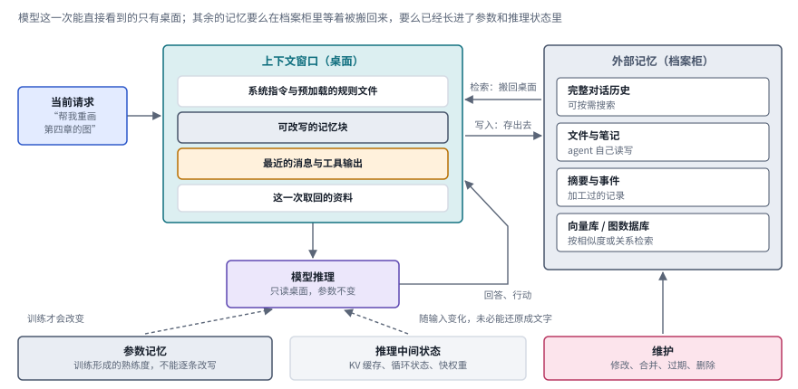

*图：记忆的全景。青色桌面是上下文窗口，灰色档案柜是外部记忆，下排是参数记忆、推理中间状态和维护操作；各框里的内容是常见的例子，具体系统各有取舍。*

这张图里有两处值得多停一下。第一处是桌面和档案柜之间那两条箭头。今天几乎所有记忆系统的设计，说到底都在回答这两条箭头什么时候走、搬什么东西：Letta 把记忆定义为"此刻往上下文窗口里放哪些 token"的问题，指的就是这里。第二处是右下角的维护框。一个只会往档案柜里塞东西、从不整理的系统，迟早会把第一周那句"结果放在 results_v2"原封不动地搬回桌面，本章第二节的"边界"和三.1 讨论的正是这个框怎样才算立得住。

有两种底层机制会在后文反复出现。**嵌入（embedding）**把文本或图像编码成向量，检索器根据向量之间的关系找出候选；比如先找出和"用户偏好变化"相关的历史片段，再判断其中哪条现在仍然有效。**注意力（attention）**是模型内部根据当前查询读取相关表征的机制；**KV 缓存**保存先前 token 的键和值，让模型生成每个新 token 时不必把历史重算一遍。KV 缓存是推理过程中的中间状态，和一份整理好的事实库是两回事；压缩 KV 缓存和删除一份用户档案，也是性质完全不同的两种操作。

设计记忆系统时，最好把读写过程拆成五步来看。**写入**决定保留什么，**组织**决定内容之间怎样连接，**检索**决定取回什么，**应用**决定取回之后要不要采纳，**维护**负责修改、合并、过期和删除。系统答错一个问题，原因可能是证据从来没被写进去，可能是检索没有找对，也可能是一条旧规则压过了新要求。这几种故障病根不同，换一个更快的向量数据库只能治其中一种。

下图把这五步排成一圈，并在每一步下面写出论文助手在这一步出错时会是什么样子。如果"改放 v3"这句话压根没被存下来，问题出在写入；如果 v3 和 v2 两条记录各自躺在库里、互相不知道对方，问题出在组织；如果取回来的恰好是第一周那句 v2，问题出在检索；如果 v3 已经摆上了桌面，模型却仍然听从一条更早的规则，问题出在应用；如果 v2 作废之后始终没有被标记失效，问题出在维护。最上面那条虚线表示，维护过的内容会进入下一轮的写入和检索，所以前一步的疏忽会一路传下去。

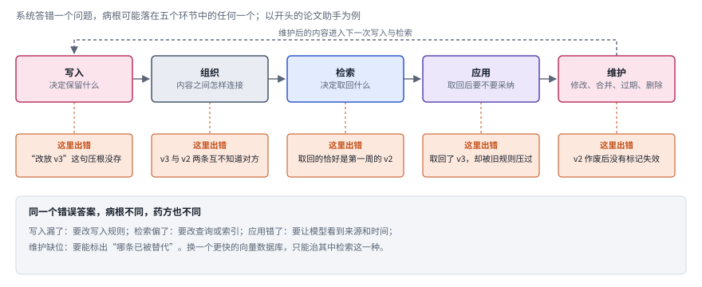

*图：读写五环节与对应的故障。橙色框是论文助手在每一步出错时的表现，底部一段说明不同的病根需要不同的药方。*

按用途，记忆还常被分成情景记忆、语义记忆和程序性记忆，分别对应经历、事实和方法。这个分类来自认知科学，Lilian Weng 的长文和 LangChain 的文章都沿用了它。它的价值在于提醒我们三类内容的更新方式各不相同：经历需要解释才能派上用场，事实可能会过期失效，方法则有自己的适用条件。为此专门建三个数据库并无必要，真正决定一条记录该怎样参与后续决策的，是它的来源、时间和当前状态。

最后还要分清任务内记忆和跨任务记忆。编程任务中暂存的测试结果，是为了这一次任务能接着做下去；跨周保存的用户偏好，是为了将来少解释一遍。前者往往可以在任务结束后清空，后者则需要更严格的来源记录、作用范围和删除机制。一条记忆能活多久，应当由它的用途来决定，存储空间够不够只是次要的考虑。

下图把这两组区分放在一起。上排三个框是三类内容，每个框里写着它记的是什么、怎样更新，再配一句论文助手例子里的原话：情景记忆记下"第三周导师改了主意"这件事本身，语义记忆记下由此得出的事实"结果放在 results_v3"，程序性记忆记下一条做法"画图前先检查坐标轴语言"。下排两个框是两种寿命，左边的任务内记忆用完即可清空，右边的跨任务记忆则要配齐来源、作用范围和删除机制。

*图：情景、语义、程序三类记忆的更新方式，以及任务内和跨任务两种寿命各自需要的管理；例句取自本章开头的论文助手。*

最后是两张贯穿第二节的总图。第一张是一架梯子：从下往上依次是五个阶段，先从外部查知识，再记住自己的经历，接着把窗口当内存来调度，然后发展出上下文工程这门手艺，最后把记忆当作持续学习的途径；最底下橙色的一条是边界，提醒我们记得多和记得对是两件事。每一级右端标着本章对应的前沿分支。左边那根箭头的意思是，每往上走一级，记忆系统要替自己做的决定就多一些。

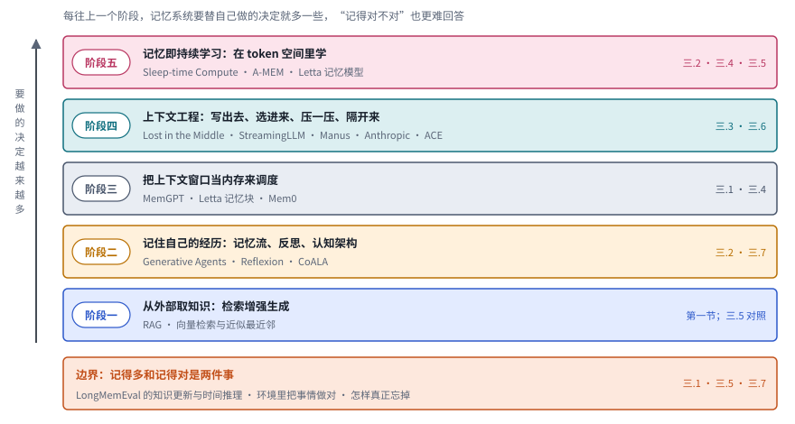

*图：五个阶段加一条边界。每一级写着代表工作，右端是本章第三节对应的分支。*

第二张是时间线，每一行是梯子上的一个阶段，点的位置按 arXiv 编号或博客发布时间，精确到月。把它和梯子对照着看，会发现几个阶段并不是排着队依次登场的。2023 年一年之内，记忆流、反思、MemGPT、Lost in the Middle 和 StreamingLLM 几乎同时出现，阶段二到阶段四的种子都在那一年埋下；到 2025 年，上下文工程的几篇长文集中在夏天发表，阶段五的论文和博客也接连出来，边界那一行则从 2024 年的 LongMemEval 一直延续到 2026 年的系统评测。

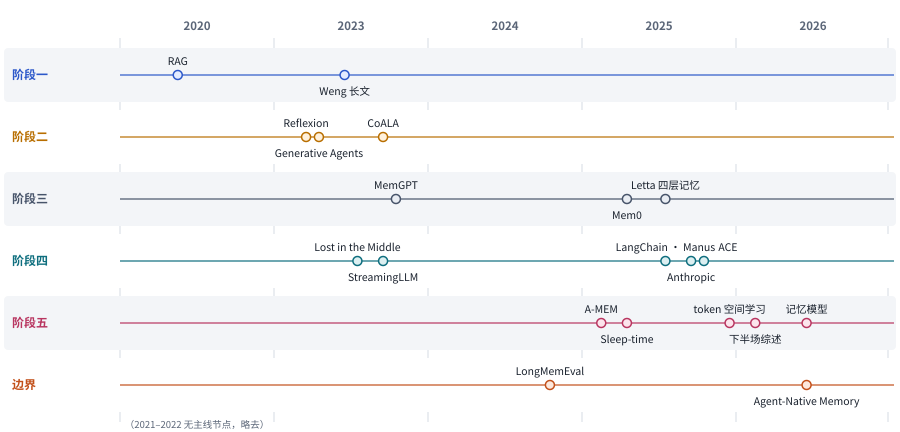

*图：主线上的代表工作按阶段分行排开。2021 到 2022 年这一行没有主线节点，图里略去；“Weng 长文”“Letta 四层记忆”“token 空间学习”“记忆模型”是博客文章，其余为论文。*

## 二、发展主线：从查资料，到在上下文里持续学习

这条主线主要借自 Letta 的那篇记忆总论，再用 Lilian Weng、LangChain、Manus 和 Anthropic 的文章把中间几段补充完整，最后接上 Letta 关于 token 空间持续学习的判断。把它们叠在一起看，记忆研究这几年的演进可以读成五个阶段：先学会从外面查资料，再学会记住自己的经历，接着学会把有限的窗口当成内存来调度，然后发展出一整套"上下文工程"的手艺，最后开始把记忆看作 agent 持续学习的主要途径。每往后走一个阶段，记忆系统要做的决定就更多一些，"记得对不对"这个问题也变得更难回答。

> **本节要点：** 每个阶段先用一张解说图讲清代表方法怎样运转，再用一排同一画法的结构卡把同阶段的方法并排，最后用一张对照表写明每种做法补上了什么、又留下了什么代价。本节末尾的总对照把五组方法放到两条共同的坐标轴上，第三节的七个分支都能在那里找到自己的位置。

| 阶段 | 内容 | 代表工作 | 本章对应分支 | 速查卡 |
|---|---|---|---|---|
| 阶段一 | 从外部取知识：检索增强生成 | RAG、向量检索与近似最近邻算法 | （基础概念，见第一节）；三.5 作对照 | A1、A2 |
| 阶段二 | 记住自己的经历：记忆流、反思、认知架构 | Generative Agents、Reflexion、CoALA | 三.2、三.7 | B1 至 B3 |
| 阶段三 | 把上下文窗口当内存来调度 | MemGPT、Letta 记忆块、Mem0 | 三.1、三.4 | C1 至 C3 |
| 阶段四 | 上下文工程：写出去、选进来、压一压、隔开来 | Lost in the Middle、StreamingLLM、Manus、Anthropic 的压缩与笔记、ACE | 三.3、三.6 | D1 至 D5 |
| 阶段五 | 记忆即持续学习：在 token 空间里学 | Sleep-time Compute、A-MEM、Letta 记忆模型 | 三.2、三.4、三.5 | E1 至 E4 |
| 边界 | 状态是否正确，能否真正忘掉 | LongMemEval、2026 年的状态与系统评测 | 三.1、三.5、三.7 | |

### 阶段一：模型不知道的事，先去外面查

> **要点：** 记忆研究的起点是把知识放到模型外面的索引里，用到时再查。这一步解决了"知识"问题，可查的始终是别人写好的静态资料，agent 自己的经历还没有地方放。

故事的起点是一个很朴素的问题：模型在预训练里没见过的事实，能不能临时从外面查来再回答？2020 年 Facebook AI 等机构的 [Retrieval-Augmented Generation](https://arxiv.org/abs/2005.11401)（RAG）给出了肯定的回答。它把一个检索器和一个生成模型接在一起，先从维基百科这样的外部索引里找出相关段落，再让模型根据这些段落生成答案。这样一来，知识就不必全部压进参数，更新知识也只需要更新索引。

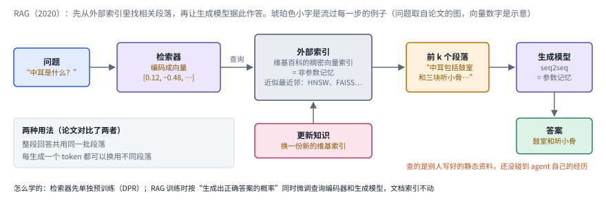

*图：RAG 的一次问答。紫色是两个模型，灰色是外部索引，琥珀色是取回的段落；左下角是论文比较的两种用法。*

上图从左往右读。问题先交给一个预训练好的神经检索器，它把问题编码成向量，拿去外部索引里查；这份索引是用维基百科建成的稠密向量索引，论文把它称为"非参数记忆"，和生成模型参数里的"参数记忆"相对。查出来的前 k 个段落连同问题一起交给生成模型，生成模型写出答案。中间下方那个粉色的框是这套设计最大的好处：想让系统知道一件新事，只要往索引里加东西，模型本身不必动。左下角的灰框记着论文比较过的两种用法，一种是整段回答共用同一批段落，另一种是每生成一个 token 都可以换用不同的段落。

Lilian Weng 在 2023 年的长文里，把这件事放进了 agent 的框架：长期记忆就是一个可以随时查询的外部向量库。向量库里的检索追求的是"足够快"，所以实践中大多用近似最近邻算法，牺牲一点精度换取速度。她在文中逐一介绍的 LSH、ANNOY、HNSW、FAISS 和 ScaNN，至今仍是各种记忆系统的底层零件。

这个阶段解决的是"知识"问题，却还没碰到"经历"问题。RAG 查的是一份静态的、别人写好的资料库；一个持续工作的 agent 还需要记住自己做过的决定、遇到的约束和得到的结果。Letta 在文章里专门强调了这条界线：检索是支撑记忆的工具，它本身还算不上记忆。

**速查：阶段一的两种做法。** 两张卡的结构几乎一样，都是"编码、入库、按相似度取回"；差别在于 A1 把检索和生成接成了一个完整的问答系统，A2 则是 Weng 在 agent 语境里对"长期记忆"给出的最简定义。

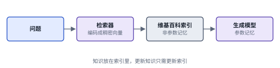 

*图：阶段一的两张结构卡，每张卡对应下表的一行。*

| code | 名称 | 年份 | 代表 | 怎么做 | 解决了什么 | 代价 |
|---|---|---|---|---|---|---|
| A1 | 检索增强生成 | 2020 | [RAG](https://arxiv.org/abs/2005.11401) | 预训练的神经检索器从维基百科稠密向量索引里取出相关段落，交给 seq2seq 生成模型作答；论文比较了整段共用一批段落和逐 token 换用段落两种做法 | 模型没见过的事实可以临时查来，知识存在索引里，更新知识只需更新索引，模型不用重训 | 查的是别人写好的静态资料，碰不到 agent 自己的经历；答案好坏很大程度上取决于检索有没有找对 |
| A2 | 外部向量库 | 2023 | [Weng 长文](https://lilianweng.github.io/posts/2023-06-23-agent/) | 把文本或经历编码成嵌入向量存进向量库，查询时用 LSH、HNSW、FAISS、ScaNN 等近似最近邻算法找出候选 | 给 agent 一个容量不受窗口限制、可以随时查询的长期记忆，检索速度足够快 | 近似检索牺牲了一点精度；按相似度找到的记录未必是现在仍然有效的那条，开头那句 results_v2 就是例子 |

### 阶段二：记住自己经历过什么

> **要点：** agent 开始把自己的观察、反思和计划写成一条记忆流，按新近、重要、相关三项打分取回，并定期把经历归纳成更高层的认识。新麻烦随之出现：经历越积越多，窗口却是有限的。

2023 年，斯坦福和 Google 的 [Generative Agents](https://arxiv.org/abs/2304.03442) 在一个像素小镇里放进了二十五个由大模型驱动的居民，让人第一次直观地看到"有记忆的 agent"是什么样子。每个居民都有一条记忆流，用自然语言记下自己观察到的每一件事。要做决定时，系统按三个标准从记忆流里挑出相关内容：越新的越优先，越重要的越优先（重要程度由模型自己打分），和当前情境越相关的越优先。更关键的是反思机制：系统会定期拿最近的一批观察向模型提问，让它归纳出更高层的看法，再把这些看法也存回记忆流。经历由此变成了可以指导以后行动的认识。Lilian Weng 的长文对这套机制有很细致的讲解。

下图把这套机制拆成三步，数字都取自论文。左边灰色的长框是记忆流，每一条记录都有一段自然语言描述、一个创建时间和一个最近访问时间；观察、计划和反思都存在这同一条流里，只是用颜色区分（图中的例句是示意）。

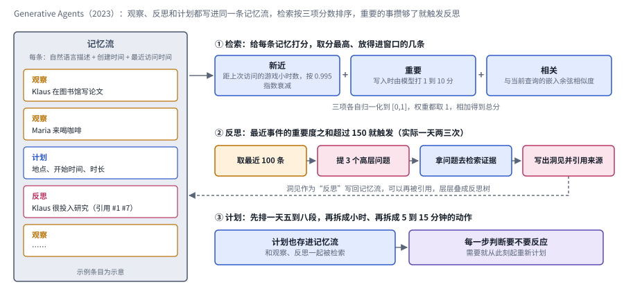

*图：Generative Agents 的三步。① 检索按三项分数排序，② 重要度累计到阈值时触发反思，③ 计划也写回记忆流；虚线表示反思写回记忆流，可以被以后的反思再引用。*

第一步是检索。每条记忆有三个分数：新近分按距上次被访问过去了多少个游戏小时做指数衰减，衰减系数是 0.995；重要分在写入时由模型打出，从 1 分的琐事到 10 分的大事，论文举的例子是"打扫房间"得 2 分、"约心仪的人出去"得 8 分；相关分是这条记忆和当前查询在嵌入空间里的余弦相似度。三项各自归一化到 0 到 1 之间，权重都取 1，相加得到总分，分数最高、又放得进窗口的那几条进入提示。第二步是反思。最近感知到的事件重要分之和一旦超过 150，就触发一次反思，实际运行中每个居民一天大约反思两三次：系统把最近 100 条记录交给模型，让它提出 3 个最值得回答的高层问题，再拿这些问题去检索证据，最后写出洞见，每条洞见都注明它引用了哪几条记录。洞见作为"反思"写回记忆流，以后可以被新的反思再引用，于是层层叠成一棵反思树，叶子是原始观察，越往上越抽象。第三步是计划：居民先给一天排出五到八段粗略的安排，再拆成以小时计的动作，再拆成 5 到 15 分钟的动作；计划同样存进记忆流，和观察、反思一起参与检索，遇到值得反应的事情时，就从这一刻起重新计划。

同一年，[Reflexion](https://arxiv.org/abs/2303.11366) 从另一个角度说明了经历的价值：任务失败之后，让模型用自然语言写一段反思，下一次尝试时带上它。LangChain 在梳理"写出去"这类策略时，把 Reflexion 和 Generative Agents 并列为"由 agent 自己生成长期记忆"的两个源头。不久之后，[Cognitive Architectures for Language Agents](https://arxiv.org/abs/2309.02427)（CoALA）借鉴认知科学和符号 AI 里的经典认知架构，为语言 agent 提出了一套带有模块化记忆组件的通用框架，把记忆和决策过程放进同一张蓝图里讨论。在这张蓝图里，记忆分成服务当前决策周期的工作记忆，以及情景、语义、程序三类长期记忆；检索把长期记忆读进工作记忆，推理读写工作记忆，学习再把内容写回长期记忆，每个决策周期先规划、再执行。

这个阶段留下了一个新的麻烦：经历会不断增长，窗口却是有限的。记忆流越写越长，总有一天会塞不进桌面。

**速查：阶段二的三种做法。** 三张卡都有一条绕回去的虚线，那是经历被加工之后重新回到记忆里的路径；它们的差别在于加工的方式，B1 是定期归纳，B2 是失败后写反思，B3 则是给"读进来、写回去"定出一套通用的动作分类。

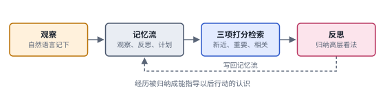 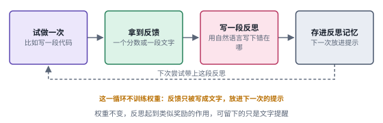

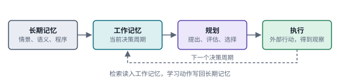

*图：阶段二的三张结构卡，每张卡对应下表的一行。*

| code | 名称 | 年份 | 代表 | 怎么做 | 解决了什么 | 代价 |
|---|---|---|---|---|---|---|
| B1 | 记忆流与反思 | 2023 | [Generative Agents](https://arxiv.org/abs/2304.03442) | 观察用自然语言写进记忆流；检索按新近、重要、相关三项归一化后相加排序；重要度累计超过阈值时，从最近一百条记录里提出三个高层问题，检索证据后写出带引用的反思，存回记忆流 | 零散的经历被归纳成能指导以后行动的认识；论文的消融实验显示观察、计划、反思三部分对行为的可信度各有贡献 | 记忆流只增不减，越写越长，迟早塞不进窗口；三项分数的权重是人定的固定值 |
| B2 | 语言反思 | 2023 | [Reflexion](https://arxiv.org/abs/2303.11366) | 任务失败后让模型用自然语言写一段反思，下一次尝试时带上 | 不动权重也能从失败中学，反思起到类似奖励信号的作用 | 留下的是"下次注意什么"一类的文字提醒，没有可以直接执行的做法 |
| B3 | 认知架构 | 2023 | [CoALA](https://arxiv.org/abs/2309.02427) | 记忆分成工作记忆和情景、语义、程序三类长期记忆；检索、推理、学习三种内部动作在它们之间读写，每个决策周期先规划（提出、评估、选择）再执行 | 把记忆和决策放进同一张蓝图，各家 agent 的记忆设计有了共同的词汇可以对照 | 它是一个概念框架，本身不规定写什么、什么时候忘这类具体策略 |

### 阶段三：把窗口当成内存来调度

> **要点：** MemGPT 借用操作系统的分层存储，把上下文窗口当内存、外部存储当磁盘，并让模型自己发函数调用决定换进换出。Letta 后来把它细化成四层记忆，工业界的 Mem0 则把抽取和更新做成了生产流水线。

同样在 2023 年，伯克利的 [MemGPT](https://arxiv.org/abs/2310.08560) 借用操作系统的思路回答了这个问题。操作系统面对的困境如出一辙：内存很小，数据很多，于是把数据分层存放，常用的放在内存里，不常用的换到磁盘上，需要时再换回来。MemGPT 把上下文窗口当成内存，把窗口外的存储当成磁盘，并且让模型自己通过函数调用决定什么时候把什么东西换进换出。Letta 的文章对它的评价是，它在固定的窗口限制下"制造出了记忆无限的错觉"。

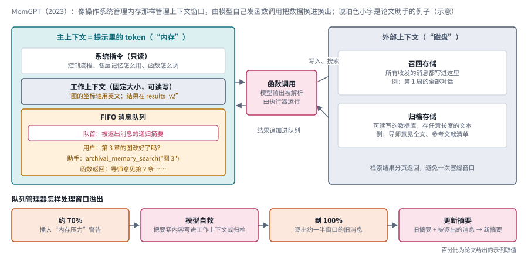

*图：MemGPT 的结构。左边青色是主上下文，右边灰色是外部上下文，中间粉色的函数调用负责两边搬运；下排是队列管理器处理窗口溢出的四步，百分比是论文给出的示例取值。*

上图左边是主上下文，也就是提示里的全部 token，论文把它分成连续的三段。最上面是只读的系统指令，交代控制流程、每一层记忆该怎么用、函数该怎么调；中间是工作上下文，一块固定大小、可读可写的文字区，存放关键事实和用户偏好，只能通过函数调用来修改；最下面是一个先进先出的消息队列，滚动保存用户消息、agent 回复、系统消息以及函数的输入输出，队首永远是一条系统消息，里面是此前被逐出消息的递归摘要。右边是外部上下文，分成两种：召回存储是消息数据库，所有收发的消息都会写进去，所以被逐出窗口的消息仍然可以搜到；归档存储是一个可读写的数据库，存放任意长度的文本对象。模型的输出被解析成函数调用，由执行器去运行，可以搜索召回存储、读写归档存储、改写工作上下文，结果追加回消息队列；检索结果分页返回，免得一次把窗口塞爆。

图的下排是这套设计最像操作系统的地方。队列管理器盯着窗口的占用：到了警告线，论文的例子是窗口的七成，它往队列里插一条"内存压力"警告，模型看到后可以把要紧的内容存进工作上下文或归档存储；到了刷新线，也就是窗口满了，它逐出一批旧消息，论文的例子是窗口的一半，再用旧摘要加上被逐出的消息生成新的递归摘要。被逐出的消息并没有消失，它们一直留在召回存储里，需要时还能查回来。

MemGPT 后来发展成了 Letta，这套思路也被细化成了更具体的结构。Letta 的文章把记忆分成四层：最近的消息缓冲区相当于短期记忆，固定在窗口里的核心记忆块存放用户信息、agent 的人设和当前目标，每个块都有标签、说明、内容和字数上限，agent 可以自己改写；完整的对话历史存在窗口之外，可以按需搜索；经过加工的知识则存进向量库或图数据库，作为归档记忆。窗口快满时，系统会把一部分旧消息逐出，逐出之前先做摘要，旧摘要和新摘要再递归地合并，于是越久远的内容在上下文里分量越轻。

工业界的系统也大多沿着这个方向走。2025 年的 [Mem0](https://arxiv.org/abs/2504.19413) 专门为生产环境设计了一套从对话里动态抽取、整合和检索记忆的流水线，作者在 LOCOMO 基准上报告，和把全部历史塞进上下文的做法相比，p95 延迟降低了 91%，token 开销节省了 90% 以上。它的流水线分两段：每来一轮新对话，先参考对话摘要和最近的若干条消息，从中抽取候选事实；再拿每条候选去和向量检索出的几条最相似的旧记忆比对，由模型通过一次工具调用在增加、更新、删除和不动四种操作里选一种。它的图版本 Mem0g 把实体存成节点、关系存成边，和新信息冲突的旧关系会被标记为失效，保留下来供时间推理使用。Sarah Wooders 在 2026 年的文章里回头总结说，MemGPT 本质上是一个"有状态的 agent harness"，那时连 harness 这个词都还没流行起来；它的记忆能力来自改写提示和管理外部状态的工具，加上 harness 本身的上下文管理，单靠检索是做不出来的。

**速查：阶段三的三种做法。** C1 和 C2 讲的是同一个系统的前后两个版本，一个按操作系统的语言来讲，一个按产品里的四层记忆来讲；C3 则是一条典型的工业流水线。三者都在回答"哪些东西该常驻桌面、哪些该收进柜子"，Mem0 把"改一条旧记忆"明确做成了四种可选操作，这一点和本章三.1 讨论的状态维护直接相连。

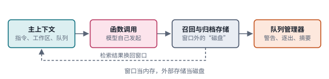 

*图：阶段三的三张结构卡，每张卡对应下表的一行。C2 的四个框之间没有箭头，表示四层并存。*

| code | 名称 | 年份 | 代表 | 怎么做 | 解决了什么 | 代价 |
|---|---|---|---|---|---|---|
| C1 | 虚拟上下文管理 | 2023 | [MemGPT](https://arxiv.org/abs/2310.08560) | 主上下文分系统指令、工作上下文和消息队列，外部有召回存储和归档存储；模型通过函数调用读写外部存储、改写工作上下文；队列管理器在窗口吃紧时发警告，满了逐出旧消息并更新递归摘要 | 在固定窗口下"制造出记忆无限的错觉"，长文档分析和多会话聊天都能越过窗口限制 | 什么时候换进换出全靠模型自己判断，判断失误就会漏掉要紧内容；递归摘要越压越轻，久远的细节会流失 |
| C2 | 四层记忆与可改写记忆块 | 2025 | [Letta 记忆总论](https://www.letta.com/blog/agent-memory/) | 消息缓冲区、固定在窗口里可由 agent 改写的核心记忆块、窗口外可搜索的完整对话历史、加工后建了索引的归档记忆；逐出前先摘要，摘要递归合并 | 把"此刻往窗口里放哪些 token"变成了分层的、可以由 agent 自己维护的结构 | 核心记忆块有字数上限，放什么需要取舍；记忆能力依赖 harness 本身的上下文管理 |
| C3 | 抽取与更新流水线 | 2025 | [Mem0](https://arxiv.org/abs/2504.19413) | 每轮对话参考摘要和近期消息抽取候选事实，再与相似的旧记忆比对，由模型选择增加、更新、删除或不动；图版本把实体关系存成图 | 面向生产环境，在 LOCOMO 上相对全量上下文 p95 延迟降低 91%、token 开销节省 90% 以上 | 每轮写入都要调用模型做抽取和比对；抽取时漏掉的信息，以后无从检索 |

### 阶段四：上下文工程成了一门手艺

> **要点：** 长上下文的几项实证发现说明，窗口变大，问题也不会自动消失。各家团队于是把记忆当作更大的"上下文管理"问题来做，归纳出写出去、选进来、压一压、隔开来四类手法，并把它们和推理成本连在一起考虑。

到了 2025 年，越来越多的团队发现，记忆问题和更大的"上下文管理"问题其实是同一个问题。Andrej Karpathy 把这件事形容为"在每一步把恰好合适的信息填进上下文窗口的精妙艺术与科学"，"上下文工程"这个说法随之流行开来。

推动这一转变的，首先是一批关于长上下文的实证发现。2023 年的 [Lost in the Middle](https://arxiv.org/abs/2307.03172) 发现，模型在关键信息位于长输入的开头或结尾时表现最好，信息落在中间时准确率明显下降，即使是专门为长上下文设计的模型也是如此。同年的 [StreamingLLM](https://arxiv.org/abs/2309.17453) 则发现，只缓存最近 token 的窗口注意力一旦超出缓存长度就会崩溃，可只要额外保留开头几个 token 的键和值，性能就能大体恢复；作者把这些吸收了大量注意力的开头位置称为"注意力汇点"（attention sink）。Anthropic 的文章把这类现象统称为"上下文腐化"：窗口越满，模型越难准确调用其中的信息。窗口变大，问题也不会自动消失。

在工程实践中，各家团队摸索出了相近的手法。LangChain 把它们归成四类：写出去、选进来、压一压、隔开来。Manus 的季逸超从生产经验出发补充了许多细节。他把文件系统当成 agent 的外部记忆，因为它不受窗口大小限制、能够持久保存、agent 也可以自己读写；他要求压缩必须可以恢复，网页正文可以删，网址必须留着。一个典型的 Manus 任务大约要调用五十次工具，所以 agent 会建一份 todo.md，边做边勾掉已完成的项，借此把全局计划不断"背诵"到上下文的末尾，避免在长循环里迷失目标。他还特别看重 KV 缓存命中率：缓存命中的输入 token 价格只有未命中时的十分之一，所以提示前缀要保持稳定，上下文最好只追加、不改写。这条建议把记忆设计和推理成本直接联系在了一起。

下图把这几篇文章的做法放到了同一张图上。中间青色的框是上下文窗口，Anthropic 把它看作一份边际收益递减的注意力预算，目标是找到最小的一组高信号 token。四个角是 LangChain 的四类手法，每一类下面列着 Manus 和 Anthropic 的具体做法：左上的"写出去"把信息存到窗口之外，箭头从窗口指向它；右上的"选进来"把需要的东西取回窗口，箭头指向窗口；左下的"压一压"在窗口内部做摘要和裁剪；右下的"隔开来"把细活交给拥有干净窗口的子 agent。正下方橙色的框是 Manus 那笔关于 KV 缓存的账，它解释了为什么前缀要稳定、上下文最好只追加。

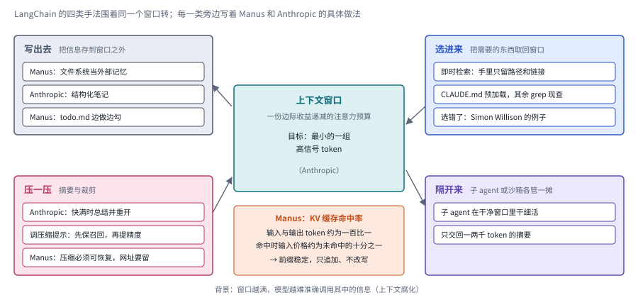

*图：上下文工程的四类手法围绕同一个窗口。每类手法下的条目来自 Manus 和 Anthropic 的文章，“选错了”一条指 LangChain 文中引用的 Simon Willison 的例子。*

Anthropic 的文章则给出了更系统的方法论。它主张"即时检索"：agent 手里只拿着文件路径、查询语句和链接这样的轻量引用，真正需要时再通过工具加载，Claude Code 预先加载 CLAUDE.md、其余内容用 glob 和 grep 现查，就是这种混合策略。对长程任务，它推荐压缩、结构化笔记和子 agent 三种手段，并给出了一个很实用的调优顺序：调压缩提示时，先追求召回，保证该留的都留下，再慢慢提高精度，删掉多余的部分。

学术界同期也在把"上下文"本身当作可以优化的对象。2025 年的 [Agentic Context Engineering](https://arxiv.org/abs/2510.04618)（ACE）发现，让模型反复把经验重写成一大段文字，细节会在一轮轮改写中流失，于是改为维护一份条目化的 playbook，只对相关条目做增删改。本章三.3 和三.6 的新论文，大多是在这个阶段的问题上继续深挖：怎样压缩才不丢关键信息，怎样读取历史才更省。

**速查：阶段四的五种做法。** 前两张卡是两项实证发现，后三张卡是三套工程做法。D1 和 D2 的卡片之间几乎没有流程，因为它们回答的是"长上下文为什么会出问题"；D3 和 D4 的四个框也不连箭头，表示这些手法可以各自单独使用；只有 D5 是一个完整的循环。

 

 

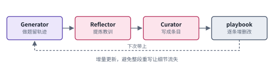

*图：阶段四的五张结构卡，每张卡对应下表的一行。*

| code | 名称 | 年份 | 代表 | 怎么做 | 解决了什么 | 代价 |
|---|---|---|---|---|---|---|
| D1 | 位置偏差 | 2023 | [Lost in the Middle](https://arxiv.org/abs/2307.03172) | 在多文档问答和键值检索两类任务里，移动关键信息在长输入中的位置，观察准确率的变化 | 揭示了长上下文的位置偏差：信息在开头或结尾时最好，落在中间时明显下降，长上下文模型也如此；它说明"全塞进去"靠不住 | 这是一项诊断性的发现，论文提出了新的评测思路，没有给出修复办法 |
| D2 | 注意力汇点 | 2023 | [StreamingLLM](https://arxiv.org/abs/2309.17453) | 窗口注意力只缓存最近 token 的 KV，同时额外保留开头几个 token 的 KV，让有限窗口训练出的模型不经微调处理超长流式输入 | 窗口超出缓存就崩溃的问题大体恢复，论文测到 400 万 token，比滑动窗口重算快至多 22.2 倍 | 夹在中间、被移出窗口的 token 不再参与计算，远处的细节无法再被读到 |
| D3 | 文件系统与可恢复压缩 | 2025 | [Manus 的经验](https://manus.im/en/blog/Context-Engineering-for-AI-Agents-Lessons-from-Building-Manus) | 文件系统当外部记忆；反复改写 todo.md 把目标背诵到上下文末尾；压缩必须可恢复；前缀稳定、只追加以提高 KV 缓存命中；出错的步骤留在上下文里 | 来自四次重写框架的生产经验，长循环里不容易迷失目标，并把记忆设计和推理成本连在一起 | 这些是生产经验的总结，文中没有受控对照实验；可恢复的内容越多，删除就越难做干净 |
| D4 | 注意力预算 | 2025 | [Anthropic](https://anthropic.com/engineering/effective-context-engineering-for-ai-agents) | 即时检索只留轻量引用；快满时压缩并重开；进度写进结构化笔记；子 agent 在干净窗口里干细活，只交回一两千 token 的摘要 | 把上下文当作边际收益递减的注意力预算，给长程任务一套系统的方法和调优顺序 | 压缩提示要反复调，先保召回再提精度；子 agent 只交回摘要，细节要靠笔记或重新加载才能找回 |
| D5 | 条目化 playbook | 2025 | [ACE](https://arxiv.org/abs/2510.04618) | Generator 做题，Reflector 提炼教训，Curator 写成小条目增量并入 playbook，只改相关条目 | 避免整段重写让细节一轮轮流失 | playbook 会越来越长，需要去重和整理，也始终占着上下文 |

### 阶段五：记忆成为持续学习的主要途径

> **要点：** Letta 主张从经验中学习的主要途径是更新学到的上下文，它可读、可迁移、可删除，比在权重上做持续学习更现实。Sleep-time Compute 和 A-MEM 提供了支撑，2026 年的"记忆模型"更进一步，要专门训练负责写记忆的模型。

上下文工程解决的主要是"这一次任务"的问题。可一个长期工作的 agent 还会遇到更深一层的问题：它能不能从一次次任务中真正学到东西，并且越用越好？

Letta 在 2025 年 12 月的文章里给出了一个鲜明的回答。在权重上做持续学习已经研究了几十年，至今很少在生产中落地，灾难性遗忘、难以替代精心设计的训练流程、把用户数据混进共享权重的隐私风险，以及强化学习奖励稀疏，都是绕不开的障碍。相比之下，把学到的东西写成上下文里的 token，有一系列实际的好处：人可以读懂，可以随模型升级迁移，遗忘只需删除，还能版本化和回滚。作者因此主张把持续学习重新定义为"在一连串任务中不断优化上下文"，把记忆操作当作一等的工具调用来训练。

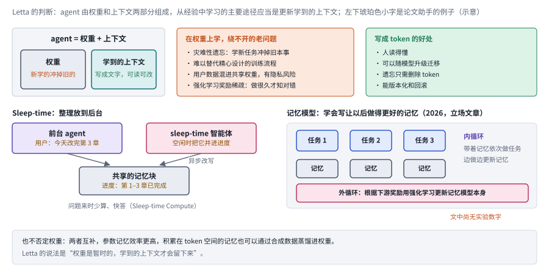

*图：阶段五的三块内容。上排是 Letta 的判断，左下是 sleep-time 的后台整理，右下是记忆模型的内外两层循环；底部一条说明这条路线和权重互补。*

上图的上排把 Letta 的论证摊开：最左边那个框说 agent 由权重和上下文两部分组成，所以持续学习有两条轴；中间橙色的框列出在权重上学绕不开的四个老问题；右边绿色的框是把学到的东西写成 token 的四个好处。下排左半边是 sleep-time 的分工，前台 agent 负责和用户对话、做任务，另一个 sleep-time 智能体在空闲时推理、整理，两者共用同一份记忆块，整理工作异步进行。下排右半边是 2026 年记忆模型的设想：内循环里，带着记忆的 agent 依次完成任务 1、任务 2、任务 3，边做边更新记忆；外循环根据下游奖励，用强化学习去更新负责写记忆的那个模型本身。右下角的橙字提醒，这篇文章是立场与规划性质的，文中还没有实验数字。

这个判断背后有几篇关键的论文支撑。由 Letta 团队成员与伯克利研究者合作完成的 [Sleep-time Compute](https://arxiv.org/abs/2504.13171) 提出，让模型在没有查询的空闲时间里，预先对上下文做推理和整理，等真正的问题来了，就能用更少的计算、更低的延迟给出准确的回答。这正是 Letta 所说的 sleep-time 智能体的基础：记忆的整理工作和对话本身分开，在后台异步进行。2025 年的 [A-MEM](https://arxiv.org/abs/2502.12110) 则借鉴卡片笔记法，让每条新记忆都生成自己的笔记、关键词和标签，并主动和已有记忆建立链接，必要时还会反过来更新旧笔记，记忆的结构因此可以在使用中持续演化。

到 2026 年 6 月，Letta 把这条路又往前推了一步。他们发现，通用模型很擅长使用上下文，却不擅长为将来写出持久有用的上下文：反复精炼的记忆会变得空泛而有损，有时又过于具体、无法推广，而且未必能稳定地改变 agent 在不同会话和不同模型上的行为。他们认为原因之一在于训练目标："完成任务"和"学习"常常是相互冲突的两个目标。于是他们主张专门训练记忆模型，内循环让 agent 带着记忆完成一系列任务，外循环用强化学习优化"写下的记忆能否提升以后的表现"。本章三.2 和三.4 收录的许多新论文，比如在读取时才整理经验、用细粒度奖励训练写入策略，都可以看作这个阶段的具体尝试。

同一年的综述 [A Survey of Agent Memory in the Second Half](https://arxiv.org/abs/2602.06052) 从更宽的角度印证了这个走向。作者认为，记忆正在变成一种可以训练、可以自我演化的能力：短期记忆决定执行过程中哪些经历被感知、挑选和抽象，长期记忆再把它们沉淀成可复用的知识和技能，让 agent 能从自己的经验里变好；写入、整理、检索和遗忘这些操作的策略，也越来越多地用强化学习端到端地学出来，手工规则的分量在下降。读本章三.2、三.4 的新论文时，可以先用它的存储载体、认知机制和记忆主体三个维度给每一篇定个位。

这条路线并没有否定权重。Letta 自己也承认两者互补：参数记忆效率更高，积累在 token 空间里的记忆也可以通过合成数据蒸馏进权重。本章三.5 讨论的原生记忆模型、参数化记忆模块和快权重，就是从另一端逼近同一个目标。

**速查：阶段五的四种做法。** 四张卡最右边的框都是"整理过的东西"，它们的差别在于整理发生在什么时候、由谁来做：E1 在问题到来之前，E2 在每次写入时，E3 把整理本身当作 agent 要学的技能，E4 干脆把负责整理的模型单独拿出来训练。

 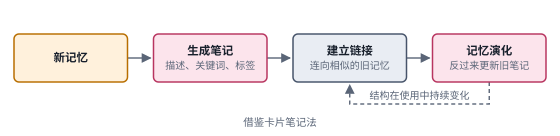

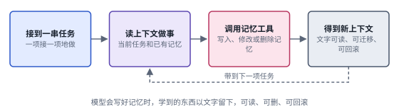 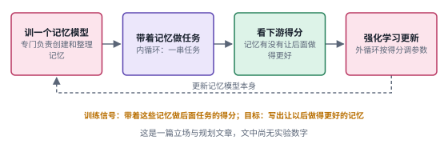

*图：阶段五的四张结构卡，每张卡对应下表的一行。*

| code | 名称 | 年份 | 代表 | 怎么做 | 解决了什么 | 代价 |
|---|---|---|---|---|---|---|
| E1 | 空闲时预计算 | 2025 | [Sleep-time Compute](https://arxiv.org/abs/2504.13171) | 在问题到来之前，让模型对上下文预先推理和整理，算出可能有用的中间结果，相关的多个查询还能共享这份工作 | 论文报告同等准确率下测试时计算约降到五分之一，延迟更低；它是 Letta sleep-time 智能体的基础 | 收益取决于问题能否被预料，论文发现用户查询越可预测，效果越好 |
| E2 | 自组织的笔记网络 | 2025 | [A-MEM](https://arxiv.org/abs/2502.12110) | 每条新记忆生成带描述、关键词、标签的笔记，主动和相似的旧记忆建立链接，必要时反过来更新旧笔记的内容和属性 | 记忆不再是固定的存取结构，可以在使用中持续演化；作者在六个基础模型上报告优于已有基线 | 每次写入都要调用模型生成笔记、建链接、改旧笔记，写入开销较大；旧笔记被改写后，原貌需要另行保存 |
| E3 | token 空间的持续学习 | 2025 | [Letta：Continual Learning in Token Space](https://letta.com/blog/continual-learning) | 把持续学习定义为在一连串任务中不断优化上下文，把记忆操作当作一等的工具调用来训练 | 绕开在权重上学的遗忘、隐私和奖励稀疏问题，学到的东西可读、可迁移、可删除、可回滚 | 前提是模型能写出好记忆，Letta 后来自己发现通用模型写出的记忆会空泛有损 |
| E4 | 记忆模型 | 2026 | [Letta：Memory Models](https://www.letta.com/blog/towards-agents-that-learn/) | 专门训练负责创建和整理记忆的模型；内循环带着记忆完成一串任务，外循环用下游奖励做强化学习，更新记忆模型本身 | 针对"通用模型写记忆不可靠、训练环境默认无状态"的问题，让"写下的记忆能否提升以后的表现"成为优化目标 | 立场与规划性质的文章，文中还没有实验数字 |

### 边界：记得多，和记得对，是两件事

> **要点：** 能存、能取，离"能正确地更新"和"能真正忘掉"都还有很长的距离。LongMemEval 把知识更新和时间推理的难处量化了出来，2026 年的工作把问题搬进了真实环境，而删除一条记录之后它派生出的东西还在不在，至今没有好答案。

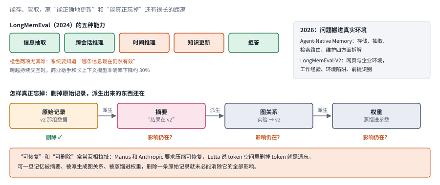

*图：上半部分是 LongMemEval 的五种能力，橙色两项最难，右边是 2026 年两项把评测搬进真实环境的工作；下半部分是一条派生链，删掉最左边的原始记录，右边三种派生物的影响未必随之消失。*

上图的上半部分对应接下来第一段，下半部分对应最后一段。派生链从左往右读：原始记录里写着 v2 那组数据，摘要把它浓缩成一句"结果在 v2"，图数据库里又多出一条"实验指向 v2"的关系，如果再把这些经验蒸馏进权重，它就成了参数的一部分。删除只作用在最左边那一格，右边三格打着问号。

能存、能取，离"能正确地更新"还有很长的距离。2024 年的 [LongMemEval](https://arxiv.org/abs/2410.10813) 把这个差距量化了出来：它把信息抽取、跨会话推理、时间推理、知识更新和拒答五种能力放进同一个评测，结果显示，商业聊天助手和长上下文模型在需要跨越持续交互记住信息时，准确率下降了约 30%。知识更新和时间推理尤其难，因为它们要求系统知道"哪条信息现在仍然有效"，光能找到旧句子是不够的。开头那个论文助手的例子，考的正是这种能力。

2026 年的工作把这个问题推向了更真实的场景。[Are We Ready For An Agent-Native Memory System?](https://arxiv.org/abs/2606.24775) 从存储、抽取、检索路由和维护四个方面拆解现有的记忆系统，报告不同的工作负载需要不同的结构；[LongMemEval-V2 官方项目](https://github.com/xiaowu0162/LongMemEval-V2/)则把评测推进到网页和企业环境，考察工作经验、环境陷阱和前提识别。记忆要回答的问题，从"以前说过什么"变成了"在这个环境里怎样把事情做对"。

还有一个边界问题同样棘手：怎样真正忘掉。LangChain 文中 Simon Willison 的例子说明，记忆被错误地选进上下文，会让人觉得上下文窗口"不再属于自己"；Manus 和 Anthropic 都强调压缩要可恢复，可"可恢复"和"可删除"在设计上常常是互相拉扯的。Letta 说 token 空间里遗忘很简单，删掉 token 就行；可一旦记忆被摘要、被派生成图关系、被蒸馏进权重，删除一条原始记录就未必能消除它的全部影响。本章三.1 讨论状态是否正确，三.5 讨论记忆放进模型内部后怎样纠正，三.7 讨论连续感知带来的隐私边界，都是在这条边界上工作。

### 总对照：五组方法放在两条共同的坐标轴上

> **要点：** 把五个阶段的速查卡放进一张表，按同样几个维度比较；再把主线经典和本章新论文放到"记忆放在哪里"和"谁来决定读写"这两条坐标轴上，最后把第三节的七个分支放回五个阶段，就能看清每个分支在继承哪一组的遗产。

最后把这一节的五组方法放进一张表，按同样几个维度比较。想快速判断一篇新论文属于哪一组，先问它的记忆放在哪里、由谁决定读写、保存的是什么；表格只放结论，每一格背后的原因写在前面同编号的速查卡和对照表里。

| 组别 | 记忆放在哪里 | 谁决定读写 | 保存的是什么 | 主要优点 | 主要代价 | 本章分支 |
|---|---|---|---|---|---|---|
| A 阶段一 | 外部索引或向量库 | 固定的检索流程 | 别人写好的知识 | 知识可以更新，不必压进参数 | 碰不到 agent 自己的经历；找到的未必仍然有效 | 三.5 作对照 |
| B 阶段二 | 外部的记忆流 | 人设计的打分与反思流程，模型参与打分和归纳 | 自己的观察、反思和计划 | 经历被归纳成能指导行动的认识 | 越写越长，迟早塞不进窗口 | 三.2、三.7 |
| C 阶段三 | 窗口加分层的外部存储 | 模型自己通过函数调用或工具调用决定 | 记忆块、完整对话历史、归档知识 | 固定窗口下记忆近乎无限，旧记忆可以被更新或删除 | 换进换出靠模型判断；摘要越压越轻 | 三.1、三.4 |
| D 阶段四 | 窗口、文件系统、子 agent 的窗口 | harness 与模型合作 | 经过挑选和压缩的上下文 | 长程任务省 token、少迷失，对缓存友好 | 压缩可能丢掉关键约束；手法要反复调 | 三.3、三.6 |
| E 阶段五 | token 空间里学到的上下文 | 越来越多由训练出的策略决定 | 跨任务积累的经验 | 越用越好，学到的东西可读、可迁移 | 写记忆的能力要专门训练，实证还不多 | 三.2、三.4、三.5 |

下图换一个角度，把具体的工作放到两条共同的坐标轴上。横轴是记忆放在哪里，从左到右依次是模型参数、KV 缓存和循环状态、上下文窗口、外部存储；越往右越容易逐条检查、纠正和删除，越往左越能参与端到端的优化。纵轴是谁来决定读写，从下往上依次是固定的规则或流水线、模型自己管理、训练出来的策略。青色的实心点是第二节的主线经典，粉色的空心点是第三节的 2026 年新论文，点在格子里的具体位置是示意，只表示它大致落在哪一格。

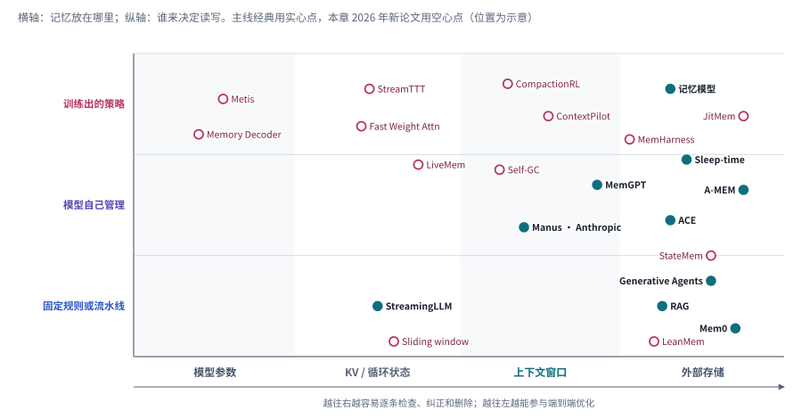

*图：横轴是记忆的存放位置，纵轴是读写决策的来源。实心点为主线经典，空心点为本章新论文，位置为示意。*

这张图里能读出两个趋势。第一，主线经典大多挤在右下和右中：外部存储，由固定流程或模型自己管理，这是阶段一到阶段四的主场。第二，2026 年的新论文明显往上走，也往左走：往上是因为越来越多的读写决策交给了训练出来的策略，比如 CompactionRL、ContextPilot、JitMem 和 MemHarness；往左是因为一批工作把记忆收进了模型内部，比如 Metis、Memory Decoder 和 StreamTTT。Letta 的记忆模型落在右上角，它代表的立场是记忆留在可读的 token 空间里，写记忆的能力却要训练出来。左上角和右上角之间的那片空白，正是第三节三.5 讨论的"内部还是外部"的争论所在。

再把第三节的七个分支放回五个阶段上。下图横轴是五个阶段加边界，纵轴是七个分支，涂色的格子就是每个分支开头"主线位置"一行标出的阶段。可以看到，阶段五这一列最密，七个分支里有四个都在把读写策略变成可训练的能力；阶段四和边界两列次之，前者由压缩、成本和多模态的预算问题分享，后者集中在"记得对不对、忘不忘得掉"上；阶段一那一列只有三.5 一个分支，它拿 RAG 当对照，讨论记忆能不能直接放进模型内部。

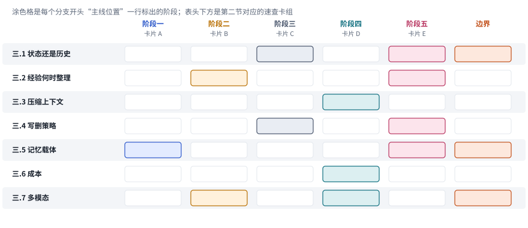

*图：七个前沿分支在五个阶段上的位置。表头下方注明每个阶段对应第二节的哪一组速查卡。*

## 三、前沿研究方向

下面七个分支收录的都是 2026 年的新论文。它们共同的变化，是从"保存历史"转向"维护能够支持行动的信息"。排列顺序从内容走向控制再走向部署：先讨论状态怎样组织、经验什么时候整理，再进入有限上下文的压缩和记忆读写策略的学习，然后比较记忆是否一定要放在模型外面，最后讨论成本和多模态输入怎样改变设计。每个分支开头先交代它要回答的问题，再标出它在上一节主线上的位置。不同路线常常同时出现在一个系统里，读的时候可以始终带着三个问题：它保存了什么，它怎样影响下一步决策，信息变了之后它还能不能保持正确。

> **本节要点：** 七个分支收录的都是 2026 年的新论文，每个分支开头先讲问题怎么来的，接着用一行“主线位置”把它挂回第二节的五个阶段，再用一张图把本分支几篇论文的做法摆在一起。第二节末尾的坐标图和矩阵图可以当作本节的目录。

### 1. 存聊天记录，还是维护一份当前状态？

回到开头那个论文助手。它的聊天记录里同时躺着"结果放在 results_v2"和"结果改放 results_v3"两句话，原始记录忠实地回答了"发生过什么"，可要回答"现在哪些事实仍然有效、还有什么没完成"，就需要另一种东西：一份随时更新的当前状态。两者谁也替代不了谁。只保存状态，系统会丢掉修改的依据，说不清 v2 为什么作废；只保存历史，识别冲突和失效信息的负担就落在了每一次推理上。所以研究这类记忆，首先要看状态更新时有没有保留来源、时间和尚未解决的条件，再看它怎样应对撤销和矛盾；单纯比较摘要的长短，说明不了什么。

> 主线位置：阶段三向阶段五的过渡。接 MemGPT 的分层存储与 Letta 的可改写记忆块，并直面 LongMemEval 揭示的知识更新难题。

> **要点：** 这一组工作都在回答同一个问题：怎样从一份不断变长的历史里，维护出一份能指导下一步行动的当前状态。

下图用开头的论文助手把这个分支画了出来。左边琥珀色的框是原始的历史日志，四条记录按时间追加，第一周说放 v2，第三周改放 v3 并说明了原因，第四周说先用柱状图凑合，第六周提出重画的请求。中间粉色的维护步骤读这些记录，记下每条信息的来源、生效时间和替代关系，写进右边灰色的当前状态。当前状态里有四行：绿色一行是此刻有效的事实，结果目录是 v3，第三周起生效，替代了 v2，来源是导师；两行橙色是已经失效的内容，v2 留作审计并写明作废原因，柱状图被标成过期的权宜之计；最后一行粉色是一条依赖关系，那些基于 v2 画出来的旧图需要标记重画。下排四个框对应本分支的四组论文：文件系统记忆研究怎样把原始材料组织得更好，Mi-Memory 和 ACM 把整个生命周期纳入设计，LiveMem 把状态放进模型内部，StateMem 则直接检验系统能不能分清当前状态和旧状态。

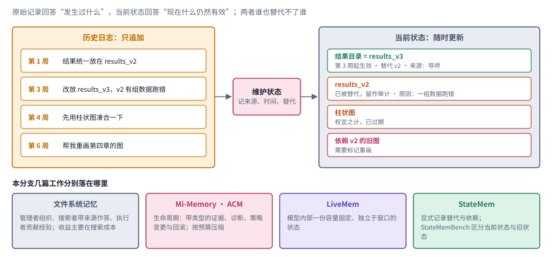

*图：左边是只追加的历史日志，右边是随时更新的当前状态，中间的维护步骤记下来源、时间和替代关系；下排是本分支几篇工作各自落在哪一块。*

把记忆组织成文件，是最贴近 Letta 和 Manus 实践的路线。**[Filesystem-Based Memory for LLM Agents: Organization, Evolution, and Sustainability](https://arxiv.org/abs/2607.26637)**（`2607.26637`） 把文件系统当作正式的研究对象，设计了三个角色：管理者负责组织文件，搜索者负责带着来源回答问题，执行者负责贡献经验。作者比较了按目录组织、原样堆放和分块检索三种做法，发现组织得更好，最稳定的收益体现在搜索成本上，答案质量并没有因此自动变好。这个结论很值得记住：分类能节省找文件的时间，却代替不了正确的理解，"目录很整齐"和"助手更聪明"之间隔着一段距离。随着文件越来越多，管理者和工具的能力也会影响目录会不会最终失控。

如果把视野从一个 agent 扩大到一台个人设备，问题就变成了记忆的整个生命周期。**[Mi-Memory: A Lifecycle Memory Framework for Personal AI](https://arxiv.org/abs/2607.18975)**（`2607.18975`） 用带类型的证据、诊断记录、策略变更和回滚记录把不同模块连接起来。它和文件系统研究最大的区别，是把修改和部署的责任也纳入了设计。报告本身明确区分了受控的模块评估、初步的内部结果和设计层面的论证，所以它最适合用来学习一个系统该怎样拆分；某个模块的分数，还不足以说明整个跨设备服务已经得到了验证。

**[Agentic Context Management: Solving Agent Memory and Cost by Treating Them as Lifecycle and Architecture Problems](https://arxiv.org/abs/2607.21503)**（`2607.21503`） 同样把记忆看成生命周期问题，但更强调组织作用域、提前准备信息和按预算压缩。它指出，每一轮都把不断增长的历史重新输入一遍，费用会持续累积，这和 Manus 对 KV 缓存的关注是同一个出发点。和它形成对照的是 **[LiveMem: Maintaining Memory State Continuity in Long-Running LLM Inference](https://arxiv.org/abs/2608.02515)**（`2608.02515`），它没有去把外部资料组织得更好，转而在模型内部维护一份独立于当前窗口、容量固定的状态，让原始证据移出窗口之后仍有可能影响回答。前者侧重服务和信息管理，后者涉及模型改造、后训练和有状态的推理，两者分别站在主线的阶段三和三.5 那条平行线上。

那么这些设计到底有没有抓住问题？**[Can Agent Memory Systems Track Evolving State?](https://arxiv.org/abs/2608.19652)**（`2608.19652`） 给出了检验的工具。它构建的 StateMemBench 会区分一个回答用的是当前状态、已经被替代的旧状态，还是别的错误；配套的 StateMem 则显式记录替代关系和依赖关系。作者还把这种状态方法做成现有记忆系统的轻量包装，并设置了等长度、等成本的对照实验，报告其中一部分提升确实来自状态结构本身，单纯增加上下文解释不了。这为"显式标出哪个事实已经失效"提供了实证支持。当然，结论的适用范围限于 StateMemBench 的场景以及所测的模型和后端，搬到各种长期业务流程上时，收益还要重新检验。

对于持续变化的任务要求，状态管理需要记下每条信息的生效时间、替代关系和受影响的任务。旧内容可以留作审计，却不该继续充当当前规则。这个区分也关系到冲突处理：保留历史是为了追溯，维护状态是为了行动，两者完全可以使用不同的检索入口。

### 2. 经验应该在写入时总结，还是等遇到新任务再整理？

提前总结经验，相当于为未来的用途下注。总结得越具体，将来调用时越方便，也越可能漏掉当初没有预见到的用途；保留原始经验则把麻烦推给了以后，检索和整理的成本都会增加。两条路线真正的分歧，在于什么时候支付抽象的成本，以及在什么证据下才扩大一条经验的适用范围。所以评估时要分别看一次经验的写入代价、跨任务的命中率和误用率；存得少，本身算不上学得好。

> 主线位置：阶段二到阶段五。接 Generative Agents 的反思、Reflexion 的语言反馈和 A-MEM 的笔记演化，回应 Letta"通用模型写出的记忆会空泛有损"的观察。

> **要点：** 本分支的几篇论文把经验的整理放在不同的时刻，比较它们时要看清抽象的成本在什么时候支付。

下图上排把一条经验的一生排成五个时刻：经历发生，写入记忆，遇到新任务，做出决策，行动之后。中间那条长箭头的两端是两种极端，越早整理，用的时候越方便，越可能漏掉当初没预见到的用途；越晚整理，原始信息保留得越完整，存储和读取的负担也越重。中排五个框对应本分支的论文和它们选择的时刻：最左边的灰框是所有路线共同的原料，原始轨迹；LifeMem 在写入时就按工作流程聚类，把稳定的规律提前固化成技能；JitMem 等到知道了新任务是什么，才从原始轨迹里生成紧凑的记忆；MemHarness 更晚，在每次行动之前根据当前状态重构已经检索到的经验；检索感知控制则在行动之后判断，继续搜索还有没有价值。底部绿色的框单独画出 Grounding Agent Memory，它不在这条时间线上，用一个后台进程去环境里核对记忆是否属实。

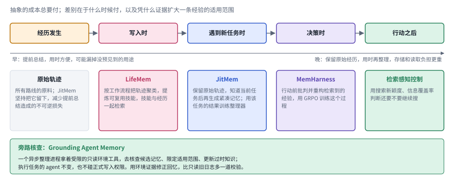

*图：上排是一条经验从发生到被使用的五个时刻，箭头下方标出“早整理”和“晚整理”各自的代价；中排是本分支论文分别把整理放在哪个时刻，底部绿框是旁路的环境核查。*

第一种思路是承认旧经验和新状态常常对不上，干脆在用的时候改造它。**[MemHarness: Memory Is Reconstructed, Not Replayed](https://arxiv.org/abs/2607.28272)**（`2607.28272`） 让策略在行动前先批判、重构检索到的经验，并用 GRPO 训练这个过程。GRPO 是一种强化学习方法，它让模型对同一个任务生成一组候选轨迹，再根据它们之间的相对回报来优化策略；放在这里，就是比较不同的经验使用方式最终能否完成任务。作者在 ALFWorld、WebShop 等环境中报告了收益。这项工作的关键在于让经验变成针对当前状态的建议，多塞一段提示并不能做到这一点；代价是额外的训练和更长的决策过程，能迁移到多远，还要看具体环境的变化。

**[Just-in-Time Memory: Learning to Curate Task-Adaptive Memory for LLM Agents](https://arxiv.org/abs/2609.27334)**（`2609.27334`） 和 MemHarness 一样强调"用时适配"，改动的位置却不同。MemHarness 在每个决策步根据当前状态重构已经检索到的经验；JitMem 则保留原始轨迹，把原本在写入阶段完成的整理工作挪到读取阶段，等知道了当前任务是什么，再生成紧凑的、与任务相关的记忆，并直接用这个任务的结果来训练整理器。名字里的"Just-in-Time"和 Anthropic 提倡的即时检索遥相呼应。两者都在使用时适配经验，一个改的是决策中的重构，一个改的是读取时的整理，比较时要分别看它们存的是什么、反馈从哪里来。保留原始轨迹减少了提前总结造成的不可逆损失，却也增加了存储、访问控制和读取时的处理负担，最终输入缩短了多少只是账本的一半。

另一条路线选择把稳定的规律提前固化下来。**[LifeMem: Enabling Lifelong Experience Reuse for LLM Agents](https://arxiv.org/abs/2609.12655)**（`2609.12655`） 按底层的工作流程把历史轨迹聚类，从中提炼出可以复用的技能，再同时检索技能和经历。它面向的是跨越多个环境的持续任务流，正好可以和即时整理对照着读：哪些规律值得提前固化，哪些细节应该留到使用时再生成？作者还观察了任务流顺序的影响，发现同一套记忆策略可能因为学习顺序不同而表现不同，这一点对设计实验很有提醒意义。

还有一个更根本的问题：历史轨迹本身也可能是错的。**[Grounding Agent Memory: Environment-Probing Curation for Enterprise Agents](https://arxiv.org/abs/2609.11060)**（`2609.11060`） 给负责整理的异步进程配备了受限的、只读的环境工具，让它去核查候选记忆、限定适用范围并更新过时的知识，同时不改变执行任务的 agent，也不碰正式的写入权限。这种做法用环境证据来修正回忆，比只读旧日志多了一道校验，和 Letta 让 sleep-time 智能体在后台整理记忆的思路一脉相承；它能不能复用，取决于环境是否允许低成本、安全地查询当前事实。

最后，有用的记忆除了内容，还包括"我们已经找过什么"。**[When Deep Research Agents Stagnate: Enhancing Reasoning with Retrieval-Aware Agent Control](https://arxiv.org/abs/2608.15191)**（`2608.15191`） 把记忆使用和停止搜索联系起来，用搜索新颖度、信息覆盖率等信号帮研究助手调整行动，避免反复检索却毫无进展。把这几篇放在一起，就覆盖了经验复用的几个环节：留下原始经历，提炼稳定的流程，遇到任务时重建建议，必要时核对现实，并判断继续搜索还有没有价值。

### 3. 怎样压缩上下文，又不把任务压丢？

窗口快满了，总得删掉点什么。上下文压缩可以直接删除内容，可以改变表示方式，也可以把一部分信息挪到能够重新查询的外部存储里。这几种做法的风险很不一样：删掉一行工具输出，可能缺了证据；把两个语义状态合并成一句话，则可能把历史和当前事实搅在一起。所以评估压缩方法时，平均任务得分只能说明一部分问题，还要专门检查关键证据很稀疏、需要回看原文、早期条件到末尾才生效这些情况，才能知道压缩是真的有效，还是只利用了简单样本里的冗余。

> 主线位置：阶段四，上下文工程里的"压一压"。接 Anthropic 的压缩与 Manus"可恢复压缩"的原则，背景是 Lost in the Middle 揭示的长上下文退化。

> **要点：** 压缩这件事被拆成了好几个可以单独研究的决定，下面先用一张图把它们和压缩的几种形态摆在一起。

下图分上下两层。上层是 2026 年夏天连续出现的四篇工作，每篇管压缩周围的一个决定：蓝色的 Self-Compacting 管什么时候压，用一份轻量的评分标准判断思路是否已经收拢；粉色的 Self-GC 管压什么，把上下文里的每一项都当成有生命周期的对象，逐项建议折叠、遮罩或剪掉；紫色的 Proactive Memory Agent 管谁来记，让一个独立的记忆 agent 坐在旁边，有选择地插一句提醒；灰色的 AREX 管压成什么，把冗长的历史压成一份只含已验证证据和未满足约束的研究状态。每个框的虚线下方是作者报告的数字。下层是压缩本身的三种形态，它们的风险各不相同：直接删除或裁剪最省事，删掉的那一行却可能正是证据；不可逆的摘要可以训练，可要是验收只看格式，漏掉约束的摘要照样能拿到奖励；可恢复的卸载把内容移到外部存储，保住了补查的机会，数据还在却未必能准确找回。最底下那条橙色的框是本分支最值得警惕的实测结果。

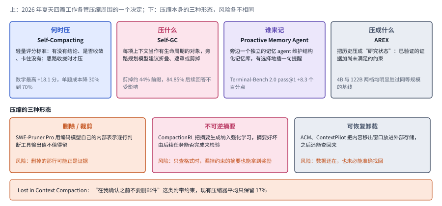

*图：上排四个框是压缩周围的四个决定及其代表工作和报告的数字；下排是压缩本身的三种形态及其风险；底部一条是压缩丢失附带约束的实测。*

最轻的一种压缩是裁剪工具输出。**[SWE-Pruner Pro](https://arxiv.org/abs/2607.18213)** 利用编码模型自己的内部表示，预测工具输出的每一行是否值得保留，并加入了与输出长度相关的表示，省去了再调用一个独立的大型裁剪模型。作者在多轮任务中报告，这种做法节省了 token，同时保持了任务质量。它的研究重点是让选择器复用执行模型已有的信号；读的时候可以看看额外预测头的开销有多大，裁错了之后能不能恢复，以及任务变化时相关性信号是否依然可靠。

Anthropic 说调压缩提示要先保召回，可"该留的"到底是什么，靠人来判断终究有限。**[CompactionRL: Reinforcement Learning with Context Compaction for Long-Horizon Agents](https://arxiv.org/abs/2607.05378)**（`2607.05378`） 干脆把任务执行和摘要生成一起纳入强化学习，并专门处理了学习信号怎样跨越压缩前后的片段。一份摘要好不好，由后续能否继续完成编程任务来检验，文字通不通顺无关紧要。这需要训练资源，也要求任务奖励能够反映出信息的丢失；如果验收只检查最终格式，一份漏掉关键约束的摘要照样可能拿到奖励。

Manus 坚持压缩必须可恢复，**[ACM: Agentic Context Management for Long Horizon Tasks](https://arxiv.org/abs/2607.23809)**（`2607.23809`） 把这个原则做成了模型能力。它为 agent 提供上下文编辑工具，被移出窗口的内容进入外部存储，之后仍然可以查询；再用示范数据和后训练教模型什么时候使用这些工具。和不可逆的摘要相比，这种"从工作区移走但不销毁"的做法更容易补查证据。不过，数据还在，未必就能随时准确地找回来，检索路径、外部存储成本和恢复延迟都是系统的一部分。

**[ContextPilot: Teaching Agents for Proactive Context Management via Fine-grained RL](https://arxiv.org/abs/2608.28476)**（`2608.28476`） 又往前走了一步，加入了计划、长期记忆和软卸载工具，并在关键的编辑决策处分支采样，以便更精细地估计每个动作的贡献。它和 CompactionRL 都让上下文管理参与训练，着力点却不同：ContextPilot 关心编辑动作怎样选择、怎样获得反馈，CompactionRL 关心压缩之后的长轨迹怎样学习。工具变多带来了灵活性，也扩大了需要探索和验证的行动空间。

上面几篇琢磨的，主要是压缩这个动作本身怎样做好。2026 年夏天连着出现的四篇工作，把目光移到了压缩周围的几个决定上：什么时候动手，窗口里哪些东西该动，由谁来负责记住要紧的事，以及压完之后留下来的应该是一种什么样的状态。四篇分别来自学界、内容平台、大厂研究院和国内研究机构，方法各不相同，放在一起读，恰好拼出了上下文管理的四个环节，也都给出了可以互相比较的数字。

**什么时候压。** 常见的做法是窗口快满了就压，或者每隔固定长度压一次。**[Self-Compacting Language Model Agents](https://arxiv.org/abs/2606.23525)**（`2606.23525`，JHU 与 Apple）指出，时机本身就很关键：一段推导做到一半时压缩，等于把草稿纸撕掉一半。它给 agent 一个压缩工具和一份很轻的评分标准，每隔一段（数学任务里按轮次边界、大约 16K token，搜索任务里按工具调用次数）问模型几个问题：手头有没有具体的结论，轨迹是不是正在收敛，是不是卡住了，下一步清不清楚。子任务刚收尾、思路正在收拢时才允许压，推导中途或者陷入僵局时就先等等。整套方法不需要微调，在六个基准、七个模型上，数学最高提升 18.1 分，搜索提升 5 到 9 分，单题成本还降低了 30% 到 70%。按 The Batch 第 370 期的转述，Qwen3-30B-A3B 在 IMO-AnswerBench 上从 45.2% 升到 52.1%，定时压缩只到 48.7%，作者认为增益主要来自"何时压缩"的这份评分标准。

**压什么。** 决定压之后，还要决定动哪些内容。**[Self-GC: Self-Governing Context for Long-Horizon LLM Agents](https://arxiv.org/abs/2607.00692)**（`2607.00692`，小红书）把上下文里的每一项都当成有生命周期的对象：用户的发言、工具返回的片段、技能的状态各自建了索引，一个旁路的规划模型逐项建议折叠、遮罩还是剪掉，再由 harness 负责保留可恢复的副本、选择安全的提交时机，并尽量照顾 KV 缓存的命中。The Batch 的编辑把它比作 McCarthy 当年发明的垃圾回收。在 33 个困难会话上，它剪掉了约 44% 的前缀 token，84.85% 的后续回答完全不受影响，规则方法只能做到 54.55% 到 69.70%；上线之后，白天的平均输入 token 降了 10% 到 15%。

**谁来记。** 前两篇都让执行任务的 agent 自己管上下文。**[Remember When It Matters: Proactive Memory Agent for Long-Horizon Agents](https://arxiv.org/abs/2607.08716)**（`2607.08716`，Meta AI）换了个分工：它在执行 agent 旁边放一个独立的记忆 agent，像一位坐在旁边记笔记的助手，持续维护一份结构化的记忆库，每一步决定是插一句简短的提醒，还是保持安静。执行 agent 本身一行不改。作者把要对付的问题叫作"行为状态衰减"：任务早期定下的约束和计划，随着轨迹变长慢慢淡出了模型的注意。这个设计让 Terminal-Bench 2.0 的 pass@1 提高了 8.3 个百分点，τ²-Bench 提高了 6.8 个百分点。消融实验里最有意思的一条是，每一步都提醒反而不如有选择地提醒，记忆 agent 的价值很大一部分在于懂得什么时候闭嘴。作者还用 SFT 和 GRPO 训练了一个 27B 的开源记忆 agent，效果部分迁移到了 Terminal-Bench 上。

**压成什么。** 最后一篇关心压缩的产物。**[AREX: Towards a Recursively Self-Improving Agent for Deep Research](https://arxiv.org/abs/2607.21461)**（`2607.21461`，北京智源）面向深度研究任务，它学会了一个更新上下文的工具，把冗长的历史压成一份紧凑的"研究状态"，里面保留已经验证过的证据和还没满足的约束，研究者读到这里会觉得很像自己的实验笔记。外层循环逐条审计草稿答案，给答案打分，分数够高就接受，不够就判断这条轨迹还能不能救，能救就定向补充研究，救不了就重来。训练依次用了合成任务、高质量轨迹、agentic 中期训练和长程强化学习，奖励特别照顾那些找到决定性证据、或者纠正了错误方向的关键步骤。据 The Batch 的报道，微调后的 4B 模型在六个基准里的五个上胜过了未微调的 35B 模型。

四篇放在一起，可以看出上下文管理正在从"写一份好摘要"变成一组分工明确的决策，每个环节都可以单独训练、单独评测。它们也留下了同一个问题：压缩到底丢了什么，目前主要靠最终任务分数间接判断。近两个月的几篇工作开始正面回答这个问题。**[Lost in Context Compaction](https://arxiv.org/abs/2608.11242)**（`2608.11242`）发现，"在我确认之前不要删邮件"这类附带约束，现有压缩器平均只保留 17%，压缩后的 100 个会话里有 30 个擅自删了邮件。**[When Can Agents Forget Their Reasoning?](https://arxiv.org/abs/2609.29875)**（`2609.29875`）在上下文边界处的隐藏状态上训练探针，能够预测 agent 之后是否需要重新推导，派生出来的状态只留在推理里时，后续出问题的风险远高于写到外部之后。**[AutoCompact](https://arxiv.org/abs/2610.02163)**（`2610.02163`）把 SelfCompact 的时机问题做成了训练目标，SWE-bench Verified 绝对提升 9.2 个百分点。**[MemoryWalker](https://arxiv.org/abs/2609.00865)**（`2609.00865`）则提醒，带驱逐的轨迹其实是一棵树，常见的强化学习训练方式会泄漏未来信息，读上文 CompactionRL、ContextPilot 的结果时值得把这一点放在心上。

在这些越来越复杂的方案旁边，有两篇工作提供了值得认真对待的反向基线。**[Zero-Mem: Zero-Token Memory Operations for LLM Agents](https://arxiv.org/abs/2607.29377)**（`2607.29377`） 在整理和检索阶段完全不调用生成式模型，改用实体关系图和时间层次来组织原始轨迹。所谓"零 token"，指的是这些记忆操作不消耗生成式模型的输入输出，编码器、索引和存储依然各有成本。**[LeanMem: Simple and Efficient Long-Term Memory for LLM Agents](https://arxiv.org/abs/2608.03463)**（`2608.03463`） 则按信息的特点分别保存用户画像、事件和原始记录，只更新正在变化的事件，并根据查询分配检索预算；它追问的是，哪些内容根本没有必要反复总结。这和 Sarah Wooders"很难打败 grep"的说法异曲同工。

已经确认的目标、持续变化的任务状态和可以再次检索的证据，最好不要强行压进同一种文本。比较压缩方法时，应当分别测试"压缩后直接继续"和"允许补充检索后继续"两种情形，并计算完整的成本，以免把外部补查的功劳算到摘要头上。

### 4. 谁来教系统写什么、删什么，并分清是谁说的？

记忆管理本身就是一种策略：在有限的空间里保存哪些信息，应当看它对未来任务的价值，眼下这段文字有多长倒在其次。难处在于价值往往延迟兑现，一条暂时用不上的约束，可能最后决定了任务是否合规；不同来源的陈述，可信程度也各不相同。所以训练写入和删除策略时，需要把内容是否相关、事实是否可靠、授权范围是否允许这三件事分开考虑，一条信息被检索得多，并不说明它值得长期相信。

> 主线位置：阶段五，让记忆的写入和维护成为可训练的能力。接 MemGPT 的自管理函数调用和 Letta"把记忆操作当作一等工具调用来训练"的主张。

> **要点：** 这一组论文共同关心的，是记忆的写入和删除怎样由一套可学习、可追溯的策略来决定。

下图上排从左往右是一条候选信息进入长期记忆的路径。它要先后回答三个问题：相关吗，看的是它对未来任务的价值；可靠吗，看的是这句话出自用户还是模型自己的推测；允许吗，看的是授权范围和作用域。三关都过了才写进长期记忆，再在以后的回答和行动里被用到。那条从右往左绕回的虚线是 AttriMem 的思路，它把最终答案里每段记忆的贡献算出来，变成写入阶段的局部奖励；虚线下方那行小字对应 Reality Monitoring，它检验的正是第二道关。中排三个框是本分支另外三篇工作：CLAUDE.md 那篇研究为什么规则只加不删，教师分层记忆研究怎样把强模型的经验整理成三层交给弱模型，Jev-Mem 把这些读写判断交给一个轻量的快控制器。最下面两个框是本节最后一段要强调的区分：错误的事实和错误的写入规则，要用不同的办法来修。

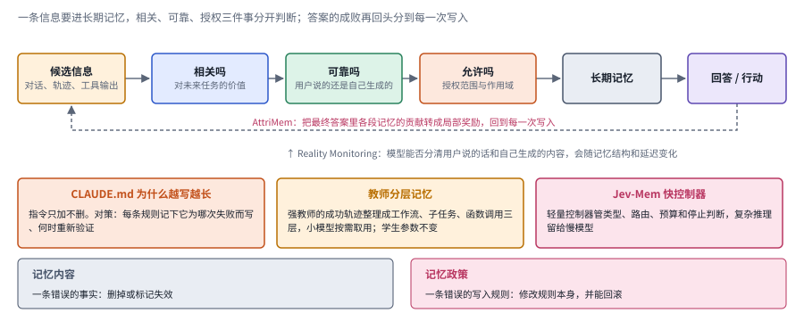

*图：上排是一条信息进入长期记忆前要过的三道判断，虚线是 AttriMem 把答案的成败分回到每次写入；中排三个框是本分支其余几篇工作；下排区分记忆内容和记忆政策。*

最直接的思路是给写入动作更细的奖励。**[AttriMem: Attribution-Guided Process Feedback for Agent Memory Construction](https://arxiv.org/abs/2607.21106)**（`2607.21106`） 研究记忆构建的细粒度反馈，把最终答案中各段记忆 token 的贡献转化成局部奖励，再和整体任务奖励结合起来。这能缓解"答案错了，却不知道该改哪一次写入"的困境。不过，贡献归因依赖回答的过程和所用的模型，那些重要却没被用上的证据，也可能被低估；所以读这篇时，跨回答模型的评测结果比训练曲线更有参考价值。

从另一端看，问题恰恰是删不掉。**[Why Does CLAUDE.md Keep Growing? Catastrophic Remembering in Agentic Coding](https://arxiv.org/abs/2608.11095)**（`2608.11095`） 研究编码 agent 的指令文件为什么越写越长。CLAUDE.md 正是 Anthropic 文章里提到的那种预先加载的程序性记忆。作者观察了真实仓库里指令的生命周期，又在可验证的设置下测试了"同时保留规则理由"的作用。和 AttriMem 追问"怎样奖励写入"不同，它追问的是"为什么不敢删除"。真实仓库的观察揭示了积累现象，受控实验帮助检验机制，两者的条件并不相同。对实践最有用的提醒是：每写下一条规则，就记下它是为了解决哪个失败而存在，以及什么时候可以重新验证它。

写记忆的能力也可以从强模型传给弱模型。**[Agent Memory Distillation: Empowering Small LLM Agents with Hierarchical Teacher Memory](https://arxiv.org/abs/2608.07169)**（`2608.07169`） 把强教师模型的成功轨迹整理成工作流、子任务、函数调用三层记忆，让较小的模型在任务开始时或工具出错时获得不同层次的帮助。这里学生模型的参数没有更新，所以"蒸馏"指的是借助结构化记忆传递能力。它依赖教师轨迹的质量，也受限于学生能不能执行这些建议；示范并非越完整越好，粒度合不合适同样重要。

写进去的东西是谁说的，同样要分清。**[Reality Monitoring in Large Language Models: Self-Knowledge That Transforms with Conversation Memory](https://arxiv.org/abs/2607.23927)**（`2607.23927`） 直接测试模型能否区分用户说过的话和自己生成的内容，发现表现会随对话记忆的结构和延迟条件而变化。这是记忆可靠性的另一个维度：检索到一段话之后，还得知道它是观察、猜测还是用户确认过的事实。最后，**[Jev-Mem: System-One-Controlled Agentic Memory for Efficient AI Agents](https://arxiv.org/abs/2609.23986)**（`2609.23986`） 把快速的记忆控制和较慢的复杂推理解耦，用一个轻量控制器处理类型、路由、预算和停止判断；它之所以放在这一组，是因为读写决策未必都要交给昂贵的生成模型去做。

这组方法共同提醒我们，要把"记忆内容"和"记忆政策"分开记录。一次失败可能意味着要删掉一条错误的事实，也可能意味着要修改一条错误的写入规则。两者一旦混在一起，系统就会不断地加例外，到最后连用户明确的纠正也盖不过旧策略。训练奖励、来源标记和可以回滚的规则维护，需要彼此配合。

### 5. 记忆一定要放在文件或数据库里吗？

前面几个分支讨论的记忆都放在模型外面，以文字的形式存在。可存储载体本身就决定了记忆怎样更新、怎样解释。外部文字容易检查、容易撤销；参数更新则可能把新信息和已有能力搅在一起；连续向量便于检索，却未必说得清里面存了什么。比较这些方案时，应当先把知识保存、查询接口和生成时的使用这三个环节分开，再考察归因、删除和迁移；有没有一个数据库，并不是判断系统有没有记忆的标准。

> 主线位置：与主线平行的另一条腿，把记忆放进模型内部。对应 Letta 所说的"权重与上下文互补"，也接 Lilian Weng 把短期记忆看作上下文内学习的视角，可与阶段一的 RAG 对照。

> **要点：** 这个分支的论文把记忆从外部文字一步步搬进模型内部，每往里走一步，得到的和失去的都不一样。

下图把这个分支的论文排成一条光谱。最左边是前四个分支讨论的外部文字，文件和数据库；往右一格是 Co-LMLM，它在预训练阶段就把事实外部化，查询键是连续向量，取回的值仍是可读的文本；再往右是测试时训练，先挑出相关片段，再用它们临时更新参数；Memory Decoder 是一个和推理模型分开扩展的参数化记忆模块；Metis 把记忆定义为模型自己读写的、持续演化的内部状态；最右边是改动计算结构本身的一组工作，包括 Memory Attention、快权重和 SketchSSM。光谱下方两条方向相反的箭头说的是这条光谱上的取舍：越往左，越容易逐条查看、纠正、删除和归因；越往右，越能参与端到端的优化，也越依赖模型改造和训练。

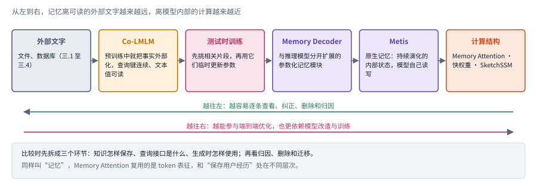

*图：从左到右，记忆离可读的外部文字越来越远，离模型内部的计算越来越近；两条反向的箭头分别是两端各自的长处。*

第一组工作仍然保留可读的文本，只是把它嵌进了模型的学习过程。**[Co-LMLM](https://arxiv.org/abs/2607.07707)** 在预训练阶段就把事实知识外部化，用连续的查询键配合可读的文本值，让生成时取回的知识仍然能追溯到具体内容。这和运行之后再总结对话的 agent 记忆不同，改变的是模型学习和取用知识的方式，可以看作 RAG 在预训练阶段的一个远亲。**[Self-Guided Test-Time Training](https://arxiv.org/abs/2607.09415)** 则先挑出和问题相关的片段，再用这些片段在测试时做参数适应；作者报告，如果用随机片段来训练，表现反而可能受损。两者放在一起看，说明外部检索和临时参数更新服务于不同的环节，选对证据比机械地扩大上下文更关键。

再往里走一步，就是让模型自己拥有记忆。**[Metis: Memory Foundation Model](https://arxiv.org/abs/2607.26760)**（`2607.26760`） 把"原生记忆"定义为一种持续演化的内部状态，以及由模型自己执行的读写过程，并提出了 Metis 原型和相应的记忆训练方法。它试图缩短"外部系统整理好，模型再重新阅读"这条链路，和 Letta 训练记忆模型的设想目标相近，路径却相反：Letta 让记忆留在 token 空间，Metis 把它收进模型内部。和文件记忆相比，内部表示可以参与端到端优化，却更难逐条查看、纠正和删除，评估时应当把易用性和训练、部署条件放在一起考虑。

**[Memory Decoder at Scale: A Pretrained, Parametric Long-Term Memory](https://arxiv.org/abs/2607.27919)**（`2607.27919`） 把长期记忆模块和基础推理模型分开扩展，研究参数化记忆的规模化训练，并处理了索引和检索分布方面的工程瓶颈。它回答的问题是"增加记忆容量是否一定要扩大整个模型"，和给普通助手插上一个随写随生效的用户数据库是两回事。预训练出来的记忆模块里的知识，和不断变化的个人状态，在更新频率和验证要求上都相差甚远。

最底层的一组工作改的是计算结构本身。**[Memory Attention](https://arxiv.org/abs/2609.28399)**（`2609.28399`） 用按 token 索引的记忆和上下文键来构造注意力值，并讨论了查表、预取和 CPU 卸载等实现问题。这是计算结构层面的复用，读的时候别把它理解成"保存了用户经历"。**[Fast Weight Attention for Continual Learning](https://arxiv.org/abs/2608.27763)**（`2608.27763`） 分析了循环快权重的在线更新规则，区分了不同的时间对齐方式各自对应什么学习目标；它说明，看起来一样的固定容量状态，可能在优化完全不同的问题。所以比较时，单凭"用了记忆"就把它们归成一类是不够的。**[SketchSSM: Write to the Full State, Read from a Compact Sketch](https://arxiv.org/abs/2609.33051)**（`2609.33051`） 保留了完整的状态写入，却用一份紧凑的草图来近似读取，从而减少每个解码步访问大状态的流量。它同样靠改变内部状态的读写方式来节省计算，和压缩自然语言记录处在不同的层次。Manus 的作者曾推测，状态空间模型如果学会使用基于文件的记忆，或许能成为更强的 agent；SketchSSM 这类工作则从另一个方向改进状态空间模型自身的记忆读写。近似读取是否可用，要同时看一般任务和长距离召回，只测吞吐是不够的。

这一组工作把记忆从系统外部延伸到了模型内部，比较的重点也随着存储对象而变化。事实条目、经验轨迹、token 表征和循环状态各有各的读写接口：逐条删除用户资料，需要能够定位的记录；减轻每一步读取巨大状态的负担，则更依赖内部结构的设计。先想清楚更新、撤销和读取各需要什么，再选择相应的记忆载体，顺序不能反过来。

### 6. 记忆更省 token，就真的更便宜吗？

Manus 的作者算过一笔账：缓存命中的输入 token 价格只有未命中时的十分之一。这笔账提醒我们，记忆系统的成本远比"提示有多长"复杂，它会把开销在时间上重新分配：写入时花一次摘要或建索引的钱，可能换来以后多次读取的节省；可如果一条记忆很少被复用，这笔投入就永远收不回来。完整的比较应当把生成记忆、更新索引、检索、读取以及失败后的恢复都算进去，并分别报告冷启动和长期使用两种情形。否则，一个预先准备了昂贵记忆库的方案，很容易显得比从原始输入开始的基线更便宜。

> 主线位置：阶段四，上下文工程里的成本一侧。接 Manus 对 KV 缓存命中率的强调、Anthropic 的注意力预算，以及 StreamingLLM 的注意力汇点。

> **要点：** 这一组论文都在算记忆的账，有的算注意力读取的开销，有的算检索前端和整个 agent 工作负载的开销。

下图左右两半各算一笔账。左半边是一份完整的成本账，五行分别是构建、维护、检索、生成和环境执行，每行上下两根条形分别代表首次使用和多次复用时这一项的开销；条形长度只是示意，它想说明的是一种常见的形状：构建的开销集中在冷启动，复用多次之后就被摊薄，环境执行的开销则不管复用多少次都不会消失。右半边是四种读历史的方式，每一行二十四个小格代表从早到晚的 token，深色格表示这一步真正读取的 KV。第一行全部读取是基线；第二行由模型自己声明要读哪些区域；第三行平时只读最近一段，虚线格表示完整的 KV 仍然保留，召回头判断需要时再做全局读取；第四行是滑动窗口加注意力汇点，只读开头几个和最近一段。读得越少越省，判断一旦失误，远处的证据就会被漏掉。

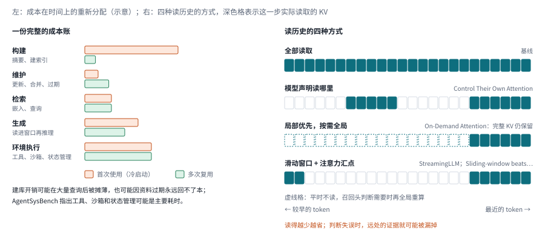

*图：左边是一份完整成本账的五项开销，两种颜色分别是首次使用和多次复用（条形长度为示意）；右边是四种读历史的方式，深色格是实际读取的 KV。*

一组工作想办法让模型少读历史。**[Language Models Can Control Their Own Attention](https://arxiv.org/abs/2609.02737)**（`2609.02737`） 让模型自己声明这一步需要全局、特定区域还是局部的注意力，再由推理引擎据此减少 KV 读取。它直接缩小了读取范围，可一旦判断失误，就可能漏掉远处的证据。**[On-Demand Attention: Language Models Know When to Recall](https://arxiv.org/abs/2609.20734)**（`2609.20734`） 采取局部优先的策略：一个轻量的召回头决定是否需要重新计算全局注意力，同时把完整的历史 KV 保留下来。两者都在尝试少读历史，后者明确保留了重新访问的机会，所以计算上的节省和存储上的节省要分开来看。

**[Sliding-window beats linear attention](https://arxiv.org/abs/2608.28444)**（`2608.28444`） 则为简单基线正名：在作者比较的设置中，滑动窗口配合注意力汇点，能够匹敌甚至超过经过后训练的线性注意力方案。滑动窗口只保留最近的一段上下文；注意力汇点就是 StreamingLLM 发现的那些持续吸收注意力的少数开头位置，相关方法通常会额外保留它们来稳定推理。题名说得很满，读的时候更要看清模型、任务和内存预算；它提供的是一个应当认真比较的简单方案，还谈不上对所有线性架构的最终判决。和"学习何时全局读取"相比，固定窗口实现简单，却需要确认远距离的证据不会被一直排除在外。

成本不只出在注意力上。**[The Embedder's Dilemma: LLMs Are Better, but at What Cost?](https://arxiv.org/abs/2608.12875)**（`2608.12875`） 从检索的前端算账，比较大模型和专用嵌入模型在多个任务上的质量、费用和速度，展示了总体表现相近时成本可能相差很大。它和前面几篇注意力论文优化的层次不同，却同样反对只看单项质量分数。**[From LLM Inference to Agentic Workloads: Characterization and Implications for Serving Systems](https://arxiv.org/abs/2608.15127)**（`2608.15127`） 用 AgentSysBench 测量完整的 agent 工作负载，指出工具、沙箱和状态管理可能成为主要的耗时来源，所以优化一次模型调用，未必能缩短整个任务。

因此，建议至少把成本拆成构建、维护、检索、生成和环境执行五项，再区分首次使用和多次复用。昂贵的建库开销可能在大量查询之后被摊薄，也可能因为资料很快过期而永远回不了本。服务多个用户时，还应当记录并发情况和尾部延迟：平均查询很快，可偶尔为了重建记忆阻塞几十秒，对实时助手来说仍然不够用。

一个实用的对照办法是固定最终任务质量的门槛，比较达到门槛所需的总费用；另一个办法是固定费用，看错误的分布有没有变化。前者适合部署选型，后者适合研究归因。只比较最终提示的长度，会漏掉许多真正昂贵的环节。

### 7. 当记忆来自视频、手机和语音，问题怎样变化？

Lilian Weng 在长文里把人类的感觉记忆对应到原始输入的嵌入表示上，可在 2023 年，这一层还几乎只停留在文字上。当助手开始戴在你头上、装在你手机里、和你实时语音对话，记忆首先要解决的就成了事件对齐问题，多存几张截图和几段录音解决不了它。同一个物体可能从不同的视角出现，同一句话也需要时间、说话人和周围环境才能被正确解释。连续感知还带来了隐私和信息过时的问题：系统看过的东西，未必应该永久保留；能检索到的东西，也未必允许用于任何任务。所以这里要同时研究时间组织、证据定位、存储预算和访问范围。

> 主线位置：阶段二在多模态上的延伸，并同时触及阶段四的预算问题和"能否忘掉"的边界。接 Lilian Weng 的感觉记忆与 Generative Agents 的记忆流。

> **要点：** 这一组论文面对的是不会停下来的感知输入，它们都要在问题出现之前决定留下什么。

下图顶部那排小方块是一条源源不断的输入流，视频帧、音频和手机上的应用会话交替进来。下面五条泳道是本分支的五篇论文，每一条的右侧标签说明它把这条流变成了什么形式的记忆：LightMem-Ego 把视觉和音频对齐到同一条时间线，再分成当前、短期、长期三层；StreamTTT 用快权重保存久远的历史，较短的 KV 窗口留给眼前的画面；OneStreamer 写下带时间戳的局部描述和事件摘要，并学习什么时候主动开口；VoiceMem 把语音交互里的记忆分成信息和情感两条通路；GraphMemix 按查询在预算内挑出一片证据子图。底部橙色的一条对应 MobileMem，它把场景拉长到一年的手机使用，也把隐私和适用范围的问题摆到了台面上。

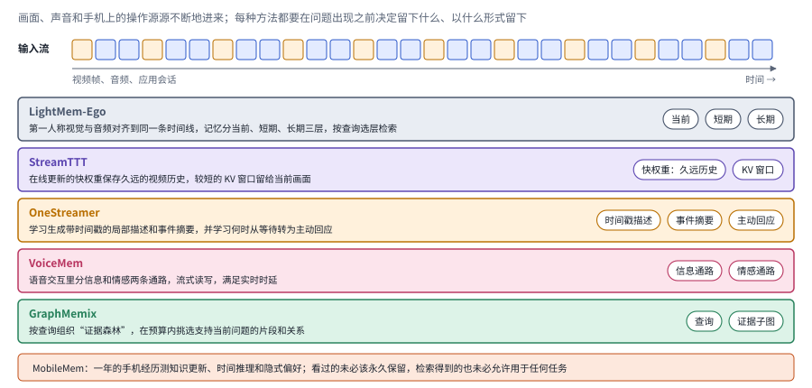

*图：顶部是一条不断进来的多模态输入流，下面五条泳道是本分支论文各自留下的东西，右侧的小标签是它们的记忆形式；底部一条是手机场景的隐私与适用范围问题。*

**[LightMem-Ego](https://arxiv.org/abs/2607.11487)** 把第一人称视角的视觉和音频对齐到一条共同的时间线上，再把记忆组织成当前、短期和长期三层，根据查询选择从哪一层检索。它和那种把视频转成一段文字摘要的路线不同，强调的是流式积累和分层访问，结构上很像 Letta 的分层记忆搬到了多模态场景。要长期使用，还需要把隐私、耗电和检索可靠性纳入评价，检验分层记忆在持续数据流中的维护成本。

视频模型内部同样面临"桌面太小"的问题。**[StreamTTT: Reconciling Real-Time Perception and Long-Term Memory in Streaming VLMs](https://arxiv.org/abs/2608.13416)**（`2608.13416`） 用在线更新的快权重来保存久远的视频历史，把较短的 KV 窗口留给当前画面。它针对的是实时感知和回顾过去之间的冲突，依赖相应的训练和输入协议。**[OneStreamer: Unifying Perception, Memory, and Proactive Response in Streaming Video Interaction](https://arxiv.org/abs/2610.01762)**（`2610.01762`） 则学习生成带时间戳的局部描述和事件摘要，用文字记录补充最近的视觉窗口，并学习什么时候从等待转为主动回应。前者把历史压进状态，后者保留了更可读的证据；两者都要在未来的问题出现之前，就决定留下什么。

**[MobileMem: Learning from a Year of Mobile Experiences](https://arxiv.org/abs/2608.13606)**（`2608.13606`） 把场景拉长到移动设备上的持续经历，利用用户的应用会话构建连贯的长轨迹，测试知识更新、时间推理和隐式偏好。它的价值在于让记忆面对更接近日常使用的变化，可以看作 LongMemEval 在手机上的延伸；不过合成轨迹的连贯性和真实用户的行为仍然要区分开。手机上记住很多东西，还得考虑敏感数据和跨应用的边界，单把对话基准做得更长解决不了这些问题。

语音交互对时延的要求最苛刻。**[VoiceMem: Streaming Dual-Brain Memory for Real-Time Interaction](https://arxiv.org/abs/2608.26005)**（`2608.26005`） 把语音交互中的记忆分成信息和情感两条通路，并考虑了流式读写、训练和可替换的部署后端。它说明，长期助手除了召回事实，还得在交互时限内作答；但情感或画像上的分数，还不足以证明用户体验得到了长期改善。**[GraphMemix: Query-Aware Evidence Forests for Long-Term Multimodal Agent Memory](https://arxiv.org/abs/2608.26983)**（`2608.26983`） 则用与查询相关的"证据森林"来组织多模态记忆，在预算之内挑选能支持当前问题的片段和关系，以此弥补离线统一摘要和简单相似度检索的不足。

流式多模态记忆需要同时保留内容、时间和跨模态的对应关系。过早地生成语义摘要可能丢掉细节，保留全部原始观察又会推高检索成本。时间索引和原始片段回查可以互相补充；至于要不要引入图结构或内部状态，取决于证据链上真正的瓶颈在哪里。

## 四、方法对照：同样叫记忆，实际改变了什么？

读完七个分支，可以发现它们虽然都叫"记忆"，改变的东西却大不相同。有的改的是事实状态，它需要能被纠正；有的改的是程序性经验，它需要能被复用；还有的改的是模型内部表示或外部索引，它们各有各的访问成本。下面这张表按"要解决什么问题"把方法排开，并列出各自的主要代价和最该检验的条件，免得把所有收益都笼统地归结为"记住了更多内容"。

> **本节要点：** 七个分支面对的困难归成七行，每行写明代表方法、主要代价和最该检验的条件。它和第二节末尾的总对照互为补充：那边按方法的来历比较，这边按要解决的问题比较。

| 问题 | 代表方法 | 主要代价 | 重点检验条件 |
|---|---|---|---|
| 旧事实覆盖新要求 | 状态关系、替代标记、生命周期管理 | 更新冲突处理与审计成本 | 长期真实修改、删除和恢复测试 |
| 旧经验不适用 | 使用时重构、即时整理、环境核查 | 原始轨迹保留、额外读取或训练 | 跨环境迁移与完整成本对照 |
| 历史挤满工作窗口 | 摘要训练、可恢复卸载、分类型存储 | 信息损失风险、检索与训练开销 | 后续任务成败，摘要文字质量次之 |
| 不知写删是否有效 | 贡献归因、教师分层记忆、来源追踪 | 奖励和教师依赖 | 反事实贡献、长期遗忘后果 |
| 外部读写成为瓶颈 | 原生状态、参数模块、快权重、状态草图 | 模型改造与可解释性下降 | 定向纠正、删除与部署可迁移性 |
| 读取历史太慢 | 声明式注意力、按需全局读取、简单窗口 | 召回误判或完整 KV 存储 | 同质量端到端费用与尾部延迟 |
| 连续多模态输入 | 流式状态、时间描述、证据子图 | 实时预算、模态损失、隐私维护 | 真实长期用户与跨模态证据审计 |

这些路线作用在不同的层次上：外部系统可以直接调整记录和检索方式，参数或内部状态方案则往往需要相应的训练和推理实现来配合。比较时，先确定部署条件，再在同一个任务下考察质量、维护成本和恢复能力。

## 五、开放问题与研究机会

再回到开头那个陪你写论文的助手。要让它在第六周画出一张正确的图，它得跨过三道坎：先要知道 results_v3 已经取代了 results_v2，并记得为什么；再要在一大堆往来对话里挑出"坐标轴用英文"这条此刻真正要紧的约束，同时别把"先用柱状图凑合"这种早已过期的权宜之计当真；最后，经过几个月的合作，它最好还能学到你和导师的习惯，越用越顺手，而那些你明确说过要删掉的东西，也真的不再影响它。这三道坎分别对应状态维护、面向未来的读写选择和跨任务的经验复用，贯穿始终的还有第四个问题：记忆本身越积越多之后，谁来维护它。记忆研究的重心，正在从"能不能找回一条记录"转向"怎样长期维护可用的经验"。下面四个问题按这个顺序排列，它们都需要在持续的任务流中观察，单次的历史问答很难完整覆盖。

> **本节要点：** 四个开放问题依次对应状态维护、面向未来价值的读写、跨任务复用与撤销，以及记忆增长后的长期维护，分别落在全景图的维护框、桌面与档案柜之间的两条读写箭头、档案柜里跨任务保存的那部分，以及档案柜本身的不断增长上。

**1. 如何从不断变化的历史中维护可修正的当前状态？**

事实会更新，目标会改变，证据之间还会互相矛盾，这些都让记忆无法只靠持续追加的摘要来维持。一个有前景的方向，是研究带有来源、时间、生效条件和依赖关系的记忆状态，让一次纠正能够传播到所有受影响的结论上。比如任务目标改变之后，旧计划中的哪些步骤应当失效，已经完成的哪些工作仍然可以复用，需要分别处理；开头的例子里，v2 数据作废之后，基于它画的那几张图也应当被标记出来。评价时应当同时考察状态是否正确、纠错有多快以及后续任务能否完成，以此检验系统维护的究竟是当前的事实，还是只找回了一条曾经正确的记录。

**2. 如何根据未来决策价值学习写入、检索和遗忘？**

写入的时候，系统通常还不知道未来会遇到什么任务，一条眼下没用的信息，可能很久以后才成为关键证据。这里的研究机会是用带有延迟需求的任务流来训练记忆策略，把未来的收益和整理、读取、补查的成本一起放进优化目标，这也正是 Letta 所说的记忆原生强化学习想要做的事。实验设计上，需要变换查询的时间和任务的类型，并刻意保留一些稀有但重要的线索，防止策略只学会优化近期的摘要质量。已经丢掉的信息能不能通过重新观察补回来，也是决定保存优先级的重要条件。

**3. 如何让经验跨任务复用，同时保持隔离与可撤销？**

不同的用户、项目和环境可以共享方法，却不应当无条件地共享私有事实或过期规则。可以研究事实、技能和个性化偏好各自的迁移机制，明确每一类的适用范围，并追踪原始记录、摘要、图关系、缓存和参数更新之间的派生关系。删除一条记录之后，还要检验系统以后的行为是否仍然受它影响；环境变化之后，则要观察系统能否识别出旧经验已经失效，主动补充证据，或者停止套用旧规则。Letta 期望记忆能跨越模型的更新换代传承下去，这个愿景越是诱人，可撤销性就越重要。

**4. 如何避免记忆增长演变为长期维护负担？**

系统持续运行下去，会出现重复的条目、退化的索引、相互冲突的来源和逐渐漂移的检索成本，CLAUDE.md 越写越长就是一个缩影。这里的研究机会是让系统主动合并、归档和修复记忆，同时保留可以回查的依据，Letta 设想的 sleep-time 后台整理是一条可能的路径。评测应当覆盖足够长的任务流，并一起报告存储增长、过期比例、冲突处理成本和任务表现。只有把维护动作本身也计入预算，才能判断紧凑的内部状态和外部可审计的记忆，分别适合哪些需求。

**实验资源：** [LongMemEval 论文](https://arxiv.org/abs/2410.10813) · [LongMemEval-V2 官方仓库](https://github.com/xiaowu0162/LongMemEval-V2/) · [ContextPilot 官方仓库](https://github.com/Tencent/ContextPilot) · [A-MEM](https://arxiv.org/abs/2502.12110) · [2026 年记忆系统实证比较](https://arxiv.org/abs/2606.24775)。动手之前，请先核对各项目的任务设定、代码版本、数据和运行条件。
