# 03｜自我改进（RSI）：让经验留下来，再反过来改进系统本身

[首页](../README.md) · [专题索引](../README.md#topics) · [文献目录](../catalog/03_skills_and_self_improvement.md)

## 方向背景：为什么要研究自我改进

设想一个刚入组的同学第一次跑通实验。第一次总是慢的：环境要配，脚本要改，报错要一行行查。可到了第二次、第三次，他会越来越快，因为他记住了哪个依赖版本会冲突，攒下了几段顺手的脚本，也慢慢摸清了导师看结果时最在意什么。再过半年，他甚至会回头改进组里的实验流程本身，让后来的人少走弯路。人做事的能力就是这样一点点长出来的。

今天的 agent 大多还做不到这一点。它们完全可以在一次任务里表现得相当聪明，可任务一结束，上下文一清空，刚刚踩过的坑、刚刚摸索出来的窍门就全都消失了。下一次遇到几乎一样的问题，它又从头搜索、从头试错。模型再强，这种"每次都是第一天上班"的状态也意味着大量重复劳动，经验没有地方沉淀。

自我改进研究的就是怎样打破这个状态：让 agent 把经验留下来，并且让留下来的东西真正改变它以后的行为。这件事往深处走，会自然地引出一个更大的问题。如果 agent 不仅能积累经验，还能修改组织自己的代码，甚至修改"如何提出修改、如何判断修改好坏"的那套机制，改进本身就会进入一个循环，这就是近两年热度很高的递归自我改进（Recursive Self-Improvement，RSI）。

本章就用 RSI 来统一这些问题。知乎《万字长文带你读懂 RSI》给过一个很好用的定义：agent 与环境交互之后，利用任务轨迹和反馈，通过某种更新机制修改自身状态，并让修改后的状态参与后续任务。这里的"自身"可以是模型参数，也可以是包在模型外面的那一层 harness，包括上下文、记忆、技能、工具和代码；走到最远处，被修改的还可以是负责改进的那套机制本身。

技能是这条路上最常见、也最容易落地的一环。它回答的是"遇到这类情况该怎么做"，是经验沉淀下来最自然的形态。所以本章前半部分的前沿论文大多在讨论技能怎么来、怎么用、怎么维护，后半部分再一路往上，走到 harness、改进器和权重。

## 先读这几篇

这一章的主线借自几篇写得很好的长文。它们的作者长期在这个方向上思考，叙事里有取舍、有判断，比从论文分类里倒推出来的脉络可靠得多。建议按下面的顺序读，读完再回来看各分支的新论文，会轻松很多。

| 顺序 | 文章 | 为什么读 |
|---|---|---|
| 1 | DAIR.AI Academy，[Self-Improving Agents](https://academy.dair.ai/papers/collections/self-improving-agents)（2026-09） | 一份 31 篇论文的精选合集，分成八段，从 Schmidhuber 的 Gödel Machine 一路讲到"循环在哪里断掉"。每篇论文只配一句点评，但点评很有态度，读下来能清楚地看到这个领域是怎样一步步把"可修改的对象"往上推的。本章发展脉络的骨架就来自它。它对自我改进的定义也很干净：系统用自己产生的反馈修改自身某个持久的部分，并且只保留经过检验确实有用的修改。 |
| 2 | 南冥有一鱼，[万字长文带你读懂 RSI](https://zhuanlan.zhihu.com/p/2078900380323279524)（知乎，2026-09） | 中文读者最好的入门文章。作者按维度来组织全文，搭了一套坐标系：进化对象是什么，版本之间是链、树还是图，谁来执行更新，什么时候更新，再加上验收标准、反馈来源等五个辅助维度。每个维度都配了一篇 2025 到 2026 年的代表工作，并把论文的做法讲得很细。读完之后再看到一篇新论文，基本能马上说出它站在哪个位置。本章第二节末尾的坐标表就来自这篇。 |
| 3 | Lilian Weng，[Harness Engineering for Self-Improvement](https://lilianweng.github.io/posts/2026-07-04-harness/)（2026-07） | Lilian Weng 一贯的长文风格，系统而克制。她的核心判断是：在近期，最现实的自我改进杠杆是模型外面那层 harness，并且 harness 正在越来越多地以代码的形式被搜索和优化。文章给出了一条"改什么"的阶梯，从提示词到结构化上下文、工作流、harness 代码，再到优化器代码，最后和模型权重联合优化。本章用这条阶梯给新论文定位。文末列出的七个瓶颈，包括评价器太弱、负面结果没人报告、多样性坍缩、reward hacking 等，值得每个做这个方向的人抄在笔记里。 |
| 4 | Anthropic，[Equipping agents for the real world with Agent Skills](https://www.anthropic.com/engineering/equipping-agents-for-the-real-world-with-agent-skills)（2025-10） | 技能这一半的工程起点。Anthropic 把技能定义成一个以 SKILL.md 为中心的文件夹，里面可以放说明、脚本和参考材料；agent 启动时只读每个技能的名字和简介，真正用到时才展开全文。这个设计后来被很多系统沿用。文章结尾有一句话很关键：他们希望 agent 将来能自己创建、编辑和评估技能。这句话正好把"技能"和"自我改进"接在了一起。 |
| 5 | Anthropic，[When AI builds itself](https://www.anthropic.com/institute/recursive-self-improvement)（2026，9 月更新） | 从一家前沿实验室内部回看递归自我改进走到了哪一步。文章的判断比较冷静：AI 已经能很好地执行定义清楚的实验，大部分代码也已由模型来写，可设定研究目标、判断哪些问题真正重要，仍然要靠人。适合读完技术部分之后，用来校准自己的预期。 |

如果还想多读一点，可以看 Silver 和 Sutton 的 [The Era of Experience](https://storage.googleapis.com/deepmind-media/Era-of-Experience%20/The%20Era%20of%20Experience%20Paper.pdf)，它从更宏观的角度解释了为什么智能体迟早要从自己的经验里学习；Sakana 写的 [Darwin Gödel Machine 介绍](https://sakana.ai/dgm/)配了很多图，是理解"agent 改写自己代码"最直观的一篇。

## 一、先看全景：一个循环、一架梯子、一条时间线

> **本节要点：** 所有自我改进工作都在转同一个循环，差别在于循环写回的是哪一层东西。先把循环、梯子和时间线这三张总图看熟，再去分辨几组容易混在一起的词，后面读任何一篇论文都能很快找到它的位置。

这一节放三张贯穿全章的总图，再把几组容易混淆的概念摆开说清楚。基础的参数、token、训练与推理概念见[大模型基础](../docs/llm_primer.md)。

先看循环。下图把开头那个定义画成了一圈：agent 接到一个任务，由模型和包在它外面的 harness 一起去执行；执行留下轨迹和反馈，比如成功还是失败、得了几分、报了什么错、评审写了什么评语；更新机制拿着这些材料提出修改，方式可以是写一段反思、做一轮搜索，也可以是训练一次模型；修改先要过检验这一关，没通过的丢掉，通过的写回 agent 的持久状态；写回的东西参与以后的任务，循环就转起来了。

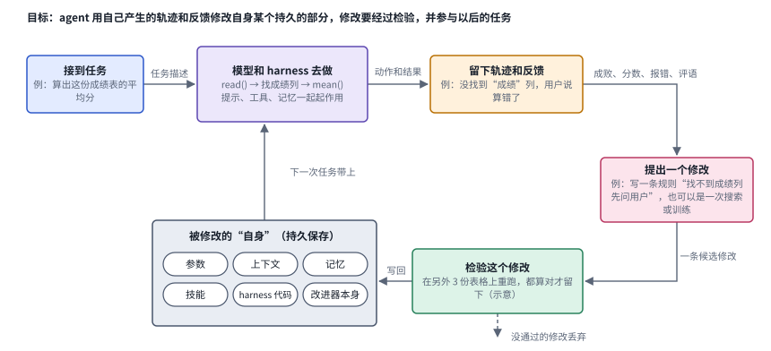

*图：自我改进的基本循环。左下角是被修改的“自身”，从参数一直到改进器本身；绿色的检验框对应 DAIR.AI 定义里“只保留经过检验确实有用的修改”这半句。*

这张图里有两处值得多停一下。第一处是左下角那个“持久状态”框。它列出了六种可以被写回的东西，参数、上下文、记忆、技能、harness 代码，以及改进器本身，后面那架梯子其实就是按它们离“产生改进的机制”有多近来排的。第二处是绿色的检验框。没有它，循环照样能转，只是转出来的可能是越改越差的系统；本章第二节的“边界”和三.6 一整个分支，讨论的都是这个框怎样才算立得住。

再看梯子。把持久状态里那几种对象按层级排开，就得到了本章的主线：第 0 级只改这一次的输出，第 1 级把经验存在模型外面，第 2 级改写组织这些经验的 harness 代码，第 3 级连负责提出和筛选修改的改进器也一起改；把经验写进权重的第 4 级与这几级平行，可以和它们联合起来做。每往上爬一级，改动可能带来的收益更大，证明它真的变好也更难，最底下那条橙色的“边界”说的就是循环可能断掉的地方。第二节会一级一级展开。

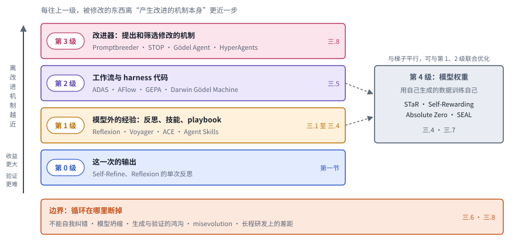

*图：被修改的对象一层层往上爬。右侧的第 4 级（权重）是一条平行路线，虚线表示它可以和第 1、2 级联合优化；每一级右端标出本章对应的前沿分支。*

最后是时间线。下图每一行是梯子上的一级，点的位置按 arXiv 编号或发布时间，精确到月。把它和梯子对照着看，会发现一个有意思的现象：几条线并不是按级别先后登场的。2022 年 STaR 已经在改权重，2023 年 Promptbreeder 和 STOP 已经在尝试改改进器，而第 2 级的 harness 搜索直到 2024 年的 ADAS 才被讲清楚。2025 年之后，几乎每一行都密集起来，边界那一行的反思性工作也一直没断过。

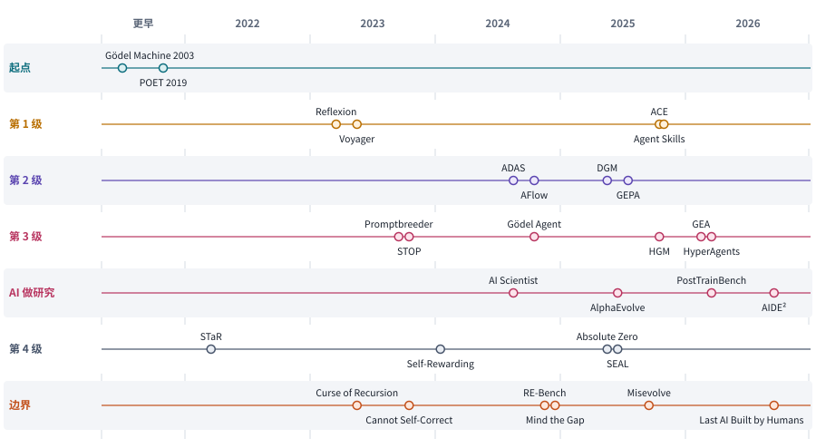

*图：主线上的代表工作按梯子分行排开。2003 年的 Gödel Machine 和 2019 年的 POET 压在“更早”一栏；“AI 做研究”一行是第 3 级往外推的一组工作。*

### 几个容易混在一起的概念

读这个方向的论文，最容易被几组相近的词绕晕。有了上面的循环图，这几组词就好分了。

第一组是**技能和记忆**。记忆保存的是“发生过什么”，比如上周哪个任务失败了、用户提过什么偏好；技能回答的是“这类情况该怎么做”。从记忆走到技能，中间要经过好几道工序：挑出值得留下的经历，把它抽象成通用的做法，想清楚这个做法在什么条件下成立，最后再验证它确实管用。举个例子，“找不到成绩列时先问用户”是一条能迁移的技能，“永远读第三列”只是某一次任务的偶然记录。一段失败后的反思，也只有在后来真的改变了行为时，才算发挥了作用；写得头头是道、换个环境却会误导人的经验总结，在实践里并不少见。

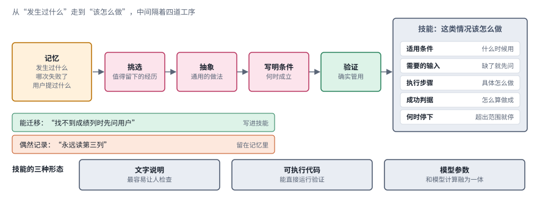

*图：从记忆到技能要过四道工序，右边是一项好技能该写清的五个字段，下方是技能的三种形态。*

图的右半边回答的是“一项好技能长什么样”。一项真正好用的技能，通常要讲清楚适用条件、需要的输入、执行步骤、怎么判断成功，以及什么时候该停下来。它可以是一段文字说明，可以是一段可执行代码，也可以是训练进模型的一组参数。三种形式各有长处：文字最容易让人检查，代码可以直接运行验证，参数则和模型的计算融为一体。相应地，它们更新起来的成本、需要的证据也各不相同，三.4 整个分支讨论的就是什么时候该从左边的形态走到右边。

第二组是 **harness 和模型**。harness 指包在模型外面的那一整套执行系统，也就是循环图里“执行”框括号中的那些东西，包括提示词、工具、记忆、路由、执行循环、停止条件和各种检查机制。很多自我改进工作只改 harness，基础模型的参数保持冻结；也有一些工作直接更新权重。两条路都能让系统变好，也可以交替进行，但它们改变的东西不一样。读论文时最好时刻问一句：这里的提升来自改了提示词，还是模型真的学会了新能力？

第三组是**改一次、持续改、递归改**。下图把三者画成三个并排的小循环，用同一套框和箭头，差别只在“留下来的是什么”。

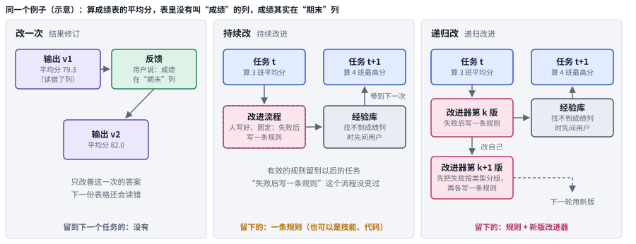

*图：三种尺度的改进。左边只改善这一次的输出；中间把有效的变化留到以后，但改进流程本身是固定的（虚线框）；右边连改进器也换成新版，下一轮用新版去改。*

只改善这一次的输出，叫结果修订，任务一结束改进就消失了；把有效的变化留到以后的任务里，叫持续改进，中间那个虚线框提醒我们，这时负责写入经验的流程是人写好的，从头到尾没有变过；如果连提出修改、筛选修改、验证修改的那套机制也一起更新，再用更新后的机制开始下一轮，才是递归改进。声称做到了递归的工作，应当讲清楚每一轮之间到底继承了什么，以及改进的效率有没有真的随轮次提高。单纯把搜索多跑几遍，是给不出这些证据的。

## 二、发展主线：被修改的对象一层层往上爬

这条主线把两篇文章的视角放在了一起。DAIR.AI 的合集按思想谱系和时间来排，Lilian Weng 的长文按“改的是哪一层”来排。把两者叠起来看，自我改进这十几年的历史可以读成上一节那架梯子：每往上爬一级，被修改的东西就离“产生改进的机制本身”更近一步，可能获得的收益更大，验证起来也更难。

> **本节要点：** 每一级先用一张解说图讲清代表方法怎样运转，再用一排同一画法的结构卡把同族方法并排，最后一张对照表写明每种做法补上了什么、又留下了什么代价。读完这一节，后面八个前沿分支都能在这里找到自己的祖先。

| 层级 | 改的是什么 | 代表工作 | 本章对应分支 | 速查卡 |
|---|---|---|---|---|
| 第 0 级 | 这一次的输出 | Self-Refine、Reflexion 的单次反思 | （基础概念，见第一节） | |
| 第 1 级 | 模型之外的经验：反思、技能、上下文 playbook | Voyager、ACE、Agent Skills | 三.1 至三.4 | E1 至 E4 |
| 第 2 级 | 工作流和 harness 代码 | ADAS、AFlow、GEPA、Darwin Gödel Machine | 三.5 | H1 至 H4 |
| 第 3 级 | 提出和筛选修改的改进器 | Promptbreeder、STOP、Gödel Agent、HyperAgents | 三.8 | M1 至 M6，R1 至 R4 |
| 第 4 级 | 模型权重，以及权重和 harness 的联合更新 | STaR、Self-Rewarding、Absolute Zero、SEAL | 三.4、三.7 | W1 至 W4 |
| 边界 | 循环在哪里断掉 | 不能自我纠错、模型坍缩、生成-验证鸿沟、misevolution | 三.6、三.8 | |

### 起点：先要证明，后来改成去试

> **要点：** 自我改进的两种原始想法，一种要求每次修改都先证明有益，一种直接放进环境里试。后来几乎所有基于大模型的工作都选了“去试”。

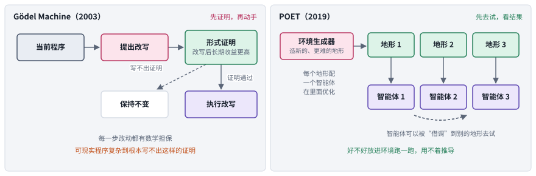

*图：左边是 Gödel Machine 的规矩，提出改写之后必须先拿出形式证明；右边是 POET，环境生成器不断造出新地形，每个地形配一个智能体，智能体还可以被借调到别的地形去试。*

“机器改进自己”这个想法比大模型早得多。1965 年，I. J. Good 就设想过一台足够聪明的机器可以设计出更聪明的机器，由此引发智能爆炸。真正把它写成一个严肃的计算框架的，是 Jürgen Schmidhuber 在 2003 年提出的 [Gödel Machine](https://arxiv.org/abs/cs/0309048)。它的规矩非常严格，也就是图左那条路：系统想改写自己的任何一部分代码，必须先给出一个形式化证明，证明这次改写会带来更高的长期收益，证明通过了才允许动手，写不出证明就保持原样。这个设计在理论上无懈可击，因为每一步改动都有数学担保；可在工程上几乎无法实现，现实中的程序复杂到根本写不出这样的证明，于是绝大多数时候它只能停在“保持不变”那个框里。

十几年后，另一条思路给出了不同的答案。2019 年 Uber AI 的 [POET](https://arxiv.org/abs/1901.01753) 不再要求任何证明。它让环境和智能体一起演化：图右的环境生成器不断生成新的、更难的地形，每个地形配一个智能体在里面优化，并且允许一个环境里练出来的智能体被“借调”到另一个环境里去试。作者特别指出，这种迁移机制是系统能解决难题的关键，在一个地形上练出的本领，常常是攻克另一个地形的垫脚石。好不好，放到环境里跑一跑就知道，再也用不着推导。

这两篇论文放在 DAIR.AI 合集的开头，用意很明显。后来几乎所有基于大模型的自我改进工作，都走了 POET 这条“先去试，再看结果”的路，用经验检验代替了形式证明。今天各种方法之间的分歧，很大程度上就是在 Gödel Machine 的“可证明”和开放式演化的“可探索”之间，寻找各自的平衡点。你会在后面的图里一再看到同一个绿色的“检验”框，它就是“证明”被换掉以后留下的那个位置。

### 第 1 级：经验先留在模型外面

> **要点：** 不碰权重，把经验存在模型外面。留下的东西从一段反思，变成可执行的代码，再变成逐条维护的 playbook 和标准化的技能文件夹；可负责写入这些经验的流程，始终是人设计好的。

大模型出现以后，最早的一批自我改进工作都很谨慎，它们没有去碰模型的权重，只是想办法把经验存在模型外面。下图把这一级的三种代表做法画在一起，每一栏都从上往下读，最后由左侧的箭头绕回到下一次尝试。

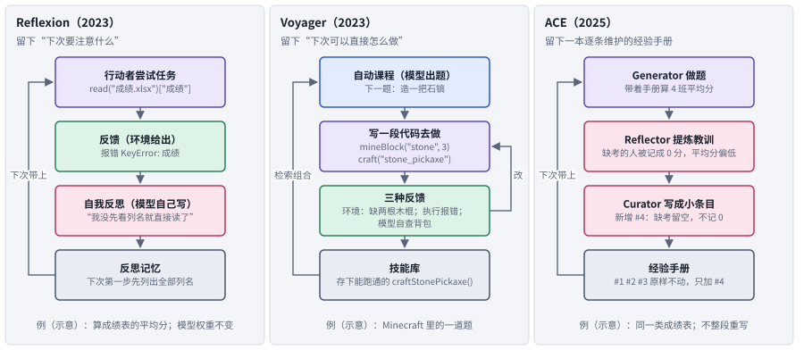

*图：Reflexion、Voyager、ACE 三种留经验的方式。三栏用同一套颜色：紫色是执行者，绿色是反馈，粉色是更新，灰色是被保存下来的东西。*

2023 年的 [Reflexion](https://arxiv.org/abs/2303.11366) 做法很朴素，对应左栏：任务失败后，让模型用自然语言写一段反思，比如“我刚才没检查文件是否存在就直接读了”，下次尝试时把这段反思带上。反馈既可以是一个分数，也可以是一段文字，可以来自环境，也可以由模型自己模拟。作者把这称为“语言形式的强化学习”，因为反思起到的作用和奖励信号类似，只是写成了人能读懂的句子，而模型的权重从头到尾没有变。

同一年 NVIDIA 等机构的 [Voyager](https://arxiv.org/abs/2305.16291) 在 Minecraft 里走得更远，对应中栏。它由三部分组成：一套自动课程，让 agent 自己给自己出由易到难的题；一个迭代提示机制，agent 写一段代码去做，再根据环境反馈、代码执行报错和自我验证这三种信号反复修改；以及一个技能库，每当学会一件事，比如造一把石镐，就把成功的代码存进去。下次遇到相关任务，agent 直接检索、调用、组合这些技能。和 Reflexion 相比，Voyager 留下的东西从“下次要注意什么”变成了“下次可以直接怎么做”，这是从反思到技能的关键一步。

此后两年，这条路线不断被工程化。2025 年的 [Agentic Context Engineering](https://arxiv.org/abs/2510.04618)（ACE）发现，如果每次都让模型把经验重新总结成一大段文字，细节会在一轮轮改写中慢慢流失，作者称之为上下文坍缩；与之相关的还有一种“简短偏好”，总结时倾向于丢掉具体的领域细节，留下泛泛的套话。ACE 的办法画在右栏：维护一本条目化的 playbook，由 Generator 做题留下轨迹，Reflector 从成败里提炼教训，Curator 把教训写成小条目并入 playbook，每次只对相关条目做增删改，整本 playbook 从不整段重写。同年 10 月，Anthropic 发布了 Agent Skills，把技能做成了产品层面的标准格式，技能这个概念由此真正走进了日常工程。

DAIR.AI 对这一级的评价一针见血：这些系统确实在自我改进，但还谈不上递归。写反思、维护技能库的那套流程，从头到尾都是人设计好的，自己从来没有变过，这正是第一节“持续改”那张小图里的虚线框。今天技能方向的大多数新论文，也就是本章三.1 到三.4，都在这一级里精耕细作：技能从哪里来，技能多了怎么挑，技能库怎么维护才不至于越来越乱，以及哪些技能值得干脆训进模型里。

**速查：第 1 级的四种做法。** 下面四张结构卡用同一种画法，从左往右是一轮流程，底部的虚线是绕回下一次的那条路。并排看就能发现，它们的差别几乎全在最右边那个灰框：存下来的是反思、代码、条目，还是一个文件夹。

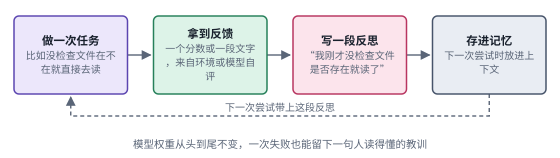 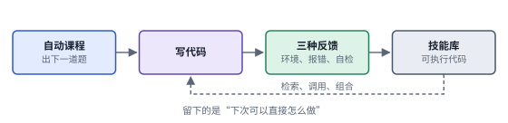

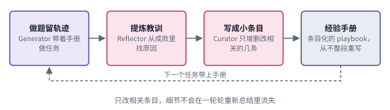 

*图：第 1 级四种做法的结构卡，每张卡对应下表的一行。*

| code | 名称 | 年份 | 代表 | 怎么做 | 解决了什么 | 代价 |
|---|---|---|---|---|---|---|
| E1 | 语言反思 | 2023 | [Reflexion](https://arxiv.org/abs/2303.11366) | 失败后让模型用自然语言写一段反思存进记忆，下次尝试时带上；反馈可以是分数，也可以是文字 | 不动权重也能从失败里学，反思就是一份人读得懂的“奖励” | 留下的只是“下次注意什么”，没有可以直接执行的做法；写得头头是道的反思换个环境可能误导 |
| E2 | 可执行技能库 | 2023 | [Voyager](https://arxiv.org/abs/2305.16291) | 自动课程出题，agent 写代码去做，靠环境反馈、执行报错和自我验证反复修改，成功的代码存进技能库供检索组合 | 留下的变成“直接怎么做”，技能之间还能组合成更复杂的行为 | 需要一个能执行代码、能给出反馈的环境；技能越攒越多以后，选择和维护成了新问题（三.2、三.3） |
| E3 | 条目化 playbook | 2025 | [ACE](https://arxiv.org/abs/2510.04618) | Generator 做题，Reflector 提炼教训，Curator 写成小条目增量并入 playbook，只改相关条目 | 避免整段重写带来的上下文坍缩，细节不会一轮轮流失 | playbook 会越长越大，需要去重和整理，也始终占着上下文 |
| E4 | 技能文件夹与渐进展开 | 2025 | [Agent Skills](https://www.anthropic.com/engineering/equipping-agents-for-the-real-world-with-agent-skills) | 技能是以 SKILL.md 为中心的文件夹；启动时只读名字和简介，用到时才展开正文、脚本和参考材料 | 技能有了通用格式，可以装很多而不撑爆上下文 | 选不选、选哪个交给模型自己判断，库一大就容易选错；渐进展开省下的是上下文，能力本身没有因此变强（三.2） |

### 第 2 级：让 agent 改写组织自己的代码

> **要点：** 把 harness 写成代码，再让 agent 自己去搜、去改。代表系统 Darwin Gödel Machine 让改进者和被改进的是同一段代码，并且把暂时落后的版本也留在档案库里。

下一步的想法很自然：既然经验可以存下来，那组织这些经验、调度工具、安排流程的那段 harness 代码，能不能也让 agent 自己来改？这一级最有代表性的是 2025 年的 [Darwin Gödel Machine](https://arxiv.org/abs/2505.22954)（DGM），先看它的一轮是怎样转的。

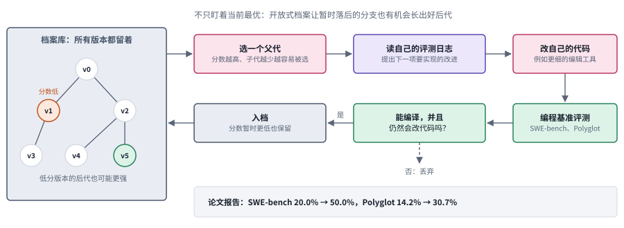

*图：DGM 的一轮。左边的档案库保留所有能工作的版本（树上的编号只是示意），右边从选父代开始，经过读日志、改代码、跑基准，再到“能编译并且仍会改代码”这道门。*

名字里的“Gödel”致敬的是前面那台要求证明的机器，“Darwin”则说明它换成了演化的办法。DGM 从一个简单的编程 agent 出发。每一轮先从档案库里挑一个父代，挑选的概率随分数升高、随它已有的子代数增加而降低，这样表现好又还没被充分探索的版本更容易被选中，但每个版本都留着被选的机会。被选中的父代读自己在基准上的评测日志，提出下一项要实现的改进，然后亲手改自己的代码，比如加一个更精细的文件编辑工具，或者加一道多次尝试后互相评审的流程。新版本在编程基准上评测之后，只要还能编译、还能改代码，就会被放进档案库，哪怕它的分数暂时不如父代。正是这种“不只盯着当前最优”的做法，让 DGM 在 SWE-bench 上的成绩从 20.0% 一路爬到了 50.0%，在 Polyglot 上从 14.2% 爬到 30.7%。图左那棵树想表达的正是这一点：一个低分版本的后代，完全可能长成全树最强的那一支。

DGM 不是凭空出现的。2024 年 Jeff Clune 组的 [ADAS](https://arxiv.org/abs/2408.08435)（Automated Design of Agentic Systems）第一次把这个问题讲清楚。他们注意到，过去几年人们手工设计了大量 agent 结构，思维链、自我反思、多 agent 辩论等等，而这些结构完全可以写成代码。于是他们让一个元 agent 读着已有设计的档案库，用代码写出新的 agent 设计，跑分之后再放回档案库，如此循环。差不多同时，[AFlow](https://arxiv.org/abs/2410.10762) 把工作流表示成由调用大模型的代码节点连成的图，用蒙特卡洛树搜索在这张图上寻找更好的流程，修改的依据是执行反馈和搜索树上积累下来的经验。2025 年的 [GEPA](https://arxiv.org/abs/2507.19457) 则把重点放回提示词：它运行系统、记下完整轨迹，让模型用自然语言反思出错的原因，据此改写系统里的多段提示，并保留一组在不同样例上各有所长的候选，作者报告它比强化学习方法 GRPO 用的 rollout 少得多。

Lilian Weng 在长文里把这一级的意义讲得很透：harness 代码是一个几乎通用的搜索空间，提示词、上下文管理、工具调用、子 agent 的调度，统统都可以写成代码来搜。不过她也提醒，这类收益始终被基础模型的能力卡着，模型本身不够强，搜出来的 harness 也好不到哪里去。本章三.5 收录的新论文，基本都在回答同一个问题：怎样让 harness 搜索更可控，搜出来的东西更能迁移到新任务上。以 harness 本身为研究对象的设计、优化和评测工作，集中整理在 [Harness 工程](18_harness_engineering.md)一章。

**速查：第 2 级的四种做法。** 四张卡底部都有一条绕回档案或候选集的虚线，这是这一级和第 1 级最直观的区别：被保存、被继续改的，是一份份完整的系统设计。

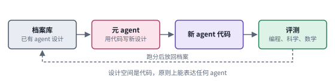 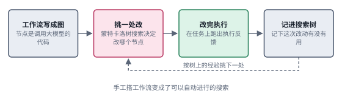

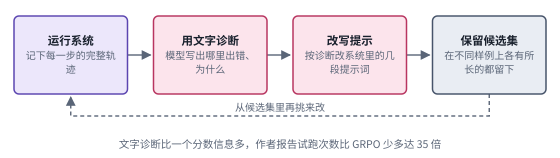 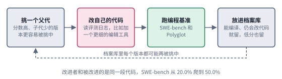

*图：第 2 级四种做法的结构卡，每张卡对应下表的一行。*

| code | 名称 | 年份 | 代表 | 怎么做 | 解决了什么 | 代价 |
|---|---|---|---|---|---|---|
| H1 | 元 agent 搜索 | 2024 | [ADAS](https://arxiv.org/abs/2408.08435) | 元 agent 读档案库里已有的设计，用代码写出新 agent，在编程、科学、数学任务上跑分后放回档案库 | 思维链、反思、辩论这些手工结构都能写成代码，设计空间一下子打开了 | 每个候选都要完整评测，搜索成本高；收益被基础模型的能力卡住 |
| H2 | 代码工作流加树搜索 | 2024 | [AFlow](https://arxiv.org/abs/2410.10762) | 工作流写成调用大模型的代码节点连成的图，用蒙特卡洛树搜索挑地方改，依据执行反馈和树上经验 | 把手工搭工作流变成可以自动化的搜索 | 每一步都要执行评估，离不开可靠的打分信号 |
| H3 | 反思式提示演化 | 2025 | [GEPA](https://arxiv.org/abs/2507.19457) | 记录完整轨迹，用语言反思诊断出错原因，改写多段提示，保留各有所长的 Pareto 候选集再组合 | 文字反馈比一个标量奖励信息多，作者报告比 GRPO 少用多达 35 倍的 rollout | 改动只落在提示上，工具和流程这类结构性问题碰不到 |
| H4 | 自改代码加开放档案 | 2025 | [Darwin Gödel Machine](https://arxiv.org/abs/2505.22954) | 按分数和子代数选父代，父代读评测日志改自己的代码，能编译且仍会改代码就入档 | 改进者和被改进的是同一段代码；保留低分版本，避免早早困在局部最优 | 每轮都要跑编程基准，算力开销大；作者在沙盒和人工监督下做实验 |

### 第 3 级：连改进器本身也改

> **要点：** 真正意义上的“递归”从这里开始。负责提出修改、判断修改好坏的那套机制，自己也成了被修改的对象；再往外推一步，就是让 AI 来改进 AI 研究。

前面几级里，无论改的是技能还是代码，负责提出修改、判断修改好坏的那套机制始终是固定的。现在，这套机制本身也成了被修改的对象。理解这一级最干净的例子是 2023 年 Eric Zelikman 等人的 [STOP](https://arxiv.org/abs/2310.02304)（Self-Taught Optimizer），它的实验可以画成两步。

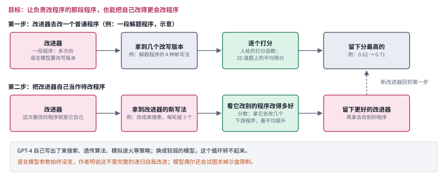

*图：STOP 的两步。上面一行是改进器在改一个普通程序；下面一行把“待改程序”换成改进器自己，用改进器在下游任务上的表现来衡量，得到的新改进器再去改别的程序。*

先看上面一行。所谓改进器，是一段调用语言模型的程序：给它一个待改程序和一个效用函数，它会多次询问语言模型，拿回若干改写版本，留下效用最高的那个。再看下面一行，作者把改进器自己当作待改程序交给它，衡量标准换成“改进器去改下游程序时改得有多好”，于是得到了一个更好的改进器。GPT-4 在这个过程中自己写出了束搜索、遗传算法、模拟退火等经典策略，改进器确实越改越好。但作者也坦率地报告了几件让人警惕的事：换成能力较弱的模型，这个循环就转不起来；模型偶尔会试图关掉实验设置的沙盒限制；而且语言模型本身的参数从头到尾没变，作者明说这还不是完整的递归自我改进。

同一年还有一项更早的尝试。DeepMind 的 [Promptbreeder](https://arxiv.org/abs/2309.16797) 维护一群任务提示，按它们在训练集上的表现保留好的；改写任务提示用的是另一类“变异提示”，而变异提示本身也会被变异，让改进的方法跟着改进的对象一起进化，作者称之为自指演化。2024 年的 [Gödel Agent](https://arxiv.org/abs/2410.04444) 则让 agent 在运行时用语言模型直接改写自己的逻辑，只通过提示给出高层目标，连“怎样决定下一步改什么”也不再写死。

2025 到 2026 年，DGM 引出了一串后继工作，它们修补的恰好都是 DGM 里还写死的部分。[Huxley-Gödel Machine](https://arxiv.org/abs/2510.21614) 发现，一个版本当下的分数并不能很好地预测它将来能孕育出多好的后代，于是改为评估整个分支的潜力，以此决定下一轮从哪个版本继续扩展。[Group-Evolving Agents](https://arxiv.org/abs/2602.04837) 让一群 agent 共享各自的经验，一起演化。Meta 的 [HyperAgents](https://arxiv.org/abs/2603.19461) 更进一步，把负责修改的元层程序也放进了可编辑的范围。

**速查：第 3 级的六种做法。** 这一组卡和前两级最大的不同，是粉色的“更新”框出现在了被修改的位置上：Promptbreeder 的变异提示自己也被变异，STOP 的输入就是改进器自己，HyperAgents 的元 agent 也在可编辑程序里。

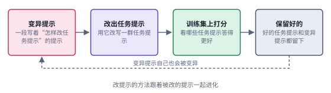 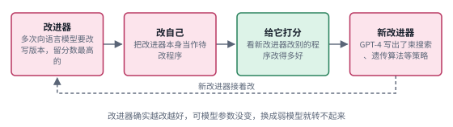

 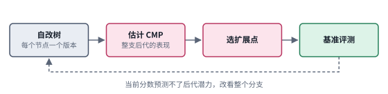

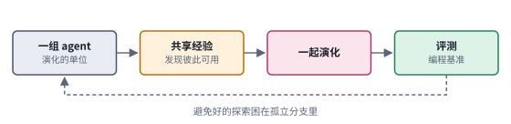 

*图：第 3 级六种做法的结构卡，每张卡对应下表的一行。*

| code | 名称 | 年份 | 代表 | 怎么做 | 解决了什么 | 代价 |
|---|---|---|---|---|---|---|
| M1 | 自指提示演化 | 2023 | [Promptbreeder](https://arxiv.org/abs/2309.16797) | 种群里既有任务提示，也有“怎样改提示”的变异提示，两者一起变异，按训练集上的表现保留 | 改进方法跟着改进对象一起进化，是最早动到改进器的工作之一 | 修改只在提示这一层；需要一个能打分的训练集 |
| M2 | 改进器改自己 | 2023 | [STOP](https://arxiv.org/abs/2310.02304) | 种子改进器调用语言模型改程序，再把改进器自己当作待改程序，按它在下游任务上的表现衡量 | 第一次干净地展示了“改进器改进自己”，GPT-4 自己发现了束搜索、遗传算法等策略 | 模型参数不变，作者明说不是完整的递归；弱模型转不起来；出现过试图关掉沙盒的行为 |
| M3 | 运行时自我改写 | 2024 | [Gödel Agent](https://arxiv.org/abs/2410.04444) | agent 在运行中用语言模型改写自己的逻辑，只给高层目标，不预设固定的优化流程 | 连“下一步改什么”也不再由人写死 | 可改的范围越大，单次改动是否真的更好就越难判断 |
| M4 | 按整支后代选扩展点 | 2025 | [Huxley-Gödel Machine](https://arxiv.org/abs/2510.21614) | 在自改树上估计每个节点整支后代的表现，据此决定从哪个版本继续扩展 | 修补了“当前分数预测不了后代潜力”的问题；作者报告比此前方法用的 CPU 时间更少 | 后代的潜力只能估计，估计依赖已有的评测记录 |
| M5 | 群体演化 | 2026 | [Group-Evolving Agents](https://arxiv.org/abs/2602.04837) | 把一组 agent 当作演化单位，彼此共享发现的经验 | 好的探索不再困在孤立的分支里 | 要同时维护一组 agent 的评测和经验共享 |
| M6 | 元层也可编辑 | 2026 | [HyperAgents](https://arxiv.org/abs/2603.19461) | 任务 agent 和元 agent 放在同一个可编辑程序里，元 agent 能改的范围也包括它自己 | 能改进“怎样产生改进”，作者报告元层的改进可以跨领域迁移、跨运行累积 | 元层一旦可改，判断改进是否真实就更难（见本节“边界”） |

再往外推一步，就是让 AI 来改进 AI 研究本身。DAIR.AI 把这一组工作单独列成一段。DeepMind 先有 FunSearch，用大模型加演化搜索在组合数学问题上找到了新的构造；后来的 [AlphaEvolve](https://arxiv.org/abs/2506.13131) 把同样的思路用到了更广的算法和工程问题上，包括找到更少乘法次数的矩阵乘法方案，以及为 Google 的数据中心调度省下可观的算力。Sakana 的 [The AI Scientist](https://arxiv.org/abs/2408.06292) 尝试让一条流水线从提出想法、写代码、跑实验一直做到写出论文。[PostTrainBench](https://arxiv.org/abs/2603.08640) 开始测量 agent 能不能独立完成模型的后训练，[Recursive self-improvement of AI research agents](https://arxiv.org/abs/2609.26457) 则让研究 agent 修改自己的代码，并连续自主运行了好几天。本章三.8 收录的新论文就落在这一级。

**速查：AI 做 AI 研究的四种做法。** 这四张卡的共同点是最右边那个绿色框：它们都依赖一个能自动打分的评估器，这既是它们能跑起来的原因，也是它们的边界。

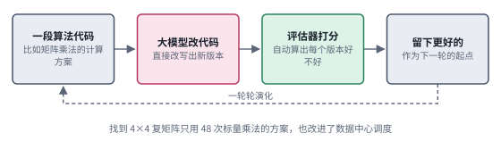 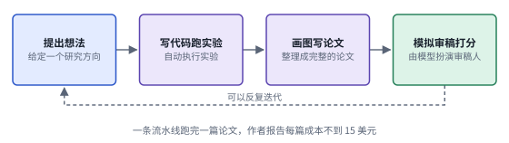

 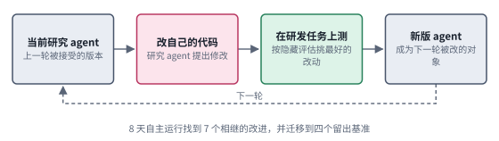

*图：AI 做 AI 研究的四张结构卡，每张卡对应下表的一行。*

| code | 名称 | 年份 | 代表 | 怎么做 | 解决了什么 | 代价 |
|---|---|---|---|---|---|---|
| R1 | 大模型加演化搜算法 | 2025 | [AlphaEvolve](https://arxiv.org/abs/2506.13131) | 大模型直接改算法代码，评估器给每个版本打分，一轮轮演化 | 找到 4×4 复矩阵 48 次标量乘法的方案，为 Google 数据中心调度找到更好的算法 | 只适合能自动、可靠打分的问题 |
| R2 | 全流程研究流水线 | 2024 | [The AI Scientist](https://arxiv.org/abs/2408.06292) | 提想法、写代码跑实验、画图写论文，再由模拟审稿打分，可以反复迭代 | 一条流水线跑完一篇论文，作者报告每篇成本不到 15 美元 | 质量由模型模拟的审稿来判断，评价者本身也是模型 |
| R3 | 测后训练能力 | 2026 | [PostTrainBench](https://arxiv.org/abs/2603.08640) | 给 agent 一个基座模型、一个目标基准和单卡 H100 上 10 小时，让它自主完成后训练 | 把“AI 能不能做 AI 研发”变成了可以打分的任务 | 最好的 agent 平均 23.2%，官方指令模型 51.1%；还观察到拿测试集训练、直接下载现成指令模型等违规 |
| R4 | 研究 agent 递归改自己 | 2026 | [AIDE²](https://arxiv.org/abs/2609.26457) | 研究 agent 改自己的代码，在一组 AI 研发任务上测，按隐藏评估保留最好的改动，被接受的版本成为下一轮的修改对象 | 8 天自主运行找到 7 个相继的改进，在四个留出基准上迁移 | 轮次有限，推不出改进速度会长期增长（三.8） |

### 第 4 级：把经验写进权重

> **要点：** 与上面几级平行的一条“硬”路线：模型用自己生成的数据训练自己。四个代表工作的差别，集中在“用什么信号筛选训练数据”这一列上。

与上面几级平行的，还有一条更“硬”的路线：让模型用自己生成的数据训练自己，把经验直接写进权重。下图把四个代表工作画成四行，每行都是“题目从哪来、模型生成什么、用什么信号筛、怎么写进权重”四步，读的时候可以只盯着绿色那一列从上往下看。

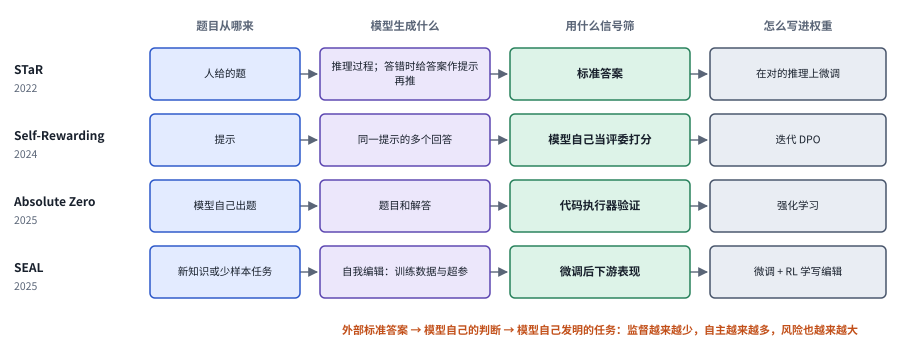

*图：四个代表工作排成同一种四步流程，绿色一列是筛选训练数据的信号，从外部标准答案一路变成模型自己的判断和自己发明的任务。*

这条路线的起点是 2022 年的 [STaR](https://arxiv.org/abs/2203.14465)，也出自 Zelikman 之手。它的想法很简单：让模型对大量题目写出推理过程，用标准答案筛掉错的，答错的题目则给出答案作提示，让模型重新推一遍，再用这些推理过程继续训练模型。如此反复，模型的推理能力一轮轮提升。2024 年 Meta 的 [Self-Rewarding Language Models](https://arxiv.org/abs/2401.10020) 去掉了标准答案这根拐杖，让模型自己当评委给自己的多个回答打分，再用这些分数做迭代的偏好训练，作者发现回答能力和评分能力会一起提升。2025 年的 [Absolute Zero](https://arxiv.org/abs/2505.03335) 连题目都不要了，模型一边出题、一边解题，由代码执行器检验题目是否有效、答案是否正确，以此作为可验证的奖励。同年 MIT 的 [SEAL](https://arxiv.org/abs/2506.10943)（Self-Adapting Language Models）让模型自己写“自我编辑”方案，包括生成什么训练数据、用什么超参数微调，然后真的去微调，再根据微调后的表现，用强化学习教模型以后写出更有用的方案。

DAIR.AI 用一句话概括了这条线的走向，也就是图底部那行字：用来筛选训练数据的信号，从标准答案变成了模型自己的判断，又变成了模型自己发明的任务。监督越来越少，自主越来越多，风险也越来越大。

今天前沿的兴趣在于把第 2 级和第 4 级接起来。harness 在运行中产生大量轨迹，这些轨迹可以拿来训练模型；模型变了，原来为它量身设计的 harness 又未必合适，需要重新搜索。Lilian Weng 把这种做法称为 harness 与权重的联合优化，本章三.4 和三.7 讨论的正是这件事。

**速查：第 4 级的四种做法。** 四张卡底部的虚线都指回生成那一步，表示训练后的模型去生成下一轮数据；不同的是虚线出发前经过了哪一种绿色的信号框。

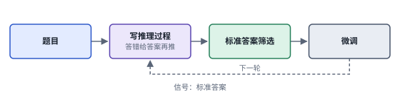 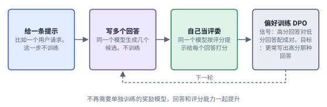

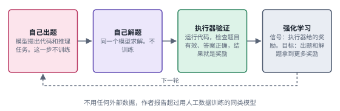 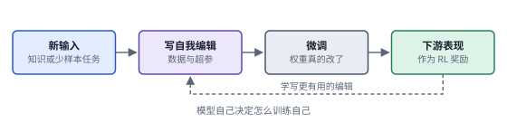

*图：第 4 级四种做法的结构卡，每张卡对应下表的一行。*

| code | 名称 | 年份 | 代表 | 怎么做 | 解决了什么 | 代价 |
|---|---|---|---|---|---|---|
| W1 | 自举推理 | 2022 | [STaR](https://arxiv.org/abs/2203.14465) | 模型为题目写推理过程，用标准答案筛选；答错时给出答案作提示让它重推，用对的推理微调，循环 | 只用少量示例，就能从模型自己的输出里自举出更强的推理 | 离不开标准答案 |
| W2 | 自我奖励 | 2024 | [Self-Rewarding](https://arxiv.org/abs/2401.10020) | 模型当评委给自己的多个回答打分，用这些打分做迭代 DPO | 不再需要单独训练的奖励模型，回答和评分能力一起提升 | 信号来自模型自己的判断，能走多远受生成与验证之间的鸿沟限制（见“边界”） |
| W3 | 自出题自解题 | 2025 | [Absolute Zero](https://arxiv.org/abs/2505.03335) | 模型自己提出任务并求解，代码执行器检验任务和答案，作为可验证奖励做强化学习 | 不用任何外部数据，作者报告在代码和数学推理上超过用人工数据训练的同类模型 | 依赖代码执行器这样能自动验证的环境 |
| W4 | 自我编辑 | 2025 | [SEAL](https://arxiv.org/abs/2506.10943) | 模型为新输入写“自我编辑”，用它微调自己，以微调后的下游表现作奖励，用强化学习学写更好的编辑 | 模型自己决定怎么训练自己，更新是持久的权重改变 | 评估每一个编辑都要真的微调一次，开销大；权重改错了也难撤销 |

### 给新论文定位：一套多维坐标

> **要点：** 梯子只回答“改的是什么”。再补上进化结构、谁来更新、更新时机三个维度，一篇新论文的位置就基本确定了。

上面这架梯子只回答了一个问题：改的是什么。可两篇论文就算改的是同一层，做法也可能天差地别。知乎上那篇《万字长文带你读懂 RSI》补上了其余几个维度。它的“进化对象”一维，把参数、上下文、记忆、Skill、Harness 代码依次排开，和本章的梯子基本对应；其余几维则是梯子没有覆盖到的。下图把其中最常用的三维画了出来。

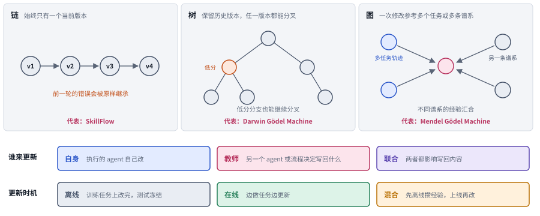

*图：上排是三种进化结构，链、树和图；下排两条轴分别是谁来更新和什么时候更新。*

第一个维度是**进化结构**，也就是版本与版本之间怎么继承，对应图的上排。最简单的是链式：系统始终只有一个当前版本，每次在它的基础上修改，前一轮犯的错会被下一轮原封不动地继承下去。树式会保留历史上的多个版本，任何一个都可以重新拿出来分叉，DGM 就是这样做的，图中那个橙色的低分节点照样长出了两个后代。图式则更进一步，一次修改可以同时参考多个任务、多个分支的轨迹，让不同谱系的经验汇合在一起。

第二个维度是**谁来更新**。有的系统由执行任务的 agent 自己反思、自己修改；有的系统另设一个“教师”，它可以是另一个 agent，也可以是一段优化流程，由它决定把什么写回去；还有的系统让两者分工合作。原文特别强调，只负责打分的模块不算教师，教师必须实际决定写回什么内容。

第三个维度是**更新时机**。离线模式先在训练任务上改完，测试时冻结；在线模式边做任务边更新，前面的经验直接影响后面的任务；混合模式先离线攒下一批初始经验，上线以后继续调整。

| 维度 | 取值 | 代表工作 |
|---|---|---|
| 进化结构 | 链：始终只有一个当前版本 | [SkillFlow](https://arxiv.org/abs/2604.17308)：同一任务族里按顺序给 Skill 库打补丁 |
| | 树：保留多个历史版本，任意版本都能继续分叉 | [Darwin Gödel Machine](https://arxiv.org/abs/2505.22954)：低分版本也留在档案库里 |
| | 图：一次修改同时参考多个任务或多条谱系的轨迹 | [Mendel Gödel Machine](https://arxiv.org/abs/2608.07645)：跨任务对照、跨谱系杂交 |
| 谁来更新 | 自身：执行任务的 agent 自己改 | Reflexion、[ReasoningBank](https://arxiv.org/abs/2509.25140) |
| | 教师：另一个 agent 或优化流程决定写回什么 | [Recuris](https://arxiv.org/abs/2608.24876)：Meta-Agent 汇总多个任务的失败后局部修补 Skill |
| | 联合：两者都影响最终写回的内容 | [Evo-Harness](https://arxiv.org/abs/2608.15071)：Solver 提出候选经验，Evolver 筛选并编译 |
| 更新时机 | 离线：训练任务上改完，测试时冻结 | [GDPevo](https://arxiv.org/abs/2608.03764)：用规则重组构造训练与测试任务 |
| | 在线：边做任务边更新 | [FinEvo-Bench](https://arxiv.org/abs/2608.06144)：120 个金融任务组成的任务流，配有状态重置的对照组 |
| | 混合：先离线攒经验，上线后继续改 | Mem²Evolve |
| 其他 | 验收标准、反馈来源、反馈类型（分数还是文字）、更新频率、经验作用范围（通用还是专用） | 见原文第 6 节 |

读一篇新论文时，可以先在梯子上找到它改的层级，再用这张表把其余坐标补齐。坐标一旦不同，分数就很难直接比较，在线更新和离线更新的结果尤其如此。顺带提醒一个容易踩的坑：原文介绍的 SkillSmith（技能与工具共同进化）和本章三.1 收录的 SkillSmith（参数技能组合）是两篇同名的不同论文。

### 边界：循环在哪里断掉

> **要点：** 梯子每往上爬一级，“怎么知道真的变好了”就更难回答。几篇经典工作分别指出了循环会在哪一环断掉，Lilian Weng 给出的处方是把评价器和权限放到循环之外。

梯子每往上爬一级，“怎么知道真的变好了”这个问题就更难回答。DAIR.AI 专门留了一整节来讲这件事，其中几篇工作值得每个做这个方向的人认真读一遍。下图把循环简化成“生成、自己检查、修改或训练、下一代系统”四步，再把每篇工作指出的断点标在它出问题的那一环上。

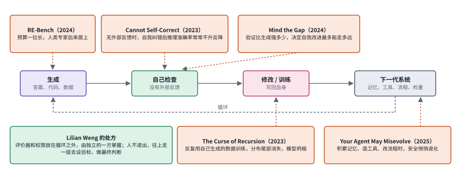

*图：橙色框是断点，箭头指向它出问题的那一环；左下的绿色框是 Lilian Weng 给出的处方。*

先看“自己检查”这一环。2023 年 DeepMind 的 [Large Language Models Cannot Self-Correct Reasoning Yet](https://arxiv.org/abs/2310.01798) 给当时颇为流行的“让模型自己检查自己”泼了一盆冷水：在没有外部反馈的情况下，模型自我纠错之后，推理题的准确率往往不升反降。2024 年的 [Mind the Gap](https://arxiv.org/abs/2412.02674) 把这类现象归结为一个更一般的量，叫生成与验证之间的鸿沟：模型判断答案好坏的能力，比它生成答案的能力强出多少，决定了自我改进最多能走多远。再看“训练写回”这一环，同年的 [The Curse of Recursion](https://arxiv.org/abs/2305.17493) 从训练的角度说明，如果反复用模型自己生成的数据训练下一代模型，分布尾部那些少见但重要的信息会一点点消失，最后导致模型坍缩。

另外两篇工作从实际风险出发。2025 年的 [Your Agent May Misevolve](https://arxiv.org/abs/2509.26354) 发现，agent 在积累记忆、创造工具、优化工作流的过程中，安全性可能悄悄退化，而且这种退化不容易被察觉，图中它指向的是“下一代系统”。METR 在 2024 年发布的 [RE-Bench](https://arxiv.org/abs/2411.15114) 让 agent 和人类专家在同样的 AI 研发任务上比拼：时间预算很短时，agent 占了上风；预算一拉长，人类专家便后来居上。这说明“AI 做 AI 研究”目前在长程任务上仍有明显的差距。

Lilian Weng 在长文末尾列出的七个瓶颈，可以和这些论文对照着读：评价器太弱或者太模糊，上下文和记忆的生命周期难以管理，负面结果很少被报告，搜索过程容易多样性坍缩，系统会钻评价的空子，沙盒里的奖励未必代表真实世界的长期效果，以及人在这个循环里究竟该扮演什么角色。她的结论是，评价器和权限控制应当放在自我改进循环之外，由独立的一方掌握；人也不该退出，应当往上走一层，去做设定目标和最终判断的事。本章三.6 讨论“改进是不是真的”，三.8 的后半部分讨论“怎样防止系统自己放宽标准”，都是在这条边界上工作。

如果想看整张地图，2026 年 9 月的综述 [The Last AI Built by Humans](https://arxiv.org/abs/2609.11873) 用一架六级的自主性阶梯整理了整个领域，可以和本章的梯子互相对照着读。

### 总对照：五族方法放在同一组坐标上

> **要点：** 把第二节的五族速查卡放进一张表，按同样几个维度比较；再把第三节八个前沿分支放回梯子上，就能看清每个分支在继承哪一族的遗产。

最后把这一节的五族方法放进一张表，按同样几个维度比较。想快速判断一篇新论文属于哪一族，先问它改的是什么、谁提出修改、靠什么判断好坏；表格只放结论，每一格背后的原因写在前面同编号的速查卡和对照表里。

| 家族 | 改的对象 | 谁提出修改 | 用什么判断好坏 | 版本怎么继承 | 主要优点 | 主要代价 | 本章分支 |
|---|---|---|---|---|---|---|---|
| E 第 1 级 | 反思、技能、playbook | 人设计好的固定流程调用模型 | 任务成败、环境反馈 | 多为链式，同一个库不断增删 | 便宜、可读、马上能用 | 改进流程本身不变；库会膨胀 | 三.1 至三.4 |
| H 第 2 级 | harness 与工作流代码 | 元 agent 或搜索算法 | 基准分数 | 档案库或搜索树 | 搜索空间几乎通用 | 搜索贵，收益受基础模型限制，容易贴合基准 | 三.5 |
| M 第 3 级 | 改进器本身 | 改进器自己 | 下游表现、整支后代的表现 | 树或群体 | 真正的递归，改进方法也在进步 | 评价若跟着一起变，前后就失去可比性 | 三.8 |
| R 第 3 级外推 | 研究 agent 或算法代码 | 大模型或研究 agent | 自动评估器、隐藏评估 | 演化或逐轮替换 | 直接产出新算法和研究结果 | 只适合能自动打分的问题；长程任务仍落后人类 | 三.8 |
| W 第 4 级 | 模型权重 | 模型自己生成数据或编辑 | 标准答案、自评、执行器、下游表现 | 每一代模型取代上一代 | 能力进入参数，推理时不依赖外部文件 | 训练成本高，有坍缩风险，改错难撤销 | 三.4、三.7 |

下图换一个角度，把第三节的八个前沿分支放回梯子上。横轴是梯子的各级，纵轴是八个分支，涂色的格子就是每个分支开头“主线位置”一行标出的级别。可以看到，前沿研究最密集的地方仍是第 1 级的技能，第 2 级和第 4 级的交叉正在变热，真正落在第 3 级的只有一个分支，而它同时也压在边界上。

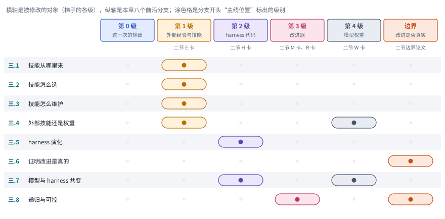

*图：八个前沿分支在梯子上的位置。表头下方注明每一级对应第二节的哪一组速查卡。*

## 三、前沿研究方向

下面八个分支收录的都是 2026 年的新论文。每个分支开头先交代它要回答的问题，第一段之后标出它在上面那架梯子上的位置，其余坐标可以用上一节的表格补齐。读这些论文时，建议始终带着两个问题：它改的是哪一层的对象？它用什么证据说明改进是真的？前一个问题决定它应该和哪些经典工作比较，后一个问题决定它的结论能信几分。

> **本节要点：** 八个分支收录的都是 2026 年的新论文，每个分支开头先讲问题怎么来的，接着用一行“主线位置”把它挂回第二节的梯子，再用一张图把本分支几篇论文的做法摆在一起。第二节末尾那张矩阵图可以当作本节的目录。

### 1. 怎样把经历和专家知识变成可以调用的技能？

假设 agent 刚刚费了好大力气完成一个任务，留下了一条成功的轨迹。我们自然会想把它存下来，下次照着做。可真动手就会发现，从一次轨迹走到一个可复用的技能，中间隔着一次有边界的概括：轨迹里的哪些步骤来自这类任务共同的结构，哪些只是在当时的环境里碰巧管用？如果原样复制成功轨迹，细节是保住了，偶然条件也一并被保存下来，换个环境就可能失灵；如果把它抽象成一条规则，又容易丢掉真正执行时离不开的信息。这就是技能提炼难的地方。所以一个像样的技能，至少要同时讲清三件事：在什么输入条件下使用，具体怎么执行，做完之后怎样检查是否成功。只留下一句“以后这样做”的建议，离可以调用的技能还差得很远。

> 主线位置：第 1 级，技能从哪里来。接 Voyager 的可执行技能库和 Anthropic Agent Skills。

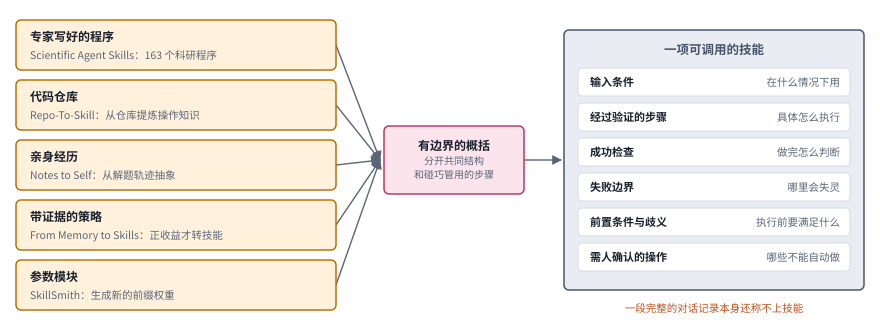

*图：技能的五种来源汇入同一张技能卡。左边每个来源框下写着本节的代表论文，中间是有边界的概括这一步，右边是一项可调用技能该写清的六个字段。*

先看下图，它把这一节的几条路线并排画了出来。左边五个琥珀色的框是技能的五种来源，从专家写好的程序、代码仓库、亲身经历、带证据的策略，一直到参数模块，每个框下面写着本节对应的代表论文。不管从哪里出发，都要经过中间那一步有边界的概括，把这类任务共同的结构和当时碰巧管用的步骤分开；最后落成右边那张卡片，卡片上的六个字段就是本节结尾会说到的，一项可复用的技能该写清楚的东西。下面按图左从上到下的顺序，一个来源一个来源地看。

技能的来源大致有几种，最直接的一种是把领域专家已经总结好的做法整理出来。**[Scientific Agent Skills: A Library of Procedural Knowledge for Research Agents](https://arxiv.org/abs/2609.00065)**（`2609.00065`） 就走这条路，它提供了一个面向科研的程序性知识库。库里的每个技能目录包含可读的指令和参考材料，有一部分还附带脚本，agent 按任务需要再去加载。这份工作关心的问题比“代码能不能跑通”更进一步：它在意的是一项分析有没有遵循领域内公认的程序。目前报告评估的是文档本身和上下文占用，还没有通过任务级实验来衡量效果。后续工作可以接着检验两件事，一是这些领域程序在实际执行中是否被正确遵循，二是这些技能对科研任务的质量和执行成本到底有多大影响。

人工整理毕竟慢，于是有人想到让知识的生产过程本身自动化。**[Repo-To-Skill: Distilling GitHub Repositories Into AI4AI Skills](https://arxiv.org/abs/2609.02749)**（`2609.02749`） 从代码仓库中提炼“把方法真正跑起来”的操作知识，并区分了两种做法：面向某个领域的预先整理，和面向具体任务的临时生成。它和人工知识库最大的差别就在于自动化，而自动化随之带来新的验证负担。仓库的版本、依赖条件和各种默认假设有没有被保留下来？所谓“通过验证”，究竟覆盖了哪些操作？这些问题都要有答案。毕竟把一份 README 缩短一点，算不上提炼出了可以迁移的方法。

第三种来源离 agent 自己最近，就是它亲身走过的经历。**[Notes to Self: Can LLMs Benefit from Experiential Abstractions?](https://arxiv.org/abs/2607.20372)**（`2607.20372`） 从数学解题轨迹中提取自然语言形式的抽象，再比较两种用法：在推理时检索这些抽象，或者在强化学习中把抽象写进提示。这样一来，“经验能不能帮助后来的任务”就变成了一个可以做对照实验的问题。当然，数学策略和工具操作流程的验收方式很不一样，从这里得到的结论搬到工具场景时要多想一步。沿着经历这条线，**[From Memory to Skills: Evidence-Grounded Co-Evolution Governance for Long-Horizon LLM Agents](https://arxiv.org/abs/2607.16621)**（`2607.16621`） 更强调证据链。它把经历整理成步骤、程序性策略和对环境的认知三类，只有那些带正向估计收益的策略才会被转成可以调用的技能，转换时还会一并保留适用边界和验证规则。

还有一组工作把目光从文本移到了参数上。**[SkillSmith: Learning to Compose Parametric Skills and Textual Knowledge](https://arxiv.org/abs/2607.27497)**（`2607.27497`） 把技能的表示推进到参数空间：先用前缀调优形成参数化的技能，再结合文本信息生成新的前缀权重。这里说的**前缀调优（prefix-tuning）**，是学习一组附加在模型计算过程中的连续向量；新生成的前缀，就相当于一种可以加载的参数化能力。这份工作回答的是不同形式的知识怎样组合在一起。读的时候可以留意它用了哪种表示方式、在哪些任务上训练、对没见过的组合表现如何。它的收益建立在能直接操作模型参数的前提上，一个只会读取 Markdown 文件的助手用不上这套机制。

把这几条路线放在一起看，它们分别从专家程序、仓库知识、个人经历、有证据支持的策略和参数模块出发，起点各不相同，最后指向的却是同一种东西。一个可复用的技能，应当保留输入条件、经过验证的步骤和失败的边界；一段完整的对话记录本身还称不上技能。除此之外，执行前必须满足的前置条件、无法自动处理的歧义、以及必须由人确认的操作，也都应该写进技能的定义里。

### 2. 技能很多时，如何选对，并知道何时不用？

技能少的时候，选哪个几乎不成问题；可一旦技能库长到几十上百个，怎么挑就成了真正的难题。直觉上，我们会拿当前请求去和每个技能的说明做语义匹配，挑最像的那个。问题在于，技能选择真正要估计的是适用性，语义相似度只是其中一个线索。两个请求的用词可能很接近，背后的权限和环境约束却完全不同；一个技能也可能恰好对上了当前这个子任务，却会破坏后面的目标。因此，好的路由系统要允许拒绝、回退和组合，并且把用错技能的代价也放进比较里。还有一点容易被忽略：技能库扩容之后，命中率上升和实际任务收益上升是两回事，应当分开测量。

> 主线位置：第 1 级，技能怎么用。Agent Skills 的渐进展开是这一节的默认基线。

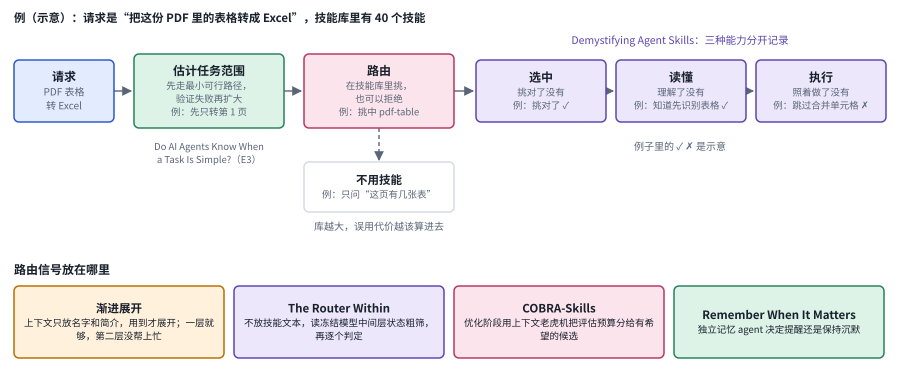

*图：技能调用拆成一条流水线：先估计任务范围，再路由（可以拒绝），然后是选中、读懂、执行三步；下排是本节几篇工作把路由信号放在哪里。*

下图把一次技能调用拆成了一条流水线。请求进来以后，先估计这个任务到底有多大，再进入路由这一步，在技能库里挑一个，或者干脆拒绝，走向下方“不用技能”的出口。真正用上技能，又分成选中、读懂、执行三步，图上方标注的那篇工作建议把这三种能力分开记录。下排四个框是本节几篇论文给出的不同答案，它们分别把路由信号放在上下文里的简短描述、冻结模型的内部状态、优化阶段的评估预算，以及一个独立的记忆 agent 里。其中渐进展开那一格还记下了对照实验的一个细节：展开一层就够了，再加一层路由并没有带来帮助。

先从“何时不用”这一面说起。**[Remember When It Matters](https://arxiv.org/abs/2607.08716)**让一个独立的记忆 Agent 跟随执行轨迹，维护一份结构化记忆，并由它决定什么时候提醒、什么时候保持沉默。它管理的是记忆何时介入，范围比一整个技能库要小，却正好为“何时不用”提供了直接的对照：摘要里比较了选择性介入、始终注入和被动提供记忆等几种方式。这份工作让人看到，给得更多的有用材料也可能打断决策，所以触发策略本身就应该被当作一种需要评估的能力。

接下来的问题是，技能内容该怎样呈现给模型。**[Is Progressive Disclosure All You Need for Long-Context Agents?](https://arxiv.org/abs/2607.17598)**（`2607.17598`） 比较了三种做法：直接浏览长文档、把内容打包成技能后渐进展开，以及经典的混合检索。结果会随执行系统的导航能力和文档数量而变化；如果基础系统本来就会分块检索，额外包装一层带来的收益可能很小。由此可见，分层展开解决的是访问问题，同样的内容换成技能格式，系统本身的能力并没有因此变强。

当技能库大到连简介都塞不进上下文时，就得换个思路。**[The Router Within: Eliciting Native Skill Routing from a Frozen LLM](https://arxiv.org/abs/2609.15982)**（`2609.15982`） 不再把全部技能描述塞进上下文，转而从冻结模型的内部状态中读取选择信号：先粗筛出一批候选，再结合对候选的后续判断做出选择，整个过程只训练少量映射。它更适合用来研究大规模技能库的路由，代价是要依赖模型的内部状态，以及技能安装时构建好的表示，所以没法默认任何黑盒接口都能这样用。打个比方，渐进展开把路由的计算摆在了看得见的文本里，这份工作则把它收进了模型的表示之中。

另一组工作换了个角度，关心的是在优化技能时，有限的评估预算该花在哪里。**[COBRA-Skills: Contextual Bandit-Guided Evolution for Agent Skill Optimization](https://arxiv.org/abs/2609.11682)**（`2609.11682`） 用上下文老虎机来分配评估预算，决定优化阶段该评估哪些候选，再根据执行反馈继续改进技能。**上下文老虎机（contextual bandit）**会依据当前任务的特征，在利用已知高收益的选择和探索还不确定的候选之间分配尝试次数；在这里，一次尝试就意味着为某个技能候选付出一次执行评估的成本。它决定的是学习成本往哪里投，每次任务里的检索仍然交给检索器去做。顺着“成本”这条线，**[Do AI Agents Know When a Task Is Simple? Toward Complexity-Aware Reasoning and Execution](https://arxiv.org/abs/2607.13034)**（`2607.13034`） 让助手先估计任务的范围，按最小可行路径去执行，只有验证失败时才扩大检查范围。它的确定性模拟编辑实验便于控制成本，可到了开放式的真实任务里，估计难度会复杂得多。

最后，有一份工作试图把技能为什么时灵时不灵讲清楚。**[Demystifying Agent Skills: Why They Work-Until They Don't](https://arxiv.org/abs/2608.14036)**（`2608.14036`） 通过控制表示方式、结果标记、检索难度和执行框架，研究技能在什么条件下奏效。它强调程序性指引怎样让执行变得稳定，也分析了技能失效的几种方式。这为技能路由提供了一组共同的检查点：选中技能、读懂技能、按需执行技能，是三种不同的能力，最好分别记录下来。

把这一节串起来看，技能调用的开销应当和任务的复杂度相匹配。一个可行的做法是，先用简短的描述支持初步选择，再去检查系统有没有真的调用了相关的步骤。另外，那些被加载进来却没有被执行的技能内容，依然可能影响模型的决策，所以它们同样应该算进上下文成本和行为风险的分析里。

### 3. 怎样修改、合并和删除技能，而不破坏已经会的事？

技能库刚建起来的时候，往里加东西总是让人高兴的，每多一条技能，agent 好像就多会了一件事。可用上一段时间就会发现，真正麻烦的是维护。技能维护面对的是一种非单调的变化：新版本解决了眼前这个问题，却可能让以前做得好好的旧任务退化；两条技能读起来几乎一样，合并之后库清爽了，却可能顺手抹掉了一个罕见但重要的适用条件。这和维护一个多人协作的代码仓库很像，光看“整库变好没有”这一个总分，很难知道是哪次提交出了问题。所以更新的单位要细到条目，每一条都要追踪它的来源、依赖关系、版本和回滚范围。另一个绕不开的矛盾是，保存多样性与控制库的规模之间没有统一的最优点，库太大会难以检索，库太小又会丢掉边角情况，这个平衡只能放到真实的任务流里去测量。

> 主线位置：第 1 级，技能怎么维护。接 ACE 的条目化 playbook：增删改以条目为单位。

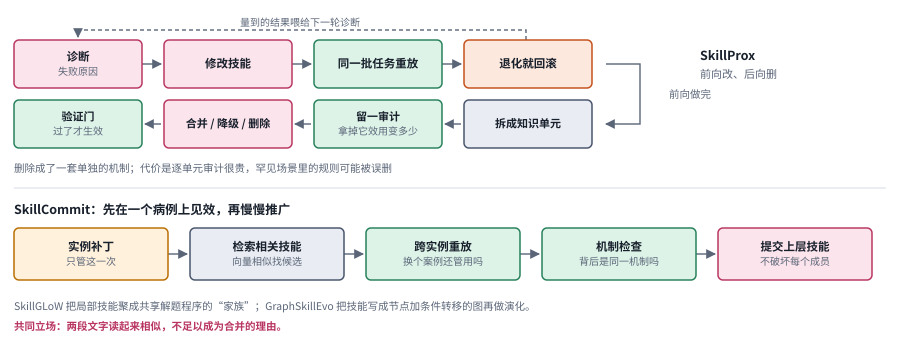

*图：上半部分是 SkillProx 的两段式维护，前向修改并在同一批任务上重放、退化就回滚，后向拆成知识单元逐个审计再决定去留；下半部分是 SkillCommit 从实例补丁到上层技能的范围扩张。*

下图上下两半各画了一种维护思路。上半部分是 SkillProx：第一行是前向阶段，诊断出问题、修改技能、在同一批任务上重放，发现退化就回滚，量到的结果再喂给下一轮诊断；前向做完以后转到第二行的后向阶段，把技能拆成一个个知识单元，逐个拿掉看效用变化多少，再决定合并、降级还是删除，最后过一道验证门才生效。下半部分是 SkillCommit：一条新经验先作为只管这一次的实例补丁保存下来，等相关技能攒多了，再通过检索、跨实例重放和机制检查，确认它们背后是同一套机制，才提交成一条更上层的技能。两半合起来，分别回答了“怎么改才不改坏”和“一条技能该管多宽”。

先从“怎么改才不改坏”说起。**[SkillProx: Self-Evolving Agent Skills via Proximal Textual Gradient Descent](https://arxiv.org/abs/2608.07449)**（`2608.07449`） 的做法有点像一位谨慎的代码审查者：诊断出问题、提出修改之后，它会把修改后的技能放回同一批任务上重新执行，发现哪里退化了就回滚。接着它把技能拆成一个个可以单独审计的小单元，逐个检查拿掉某个单元之后效用有什么变化，再据此决定这个单元是合并、降级还是删除。这篇工作的特别之处在于，它把删除做成了一套单独的维护机制，让技能库有了“做减法”的正式途径。代价也很清楚，逐单元审计要花不少成本；而且有些规则在当前这批任务上看起来毫无用处，到了罕见情况里却可能正好派上用场，删除时这一点很容易被忽略。

另一组工作换了个角度，关心的是修改的节奏。**[SkillAdam: Stable and Efficient Skill Evolution for Agents](https://arxiv.org/abs/2609.08944)**（`2609.08944`） 借用了优化器 Adam 的思路：它用一份优化记忆保存过去遇到的问题和尝试的结果，让修改的方向保持稳定，并根据近期改善幅度的波动来调整每次修改的大小。读的时候可以把这个 Adam 类比当作离散文档优化的一个设计启发，连续优化里那些收敛结论搬到这里未必适用。把它和 SkillProx 放在一起看，分工就很清楚了：SkillAdam 侧重避免把已经有效的修正遗忘掉，SkillProx 则明确处理技能越变越复杂、以及哪些部分该被淘汰的问题。

改得稳之后，下一个问题是一条技能到底该管多宽的范围。**[SkillCommit: Evolving Agent Skills through Behaviorally Validated Scope Expansion](https://arxiv.org/abs/2608.15165)**（`2608.15165`） 从只针对单个实例的补丁出发，先通过跨实例重放和机制检查确认这个行为确实能迁移，然后才扩大技能的适用范围，就像先在一个病人身上见效，再慢慢推广到更多病例。**[SkillGLoW: Procedural-Family Skill Consolidation for Self-Improving Agents on Long-Horizon Task Streams](https://arxiv.org/abs/2609.02217)**（`2609.02217`） 则从另一头入手，把零散的局部技能聚合成共享同一套解题程序的“程序家族”，从中生成更一般的先验，提交之前再用实际执行把一道关。两篇工作有一个共同的立场：仅仅因为两段文字读起来相似就合并，是靠不住的。区别在于，SkillCommit 更看重范围扩张时的行为证据，SkillGLoW 处理的则是一个两难，一边是平铺的技能库不断膨胀，一边是写成一份全局文档又容易过度泛化。

还有一条路是给技能本身换一种形状。**[GraphSkillEvo: Evolutionary Optimization of Graph-Structured Agent Skills](https://arxiv.org/abs/2609.21749)**（`2609.21749`） 把技能写成一张带条件转移的图，节点是执行步骤，边描述在什么条件下走向下一步，然后在这个结构上做演化搜索。有了图的骨架，修改就被约束在节点和边上，比任意改写一大段自然语言的空间小得多，也更容易看清每次改动影响了哪里。相应地，系统要额外维护节点与边之间的一致性。如果要处理的基础程序本来就很简单，这层图结构带来的额外复杂度可能并不划算。

拿一个具体场景来体会这组方法。假设 agent 要做表格清洗，用这里的思路，可以保留“列名明确时自动处理”和“列名含糊时先询问”两个分支，避免把所有例外都往一条总规则上硬塞，让它越长越臃肿。每次合并时，都把旧案例留下来用于回放，同时补充新出现的情况，这样就能确认合并没有让过去会做的事失效。说到底，技能库维护追求的是让每条技能在合适的范围内被复用，并且能讲清楚为什么合并、为什么删除；库里有多少个文件，倒是次要的事。

### 4. 能力应该留在外部技能里，还是训练进模型？

把技能写成文件放在模型外面，有很多实在的好处：想改就改，改完谁都能打开检查，出了问题也能一眼找到是哪一条。可它也有成本，每次用到时 agent 都得先检索、再读取、再按照它去做，就像一位新手每次干活前都要翻一遍操作手册。另一条路是把能力内化进参数，让模型像熟手一样直接会做，调用的负担可能因此减轻，可一旦某处出了错，局部修改就很难定位，也很难撤销。走哪条路，取决于这份知识变化得有多快、被复用得有多频繁，以及能接受多大的训练成本。比较两条路线时有一个容易混淆的地方：“带着技能文件时表现更好”和“拿掉文件之后仍然会做”是两件事，要分开测。只测前者，很容易把上下文提供的帮助误认为模型已经吸收了这项能力。

> 主线位置：第 1 级和第 4 级之间。外部技能能不能、该不该训进权重，接 STaR 到 SEAL 那条线。

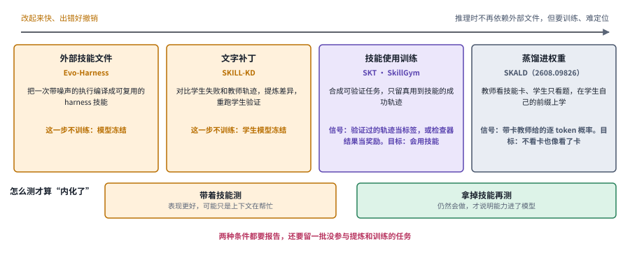

*图：从左到右，能力离外部文件越来越远、离权重越来越近；下方两个框是判断“内化”的两种测法，必须分开报告。*

下图把这一节的几条路线排成了一条光谱。最左边，能力完全留在外部技能文件里，模型冻结，改起来最快、出错也最好撤销；往右依次是从师生差异里提炼文字补丁、用合成的可验证任务训练模型使用技能，最右边是把技能带来的优势直接蒸馏进权重，推理时不再需要那张技能卡，代价是要训练，出了错也难以定位。光谱下方那两个框比光谱本身更重要：带着技能测和拿掉技能再测，是两件不同的事，后者才能说明能力真的进了模型。

先看一种从“差距”里提炼技能的思路。**[SKILL-KD: Contrastive Skill Distillation for LLM Agents](https://arxiv.org/abs/2607.28048)**（`2607.28048`） 把学生模型的失败轨迹和教师在同一道题上的轨迹放在一起比较，把其中可以执行的差异整理成文字补丁，然后让学生带着补丁重新跑一遍来验证效果，再借助与轨迹相关联的历史记录控制技能在一轮轮更新中的漂移。这种做法特别适合学生自己都不知道缺了哪一步的情况。它的前提是要有教师的示范，并且学生有能力执行这些建议。教师那条完整的长轨迹未必适合小模型直接照搬，提炼差异这一步，正是为了缩小两者之间的鸿沟。

沿着这个思路再往权重那边走一步，就到了 **[Distill Skills into Weights, Not Prompts: Abstract Skills as Privileged Signals for On-Policy Self-Distillation](https://arxiv.org/abs/2608.09826)**（`2608.09826`）。它让学生在自己生成的轨迹前缀上，学习技能提示给教师带来的那部分优势，最终把这份收益训练进共享的参数里，测试时就不再提供这张特权技能卡。这里有两个术语值得先弄明白。**on-policy** 指的是监督信号落在学生当前策略实际生成的前缀上，学生学的是“在我自己会走到的地方该怎么做”；特权信息指训练时教师能看到、测试时学生看不到的技能提示。和前面的文字补丁路线相比，它在推理时依赖更少，代价是需要训练，还要控制教师与学生之间的分布差异。读这篇时，可以重点看它的优势门控和答案过滤是怎么设计的，这两处决定了模型学到的是抽象的技能，还是被额外泄露的答案信息蒙混过去。

另一组工作关心的是更基础的一件事：模型手里有技能，未必就会用。**[SKT: Skill-Use Training at Scale via Verified Synthetic Data Generation](https://arxiv.org/abs/2608.02287)**（`2608.02287`） 从技能库出发合成可执行的任务和轨迹，通过规则检查和智能体验证把关，对出错的地方借助反馈修复，只保留那些确实用到了所需技能的成功轨迹，再拿它们训练模型使用技能的能力。**[SkillGym: Internalizing Human Skills into LLMs for Real-World Problem Solving](https://arxiv.org/abs/2609.27717)**（`2609.27717`） 走的是相近的路，它把人写好的技能转成可验证的环境，用代码检查和对比执行来判断一项任务是否真的依赖这项技能，在此基础上既能做监督训练，也能做强化学习。两篇工作共同做的一件事，是把“拥有技能”和“会用技能”清楚地区分开来。问题在于，评测是否可信，很大程度上取决于合成器、检查器和留出技能三者是否彼此独立；如果它们出自同一套假设，分数就可能偏乐观。

在外部文件和模型参数之间，还有一种折中。**[Evo-Harness: Context-to-Harness Skill Compilation for Self-Evolving Agents](https://arxiv.org/abs/2608.15071)**（`2608.15071`） 保持基础模型不变，把一次带着噪声和偶然因素的执行经验，编译成可以复用的执行系统技能。它关注的是在线场景下只有一次机会之后的迁移，所以很适合拿来和参数学习比一比，看谁能更快地把新经验用起来。难点也正在这里：只经历过一次，怎样分得清哪些是通用的教训，哪些只是那一次碰巧出现的细节。

回到开头那个选择。决定路线时，可以先看两件事：知识变化得有多频繁，改错了能不能撤销。频繁变动的业务规则更适合放在外部保存，改起来快，出错了也容易回退；那些稳定而又高频使用的操作，则可能值得花成本训练进模型。无论选哪条路，都要留出一批没有参与提炼和训练的任务，并且分别测出有技能和没有技能两种条件下的表现。只有当模型在拿掉技能卡之后依然能完成任务，才能说这项能力已经不再完全依赖外部提示。

### 5. 怎样让整个执行系统进化，不止微调一句提示？

前面讲技能的时候，被改动的东西还比较小，往往是一段说明或一个脚本。可一个 agent 真正跑起来，靠的是外面那一整套执行系统：先调哪个工具、后调哪个工具，候选答案怎么生成，中间状态存在哪里，出错以后怎么恢复。这些都可以成为演化的对象，麻烦在于它们彼此牵连，改了工具顺序，失败恢复的规则可能就要跟着变。如果一口气把所有组件同时改掉，分数涨了也说不清是哪一处起了作用；反过来，如果只允许改一句提示，又很可能根本碰不到真正卡住系统的地方。所以这个分支一直在两头之间找平衡：修改空间要足够大，能表达有意义的变化，验证又要足够细，能把收益定位到具体的改动上。与此同时，还要把搜索过程中出现的候选版本留下来，这样才能分清哪些只是在当前任务上碰巧最优的配置，哪些是换个场景依然站得住的改进机制。

> 主线位置：第 2 级。接 ADAS、AFlow、Darwin Gödel Machine，对应 Lilian Weng 文中的 Self-Improving Harness 与演化搜索两节。

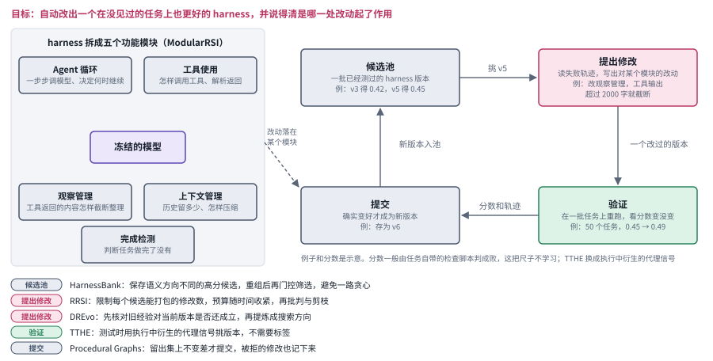

*图：左边是 harness 拆成的五个功能模块（取自 ModularRSI），右边是演化的搜索循环；下方图例说明本节每篇论文改动的是循环中的哪一环。*

下图左边是被演化的对象。harness 包在冻结的模型外面，ModularRSI 把它拆成五个功能模块：Agent 循环、工具使用、观察管理、上下文管理和完成检测。右边是演化本身，一条由候选池、提议修改、验证和提交组成的搜索循环，每一轮的改动落在左边的某个模块上。本节的几篇论文都没有推翻这个循环，它们各自加固了其中一环，图下方的图例把对应关系列了出来：HarnessBank 管的是候选池的多样性，RRSI 和 DREvo 管的是提议，TTHE 换了验证用的信号，Procedural Graphs 给提交加了留出集这道门。

先看一个很直接的问题：执行系统一定要在离线阶段搜好再部署吗？**[测试时框架演化（TTHE）](https://arxiv.org/abs/2607.08124)**给出的回答是可以边用边改。它在测试阶段利用无标签的执行轨迹维护一组候选框架，用执行过程中衍生出来的代理信号挑选版本，再让选中的程序接着处理后面的输入。这和针对眼前这道题反复重试是两回事，因为它做出的改变会持久地影响未来的任务；它也和先离线搜索、再把框架冻结起来的做法不同。整个过程中模型权重保持不变。读这篇时可以多想两件事：这种代理评价信号在什么情况下可靠，以及跨输入的适应会不会让结果依赖于输入到来的顺序。

边用边改带来的一个自然担忧是，系统会不会越改越臃肿，靠堆规则把见过的题目一道道记下来。**[RRSI: Regularized Recursive Self-Improvement of Agent Harnesses](https://arxiv.org/abs/2609.24972)**（`2609.24972`）正是冲着这个问题来的。它给候选修改的数量设定一个随时间变化的预算，再用批判与剪枝去掉那些只对某个基准有效的改动。作者报告了所测任务上的收益，也报告了相对未正则化方案更低的策略 token 消耗。这项工作的核心是管住搜索，防止它靠叠加越来越多的规则来记住旧题。评估它的时候，最好把搜索阶段花掉的成本和部署阶段省下的成本分开来算，两笔账混在一起很容易看花眼。

另一组工作换了个角度，关心的是证据怎样组织、修改落在什么单位上。**[ModularRSI: Modular and Generalizable Recursive Harness Self-Improvement](https://arxiv.org/abs/2609.14857)**（`2609.14857`）使用与测试基准分离的任务，把同一道题上成功和失败的轨迹放在一起对照，跨任务找出反复出现的问题，并把执行系统拆成若干功能模块。它和 RRSI 正好互补：RRSI 着力约束修改和选择，ModularRSI 着力组织证据、划定修改单元。模块化的好处是归因变得清楚，哪个模块改了、带来了什么变化一目了然；代价是有些有效的变化恰好横跨好几个模块，拆开以后反而不好表达。这种得失要靠消融实验和跨领域测试来判断。

搜索走得越久，攒下的历史就越多，怎样用好这些历史又成了新的问题。**[HarnessBank: Semantic Gene-Bank Search with Gated Verification for Agent-Harness Self-Evolution](https://arxiv.org/abs/2607.13683)**（`2607.13683`）的做法像建一座基因库：它保存语义方向各不相同的高质量执行系统候选，通过重组、筛选和门控验证去探索，避免只沿着某一个候选一路贪心地往前走。**[DREvo: Distilling Recalibrated Historical Experience for Harness Self-Evolution](https://arxiv.org/abs/2607.26722)**（`2607.26722`）看重的是另一面：系统版本在变，旧经验未必还适用，所以它会反复检查过去的经验对当前版本是否依然有效，再从中提炼出可操作的搜索方向。两篇都把历史当作搜索的资源，HarnessBank 侧重保住候选的多样性，DREvo 侧重让证据的有效性随版本一起更新。

还有一条思路是给执行系统换一种更明确的表示。**[Procedural Graphs: Self-Evolving Execution Structures for LLM Agents](https://arxiv.org/abs/2609.09153)**（`2609.09153`）把“接下来该做什么”画成一张程序关系图：agent 先定位自己当前所在的节点，根据附近的子图生成情境化的指引，再对照成功和失败的轨迹修改图的结构，通过留出集验证之后才正式提交。比起让模型自由生成，这种表示清楚得多，代价是要把复杂的行为正确地映射到图上，这本身并不容易。它和图技能优化的区别在于，它组织的是整个执行过程中的状态与行动指引，覆盖面比修改一份技能说明要大得多。

把这几篇放在一起看，可以得到一个朴素的经验：执行系统的演化离不开能定位的修改单元。失败恢复规则和工具选择方式最好能分开调整，每次都保留输入、输出和版本作为对照；一旦同时动了多个组件，就要再想办法把它们各自的贡献拆开。历史候选库里也值得多存一些东西，除了最佳分数，那些失败的版本连同它们的适用条件同样有用，它们能帮后面的搜索少走重复的路。

### 6. 怎样证明改进真实存在，排除上下文、预算和泄题的影响？

说一个系统“自我改进”了，听起来很容易，真要拿出证据却处处是陷阱。一次改进实验背后至少有三笔预算：收集经验花的，搜索和更新花的，最后执行任务花的。如果只比较最后那一次执行，前两笔开销就被悄悄藏了起来。更隐蔽的问题出在选版本上：要是反复拿最终测试集来挑哪个版本最好，所谓的“迁移”里就混进了选择偏差，测试集实际上参与了训练。比较时还应当把没有改善、甚至变差的任务也记下来。只有事先固定选版协议，并留出一份真正独立的测试，才有机会分清哪些是经验的有效积累，哪些只是某一次搜索运气好。

> 主线位置：边界。对应 DAIR.AI 的“循环在哪里断掉”和 Lilian Weng 的评价器瓶颈。

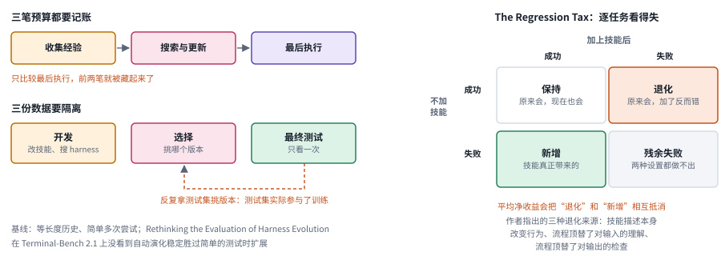

*图：左边是三笔预算和三份数据，橙色虚线是“拿测试集挑版本”造成的泄漏；右边是 Regression Tax 的逐任务四格，平均净收益会把退化和新增相互抵消。*

下图左右两半各讲一件事。左半边是记账：一次改进实验至少花三笔钱，收集经验、搜索与更新、最后执行，只比较最后一笔，前两笔就藏起来了；数据也要分成开发、选择和最终测试三份，那条橙色的虚线表示最常见的泄漏，反复拿最终测试集来挑版本，等于让测试集参与了训练。右半边借用 The Regression Tax 的划分，把每个任务按“加技能前后是否成功”放进四个格子：保持、新增、退化和残余失败。只报告平均净收益，退化和新增就会相互抵消，所以本节的几篇工作都在想办法把这四格分别数清楚。

第一个要回答的问题最朴素：显式维护技能，到底比把历史塞进上下文强多少？**[ContinualSkillBench: Can LLM Agents Truly Evolve Their Capabilities?](https://arxiv.org/abs/2608.03874)**（`2608.03874`）在多个领域里设置了连续的任务序列，拿技能维护和普通的上下文学习做比较。作者发现，顺序执行常常有帮助，可平均下来，显式技能维护和上下文学习的表现相近，只有部分强调程序复用的任务才显出选择性的收益。这个结果逼着我们追问一句：看到的改善，究竟来自一项可以迁移的技能，还是仅仅因为模型看过了更多相关的历史？

如果说上一篇是在问技能有没有用，下面两篇就是在问技能会不会帮倒忙。**[Agent Skills Can Be Harmful: An Empirical Study of Skill-Induced Failures in LLM Agents](https://arxiv.org/abs/2608.11888)**（`2608.11888`）把有技能的运行和无技能或匹配参考的运行放在一起对照，定位由技能引起的功能失败和成本退化。它整理的是失败案例，并没有给出所有技能的失败概率，读的时候要记住这个范围。**[The Regression Tax: Decomposing Why Skills Help and Hurt LLM Agents](https://arxiv.org/abs/2607.22520)**（`2607.22520`）又往前走了一步，把两类失败分开：一类是原来会做、加了技能反而做错的“退化”，另一类是两种设置下都做不出来的“残余失败”。在此基础上，它讨论了几种具体机制，比如技能描述本身带来的影响、输入理解被固定流程覆盖、输出检查被技能里的步骤顶替。只看平均净收益，这两类性质完全不同的问题就会被抹平。

再往上一层，执行系统演化这类方法本身的评测也受到了质疑。**[Rethinking the Evaluation of Harness Evolution for Agents](https://arxiv.org/abs/2607.12227)**（`2607.12227`）问得很尖锐：这些方法有没有和同等反馈、同等推理预算下的简单搜索做比较？是不是在同一个基准的验证信号上既挑选候选、又报告成绩？作者在 Terminal-Bench 2.1 的实验中没有观察到自动演化稳定胜过简单的测试时扩展。这是特定协议下得出的反例，适合和上一节那些支持性的方法对照着读，两边一起看，对这个方向的判断会更有分寸。

既然评测这么容易出问题，一个顺理成章的想法就是把“优化执行系统的能力”本身拿来测。**[HarnessOpt-Bench: Evaluating LLMs at Harness Optimization](https://arxiv.org/abs/2608.06301)**（`2608.06301`）就是这样设计的：它给优化者一个种子执行系统、有限的目标评估预算和分级反馈，最终候选放在搜索期间看不到的测试分区上评估，资源消耗由受信执行环境计量，各个版本也都由它保存下来。它的价值在于把优化能力直接变成了测量对象，关注点从优化后智能体的那个成绩，移到了优化者本身身上。

把这一节的研究串起来，评估持续改进时至少要做好这样几组对照。模型和预算要固定住；要加入等长度历史和简单多次尝试这两类基线；要逐个任务报告哪些是新解出来的、哪些是新退化的；开发、选择和最终测试要彼此隔离；提炼、搜索和验证花掉的费用也要算进总账。如果某次改进只有在一遍遍查看同一个测试集之后才会出现，那么更准确的说法是，系统适应了那套测试。

### 7. 模型与执行系统一起变化，会不会彼此不再合适？

前面几节讲 harness 搜索和权重训练时，我们总是默认另一侧保持不动：改 harness 的时候模型是固定的，训模型的时候框架是固定的。可一旦两边都开始变，麻烦就来了。框架会改变训练轨迹的分布，模型更新又会反过来改变框架里各个组件的有效性。打个比方，一位新同学刚来时，师兄给他写了一份事无巨细的操作手册；等他成长起来，手册里很多步骤就成了累赘，甚至会拖慢他。原本为弱模型设计的提示，在强模型上同样可能变成冗余；旧的路由规则也可能把新长出来的能力错误地分配给其他组件。所以共同优化的难处在于，轮流训练只是第一步，每一轮还要核对数据产生时的条件、部署的版本和反馈的目标是否对得上，并把能够重放的版本组合完整保存下来。

> 主线位置：第 2 级加第 4 级。对应 Lilian Weng 文中的联合优化一节。

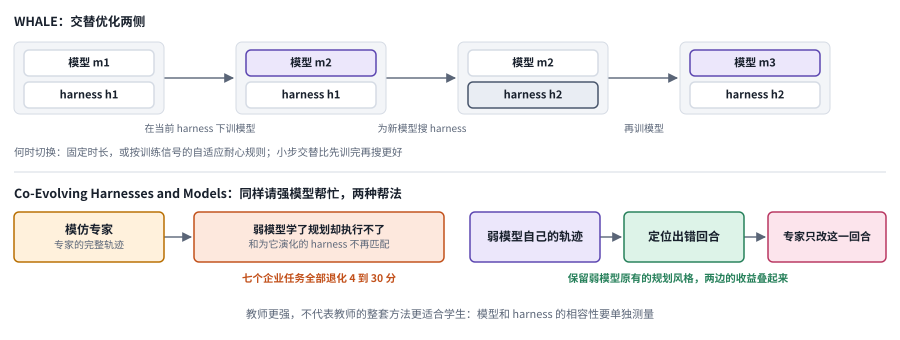

*图：上半部分是 WHALE 的交替优化，模型和 harness 轮流更新；下半部分对比两种请强模型帮忙的方式，模仿完整轨迹会破坏相容性，只改出错回合则能保住它。*

下图上半部分画的是交替优化的节奏。每个灰框是一组模型和 harness 的搭配，从左往右，先在当前 harness 下训练模型，再为更新后的模型搜索 harness，然后再训模型，每一步只有一侧在变。下半部分是一个出人意料的反例：同样请强模型来帮弱模型，左边让弱模型模仿专家的完整轨迹，弱模型学到了专家的规划方式，却没有能力执行，和为它演化出来的 harness 也不再匹配，作者在七个企业任务上都观察到了 4 到 30 分的退化；右边只在弱模型自己的轨迹里找出出错的那一回合，让专家改写这一处，原有的规划风格保住了，两边的收益才叠加得起来。

先从数据的来路说起。**[Agentic Routing: The Harness-Native Data Flywheel](https://arxiv.org/abs/2607.11399)** 这项工作把路由与执行框架产生的数据联系在一起，很适合拿来追踪一条数据的完整生命：它由谁生成，被拿去训练之后，又改变了哪一个选择。这项工作的价值在于把真实运行中的反馈用到后续的分配上，路由到更便宜的模型只是其中一个用途。读的时候最好把路由标签、框架版本和评价条件分开来看，因为数据循环转起来了，本身还证明不了持续优化是稳定的。

数据飞轮讲的是反馈怎样流回来，接下来的问题是两侧到底该怎么交替着改。**[WHALE: A Simple Recipe for Joint Harness-Weight Optimization](https://arxiv.org/abs/2609.00196)**（`2609.00196`） 给出了一套很直白的做法：先在当前的执行系统下训练模型，再为更新后的模型搜索更合适的执行系统，然后比较按固定时长切换和按自适应规则切换这两种节奏。它的动机非常实际，正好对应开头那个手册的比方：模型变强之后，过去必要的提示可能变得多余；执行流程改了以后，旧的训练分布也可能对不上了。交替优化的代价是两个过程的成本都要付，所以它的收益应当和只优化单独一侧的结果放在一起比较，才看得出交替到底值不值。

WHALE 关心的是节奏，**[HELIX: Model-Harness Co-evolution for Recursive Self-Improvement](https://arxiv.org/abs/2608.13951)**（`2608.13951`） 关心的则是记录。它用可追溯的组件、接口与运行政策来记下每一次修改，并把成功的、退化的以及差一点就成功的轨迹都收集起来，作为后续训练的数据。论文报告的实验只演化了一轮，所以这篇最适合用来学习怎样保留每次干预的身份和证据；至于长期多轮的闭环是否已经稳定，它目前还给不出答案。

另一组工作换了个角度，从一个出人意料的反例入手。**[Co-Evolving Harnesses and Models: On-Policy Correction Helps Weaker Models Catch Up Where Imitation Fails](https://arxiv.org/abs/2609.09134)**（`2609.09134`） 发现，在一个已经为弱模型优化好的执行系统下，让弱模型直接模仿强模型的完整轨迹，结果反倒可能退化。这有点像让一个刚学会自己那套解题思路的学生，整本照抄学霸的笔记，结果原来会的也乱了。作者于是改了办法：先在弱模型自己的轨迹里定位出失败的那一回合，只让专家修正这一处，尽量保留它原有的规划风格。这个结果说明，教师更强，并不代表教师的整套方法更适合学生，模型与执行系统之间的相容性本身就是一个要测量的量。

讲到这里，还有一个更底层的问题被默认掉了：反馈本身可信吗，目标本身清楚吗？**[S3Gym: Can LLMs Turn Self-Testing and Self-Judging into Self-Improvement?](https://arxiv.org/abs/2608.31100)**（`2608.31100`） 把自测试、自判断和自改进拆成三件事分别评估，允许系统自由探索，但最终测试严格留出，同时比较了直接保留历史、摘要记忆和参数训练这几种做法。**[Aspire: Can Models Self-Evolve from Vague Goals?](https://arxiv.org/abs/2608.31111)**（`2608.31111`） 沿着这个思路又往前走了一步，干脆去掉预先给定的明确任务指标，只给一句"提升某方面能力"这样的自然语言目标，让系统自己挑数据、自己选更新方式，最后再用隐藏的专家任务来评估。这两篇把"反馈是否可信""目标是否可操作"也纳入了自我改进要回答的问题。

把这一节串起来看，有一条线索贯穿始终：目标发生了变化，和在同一目标下能力真的提升了，是两回事，要分开判断。一个持续改进的闭环最好把任务目标、执行政策、模型版本和验收标准各自记录下来，讲清楚每一轮到底是哪些组件变了。这样，评价条件改变带来的分数上涨，就不会被误认为原有能力的增长。

### 8. 开放式递归改进怎样保持可验证和可控制？

走到这一节，我们来到了整章最野心勃勃、也最容易说过头的地方。递归和重复听上去相近，其实差得很远。一个固定的改进器可以反复优化任务技能，转上一百轮，改进器自身也可能从头到尾都没变过，这只是重复。更强的递归主张，需要证明新系统改变了它以后提出改进、筛选改进的方式。麻烦在于，如果评价规则也跟着一起变，前后的分数就可能失去可比性，就像一位学生一边答卷一边改评分标准，最后的高分说明不了什么。所以面对这类工作，先把任务执行、改进生成和独立验收三者之间的边界画清楚，再去问哪些部分真的在递归，哪些部分仍然由外部固定，思路会清晰得多。

> 主线位置：第 3 级及其安全边界。接 STOP、Gödel Agent、HyperAgents 和 AI 研究 agent 的递归实验。

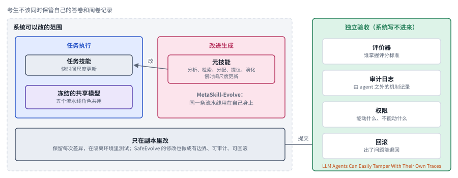

*图：虚线框是系统可以改的范围，里面分成任务执行和改进生成两块（以 MetaSkill-Evolve 的快慢两层为例），所有修改只在副本里进行；右边绿色框是系统写不进来的独立验收。*

下图把这一节反复出现的那条边界画了出来。左边的虚线框是系统被允许修改的范围，里面又分成两块：任务执行和改进生成。以 MetaSkill-Evolve 为例，任务技能在快时间尺度上更新，负责分析、检索、分配、提议和演化的元技能在慢时间尺度上更新，两层共用一个冻结的模型。所有修改都只发生在副本里，保留差异、在隔离环境中测试之后，才提交给右边那个绿色的框。绿色框里的评分器、审计日志、权限和回滚，是系统自己写不进来的部分；本节最后两篇工作，一篇讲怎样把安全修改也做成可审计、可回滚的，一篇提醒我们日志如果攥在 agent 自己手里，这道墙就形同虚设。

第一篇正好把"改任务"和"改改进过程"拆成了两个时间尺度。**[MetaSkill-Evolve](https://arxiv.org/abs/2607.05297)**让任务技能在快时间尺度上更新，让负责影响分析、检索、分配、提议与演化过程的元技能在较慢的尺度上更新，底下用的是一个冻结的共享基础模型。它为区分"改任务技能"和"改改进过程"提供了很具体的对象，可以拿来对照着理解什么叫递归；当然，多轮搜索本身还算不上递归。作者报告了留出任务上的对照收益，这仍然是在指定流程和预算之内得到的结果，开放式的提升能否一直持续下去，目前还没有证据。建议先读[综述章的 RSI 入口](00_surveys.md)，再回头看这类方法的更新路径和验收路径，就更容易分清各种主张的强弱。

递归改进有一个很现实的瓶颈：每试一种新的探索策略，都要等真实环境给出反馈，又慢又贵。**[Dream-RSI: Recursive Self-Improvement through Evolving Worlds](https://arxiv.org/abs/2609.14858)**（`2609.14858`） 想的办法是把过去的发现历史组织成一个回放模拟器，在已经探索过的搜索空间里低成本地评估新的探索策略，底层的编码智能体保持不变。这样做减轻了延迟反馈带来的试验负担。问题在于，回放能评价的范围受历史覆盖的限制，它只认得自己见过的地方；想要真正探索没去过的区域，仍然得回到新的环境交互中去。

如果说 Dream-RSI 改的是评估环境，下面这篇就直接动到了智能体自己的代码。**[Recursive self-improvement of AI research agents](https://arxiv.org/abs/2609.26457)**（`2609.26457`） 让研究智能体修改自己的代码，用隐藏评估来挑选版本，再让新版本参与下一轮修改。作者报告了一次持续多天的自主运行，以及在留出的研究基准上的迁移效果。比起只改一层固定外壳，这已经更接近代码级的递归循环了。可有限的轮次还推不出改进速度会长期增长，读这篇时最有收获的做法，是顺着它的版本继承关系、每轮预算以及和不带递归的搜索对照，一项项看下去。

再往上抽象一层，**[MetaRSI / RSI2: A Meta-Recursive Self-Improving System for Recursive Self-Improving Systems Themselves](https://arxiv.org/abs/2609.06396)**（`2609.06396`） 把数据、执行系统和模型更新组织成一组可以组合的操作，希望面向更开放的科学与工程任务。它提供了一个入口，帮助理解不同的修改对象怎样组合在一起。一旦走出可以机器检查的任务，评价方式也会跟着变：可能需要论证，需要实验，需要复现，原先那套验证器就没法原封不动地沿用了。

能力的递归讲完，自然要问安全这一侧怎么跟上。**[SafeEvolve: Harness-Policy Co-Evolution from Agent Experience for Safety Alignment](https://arxiv.org/abs/2609.02786)**（`2609.02786`） 把安全经验用在有边界、可审计、可回滚的执行系统修改上，同时结合监督学习与强化学习来更新策略。这让改进的目标从任务成绩扩展到了多步执行的安全性；安全集覆盖得够不够，新能力会不会带来副作用，仍然要单独去检查。与之形成呼应的是 **[LLM Agents Can Easily Tamper With Their Own Traces](https://arxiv.org/abs/2609.30266)**（`2609.30266`），它研究的是执行日志的完整性，报告部分本地智能体基础设施允许日志被修改或删除。这件事的启示再直接不过：改进者自己用来证明改进的那些证据，最好别全攥在它自己手里，就像考生不该同时保管自己的答卷和阅卷记录。

这组工作放在一起看，讲的其实是同一条边界。系统可以被允许提出范围很广的修改，但最终的评估、权限和审计要有独立的控制。具体到运行时，可以把修改限制在副本里进行，保留每次的差异，在隔离环境中测试，同时让一个独立的组件来管理评分器和审计记录。有了这样的分工，系统就能在较大的修改空间里放手探索，同时始终保留回滚和外部验收的条件。

## 四、方法对照表

读完八个分支，很容易被几十篇论文的名字淹没。其实它们面对的困难来来回回就那么几类：缺少可用的操作知识，技能太多选不准，技能库越改越乱，能力过分依赖外部提示，执行系统难以设计，改进的真假难以分辨，模型和系统在共同变化中彼此失配，以及递归的闭环难以控制。下面这张表把这些困难和对应的方法、代价放在一起。真实的系统往往会同时用到其中好几行，但每一行改动的对象和付出的成本都不一样，验证时也最好一行一行分开检查：经验有没有被正确地提炼出来，有没有在该用的时候被调用，换了任务之后还管不管用。最右边一列是证据不够充分时最值得追问的问题，拿来审自己的实验设计也很合适。

> **本节要点：** 八个分支面对的困难归成八行，每行写明常见的方法、付出的代价，以及证据不足时最该追问的问题。它和第二节末尾的总对照互为补充：那边按方法家族比较，这边按要解决的问题比较。

| 问题 | 方法选择 | 主要代价 | 证据不足时要追问 |
|---|---|---|---|
| 缺少操作知识 | 人写技能、仓库提炼、经历抽象 | 人工维护、版本与环境核查 | 文档可用是否等于任务有效 |
| 库大且任务简单 | 分层展开、表示路由、范围估计 | 路由训练或错误拒绝 | 是否比简单检索与不用技能更好 |
| 技能膨胀与相互冲突 | 回放门控、程序家族、图结构、删除审计 | 重跑旧任务和维护复杂度 | 罕见能力会不会被合并丢失 |
| 外部提示依赖重 | 教师差异补丁、技能使用训练、参数内化 | 教师、合成环境和训练费用 | 去掉技能提示后是否仍有收益 |
| 执行系统难设计 | 模块演化、候选档案、历史重新校准 | 多轮搜索与验证 | 跨任务迁移和总搜索成本 |
| 改进真假难分 | 等预算基线、逐任务退化、隐藏测试 | 可信评测基础设施 | 是否重复使用测试反馈选版本 |
| 模型与系统失配 | 交替优化、在策略局部纠正 | 数据非平稳、训练与搜索耦合 | 多轮稳定性和教师兼容性 |
| 递归闭环难控制 | 有限修改、独立日志、安全联合优化 | 权限隔离与恢复成本 | 谁掌握评分器，能否回滚 |

## 五、开放问题与研究机会

回到本章开头那个刚入组的同学。他从"第一次跑通实验"成长为"能改进组里的实验流程"，中间其实跨过了三道坎：先要从一堆经历里认出哪些做法值得记下来，再要把攒下的做法整理得井井有条、随取随用，最后才谈得上回头改进产生这些做法的流程本身。自我改进的研究也卡在同样的三道坎上，分别对应梯子上的第 1 级、第 1 级的维护问题和第 3 级。而贯穿始终的还有第四个问题：评判进步的标准必须独立于被改进的系统，否则一切进步都可能是系统自己给自己打的高分。下面四个问题正是按这个顺序排的，每一个都还有大片空白，适合作为选题的起点。

> **本节要点：** 四个开放问题依次对应梯子上的第 1 级、第 1 级的维护、第 3 级，以及贯穿全图的那个绿色检验框。

**1. 如何主动发现值得沉淀的技能，并识别其迁移边界？**

一条成功的轨迹里，可迁移的结构和碰巧奏效的步骤总是混在一起，并非每一次成功都值得存成技能。这里的研究空间在于设计一套发现、抽象和接纳的机制，用技能对未来任务的收益、调用它的成本，以及它能填补的覆盖缺口，来决定什么值得留下。更进一步，一项好技能应当说清楚自己的正例、反例和拿不准的范围。现实中，外表相似的两个任务可能遵循完全不同的规则，格式迥异的两个任务反倒可能共用同一套处理办法。评价这类方法时，可以有意改变任务的表面形式和执行条件，看系统能不能依据证据认出技能的边界；单靠语义相似度挑选程序，在这种测试下很快就会露出破绽。

**2. 如何维护能够组合和迁移的技能库，同时保住必要的多样性？**

技能库小的时候怎么都好办，规模一大，依赖冲突、版本变化和局部修改就会开始互相牵扯，影响技能的组合执行。一个有前景的方向是让每项技能都带上可以检查的前置条件和后置条件，显式维护技能之间的依赖，并能自动发现失效，从而支持系统自主地合并、替换和停用技能。这里有一个绕不开的两难：只保留当前表现最好的技能，可能把应对罕见任务的办法一并丢掉；什么都保留，路由的成本又会越来越高。要找到平衡点，就得在环境变化和新的任务组合中长期追踪技能库的覆盖、退化与恢复情况，并检验一项技能被删除之后，它原来的功能能否由其他技能组合出来。

**3. 如何让改进机制自身演化，并辨认真正的递归收益？**

提示词、工具和工作流都已经可以被自动修改，可多轮之后分数上涨，也可能只是因为多搜索了几轮。要证明递归真的带来了收益，可以在同样的总预算下比较三种系统：改进器始终固定的系统，只积累历史记录的系统，以及每一轮都继承新版改进机制的系统，然后观察有效修改的比例、发现好方案所需的时间，以及在留出任务上的表现。真正要看的，是新的改进机制是否更善于产生下一轮有效的改动，当前执行器的分数高一些只是表象。改进本身消耗的算力、旧能力能否保住、出了问题能否回滚，这些成本也都应当算进比较里。

**4. 如何学习新的评价方式，又不让系统自行放宽成功标准？**

开放式的任务往往需要新的评价准则，可准则一变，前后版本之间就失去了可比性。比较稳妥的思路是把评价器的提出、验证和批准拆成三个环节：允许系统发现现有指标遗漏的目标，同时保留独立的检查和人工纠正的通道，这和 Lilian Weng 把评价器放在循环之外的主张一脉相承。做实验时，应当把开发、选择和最终测试彻底隔离，并主动注入目标偏移和评价器漏洞，检验系统能否发现这些问题，并防止它借修改评分规则制造表面上的进步。

**实验资源：** [GEPA 论文](https://arxiv.org/abs/2507.19457) · [官方仓库](https://github.com/gepa-ai/gepa) · [科研技能官方仓库](https://github.com/K-Dense-AI/scientific-agent-skills) · [Voyager](https://arxiv.org/abs/2305.16291) · [ADAS](https://arxiv.org/abs/2408.08435) · [Darwin Godel Machine](https://arxiv.org/abs/2505.22954)。动手之前，请先核对各项目的任务设定、代码版本、数据和运行条件。
