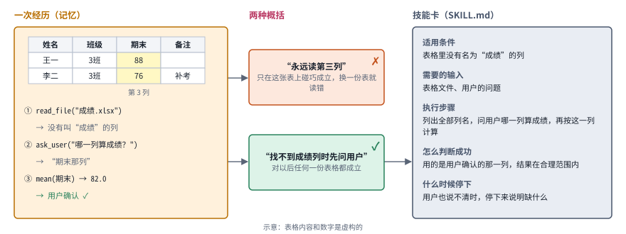
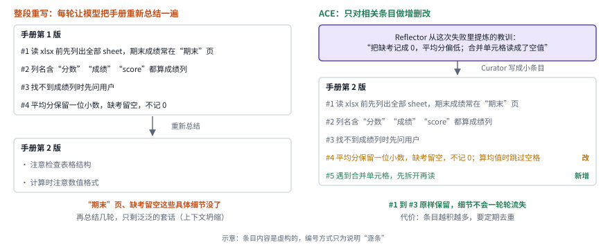
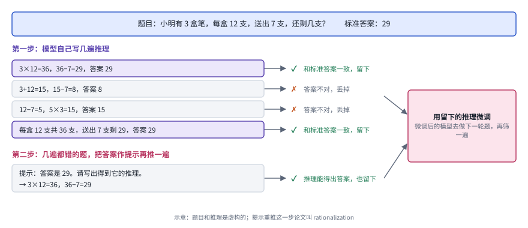
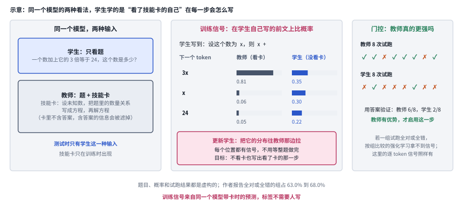
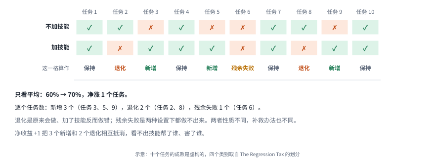

# 03｜自我改进（RSI）：让经验留下来，再反过来改进系统本身

[首页](../README.md) · [专题索引](../README.md#topics) · [文献目录](../catalog/03_skills_and_self_improvement.md)

## 方向背景：为什么要研究自我改进

人做事的能力是靠经验一点点长出来的，一个刚入组的同学就是例子。他第一次跑通实验总是慢的：环境要配，脚本要改，报错要一行行查。到了第二次、第三次，他会越来越快，因为他记住了哪个依赖版本会冲突，攒下了几段顺手的脚本，也摸清了导师看结果时最在意什么。再过半年，他甚至会回头改进组里的实验流程，让后来的人少走弯路。

今天的 agent 大多还做不到这一点。它在一次任务里可以表现得相当聪明，可任务一结束，上下文一清空，刚刚踩过的坑和摸索出来的窍门就全部消失了。下一次遇到几乎一样的问题，它又从头搜索、从头试错。模型再强，这种每次都像第一天上班的状态也意味着大量重复劳动，因为经验没有地方沉淀。

自我改进研究的就是怎样打破这个状态。知乎《万字长文带你读懂 RSI》给过一个好用的定义：agent 与环境交互之后，利用任务轨迹和反馈，通过某种更新机制修改自身状态，并让修改后的状态参与后续任务。这里被修改的“自身”有两大块。一块是模型的参数。另一块是包在模型外面、负责把模型的输出变成实际行动的那一层执行系统，业内叫 harness，它包括提示词、上下文、记忆、技能、工具和调度这些部件的代码。很多自我改进工作只改 harness，模型参数保持冻结，因为改文件和代码比重新训练便宜得多。

自我改进往深处走，就是近两年热度很高的递归自我改进（Recursive Self-Improvement，RSI），本章的标题和主线都由它而来。修改总要有人来提，也要有人判断改得好不好。如果 agent 连这套负责提出和判断修改的机制也能自己改，下一轮就会用改过的机制去做下一次改进，改进本身进入了一个循环，“递归”指的就是这个循环。

在这些被修改的对象里，技能最常见，也最容易落地。技能回答的是“遇到这类情况该怎么做”，比如“表格里找不到成绩列时先问用户”，它正是那位同学笔记本里攒下的东西，所以 2026 年的新论文有一大半在研究技能怎么来、怎么用、怎么维护。

## 先读这几篇

这一章的主线借自下面几篇长文。它们的作者长期在这个方向上思考，叙事里有取舍、有判断。建议按顺序读，读完再看各分支的新论文。

| 顺序 | 文章 | 为什么读 |
|---|---|---|
| 1 | DAIR.AI Academy，[Self-Improving Agents](https://academy.dair.ai/papers/collections/self-improving-agents)（2026-09） | 一份 31 篇论文的精选合集，分成八段，从 Schmidhuber 的 Gödel Machine 一路讲到“循环在哪里断掉”。每篇论文只配一句点评，点评很有态度，读下来能看到这个领域怎样一步步把“可修改的对象”往上推。本章发展主线的骨架就来自它。它对自我改进的定义也很干净：系统用自己产生的反馈修改自身某个持久的部分，并且只保留经过检验确实有用的修改。 |
| 2 | 南冥有一鱼，[万字长文带你读懂 RSI](https://zhuanlan.zhihu.com/p/2078900380323279524)（知乎，2026-09） | 中文读者最好的入门文章。作者按维度组织全文，搭了一套坐标系：进化对象是什么，版本之间是链、树还是图，谁来执行更新，什么时候更新，再加上验收标准、反馈来源等五个辅助维度。每个维度都配了一篇 2025 到 2026 年的代表工作，并把做法讲得很细。本章第二节“给新论文定位”一小节的坐标表就来自这篇。 |
| 3 | Lilian Weng，[Harness Engineering for Self-Improvement](https://lilianweng.github.io/posts/2026-07-04-harness/)（2026-07） | Lilian Weng 一贯的长文风格，系统而克制。她的核心判断是：近期最现实的自我改进杠杆是模型外面那层 harness，而且 harness 越来越多地以代码的形式被搜索和优化。文章给出了一条“改什么”的阶梯，从提示词到结构化上下文、工作流、harness 代码，再到优化器代码，最后和模型权重联合优化，本章第二节的层级就按这条阶梯排。文末列出的七个瓶颈，包括评价器太弱、负面结果没人报告、候选越搜越单一、系统钻评价规则的空子（reward hacking）等，值得每个做这个方向的人抄在笔记里。 |
| 4 | Anthropic，[Equipping agents for the real world with Agent Skills](https://www.anthropic.com/engineering/equipping-agents-for-the-real-world-with-agent-skills)（2025-10） | 技能这一半的工程起点。Anthropic 把技能定义成一个以 SKILL.md 为中心的文件夹，里面可以放说明、脚本和参考材料；agent 启动时只读每个技能的名字和简介，真正用到时才展开全文。这个设计后来被很多系统沿用。文章结尾说，他们希望 agent 将来能自己创建、编辑和评估技能，这句话把“技能”和“自我改进”接在了一起。 |
| 5 | Anthropic，[When AI builds itself](https://www.anthropic.com/institute/recursive-self-improvement)（2026，9 月更新） | 从一家前沿实验室内部回看递归自我改进走到了哪一步。文章的判断比较冷静：AI 已经能很好地执行定义清楚的实验，大部分代码也已由模型来写，可设定研究目标、判断哪些问题真正重要，仍然要靠人。适合读完技术部分之后，用来校准自己的预期。 |

如果还想多读一点，可以看 Silver 和 Sutton 的 [The Era of Experience](https://storage.googleapis.com/deepmind-media/Era-of-Experience%20/The%20Era%20of%20Experience%20Paper.pdf)，它从更宏观的角度解释了为什么智能体迟早要从自己的经验里学习；Sakana 写的 [Darwin Gödel Machine 介绍](https://sakana.ai/dgm/)配了很多图，是理解“agent 改写自己代码”最直观的一篇。

## 一、基本概念：一个循环，和它写回的几层东西

> **要点：** 一个系统怎样才算在改进自己？它要执行任务、留下反馈、提出修改、检验修改，再把通过的修改写回去。各项工作的差别在于写回的是哪一层：这一次的答案、模型外面的经验、执行代码、负责改进的机制本身，或者模型权重。

agent 的自我改进和那位刚入组的同学走的是同样几步，下图把它画成一圈。那位同学每做完一次实验，会看看结果，想想哪里可以改，下次换个做法试一试，确实更快，就把新做法记进笔记。换到 agent 身上：agent 接到任务，由模型和 harness 一起执行；执行留下轨迹和反馈，比如成功还是失败、得了几分、报了什么错、评审写了什么评语；更新机制拿着这些材料提出修改，方式可以是写一段反思、做一轮搜索，也可以是训练一次模型；修改先要过检验，没通过的丢掉，通过的写回 agent 的持久状态，参与以后的任务。基础的参数、token、训练与推理概念见[大模型基础](../docs/llm_primer.md)。

*图：自我改进的基本循环。每个框里的例子（示意）是同一件事：算一份成绩表的平均分。左下角是被修改的“自身”，从参数一直到改进器本身；绿色的检验框对应 DAIR.AI 定义里“只保留经过检验确实有用的修改”这半句。*

顺着图里的例子走一圈。agent 接到“算出这份成绩表的平均分”，读表时找不到叫“成绩”的列，算错了；用户说成绩在“期末”列，这句话就是反馈，由用户给出。更新机制据此提出一条规则“找不到成绩列先问用户”；检验再拿 3 份新表格重跑，都算对，这条规则才写进记忆，下一次任务带上。

图里的检验框最容易被忽略，可它决定了循环转出来的是进步还是退步。检验用的分数也有来源：上面的例子里，判对错的是那 3 份表格事先算好的正确平均分，这把尺子由人准备，不随循环学习。没有检验，循环照样能转，只是每一轮写回的修改可能让系统变差，而系统自己察觉不到。

图的左下角列出了可以被写回的六种东西：参数、上下文、记忆、技能、harness 代码，以及改进器本身。改进器指负责提出修改、判断修改好坏的那套程序，也就是图里的更新机制加上检验。

这六种东西可以按“改动留下了多少”来分成三种尺度，下图把它们画成三个并排的小循环。

*图：三种尺度的改进，三栏用同一个成绩表例子（示意）。左边只改善这一次的输出；中间把有效的变化留到以后，但改进流程本身是固定的（虚线框）；右边连改进器也换成新版，下一轮用新版去改。*

三种尺度里，只有最大的那种称得上递归改进。最小的尺度只改善这一次的输出，比如让模型把答案检查一遍再改：图左栏里，用户说成绩在“期末”列，平均分从读错列的 79.3 改成 82.0，任务一结束，改进就消失了，下一份表格还会读错。中间的尺度把有效的变化写进经验库，带到以后的任务里：算 3 班平均分时学到的“找不到成绩列时先问用户”，到算 4 班最高分时还用得上；可负责写入经验的流程“失败后写一条规则”是人写好的，从头到尾没变过，图里用虚线框标出了这一点。最大的尺度连改进器也换成新版，下一轮用新版去改：图右栏里，第 k+1 版改进器学会了先把失败按类型分组，再各写一条规则。所以一项声称做到递归的工作，应当讲清楚每一轮之间到底继承了什么，以及改进的效率有没有随轮次提高；把同一个固定的搜索多跑几遍，是给不出这些证据的。

把可写回的对象按“离改进器有多近”排开，就得到了本章的主线，下图把它画成一架梯子。第 0 级只改这一次的输出，第 1 级把经验存在模型外面，第 2 级改写组织这些经验的 harness 代码，第 3 级连改进器也一起改。把经验写进权重的第 4 级与这几级平行，可以和第 1、2 级联合起来做。每往上爬一级，被修改的东西离产生改进的机制更近，一次改动可能带来的收益更大，证明它真的变好也更难。

*图：被修改的对象一层层往上爬。右侧的第 4 级（权重）是一条平行路线，虚线表示它可以和第 1、2 级联合优化；最底下橙色的一行是循环可能断掉的地方；每一级右端标出本章对应的前沿分支。*

梯子上的几级并不是按从低到高的顺序登场的。下图每一行是梯子上的一级，点的位置按 arXiv 编号或发布时间，精确到月。最高的几级反倒出现得早：2022 年就有工作在改权重（第 4 级的 STaR），2023 年就有工作在尝试改改进器（第 3 级的 Promptbreeder 和 STOP），夹在中间、改 harness 代码的第 2 级，直到 2024 年的 ADAS 才被讲清楚。2025 年之后几乎每一行都密集起来，指出循环会在哪里断掉的反思性工作也一直没断过。

*图：主线上的代表工作按梯子分行排开。2003 年的 Gödel Machine 和 2019 年的 POET 压在“更早”一栏；“AI 做研究”一行是第 3 级往外推的一组工作。*

## 二、发展主线：被修改的对象一层层往上爬

> **要点：** 这二十多年里，被修改的对象是怎样一层层往上走的？先是放弃“每次修改都要证明有益”，改成放进环境里试；接着把经验存在模型外面，再让 agent 改写自己的执行代码，再连负责改进的机制一起改；另一条平行的路线把经验直接训进权重。每往上一级，可能的收益更大，检验也更难。

这条主线把两篇文章的视角叠在了一起。DAIR.AI 的合集按思想谱系和时间来排，Lilian Weng 的长文按改的是哪一层来排。叠起来看，每往上爬一级，被修改的东西就离产生改进的机制更近一步。下表列出各级改的对象和代表工作；最后一列的编号对应本节的结构卡，同一族方法的卡用同一种画法，卡后面跟一张对照表。

| 层级 | 改的是什么 | 代表工作 | 本章对应分支 | 速查卡 |
|---|---|---|---|---|
| 第 0 级 | 这一次的输出 | Self-Refine、Reflexion 的单次反思 | （基础概念，见第一节） | |
| 第 1 级 | 模型之外的经验：反思、技能、上下文 playbook | Voyager、ACE、Agent Skills | 三.1 至三.4 | E1 至 E4 |
| 第 2 级 | 工作流和 harness 代码 | ADAS、AFlow、GEPA、Darwin Gödel Machine | 三.5 | H1 至 H4 |
| 第 3 级 | 提出和筛选修改的改进器 | Promptbreeder、STOP、Gödel Agent、HyperAgents | 三.8 | M1 至 M6，R1 至 R4 |
| 第 4 级 | 模型权重，以及权重和 harness 的联合更新 | STaR、Self-Rewarding、Absolute Zero、SEAL | 三.4、三.7 | W1 至 W4 |
| 边界 | 循环在哪里断掉 | 不能自我纠错、模型坍缩、生成-验证鸿沟、misevolution | 三.6、三.8 | |

### 起点：先要证明，后来改成去试

> **要点：** 最早的自我改进设想怎样保证一次修改真的有益？一种要求先证明，一种直接放进环境里试。现实中的程序复杂到写不出证明，所以后来基于大模型的工作几乎都选了去试，循环里“检验修改”那一步，就是证明被换掉以后留下的位置。

最早把“机器改进自己”写成严肃计算框架的设计，要求每次修改都先证明有益。这个想法比大模型早得多：1965 年，I. J. Good 设想过，一台足够聪明的机器可以设计出更聪明的机器，由此引发智能爆炸。真正把它写成一个严肃计算框架的，是 Jürgen Schmidhuber 在 2003 年提出的 [Gödel Machine](https://arxiv.org/abs/cs/0309048)。它的规矩非常严格：系统想改写自己的任何一部分代码，必须先给出形式化证明，证明这次改写会带来更高的长期收益，证明通过了才允许动手，写不出证明就保持原样。

*图：左边是 Gödel Machine 的规矩，提出改写之后必须先拿出形式证明；右边是 POET，框里的例子和得分是示意；环境生成器不断造出新地形，每个地形配一个智能体，智能体还可以被借调到别的地形去试。*

证明在现实程序上写不出来，所以 2019 年 Uber AI 的 [POET](https://arxiv.org/abs/1901.01753) 换了一条路：不要证明，放进环境里去试。Gödel Machine 的设计在理论上无懈可击，因为每一步改动都有数学担保，担保的对象是人事先写进去的效用函数；拿图左边的例子说，把冒泡排序换成快速排序，也得先证明效用的期望值更高才能动手。可现实中的程序复杂到根本写不出这样的证明，于是它绝大多数时候只能停在“保持不变”那个框里。POET 不再要求任何证明，它的环境生成器不断造出新的、更难的地形，每个地形配一个智能体，以这个地形给出的得分为目标在里面优化：得分由地形直接算出，走得越远越高，智能体用进化策略按这个得分更新自己的参数。图右边的例子里，平地上的智能体已经能拿 280 分，有台阶的地形上只有 40 分；一个地形里练出来的智能体还可以被借调到别的地形去试。作者指出，这种借调是系统能解决难题的关键，在一个地形上练出的本领，常常是攻克另一个地形的垫脚石。改动好不好，放进环境里跑一跑就知道，用不着推导。

后来几乎所有基于大模型的自我改进工作，都走了 POET 这条先去试、再看结果的路，DAIR.AI 把这两篇放在合集开头，用意就在这里。用经验检验代替形式证明的代价是，经验检验只能说明改动在试过的环境里有用，所以今天各种方法的分歧，很大程度上在于检验做到多严：检验越严，越接近 Gödel Machine 的可靠；越松，越接近开放演化的自由探索。

### 第 1 级：经验先留在模型外面

> **要点：** 不动模型权重，经验能存在哪里？存在模型外面：从一段反思，到能执行的代码，再到逐条维护的经验手册和标准化的技能文件夹。可决定写入什么的流程始终是人设计的，所以这一级还谈不上递归。

大模型出现以后，最早的一批自我改进工作都很谨慎，它们没有去碰模型的权重，只想办法把经验存在模型外面。下图把这一级的三种代表做法画在一起，每一栏从上往下读，最后由左侧的箭头绕回到下一次尝试。

*图：Reflexion、Voyager、ACE 三种留经验的方式。每个框里是一个示意例子：左栏和右栏是算成绩表的平均分，中栏是 Minecraft 里造一把石镐。三栏用同一套颜色：紫色是执行者，绿色是反馈，粉色是更新，灰色是被保存下来的东西。*

最朴素的留经验方式是写一段反思，2023 年的 [Reflexion](https://arxiv.org/abs/2303.11366) 就这样做，对应左栏。任务失败后，让模型用自然语言写一段反思，比如图左栏里，读表报错 KeyError 之后写下“我没先看列名就直接读了”，下次尝试时把这段反思带上，第一步先列出全部列名。反馈可以是一个分数，也可以是一段文字，可以来自环境（例子里的报错由 Python 给出），也可以由模型自己模拟；写反思的是同一个模型，靠提示去写，这一步不训练。作者把这称为“语言形式的强化学习”，因为反思起的作用和奖励信号类似，只是写成了人能读懂的句子，模型权重从头到尾没变。它的局限也在这里：反思只告诉下一次“要注意什么”，没有给出可以直接执行的做法。

反思缺的那份可执行的做法，由同一年 NVIDIA 等机构的 [Voyager](https://arxiv.org/abs/2305.16291) 补上了，对应中栏。它在 Minecraft 里有一套自动课程，让 agent 自己给自己出由易到难的题；agent 写一段代码去做，再根据环境反馈、代码执行报错和自我验证这三种信号反复修改，前两种由游戏和代码解释器给出，自我验证由同一个模型对照任务检查背包，这些信号都没有经过专门训练；每学会一件事，比如造一把石镐，就把成功的代码存进技能库，下次遇到相关任务直接检索、调用、组合。留下的东西从“下次要注意什么”变成了“下次可以直接怎么做”，这是从反思走到技能的一步。

这一步之所以要单独说，是因为记下“发生过什么”和总结出“该怎么做”之间还隔着几道工序，下图把它们画了出来。

*图：从记忆到技能要过四道工序，右边是一项好技能该写清的五个字段，下方是技能的三种形态。*

从记忆走到技能要过四道工序：挑出值得留下的经历，把它抽象成通用的做法，写明这个做法在什么条件下成立，再验证它确实管用。记忆保存的是发生过什么，比如上周哪个任务失败了、用户提过什么偏好；技能回答的是这类情况该怎么做。举个例子，agent 处理过一份成绩表，那一次成绩恰好放在第三列。它可以从中总结出“找不到成绩列时先问用户”，这条做法能用到以后任何一份表格上；也可以记成“永远读第三列”，这只是那一次的偶然情况，换一份表就会读错。所以一项好技能要写清适用条件、需要的输入、执行步骤、怎么判断成功，以及什么时候该停下。

*图：把那份成绩表的经历画出来（示意）。左边是一次真实的轨迹，中间是两种概括，右边是写满五个字段的技能卡。*

把成绩表这个例子画出来，四道工序各自落在哪里就清楚了。左边的轨迹里，agent 读表时没找到叫“成绩”的列，问了用户，才按“期末”那一列算出平均分；这就是记忆保存下来的那一次经过。中间两种概括都从这条轨迹出发，“永远读第三列”只抓住了这张表的排列，“先问用户”抓住的是这一次真正起作用的做法。右边的技能卡把后一种概括的成立条件、输入、步骤、成功标准和停止条件逐项写下，下一次换一份表也能照着用。

技能写好以后还要选一种形态，三种形态更新起来的成本和需要的证据各不相同。技能可以写成文字说明，最容易让人检查；可以写成代码，能直接运行验证；也可以训练进模型参数，和模型的计算融为一体。

技能和经验一多，反复整段重写会让细节流失，2025 年的 [Agentic Context Engineering](https://arxiv.org/abs/2510.04618)（ACE）因此改成逐条维护一本经验手册。ACE 发现，如果每次都让模型把经验重新总结成一大段文字，细节会在一轮轮改写中慢慢流失，作者称之为上下文坍缩；总结时模型还偏爱简短，倾向于丢掉具体的领域细节，留下泛泛的套话。ACE 的办法画在右栏：维护一本条目化的经验手册（playbook），由一个角色做题留下轨迹（Generator），一个角色从成败里提炼教训（Reflector），一个角色把教训写成小条目并入手册（Curator）。每次只对相关条目做增删改，整本手册从不整段重写，细节因此不会一轮轮流失。图右栏的例子里，Reflector 发现缺考的人被记成 0 分、平均分偏低，Curator 只新增第 4 条“缺考留空，不记 0”，前 3 条原样不动。三个角色由同一个语言模型按不同提示扮演，Reflector 判断成败依据的是执行结果，有标准答案时也参照标准答案，模型权重不动。

*图：同一本经验手册的两种更新方式（示意）。左边每轮整段重新总结，右边只改相关条目。*

两种更新方式的差别，放到一本具体的手册上就看得出来。左边让模型把四条经验重新总结一遍，得到的第二版只剩“注意检查表格结构”这类套话，“期末成绩常在期末页”“缺考留空”这些真正有用的细节在一次改写里就丢了。右边的 ACE 先由 Reflector 从这次失败里提炼出教训，再由 Curator 把它写成小条目：修订第 4 条，新增第 5 条，前三条原样不动。代价是条目会越积越多，一直占着上下文，需要定期去重。

技能真正走进日常工程，靠的是同年 10 月 Anthropic 发布的 Agent Skills：它把技能做成了一个标准文件夹格式，并让 agent 只在用到某个技能时才展开它的全文。

这一级的系统确实在自我改进，可还谈不上递归，这是 DAIR.AI 一针见血的评价。写反思、维护技能库、整理手册的流程，都是人设计好的，自己从来没有变过；被改的只是经验库里的内容。今天技能方向的大多数新论文都在这一级里精耕细作：技能从哪里来，技能多了怎么挑，技能库怎么维护才不至于越来越乱，以及哪些技能值得训进模型。

**速查：第 1 级的四种做法。** 四张结构卡用同一种画法，从左往右是一轮流程，底部的虚线是绕回下一次的那条路。它们的差别几乎全在最右边那个灰框：存下来的是反思、代码、条目，还是一个文件夹。

 

 

*图：第 1 级四种做法的结构卡，每张卡对应下表的一行。*

| code | 名称 | 年份 | 代表 | 怎么做 | 解决了什么 | 代价 |
|---|---|---|---|---|---|---|
| E1 | 语言反思 | 2023 | [Reflexion](https://arxiv.org/abs/2303.11366) | 失败后让模型用自然语言写一段反思存进记忆，下次尝试时带上；反馈可以是分数，也可以是文字 | 不动权重也能从失败里学，反思就是一份人读得懂的“奖励” | 留下的只是“下次注意什么”，没有可以直接执行的做法；写得头头是道的反思换个环境可能误导 |
| E2 | 可执行技能库 | 2023 | [Voyager](https://arxiv.org/abs/2305.16291) | 自动课程出题，agent 写代码去做，靠环境反馈、执行报错和自我验证反复修改，成功的代码存进技能库供检索组合 | 留下的变成“直接怎么做”，技能之间还能组合成更复杂的行为 | 需要一个能执行代码、能给出反馈的环境；技能越攒越多以后，选择和维护成了新问题（三.2、三.3） |
| E3 | 条目化 playbook | 2025 | [ACE](https://arxiv.org/abs/2510.04618) | 一个角色做题，一个角色提炼教训，一个角色把教训写成小条目增量并入 playbook，只改相关条目 | 避免整段重写带来的上下文坍缩，细节不会一轮轮流失 | playbook 会越长越大，需要去重和整理，也始终占着上下文 |
| E4 | 技能文件夹与渐进展开 | 2025 | [Agent Skills](https://www.anthropic.com/engineering/equipping-agents-for-the-real-world-with-agent-skills) | 技能是以 SKILL.md 为中心的文件夹；启动时只读名字和简介，用到时才展开正文、脚本和参考材料 | 技能有了通用格式，可以装很多而不撑爆上下文 | 选不选、选哪个交给模型自己判断，库一大就容易选错；渐进展开省下的是上下文，能力本身没有因此变强（三.2） |

### 第 2 级：让 agent 改写组织自己的代码

> **要点：** 经验存在模型外面之后，能不能让 agent 改写自己的执行代码？思维链、反思、多 agent 辩论这些人手设计的结构都能写成代码，于是执行代码也能被自动搜索。这一级的代表做法让负责修改的和被修改的是同一段代码，暂时落后的版本也留着，作为以后继续改的起点。

第 2 级把 agent 的设计本身当成可以自动搜索的对象，因为第 1 级里被改的只是经验，调度工具、安排流程、组织经验的那段 harness 代码始终由人来写。下面三项工作都这样做，差别在于搜索的范围有多大：ADAS 搜整个 agent 的代码，AFlow 搜由模型调用连成的工作流，GEPA 只搜系统里的提示词。

搜索范围最大的是 2024 年 Jeff Clune 组的 [ADAS](https://arxiv.org/abs/2408.08435)（Automated Design of Agentic Systems），它把“完成任务的整段 agent 代码也可以自动设计”当作一个独立的研究问题提了出来。让语言模型改写调用语言模型的代码，在它之前已经有人做过：2023 年的 STOP 让语言模型反复改写一段负责改进别的程序的代码。ADAS 的不同在于，被搜索的对象换成了直接完成任务的 agent 本身，历次设计都存进一个不断增长的档案库。他们注意到，过去几年人们手工设计了大量 agent 结构，思维链、自我反思、多 agent 辩论等等，而这些结构都能写成代码。于是他们让一个负责设计的 agent 读着已有设计的档案库，用代码写出新的 agent 设计，跑分之后再放回档案库，如此循环。

范围小一些的 [AFlow](https://arxiv.org/abs/2410.10762) 只搜工作流，和 ADAS 差不多同时出现。它把工作流表示成一张由调用大模型的代码节点连成的图，用蒙特卡洛树搜索在图上寻找更好的流程，修改的依据是执行反馈和搜索树上积累下来的经验。

范围最小的 [GEPA](https://arxiv.org/abs/2507.19457) 只改提示词，可它用文字分析代替分数，省下了大量试跑。这项 2025 年的工作运行系统、记下完整轨迹，让模型用自然语言分析出错的原因，据此改写系统里的多段提示，并保留一组在不同样例上各有所长的候选，每个样例上的分数由任务自带的评测指标算出。文字分析比一个分数携带的信息多，作者报告它比强化学习方法 GRPO 用的试跑次数（rollout）少得多。

2025 年的 [Darwin Gödel Machine](https://arxiv.org/abs/2505.22954)（DGM）把负责搜索的程序和被搜索的 agent 合成了一段代码，在上面三项工作里它们还是分开的：DGM 让一个编程 agent 直接改写自己的代码。名字里的“Gödel”致敬那台每次改写自己之前都必须先拿出形式证明的 Gödel Machine，“Darwin”说明它把证明换成了演化。下图是它的一轮。

*图：DGM 的一轮。左边的档案库保留所有能工作的版本（树上的编号只是示意），右边每个框旁的例子和分数 0.31、0.35 也是示意；从选父代开始，经过读日志、改代码、跑基准，再到“能编译并且仍会改代码”这道门。*

DGM 每一轮都把还能工作的新版本放进档案库，哪怕它暂时落后，这让分数能一路往上爬。每一轮先从档案库里挑一个父代，挑选的概率随分数升高、随它已有的子代数增加而降低，所以表现好又还没被充分探索的版本更容易被选中，每个版本也都留着被选的机会。父代读自己在基准上的评测日志，提出下一项要实现的改进，然后亲手改自己的代码，比如加一个更精细的文件编辑工具，或者加一道多次尝试后互相评审的流程。新版本在编程基准上评测，分数由基准自带的测试脚本判定：补丁让测试通过就算对，测试脚本是人写好的，不参与学习。拿图里的例子说，v2 加了一个按行号替换的编辑工具，测试脚本判出的分数从 0.31 升到 0.35。评测之后，只要还能编译、还能改代码，就放进档案库，哪怕分数暂时不如父代。这样做是因为一个低分版本的后代，完全可能长成全树最强的那一支，只盯着当前最优容易早早困在局部。DGM 在 SWE-bench 上的成绩因此从 20.0% 爬到了 50.0%，在 Polyglot 上从 14.2% 爬到 30.7%。

Lilian Weng 在长文里指出，提示词、上下文管理、工具调用、子 agent 的调度都可以写成代码来搜，所以 harness 代码是一个几乎通用的搜索空间，这一级也因此重要。她也提醒，这类收益始终被基础模型的能力卡着，模型本身不够强，搜出来的 harness 也好不到哪里去。以 harness 本身为研究对象的设计、优化和评测工作，集中整理在 [Harness 工程](18_harness_engineering.md)一章。

**速查：第 2 级的四种做法。** 四张卡底部都有一条绕回档案或候选集的虚线，这是这一级和第 1 级最直观的区别：被保存、被继续改的，是一份份完整的系统设计。

 

 

*图：第 2 级四种做法的结构卡，每张卡对应下表的一行。*

| code | 名称 | 年份 | 代表 | 怎么做 | 解决了什么 | 代价 |
|---|---|---|---|---|---|---|
| H1 | 元 agent 搜索 | 2024 | [ADAS](https://arxiv.org/abs/2408.08435) | 负责设计的 agent 读档案库里已有的设计，用代码写出新 agent，在编程、科学、数学任务上跑分后放回档案库 | 思维链、反思、辩论这些手工结构都能写成代码，设计空间一下子打开了 | 每个候选都要完整评测，搜索成本高；收益被基础模型的能力卡住 |
| H2 | 代码工作流加树搜索 | 2024 | [AFlow](https://arxiv.org/abs/2410.10762) | 工作流写成调用大模型的代码节点连成的图，用蒙特卡洛树搜索挑地方改，依据执行反馈和树上经验 | 把手工搭工作流变成可以自动化的搜索 | 每一步都要执行评估，离不开可靠的打分信号 |
| H3 | 反思式提示演化 | 2025 | [GEPA](https://arxiv.org/abs/2507.19457) | 记录完整轨迹，用语言分析出错原因，改写多段提示，保留在不同样例上各有所长的候选集再组合 | 文字反馈比一个分数信息多，作者报告比 GRPO 少用多达 35 倍的试跑 | 改动只落在提示上，工具和流程这类结构性问题碰不到 |
| H4 | 自改代码加开放档案 | 2025 | [Darwin Gödel Machine](https://arxiv.org/abs/2505.22954) | 按分数和子代数选父代，父代读评测日志改自己的代码，能编译且仍会改代码就入档 | 改进者和被改进的是同一段代码；保留低分版本，避免早早困在局部最优 | 每轮都要跑编程基准，算力开销大；作者在沙盒和人工监督下做实验 |

### 第 3 级：连改进器本身也改

> **要点：** 第 2 级的 DGM 已经能改写负责提出修改的那段代码，可挑哪个版本接着改、什么样的版本能留下，这些规则一直由人写死；它们自己能不能也被修改？到这一级，改进器的规则也进入了可以被改的范围。再往外推一步，就是让 AI 来改进做 AI 研究的过程。

真正的递归要求改进器的规则也能被改，DGM 还没做到这一步：它改的是自己的代码，可“从档案库里怎样选父代”“什么样的版本可以入档”这些规则仍是人写死的。理解这一点最干净的例子，是 2023 年 Eric Zelikman 等人的 [STOP](https://arxiv.org/abs/2310.02304)（Self-Taught Optimizer），它的实验分两步。

*图：STOP 的两步，框里的例子和 0.62、0.71 是示意。上面一行是改进器在改一个普通程序；下面一行把“待改程序”换成改进器自己，用改进器在下游任务上的表现来衡量，得到的新改进器再去改别的程序。*

STOP 证明了改进器能把自己越改越好，只是条件苛刻。它的改进器是一段调用语言模型的程序：给它一个待改程序和一个给程序打分的函数，它多次询问语言模型，拿回若干改写版本，留下分数最高的那个。打分函数由人给定，比如解题程序在 20 道题上的平均得分，它本身不学习。第一步，用它改普通程序，例如从解题程序的 4 种新写法里留下得分从 0.62 升到 0.71 的那一种。第二步，把改进器自己当作待改程序交给它，打分标准换成“改进器去改下游程序时改得有多好”，也就是拿它去改几个下游程序、算平均提升，这个分数仍由人给的那些打分函数算出，于是得到了一个更好的改进器，再拿它去改别的程序。GPT-4 在这个过程中自己写出了束搜索、遗传算法、模拟退火等经典策略，改进器确实越改越好。作者也坦率地报告了几件让人警惕的事：换成能力较弱的模型，这个循环就转不起来；模型偶尔会试图关掉实验设置的沙盒限制；语言模型本身的参数从头到尾没变，作者明说这还不是完整的递归自我改进。

STOP 之外，还有两项早期工作也让改进器参与被改，差别在于改进器以什么形式出现：在 Promptbreeder 里它是一段提示词，在 Gödel Agent 里它是 agent 运行时的程序逻辑。同一年，DeepMind 的 [Promptbreeder](https://arxiv.org/abs/2309.16797) 在提示词这一层做了类似的事。它维护一群任务提示，按它们在训练集上的表现保留好的；改写任务提示用的是另一类“变异提示”，而变异提示本身也会被变异，于是改进的方法跟着改进的对象一起进化，作者称之为自指演化。2024 年的 [Gödel Agent](https://arxiv.org/abs/2410.04444) 让 agent 在运行时用语言模型直接改写自己的逻辑，人只通过提示给出高层目标，连“怎样决定下一步改什么”也不再写死。

2025 到 2026 年，DGM 引出了一串后继工作，它们修补的都是 DGM 里还由人写死的部分，差别在于修补的是哪一条规则：选哪个版本继续扩展，经验能不能在版本之间共享，以及负责修改的那层程序能不能被改。[Huxley-Gödel Machine](https://arxiv.org/abs/2510.21614) 发现，一个版本当下的分数并不能很好地预测它将来能孕育出多好的后代，于是改为估计整个分支的潜力，以此决定下一轮从哪个版本继续扩展。[Group-Evolving Agents](https://arxiv.org/abs/2602.04837) 让一群 agent 共享各自的经验、一起演化，好的发现不再困在孤立的分支里。Meta 的 [HyperAgents](https://arxiv.org/abs/2603.19461) 把负责修改的那层程序也放进了可编辑的范围，改进器能改的东西包括它自己。

**速查：第 3 级的六种做法。** 这一组卡和前两级最大的不同，是粉色的“更新”框出现在了被修改的位置上：Promptbreeder 的变异提示自己也被变异，STOP 的输入就是改进器自己，HyperAgents 的元 agent 也在可编辑程序里。

 

 

 

*图：第 3 级六种做法的结构卡，每张卡对应下表的一行。*

| code | 名称 | 年份 | 代表 | 怎么做 | 解决了什么 | 代价 |
|---|---|---|---|---|---|---|
| M1 | 自指提示演化 | 2023 | [Promptbreeder](https://arxiv.org/abs/2309.16797) | 种群里既有任务提示，也有“怎样改提示”的变异提示，两者一起变异，按训练集上的表现保留 | 改进方法跟着改进对象一起进化，是最早动到改进器的工作之一 | 修改只在提示这一层；需要一个能打分的训练集 |
| M2 | 改进器改自己 | 2023 | [STOP](https://arxiv.org/abs/2310.02304) | 种子改进器调用语言模型改程序，再把改进器自己当作待改程序，按它在下游任务上的表现衡量 | 把“改进器改进自己”展示得最直接：送去修改的待改程序就是改进器本身，GPT-4 自己发现了束搜索、遗传算法等策略 | 模型参数不变，作者明说不是完整的递归；弱模型转不起来；出现过试图关掉沙盒的行为 |
| M3 | 运行时自我改写 | 2024 | [Gödel Agent](https://arxiv.org/abs/2410.04444) | agent 在运行中用语言模型改写自己的逻辑，只给高层目标，不预设固定的优化流程 | 连“下一步改什么”也不再由人写死 | 可改的范围越大，单次改动是否真的更好就越难判断 |
| M4 | 按整支后代选扩展点 | 2025 | [Huxley-Gödel Machine](https://arxiv.org/abs/2510.21614) | 在自改树上估计每个节点整支后代的表现，据此决定从哪个版本继续扩展 | 修补了“当前分数预测不了后代潜力”的问题；作者报告比此前方法用的 CPU 时间更少 | 后代的潜力只能估计，估计依赖已有的评测记录 |
| M5 | 群体演化 | 2026 | [Group-Evolving Agents](https://arxiv.org/abs/2602.04837) | 把一组 agent 当作演化单位，彼此共享发现的经验 | 好的探索不再困在孤立的分支里 | 要同时维护一组 agent 的评测和经验共享 |
| M6 | 元层也可编辑 | 2026 | [HyperAgents](https://arxiv.org/abs/2603.19461) | 任务 agent 和元 agent 放在同一个可编辑程序里，元 agent 能改的范围也包括它自己 | 能改进“怎样产生改进”，作者报告元层的改进可以跨领域迁移、跨运行累积 | 元层一旦可改，判断改进是否真实就更难（见本节“边界”） |

改进器既然能改进程序，再往外推一步就是让 AI 改进做 AI 研究的过程本身，DAIR.AI 把这一组工作单独列成一段。这组工作的共同点是让 AI 承担研究里的一部分，并用一个能自动打分的评价器判断结果好坏；差别在于承担的那部分有多大，从找一个更好的算法，到写完一整篇论文，再到改写做研究的 agent 自己。最小的一端是找算法：DeepMind 先有 FunSearch，用大模型加演化搜索在组合数学问题上找到了新的构造；后来的 [AlphaEvolve](https://arxiv.org/abs/2506.13131) 把同样的思路用到更广的算法和工程问题上，包括找到更少乘法次数的矩阵乘法方案，以及为 Google 的数据中心调度省下可观的算力。往大一步是整个研究流程：Sakana 的 [The AI Scientist](https://arxiv.org/abs/2408.06292) 尝试让一条流水线从提出想法、写代码、跑实验一直做到写出论文。再往大是 AI 研发本身：[PostTrainBench](https://arxiv.org/abs/2603.08640) 测量 agent 能不能独立完成模型的后训练，[Recursive self-improvement of AI research agents](https://arxiv.org/abs/2609.26457) 更进一步，让研究 agent 修改自己的代码，并连续自主运行了好几天。它们都靠自动评价器才跑得起来，所以也只适用于能自动打分的问题。评价器从哪来也各不相同：AlphaEvolve 的评价器是人为每个问题写好的打分程序，比如数一数矩阵乘法用了几次标量乘法，它不学习；The AI Scientist 的审稿分数由语言模型按审稿提示给出，这个审稿模型也不随流水线训练。

**速查：AI 做 AI 研究的四种做法。** 四张卡的共同点是最右边那个绿色框，也就是自动打分的评价器。

 

 

*图：AI 做 AI 研究的四张结构卡，每张卡对应下表的一行。*

| code | 名称 | 年份 | 代表 | 怎么做 | 解决了什么 | 代价 |
|---|---|---|---|---|---|---|
| R1 | 大模型加演化搜算法 | 2025 | [AlphaEvolve](https://arxiv.org/abs/2506.13131) | 大模型直接改算法代码，评价器给每个版本打分，一轮轮演化 | 找到 4×4 复矩阵 48 次标量乘法的方案，为 Google 数据中心调度找到更好的算法 | 只适合能自动、可靠打分的问题 |
| R2 | 全流程研究流水线 | 2024 | [The AI Scientist](https://arxiv.org/abs/2408.06292) | 提想法、写代码跑实验、画图写论文，再由模拟审稿打分，可以反复迭代 | 一条流水线跑完一篇论文，作者报告每篇成本不到 15 美元 | 质量由模型模拟的审稿来判断，评价者本身也是模型 |
| R3 | 测后训练能力 | 2026 | [PostTrainBench](https://arxiv.org/abs/2603.08640) | 给 agent 一个基座模型、一个目标基准和单卡 H100 上 10 小时，让它自主完成后训练 | 把“AI 能不能做 AI 研发”变成了可以打分的任务 | 最好的 agent 平均 23.2%，官方指令模型 51.1%；还观察到拿测试集训练、直接下载现成指令模型等违规 |
| R4 | 研究 agent 递归改自己 | 2026 | [AIDE²](https://arxiv.org/abs/2609.26457) | 研究 agent 改自己的代码，在一组 AI 研发任务上测，按隐藏评估保留最好的改动，被接受的版本成为下一轮的修改对象 | 8 天自主运行找到 7 个相继的改进，在四个留出基准上迁移 | 轮次有限，推不出改进速度会长期增长（三.8） |

### 第 4 级：把经验写进权重

> **要点：** 除了改模型外面的东西，能不能直接把经验写进权重？这条平行路线让模型用自己生成的数据训练自己。难点在于这些数据有对有错，几种做法的差别就在用什么挑出好数据：先用人给的标准答案，后来换成模型自己的打分，再换成模型自己出题、由程序检验。挑选越来越少依赖人，风险也越来越大。

让模型用自己生成的数据训练自己，难点在于筛选。前几级都把模型当作冻结的，改的是模型外面的东西；这条路线直接把经验写进权重，可模型自己生成的数据有对有错，拿错的去训练只会越训越差，所以每种做法都要回答用什么信号挑出好数据。下图把四个代表工作排成四列，逐行比较模型产出什么、训练信号从哪来、怎样写进权重，以及各自的代价。

*图：第 4 级四种做法的范式对比。每列一种做法，四行依次是模型产出什么、训练信号从哪来、怎样写进权重和代价；第二行的信号从外部标准答案一路变成模型自己的判断和自己发明的任务。*

筛选信号一步步从标准答案换成了模型自己的判断和自己发明的任务。起点是 2022 年的 [STaR](https://arxiv.org/abs/2203.14465)，也出自 Zelikman 之手。它让模型对大量题目写出推理过程，用标准答案筛掉错的；答错的题目则给出答案作提示，让模型重新推一遍；再用留下的推理过程微调模型：标签就是这些答案对得上的推理，目标是让模型下次自己写出能得到正确答案的推理。如此反复，模型的推理能力一轮轮提升。标准答案并不总有，2024 年 Meta 的 [Self-Rewarding Language Models](https://arxiv.org/abs/2401.10020) 就让模型自己当评委，用一段评分提示给自己的多个回答打分；高分回答和低分回答配成一对，就是偏好训练（DPO）的数据，目标是让模型更常写出高分那种回答。评委就是正在训练的这个模型，所以评委也跟着每一轮 DPO 一起更新。这样一轮轮迭代，作者发现回答能力和评分能力会一起提升。题目也不总有，2025 年的 [Absolute Zero](https://arxiv.org/abs/2505.03335) 让模型一边出题、一边解题，由代码执行器检验题目是否有效、答案是否正确，以此作为可以验证的奖励（执行器只负责运行代码，不学习），再用强化学习让模型拿到更多这样的奖励。同年 MIT 的 [SEAL](https://arxiv.org/abs/2506.10943)（Self-Adapting Language Models）更进一步，让模型自己写“自我编辑”方案，包括生成什么训练数据、用什么超参数微调，然后真的拿自己生成的数据去微调；微调后在下游任务上的表现就是奖励，由下游任务的评测算出，评测本身不学习，再用强化学习教模型以后写出能让这个表现更好的方案。

*图：STaR 在一道应用题上的一轮（示意）。上面四行是模型自己写的推理，用标准答案筛；下面是全错时带着答案提示重推。*

拿一道应用题来看，STaR 的筛选信号就是那个标准答案。模型对同一道题写了四遍推理，两遍得出 29，和标准答案一致，留下；另外两遍算成 8 和 15，丢掉。如果几遍全错，就把答案 29 作为提示交给模型，让它写出一条能得到这个答案的推理，这一步论文叫 rationalization。留下的推理用来微调，微调后的模型再去做下一轮题。整个过程离不开标准答案，上一段的后三项工作换掉的正是这个信号。

今天前沿的兴趣在于把第 2 级和第 4 级接起来。harness 在运行中产生大量轨迹，这些轨迹可以拿来训练模型；模型变了，原来为它设计的 harness 又未必合适，需要重新搜索。Lilian Weng 把这种做法称为 harness 与权重的联合优化。两条路都能让分数上涨，可它们改变的东西不同，所以读这类论文时要分清提升来自 harness 的改动，还是模型真的学会了新能力。

**速查：第 4 级的四种做法。** 四张卡底部的虚线都指回生成那一步，表示训练后的模型去生成下一轮数据；不同的是虚线出发前经过了哪一种绿色的信号框。

 

 

*图：第 4 级四种做法的结构卡，每张卡对应下表的一行。*

| code | 名称 | 年份 | 代表 | 怎么做 | 解决了什么 | 代价 |
|---|---|---|---|---|---|---|
| W1 | 自举推理 | 2022 | [STaR](https://arxiv.org/abs/2203.14465) | 模型为题目写推理过程，用标准答案筛选；答错时给出答案作提示让它重推，用对的推理微调，循环 | 只用少量示例，就能从模型自己的输出里自举出更强的推理 | 离不开标准答案 |
| W2 | 自我奖励 | 2024 | [Self-Rewarding](https://arxiv.org/abs/2401.10020) | 模型当评委给自己的多个回答打分，把高分回答和低分回答配成对，迭代做偏好训练（DPO） | 不再需要单独训练的奖励模型，回答和评分能力一起提升 | 信号来自模型自己的判断，能走多远受生成与验证之间的鸿沟限制（见“边界”） |
| W3 | 自出题自解题 | 2025 | [Absolute Zero](https://arxiv.org/abs/2505.03335) | 模型自己提出任务并求解，代码执行器检验任务和答案，作为可验证奖励做强化学习 | 不用任何外部数据，作者报告在代码和数学推理上超过用人工数据训练的同类模型 | 依赖代码执行器这样能自动验证的环境 |
| W4 | 自我编辑 | 2025 | [SEAL](https://arxiv.org/abs/2506.10943) | 模型为新输入写“自我编辑”，用它微调自己，以微调后的下游表现作奖励，用强化学习学写更好的编辑 | 模型自己决定怎么训练自己，更新是持久的权重改变 | 评估每一个编辑都要真的微调一次，开销大；权重改错了也难撤销 |

### 给新论文定位：一套多维坐标

> **要点：** 知道一篇论文改的是哪一层，还不足以给它定位，因为改同一层的做法也可能差得很远。再补三个问题：新版本从哪个旧版本改来，谁来提出修改，什么时候修改；答完这三问，一篇新论文的位置就基本确定了。

梯子没覆盖到的维度，可以借知乎《万字长文带你读懂 RSI》的坐标系补上。这篇文章用多个维度给论文定位，其中“进化对象”一维把参数、上下文、记忆、Skill、Harness 代码依次排开，和本章的梯子基本对应；下图画出了其余维度里最常用的三维。

*图：上排是三种进化结构，链、树和图；下排两条轴分别是谁来更新和什么时候更新。*

第一个维度是进化结构，也就是版本与版本之间怎么继承。最简单的是链式：系统始终只有一个当前版本，每次在它的基础上修改，前一轮犯的错会被下一轮原样继承。树式保留历史上的多个版本，任何一个都能重新拿出来分叉，DGM 就是这样做的，图中那个橙色的低分节点照样长出了两个后代。图式更进一步，一次修改可以同时参考多个任务、多条谱系的轨迹，让不同谱系的经验汇合。

第二个维度是谁来更新。有的系统由执行任务的 agent 自己反思、自己修改；有的系统另设一个专门的“改写者”，它可以是另一个 agent，也可以是一段优化流程，由它决定把什么写回去；还有的系统让两者分工合作。原文特别强调，只负责打分的模块不算改写者，改写者必须实际决定写回什么内容。这里的改写者和后文蒸馏里的教师模型是两回事：前者决定改什么，后者提供示范或概率供学生模仿。

第三个维度是更新时机。离线模式先在训练任务上改完，测试时冻结；在线模式边做任务边更新，前面的经验直接影响后面的任务；混合模式先离线攒下一批初始经验，上线以后继续调整。

| 维度 | 取值 | 代表工作 |
|---|---|---|
| 进化结构 | 链：始终只有一个当前版本 | [SkillFlow](https://arxiv.org/abs/2604.17308)：同一任务族里按顺序给 Skill 库打补丁 |
| | 树：保留多个历史版本，任意版本都能继续分叉 | [Darwin Gödel Machine](https://arxiv.org/abs/2505.22954)：低分版本也留在档案库里 |
| | 图：一次修改同时参考多个任务或多条谱系的轨迹 | [Mendel Gödel Machine](https://arxiv.org/abs/2608.07645)：跨任务对照、跨谱系杂交 |
| 谁来更新 | 自身：执行任务的 agent 自己改 | Reflexion、[ReasoningBank](https://arxiv.org/abs/2509.25140) |
| | 改写者：另一个 agent 或优化流程决定写回什么 | [Recuris](https://arxiv.org/abs/2608.24876)：一个专门的 agent 汇总多个任务的失败后局部修补 Skill |
| | 联合：两者都影响最终写回的内容 | [Evo-Harness](https://arxiv.org/abs/2608.15071)：执行任务的一方提出候选经验，另一方筛选并编译 |
| 更新时机 | 离线：训练任务上改完，测试时冻结 | [GDPevo](https://arxiv.org/abs/2608.03764)：用规则重组构造训练与测试任务 |
| | 在线：边做任务边更新 | [FinEvo-Bench](https://arxiv.org/abs/2608.06144)：120 个金融任务组成的任务流，配有状态重置的对照组 |
| | 混合：先离线攒经验，上线后继续改 | Mem²Evolve |
| 其他 | 验收标准、反馈来源、反馈类型（分数还是文字）、更新频率、经验作用范围（通用还是专用） | 见原文第 6 节 |

坐标不同的两篇论文，分数很难直接比较，在线更新和离线更新的结果尤其如此，因为在线系统在测试过程中还在学。

按坐标查论文时还要提防重名：原文介绍的 SkillSmith 讲技能与工具共同进化，另有一篇同名的 SkillSmith 讲参数技能组合，两者是不同的论文。

### 边界：循环在哪里断掉

> **要点：** 每往上一级，“怎么知道真的变好了”就更难回答。循环会在哪一步断掉？几篇经典工作各指出了一处，Lilian Weng 给出的处方是把打分和权限交给循环之外的一方。

循环的每一环都可能断掉，DAIR.AI 专门留了一整节讲这件事。下图把循环简化成“生成、自己检查、修改或训练、下一代系统”四步，再把每篇工作指出的断点标在它出问题的那一环上。

*图：橙色框是断点，箭头指向它出问题的那一环；左下的绿色框是 Lilian Weng 给出的处方。*

第一处断点在“自己检查”：没有外部反馈时，模型自我纠错常常越改越错。很多工作让模型检查自己的答案，再据此修改。2023 年 DeepMind 的 [Large Language Models Cannot Self-Correct Reasoning Yet](https://arxiv.org/abs/2310.01798) 发现，在没有外部反馈的情况下，模型自我纠错之后，推理题的准确率往往不升反降，因为模型分不清自己的哪个答案是对的，改动可能把对的改成错的。2024 年的 [Mind the Gap](https://arxiv.org/abs/2412.02674) 把这件事归结为生成与验证之间的鸿沟：模型判断答案好坏的能力比它生成答案的能力强出多少，决定了自我改进最多能走多远。

第二处断点在“训练写回”：反复用自己生成的数据训练，模型会坍缩。[The Curse of Recursion](https://arxiv.org/abs/2305.17493) 说明，如果反复用模型自己生成的数据训练下一代模型，每一代都更少生成分布尾部那些少见的内容，下一代也就学不到它们，这些少见但重要的信息一点点消失，最后导致模型坍缩。

第三处断点在“下一代系统”，问题出在检验只看任务分数。2025 年的 [Your Agent May Misevolve](https://arxiv.org/abs/2509.26354) 发现，agent 在积累记忆、创造工具、优化工作流的过程中，安全性可能悄悄退化，而检验分数的环节看不到这种退化。

除了检验会出错，能力本身也有边界。对于第 3 级往外推的“AI 做 AI 研究”，METR 在 2024 年发布的 [RE-Bench](https://arxiv.org/abs/2411.15114) 给出了一个能力上的边界：在同样的 AI 研发任务上，时间预算很短时 agent 占上风，预算一拉长，人类专家便后来居上，说明长程研究任务上仍有明显的差距。

针对这些断点，Lilian Weng 的处方是把评价器和权限控制放到自我改进循环之外。她在长文末尾列出了七个卡住进展的问题：评价器太弱或者太模糊，上下文和记忆的生命周期难以管理，负面结果很少被报告，搜索过程中候选越来越单一，系统会钻评价规则的空子，沙盒里的奖励未必代表真实世界的长期效果，以及人在这个循环里究竟该扮演什么角色。其中好几条和上面的断点同源：检验交给系统自己，它就可能在检验上作弊或犯错。所以评价器和权限控制要由独立的一方掌握；人也不该退出，应当往上走一层，去做设定目标和最终判断的事。

如果想看整张地图，2026 年 9 月的综述 [The Last AI Built by Humans](https://arxiv.org/abs/2609.11873) 用一架六级的自主性阶梯整理了整个领域，可以和本章的梯子互相对照着读。

### 总对照：五族方法放在同一组坐标上

> **要点：** 前面五族方法放在一起怎样比？用同样四个问题：改的是什么，谁来提出修改，用什么判断好坏，新版本从哪个旧版本改来。表里每一行，就是一族方法对这四个问题的回答。

想快速判断一篇新论文属于哪一族，先问它改的是什么、谁提出修改、靠什么判断好坏。下表只放结论，每一格背后的原因写在前面同编号的速查卡和对照表里。

| 家族 | 改的对象 | 谁提出修改 | 用什么判断好坏 | 版本怎么继承 | 主要优点 | 主要代价 | 本章分支 |
|---|---|---|---|---|---|---|---|
| E 第 1 级 | 反思、技能、playbook | 人设计好的固定流程调用模型 | 任务成败、环境反馈 | 多为链式，同一个库不断增删 | 便宜、可读、马上能用 | 改进流程本身不变；库会膨胀 | 三.1 至三.4 |
| H 第 2 级 | harness 与工作流代码 | 元 agent 或搜索算法 | 基准分数 | 档案库或搜索树 | 搜索空间几乎通用 | 搜索贵，收益受基础模型限制，容易贴合基准 | 三.5 |
| M 第 3 级 | 改进器本身 | 改进器自己 | 下游表现、整支后代的表现 | 树或群体 | 真正的递归，改进方法也在进步 | 评价若跟着一起变，前后就失去可比性 | 三.8 |
| R 第 3 级外推 | 研究 agent 或算法代码 | 大模型或研究 agent | 自动评价器、隐藏评估 | 演化或逐轮替换 | 直接产出新算法和研究结果 | 只适合能自动打分的问题；长程任务仍落后人类 | 三.8 |
| W 第 4 级 | 模型权重 | 模型自己生成数据或编辑 | 标准答案、自评、执行器、下游表现 | 每一代模型取代上一代 | 能力进入参数，推理时不依赖外部文件 | 训练成本高，有坍缩风险，改错难撤销 | 三.4、三.7 |

下图把第三节的八个前沿分支放回梯子上。横轴是梯子的各级，纵轴是八个分支，涂色的格子就是每个分支开头“主线位置”一行标出的级别。前沿研究最密集的地方仍是第 1 级的技能，第 2 级和第 4 级的交叉正在变热，落在第 3 级的只有一个分支，它同时也压在边界上。

*图：八个前沿分支在梯子上的位置。表头下方注明每一级对应第二节的哪一组速查卡。*

## 三、前沿研究方向

下面八个分支收录的都是 2026 年的新论文，它们落在第二节那架梯子的不同层级上：第 1 级的技能占了四个分支，其余分支分别处理 harness 演化、改进是否真实、模型与 harness 一起变化，以及递归改进的控制。读每篇论文时可以带着两个问题：它改的是哪一层的对象，它用什么证据说明改进是真的。前一个问题决定它该和哪些经典工作比较，后一个问题决定它的结论能信几分。

> **本节要点：** 八个分支都在追问自我改进循环里的某一环，差别在于它们落在梯子的哪一级。前四个分支在第 1 级，沿着一项技能的生命周期依次问它从哪里来、怎么选、怎么维护、该不该训进模型；第 5 个分支上到第 2 级，问 harness 怎样整体演化；第 7 个分支同时动第 2 级和第 4 级，问模型和 harness 一起变化时怎样保持相容；第 6 和第 8 个分支压在边界上，分别问改进怎样证明、递归改进怎样保持可控。

### 1. 怎样把经历和专家知识变成可以调用的技能？

从轨迹走到技能，要做一次有边界的概括：留下共同结构，写明它在什么输入条件下使用、具体怎么执行、做完之后怎样检查是否成功。假设 agent 费了好大力气完成一个任务，留下了一条成功的轨迹，我们自然想把它存下来，下次照着做。可轨迹里的步骤有两种：一种来自这类任务共同的结构，一种只是在当时的环境里碰巧管用。原样复制轨迹，细节保住了，偶然条件也一并存了下来，换个环境就可能失灵；把它抽象成一条规则，又容易丢掉真正执行时离不开的信息。

> 主线位置：第 1 级，技能从哪里来。接 Voyager 的可执行技能库和 Anthropic Agent Skills。

> **要点：** 经历和专家知识怎样变成可以调用的技能？来源可以是专家写好的程序、代码仓库、亲身经历、带证据的策略，也可以是一组模型参数。起点不同，最后都要写成一份说明：什么条件下用，验证过的步骤是什么，在哪里会失败。

下图左边是本节论文的五种来源，中间是有边界的概括这一步，右边是一项可调用技能该写清的六个字段。

*图：技能的五种来源汇入同一张技能卡。左边每个来源框下写着本节的代表论文，中间是有边界的概括这一步，右边是一项可调用技能该写清的六个字段。*

最直接的来源是领域专家已经总结好的做法。**[Scientific Agent Skills: A Library of Procedural Knowledge for Research Agents](https://arxiv.org/abs/2609.00065)**（`2609.00065`） 提供了一个面向科研的程序性知识库，每个技能目录包含可读的指令和参考材料，有一部分还附带脚本，agent 按任务需要再去加载。它关心的是一项分析有没有遵循领域内公认的程序，这比“代码能不能跑通”更进一步。目前报告评估的是文档本身和上下文占用，还没有任务级实验，所以这些程序在实际执行中是否被正确遵循、对科研任务的质量和成本有多大影响，仍有待检验。

人工整理慢，于是有人让整理过程自动化。**[Repo-To-Skill: Distilling GitHub Repositories Into AI4AI Skills](https://arxiv.org/abs/2609.02749)**（`2609.02749`） 从代码仓库中提炼“把方法真正跑起来”的操作知识，并区分两种做法：面向某个领域预先整理，和面向具体任务临时生成。自动化带来了新的验证负担：仓库的版本、依赖条件和默认假设有没有被保留下来，所谓“通过验证”覆盖了哪些操作，都要有答案，因为把一份 README 缩短一点算不上提炼出了可以迁移的方法。

第三种来源离 agent 自己最近，是它亲身走过的经历。**[Notes to Self: Can LLMs Benefit from Experiential Abstractions?](https://arxiv.org/abs/2607.20372)**（`2607.20372`） 从数学解题轨迹中提取自然语言形式的抽象，再比较两种用法：推理时检索这些抽象，或者在 MATH 训练集上做强化学习时把抽象写进训练提示。摘要没有写明强化学习的奖励，按 MATH 题有标准答案推断，奖励应来自答案是否正确。这样“经验能不能帮助后来的任务”就成了一个可以做对照实验的问题。数学策略和工具操作流程的验收方式很不一样，所以这里的结论搬到工具场景时要再验证。

经历里也有坏经验，所以第四种来源要求带证据。**[From Memory to Skills: Evidence-Grounded Co-Evolution Governance for Long-Horizon LLM Agents](https://arxiv.org/abs/2607.16621)**（`2607.16621`） 把经历整理成步骤、程序性策略和对环境的认知三类，只有带正向估计收益的策略才会被转成可以调用的技能，转换时还保留适用边界和验证规则。

前面几种来源产出的都是文字或代码，**[SkillSmith: Learning to Compose Parametric Skills and Textual Knowledge](https://arxiv.org/abs/2607.27497)**（`2607.27497`） 把技能放进了参数里。它用前缀调优形成参数化的技能，前缀调优是学习一组附加在模型计算过程中的连续向量，加载这组向量就相当于加载一项能力；再结合文本信息生成新的前缀权重，回答文字知识和参数技能怎样组合。读的时候可以留意它在哪些任务上训练、对没见过的组合表现如何。它的收益建立在能直接操作模型参数的前提上，一个只会读取 Markdown 文件的助手用不上这套机制。

这几条路线起点不同，指向的却是同一种东西：保留了输入条件、经过验证的步骤和失败边界的技能，一段完整的对话记录本身还称不上技能。执行前必须满足的前置条件、无法自动处理的歧义、必须由人确认的操作，也都应该写进技能的定义里。

### 2. 技能很多时，如何选对，并知道何时不用？

技能库一大，挑选就要判断技能在当前情况下适不适用，所以好的选择机制要允许拒绝、回退和组合，并把用错技能的代价也算进去。技能少的时候，选哪个几乎不成问题；技能库长到几十上百个，挑选就成了难题。直觉上的做法是拿当前请求去和每个技能的说明做语义匹配，挑最像的那个。可选技能真正要判断的是这个技能在当前情况下适不适用，用词像只是一个线索：两个请求的用词可能很接近，背后的权限和环境约束却完全不同；一个技能也可能恰好对上了当前这个子任务，却破坏后面的目标。技能库扩容之后，选中率上升和任务收益上升要分开测量。

> 主线位置：第 1 级，技能怎么用。Agent Skills 的渐进展开是这一节的默认基线：上下文里只放每个技能的名字和简介，用到时才展开全文。

> **要点：** 技能很多时，怎样选对，又怎样知道这次不该用？一次调用可以拆成几步：估计任务有多大，挑一个或者干脆不用，读懂它，再执行。几种做法的差别在于挑选靠什么：上下文里的技能简介，冻结模型自己的中间状态，优化时的评估次数，或者一个专门管记忆的 agent。它们共同的提醒是，有用的材料给多了也会干扰决策。

下图把一次技能调用画成一条流水线，下排四个框是本节论文给出的挑选依据。

*图：技能调用拆成一条流水线，框里用同一个请求“把 PDF 里的表格转成 Excel”作示意：先估计任务范围，再挑选技能（可以拒绝），然后是选中、读懂、执行三步；下排是本节几篇工作把挑选依据放在哪里。*

顺着图里的例子看。请求是把 PDF 里的表格转成 Excel，先估计范围，只转第 1 页，对得上再转全部；路由在 40 个技能里挑中 pdf-table。后面三步分开记录：挑对了，也读懂了要先识别表格，执行时却跳过了合并单元格那一步，失败记在“执行”上。要是请求只是问这页有几张表，路由应当走向“不用技能”，直接回答。

什么时候不用，本身就是一种要评估的能力。**[Remember When It Matters](https://arxiv.org/abs/2607.08716)**让一个独立的记忆 agent 跟随执行轨迹，维护一份结构化记忆，并由它决定什么时候提醒、什么时候保持沉默。它管理的是记忆何时介入，范围比一整个技能库小，却正好给“何时不用”提供了对照：摘要里比较了选择性介入、始终注入和被动提供记忆几种方式。它说明有用的材料给多了也可能打断决策。

决定要用之后，把内容打包成技能再渐进展开，解决的是怎样取到内容，系统的能力并不因此变强。**[Is Progressive Disclosure All You Need for Long-Context Agents?](https://arxiv.org/abs/2607.17598)**（`2607.17598`） 比较了三种做法：直接浏览长文档、把内容打包成技能后渐进展开，以及经典的混合检索。结果随执行系统的导航能力和文档数量而变；如果基础系统本来就会分块检索，额外包装一层带来的收益可能很小，图里记下的细节是展开一层就够，再加一层没有帮助。

技能库大到连简介都塞不进上下文时，可以改从模型内部读出挑选信号。**[The Router Within: Eliciting Native Skill Routing from a Frozen LLM](https://arxiv.org/abs/2609.15982)**（`2609.15982`） 不把技能描述放进上下文，从冻结模型的中间层状态里读出挑选信号：先粗筛出一批候选，再逐个判定，整个过程只训练两个线性映射，模型本身冻结；这两个映射用什么标签训练，摘要没有交代。渐进展开把挑选的计算摆在看得见的文本里，这份工作把它收进了模型的表示之中。代价是它依赖模型的内部状态和技能安装时构建好的表示，只提供文字接口的黑盒模型用不上。

挑选技能之外，优化技能时也要做选择：有限的评估预算该花在哪些候选上。**[COBRA-Skills: Contextual Bandit-Guided Evolution for Agent Skill Optimization](https://arxiv.org/abs/2609.11682)**（`2609.11682`） 用上下文老虎机来分配这笔预算。上下文老虎机是一种按当前任务的特征，在“用已知收益高的选项”和“试还不确定的选项”之间分配尝试次数的算法；这里的一次尝试，就是为某个技能候选付出一次执行评估。它决定的是学习成本投向哪里，每次任务里的检索仍由检索器完成。

成本也可以在执行时省，办法是先估计任务有多大：**[Do AI Agents Know When a Task Is Simple? Toward Complexity-Aware Reasoning and Execution](https://arxiv.org/abs/2607.13034)**（`2607.13034`） 让助手先估计任务的范围，按最小可行路径执行，验证失败了才扩大检查范围。它的实验用确定性的模拟编辑任务，便于控制成本，到了开放式的真实任务里，估计难度会复杂得多。

要弄清技能为什么时灵时不灵，得把选中技能、读懂技能、按需执行技能当作三种不同的能力分别记录，这是 **[Demystifying Agent Skills: Why They Work-Until They Don't](https://arxiv.org/abs/2608.14036)**（`2608.14036`） 的建议。它通过控制表示方式、结果标记、检索难度和执行框架来研究这个问题，发现程序性指引能让执行变稳定，也分析了技能失效的几种方式；三种能力分开记录之后，一次失败才能定位到具体的环节。

所以技能调用的开销应当和任务的复杂度相匹配：先用简短的描述做初步挑选，再检查系统有没有真的执行了相关步骤。被加载进来却没有被执行的技能内容依然可能影响模型的决策，所以也要算进上下文成本和行为风险里。

### 3. 怎样修改、合并和删除技能，而不破坏已经会的事？

技能库真正麻烦的是维护，所以更新要细到一条一条的技能，每一条都要追踪来源、依赖、版本和回滚范围。技能库刚建起来时，每多一条技能，agent 好像就多会了一件事；用上一段时间就会发现问题。新版本解决了眼前这个问题，却可能让以前做得好好的旧任务退化；两条技能读起来几乎一样，合并之后库清爽了，却可能顺手抹掉了一个罕见但重要的适用条件。这和维护一个多人协作的代码仓库很像，只看“整库变好没有”这一个总分，查不出是哪次修改出了问题。库的大小也没有统一的最优点，库太大难以检索，库太小又丢掉边角情况，这个平衡只能放到真实的任务流里去测。

> 主线位置：第 1 级，技能怎么维护。接 ACE 的条目化 playbook：增删改以条目为单位，整本从不重写。

> **要点：** 技能库要怎样修改、合并和删除，才不把已经会的事改坏？要回答两个问题：怎么改才不改坏，一条技能该管多宽。可行的做法是改完就在旧任务上重放，变差就退回，删除单独处理；拿到行为上的证据才扩大或合并一条技能，两条读起来相似不算理由。

下图上半部分是 SkillProx 的两段式维护，下半部分是 SkillCommit 从一次性补丁扩张成上层技能的过程。

*图：两半都用技能“算平均分”作示意，分数是 20 张事先算好答案的成绩表里算对了几张。上半部分是 SkillProx 的两段式维护，前向修改并在同一批任务上重放、退化就回滚，后向拆成知识单元逐个审计再决定去留；下半部分是 SkillCommit 从实例补丁到上层技能的范围扩张。*

顺着图里的例子看。诊断发现缺考的人被记成 0 分，修改是加一步“缺考留空”；重放同一批 20 张表，算对的从 17 张变成 19 张，留下；要是掉到 16 张，就撤回。后向审计时，技能里有一条“读第三列”，拿掉它仍然算对 19 张，于是删掉它，验证门确认仍是 19 张才生效。这里的分数来自对照事先算好的答案，这把尺子不随技能学习。

**[SkillProx: Self-Evolving Agent Skills via Proximal Textual Gradient Descent](https://arxiv.org/abs/2608.07449)**（`2608.07449`） 回答怎么改才不改坏，做法像一位谨慎的代码审查者。前向阶段，它诊断失败原因、修改技能，再把修改后的技能放回同一批任务上重新执行，发现哪里退化了就回滚。后向阶段，它把技能拆成一个个知识单元，逐个拿掉，看效用变化多少，再决定这个单元是合并、降级还是删除，过了验证门才生效。这样技能库有了“做减法”的正式途径。代价是逐单元审计很贵，而且有些规则在当前这批任务上看起来毫无用处，到了罕见情况里却正好派上用场，删除时容易误删。

SkillProx 管的是每次改动的对错，**[SkillAdam: Stable and Efficient Skill Evolution for Agents](https://arxiv.org/abs/2609.08944)**（`2609.08944`） 管的是改动的节奏。它借用优化器 Adam 的思路，用一份优化记忆保存过去遇到的问题和尝试的结果，让修改的方向保持稳定，并根据近期改善幅度的波动调整每次修改的大小，目的是别把已经有效的修正遗忘掉。这个类比是一个设计启发，连续优化里的收敛结论搬到离散的文档修改上未必成立。

改得稳之后，还要决定一条技能该管多宽。**[SkillCommit: Evolving Agent Skills through Behaviorally Validated Scope Expansion](https://arxiv.org/abs/2608.15165)**（`2608.15165`） 从只管一次的实例补丁出发，先检索相关技能，通过跨实例重放和机制检查确认这个行为换个案例也管用、背后是同一套机制，才把它提交成适用范围更宽的技能，就像一种疗法先在一个病人身上见效，再慢慢推广到更多病例。**[SkillGLoW: Procedural-Family Skill Consolidation for Self-Improving Agents on Long-Horizon Task Streams](https://arxiv.org/abs/2609.02217)**（`2609.02217`） 从另一头处理同一个问题：平铺的技能库会不断膨胀，写成一份全局文档又容易过度泛化，所以它把零散的局部技能聚合成共享同一套解题程序的“程序家族”，从中生成更一般的先验，提交之前再用实际执行把一道关。两篇的共同立场是，两段文字读起来相似，不足以成为合并的理由，要有行为上的证据。

修改的空间也可以通过给技能换一种形状来收窄。**[GraphSkillEvo: Evolutionary Optimization of Graph-Structured Agent Skills](https://arxiv.org/abs/2609.21749)**（`2609.21749`） 把技能写成一张带条件转移的图，节点是执行步骤，边描述在什么条件下走向下一步，再在这个结构上做演化搜索。修改被约束在节点和边上，比任意改写一大段自然语言的空间小得多，每次改动影响了哪里也更容易看清。相应地，系统要额外维护节点与边之间的一致性；如果要处理的程序本来就很简单，这层图结构未必划算。

放到表格清洗上，这组方法的做法是把例外拆成分支，合并时回放旧案例。按这里的思路，可以保留“列名明确时自动处理”和“列名含糊时先询问”两个分支，不把所有例外都塞进一条越来越臃肿的总规则；每次合并时，把旧案例留下来回放，同时补上新出现的情况，就能确认合并没有让过去会做的事失效。衡量技能库维护得好不好，看的是每条技能是否在合适的范围内被复用、合并和删除是否讲得出理由，库里有多少个文件是次要的。

### 4. 能力应该留在外部技能里，还是训练进模型？

能力留在外部技能里还是训进模型，取决于这份知识变化得有多快、被复用得有多频繁，以及能接受多大的训练成本。把技能写成文件放在模型外面，好处很实在：想改就改，谁都能打开检查，出了问题也能一眼找到是哪一条。代价是每次用到时 agent 都得先检索、再读取、再照着做，就像新手每次干活前都要翻一遍操作手册。把能力训练进参数，模型就像熟手一样直接会做，调用的负担减轻了，可一旦出错，很难定位是哪里学错，也很难撤销。比较两条路时最容易混淆的是：带着技能文件时表现更好，可能只是上下文在帮忙，拿掉文件之后仍然会做，才说明能力进了模型，两者要分开测。

> 主线位置：第 1 级和第 4 级之间。外部技能能不能、该不该训进权重，接 STaR 到 SEAL 那条“用自己生成的数据训练自己”的线。

> **要点：** 能力该留在外部技能文件里，还是训进模型？从文件到权重可以排成一条光谱：模型不动，把经验整理成执行代码里的技能；对比学生和教师的轨迹，写成文字补丁；用合成的、能自动检查的任务训练模型用技能；把技能带来的好处直接训进权重。判断能力是否进了模型，要拿掉技能再测一次。

下图从左到右，能力离外部文件越来越远、离权重越来越近，下方两个框是两种测法。

*图：从左到右，能力离外部文件越来越远、离权重越来越近；下方两个框是判断“内化”的两种测法，必须分开报告。*

光谱最左边，模型完全冻结，经验被编译成 harness 技能。**[Evo-Harness: Context-to-Harness Skill Compilation for Self-Evolving Agents](https://arxiv.org/abs/2608.15071)**（`2608.15071`） 把一次带着噪声和偶然因素的执行经验，编译成可以复用的 harness 技能。它关注在线场景下只经历过一次之后的迁移，所以很适合拿来和参数学习比一比，看谁能更快地把新经验用起来。难点也在这里：只经历过一次，很难分清哪些是通用的教训，哪些只是那一次碰巧出现的细节。

往右一步是从差距里提炼技能。学生模型常常不知道自己缺了哪一步，**[SKILL-KD: Contrastive Skill Distillation for LLM Agents](https://arxiv.org/abs/2607.28048)**（`2607.28048`） 就把学生的失败轨迹和教师在同一道题上的轨迹放在一起比较（教师是能力更强的 agent，在这里只提供它的轨迹），把其中可以执行的差异整理成文字补丁，让学生带着补丁重跑一遍验证效果（学生模型始终冻结，不更新参数），再借助与轨迹相关联的历史记录控制技能在一轮轮更新中的漂移。它提炼差异，是因为教师的完整长轨迹未必适合小模型照搬；它的前提是要有教师示范，学生也有能力执行这些建议。

再往右是训练模型使用技能，因为手里有技能未必就会用。**[SKT: Skill-Use Training at Scale via Verified Synthetic Data Generation](https://arxiv.org/abs/2608.02287)**（`2608.02287`） 从技能库出发合成可执行的任务和轨迹，通过规则检查和 agent 验证把关，对出错的地方借助反馈修复，只保留确实用到了所需技能的成功轨迹，再拿它们做监督微调：标签就是这些验证过的轨迹，目标是让模型照着它们识别、调用和组合技能。**[SkillGym: Internalizing Human Skills into LLMs for Real-World Problem Solving](https://arxiv.org/abs/2609.27717)**（`2609.27717`） 把人写好的技能转成可验证的环境，用代码检查和对比执行判断一项任务是否真的依赖这项技能，在此基础上做监督微调或强化学习：监督微调的标签是通过代码检查的成功轨迹，强化学习的奖励是代码检查器判出的任务结果。两篇都把“拥有技能”和“会用技能”分开了。它们的评测是否可信，取决于合成任务的程序、检查程序和留出的技能三者是否彼此独立；如果出自同一套假设，分数就可能偏乐观。

光谱最右边是把技能直接蒸馏进权重。**[Distill Skills into Weights, Not Prompts: Abstract Skills as Privileged Signals for On-Policy Self-Distillation](https://arxiv.org/abs/2608.09826)**（`2608.09826`） 让同一个模型扮演两个角色：教师看着技能卡解题，学生只看题，训练让学生学到技能卡给教师带来的那部分优势，测试时就不再提供技能卡。技能卡在这里是一种特权信息，即训练时教师能看到、测试时学生看不到的东西。下图用一道应用题画出它的训练信号怎样构造。

*图：把技能卡的好处蒸进权重（示意）。左边是同一个模型的两种输入，中间是在学生自己写的前文上比较下一个 token 的概率，右边是决定要不要启用这一步的门控。*

训练信号来自同一个模型带卡时的预测，不需要人写标签。图左边，技能卡只写解法，含答案的信息会被滤掉。图中间，学生先自己写出“设这个数为 x，则 x +”，教师在同一段前文上给出下一个 token 的概率，学生的分布被往教师那边拉；学习发生在学生自己会走到的位置上，这种设定叫 on-policy，而且每个位置都有信号。图右边是门控：只有用验证过的试跑估计出教师确有优势，才启用这一步。作者的出发点是，一组试跑全对或全错时，按组比较的强化学习拿不到信号，这样的组占了 63.0% 到 68.0%，逐 token 的信号正好补上。和文字补丁相比，它在推理时依赖更少，代价是要训练，还要控制教师与学生之间的分布差异；读这篇时可以重点看优势门控和答案过滤，这两处决定了模型学到的是抽象的技能，还是被泄露进来的答案信息。

所以选路线时可以先看两件事：知识变化得有多频繁，改错了能不能撤销。频繁变动的业务规则适合放在外部，改起来快，出错了容易回退；稳定又高频使用的操作，可能值得花成本训练进模型。无论选哪条，都要留出一批没有参与提炼和训练的任务，分别测有技能和没有技能两种条件下的表现，模型在拿掉技能卡之后依然能完成任务，才能说这项能力不再依赖外部提示。

### 5. 怎样让整个执行系统进化，不止微调一句提示？

整个 harness 一起演化时，要在两头之间找平衡：修改空间要大到能表达有意义的变化，验证要细到能把收益归到具体的改动上。技能被改动时，改的往往只是一段说明或一个脚本，可一个 agent 跑起来，靠的是整套 harness：先调哪个工具、后调哪个，候选答案怎么生成，中间状态存在哪里，出错以后怎么恢复。这些部件彼此牵连，改了工具顺序，失败恢复的规则可能就要跟着变。一口气把所有部件同时改掉，分数涨了也说不清是哪一处起了作用；只允许改一句提示，又可能碰不到真正卡住系统的地方。搜索中出现的候选版本也要留下来，用来分清哪些只是碰巧适合当前任务，哪些换个场景依然站得住。

> 主线位置：第 2 级。接 ADAS、AFlow、Darwin Gödel Machine，对应 Lilian Weng 文中的 Self-Improving Harness 与演化搜索两节。

> **要点：** 怎样让整个执行系统进化，不止改一句提示？做法是一个搜索循环：手里有一批测过的版本，挑一个提出修改，在一批任务上验证，确实变好才提交。几篇论文各加固其中一环：保住候选版本的多样性，改进提修改的方式，换一种验证用的信号，在提交前多加一道留出任务的检查，或者把执行系统拆成几个功能模块分别改。

下图左边是 ModularRSI 拆出的五个功能模块，右边是搜索循环，下方写着每篇论文改动的是循环里的哪一环。

*图：左边是 harness 拆成的五个功能模块（取自 ModularRSI），右边是演化的搜索循环，框里的版本号和分数是示意；下方图例说明本节每篇论文改动的是循环中的哪一环。*

顺着图里的例子看。候选池里有 v3（0.42）和 v5（0.45），挑出 v5；读失败轨迹发现工具输出太长、把上下文挤满，于是改观察管理模块，超过 2000 字就截断；在 50 个任务上重跑，分数从 0.45 升到 0.49，存为 v6。这些分数通常由任务自带的检查脚本判成败，检查脚本是人写的，不学习。

要知道哪一处修改起了作用，先得有清楚的修改单元。**[ModularRSI: Modular and Generalizable Recursive Harness Self-Improvement](https://arxiv.org/abs/2609.14857)**（`2609.14857`） 把 harness 拆成 Agent 循环、工具使用、观察管理、上下文管理和完成检测五个功能模块。它在与测试基准分离的任务上搜集证据，把同一道题上成功和失败的轨迹放在一起对照，跨任务找出反复出现的问题，再落到具体模块上修改。模块化让归因变清楚，哪个模块改了、带来了什么变化一目了然；代价是有些有效的变化恰好横跨好几个模块，拆开以后反而不好表达，这种得失要靠消融实验和跨领域测试判断。

修改空间大了，搜索就可能靠堆规则把见过的题目一道道记下来，harness 越改越臃肿，RRSI 用逐步收紧的修改预算来防止这一点。**[RRSI: Regularized Recursive Self-Improvement of Agent Harnesses](https://arxiv.org/abs/2609.24972)**（`2609.24972`） 限制每个候选能打包的修改数，这个预算随时间收紧，再用批判与剪枝去掉只对某个基准有效的改动。作者报告了所测任务上的收益，也报告了相对不加限制的方案更低的 token 消耗。评估它时最好把搜索阶段花掉的成本和部署阶段省下的成本分开算，混在一起容易看花眼。

搜索走得越久，攒下的历史越多，用好历史又成了问题。**[HarnessBank: Semantic Gene-Bank Search with Gated Verification for Agent-Harness Self-Evolution](https://arxiv.org/abs/2607.13683)**（`2607.13683`） 的做法像建一座基因库：保存语义方向各不相同的高质量 harness 候选，通过重组、筛选和门控验证去探索，避免只沿着一个候选一路贪心地往前走。历史经验还可能过时，因为 harness 版本在变。**[DREvo: Distilling Recalibrated Historical Experience for Harness Self-Evolution](https://arxiv.org/abs/2607.26722)**（`2607.26722`） 因此先核对过去的经验对当前版本是否依然成立，再从中提炼出可操作的搜索方向。

验证用的信号也可以换成执行中衍生的无标签代理信号，这样就能边用边改。离线搜好再部署要有标签，**[测试时框架演化（TTHE）](https://arxiv.org/abs/2607.08124)**改成边用边改：它在测试阶段利用无标签的执行轨迹维护一组候选 harness，用执行过程中衍生出来的代理信号挑选版本，再让选中的程序处理后面的输入，模型权重保持不变。这些代理信号由框架从执行轨迹里算出，摘要没有交代具体怎么算，也没有说它们需要训练。它做出的改变会持久地影响未来的任务，这一点和对眼前这道题反复重试不同。读这篇时可以多想两件事：代理信号在什么情况下可靠，以及跨输入的适应会不会让结果依赖输入到来的顺序。

提交这一环可以再加一道留出集的门。**[Procedural Graphs: Self-Evolving Execution Structures for LLM Agents](https://arxiv.org/abs/2609.09153)**（`2609.09153`） 把“接下来该做什么”画成一张程序关系图：agent 先定位自己当前所在的节点，根据附近的子图生成情境化的指引，再对照成功和失败的轨迹修改图的结构，在留出集上不变差才正式提交，被拒的修改也记下来。这种表示比让模型自由生成清楚得多，代价是要把复杂的行为正确地映射到图上。三.3 的 GraphSkillEvo 也用图，不过它只把一份技能写成步骤图；Procedural Graphs 组织的是整个执行过程中的状态与行动指引，覆盖面大得多。

这几篇合起来说明，harness 演化离不开能定位的修改单元。失败恢复规则和工具选择方式最好能分开调整，每次都保留输入、输出和版本作为对照；同时动了多个部件，就要设法把它们各自的贡献拆开。候选库里除了最佳分数，失败的版本连同它们的适用条件也值得保存，它们能帮后面的搜索少走重复的路。

### 6. 怎样证明改进真实存在，排除上下文、预算和泄题的影响？

说一个系统“自我改进”了很容易，拿出证据却处处是陷阱。一次改进实验至少花三笔预算：收集经验，搜索和更新，最后执行任务。只比较最后那一次执行，前两笔开销就被藏了起来。更隐蔽的问题出在选版本上：反复拿最终测试集来挑哪个版本最好，测试集实际上就参与了训练，报出来的“迁移”里混进了选择偏差。没有改善、甚至变差的任务也要记下来。只有事先固定选版本的规则，并留出一份真正独立的测试，才分得清哪些是经验的有效积累，哪些只是某一次搜索运气好。

> 主线位置：边界。对应 DAIR.AI 的“循环在哪里断掉”和 Lilian Weng 的评价器瓶颈。

> **要点：** 报告里的改进怎样才算真实？要做好记账和对照：开发、挑选和最终测试三份数据分开，花在三处的预算都算上；拿“历史一样长”和“简单多试几次”两种做法当对照；逐个任务数清楚哪些是新做对的、哪些变差了。按这些标准重新测，技能维护和执行系统演化的收益都比报告的小。

下图左边是记账，右边借用 The Regression Tax 的划分，把每个任务按加技能前后是否成功放进四个格子。

*图：左边是三笔预算和三份数据，橙色虚线是“拿测试集挑版本”造成的泄漏；右边是 Regression Tax 的逐任务四格，平均净收益会把退化和新增相互抵消。*

平均来看，显式维护技能并不比把历史塞进上下文强多少。**[ContinualSkillBench: Can LLM Agents Truly Evolve Their Capabilities?](https://arxiv.org/abs/2608.03874)**（`2608.03874`） 在多个领域里设置了连续的任务序列，拿技能维护和普通的上下文学习做比较。顺序执行常常有帮助，可平均下来，显式技能维护和上下文学习的表现相近，只有部分强调程序复用的任务显出收益。所以看到改善时要追问，它来自一项可以迁移的技能，还是只因为模型看过了更多相关的历史。

技能还可能帮倒忙。**[Agent Skills Can Be Harmful: An Empirical Study of Skill-Induced Failures in LLM Agents](https://arxiv.org/abs/2608.11888)**（`2608.11888`） 把有技能的运行和无技能或匹配参考的运行放在一起对照，定位由技能引起的功能失败和成本退化。它整理的是失败案例，没有给出所有技能的失败概率。

只看平均净收益，还会把技能造成的退化掩盖掉。**[The Regression Tax: Decomposing Why Skills Help and Hurt LLM Agents](https://arxiv.org/abs/2607.22520)**（`2607.22520`） 把失败分成两类：原来会做、加了技能反而做错的“退化”，和两种设置下都做不出来的“残余失败”。只看平均净收益，退化会被新增抵消掉，两类性质完全不同的问题就被抹平了。作者还指出了退化的三种来源：技能描述本身改变了行为，固定流程顶替了对输入的理解，技能里的步骤顶替了对输出的检查。

*图：十个任务在加技能前后的成败（示意），每一列按 The Regression Tax 的划分归类。*

把十个任务逐个列出来，就能看到平均分怎样把问题抹平。加技能以后平均成功率从 60% 升到 70%，只涨了一个任务；逐列去数，却是三个任务新做对了，两个原来会做的任务被技能带错了，还有一个任务两种设置下都做不出来。只报那个 10 个百分点，读者既看不到两次退化，也看不到那个技能没有帮上忙的任务。

技能之外，harness 演化方法的收益在等预算的简单搜索面前也站不太稳。**[Rethinking the Evaluation of Harness Evolution for Agents](https://arxiv.org/abs/2607.12227)**（`2607.12227`） 问：这些方法有没有和同等反馈、同等推理预算下的简单搜索比较？是不是在同一个基准的验证信号上既挑选候选、又报告成绩？作者在 Terminal-Bench 2.1 上没有观察到自动演化稳定胜过简单的测试时扩展，也就是把同样的预算花在多试几次上。这是特定协议下的反例，适合和三.5 那些报告收益的方法对照着读，比如限制每个候选修改数的 RRSI 和按功能模块改进的 ModularRSI。

既然评测这么容易出问题，可以把“优化 harness 的能力”本身拿来测。**[HarnessOpt-Bench: Evaluating LLMs at Harness Optimization](https://arxiv.org/abs/2608.06301)**（`2608.06301`） 给负责优化的模型一个种子 harness、有限的评估预算和分级反馈，最终候选放在搜索期间看不到的测试分区上评估，资源消耗由一个受信的执行环境计量，各个版本也由它保存。这样测的对象从优化后 agent 的那个成绩，移到了做优化的那个模型身上。

所以评估持续改进时至少要做到：固定模型和预算；加入等长度历史和简单多次尝试两类基线；逐个任务报告新解出来的和新退化的；开发、选择和最终测试彼此隔离；提炼、搜索和验证的费用都算进总账。如果某次改进只有在一遍遍查看同一个测试集之后才出现，更准确的说法是系统适应了那套测试。

### 7. 模型与执行系统一起变化，会不会彼此不再合适？

模型和 harness 一起变化时，两者可能不再相容，所以共同优化不止是轮流训练。改 harness 时通常假定模型固定，训模型时通常假定 harness 固定；两边都开始变，麻烦就来了：harness 决定了模型在训练里看到什么样的轨迹，模型更新又改变了 harness 里每个部件还有没有用。打个比方，一位新同学刚来时，师兄给他写了一份事无巨细的操作手册；等他成长起来，手册里很多步骤就成了累赘，甚至会拖慢他。原本为弱模型写的提示，在强模型上同样可能变成多余；旧的分配规则也可能把模型新长出来的能力错分给别的部件。所以每一轮都要核对数据产生时的条件、部署的版本和反馈的目标是否对得上，并把能够重放的模型与 harness 组合完整保存下来。

> 主线位置：第 2 级加第 4 级。对应 Lilian Weng 文中的联合优化一节。

> **要点：** 模型和执行系统一起变化时，两者还配不配？几篇工作各管一件事：两边轮流更新时该多久换一次，结论是小步交替更好；每一次修改怎样记下来；强模型怎样帮弱模型，结论是让弱模型照抄强模型的完整轨迹会变差，只改出错的那一步才有收益。教师更强，不代表教师的整套做法更适合学生，两边配不配要单独测。

下图上半部分是 WHALE 的交替优化，下半部分对比两种请强模型帮忙的方式。

*图：上半部分是 WHALE 的交替优化，模型和 harness 轮流更新；下半部分对比两种请强模型帮忙的方式，模仿完整轨迹会破坏相容性，只改出错回合则能保住它。*

两侧一起变，先要知道数据从哪里来、流到了哪里。**[Agentic Routing: The Harness-Native Data Flywheel](https://arxiv.org/abs/2607.11399)** 把任务分配和 harness 运行中产生的数据联系起来，把真实运行的反馈用到后续的分配上，路由到更便宜的模型只是其中一个用途。它适合拿来追踪一条数据的完整生命：由谁生成，被拿去训练之后又改变了哪一个选择。读的时候要把分配标签、harness 版本和评价条件分开看，因为数据循环转起来，并不能证明持续优化是稳定的。

两侧该怎样交替，WHALE 的回答是小步交替，每一步只有一侧在变。**[WHALE: A Simple Recipe for Joint Harness-Weight Optimization](https://arxiv.org/abs/2609.00196)**（`2609.00196`） 给出的做法很直白：先在当前 harness 下训练模型，再为更新后的模型搜索更合适的 harness，然后再训模型，每一步只有一侧在变。训模型这一步用的是在线拒绝采样微调：模型在当前 harness 下自己多做几遍，只拿做对的轨迹当训练数据，目标是更常走出做对的轨迹；搜 harness 这一步用 Meta-Harness，模型权重不动。它比较了按固定时长切换和按训练信号自适应切换两种节奏，结论是小步交替比先训完再搜更好。交替优化两个过程的成本都要付，所以它的收益应当和只优化一侧的结果放在一起比，才看得出值不值。

WHALE 管节奏，**[HELIX: Model-Harness Co-evolution for Recursive Self-Improvement](https://arxiv.org/abs/2608.13951)**（`2608.13951`） 管记录。它用可追溯的部件、接口与运行规则记下每一次修改，并把成功的、退化的以及差一点就成功的轨迹都收集起来，作为后续训练的数据：一轮演化产出了 438 条验证过的记录，分别可以用于监督微调、训练评判器和过滤器，以及偏好训练。论文的实验只演化了一轮，所以这篇最适合用来学习怎样保留每次修改的身份和证据，长期多轮的闭环是否稳定，它还给不出答案。

相容性问题最清楚地体现在一个反例里。**[Co-Evolving Harnesses and Models: On-Policy Correction Helps Weaker Models Catch Up Where Imitation Fails](https://arxiv.org/abs/2609.09134)**（`2609.09134`） 在一个已经为弱模型优化好的 harness 下，让弱模型拿强模型的完整轨迹当标签直接微调，结果弱模型学到了专家的规划方式却执行不了，和为它演化出来的 harness 也不再匹配，作者在七个企业任务上都观察到了 4 到 30 分的退化。这有点像让一个刚学会自己那套解题思路的学生整本照抄学霸的笔记，原来会的也乱了。作者改为先在弱模型自己的轨迹里找出出错的那一回合，只让专家改写这一处，再用改过的轨迹微调弱模型，标签大部分还是弱模型自己写的，保留了它原有的规划风格，两边的收益才叠加起来。

两侧一起变时，还有一个更底层的假设：反馈可信，目标清楚。**[S3Gym: Can LLMs Turn Self-Testing and Self-Judging into Self-Improvement?](https://arxiv.org/abs/2608.31100)**（`2608.31100`） 把自测试、自判断和自改进拆成三件事分别评估，允许系统自由探索，最终测试严格留出，并比较了直接保留历史、摘要记忆和参数训练几种做法。**[Aspire: Can Models Self-Evolve from Vague Goals?](https://arxiv.org/abs/2608.31111)**（`2608.31111`） 去掉了预先给定的明确指标，只给一句“提升某方面能力”这样的自然语言目标，让系统自己挑数据、自己选更新方式，最后用隐藏的专家任务评估。两篇把“反馈是否可信”和“目标是否可操作”也变成了自我改进要回答的问题。

所以一个持续改进的闭环要把任务目标、执行规则、模型版本和验收标准各自记录下来，讲清每一轮是哪些部件变了。目标变了带来的分数上涨，和同一目标下能力的提升，是两种不同的事，有了这些记录才不会混为一谈。

### 8. 开放式递归改进怎样保持可验证和可控制？

递归和重复听上去相近，差得却很远。一个固定的改进器可以反复优化任务技能，转上一百轮，改进器自身却从头到尾没变过，这只是重复。递归的主张要证明新系统改变了它以后提出改进、筛选改进的方式。麻烦在于，如果评价规则也跟着一起变，前后的分数就可能失去可比性，就像一位学生一边答卷一边改评分标准，最后的高分说明不了什么。所以读这类工作，先把任务执行、改进生成和独立验收三者的边界画清楚，再问哪些部分真的在递归，哪些部分仍由外部固定。

> 主线位置：第 3 级及其安全边界。接 STOP、Gödel Agent、HyperAgents 和 AI 研究 agent 的递归实验。

> **要点：** 递归改进怎样保持可验证、可控制？把系统能改的范围分成两块，一块执行任务，一块负责生成改进，修改只在副本里做；打分、日志、权限和回滚放在系统改不到的地方。几篇论文都围着这条边界：有的把能改的范围往外推，有的降低每次评估的成本，有的守住独立验收这一侧。

下图左边的虚线框是系统可以改的范围，右边绿色的框是系统写不进来的独立验收。

*图：虚线框是系统可以改的范围，里面分成任务执行和改进生成两块（以 MetaSkill-Evolve 的快慢两层为例），所有修改只在副本里进行；右边绿色框是系统写不进来的独立验收。*

要分清“改任务”和“改改进过程”，**[MetaSkill-Evolve](https://arxiv.org/abs/2607.05297)**给了一个很具体的例子。它让任务技能在快时间尺度上更新，让负责分析、检索、分配、提议与演化的元技能在慢时间尺度上更新，两层共用一个冻结的基础模型，相当于把同一条改进流水线用在了自己身上。作者报告了留出任务上的对照收益，这仍是在指定流程和预算之内得到的结果，开放式的提升能否一直持续，还没有证据。想先了解 RSI 相关综述，可以读[综述章的 RSI 入口](00_surveys.md)。

递归改进有一个现实的难处：每试一种新的探索策略，都要等真实环境给出反馈，又慢又贵。**[Dream-RSI: Recursive Self-Improvement through Evolving Worlds](https://arxiv.org/abs/2609.14858)**（`2609.14858`） 把过去的发现历史组织成一个回放模拟器，在已经探索过的搜索空间里低成本地评估新的探索策略，底层的编程 agent 保持不变。回放能评价的范围受历史覆盖的限制，它只认得自己见过的地方，要探索没去过的区域，仍然得回到新的环境交互中。

比改技能更直接的递归，是改 agent 自己的代码。**[Recursive self-improvement of AI research agents](https://arxiv.org/abs/2609.26457)**（`2609.26457`） 就这样做：研究 agent 修改自己的代码，用隐藏评估挑选版本，新版本参与下一轮修改。作者报告了一次持续多天的自主运行，以及在留出的研究基准上的迁移。比起只改一层固定的外壳，这已经接近代码级的递归循环，可有限的轮次推不出改进速度会长期增长。读这篇最有收获的做法，是顺着它的版本继承关系、每轮预算以及和不带递归的搜索的对照，一项项看下去。

再抽象一层，数据、harness 和模型更新可以组织成一组能够组合的操作。**[MetaRSI / RSI2: A Meta-Recursive Self-Improving System for Recursive Self-Improving Systems Themselves](https://arxiv.org/abs/2609.06396)**（`2609.06396`） 就这样做，面向更开放的科学与工程任务，可以帮助理解不同的修改对象怎样组合。问题在于，一旦走出可以机器检查的任务，评价就需要论证、实验和复现，原先那套自动验证没法原封不动地沿用。

可改的范围越大，安全这一侧越要跟上。**[SafeEvolve: Harness-Policy Co-Evolution from Agent Experience for Safety Alignment](https://arxiv.org/abs/2609.02786)**（`2609.02786`） 把安全经验用在有边界、可审计、可回滚的 harness 修改上，同时分两段更新策略：先用监督微调教策略去用演化出来的 harness 部件，再做强化学习，奖励由验证器按多步执行拆开给出，让改进的目标从任务成绩扩展到多步执行的安全性；安全测试集覆盖得够不够、新能力会不会带来副作用，仍要单独检查。

审计本身也要可信，因为 agent 有可能改动自己的执行日志。**[LLM Agents Can Easily Tamper With Their Own Traces](https://arxiv.org/abs/2609.30266)**（`2609.30266`） 研究执行日志的完整性，报告部分本地 agent 基础设施允许日志被修改或删除。改进者用来证明改进的证据，最好别全攥在它自己手里，就像考生不该同时保管自己的答卷和阅卷记录。

所以系统可以被允许提出范围很广的修改，最终的评估、权限和审计却要有独立的控制。具体到运行时，修改限制在副本里进行，保留每次的差异，在隔离环境中测试，由一个独立的部件管理评价器和审计记录。这样系统能在较大的修改空间里放手探索，同时始终保留回滚和外部验收的条件。

## 四、方法对照表

> **本节要点：** 八个分支面对的困难归成八行，每行写明常见的方法、付出的代价，以及证据不足时最该追问的问题。第二节末尾的总对照按方法家族比较，这张表按要解决的问题比较。

真实的系统往往同时用到下表的好几行，可每一行改动的对象和付出的成本不同，验证时最好一行一行分开检查：经验有没有被正确地提炼出来，有没有在该用的时候被调用，换了任务之后还管不管用。最右边一列是证据不够充分时最值得追问的问题，拿来审自己的实验设计也合适。

| 问题 | 方法选择 | 主要代价 | 证据不足时要追问 |
|---|---|---|---|
| 缺少操作知识 | 人写技能、仓库提炼、经历抽象 | 人工维护、版本与环境核查 | 文档可用，任务是否也有效 |
| 库大且任务简单 | 分层展开、表示路由、范围估计 | 路由训练或错误拒绝 | 是否比简单检索与不用技能更好 |
| 技能膨胀与相互冲突 | 回放门控、程序家族、图结构、删除审计 | 重跑旧任务和维护复杂度 | 罕见能力会不会被合并丢失 |
| 外部提示依赖重 | 教师差异补丁、技能使用训练、参数内化 | 教师、合成环境和训练费用 | 去掉技能提示后是否仍有收益 |
| 执行系统难设计 | 模块演化、候选档案、历史重新校准 | 多轮搜索与验证 | 跨任务迁移和总搜索成本 |
| 改进真假难分 | 等预算基线、逐任务退化、隐藏测试 | 可信评测基础设施 | 是否重复使用测试反馈选版本 |
| 模型与系统失配 | 交替优化、在策略局部纠正 | 数据非平稳、训练与搜索耦合 | 多轮稳定性和教师兼容性 |
| 递归闭环难控制 | 有限修改、独立日志、安全联合优化 | 权限隔离与恢复成本 | 谁掌握评价器，能否回滚 |

## 五、开放问题与研究机会

> **本节要点：** 四个开放问题依次是：哪些经历值得沉淀成技能，技能库怎样长期维护，改进机制自身的演化怎样证明，以及怎样学新的评价方式又不让系统自己放宽标准。

自我改进的研究卡在三道坎上，外加一道贯穿始终的关，下面四个问题按这个顺序排列。一个刚入组的同学从第一次跑通实验成长为能改进组里的实验流程，跨过的也是这三道坎：先从一堆经历里认出哪些做法值得记下来，再把攒下的做法整理得随取随用，最后才谈得上回头改进产生这些做法的流程。那道贯穿始终的关是：评判进步的标准必须独立于被改进的系统，否则进步可能只是系统给自己打的高分。

**1. 如何主动发现值得沉淀的技能，并识别其迁移边界？**

一条成功的轨迹里，可迁移的结构和碰巧奏效的步骤混在一起，并非每一次成功都值得存成技能。这里的研究空间在于设计一套发现、抽象和接纳的机制，用技能对未来任务的收益、调用它的成本和它能填补的覆盖缺口，来决定什么值得留下。一项好技能还应当说清楚自己的正例、反例和拿不准的范围。难点在于，外表相似的两个任务可能遵循完全不同的规则，格式迥异的两个任务反倒可能共用同一套办法。评价这类方法时，可以有意改变任务的表面形式和执行条件，看系统能不能依据证据认出技能的边界；单靠语义相似度挑选技能，在这种测试下很快就会露出破绽。

**2. 如何维护能够组合和迁移的技能库，同时保住必要的多样性？**

技能库规模一大，依赖冲突、版本变化和局部修改就会互相牵扯，影响技能的组合执行。一个有前景的方向是让每项技能都带上可以检查的前置条件和后置条件，显式维护技能之间的依赖，并能自动发现失效，从而支持系统自主地合并、替换和停用技能。这里有一个两难：只保留当前表现最好的技能，可能把应对罕见任务的办法一并丢掉；什么都保留，挑选的成本又越来越高。要找到平衡点，就得在环境变化和新的任务组合中长期追踪技能库的覆盖、退化与恢复，并检验一项技能被删除之后，它原来的功能能否由其他技能组合出来。

**3. 如何让改进机制自身演化，并辨认真正的递归收益？**

提示词、工具和工作流都已经可以被自动修改，可多轮之后分数上涨，也可能只是因为多搜索了几轮。要证明递归带来了收益，可以在同样的总预算下比较三种系统：改进器始终固定的，只积累历史记录的，以及每一轮都继承新版改进器的，再观察有效修改的比例、发现好方案所需的时间和留出任务上的表现。要看的是新的改进器是否更善于产生下一轮有效的改动，当前执行者的分数高一些只是表象。改进本身消耗的算力、旧能力能否保住、出了问题能否回滚，也都应当算进比较里。

**4. 如何学习新的评价方式，又不让系统自行放宽成功标准？**

开放式的任务往往需要新的评价准则，可准则一变，前后版本之间就失去了可比性。比较稳妥的思路是把评价器的提出、验证和批准拆成三个环节：允许系统发现现有指标遗漏的目标，同时保留独立的检查和人工纠正的通道，这和 Lilian Weng 把评价器放在循环之外的主张一致。做实验时，应当把开发、选择和最终测试彻底隔离，并主动注入目标偏移和评价器漏洞，检验系统能否发现这些问题，而且不借修改评分规则制造表面上的进步。

**实验资源：** [GEPA 论文](https://arxiv.org/abs/2507.19457) · [官方仓库](https://github.com/gepa-ai/gepa) · [科研技能官方仓库](https://github.com/K-Dense-AI/scientific-agent-skills) · [Voyager](https://arxiv.org/abs/2305.16291) · [ADAS](https://arxiv.org/abs/2408.08435) · [Darwin Godel Machine](https://arxiv.org/abs/2505.22954)。动手之前，请先核对各项目的任务设定、代码版本、数据和运行条件。
