# 04｜训练数据与环境：从“给答案”到“造出值得练习的世界”

[首页](../README.md) · [专题索引](../README.md#topics) · [文献目录](../catalog/04_training_data.md)

## 方向背景：为什么交互能力需要专门的数据与环境

设想我们想教一个模型去做网店客服，具体到一件很普通的事：顾客申请退款。读过海量网页的模型，关于退款的说法几乎都见过，退款政策怎么写，客服话术怎么说，它张口就来。可真把它放进一个有订单库、有支付接口、有库存系统的后台，它很快就会露馅：先查订单还是先查支付记录？接口报错了要不要重试？退完钱以后，账单余额和库存是不是都对得上？顾客要退的东西其实超过了退货期限，这时该拒绝还是该找主管？这些问题的答案在网页上很少成段出现，因为它们藏在一个个具体的状态变化里，只有动手做、做错了、看到后果，才学得会。

这就是智能体训练数据和普通语言模型训练数据最大的差别。语言模型过去吃的主要是已经写好的文本，学到的是“世界被描述成什么样”；智能体要学的是“我做了这一步，世界会变成什么样，接下来该怎么办”。一份标准答案能告诉模型最终该得到什么结果，却很少记录获取信息、处理工具失败、修正计划、判断何时算完成的过程。要把这些过程教给模型，就得有能反复练习的地方：可以重置的环境、有明确验收的任务、记录下来的轨迹，以及能判断对错的检查器。

难处也正在这里。环境搭起来很贵，一个高保真的业务系统复刻品，动辄要花掉一个小团队几个月；任务出得太简单，模型练了等于白练，出得太难，模型一次都做不对，也学不到东西；检查器只要有一处漏洞，模型就会找到绕过去的办法，学会“看起来像在工作”。近两年大模型让写题、写环境代码、写测试都变得便宜了，生成的瓶颈松动了，可新的问题跟着冒出来：如果出题、答题、打分全由同一类模型完成，它们可能非常一致地犯同一个错。

所以本章关心的核心问题，是怎样持续供应有信息量、可验证、又能迁移到真实任务上的经验。下面先借几篇写得很好的长文搭出一条主线，再把这一年的新论文一篇篇放到主线上去：工具知识在什么阶段学，已有语料怎样挑，课程和环境怎样生成，真实软件怎样变成练习场，难度怎样控制，真实反馈怎样回流，以及整条数据生产线怎样做成可以审计的工程。

## 先读这几篇

这一章的主线借自下面几篇长文。它们分别站在预训练数据、人工标注、强化学习环境市场和长期研究愿景这几个位置上，合起来正好覆盖了“训练数据从哪里来”这个问题十几年来的演变。建议按顺序读，读完再回来看各分支的新论文，会顺很多。

| 顺序 | 文章 | 为什么读 |
|---|---|---|
| 1 | David Silver、Richard S. Sutton，[Welcome to the Era of Experience](https://storage.googleapis.com/deepmind-media/Era-of-Experience%20/The%20Era%20of%20Experience%20Paper.pdf)（2025，MIT Press《Designing an Intelligence》预印章节） | 本章主线的骨架。两位作者把人工智能的历史分成三个时代：模拟时代，强化学习智能体在规则清楚、奖励明确的游戏和仿真里靠自我对弈练出本事；人类数据时代，大模型靠海量人写的文本和人的示范、偏好获得广泛能力；以及正在到来的经验时代，智能体主要从自己与环境交互产生的数据里学习。他们的核心判断是，数学、代码、科学这些领域里能从人类数据中提取的知识正在接近上限，下一步的提升要靠经验数据，而且经验数据的规模最终会远远超过人类数据。文章还给经验学习列了四个特征：长期持续的经验流、扎根于环境的动作与观察、来自真实后果的奖励，以及基于世界模型的规划。读完它，就知道本章各个分支为什么都在为“经验”造原料。 |
| 2 | Jean-Stanislas Denain、Chris Barber（Epoch AI），[An FAQ on reinforcement learning environments](https://epoch.ai/gradient-updates/state-of-rl-envs)（2026-01） | 经验时代的一线工程现场。作者访谈了强化学习环境创业公司、新兴实验室和前沿实验室里的 18 位从业者，把环境、任务、评分器这些概念讲得非常干净：任务等于一段提示加一个评分器，环境是动作空间加上周围的上下文，常常就是一个 Docker 容器。文章记录了领域的先后顺序，先是答案容易验证的数学，然后是代码，现在增长最快的是报销、透视表、客户管理这类企业工作流；也记录了从业者最在意的质量问题，排在第一的是奖励作弊，其次是难度校准，任务通过率不能是零也不能是百分之百。本章讲环境生成、难度控制的几个分支，都可以拿这篇当作现实参照。 |
| 3 | Guilherme Penedo 等（Hugging Face），[FineWeb: decanting the web for the finest text data at scale](https://huggingfacefw-blogpost-fineweb-v1.static.hf.space/)（2024） | 人类数据时代里“怎样挑数据”的教科书。作者从 96 个 CommonCrawl 快照出发做出约 15 万亿 token 的英文语料，每一个处理步骤，从正文抽取、过滤规则到去重方式，都用小模型消融实验来决定去留。文中有几个反直觉的发现很值得记住：把所有快照放在一起做全局去重几乎没有带来收益，逐个快照去重反而更好；用大模型给 50 万篇网页打“教育价值”分，再训练一个小分类器去筛，筛出来的 FineWeb-Edu 在知识类基准上用少得多的 token 就能追上其他数据集。它教给我们的是一种态度：数据好不好，要用训练结果来回答。 |
| 4 | Lilian Weng，[Thinking about High-Quality Human Data](https://lilianweng.github.io/posts/2024-02-05-human-data-quality/)（2024-02） | 讲人工标注数据质量最系统的长文之一。她开头引用了一句很扎心的话：“每个人都想做模型的工作，没人想做数据的工作。”文章分成两半，前一半讲标注流程，从任务设计、标注员挑选培训到多人结果的聚合，一路讲到标注分歧：有些分歧来自任务没设计好，应当消除，有些分歧本身就携带信息，应当保留；后一半讲怎样借助训练动态找出可能标错的样本，同时提醒难例和模糊样本对泛化可能恰恰有用，不该一删了之。本章讨论真实反馈怎样变成训练信号时，会反复回到她的这些判断。 |
| 5 | Matthew Barnett、Tamay Besiroglu、Ege Erdil（Mechanize），[The upcoming GPT-3 moment for RL](https://www.mechanize.work/blog/the-upcoming-gpt-3-moment-for-rl/)（2025-06） | 一篇观点鲜明的预测文章。作者认为强化学习正处在 GPT-3 之前的阶段：模型只在少数专门环境里微调，学到的本事一出训练条件就失灵；等到训练环境从几个扩展到成千上万个，强化学习也会迎来自己的“GPT-3 时刻”。他们算了一笔账：DeepSeek-R1 强化学习阶段用的约 60 万道数学题，大约相当于人类六年的做题时间，要把强化学习扩到和前沿预训练相当的算力，大约需要上万年量级的任务时间。他们给出的出路叫复刻训练：让模型照着详细规格和参考实现去复刻已有软件，对错由行为是否一致来判定。本章分支5 那些从现成软件里挖任务的工作，正是在这条路上。 |
| 6 | Jiachun Li、Zhuoran Jin、Kang Liu、Jun Zhao 等，[Agentic Environment Engineering for Large Language Models: A Survey of Environment Modeling, Synthesis, Evaluation, and Application](https://arxiv.org/abs/2606.12191)（2026-06） | 读完前面几篇，再用这篇综述把视野拉到 2026 年。Epoch 的访谈让人看到环境生意的现场，这篇则把经验时代的“环境”当作一门工程来系统整理，按建模、合成、评测和应用这条生命周期组织全文。作者先讲清楚环境和数据集的分别：静态的单轮数据集写好了就不再变化，环境把它变成一个闭环、多轮、难度还能随学习者调整的系统。建模部分用八组属性刻画现有环境，比如状态转移由符号规则还是神经网络产生、开环还是闭环、在线还是离线、完全可观测还是部分可观测、单 agent 还是多 agent，再按 GUI、深度研究、具身、游戏、工具、代码、专业领域和跨领域八个领域逐一整理代表性环境。合成部分区分两种自动造环境的范式：符号合成用显式的规则或代码搭环境，靠可验证的评分标准保证反馈可靠，代价是不够灵活；神经合成让一个学出来的模型，常常是世界模型，直接充当环境，开放性好，可控性和一致性却难以保证。评测部分从正确性、多样性、复杂度和逼真度四个角度衡量环境质量，作者指出后三项至今研究得很少。最后它讨论 agent 与环境的共同演化：agent 一侧有以记忆、编排、离线轨迹和在线探索为中心的四条演化路径，环境一侧有调整内部参数、按难度匹配和按规模扩展三种演化方式；展望部分提出了“环境即服务”、多 agent 环境和神经符号结合的环境。本章分支3 的共同演化、分支4 和分支5 的环境搭建、分支6 的难度控制，都能在这张地图里找到位置。 |

如果还想多读一点，可以看 Nathan Lambert 在 Interconnects 上的 [Synthetic data: Anthropic’s CAI, scaling, OpenAI’s Superalignment, tips, and open-source examples](https://www.interconnects.ai/p/llm-synthetic-data)（2023-11），它把合成数据从指令、偏好到批评的演进讲得很清楚，适合补上主线里“模型开始给自己写数据”那一段；Hugging Face 的 [The Smol Training Playbook](https://huggingfacetb-smol-training-playbook.hf.space/)（2025-10）是一本从数据配比、消融到多阶段训练的完整实战手册，里面那句“最会训模型的团队，是对高质量数据最着迷的团队”值得抄下来；CAMEL-AI 的 [Scaling Environments for Agents](https://www.camel-ai.org/blogs/scaling-environments-for-agents)（2025-03）直接把环境称作智能体“缺失的数据”；Surge AI 的 [RL Environments and the Hierarchy of Agentic Capabilities](https://surgehq.ai/blog/rl-envs-real-world)（2025-11）用一个模拟的电脑配件网店做了 150 个客服任务，最强的模型也有四成以上做不好，很能说明一个像样的业务世界能暴露出多少问题。

## 一、先看全景：一个数据循环、一串阶段、一条时间线

> **本节要点：** 本章所有工作都在转同一个数据循环，差别在于它们改动的是循环里的哪一环。先把循环、阶段和时间线这三张总图看熟，再去分辨任务、环境、轨迹、验证器这几样容易混在一起的东西，后面读任何一篇论文都能很快找到它的位置。

这一节先放三张贯穿全章的总图，再把几组容易混淆的概念摆开说清楚。

先看循环。下图把方向背景里那个退款客服的故事画成了一圈：手里有一个当前能力有限的模型，我们先弄清楚它缺的到底是什么，再据此从已有语料里挑题，或者干脆生成新的课程和题目；题目放进一个可以重置、可以执行的环境里，让模型去交互，一路留下观察、决策和执行的轨迹；轨迹交给验证器判断结果到底成立没有，判断的结果连同轨迹一起被筛选、配比，变成训练材料；训练完的模型又回到起点，开始下一圈。

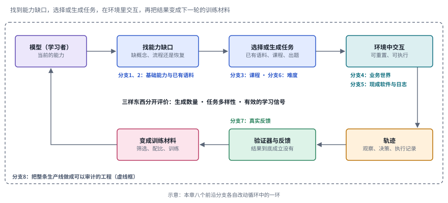

*图：训练数据的基本循环。每个框下方标出本章哪个前沿分支在改动这一环，最外面的虚线框是分支8 关心的整条生产线；这是一张示意图，具体工作往往同时碰到好几环。*

这张图里有两处值得多停一下。第一处是图中间那行字。几乎每篇论文都会报一个“生成了多少条”的数字，可这个数字只回答了循环转得快不快，至于转出来的题目是不是彼此不同、是不是真的给了模型可学的信号，需要另外的证据；三样东西混成一个“数据规模”，就什么也看不出来了。第二处是右下角的验证器。没有它，循环照样能转，转出来的却可能是一堆看上去合理、实际教错了东西的数据，本章第二节的“边界”和分支6、分支7、分支8 讨论的都是这一环怎样才立得住。

再看阶段。本章的主线以 Silver 和 Sutton 的三个时代为骨架：模拟时代、人类数据时代和经验时代。为了讲清楚训练数据这十几年的变化，下图把人类数据时代拆成了两段，一段是从网页里挑文本，一段是人的示范、标注和偏好，又在它和经验时代之间加了一段“模型开始给自己写数据”的过渡。每一栏下面写着这个阶段的数据是谁产生的、有哪些代表工作，以及本章哪些前沿分支在继承它的遗产。

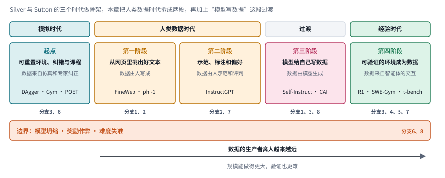

*图：五个阶段与三个时代的对应。从第一阶段往右，数据的生产者离人越来越远，规模能做得更大，验证也更难；最下面那条橙色的边界带，是第二节最后一部分要讲的三处失灵。*

把这张图从左往右读，会发现一个有意思的回环：故事从仿真里的可重置环境开始，中间绕到了人写的文本和人的示范上，最后又回到了可重置、可验证的环境，只是这一次的环境要服务会说话、会用工具的大模型。第二节会一个阶段一个阶段地展开。

最后是时间线。下图每一行是一个阶段，点的位置按 arXiv 编号或发布时间。和阶段图对照着看，各条线的登场顺序和阶段的编号并不完全一致：InstructGPT 的人类偏好数据和 Self-Instruct、Constitutional AI 的模型自写数据都出现在 2022 年这一年里，FineWeb 这样把网页筛选做成实验科学的工作反倒晚到了 2024 年；经验时代那两行在 2024 年之后迅速密集起来，其中一行是 SWE-bench、τ-bench、SWE-Gym、DeepSeek-R1 这样的具体工作，另一行是 Silver 与 Sutton、Mechanize、Epoch 这些试图给整个方向定调的长文。

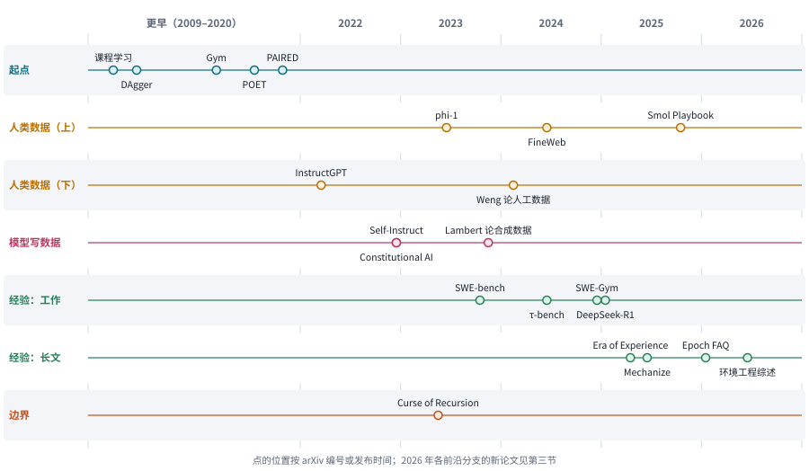

*图：主线上的代表工作按阶段分行排开。2009 到 2020 年的模拟时代工作压在“更早”一栏；经验时代拆成“工作”和“长文”两行，以免标签挤在一起。*

### 几个容易混在一起的概念

读这个方向的论文，最先要分清的是四样东西：任务、环境、轨迹和验证器。任务规定目标和约束，比如“给订单 1024 办理退款，金额不得超过实付”；环境接收动作并返回状态变化，比如真的去改订单库里的那一行；轨迹是一路上的观察、决策和执行记录；验证器则负责判断结果到底成立没有。Epoch 那篇 FAQ 给出的定义更简洁：任务就是一段提示加一个评分器，环境是动作空间和它周围的上下文。四样东西缺了任何一样，数据都可能看上去很完整，实际却撑不起有效的学习。一份只有轨迹没有环境的日志，模型只能照着模仿，没办法自己再试一次；一个只有环境没有验证器的沙箱，模型试了也不知道试得对不对。

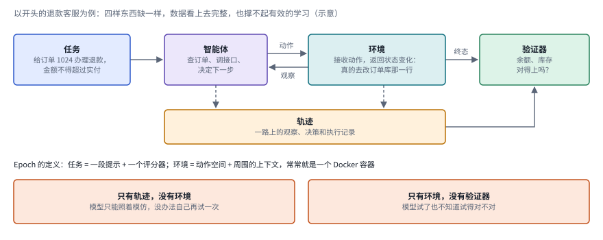

*图：用退款例子画出的四样部件。智能体和环境之间来回传递动作与观察，两者都在轨迹里留下记录，验证器同时看环境的终态和轨迹；下方两个橙色框是缺了其中一样的后果。*

这张图可以从左往右读。蓝色的任务框交代目标和约束，智能体据此决定先查订单还是先查支付记录，它发出的每个动作都会真的改变青色环境框里的状态，环境再把新的观察送回来；这一来一回的全部记录沉到下方琥珀色的轨迹框里。验证器站在最右边，它关心的是“余额和库存最后对不对得上”这样的终态，必要时也要翻看轨迹，确认模型有没有走捷径。下面两个橙色框把“缺一样”说得更具体，它们也是后面几个分支各自想补的那块短板：分支5 从日志里重建环境，补的是左边那个框；分支7 讨论反馈从哪里来，补的是右边那个框。

其中可重置的环境格外珍贵。日志只记录了别人走过的一条路，环境却能让不同的策略在完全相同的起点上各试一遍，好坏可以直接比较，失败了也能退回去重来。这正是 Silver 和 Sutton 所说的“经验”和“人类数据”的分水岭：前者是智能体自己与世界交互产生的，后者是别人事先写好、做好的。

另一组容易混的是三种数据来源：预训练语料、示范轨迹和在线交互。它们各有各的用处，彼此补充。预训练语料让模型知道工具是什么、领域里有哪些概念；示范轨迹教它正常流程该怎么走；在线交互则让它见识自己犯错之后的局面，学会恢复。所以文本数量再多，也替代不了任务覆盖和反馈质量。判断一份数据的价值，要看它补上的是哪一块，生成了多少条倒是次要的。

最后是“合成数据”这个词。今天几乎每篇论文都在合成点什么，可合成的对象差别很大：有的合成改写后的网页，有的合成题目，有的合成整个可执行的业务世界，有的从日志里反推出环境。把它们一概叫作合成数据，会掩盖掉最要紧的区别，也就是它改变了数据循环里的哪一个环节。本章后面的分支，就是按这个区别来划分的。

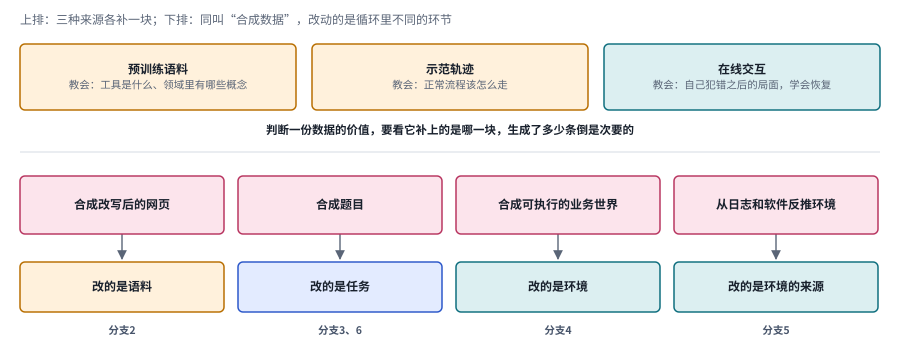

*图：上排是三种数据来源各自教会模型的东西；下排是四种常被统称为“合成数据”的做法，它们分别改动的是语料、任务、环境和环境的来源，对应本章不同的分支。*

下排四列可以当作一张查找表来用。读到一篇新论文说自己“合成了大量数据”，先看它属于哪一列：如果合成的是改写后的网页，它在和分支2 的 UltraX 比；如果合成的是题目，它要回答分支3 和分支6 关心的难度问题；如果合成的是一个可执行的世界，它要面对分支4 讨论的不变量；如果是从日志或现成软件里反推环境，它就得说明分支5 那个老问题，也就是原来系统里的缺陷有没有被一并继承下来。

## 二、发展主线：从人类数据走向经验

这条主线以 Silver 和 Sutton 的三个时代为骨架，再用另外几篇长文填充每个时代里的具体故事。把它们叠起来看，训练数据这十几年的历史可以读成一次重心的转移：一开始人们在仿真里给智能体造练习场，后来大模型把重心拉到了人写的文本和人的示范上，人们花大力气去挑、去洗、去标；再后来模型开始给自己写数据；到今天，可验证的交互环境又重新回到舞台中央，只是这一次要服务的是会说话、会用工具的大模型。每往前走一步，数据的“生产者”就离人远一点，规模能做得更大，验证也更难。

> **本节要点：** 每个阶段先用一张解说图讲清代表方法怎样运转，再用一排同一画法的结构卡把同族方法并排，最后一张对照表写明每种做法补上了什么、又留下了什么代价。读完这一节，第三节的八个前沿分支都能在这里找到自己的祖先。

| 阶段 | 内容 | 代表工作 | 本章对应分支 | 速查卡 |
|---|---|---|---|---|
| 起点：模拟时代 | 可重置的环境、在策略纠正、课程与环境生成 | DAgger、课程学习、Gym、POET、PAIRED | 分支3、分支6 | S1 至 S6 |
| 第一阶段：人类数据（上） | 从网页里挑出好文本，用消融实验定数据配方 | FineWeb、Textbooks Are All You Need | 分支1、分支2 | P1 至 P3 |
| 第二阶段：人类数据（下） | 人的示范、标注和偏好，以及标注质量本身 | InstructGPT、Lilian Weng 论人工数据 | 分支2、分支7 | H1 至 H3 |
| 第三阶段：模型写数据 | 自生成指令、AI 反馈、合成教科书 | Self-Instruct、Constitutional AI | 分支1、分支3、分支8 | G1、G2 |
| 第四阶段：经验时代 | 可验证环境成为新的数据：数学、代码、业务世界、复刻软件 | DeepSeek-R1、SWE-bench、SWE-Gym、τ-bench | 分支3、分支4、分支5、分支7 | X1 至 X5 |
| 边界 | 循环在哪里失灵：模型坍缩、奖励作弊、难度失准 | The Curse of Recursion、Epoch 访谈中的质量问题 | 分支6、分支8 | |

### 起点：模拟时代留下的三件工具

> **要点：** 大模型出现以前，强化学习已经在为“数据从哪里来”较劲。模拟时代留下了三件至今仍在用的工具：在学习者自己走到的状态上纠错，按学习者安排课程，以及可编程、可生成的环境。

在大模型出现以前，强化学习就已经在和“数据从哪里来”这个问题较劲了。Silver 和 Sutton 把那段时期称为模拟时代：智能体在西洋双陆棋、围棋、Atari 游戏这些规则清楚、奖励明确的世界里自我对弈，练出了超过人类的本领，可一走出封闭的仿真，面对开放的真实问题，就显得手足无措。这个时代没能直接通向通用智能，却给后来的智能体训练留下了三件至今仍在用的工具。下图把它们并排画在一起，每一栏底部写着这件工具的代价或局限。

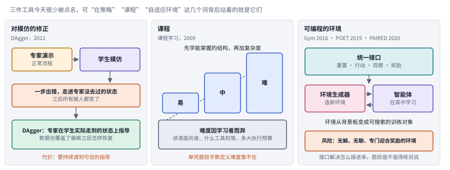

*图：三件工具。左栏从模仿出错一路走到 DAgger 的修正；中栏是一道台阶式的课程，底部提醒难度要对着具体学习者来定；右栏是统一的环境接口，以及把环境生成和智能体绑在一起的做法。*

第一件是对“模仿”的修正。最直接的办法是行为克隆：专家演示，学生模仿。它很适合传授正常流程，可学生一旦做错一步，就会走进专家几乎从未到过的状态，而一个错误又会改变之后所有的输入。2011 年的 [DAgger](https://arxiv.org/abs/1011.0686) 正是冲着这种分布错位来的，它让专家在学习者实际走到的状态上给出指导，训练数据于是不再只展示正确流程，也覆盖了偏离之后怎样恢复。代价是要持续请到可信的指导，而专家的时间从来都不便宜。今天分支3 里的 TREK、以及“在弱模型自己的轨迹上局部纠错”的那一类做法，都能看到 DAgger 的影子。

DAgger 是本章最值得画成步骤图的经典方法之一，因为后面好几个分支都在用它的思路。下图左半边是行为克隆的困境：绿色实线是专家走过的路，训练数据全部来自这条路上的状态；紫色虚线是学生自己上场后的轨迹，它在第二个点上出了一个小错，之后每一步看到的输入都和专家见过的不一样，错误于是越滚越大，落进橙色的陌生状态里。右半边是 DAgger 的一轮：先让当前的学生自己去跑，把它实际到达的状态都记下来，包括走偏的那些；再请专家在这些状态上标注“这里该怎么做”；新标注并入以往各轮汇总的数据集，在全部数据上重训，得到的新策略进入下一轮。

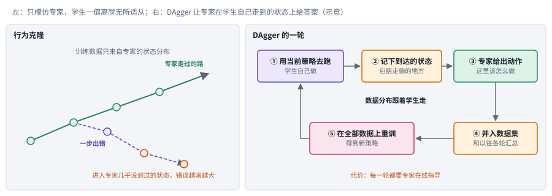

*图：左边是行为克隆的分布错位（示意），右边是 DAgger 一轮的五个步骤。关键的变化在第②步：训练数据的分布跟着学生走，专家的意见因此落在学生真正会遇到的状态上。*

这样做的好处在于，模型最需要学的“走偏以后怎么回来”终于进了训练数据；代价也一目了然，每一轮都要专家在线标注，第③步的人力会随着轮数不断累积。今天的大模型工作把“专家”换成了更强的模型或者可执行的验证器，可这个结构几乎原样保留了下来。

第二件是课程。2009 年的[课程学习](https://dl.acm.org/doi/10.1145/1553374.1553380)提出，学习顺序本身值得安排：先学能掌握的结构，再一点点加复杂度。可“由易到难”并没有一个放之四海而皆准的排序。对一个会写代码却不太会读图的模型，命令行题可能很简单，界面题反而很难；换一个模型，情况可能正好相反。所以一份课程必须讲明它面向的是哪个学习者、有哪些工具权限、执行预算多大，单凭题目字数来定义难度是靠不住的。

第三件是可编程的环境。2016 年的 [Gym](https://arxiv.org/abs/1606.01540) 给重置、行动、观察和奖励定了统一接口，把算法和环境实现部分地拆开了。接口统一解决的是“怎么接进来”，题目值不值得练是另一回事。2019 年的 [POET](https://arxiv.org/abs/1901.01753) 和 2020 年的 [PAIRED](https://arxiv.org/abs/2012.02096) 往前走了一步，把环境生成和能力发展绑在一起：环境从事先写死的背景板，变成了可以搜索、可以调整的训练对象。它们也早早暴露了这条路的风险，生成器可能造出无解的、无聊的、或者专门迎合奖励的环境。这三件工具的名字在今天的论文里出现得不多，可只要看到“在策略”“课程”“自适应环境”这几个词，背后站着的就是它们。

**速查：起点的六种做法。** 下面六张结构卡用同一种画法，从左往右是一轮流程，底部的虚线是绕回下一轮的那条路。并排看就能发现，从行为克隆到 PAIRED，变化集中在两处：谁来提供“该怎么做”的信号，以及环境是固定的还是会跟着学习者一起变。

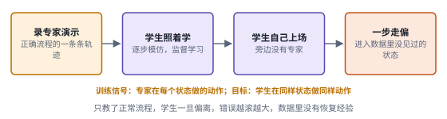 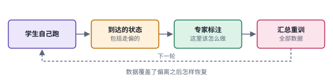

 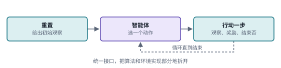

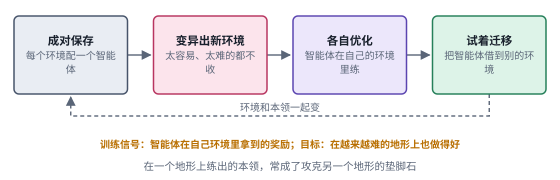 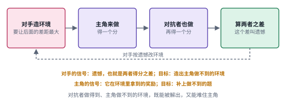

*图：起点六种做法的结构卡，每张卡对应下表的一行。PAIRED 那张卡里的“遗憾”指对抗者和主角在同一个环境里的得分之差。*

| code | 名称 | 年份 | 代表 | 怎么做 | 解决了什么 | 代价 |
|---|---|---|---|---|---|---|
| S1 | 行为克隆 | 经典做法 | 专家演示加监督学习 | 收集专家的正确流程，让学生逐步模仿 | 正常流程最便宜、最直接的传授方式 | 学生一旦偏离就进入没见过的状态，错误越滚越大，数据里没有恢复的经验 |
| S2 | 在策略纠错 | 2011 | [DAgger](https://arxiv.org/abs/1011.0686) | 让学生自己跑，专家在学生实际到达的状态上标注，汇总数据重训 | 训练分布跟着学生走，数据覆盖了偏离之后怎样恢复 | 每一轮都要请到可信的专家指导，成本随轮数增长 |
| S3 | 课程 | 2009 | [课程学习](https://dl.acm.org/doi/10.1145/1553374.1553380) | 先学能掌握的结构，再一点点加复杂度 | 学习顺序本身成了可以设计的东西 | 难度因学习者、工具权限和预算而异，没有放之四海而皆准的排序 |
| S4 | 统一环境接口 | 2016 | [Gym](https://arxiv.org/abs/1606.01540) | 给重置、行动、观察和奖励定统一接口 | 算法和环境实现部分地拆开，环境可以互换和复用 | 接口只管“怎么接进来”，题目值不值得练要另外判断 |
| S5 | 环境与智能体共同演化 | 2019 | [POET](https://arxiv.org/abs/1901.01753) | 成对保存环境和智能体，变异出难度合适的新环境，各自优化并尝试迁移 | 环境变成可以搜索的训练对象，一个环境里练出的本领能帮另一个环境 | 生成器可能造出无聊或无解的环境，需要额外的筛选条件 |
| S6 | 对抗式环境设计 | 2020 | [PAIRED](https://arxiv.org/abs/2012.02096) | 对手生成环境，以对抗者与主角的得分差为目标 | 环境既要能被解出，又要难住当前的主角 | 训练里多了对手和对抗者两个角色，生成器仍可能学会迎合奖励 |

### 第一阶段：人类数据时代（上）：从网页里挑出好文本

> **要点：** 文本几乎取之不尽，问题变成了挑哪部分。FineWeb 把“质量”当成实验问题，每一步处理都用小模型消融来决定去留；phi-1 则说明数据的质可以在相当程度上弥补量。这一阶段留给智能体的遗产，是“用训练结果检验数据”的方法论。

大模型来了以后，重心一下子转到了人写的文本上。互联网上的文本几乎取之不尽，问题变成了怎样从里面挑出真正有用的那部分。下图是这一阶段最透明的一个案例，它把一条网页处理管线和管线背后的实验方法画在了一起。

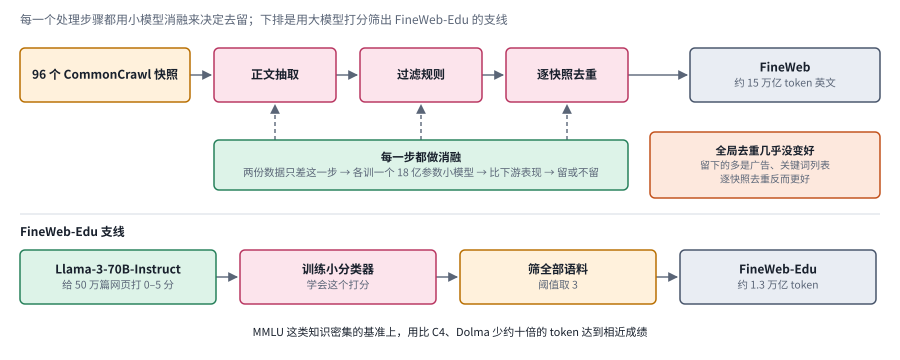

*图：上排是 FineWeb 的处理步骤，中间的绿色框是每一步都要经过的消融实验，右侧橙色框是全局去重这个反直觉的结果；下排是用大模型打分筛出 FineWeb-Edu 的支线。*

先从上排读起。96 个 CommonCrawl 快照依次经过正文抽取、过滤规则和逐快照去重，最后得到约 15 万亿 token 的英文语料。这条管线本身并不稀奇，稀奇的是那三条虚线：每一个粉色的处理步骤，都要接受下面那个绿色框的检验。下面一段会讲清这个检验怎样做，以及右侧橙色框里那个出人意料的发现。

Hugging Face 的 [FineWeb](https://arxiv.org/abs/2406.17557) 是这一阶段最透明、也最值得精读的案例。团队没有凭直觉定规则，他们把“质量”当成一个实验问题来处理：每改一处处理步骤，就用两份只在这一步上不同的数据各训一个 18 亿参数的小模型，比较下游表现，决定这一步留还是不留。这样一步步做下来，有些结论相当出人意料。比如把全部快照放在一起做全局去重，剩下的数据几乎没有变好；在其中一个快照上，去重后留下的那部分反而比被删掉的那部分训练效果更差，因为留下来的多是广告、关键词列表和格式混乱的页面。逐个快照分别去重，效果反而更好。又比如他们让 Llama-3-70B-Instruct 给 50 万篇网页按教育价值打 0 到 5 分，再用这些标注训练一个小分类器去筛整个语料，按阈值 3 筛出的 FineWeb-Edu 只保留了约 1.3 万亿 token，在 MMLU 这类知识密集的基准上，用比 C4、Dolma 少约十倍的 token 就能达到相近的成绩。

下排的 FineWeb-Edu 支线值得单独看一眼，因为它的结构后来被反复借用：先请一个大模型在一小部分数据上当标注员，再把它的判断蒸馏进一个便宜的小分类器，用小分类器去处理全部语料。大模型的判断力和小模型的吞吐量就这样接在了一起。分支2 里的 UltraX 用的就是这个结构的一个变体：先让专家大模型改写一部分文本，再把原文和改写的对应关系转成程序化的编辑监督，训练出能大规模执行编辑的模型。

稍早一点，微软的 [Textbooks Are All You Need](https://arxiv.org/abs/2306.11644) 用一个 13 亿参数的代码模型 phi-1 把同一个道理讲得更极端：约 60 亿 token 的“教科书质量”网页数据，加上约 10 亿 token 由 GPT-3.5 生成的教科书和练习题，就能训出在 HumanEval 上达到 50.6% 的小模型。数据的“质”可以在相当程度上弥补“量”。

Hugging Face 后来在 Smol Training Playbook 里把这种态度总结成一句话：最会训模型的团队，是对高质量数据最着迷的团队。他们还提醒，最符合直觉的数据未必最好，比如 arXiv 论文对小模型就可能有害，因为它太窄、太学术。这一阶段留给智能体训练的遗产，是一套“用训练结果检验数据”的方法论。本章分支1 讨论工具知识该在预训练还是中期训练阶段补，分支2 讨论语料怎样改写、怎样筛选，用的都是这一套思路，只是筛选的标准从“像教科书”换成了“对智能体有用”。

**速查：第一阶段的三种做法。** 三张卡的差别在于“好数据”的判据从哪里来：第一张靠小模型训练出来的下游表现，第二张靠大模型的打分，第三张把筛选和合成结合在一起。

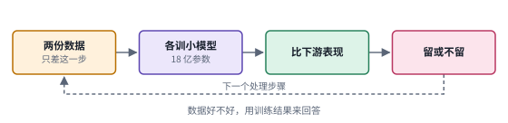 

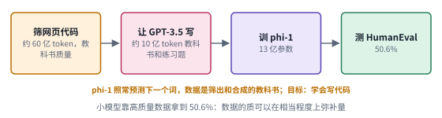

*图：第一阶段三种做法的结构卡，每张卡对应下表的一行。*

| code | 名称 | 年份 | 代表 | 怎么做 | 解决了什么 | 代价 |
|---|---|---|---|---|---|---|
| P1 | 消融定配方 | 2024 | [FineWeb](https://arxiv.org/abs/2406.17557) | 每个处理步骤做一对只差这一步的数据，各训一个 18 亿参数小模型，比下游表现决定去留 | 数据规则从凭直觉变成可检验的实验结论，还发现了全局去重几乎没用这类反直觉结果 | 每一步都要训练小模型，算力开销大；小模型上的结论能否推到更大模型要另外验证 |
| P2 | 大模型打分加小分类器 | 2024 | [FineWeb](https://arxiv.org/abs/2406.17557)（FineWeb-Edu） | Llama-3-70B-Instruct 给 50 万篇网页打教育价值分，训练小分类器，按阈值 3 筛全部语料 | 知识类基准上用比 C4、Dolma 少约十倍的 token 达到相近成绩 | 收益集中在知识密集的基准上；打分标准由大模型定，它的偏好会一并进入语料 |
| P3 | 教科书质量的数据 | 2023 | [Textbooks Are All You Need](https://arxiv.org/abs/2306.11644) | 约 60 亿 token 教科书质量网页数据，加约 10 亿 token GPT-3.5 生成的教科书和练习题，训 13 亿参数的 phi-1 | 小模型在 HumanEval 上达到 50.6%，说明质可以在相当程度上弥补量 | 合成部分依赖更强的教师模型；结论来自代码这个答案好检查的领域 |

### 第二阶段：人类数据时代（下）：示范、标注和偏好

> **要点：** 光有预训练文本，模型只会续写。InstructGPT 用人的示范、排序和强化学习教会模型听指令，这类数据随即成了关键原料，它的质量也随之成了问题。Lilian Weng 的判断是：分歧有的该消除，有的本身就携带信息，难例别一删了之。

光有预训练文本，模型只会续写，还不会听指令办事。于是人类数据的第二种形态登场了：人写的示范、人给的标注、人做的偏好比较。下图上排是这一阶段的代表流程，下排是 Lilian Weng 为这类数据的质量画出的地图。

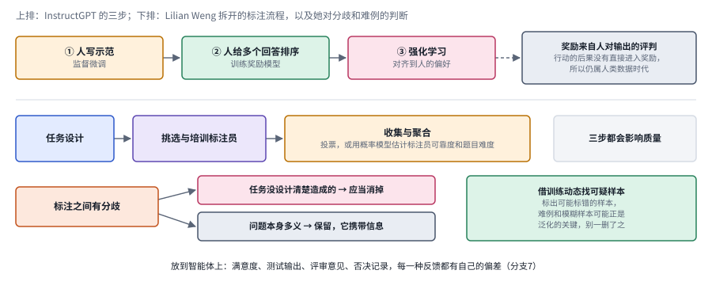

*图：上排是 InstructGPT 的三步，右端的灰框说明 Silver 和 Sutton 为什么仍把它归在人类数据时代；下排是 Lilian Weng 拆开的标注流程，以及她对分歧和难例的两条判断。*

2022 年 OpenAI 的 [InstructGPT](https://arxiv.org/abs/2203.02155) 是这一阶段的代表，先用人写的示范做监督微调，再请标注员对模型的多个回答排序，训练奖励模型，最后用强化学习对齐到人的偏好上。Silver 和 Sutton 把这种基于人类反馈的强化学习归在人类数据时代里，理由很简单：这类奖励最终来自人对输出的评判，行动在世界上造成的后果并没有直接进入奖励。

这类数据一旦成了关键原料，它的质量就成了问题。Lilian Weng 那篇长文把这件事讲得很透。她把标注拆成任务设计、标注员挑选与培训、结果收集与聚合三步，每一步都会影响质量；聚合多个人的标注，可以简单投票，也可以用概率模型同时估计每位标注员的可靠程度和每道题的难度。她最有启发的一个判断是关于分歧的：有些分歧是任务设计不清造成的，应当消掉；另一些分歧本身就反映了问题的多义性，硬把它们压成一个“标准答案”，反而丢掉了信息。在文章后半部分，她介绍了借训练动态找错标样本的几种方法，又特意提醒，难例和模糊样本可能正是提升泛化的关键，不能一删了之。

图的下排正好对应这段话的三层意思。第一行是流程，任务设计、挑选培训标注员、收集与聚合，三步都会影响质量；左下那个橙色的“分歧”框分出两条路，一条通向“消掉”，一条通向“保留”；右下的绿色框是借训练动态找可疑样本的那一类方法，它的作用是把值得复核的样本挑出来交给人，删不删要等人看过之后再定。

这些判断放到智能体上依然适用，甚至更要紧。智能体的反馈来源比单轮对话复杂得多：用户的满意度、测试的输出、同行的评审意见、人工的否决记录，每一种都有自己的偏差。本章分支7 讨论真实反馈怎样变成可训练的信号，分支2 讨论“带着答案生成的推理链”为什么会伤害蒸馏，都是在回答 Lilian Weng 提出的老问题：什么样的人类数据才算高质量。

**速查：第二阶段的三种做法。** 第一张卡是怎样用人类数据训练模型，后两张是怎样保证人类数据本身的质量。

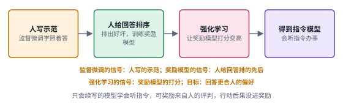 

*图：第二阶段三种做法的结构卡，每张卡对应下表的一行。H2 和 H3 取自 Lilian Weng 的长文，画的是一类做法的共同结构。*

| code | 名称 | 年份 | 代表 | 怎么做 | 解决了什么 | 代价 |
|---|---|---|---|---|---|---|
| H1 | 示范加偏好的三步法 | 2022 | [InstructGPT](https://arxiv.org/abs/2203.02155) | 人写示范做监督微调，标注员给多个回答排序训练奖励模型，再用强化学习对齐偏好 | 只会续写的模型学会了听指令办事 | 需要大量人工示范和排序；奖励来自人对输出的评判，行动的真实后果没有直接进入奖励 |
| H2 | 标注流程与聚合 | 2024 | [Lilian Weng 论人工数据](https://lilianweng.github.io/posts/2024-02-05-human-data-quality/) | 把标注拆成任务设计、标注员挑选培训、收集聚合三步；聚合可以投票，也可以用概率模型 | 质量问题可以定位到具体的环节，概率模型还能同时估计标注员可靠度和题目难度 | 每一步都要投入人力设计和管理；把多义问题硬压成一个答案会丢掉信息 |
| H3 | 借训练动态找错标 | 2024 | [Lilian Weng 论人工数据](https://lilianweng.github.io/posts/2024-02-05-human-data-quality/) | 在训练过程中观察样本的表现，标出可能标错的样本交给人复核 | 不用逐条重标，也能把可疑的样本挑出来 | 难例和模糊样本也会被标成可疑，一删了之可能伤害泛化 |

### 第三阶段：模型开始给自己写数据

> **要点：** 人类数据又贵又慢，2022 年底的 Self-Instruct 和 Constitutional AI 分别让模型自己写指令数据、自己给偏好。生成的瓶颈就此松动，新问题也随之而来：任务、环境、参考解和测试出自同一个模型时，它们可能非常一致地犯同一个错。

人类数据又贵又慢，一个自然的念头是：模型已经这么能写了，能不能让它自己写训练数据？

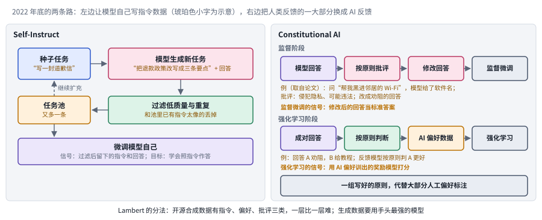

*图：左边是 Self-Instruct 的生成循环，从少量人写的种子任务出发不断扩充任务池；右边是 Constitutional AI 的两个阶段，一组写好的原则代替了大部分人工偏好标注。*

2022 年底的两篇工作几乎同时给出了肯定的回答。[Self-Instruct](https://arxiv.org/abs/2212.10560) 从一小批人写的种子任务出发，让模型自己生成新的指令、输入和输出，过滤掉低质量和重复的样本，再拿来微调模型自己。Anthropic 的 [Constitutional AI](https://arxiv.org/abs/2212.08073) 则把人类反馈的一大部分换成了 AI 反馈：模型先依据一组写好的原则批评和修改自己的回答，再在成对的回答之间按原则做判断，生成偏好数据。Nathan Lambert 在 Interconnects 上写过一篇长文梳理这段历史，他把开源社区的合成数据分成指令、偏好、批评三类，难度一层比一层高，并给出了一条朴素的经验：生成数据要用手头最强的模型，因为数据质量决定了模型质量的上限。

对照上图，两条路的差别一目了然。左栏 Self-Instruct 替代的是人写的示范：种子任务只需要一小批，之后模型生成新任务，绿色的过滤框挡掉低质量和重复的样本，剩下的进入任务池，再回头供下一轮生成参考，任务池攒够了就拿来微调模型自己。右栏 Constitutional AI 替代的是人做的偏好比较：上一行的监督阶段让模型按原则批评、修改自己的回答，下一行的强化学习阶段让模型按原则在两个回答之间做判断，产出的 AI 偏好数据再拿去训练。两栏里人都没有完全退场，种子任务和那组原则仍然是人写的，只是人的工作从逐条生产数据，变成了写规则和写起点。

合成数据的出现让“生成”的瓶颈松动了，同一个系统可以写任务说明、写环境代码、写参考解、写测试。可这也把一个新问题推到了前台，那就是**一致性与独立性**。如果这四份材料都出自同一个模型，它们完全可能非常一致地犯同一个错：题目有歧义，参考解恰好按其中一种理解来写，测试又恰好只检查那一种理解，整套数据看上去天衣无缝，实际上教的是错的东西。本章分支1 的中期训练数据合成、分支3 的自适应课程、分支8 的数据生产框架，都是在这一阶段的基础上继续往前做，也都要面对这个独立性问题。

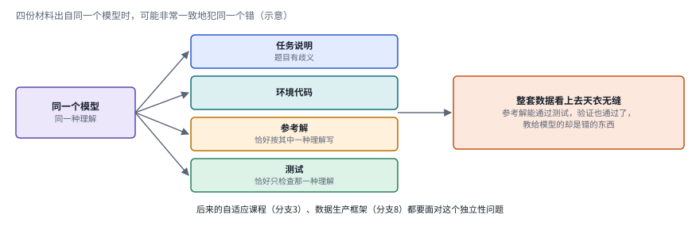

*图：同一个模型同时写出任务说明、环境代码、参考解和测试时，四份材料可以互相印证，却一起偏向同一种错误的理解（示意）。*

这张图值得记在心里，因为它解释了为什么验证器“通过”这件事本身说明不了多少。图中的参考解确实能通过测试，环境也确实能跑起来，所有内部检查都是绿灯，问题出在四份材料共享了同一个盲点。打破它的办法只能来自循环外面：换一个模型出测试，请人抽查题意，或者拿一批生成器从未见过的冻结任务来检验迁移。第二节最后的“边界”和分支8 会回到这件事上。

**速查：第三阶段的两种做法。**

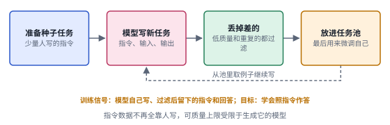 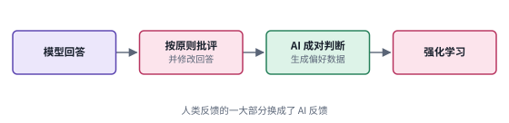

*图：第三阶段两种做法的结构卡，每张卡对应下表的一行。*

| code | 名称 | 年份 | 代表 | 怎么做 | 解决了什么 | 代价 |
|---|---|---|---|---|---|---|
| G1 | 自生成指令 | 2022 | [Self-Instruct](https://arxiv.org/abs/2212.10560) | 从少量人写的种子任务出发，模型生成新的指令、输入和输出，过滤低质量与重复后微调自己 | 指令数据不再完全依赖人工撰写，规模可以迅速扩大 | 生成和过滤都出自模型，数据质量的上限受限于生成它的模型 |
| G2 | AI 反馈 | 2022 | [Constitutional AI](https://arxiv.org/abs/2212.08073) | 模型按一组原则批评和修改自己的回答，再按原则在成对回答之间判断，生成偏好数据用于训练 | 人类反馈的一大部分换成了 AI 反馈，偏好数据的生产变便宜了 | 原则写得好不好决定了结果；判断者和被判断者是同类模型，可能共享同样的盲点 |

### 第四阶段：经验时代：可验证的环境成为新的数据

> **要点：** 静态的人类数据正在接近上限，下一步要靠智能体在环境里行动、从真实后果里拿奖励。数学最先被做成环境，接着是代码，现在增长最快的是企业工作流；环境本身也成了一门有价钱、有工程方法的生意。

前三个阶段的数据都有一个共同点：它们是静态的，写好了就放在那里。Silver 和 Sutton 认为这条路正在走到头，在数学、代码、科学这些领域，能从人类数据里提取的知识正在接近上限，而真正的新发现可能本来就超出了人类现有的理解。他们主张下一步要靠经验：智能体在环境里行动，从行动的真实后果里获得奖励。CAMEL-AI 的博客说得更直白：环境就是智能体“缺失的数据”。

下图把 Epoch 访谈里描述的环境拆开来看。左上角的青色大框是环境本身，也就是动作空间加上周围的上下文，在工程上常常就是一个 Docker 容器；框里是一道任务的完整构成，一段提示交给被训练的模型，模型多次尝试，评分器逐次判对错，最后得到一个通过率。右边是这门生意的价钱，底部是各个领域被做成环境的先后顺序。

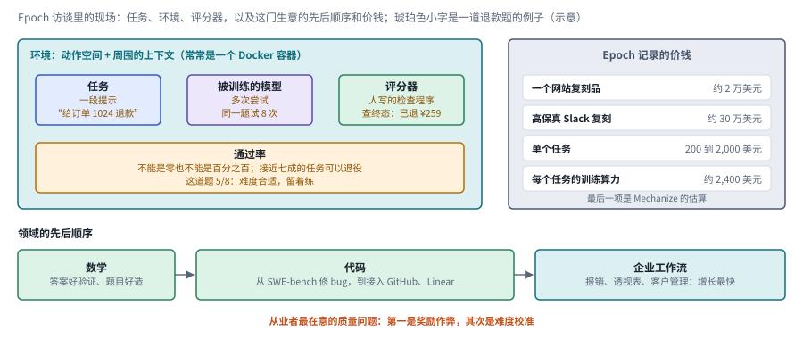

*图：环境的解剖、价钱和领域顺序，全部取自 Epoch 的访谈；“每个任务的训练算力”一项是 Mechanize 的估算。*

通过率那一栏是理解这张图的关键。一道题如果模型怎么都做不对，通过率是零，强化学习拿不到任何正样本；如果模型每次都做对，通过率是百分之百，练了也学不到新东西。所以评分器除了判对错，还间接决定了一道题有没有训练价值，这也是为什么从业者把难度校准排在奖励作弊之后，列为第二要紧的质量问题。

2025 年初的 [DeepSeek-R1](https://arxiv.org/abs/2501.12948) 让很多人第一次直观地看到了这条路的威力：在答案可以自动验证的题目上做大规模强化学习，不依赖人工标注的推理示范，也能把模型的推理能力激发出来。Epoch 的访谈也印证了这个先后顺序：数学最先被做成环境，因为答案好验证、题目好造；接着是代码，从 SWE-bench 那样的修 bug 任务，走向接入 GitHub、Linear 等真实工具的更完整场景；现在增长最快的是企业工作流。

代码线和业务世界线是这一阶段最值得画成步骤图的两条线，下图把它们并排放在一起。左边一栏说明同一套材料怎样派上两种用场，右边一栏是一个业务环境需要的部件。

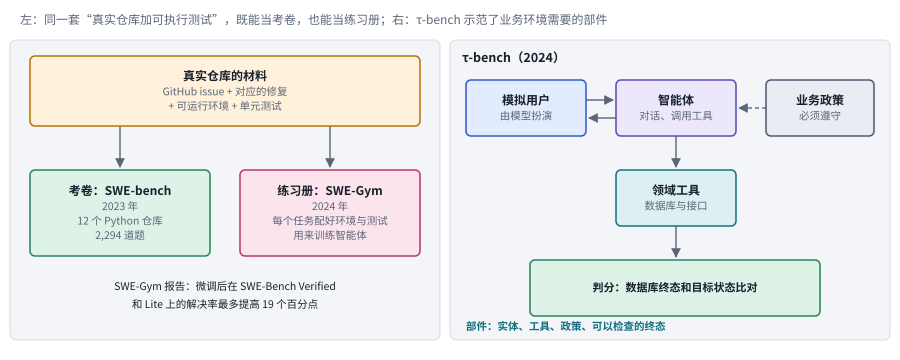

*图：左边，真实仓库里的 issue、修复、可运行环境和单元测试，向左流成考卷，向右流成练习册；右边，τ-bench 里模拟用户和智能体对话，智能体在业务政策的约束下调用领域工具，最后用数据库的终态判分。*

代码这条线的演进最清楚。2023 年的 [SWE-bench](https://arxiv.org/abs/2310.06770) 从 12 个 Python 仓库的真实 GitHub issue 和对应的修复中整理出 2,294 道题，最初是当评测用的；一年后的 [SWE-Gym](https://arxiv.org/abs/2412.21139) 把同样的思路改造成训练环境，每个任务都配好代码库、可运行环境、单元测试和自然语言描述，作者报告在这上面微调能让智能体在 SWE-Bench Verified 和 Lite 上的解决率最多提高 19 个百分点。同一套“真实仓库加可执行测试”的材料，既可以当考卷，也可以当练习册。业务世界这条线则可以追到 2024 年的 [τ-bench](https://arxiv.org/abs/2406.12045)：它让模型扮演的用户和智能体对话，智能体要调用领域工具、遵守业务政策，最后用数据库的终态和目标状态作比较来判分。它本是一个评测，却清楚地示范了一个业务环境需要哪些部件：实体、工具、政策和可以检查的终态。

τ-bench 那一栏的判分方式值得多看一眼。它判分时主要看数据库最后有没有变成目标状态，智能体按什么顺序调接口并不要紧。这让同一道题允许多种正确的做法，也让判分和开头那个退款例子里的“余额和库存对得上吗”一模一样。分支4 的 AgentMercury 把这一思路推进了一步，把“终态应当满足的约束”从单道题的答案提升成整个世界的不变量。

走到这一步，环境本身成了一门生意。Epoch 的文章记录了不少细节：一个网站复刻品大约两万美元，高保真的 Slack 复刻可以到三十万美元左右，单个任务通常在两百到两千美元之间；按 Mechanize 的估算，一个任务在强化学习训练中要消耗约 2,400 美元的算力，所以便宜而劣质的任务其实会浪费算力。Mechanize 的那篇预测文章则把眼光放得更远：如果强化学习要像预训练一样扩展，需要的环境规模是今天的成千上万倍，而软件就像当年的互联网文本一样，是现成的、海量的原料。他们提出的复刻训练，让模型照着规格和参考实现去重写已有软件，对错由行为是否一致来判定。本章分支4 搭业务世界，分支5 从现成软件和日志里挖环境，分支7 把真实工作的反馈接回训练，做的都是这一阶段的事。

到 2026 年年中，学术界开始把这些分散的做法当作一门“环境工程”来整理。Jiachun Li 等人的综述 [Agentic Environment Engineering for Large Language Models](https://arxiv.org/abs/2606.12191) 按建模、合成、评测和应用的生命周期梳理现有的 agent 环境，把自动造环境的方法分成两类：符号合成靠规则和代码，反馈可靠却不够灵活；神经合成让世界模型这样的学习模型充当环境，足够开放，却难以控制、前后也不容易一致。作者还指出，环境质量的评测里只有正确性研究得比较充分，多样性、复杂度和逼真度都还缺少成熟的衡量办法，并把“环境即服务”列为让环境部署走向标准化、可复现的一个方向。环境的数量一旦上去，“这个环境教得对不对”就会和“造不造得出来”一样要紧，这正是下面边界一节要接着讨论的问题。

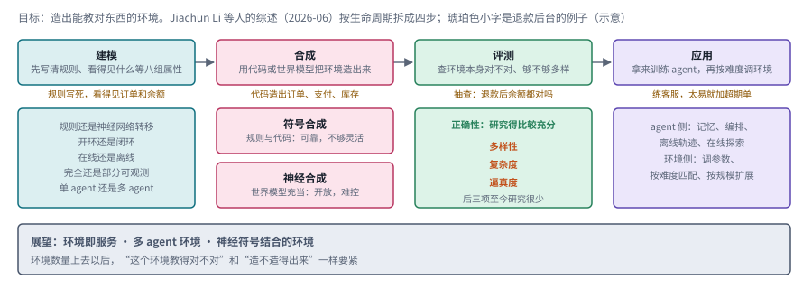

*图：综述的四段生命周期。建模一栏列出刻画环境的几组属性，合成一栏是符号与神经两种范式，评测一栏里只有正确性研究得较充分，应用一栏是 agent 与环境两侧各自的演化方式。*

这张图的第三栏是理解本章后半部分的钥匙。正确性回答的是“这个环境的反馈对不对”，多样性、复杂度和逼真度回答的是“这个环境值不值得练”。第三节的分支4 和分支5 主要在第二栏里比造环境的办法，分支6 在补复杂度这一格，分支8 的 ACE 视角则试图把这几项要求放进同一个框架里。

**速查：第四阶段的五种做法。** 五张卡的最后一格都是绿色或粉色的检查与奖励，差别在于检查的依据：答案对不对、测试过没过、终态对不对、行为是否和参考实现一致。

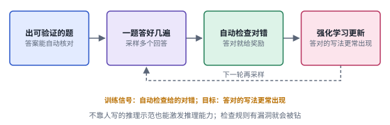 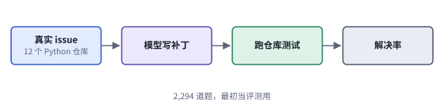

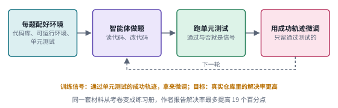 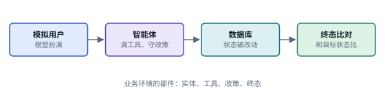

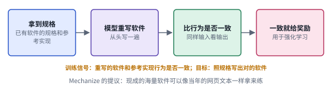

*图：第四阶段五种做法的结构卡，每张卡对应下表的一行。X5 是 Mechanize 在博客里提出的设想，画的是它描述的流程。*

| code | 名称 | 年份 | 代表 | 怎么做 | 解决了什么 | 代价 |
|---|---|---|---|---|---|---|
| X1 | 可验证奖励的强化学习 | 2025 | [DeepSeek-R1](https://arxiv.org/abs/2501.12948) | 在答案可以自动验证的题目上采样多个回答，用自动检查给奖励，做大规模强化学习 | 不依赖人工标注的推理示范，也能把推理能力激发出来 | 只适用于答案好验证的领域；检查规则一旦有漏洞就会被利用 |
| X2 | 真实仓库做考卷 | 2023 | [SWE-bench](https://arxiv.org/abs/2310.06770) | 从 12 个 Python 仓库的真实 issue 和修复里整理出 2,294 道题，用仓库测试判分 | 评测第一次贴近真实的软件维护工作 | 只覆盖有 issue 和测试的 Python 仓库；本身只用来评测 |
| X3 | 真实仓库做练习册 | 2024 | [SWE-Gym](https://arxiv.org/abs/2412.21139) | 每个任务配好代码库、可运行环境、单元测试和描述，用来训练智能体 | 同一套材料从考卷变成训练环境，作者报告解决率最多提高 19 个百分点 | 每个任务都要搭可运行的环境，构造和维护成本高 |
| X4 | 业务世界的终态判分 | 2024 | [τ-bench](https://arxiv.org/abs/2406.12045) | 模型扮演用户与智能体对话，智能体调用领域工具、遵守政策，用数据库终态与目标状态比对判分 | 示范了业务环境需要的部件：实体、工具、政策、可检查的终态 | 本身是评测；每个领域的数据库、工具和政策都要人工设计 |
| X5 | 复刻训练 | 2025 | [Mechanize 的预测文章](https://www.mechanize.work/blog/the-upcoming-gpt-3-moment-for-rl/) | 让模型照着详细规格和参考实现重写已有软件，对错由行为是否一致来判定 | 把现成的海量软件变成强化学习的任务来源 | 作者估算的规模要求极大；参考实现本身的缺陷会成为标准答案的一部分（分支5） |

### 边界：数据循环在哪里会失灵

> **要点：** 生产者离人越远，规模越大，“这些数据教对了没有”就越难回答。三条边界分别出在合成数据的递归训练、验证器的漏洞和难度的失准上；Silver 和 Sutton 的处方是把人的意图放在奖励的最上层。

数据的生产者离人越远，规模越大，“怎么知道这些数据真的教对了东西”这个问题就越难回答。几篇工作和几位作者的判断，划出了这条路的边界。下图把第一节的循环缩成一圈，三条边界各用一个橙色的框标在它出问题的那一环旁边。

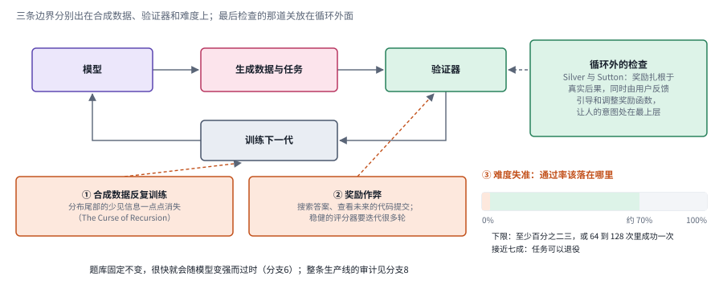

*图：橙色框①和②分别指向“训练下一代”和“验证器”，右下的横条是难度失准那条边界里的通过率区间，右上的绿色框是循环外的检查。*

第一条边界来自合成数据本身。2023 年的 [The Curse of Recursion](https://arxiv.org/abs/2305.17493) 发现，反复用模型生成的数据训练下一代模型，分布尾部那些少见却重要的信息会一点点消失，最终导致模型遗忘和坍缩。FineWeb 团队在网页数据里也观察到了相关的苗头：带有典型 ChatGPT 措辞的页面在新近的快照里明显增多，他们对此的态度很谨慎，只说这个信号值得留意，对更大规模训练的影响还不清楚。

第二条边界来自验证器。Epoch 访谈中从业者最担心的就是奖励作弊：模型会去搜索答案，甚至去查看未来的代码提交，一个稳健的评分器往往要迭代很多轮才能做好。这和本章分支5 里“把现有程序的行为当成金标准，会把原有缺陷也固化下来”是同一类问题。

第三条边界来自难度。访谈中的建议很具体：任务的通过率不能是零也不能是百分之百，至少要有百分之二三，或者在 64 到 128 次尝试里至少成功一次；通过率接近七成的任务就可以退役了。难度随模型能力而变，一份固定的题库很快就会过时。本章分支6 讨论怎样控制难度、怎样分清学会规则和记住答案，分支8 讨论怎样把整条生产线做成可以审计的工程，都是在这条边界上工作。

图右下那条横条把这段话画成了一个区间：最左边那一小段是通过率接近零的题，模型拿不到正样本；中间那一大段是值得练的区间，左端的门槛是百分之二三，或者 64 到 128 次里至少成功一次；过了约七成，题目就可以退役，留给更新的、更难的题。这个区间会随着模型变强整体右移，所以分支3 那些让题目跟着学生一起变的方法，本质上是在追着这个区间跑。

Silver 和 Sutton 自己也承认，经验时代带来的不只是机会。他们主张奖励要扎根于真实世界的后果，同时设想由用户的反馈来引导和调整奖励函数，让人的意图始终处在目标的最上层。用本章的话说，环境再逼真、规模再大，最后检查它教了什么的那道关，仍然要放在数据循环的外面。

### 总对照：五族方法与八个分支放在同一张图上

> **要点：** 把第二节五个阶段的速查卡放进一张表，按同样几个维度比较；再把经典工作和第三节的新论文放进同一张“阶段 × 循环环节”的格子里，就能看清每个分支在继承哪一族的遗产，以及今年的新工作扎堆在哪里。

下面这张表把五族方法放在同一组维度上比较。读的时候可以从上往下看“数据由谁产生”这一列，它正好是本节开头说的那条主线：从仿真和专家，到人写的文本，到人的示范与判断，到模型，最后到智能体自己的交互。

| 族 | 阶段 | 数据由谁产生 | 信号从哪里来 | 能否重放 | 规模的瓶颈 | 最容易出的问题 | 本章对应分支 |
|---|---|---|---|---|---|---|---|
| S | 起点 | 仿真环境与专家纠正 | 环境奖励、专家标注 | 能，环境可以重置 | 专家时间、环境的手工设计 | 生成的环境无解、无聊或迎合奖励 | 分支3、分支6 |
| P | 人类数据（上） | 人写的网页文本 | 小模型消融的下游表现、大模型打分 | 不涉及交互 | 处理和消融的算力 | 小模型上的结论未必迁移；打分者的偏好进入语料 | 分支1、分支2 |
| H | 人类数据（下） | 人的示范、标注和偏好 | 人对输出的评判 | 不涉及交互 | 人工成本与标注质量 | 分歧被硬压成单一答案；难例被误删 | 分支2、分支7 |
| G | 模型写数据 | 模型 | 模型按原则或过滤规则做的判断 | 不涉及交互 | 生成模型的上限 | 出题、答题、打分共享同一个盲点 | 分支1、分支3、分支8 |
| X | 经验时代 | 智能体与环境的交互 | 可执行的检查：答案、测试、终态、行为一致 | 能，环境可以重置 | 环境的构造与维护成本 | 奖励作弊、难度失准、继承原有缺陷 | 分支3、分支4、分支5、分支7 |

再看格子图。横轴是第二节的六个阶段，纵轴是第一节那个数据循环里的五个环节；实心的标签是第二节讲过的经典工作，虚线框是第三节收录的 2026 年新论文，每篇按它“主线位置”那一行放进对应的格子。

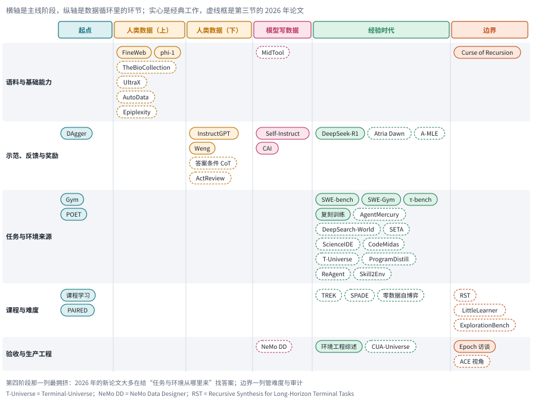

*图：经典工作和新论文在“阶段 × 循环环节”上的位置。经验时代那一列的“任务与环境来源”最拥挤，说明今年的新工作大多在回答环境从哪里来；边界一列集中在难度与审计。*

这张格子图有两处空白值得留意。第一处是起点那一列除了 DAgger、Gym、POET 这些经典工作以外几乎没有新论文直接落进去，它们的思路却借由 TREK、SPADE 和 RST 活在了经验时代和边界那两列里。第二处是“验收与生产工程”这一行，新论文只有零星几篇，和“任务与环境来源”一行的拥挤形成鲜明对比。造环境的人越来越多，检查环境的工具却没有跟上，这正是第六节第三个开放问题想要填的坑。

## 三、前沿研究方向

下面八个分支收录的都是 2026 年的新论文，它们合起来构成了一个完整的数据循环：找到模型的能力缺口，选择或生成合适的任务，让模型在环境里交互，再把结果变成下一轮的训练材料。分支1 和分支2 处理循环的起点，也就是基础能力和已有语料；分支3 到分支5 处理任务和环境从哪里来；分支6 和分支7 处理难度与反馈；分支8 处理整条生产线。每个分支开头先交代它要回答的问题，再标出它在主线上的位置。读的时候建议始终带着两个问题：它改变的是循环里的哪一个环节？生成的数量、任务的多样性和有效的学习信号，它分别是怎么证明的？这三样东西最好分开评价，合并成一个“数据规模”的数字，就什么也看不出来了。

> **本节要点：** 八个分支收录的都是 2026 年的新论文，每个分支开头先讲问题怎么来的，接着用一行“主线位置”把它挂回第二节的阶段，再用一张图把本分支几篇论文的做法摆在一起。第一节的循环图和第二节末尾的格子图可以当作本节的目录。

### 分支1：工具使用应该在什么阶段学，领域知识又怎样组织？

教模型用工具，至少要教会三层东西：调用的语法、工具的用途和调用的后果。能生成格式正确的调用，和知道什么时候该调用，是两种能力；知道该调用，和能读懂返回值、根据返回值调整下一步，又是另一种能力。预训练、监督微调和交互学习给出的信号各不相同，单凭阶段的名字很难判断哪一种更好。所以研究数据配方时，第一步应当是诊断：模型缺的是工具概念、任务策略，还是失败之后的恢复？诊断清楚了，才知道该补文档、补示范，还是补可执行的经验。

> 主线位置：第一阶段到第三阶段之间。延续 FineWeb 的“用训练结果检验数据配方”，再用合成数据把预训练和后训练之间的缺口补上。

> **要点：** 教工具使用之前先诊断：缺的是工具概念、任务策略，还是失败后的恢复。MidTool 用中期训练补行动能力的底座，TheBioCollection 用结构对齐补领域知识的底座。

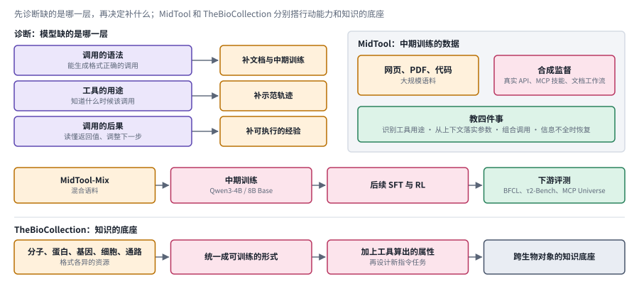

*图：先诊断模型缺的是哪一层，再决定补什么；MidTool 和 TheBioCollection 分别搭行动能力和知识的底座。左上三行是本节开头那段诊断的三层，从调用的语法、工具的用途到调用的后果，越往下越接近真正的交互，右边是每一层缺了以后最直接的补法。*

下图把这一节的两篇论文和开头的诊断放在了一起。左上角的三行对应工具使用的三层能力，每一行右边是缺了这一层时最直接的补法：语法和概念不懂，就补文档和中期训练；不知道什么时候该调用，就补示范；读不懂返回值、出了错不会调整，就得补可执行的经验。右上和中间一行是 MidTool 的做法，它把大规模的网页、PDF 和代码，与来自真实 API、MCP 技能和文档工作流的合成监督混成 MidTool-Mix，先做中期训练，再接监督微调和强化学习，最后在 BFCL、τ2-Bench 和 MCP Universe 上看效果，绿色框里那四件事是它想教会模型的东西。最下面一行是 TheBioCollection，它处理的是另一种底座：把分子、蛋白质、基因、细胞和通路这些格式各异的资源统一成可训练的形式，再补上工具算出的属性和新的指令任务。

先看行动能力这一侧。**[MidTool: Mid-training Data Synthesis for Agentic Tool Use](https://arxiv.org/abs/2608.20314)**（`2608.20314`）抓住了一个常被忽略的前提：后训练能不能教会工具使用，可能取决于模型在此之前是否充分理解了工具的能力和参数之间的关系。作者把网页、PDF、代码和真实 API、技能说明、文档工作流结合起来，生成中期训练材料，再比较后续监督微调和强化学习的效果。它教的东西超出了“调用哪个函数”，还包括参数怎样落地、调用怎样组合，以及信息不完整时怎样恢复。限制在于中期训练本身要增加成本，报告里的后续收益也说明不了任何基础模型都该采用同样的配比。这和 FineWeb 的教训一致：配方要在具体模型上用实验来定。

再看知识底座这一侧。**[TheBioCollection: Unified Pre-Training Scale LLM Corpus for Biology](https://arxiv.org/abs/2607.08803)**（`2607.08803`）处理的是另一种断裂：分子、蛋白质、基因、细胞和通路的资源本来很丰富，却缺乏一种统一的、可以直接拿来训练的形式。作者的做法比拼接文本多走了几步，他们加入了用工具计算出的属性，还设计了新的指令任务。这说明领域数据的价值可能主要来自结构上的对齐，普通的语言扩写给不了这些。把它和 MidTool 放在一起看，分工很清楚：TheBioCollection 搭的是跨生物数据对象的知识底座，MidTool 搭的是行动能力的底座。两者都还没有经过智能体轨迹的验证，专业指标的提高，也说明不了模型已经能可靠地执行科学流程。

回到开头的诊断。如果模型连字段的含义都不懂，直接用稀疏的结果奖励去训，昂贵的环境调用多半会消耗在基本的理解错误上；如果它已经懂了规则，继续往里堆说明书，可能只是在重复它已经知道的东西。先弄清楚缺的是“知道工具存在”还是“知道何时使用”，再决定补什么，钱才花在刀刃上。

### 分支2：已有语料怎样清理与选择，不再一味扩容？

数据质量远不止标签对不对这一件事，生成过程是否贴近部署时能拿到的信息，同样决定了数据好不好用。举几个例子：看着答案写出来的解释，用了特权工具才得到的轨迹，只保留成功结果的样本，它们都可能顺利通过表面上的筛选，却各自引入不同的偏差。所以筛选的时候，除了记录结果对错，还应当记下来源条件、生成时可见的信息和步骤之间的依赖，把“最后答案对”和“过程值得学”这两件事区分开。

> 主线位置：第一阶段和第二阶段。接 FineWeb 的消融式筛选和 Lilian Weng 对数据质量的讨论，把“挑数据”的方法从网页文本推广到推理链和程序化编辑。

> **要点：** 数据的毛病常常出在生产过程里。四篇工作分别处理生成过程中的合理化、改写的成本与风险、选择规则的搜索，以及“什么值得学”的信息论定义。

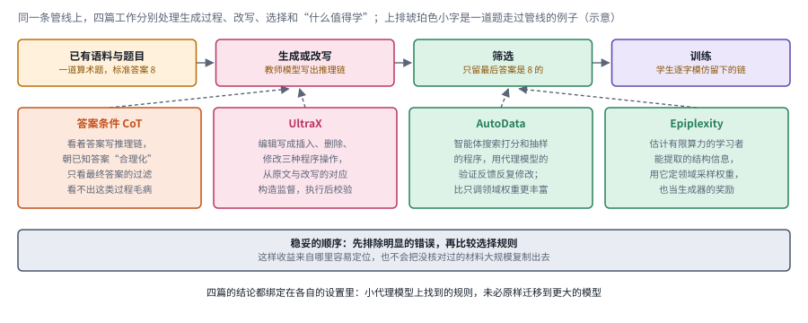

*图：同一条数据管线上，四篇工作分别处理生成过程、改写、选择和“什么值得学”。上排是一条最简单的数据管线，下面四张卡片用虚线指向各自改动的环节。*

下图先画了一条最简单的数据管线：已有语料和题目经过生成或改写，再经过筛选，最后进入训练。这一节的四篇论文各自落在管线的某一处。左边两张卡片指向“生成或改写”：答案条件 CoT 那篇揭示的是生成过程里的毛病，看着答案写出来的推理链会朝答案合理化，而只看最终答案的过滤器看不见这种毛病；UltraX 则把改写这件事本身变成可以检查的程序操作。右边两张卡片指向“筛选”：AutoData 让智能体去搜索打分和抽样的程序，Epiplexity 换了一个信息论的角度来定义“什么值得学”，它的信号既能定领域采样的权重，也能当生成器的奖励。图底部的灰框是本节结尾给出的那个稳妥顺序。

第一篇工作揭示了一个结果过滤看不见的缺陷。**[Answer-Conditioned Chains of Thought Degrade Verifiable-Reasoning Distillation](https://arxiv.org/abs/2607.14552)**固定了生成器、题目和正确性筛选，只改变一件事：生成推理链时，是否要求模型朝着已知答案去合理化。结果发现，这样生成的数据会损害其设置下的蒸馏效果。摘要还通过提示消融，把问题定位到了“合理化”这条指令上，答案是否可见反倒不是关键。这个结果提醒我们，只看最终答案的过滤可能放过过程上的毛病；同时也要守住结论的范围，它说的是这种生成方式有问题，推不出“任何包含答案的训练样本都有害”。这和 Lilian Weng 讲的标注流程如出一辙：数据的毛病常常出在生产过程里，光看成品看不出来。

第二篇处理的是改写的成本和风险。**[UltraX: Refining Pre-Training Data at Scale with Adaptive Programmatic Editing](https://arxiv.org/abs/2607.08646)**（`2607.08646`）比较了两种老办法的不足：固定规则不够灵活，逐篇请大模型改写又贵又可能乱改。它的方案是把编辑表示成插入、删除、修改这样的程序操作，从原文和改写文的对应关系里构造监督，再验证执行结果。这样一来，“生成一篇好文章”就变成了“产生一组可以检查的编辑”。限制也很明显：编辑合法，内容未必忠实；如果教师模型引入了错误的知识，程序化执行只会把错误高效地复制下去。

第三篇换了个思路，搜索的对象从文档变成了挑文档的程序。**[AutoData: Agentic Search for Pre-training Data Selection](https://arxiv.org/abs/2609.19754)**（`2609.19754`）利用词汇统计、类别、困惑度等特征，在代理模型的验证反馈下反复修改评分和抽样规则。比起只调几个领域的权重，它能发现更复杂的特征组合。这很像把 FineWeb 团队手工做的那一轮轮消融交给智能体去自动完成。代价是代理实验的预算，而且在小模型上找到的规则，未必能原样迁移到更大的模型、更多的语言或另一种目标能力上。

第四篇试图从信息论的角度回答“什么值得学”。**[Epiplexity Guided Data Selection and Generation for Out-of-Distribution Generalization](https://arxiv.org/abs/2608.11746)**（`2608.11746`）用了一个叫 epiplexity 的量，指的是计算能力有限的学习者能从数据里提取出的结构信息，再用它来指导领域采样和合成生成。它和 AutoData 都用到了学习反馈，区别在于它更强调结构信息这个指标，AutoData 更强调程序搜索的空间。读这篇时要守住一条线：信息量、文本难度和下游收益是三样东西，指标的估计又依赖学习曲线和训练设置，它对具体的智能体技能是否合用，还要另外验证。

这四篇合起来，分别处理了纠错、改写、选择和面向迁移的数据设计。实践中比较稳妥的顺序是先排除明显的错误，再比较选择规则，这样既容易定位收益来自哪里，也能避免把没核对过的材料大规模复制出去。

### 分支3：让题目随着学生变强，还是让学生与世界一起演化？

固定的题库有一个绕不开的问题：学生会变强。昨天还做不出的题，今天已经能稳稳做对，再练下去只是浪费算力；而那些远远超出能力的题，学生一次都做不对，也拿不到任何学习信号。课程控制要做的，就是让题目始终落在学生“够一够能够到”的地方。它可以只调题目难度，也可以连环境规则和反馈密度一起改。前者让任务定义保持相对稳定，便于观察能力的提升；后者扩大了探索的范围，评价的目标却可能跟着漂移。两种做法都要防住两个极端：只产生学生早就会做的题，或者产生无法验证的难题。比较时，最好报告新任务的覆盖和独立分布上的表现，只报告自己生成的训练集上的成功率是不够的。

> 主线位置：起点和第四阶段的交汇处。把课程学习、DAgger、POET 和 PAIRED 的思路搬到大模型上，环境生成器从手写规则换成了会写代码的模型。

> **要点：** 题目要始终落在学生“够一够能够到”的地方。TREK 在够不着的题上请老师帮一把就撤，SPADE 让出题人跟着学生一起成长，零数据自博弈把同样的思路推到了预训练。

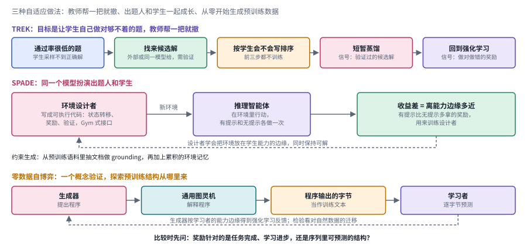

*图：TREK、SPADE 和零数据自博弈三种自适应做法。三行各画一种做法，虚线是绕回去的反馈，每一行的标题点出它和起点那些经典工具的关系。*

下图三行各画了一种做法。第一行是 TREK 的五个步骤：先找出学生通过率很低的题，请外部教师、白盒教师或带额外上下文的同一个模型给出候选解并验证，按学生自己的似然只留前几个，用一段短暂的前向 KL 蒸馏把这些解拉进学生能探索到的范围，然后回到在策略的 GRPO 继续精修。第二行是 SPADE：同一个模型扮演两个角色，环境设计者把环境写成带状态转移、奖励和验证代码的可执行程序，推理智能体在里面行动，有提示和无提示各做一次；两次之间的收益差用来估计这道题离学生的能力边缘有多近，再反过来训练设计者，那条虚线就是这个反馈。第三行是零数据自博弈：生成器提出程序，通用图灵机把程序解释成字节序列，学习者逐字节预测，生成器按学习者的能力边缘得到强化学习的反馈。三行放在一起，正好对应起点那一节的 DAgger、PAIRED 和课程学习。

第一篇关心的是那些学生根本采样不到正确解的题。**[TREK](https://arxiv.org/abs/2607.05339)**先找出学生很难采样出成功轨迹的题目，引入经过验证的候选解，用短暂的蒸馏把这些解带进学生可以探索到的范围，然后再回到在策略的强化学习。这里补充数据的作用是扩大探索的支持范围，学生并不会长期去复制老师。它和不断增加题目数量的路线方向不同，关注的是少数“当前策略根本到不了”的解法能不能变成可学的样本。读的时候可以把它和 DAgger 对照着看：两者都是在学生够不着的地方请老师帮一把，只是 TREK 帮完就撤。

第二篇让出题人和学生一起成长。**[SPADE: Self-Play in Adaptive Synthetic Executable Environments](https://arxiv.org/abs/2608.19197)**（`2608.19197`）把环境设计者和推理智能体放进同一个学习循环。设计者编写带有状态转移、奖励和验证代码的环境；学生在有提示和没有提示两种条件下的收益差，被用来估计一道题离学生的能力边缘有多近。文档 grounding 和环境记忆约束着生成过程，让它不至于在真空里随机造题。它的关键之处在于课程会随学生调整，环境池也随之不断更新。这几乎就是 PAIRED 在大模型时代的样子。限制在于，提示带来的收益只是可学性的一个代理，设计者和验证器仍然可能共享同一个盲点。

第三篇走得更基础，干脆从“零数据”开始。**[Self-Play Pretraining with Zero Data](https://arxiv.org/abs/2609.30063)**（`2609.30063`）让一个生成器提出程序，程序输出字节序列，学习者去预测这些序列，生成器则根据学习者的能力边缘得到反馈。作者明确把它定位为概念验证；它研究的是对自然数据的迁移，没有声称一个毫无先验的系统已经掌握了现实工作。标题里的“零数据”也要读准：计算、设计选择和归纳偏置都还在，程序解释器和优化过程本身就塑造了搜索的空间。

SPADE 和零数据自博弈都属于自适应生成，学习的对象却很不一样：前者直接面向可以行动的环境，后者探索的是预训练结构从哪里来。比较它们时，可以先问一句：奖励到底针对的是任务完成、学习进步，还是序列里可预测的结构？如果把这些都混成一个“自生成成功率”，就无法判断改进是来自更好的课程，还是来自更容易的题。真正的检验需要独立的、冻结的、生成器从未参与设计的迁移任务。

### 分支4：先写一道题，还是先搭一个能产生多种题的业务世界？

回到开头那个退款的例子。如果我们只围绕“给订单 1024 退款”这一道题搭一个小环境，检查起来很方便，可这个环境里很可能只有这一张订单、这一个接口，换一道题就得重搭。真实的业务却是一个共享状态的世界：退款会改账单，也会改库存，还可能触发风控。独立的题目容易检查答案，却常常缺少真实任务里的状态依赖；可执行的世界能让每个动作改变之后的观察，构造和维护的成本却高得多。研究环境生成，应当先确认状态、动作、反馈和验收是否彼此一致，然后再谈规模。否则题目数量再多，也可能只是同一种表面模板的翻版，或者藏着能绕开目标的验证漏洞。

> 主线位置：第四阶段，业务世界。接 τ-bench 用数据库终态判分的思路，对应 Epoch 访谈里增长最快的企业工作流环境。

> **要点：** 先搭一个有实体、服务、状态和不变量的业务世界，再让题目从世界里长出来；评价时，主目标之外还要检查不变量和被禁止的路径。

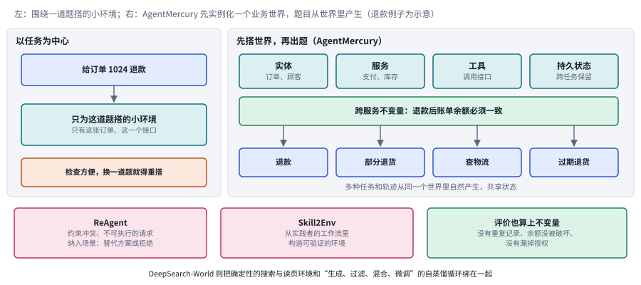

*图：以任务为中心与先搭世界两种做法，以及业务场景里的拒绝、专家工作流和不变量检查。左右两栏是两种造环境的顺序；底部三个框是这一节其余工作和评价时要补上的检查。*

下图左右两栏对比了两种造环境的顺序。左栏以任务为中心：围绕“给订单 1024 退款”这一道题搭一个小环境，里面只有这张订单、这一个接口，检查起来方便，换一道题就得重搭。右栏是 AgentMercury 的顺序：先实例化实体、服务、工具和持久状态，再写下跨服务的不变量，比如“退款后账单余额必须一致”，然后让多种任务从同一个世界里自然产生，它们共享状态，也都要遵守这条不变量（图中的几种任务是示意）。底部左边两个框是 ReAgent 和 Skill2Env，一个把约束冲突和不可执行的请求纳入场景，一个从实践者的工作流里构造环境；右边的绿框是这一节结尾的评价建议，主目标之外还要检查不变量有没有被破坏。

先看一个把环境和学习过程绑在一起的例子。**[DeepSearch-World](https://arxiv.org/abs/2607.07820)**提供了一个确定性的、可验证的搜索与页面读取环境，并用轨迹生成、过滤、混合和微调组成一个自蒸馏循环。它把环境和学习过程结合了起来，很适合用来比较固定的教师轨迹和可重复交互的数据各有什么不同。报告里的模型成绩属于这个环境和这套任务配方；环境可以重放，分析起来方便，可真实网页一直在变，任务能不能迁移过去，还要另外检验。

再看先搭世界、后出题目的做法。**[AgentMercury: Your Agent Can Synthesize Verifiable Environments for Business Scenarios at scale](https://arxiv.org/abs/2608.20634)**（`2608.20634`）针对的正是以任务为中心的生成方式的局限：围绕一道固定问题拼出来的环境，很容易变成只为这道题服务的舞台。它的做法是先实例化实体、服务、工具、持久状态和跨服务的不变量，再从这个业务世界里产生任务。比如“退款后账单余额必须一致”是整个世界的约束，所有涉及退款的题都要遵守它，它的地位比某一道题的答案高一层。这样更容易构造共享状态下的多样工作流。当然，世界的结构看起来合理，也未必涵盖了现实机构的全部政策和异常情况。

业务场景还要覆盖约束冲突和不可执行的请求。[ReAgent: Rethinking Agent Training Through Scenario Co-Design](https://www.alphaxiv.org/abs/2609.reagent-agent-training-scenario-design)的介绍把替代方案和拒绝不可行的操作纳入了场景设计；[Skill2Env: Reinforcing Agents with Collective Skills](https://www.alphaxiv.org/abs/2609.reinforcing-agents-collective-skills)则讨论怎样从实践者的工作流里构造可验证的环境。这两条思路一条连着业务规则，一条连着专家经验，共同的意思是：一个任务除了要有完成的路径，还应当讲清楚哪些路径是被禁止的，以及系统什么时候需要换一个方案。就像退货期限过了的那位顾客，正确的做法可能是礼貌地拒绝，或者转给主管。

所以这个分支的评价应当把不变量也算进来，主目标之外，还要检查新建的记录有没有重复、退款有没有破坏余额、是否漏掉了授权。否则环境越逼真，模型越可能学会“像在工作”，却没有学会真实业务里的责任边界。

### 分支5：从现成软件提取任务，保留真实约束还是继承历史缺陷？

和凭空造世界相比，从现成的软件里挖任务有一个天然的优势：真实。真实软件自带依赖、配置和各种异常路径，往往比合成的函数题更接近部署时的样子。Mechanize 那篇文章的判断也在这里，软件就像当年的互联网文本，是现成而海量的原料。可真实也有真实的麻烦：原仓库里可能有脆弱的测试、历史遗留的漏洞，或者再也复现不了的服务状态。所以抽取任务时，要分清“保留现实的复杂度”和“把偶然的缺陷变成标准答案”。可执行环境、版本锁定和独立验收应当一起保存下来，否则后来的模型失败了，可能只是因为环境本身已经坏了。

> 主线位置：第四阶段，软件即原料。接 SWE-bench 和 SWE-Gym 从真实仓库造任务的路线，对应 Mechanize 提出的复刻训练。

> **要点：** 从现成软件挖任务，真实是最大的优势，也是最大的风险。五条路线各有锚点，锚点不同，藏错误的方式也不同。

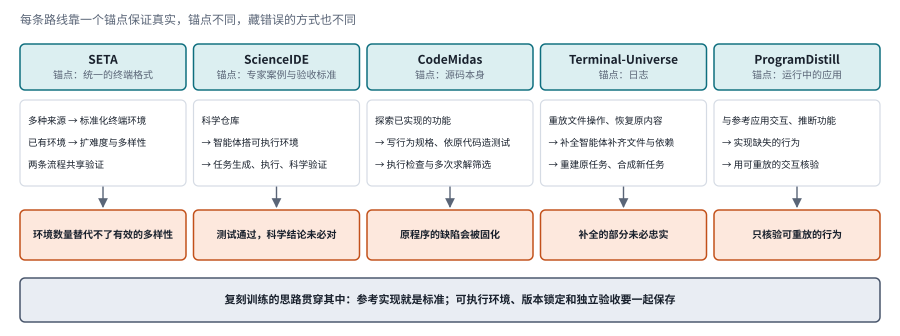

*图：五条路线各自的锚点、流程，以及各自藏错误的方式。五列各是一条路线：最上面写锚点，中间是流程，下面的橙色框是这条路线最容易藏错误的地方。*

下图把这一节的五篇论文排成五列，每列从上往下读。最上面的青色框写着这条路线靠什么来保证真实，也就是它的锚点：SETA 靠统一的终端格式，ScienceIDE 靠专家定义的案例和验收标准，CodeMidas 靠源码本身，Terminal-Universe 靠日志，ProgramDistill 靠一个正在运行的参考应用。中间的白框是各自的流程，下面的橙色框是这条路线最容易藏错误的地方。五个橙色框各不相同，正好说明了本节结尾那句话：锚点不同，藏错误的方式也不同。底部的灰框把 Mechanize 的复刻训练放进来，因为这五条路线多少都有“参考实现就是标准”的影子。

第一篇把多种来源统一成终端环境。**[SETA](https://arxiv.org/abs/2607.10891)**把多种来源转换成标准化的终端训练环境，再从已有环境出发继续扩展难度和多样性，两条流程共享同一套验证机制。它很适合用来说明，数据工程的基本单位可以是一个“可执行的任务环境”，比输入和答案的配对丰富得多。作者报告了训练后的迁移结果；进一步比较时，还应当把环境数量、独立的任务结构和验证器质量分开来看，规模替代不了有效的多样性。

第二篇面向科学代码。**[ScienceIDE: Turning World's Scientific Codebase into Agent Learnable Environments](https://arxiv.org/abs/2609.19134)**（`2609.19134`）把科学仓库变成了可编程的练习场：专家先定义案例和验收标准，智能体再去构造支持任务生成、执行和科学验证的环境。这和从零造世界的路子不同，现成的软件提供了知识和约束，专家的标准则限定了“运行成功”的含义。限制也恰恰在这里，依赖、领域惯例和验收标准的维护都需要人力，测试通过了，也还证明不了科学结论本身是对的。

第三篇只用源码。交叉样本 **[CodeMidas: Scaling Agentic Coding RL Environments from Code Itself](https://arxiv.org/abs/2609.22068)**（`2609.22068`）只把已有的源码当作任务特定的输入，从实现的行为里构造规格、测试和任务，再通过执行和多次求解来筛选。和依赖 issue 或提交历史的路线相比，它更容易扩展到那些缺少开发记录的仓库。这和 Mechanize 的复刻训练是同一个思路：参考实现就是标准。可这也带来了同样的风险，现有的行为未必是正确的需求，如果原程序本来就有缺陷，把它的行为当成“金标准”，缺陷也会被固化下来。

第四篇反过来，从日志恢复环境。**[Terminal-Universe: Turning Agent Trajectories into Scalable Terminal Environments](https://arxiv.org/abs/2609.04148)**（`2609.04148`）重放日志里的文件操作，恢复修改之前的内容，再补齐缺失的文件和依赖，把一次性的示范重建成可以复用的工作区。它的优势是能利用已经积累下来的大量轨迹，相当于把第二阶段的人类示范转换成第四阶段的环境。风险在于补全出来的环境只能证明足以支撑某些任务，未必忠实还原了原来的系统。重建时必须记清楚，哪些内容来自日志，哪些是后来推断补上的。

第五篇从运行中的应用出发。**[ProgramDistill: From Interactive Web Apps to Verifiable Reference-Guided SWE Tasks](https://arxiv.org/abs/2609.18805)**（`2609.18805`）让智能体通过一个正在运行的参考应用去推断它的功能，再实现缺失的行为，用可重放的交互来核验。标题里的“蒸馏”指的是把程序行为转成任务，和参数蒸馏是两回事。把这五条路线放在一起，可以看到它们各有各的锚点：SETA 靠统一的终端格式，ScienceIDE 靠专家案例，CodeMidas 靠源码，Terminal-Universe 靠日志，ProgramDistill 靠可以观察的应用行为。锚点不同，藏错误的方式也不同，所以选路线时，只比最终的任务数量是远远不够的。

### 分支6：如何控制难度，并区分学会规则与记住答案？

Epoch 访谈里有一条很实用的经验：任务的通过率不能是零也不能是百分之百，接近七成的任务就可以退役了。可“难度”本身并不是一个分数。长流程、稀疏反馈、陌生工具和组合规则，会以完全不同的方式让任务变难。如果只是从同一个模板里随机切出训练集和测试集，测到的可能只是模型会不会填空，规则能不能迁移根本没有测到。所以要按实体、模板、工具组合和环境版本来设计留出条件，报告是哪种变化让表现下降，再去判断数据是否真的帮模型学到了可复用的结构。

> 主线位置：边界，难度校准。接课程学习的“难度因学习者而异”，对应 Epoch 访谈中的难度校准问题。

> **要点：** 难度并不是一个分数。递归合成能把任务越做越长，留出条件要按变化的来源来切，控制知识接触和改写世界规律则提供了隔离记忆的两种办法。

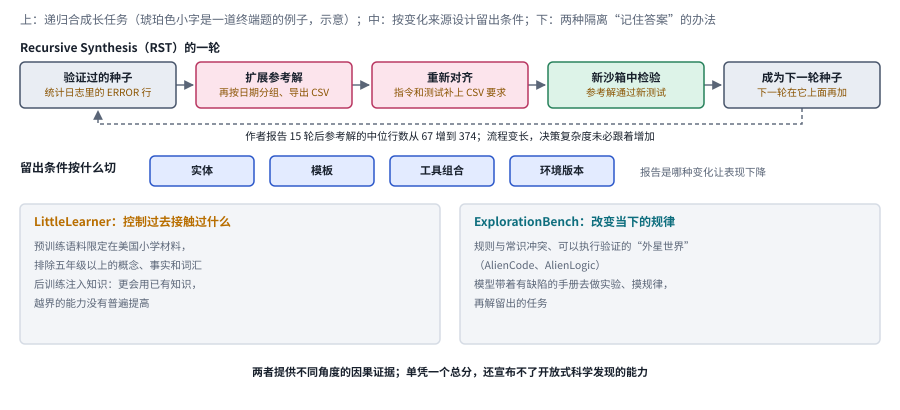

*图：RST 的递归合成、留出条件的切法，以及隔离记忆的两种办法。上排是 RST 的一轮，中间一行是设计留出条件的四个维度，下面两栏是隔离“记住答案”的两种办法。*

下图分成三层。最上面一行是 Recursive Synthesis 的一轮：从验证过的种子出发，扩展参考解，重新对齐指令和验证器，在新的沙箱里检验，通过后成为下一轮的种子。作者报告，15 轮之后参考解的中位行数从 67 行增加到 374 行；这正是本节提醒要分开报告的那类数字，参考解变长了，真正的决策复杂度未必跟着增加。中间一行是留出条件可以沿着切的四个维度，实体、模板、工具组合和环境版本，切法不同，测到的东西也不同。下面两栏是隔离“记住答案”的两种办法：LittleLearner 控制模型过去接触过什么，ExplorationBench 改变模型当下面对的规律。

第一篇用递归的方式造长任务。**[Recursive Synthesis for Long-Horizon Terminal Tasks](https://arxiv.org/abs/2608.05466)**（`2608.05466`）从经过验证的种子出发，扩展参考解，重新对齐指令和验证器，在新的沙箱里检验通过后，再把它当作下一轮的种子。和独立地生成难题相比，它保留了一条可以追踪的构造链。局限在于，流程变长了，真正的决策复杂度未必跟着增加；生成链上共享的错误也可能一代代传下去。所以命令数、参考解长度和实际的失败原因，应当分开报告。

第二篇反其道而行，把知识范围收紧。**[LittleLearner: Language Models Under Pedagogically Controlled Knowledge Exposure](https://arxiv.org/abs/2608.13545)**（`2608.13545`）没有追求无限扩张，它严格限制了预训练时接触的知识范围，建立起一条可以解释的课程边界。这样就能追问一个平时很难回答的问题：模型的表现到底来自先前的接触，还是来自后来的学习？报告中的知识注入实验没有让越界的能力普遍提高。这个结论要放在它受控的模型和任务设置里理解，推不出任何后训练都学不到新知识。

第三篇干脆改写了世界的规律。交叉样本 **[ExplorationBench: Measuring AI Systems' Exploration in Verifiable Alien Worlds](https://arxiv.org/abs/2609.30199)**（`2609.30199`）使用与常识冲突、却可以执行验证的规则世界，要求模型通过做实验去摸清规律。这大大降低了“靠记忆就能答对”的可能，代价是问题变成了特定合成世界里的探索。LittleLearner 控制的是过去接触过什么，ExplorationBench 改变的是当下的规律是什么，两者提供了不同角度的因果证据。不过，单凭一个总分，两者都还不足以宣布系统已经具备了开放式科学发现的能力。

### 分支7：真实反馈如何变成可训练信号，又不把意见当真值？

Silver 和 Sutton 设想的经验时代，奖励来自真实世界的后果。可一旦真的去收集真实反馈，就会发现反馈的种类五花八门：用户的满意度、测试的输出、审稿人的意见、模型写的评语。它们是性质不同的信号。满意度可能受到表达方式的影响，测试可能不完整，评语又可能带着模型自身的偏差。把它们统一成奖励之前，应当保留每个信号的来源、适用范围和冲突时的处理方式。哪怕是同样一句“成功”，指的是中间某个操作完成了，还是用户真正的目标达到了，也要由任务协议说清楚。

> 主线位置：第四阶段，扎根于真实后果的奖励。同时接回第二阶段 Lilian Weng 关于标注分歧和标注质量的讨论。

> **要点：** 真实反馈种类繁多、各带偏差。统一成奖励之前先记下每个信号的来源和范围，采集时把失败、否决和人工修正一并留下。

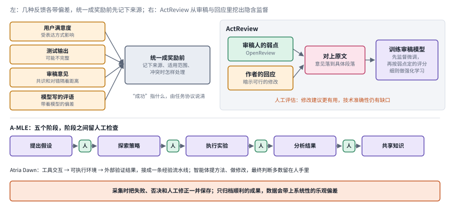

*图：几种反馈各自的偏差，ActReview 的隐含监督，A-MLE 的人工检查点和 Atria Dawn 的经验流水线。左上四个框是常见的反馈及其偏差，右上是 ActReview 的流程，下面是 A-MLE 的五个阶段和 Atria Dawn 的流水线。*

下图左上角的四个琥珀色框是本节开头列出的几种反馈，每个框下面写着它最常见的偏差；它们汇向中间的灰框，意思是统一成奖励之前，先把来源、适用范围和冲突时的处理方式记下来。右上是 ActReview：审稿人指出的弱点和作者的回应在 OpenReview 上成对出现，作者的回应暗示了可行的修改，两者对齐、落到论文的局部证据上，就成了训练修改建议的隐含监督；训练分两步，先做监督微调，再用按弱点定的评分细则做 GRPO。下半部分是 A-MLE 的五个阶段，阶段之间那几个绿色的“人”字框就是人工检查点；再往下一行是 Atria Dawn 的经验流水线。最底部的橙色框是本节结尾的那条建议。

第一篇从学术评审里找监督。**[ActReview: Rebuttal-Guided Training Data and Rubric Rewards for Actionable Peer Review Generation](https://arxiv.org/abs/2609.09076)**（`2609.09076`）从审稿意见和作者回应的对话里提取可以落实的修改建议，区分“诊断问题”和“提出修订”，并把建议落到论文局部的证据上。它的价值在于从真实的互动里挖掘隐含的监督，避免让模型凭空批评。研究也暴露出一个技术准确性上的缺口：建议能落实，作者也愿意回应，批评本身却未必是对的。这正是 Lilian Weng 所说的那种情形，人与人之间的共识和真实的对错之间，还隔着一段距离。

第二篇讲一条完整的经验流水线。**[Atria Dawn: The Dawn of Agentic Superintelligence](https://arxiv.org/abs/2609.15818)**（`2609.15818`）描述了一条把工具交互、可执行环境和外部验证结果连接起来的经验流水线，并讨论了真实的研发协作。读这篇时，可以把注意力放在证据链和人类保留最终判断这两处，标题里的能力宣言倒可以先放一放。这是一份包含多种系统成分的技术报告，整体表现不能全部归功于某一种数据方法；参与者对任务完成情况的评价，也不是随机对照下得出的生产率因果估计。

第三篇是一个应用案例。**[Agentic ML Exploration (A-MLE) for Ads Ranking](https://arxiv.org/abs/2609.08248)**（`2609.08248`）把机器学习的迭代拆成假设、探索、执行、分析和共享知识几个阶段，并在阶段之间保留人工检查。它更接近智能体做数据与模型工程的一个应用案例，和通用的训练集生成算法有一段距离。它和 ActReview 给出的共同启示是：真实的工作记录很有价值，可反馈会受到角色、组织政策以及“只留下成功案例”这种选择的影响。采集数据时，失败、否决和人工修正都应当一并保存，只归档看起来顺利的成果，会让数据带上系统性的乐观偏差。

### 分支8：规模化之前，先把数据生产做成可审计的工程

数据管线一旦自动化，里面的每一个错误都会被放大：错误的验收，重复的任务，混用的版本。Epoch 访谈中的从业者把“扩大任务生产的同时保住质量”称为最核心的运营瓶颈。审计这件事，远比在最后加一列“来源”复杂，它要求每一条样本都能追溯到它的环境、工具、生成策略、过滤理由和使用位置。只有这样，训练出现退化时才能定位到具体是哪个数据环节出了问题，外部评估也才能判断训练信息有没有越过测试的边界。

> 主线位置：边界，数据生产的工程化。接第三阶段的合成数据和第四阶段的环境市场，回应“一致性与独立性”问题。

> **要点：** 数据管线自动化以后，每个错误都会被放大。先把数据对象和质量要求拆开，再让每条样本都能追溯到环境、工具、生成策略和使用位置。

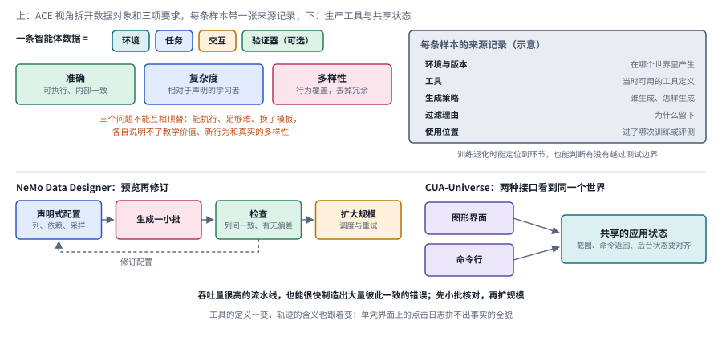

*图：ACE 视角的数据对象和三项要求、样本来源记录、NeMo Data Designer 的预览循环和 CUA-Universe 的共享状态。上半部分是 ACE 视角和一张示意的来源记录，下半部分是两件生产工具。*

下图上半部分左边是 ACE 视角：一条智能体数据被拆成环境、任务、交互和可选的验证器四样东西，对它的要求又被拆成准确、复杂度和多样性三项，三者不能互相顶替。右边那张来源记录是根据本节开头的要求画的示意，每条样本都记下它来自哪个环境和版本、当时有哪些工具、用什么策略生成、为什么被留下、后来进了哪次训练或评测。下半部分左边是 NeMo Data Designer 的“预览再修订”循环，虚线表示检查发现问题后回头修改配置；右边是 CUA-Universe，图形界面和命令行两种接口必须看到同一份应用状态。

第一篇给出了一套拆解问题的框架。**[What Makes Good Agentic Data? An ACE Lens on Data Generation for LLM Agents](https://arxiv.org/abs/2608.27260)**（`2608.27260`）把环境、任务、交互和可选的验证器拆开，又区分了有效性、相对于学习者的复杂度和行为多样性。它是一个组织研究的框架，本身并不会让数据自动变好。它最重要的作用，是阻止三个问题互相顶替：一条数据能执行，说明不了它有教学价值；足够难，说明不了它覆盖了新的行为；换了一套文字模板，也说明不了多样性真的增加了。这和第一节对任务、环境、轨迹、验证器的区分是一脉相承的。

第二篇是一套生产工具。**[NeMo Data Designer: An Extensible Framework for Multimodal Synthetic Data Generation](https://arxiv.org/abs/2609.17699)**（`2609.17699`）用声明式的配置来描述数据列、依赖关系和采样方式，并提供“预览再修订”的循环、调度和重试。它解决的是可复用、可追踪的生产问题，至于什么是真的，仍然要由使用者自己判断。比较稳妥的用法是先生成一小批样本，检查列与列之间是否一致、有没有偏差，再扩大规模；吞吐量很高的流水线，同样能很快制造出大量彼此一致的错误。

第三篇提醒我们，环境工程还要处理多个接口之间的共享状态。交叉样本 **[CUA-Universe: A Scalable and Dynamic Environment for Hybrid GUI+CLI Agents](https://arxiv.org/abs/2609.05374)**（`2609.05374`）要求图形界面和命令行看到的是同一个世界。它结合了应用适配、任务构造和轨迹引导，研究智能体怎样混合使用两种接口。这件事和数据工程的关系在于：工具的定义一变，轨迹的含义也跟着变；图形界面的截图、命令的返回和后台的状态必须能对齐，单凭界面上的点击日志，拼不出事实的全貌。

## 四、跨领域数据研究：哪些思路可以迁移，哪些不能

训练数据的设计问题并不只属于智能体。视觉、结构化建模和学习机制的研究里，也有大量关于合成数据、受控任务和数据选择的工作，它们常常用到和本章相同的词，“轨迹”“环境”“学习信号”。借鉴这些工作很有价值，可每次借之前，都要先弄清楚它改变的是监督的来源、样本的分布还是模型的结构，避免被同一个词的不同含义带偏。

> **本节要点：** 外领域的数据工作常用和本章相同的词，借之前先问它改变了监督来源、样本分布还是模型结构，再看搬到智能体训练还缺动作、环境反馈和独立验收中的哪几块。

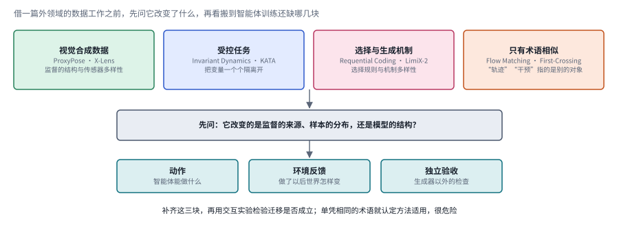

*图：上排是本节讨论的四组外领域工作，中间是借鉴前要问的问题，下排是搬到智能体训练时通常要补上的三块。*

下图把本节的四组工作排在最上面：视觉合成数据、受控任务、选择与生成机制，以及只是术语相似的那一组。它们往下汇入同一个问题，也就是这项工作改变的到底是监督的来源、样本的分布，还是模型的结构；回答了这个问题，再看最下面那三块，动作、环境反馈和独立验收，搬到智能体训练里还缺哪几块。前三组通常能借到一部分思路，第四组只是撞了名字，下面几段按图中从左到右的顺序展开。

先看视觉领域。交互数据和其他领域的合成数据共享一部分设计问题，训练目标却各不相同。[ProxyPose](https://arxiv.org/abs/2607.06555) 借助视频翻译构造几何代理，[X-Lens](https://arxiv.org/abs/2607.12993) 把标定、几何偏置和合成的多视角数据结合起来，两者都说明了监督的结构和传感器的多样性怎样影响学习。它们能帮助我们理解数据设计，却没有直接提供语言智能体完成任务的证据。

再看受控任务。它的价值在于能把变量一个个隔离开。[Invariant Learning Dynamics of Transformers](https://arxiv.org/abs/2607.11875) 在合成的归纳任务里分析学习动力学和数据统计，[Kernelized Linear Attention](https://arxiv.org/abs/2607.17419) 借助合成的召回任务研究特征几何和记忆容量。两者主要属于机制和架构研究，对本章的启发在于怎样设计可以解释的数据实验，比如分支6 里 LittleLearner 那种控制知识接触的思路；至于怎样生成真实的交互环境，它们给不出答案。

数据还可以承载选择和生成机制本身的信息。[Requential Coding](https://arxiv.org/abs/2607.11883) 从教师挑选学生样本的过程出发讨论压缩和泛化，[LimiX-2](https://arxiv.org/abs/2609.17488) 用结构因果模型合成表格数据。它们分别说明了选择规则和机制多样性有多重要，和分支2 的数据选择、分支4 的世界构造遥相呼应。可要把这些思路搬到智能体训练里，还得补上动作、环境反馈和独立验收这几块。

最后要警惕的是只有术语相似的情形。[Particle Dynamics of Flow Matching](https://arxiv.org/abs/2609.06947) 研究的是生成采样的几何轨迹，和智能体的行动历史是两回事；[First-Crossing Reduction and Inference for No-Rescue Effects](https://arxiv.org/abs/2609.17495) 讨论特定干预条件下的统计识别，也和智能体训练方法无关。生成样本的轨迹、环境中的行动轨迹和统计意义上的干预，分别对应完全不同的对象。借用这类方法前，要先把变量和反馈一一对应起来，再通过交互实验检验迁移是否成立，单凭相同的术语就认定方法适用，是很危险的。

## 五、跨方法对照：反馈来源、覆盖与成本

读完八个分支，很容易被各种“合成”“生成”“蒸馏”绕晕。其实不同数据路线之间最关键的差别只有两处：反馈从哪里来，以及这个反馈能不能代表最终任务的要求。编辑、课程生成、业务世界合成、软件挖掘，各自扩大了一部分经验的覆盖，也各自带来了不同的校验和维护成本。下面这张表把它们放在一起，最右边一列是这条路线最容易出问题的地方，拿来审自己的实验设计也很合适。

> **本节要点：** 七条数据路线按问题来排成七行，每行写明主要信号、必要假设和最容易出问题的地方。它和第二节末尾的总对照互为补充：那边按历史阶段比较方法家族，这边按今天的路线比较成本与风险。

| 路线 | 主要信号 | 必要假设 | 主要成本与局限 |
|---|---|---|---|
| 专家示范与中期训练 | 正确轨迹、工具文档与参数关系 | 教师及文档可靠，训练状态接近使用状态 | 收集与清理成本；可能缺少错误恢复 |
| 编辑与程序化数据选择 | 编辑校验、代理训练反馈 | 编辑保真，代理模型能代表目标模型 | 搜索和验证开销；代理最优未必迁移 |
| 自适应环境生成 | 学习进步、提示收益差或结构信息 | 指标能反映可学性，环境有可解性约束 | 生成与求解相互消耗预算；可能共同投机 |
| 业务世界合成 | 状态不变量与工作流验收 | 环境规则覆盖关键政策及副作用 | 跨服务维护复杂；合成世界可能过于整齐 |
| 软件与日志挖掘 | 原实现、历史轨迹与执行测试 | 锚点可信，依赖可恢复 | 环境重建昂贵；可能继承旧程序错误 |
| 受控课程与陌生规则 | 曝光边界、规则迁移、探索结果 | 边界能有效阻断记忆捷径 | 归因更清楚，但离真实任务分布更远 |
| 真实反馈与生产流水线 | 外部验收、人工修订、生成配置 | 人类反馈有依据，版本信息完整 | 隐私与许可审查；组织偏差和成功筛选 |

比较这些路线时，“每条样本多少钱”是最容易算、也最容易误导人的数字。一条廉价的轨迹如果不能重放、无法验收，可能根本没有训练价值；一个昂贵的环境如果能长期重置、不断产生新题，摊下来反而很划算。Epoch 访谈里那个“便宜的劣质任务会浪费训练算力”的提醒，说的也是同一件事。公平的比较至少要固定目标模型、总执行预算和独立的测试集，同时统计有效任务率、重放成功率、行为覆盖和人工验收所花的时间。

## 六、开放问题与研究机会

回到本章开头那位网店客服模型。要让它真正学会处理退款，我们需要做成四件事：先得有一个像样的练习场，里面有订单、支付、库存和政策，而且状态彼此一致；然后练习的题目要始终落在它够一够能够到的地方，既不能全是它早就会的，也不能全是它根本做不到的；接着还得确认它学到的是“退款后余额必须对得上”这样的规则，没有去钻某个评分器的漏洞；最后，它在真实岗位上积累的经验要能安全地流回训练，不能把顾客的隐私一并带进去。训练数据与环境的研究也正卡在这四道关口上，分别对应主线上的第四阶段、课程与难度、边界上的验证问题，以及真实反馈的回流。下面四个问题就是按这个顺序排的，每一个都还有大片空白，适合作为选题的起点。

> **本节要点：** 四个开放问题依次对应退款客服要过的四道关：像样的练习场、能力边缘的题目、没被钻空的验证器，以及真实经验的安全回流。

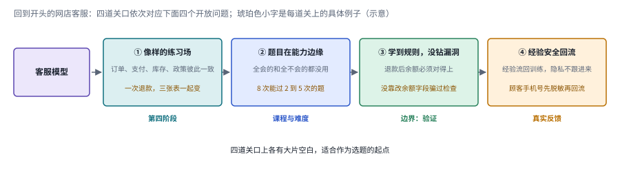

*图：四道关口从左到右排开，每道关口下方标出它在第二节主线上的位置，编号和下面四个问题一一对应。*

**1. 如何把真实世界中的工作过程转化为可学习的交互环境？**

现成的日志通常缺少可以重放的状态、失败的分支和完整的约束，手工搭的环境又容易过度简化，Surge AI 博客里那个模拟网店就说明，一个足够真实的业务世界要靠领域专家长期往里添东西。这里的研究空间在于从软件、业务规则和实际操作中提取可执行的环境，保留那些决定成败的状态变化和外部反馈。除了生成工具接口，环境还要支持重置、条件变化和可行性检查。依赖安装失败、资源不足、工具故障和推理失败，应当分别记录下来；如果混在一起，生成器可能通过制造坏环境来压低通过率，看上去题目变难了，其实没有提供任何有价值的训练机会。

**2. 如何持续生成处于模型能力边界、又具有行为多样性的任务？**

固定的题目会随着模型进步失去挑战，单纯增加步骤或改写文字，也未必增加了能力的覆盖。Epoch 访谈给出的通过率区间是一个好起点，可它只回答了“多难”，没有回答“难在哪里”。研究机会在于依据失败的结构和能力的缺口来生成任务，分别控制依赖深度、信息缺失和工具组合，并覆盖询问、验证、撤销和拒绝这些行为，就像那位超过退货期限的顾客，正确的应对可能是拒绝。已经能完成的任务仍然可以用来保持基本技能，只是权重要随学习状态调整。评价时应当同时观察新任务上的迁移和旧能力的保持，一味追求生成题目的低通过率，并没有抓住重点。

**3. 如何验证合成数据教会了可迁移能力，没有教会评分捷径？**

生成的测试能接受参考解，说明不了它能拒绝错误的或投机取巧的解。奖励作弊是 Epoch 访谈里从业者最担心的问题，也是主线边界上那道最难守的关。一个可行的方向是用错误的候选解反过来检查验证器，再结合独立的审查和冻结的迁移任务，把生成机制、轨迹行为和部署表现连起来看。还要主动改变环境和任务条件，检查筛选流程会不会持续排除那些罕见却重要的恢复经验，这和 Lilian Weng 提醒的“难例和模糊样本不要一删了之”是同一个道理。出题、答题和打分如果共享同一种偏差，训练曲线再漂亮，也可能没有对应真实的能力增长。

**4. 如何让真实工作经验安全地回流到训练？**

Silver 和 Sutton 设想的经验流，意味着智能体在真实岗位上的轨迹会源源不断地变成训练数据。这些轨迹里可能有私有的源码、访问令牌、个人信息和敏感的业务关系，只去掉姓名远远不够。研究机会在于建立来源、用途、保留和删除的全流程管理，并追踪一段原始经验怎样进入合成样本、又怎样进入后续的模型。采集、清洗、生成和训练应当各自保留不同的权限边界，合成出来的凭证也要和生产系统隔离开。评价时，要同时检查经验的学习价值和敏感信息的传播情况；安全处理应当贯穿整条管线，训练前一次性清洗是远远不够的。

**实验资源：** [Gymnasium官方仓库](https://github.com/Farama-Foundation/Gymnasium) · [ScienceIDE作者仓库](https://github.com/aitofound/ScienceIDE) · [FineWeb 论文](https://arxiv.org/abs/2406.17557) · [SWE-Gym](https://arxiv.org/abs/2412.21139) · [τ-bench](https://arxiv.org/abs/2406.12045)。动手之前，请先核对各项目的任务设定、代码版本、数据和运行条件。
