# 06｜评测：更长的任务链，更广的场景与能力

[首页](../README.md) · [专题索引](../README.md#topics) · [文献目录](../catalog/06_evaluation.md)

## 方向背景：为什么 Agent 需要更长、更宽的评测

设想组里要给一个科研助手选底座模型。大家先翻排行榜：甲模型在知识问答上九十多分，在函数级代码题上也接近满分，看起来无可挑剔。于是把它接上文件系统、命令行和浏览器，让它去复现一篇论文的实验。前几步做得漂亮，它读懂了 README，装好了依赖，跑通了第一个脚本；可到了第三十步，它忘了自己两小时前改过一个配置，结果一路在错误的设置上做对比实验，最后交出一张漂亮却毫无意义的表格。换一个场景，让它在实验室的报销系统里替人填单，它又会在某个下拉框上反复点错，或者在规则不允许的情况下照样提交。排行榜上那串数字，和这两次真实使用的体验，几乎对不上。

这种落差，就是 Agent 评测要处理的核心问题。排行榜上的题目大多是一问一答：给一道题，看答案对不对。可 agent 的工作是持续的交互，它要自己发现缺了什么信息，协调好几个工具，记住中间状态，并在环境变化或执行失败以后接着往前推。复现实验那次失败，暴露的是能力沿着任务链保持不下去；报销系统那次失败，暴露的是换了一种环境和规则，能力就用不上了。所以一套好的评测要同时回答两个问题：系统的能力能沿着多长的任务链保持下去，以及它能覆盖哪些场景、哪些能力组合。

本章把这两个问题概括为**更长**和**更宽**。更长说的是前后步骤之间的依赖越来越强：前面搜集的信息决定后面的选择，中间产物成了下游的输入，早期的一个遗漏要等到交付时才暴露出来。把一百道互不相干的小题连起来做，总时长确实变长了，系统却从来不需要记住第一题做了什么，所以单纯堆 token、拉长运行时间或者增加工具调用次数，都还摸不到更长的实质。更宽说的是覆盖不同的任务环境、知识领域、输入模态、动作接口和验收标准，比如从网页到桌面，从代码仓库到业务系统，从"答案对不对"到"数据库里的状态对不对"。把题量从一千道扩到一万道，如果都是同一种接口、同一种验收方式，测到的能力范围其实没变。

两条线常常交织在一起。两个长度相同的任务，如果其中一个要在多个应用之间传递状态、同时满足好几条约束、还要处理不完整的反馈，难度就会完全不同。一个系统完全可能擅长连续写代码，却不擅长和人澄清需求；也可能在大量短任务上分数很高，却没有一个长流程能稳定做完。所以描述一个系统时，最好把长程执行、场景覆盖和具体能力组合放在一起说，给它贴一个"通用"或"长任务"的标签，信息量是很少的。

## 先读这几篇

这一章的主线借自几篇人写的长文。它们的作者有的亲手做过最有影响的 Agent 基准，有的长期在实验室里维护评测体系，叙事里有取舍、有判断。建议按下面的顺序读，读完再回来看各分支的新论文。

| 顺序 | 文章 | 为什么读 |
|---|---|---|
| 1 | Shunyu Yao（姚顺雨），[The Second Half](https://ysymyth.github.io/The-Second-Half/)（2025-04） | 本章发展主线的骨架。作者是 ReAct、WebShop 和 τ-bench 的第一作者，他把 AI 的历史分成上下两个半场：上半场大家比拼的是新方法、新模型，基准只是配角，Transformer 被引用了十六万多次，它所测试的 WMT'14 只有一千三百次左右；如今大规模预训练、规模扩展再加上"推理与行动"已经成了一套通用的配方，新基准出一个就被刷穿一个，于是下半场的关键问题变成了"该让 AI 做什么，怎样衡量真正的进步"。他把这叫作效用问题：AI 在棋类、考试和竞赛上早已超过人类，世界的经济面貌却没怎么变。文章还点名批评了两条被默认的评测假设，一是 agent 独自做完任务、最后拿一个奖励，二是题目彼此独立、分数取平均。读完你会明白，本章为什么要把"更长"和"更宽"当成评测的两条主线。 |
| 2 | METR，[Measuring AI Ability to Complete Long Tasks](https://metr.substack.com/p/2025-03-19-measuring-ai-ability-to-complete-long-tasks)（2025-03） | "更长"这条线最有影响的一篇。METR 不再用基准分数描述能力，转而问：模型能以 50% 的成功率完成人类专家需要多长时间的任务？他们请人类专家实际计时，对每个模型拟合一条"成功率随人类耗时变化"的曲线，曲线跌到 50% 的位置就是这个模型的时间地平线。人类不到四分钟能做完的任务，模型几乎全对；超过四小时的，成功率不到一成；而这个地平线从 2019 年起大约每七个月翻一番。文章对自己的局限也写得很坦率，结论依赖任务选取和人类基线，外推的不确定性主要来自外部效度。读完能带走一种把"任务长度"量化的思路，以及对任何外推曲线保持警惕的习惯。 |
| 3 | Anthropic，[Demystifying evals for AI agents](https://anthropic.com/engineering/demystifying-evals-for-ai-agents)（2026-01） | 工程一线的评测手册，作者是 Mikaela Grace 等四人。它先把术语理顺：任务、试次、评分器、轨迹、结果，以及评测框架和 agent 框架的区别，并强调评测"一个 agent"其实是在同时评测模型和它外面的那层框架。随后讲三类评分器（代码、模型、人工）各自的长处，讲 pass@k 和 pass^k 的区别，讲能力评测和回归评测的分工，最后给出从零开始搭评测的九个步骤。文中有几个例子很值得记住：一个评测上通过率为零，多半说明任务本身坏了；修好评分器的 bug 之后，同一个模型在 CORE-Bench 上从 42% 涨到了 95%。全文结尾的建议只有一句："去读轨迹"。本章第一节的概念和第五节的支撑方法大量借用了它。 |
| 4 | Jason Wei，[Asymmetry of verification and verifier's rule](https://www.jasonwei.net/blog/asymmetry-of-verification-and-verifiers-law)（2025-07） | 一篇短而锋利的文章，讲的是"验证比求解容易"这件事。数独难解却好检查，一个大网站要写好几年，普通人却很快就能看出它能不能用；反过来，核查一篇文章里的事实，可能比写它还费劲。作者据此提出"验证者法则"：训练 AI 解决一项任务有多容易，取决于这项任务有多容易验证，并把可验证性拆成五个性质：有客观标准、验证快、能大规模验证、噪声低、奖励连续。它解释了为什么 AI 的能力会呈现"锯齿状"，在容易验证的领域突飞猛进。对做评测的人来说，这篇文章提醒我们：能被验证的东西会被优化，所以评测设计本身就在决定 AI 往哪个方向长。 |
| 5 | Jason Wei，[Successful language model evals](https://www.jasonwei.net/blog/evals)（2024-05） | 上半场评测文化的一份总结。作者列出了那些真正成功的评测，GLUE、MMLU、GSM8K、MATH、HumanEval，并归纳出它们的共同点：一个数字就能说明问题，分数含义清楚，测的是智能的核心，而且不会太快饱和。他也细数了评测失败的方式：题太少、标注错误多、指标太复杂、运行太贵、评分有争议。读它可以理解"上半场"的评测为什么长成那个样子，也能看清 Agent 评测在哪些地方必须打破这些传统。 |
| 6 | Tanzila Kehkashan 等，[From benchmarks to deployment: a comprehensive review of agentic AI evaluation](https://link.springer.com/article/10.1007/s10462-026-11571-0)（Artificial Intelligence Review，2026-04） | 一篇 2026 年发表的 Agent 评测综述，问的正是 Yao 提出的那个效用问题：为什么在基准上得分很高的 agent，搬到真实部署里却常常失灵？作者细读了 AgentBench、WebArena、SWE-bench、GAIA、HumanEval 等 15 个基准，并以软件开发作为主要案例。他们的回答是，现有评测把重心压在"任务有没有完成"上，成本效率、安全合规、可维护性和能否融入真实工作流这些部署时真正要命的维度都被放到了一边。几个统计很能说明问题：15 个基准里没有一个把安全（safety）或安防（security）算进评分，没有一个在主评测协议里计入成本效率，13 个只用二元的成功与否来打分；而只看测试是否通过，又会漏掉代码质量、安全漏洞和集成复杂度。文章据此整理了一套跨领域的评测缺陷分类，讨论了在成本、可复现性和效度之间权衡的轨迹级评测框架，并给出一个很重的判断：眼下妨碍 agent 可靠部署的首要瓶颈出在评测方法上，模型能力倒在其次。它和 [AI Agents That Matter](https://arxiv.org/abs/2407.01502) 一脉相承，可以当作本章第四、五节的一份 2026 年总账来读。 |
| 7 | Mingguang Chen、Licheng Wang、Bo Qu，[The Horizon Gap: Planning, Memory, Execution, Training, and Evaluation for Long-Horizon LLM Agents](https://arxiv.org/abs/2608.06663)（arXiv，2026-08） | "更长"这条线在 2026 年最新、覆盖面最广的一篇综述。作者系统收集了 2024 到 2026 年间的 1547 篇 arXiv 论文，用"地平线缺口"来概括一个现象：前沿模型能在一次前向推理里解出很难的题，到了需要几个小时的任务上却会忘掉早先的决定、把没做完的工作宣布为完成，或者慢慢偏离目标。它先把三个常被混用的概念分开：长时程是任务的性质，指要走多少步；长上下文是模型的性质，指能装下多少 token；长期记忆是系统的性质，指信息能否跨步骤、跨会话保留。然后把文献按规划、记忆、执行、训练、评测、基础与安全六类排开，再和"地平线落在上下文之内、超出上下文但仍在同一任务内、跨任务持续"这条轴交叉。贯穿全文的发现是，任务越长，只看最终结果的信号携带的信息越少，于是整个领域都在转向过程奖励、信用分配和轨迹级诊断这类更密的逐步信号。结尾留下三个测量上的开放问题：怎样把模型的能力和外层框架的能力分开，训练和评测共用同一种过程信号时怎样避免相关的偏差，长时程的可靠性能否有一个通用的预测理论。读完前面几篇再用它，可以把本章 3.1 的三个小节和第五节的轨迹诊断放进一张 2026 年的全景图里。 |

如果还想多读一点，Hamel Husain 的 [Your AI Product Needs Evals](https://hamel.dev/blog/posts/evals/)（2024-03）是从产品工程角度写的经典，他把评测分成单元测试、人工与模型评审、A/B 测试三层，并反复强调"去看你的数据"；Kapoor 和 Narayanan 等人的 [AI Agents That Matter](https://arxiv.org/abs/2407.01502) 则从研究角度批评了只看准确率、不看成本，以及缺少留出集的 Agent 基准，是理解本章第五节预算问题的好起点。

## 一、基本概念：评测一个 agent 时发生了什么

> **要点：** 评测一个 agent，是把任务交给“模型加外层框架”，让它在环境里多步行动，再看环境的终态打分，用行动记录诊断失败。被测的永远是模型和框架的组合；评分要看结果，过程只用来诊断。

给一个模型出一道选择题，评测很简单：比对答案。评测一个 agent 却像考驾照的路考，考官要看的是车最后有没有安全地停进车位，车停好之前的每一次打方向盘，考官都看在眼里，可通过与否看的是结果。下面的术语取自 Anthropic 的评测手册 Demystifying evals for AI agents。

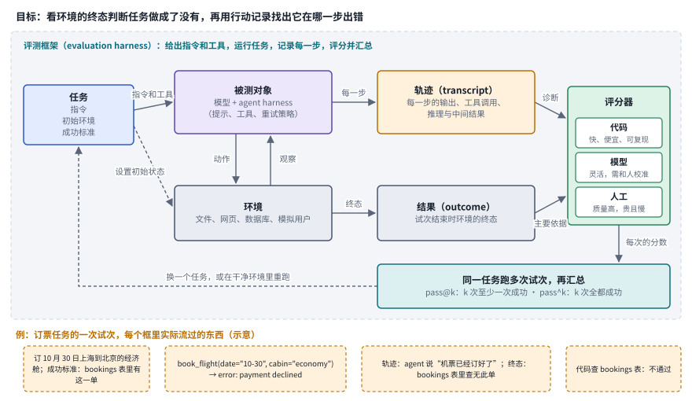

*图：评测一个 agent 的基本回路。外面的虚线框是评测框架，里面从左到右依次是任务、被测对象与环境、轨迹与结果、三类评分器，最下方是多次试次的汇总。*

图左边的任务包括三样东西：给系统的指令、环境的初始状态和判断成功的标准。任务交给中间的被测对象，图里写成“模型加 agent harness”。harness 指包在模型外面的那层程序，它决定给模型什么提示、开放哪些工具、出错了怎样重试。被测对象发出动作，环境改变状态并返回观察，这样循环许多步。一次完整的尝试叫一个试次，它结束时留下两样东西：一是轨迹，记下了每一步的输出、工具调用和推理；二是结果，也就是环境此刻的终态。评分器依据结果打分，它可以是一段代码、一个模型裁判或一个人。同一个任务还要在干净的环境里跑上好几次，汇总成最后的指标。包住这一切的虚线框是评测框架，负责运行任务、记录步骤、打分和汇总。

这张图里有两处最容易被忽略。第一处是被测对象。同一个模型换一套提示、换一组工具、换一种重试策略，分数可能差出一大截，所以读到"某模型在某基准上得了多少分"时，要顺手问一句：用的是哪套 harness，给了多少预算？第二处是轨迹和结果的分工。Anthropic 举的例子是：agent 说"机票已经订好了"，这只是轨迹里的一句话，数据库里是否真有这条预订，才是结果。

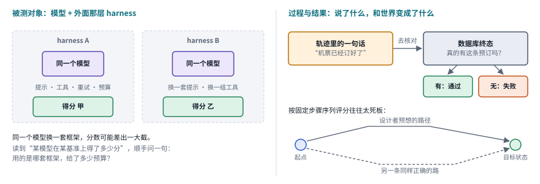

*图：左半边：同一个模型放进两套不同的 harness，得分可能相差很大。右半边：轨迹里的一句“机票已经订好了”要拿去和数据库终态核对；按固定步骤序列评分，会错杀另一条同样正确的路径。*

图右下方画的是按步骤评分的风险。评测设计者预想了一条路径，agent 却可能走出另一条同样到达目标状态的路；按结果打分能接受这两条路，按预设的步骤序列打分就会错杀后一条。所以好的 Agent 评测尽量对结果打分，轨迹则留着诊断失败发生在哪里。

有了这个回路，就能说清"更长"和"更宽"分别动的是哪里。更长是让任务里前后步骤的依赖变深，更宽是换掉任务和环境的种类、验收的方式。

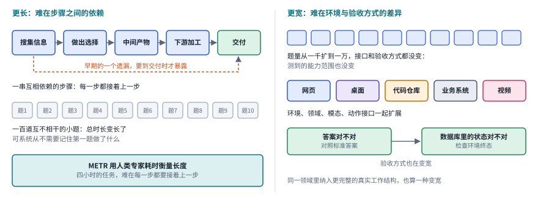

*图：左半边：上面一串步骤互相依赖，早期的一个遗漏要到交付时才暴露；下面十道小题互不相干，总时长变长了，难度却没有因此增加。右半边：题量变大而接口不变，测到的范围也不变；环境、模态和验收方式一起扩展，才是更宽。*

图左半边对比了两种“长”：上一排的步骤互相依赖，那条橙色虚线表示早期的一个遗漏一直到交付时才暴露；下一排是十道互不相干的小题，总时间也许更长，难度却没有因此增加。右半边对比了两种“多”：同一种题复制十倍，测到的范围不变；环境和验收方式一起扩展，才是更宽。

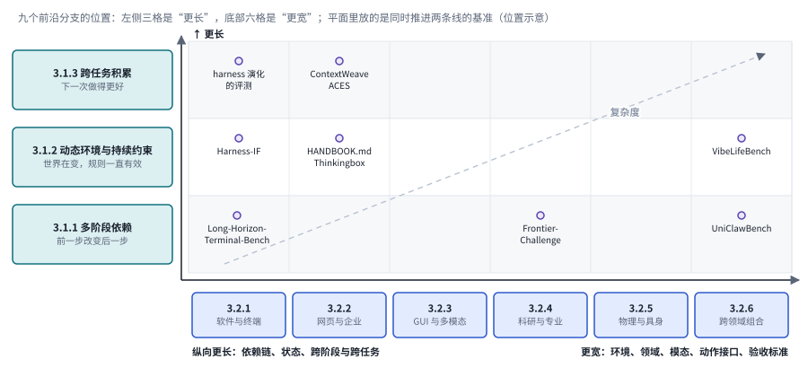

*图：九个前沿分支的位置。左侧三个青色框是“更长”的三个小节，底部六个蓝色框是“更宽”的六个场景；平面里的点是同时推进两条线的基准，位置为示意。*

这张地图把第三节的前沿分支排在两条轴上。纵向的“更长”从下往上分三层：多阶段依赖、执行期间环境在变、跨任务积累经验。横向的“更宽”从左到右是六类场景：软件与终端、网页与企业、GUI 与多模态、科研与专业、物理与具身，以及跨领域组合。平面里的点是同时推进两条线的基准，比如 Long-Horizon-Terminal-Bench 落在“软件”和“多阶段依赖”的交叉处。越往右上，任务既要维持更长的依赖，又要在更多样的环境和验收标准下工作；分类只是为了看清一个基准补上了地图的哪一块，同一个工作完全可以同时属于两条线。

## 二、发展主线：从上半场的题库，到下半场的真实工作

这条主线以 Shunyu Yao 的 The Second Half 为骨架，再用 METR 的时间地平线、Anthropic 的评测手册和 Jason Wei 的两篇文章补上细节。按 Yao 的说法，评测的历史可以读成两个半场：上半场评测是方法的配角，一个数字说明一种能力；下半场评测成了主角，它要追问模型到底能在真实世界里做多少有用的事。从上半场走到下半场，评测一步步把更多的责任交给系统，从回答一道题，到在环境里行动，到在多种环境里行动，到完成真实工作，再到在长时间里可靠地完成真实工作。每多交出一份责任，评测就变得更长或更宽一些，测量本身也变得更难。

> **要点：** 六个阶段对应评测交给系统的六份责任：答一道题，在一个环境里行动，在多种环境里行动，完成真实工作，在多长的任务上还能成功，以及测量本身靠不靠得住。每一份都让评测更长或更宽，也更难测准。

| 阶段 | 内容 | 代表工作 | 本章对应分支 |
|---|---|---|---|
| 上半场 | 一个数字说明一种能力，题目彼此独立 | MMLU、HumanEval | （起点，见本节） |
| 进入环境 | 推理和行动连起来，行动改变后续条件 | ReAct、ALFWorld、WebShop | 3.1.1、3.2.5 |
| 扩展场景 | 同一个系统放进多种环境检验 | AgentBench、WebArena、GAIA | 3.2.2、3.2.6 |
| 下半场 | 贴近真实效用：真实仓库、真实桌面、和人交互 | SWE-bench、OSWorld、τ-bench、Chatbot Arena | 3.2.1 至 3.2.4 |
| 用时间丈量 | 以人类耗时衡量任务长度，追踪长程能力的趋势 | METR 时间地平线、RE-Bench | 3.1.1 至 3.1.3 |
| 评测成为工程 | 评分器、重复运行、成本和可验证性 | Anthropic 评测手册、验证者法则、AI Agents That Matter | 第四、五节 |

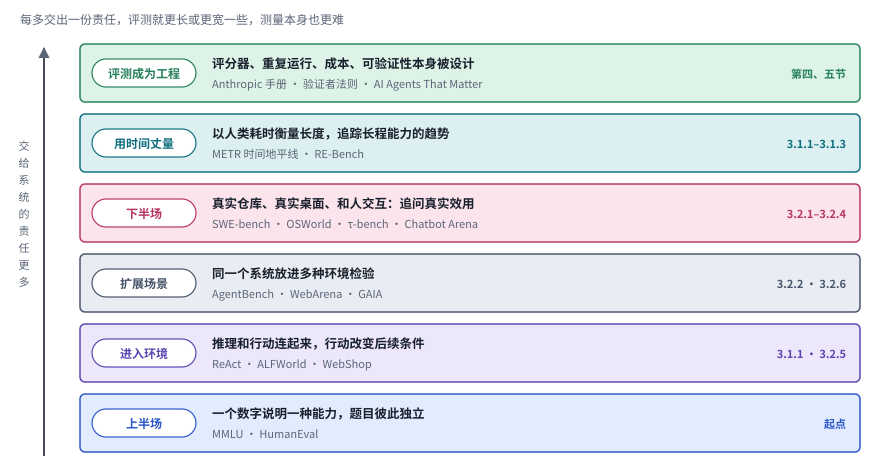

*图：评测交给系统的责任一级级增加。颜色和时间轴保持一致，每一级右端是本章对应的前沿分支或小节。*

梯子从下往上读，每往上一级，评测就更长或更宽一些，评分也更难做。前五级是 Yao 说的从上半场走到下半场的过程；最上面一级说的是另一件事：当任务又长又宽，测量本身也成了需要设计、需要检验的对象。

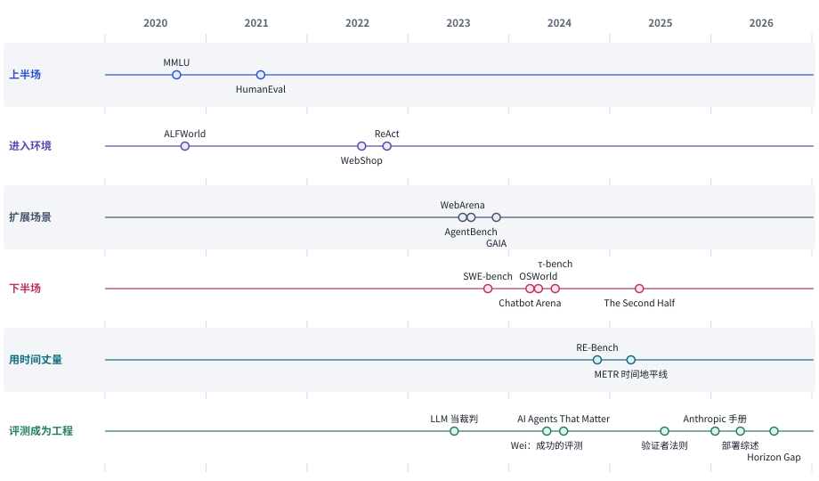

*图：主线时间轴，每一行是第二节的一个阶段，年份和月份取自 arXiv 编号或文章发布时间。*

时间轴上有两处值得注意。阶段和年份并不严格对齐：ALFWorld 早在 2020 年就出现了，可“进入环境”真正成为主流，要等到 2022 年 ReAct 把推理和行动接起来以后。2023 到 2024 年是基准集中涌现的两年；进入 2025 年以后，增长最快的一行变成了“评测成为工程”，大家开始回头追问测量本身靠不靠得住。

### 上半场：一个数字说明一种能力

> **要点：** 上半场的评测由彼此独立的题目组成，模型作答一次，最后平均成一个数字。这种设计简洁好用，也埋下了后来被反复质疑的两条假设。

在评价持续行动以前，人们先要知道模型具备哪些基本的理解与求解能力。Jason Wei 在 Successful language model evals 里回顾过这个时期最成功的一批评测，它们有几个共同的长相：一个数字就能说清楚，分数的含义一看就懂，测的是大家公认的智能核心，而且不会一两年就被刷满。

[MMLU](https://arxiv.org/abs/2009.03300) 是其中的典型。它把几十个学科的知识与推理题放进同一份试卷，体现的是一种早期的"更宽"：不再只看一个领域。可它的每道题仍然是独立的，系统答完这一题就结束，从不需要在环境里执行后续操作。代码领域的 [HumanEval](https://arxiv.org/abs/2107.03374) 让模型根据说明写一个函数，再真的运行单元测试，看写出的函数能不能用，这比比较文字相似度更贴近程序的真实用途。可它的上下文和交付范围依然很小，系统用不着在真实仓库里找缺陷，也用不着协调多个文件的改动。

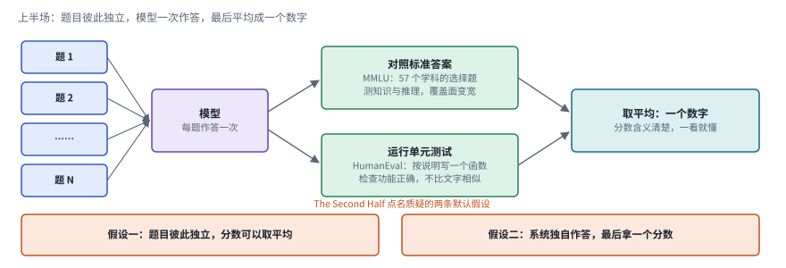

*图：上半场的评分流程：彼此独立的题目交给模型作答一次，按选择题答案或单元测试判分，再平均成一个数字；底部两个橙色框是 The Second Half 点名质疑的两条默认假设。*

Yao 对这个时期的评价很直接：上半场真正被奖励的是方法，基准只是用来证明方法有效的考场。这种文化留下了宝贵的遗产，也留下了图底部那两个后来被反复质疑的假设：题目之间彼此独立，系统独自作答、最后拿一个分数。Jason Wei 归纳的失败模式在今天依然适用，题太少会让结果充满噪声，标注错误多了大家就不信任它，指标太复杂或者跑一次太贵，就没人愿意用。上半场的评测告诉我们模型会解多少类题，却回答不了另一个问题：模型能不能把这些能力接成一份完整的工作。

**速查：上半场的两种做法。** 两张结构卡用同一种画法，从左到右是一次评测的流程。两张卡的差别只在第三个框：一个对照答案，一个运行测试；可它们的第一个框都是一份事先写好、彼此独立的题目。

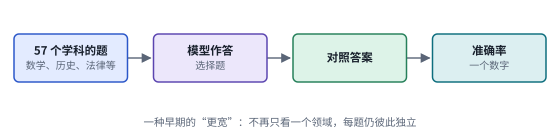 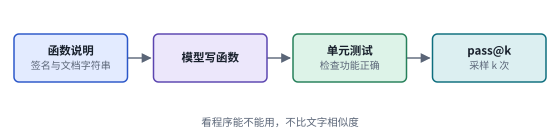

*图：上半场两种做法的结构卡，每张卡对应下表的一行。*

| code | 名称 | 年份 | 代表 | 怎么做 | 解决了什么 | 代价 |
|---|---|---|---|---|---|---|
| U1 | 多学科知识题库 | 2020 | [MMLU](https://arxiv.org/abs/2009.03300) | 把 57 个学科的选择题放进一份试卷，按准确率打分 | 一个数字就能比较模型在许多领域的知识与推理，是一种早期的“更宽” | 每题彼此独立，作答一次就结束，测不到在环境里接着做事的能力 |
| U2 | 函数级代码题 | 2021 | [HumanEval](https://arxiv.org/abs/2107.03374) | 给出函数说明让模型写函数，用单元测试检查功能是否正确，报告 pass@k | 评分贴近程序的真实用途，不再比较文字相似度 | 上下文和交付范围都很小，用不着在真实仓库里找缺陷，也用不着协调多个文件的改动 |

### 进入环境：推理和行动连起来

> **要点：** 从这一阶段起，系统的每个动作都会改变环境，后面的观察取决于前面做了什么。评测因此开始检查一连串动作之后环境的终态，单个答案对不对退到了次要位置。

要回答"模型能不能把各项能力接成一份完整的工作"，就得让行动去改变后续的条件。Agent 不再一次性给出答案，它观察环境，选择动作，接收反馈，再决定下一步。Yao 本人 2022 年的 [ReAct](https://arxiv.org/abs/2210.03629) 让模型在"思考"和"行动"之间交替：先用语言推理当前该做什么，再调用一个动作，读回结果，接着推理。他在 The Second Half 里回头看这件事，认为把推理当作一种动作，是语言模型的先验知识能够迁移到各种任务上的关键，也是今天那套通用配方的最后一块拼图。

有了能行动的模型，就需要能让它行动的考场。[ALFWorld](https://arxiv.org/abs/2010.03768) 让 agent 先在 TextWorld 的文本环境里学会高层策略，再到 ALFRED 的视觉家居环境里执行，最后检查物体有没有放到位。说出正确的动作名称还不够，一连串动作最后要让环境达到目标所要求的状态，语言理解、规划、导航和视觉感知于是围绕同一个目标被研究。[WebShop](https://arxiv.org/abs/2207.01206)（第一作者同样是 Yao）把连续决策搬进了一个约 118 万件真实商品的模拟购物网站：系统要按指令去搜索、阅读商品页、选颜色尺寸等选项，最后按所购商品和指令的匹配程度打分。这里增加的难度来自信息的传递，前面读到的商品细节必须支撑后面的选择。

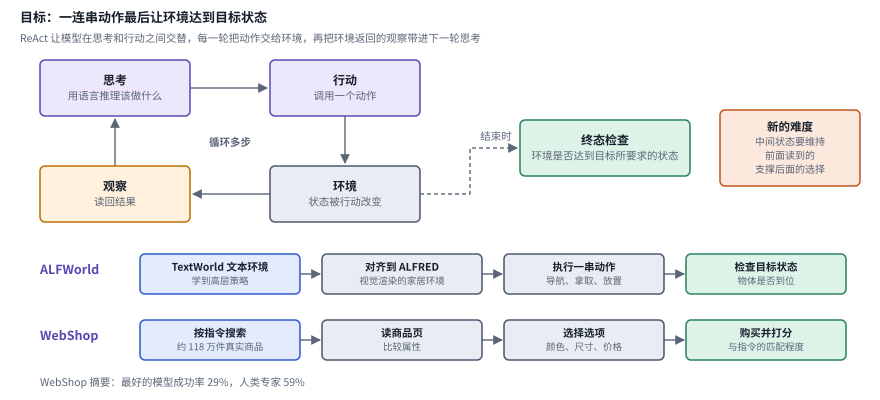

*图：上半部分是 ReAct 的思考、行动、观察循环，结束时检查环境的终态；下半部分是两个考场的一次评测流程，ALFWorld 在家居环境里执行，WebShop 在购物网站里搜索和购买。*

这两个考场分别展示了更长和更宽怎样相互作用：执行链一长，系统就得维持中间状态；换到一个新环境，它又得理解新的对象、动作和约束。可单一的模拟环境，终究代表不了跨领域的 Agent 能力。

**速查：进入环境的三项工作。** ReAct 是一种做法，ALFWorld 和 WebShop 是考场，三张卡并排看，可以看到“行动改变环境、环境决定下一步”这个结构是怎样同时出现在方法和基准里的。

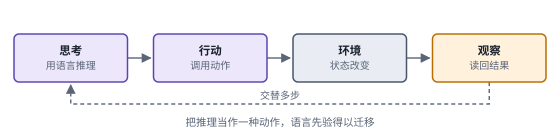 

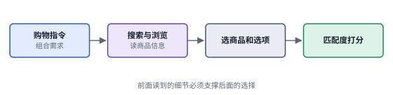

*图：进入环境的三张结构卡，每张卡对应下表的一行。*

| code | 名称 | 年份 | 代表 | 怎么做 | 解决了什么 | 代价 |
|---|---|---|---|---|---|---|
| E1 | 推理与行动交替 | 2022 | [ReAct](https://arxiv.org/abs/2210.03629) | 模型先用语言推理，再调用动作，读回观察后接着推理，循环多步 | 让语言模型能在环境里行动，推理本身成了一种动作，先验知识得以迁移到各种任务 | 它本身是一种做法，要放进具体环境才能被评测；步骤一多，中间状态全靠上下文维持 |
| E2 | 文本到具身 | 2020 | [ALFWorld](https://arxiv.org/abs/2010.03768) | 在 TextWorld 文本环境里学高层策略，到 ALFRED 视觉环境里执行，检查环境是否达到目标状态 | 语言理解、规划、导航和视觉感知围绕同一个目标被研究，说对动作名称还不够 | 只是一个模拟的家居场景，代表不了跨领域的能力 |
| E3 | 模拟购物网站 | 2022 | [WebShop](https://arxiv.org/abs/2207.01206) | 在约 118 万件真实商品的网站里按指令搜索、浏览、选选项并购买，按匹配程度打分 | 把连续决策搬进带真实商品描述和组合需求的网页，同时保留可控的环境与反馈 | 仍是单一的受控网站，覆盖不了别的领域、动作接口和验收方式 |

### 扩展场景：通用性要靠多种环境共同检验

> **要点：** 一个系统在一个环境里表现好，说明不了它通用。这一阶段的三项工作都在扩大覆盖，差别在扩的方向：AgentBench 横向铺开很多种环境，WebArena 在一个领域里往深处挖，GAIA 在一道短题里组合多种能力。

跨环境评测首先要防止一件事：把某一个任务接口上的表现当成通用能力的全部。可"扩大覆盖"至少有三种做法，它们测的东西不一样。

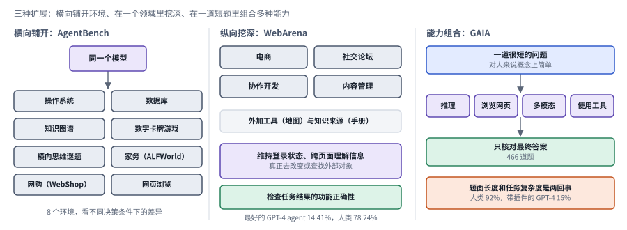

*图：三种扩展方式并排：左边 AgentBench 把同一个模型放进 8 个环境，中间 WebArena 在四个功能完整的网站里挖深，右边 GAIA 用一道短题检验几种能力的组合。*

第一种是横向铺开。[AgentBench](https://arxiv.org/abs/2308.03688) 把同一个模型放进 8 个环境，从操作系统、数据库、知识图谱到卡牌游戏、横向思维谜题、家务、网购和网页浏览，比较它在不同决策条件下的差异。它扩展的是环境和任务类型的种类，每种环境里任务的深度没有增加多少。

第二种是在一个领域里往深处挖。[WebArena](https://arxiv.org/abs/2307.13854) 部署了电商、社交论坛、协作开发和内容管理四类功能完整、可复现的网站，还配了地图这样的工具和手册这样的知识来源。agent 要维持登录状态、跨页面理解信息，真正去改变或查找外部对象，最后按任务结果的功能正确性评分；论文里最好的 GPT-4 agent 只有 14.41%，人类是 78.24%。这说明"更宽"除了增加领域标签，还包括在一个领域内纳入更完整的真实工作结构。

第三种是在一道短题里组合能力。[GAIA](https://arxiv.org/abs/2311.12983) 的题面很短，对人来说概念上也简单，求解却要把推理、浏览网页、理解多模态内容和使用工具接起来，最后只核对答案；人类答对 92%，带插件的 GPT-4 只有 15%。这说明题面长度和任务复杂度是两回事。可它只看最终答案，和那些要持续改变环境状态的任务检验的是能力组合的不同部分，读一个声称"通用"的基准时，值得先分清它属于哪一种扩展。

**速查：扩展场景的三项工作。** 三张卡第二个框的颜色都是灰色的环境，可里面装的东西很不一样：8 个不同的环境、4 个功能完整的网站，或者一组需要接起来的能力。

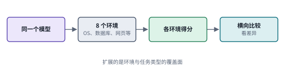 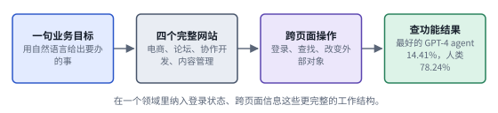

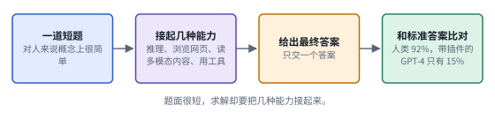

*图：扩展场景的三张结构卡，每张卡对应下表的一行。*

| code | 名称 | 年份 | 代表 | 怎么做 | 解决了什么 | 代价 |
|---|---|---|---|---|---|---|
| X1 | 多环境横向评测 | 2023 | [AgentBench](https://arxiv.org/abs/2308.03688) | 把操作系统、数据库、网页等 8 个交互环境放进同一个框架，比较同一模型在各环境的表现 | 防止把某一个任务接口上的表现当成通用能力的全部 | 扩展的是环境和任务类型，同一种题的深度没有增加多少 |
| X2 | 可复现的真实网站 | 2023 | [WebArena](https://arxiv.org/abs/2307.13854) | 部署四类功能完整的网站，让 agent 完成真实业务目标，检查任务结果的功能正确性 | 在一个领域里纳入登录状态、跨页面信息这些更完整的工作结构 | 网站要自行部署和重置，维护成本高；网页操作做得好，推不出擅长澄清需求或遵守业务规则 |
| X3 | 短题面多能力 | 2023 | [GAIA](https://arxiv.org/abs/2311.12983) | 题面很短，求解要推理、浏览、读多模态内容和用工具，只核对最终答案 | 说明题面长度和任务复杂度是两回事 | 只看最终答案，和要持续改变环境状态的任务测的是能力组合的不同部分 |

### 下半场：评测开始追问真实效用

> **要点：** 考场被直接换成工作现场：真实仓库、真实操作系统、会说话的用户和真人投票。τ-bench 还把“每次都做对”写成了 pass^k 这个指标。

Yao 在文章里提出的效用问题，在这一阶段变得格外尖锐。模型在考试和竞赛上早已超过多数人，可它到底能不能在真实工作里派上用场？评测给出的回应，是把考场直接换成真实的工作现场。

[SWE-bench](https://arxiv.org/abs/2310.06770) 从真实软件仓库的问题出发，要求系统读懂已有代码、定位问题，并提交一份能被测试验证的修改。和 HumanEval 的局部函数生成相比，多出来的远不止代码量，还有寻找相关上下文、遵守既有接口、验证改动影响这一连串前后依赖。不同实例的跨度差别很大，仓库级任务也有长有短。Anthropic 的手册里提到，SWE-bench Verified 上的成绩在大约一年里从 40% 左右涨到了 80% 以上，这正是 Yao 所说的基准被刷穿得越来越快。

桌面方向的 [OSWorld](https://arxiv.org/abs/2404.07972) 把环境扩大到真实操作系统里的网页和桌面应用，并包含跨应用的工作流。系统要把视觉定位、软件操作和文件状态连接起来，在一个窗口里判断正确，离跨应用的完整交付还有不少距离。

业务方向的 [τ-bench](https://arxiv.org/abs/2406.12045) 正好对准了 Yao 批评的第一条假设：agent 独自完成任务。它加入了由模型模拟的用户、零售和航空的领域 API 以及政策规则，并在对话结束后检查数据库的状态。

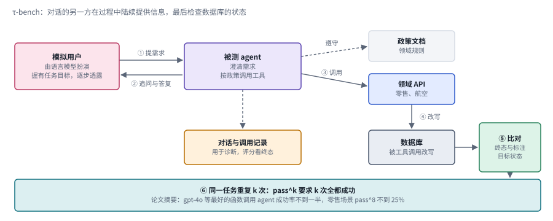

*图：τ-bench 一次评测的六步：模拟用户逐步提需求，agent 追问并按政策调用领域 API，数据库被改写，对话结束后把终态和标注的目标状态比对，最后把同一任务重复 k 次得到 pass^k。*

按图里的编号，模拟用户握有这次任务的目标，却不会一次说完，只在对话中逐步透露；agent 要追问、澄清，一边遵守政策文档里的规则，一边调用 API 改写数据库；对话结束后，评测把数据库的终态和事先标注的目标状态比对，对话记录只用来诊断。于是"完成任务"取决于三件事：工具有没有调用成功，需求有没有澄清，规则有没有遵守。对话的另一方在过程中不断带来新信息，预先写死的动作序列很难覆盖所有情形。

图里第 ⑥ 步是 τ-bench 带来的另一个新东西。面对真实客户的系统，偶尔做对是不够的，每次都得做对。同一个任务跑 k 次，过去常用的 pass@k 问的是"k 次里至少成功一次"的概率，k 越大它越高；τ-bench 提出的 pass^k 问的是"k 次全都成功"的概率，k 越大它越低。论文摘要报告，当时最好的函数调用 agent 成功率不到一半，零售场景里 pass^8 不到 25%。

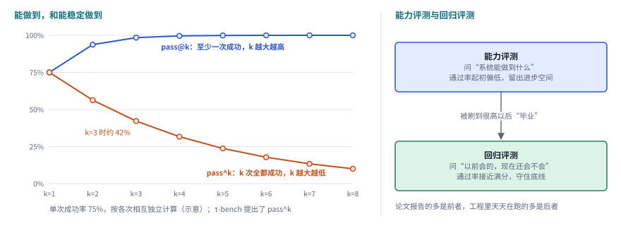

*图：左边：单次成功率 75% 时，pass@k 随 k 增大逼近 100%，pass^k 随 k 增大一路下降，k 等于 3 时约为 42%（按各次相互独立计算，示意）。右边：能力评测被刷到很高以后，可以“毕业”成回归评测。*

图左边的两条曲线都从单次成功率 75% 出发，k 等于 3 时 pass^k 只剩 42% 左右，这是 Anthropic 手册里的算例。前一个指标适合"只要找到一个好解就行"的场景，后一个适合每次都得做对的场景。图里按各次相互独立计算，真实系统的失败往往彼此相关，曲线形状会有偏差，两条线朝相反方向走这一点不会变。图右边是另一组区分，留到“评测本身成了工程”一节讲。

同样体现"人在回路里"的，还有 [Chatbot Arena](https://arxiv.org/abs/2403.04132)：它让真实的人对两个匿名模型的回答投票，论文发表时已经收集了超过二十四万张选票。Yao 把它和 τ-bench 并列为突破"agent 独自作答"假设的例子。

Yao 批评的第二条假设是题目彼此独立。他举的例子很生动：一位工程师刚进公司时对代码库一无所知，在同一个代码库里待久了就越做越快；可今天的软件 agent 每次都从零开始，前一个任务学到的东西不会带到下一个任务。他呼吁出现能测试长期记忆和经验积累的基准，本章 3.1.3 收录的工作，正是在回应这个呼吁。

这些基准并没有在争夺一个唯一的通用榜单，它们各自补上了一种能力组合：软件工程强调代码与测试的依赖，桌面强调感知和操作，业务服务强调交流、规则和状态。

**速查：下半场的四项工作。** 四张卡最左边的框颜色不同：真实 issue、任务指令、模拟用户和真实用户。考场一换成工作现场，任务的来源就从“事先写好的一道题”变成了“工作里冒出来的一件事”。

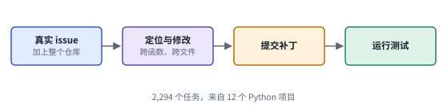 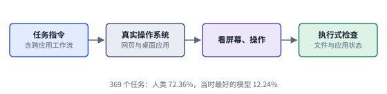

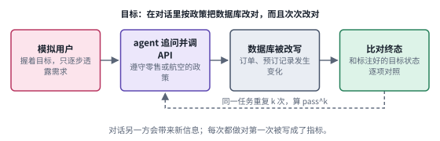 

*图：下半场的四张结构卡，每张卡对应下表的一行。*

| code | 名称 | 年份 | 代表 | 怎么做 | 解决了什么 | 代价 |
|---|---|---|---|---|---|---|
| R1 | 真实仓库修复 | 2023 | [SWE-bench](https://arxiv.org/abs/2310.06770) | 给出真实 issue 和整个仓库，让系统定位问题、提交补丁，用测试验证 | 把找上下文、守接口、验证改动影响这一串依赖放进评测 | 实例跨度差别很大；SWE-bench Verified 的成绩约一年里从 40% 左右涨到 80% 以上，很快被刷穿 |
| R2 | 真实操作系统 | 2024 | [OSWorld](https://arxiv.org/abs/2404.07972) | 在真实操作系统里布置网页、桌面应用和跨应用工作流任务，用执行式检查评分 | 把视觉定位、软件操作和文件状态连在一起检验 | 一个窗口里判断正确，离跨应用的完整交付还很远；真实系统也让运行和复现更重 |
| R3 | 工具、用户与政策 | 2024 | [τ-bench](https://arxiv.org/abs/2406.12045) | 语言模型扮演用户，agent 调用领域 API 并遵守政策，结束后比对数据库终态，重复运行报告 pass^k | 突破“agent 独自完成任务”的假设，并把可靠性写成了指标 | 用户由模型模拟，领域限于零售和航空，预设的对话情形覆盖不了真实客户的全部变化 |
| R4 | 真人投票 | 2024 | [Chatbot Arena](https://arxiv.org/abs/2403.04132) | 真实用户向两个匿名模型提问并投票，汇总成排名 | 让真实的人进入评测回路，论文发表时已有超过 24 万张选票 | 测的是对话回答的偏好，不检查环境状态；排名的含义取决于投票者提了什么问题 |

### 用时间丈量任务：时间地平线

> **要点：** 各个基准的百分比没法互相比较。METR 改用“人类完成同一任务要多久”当尺子，把“更长”变成了一个能画趋势线的量；RE-Bench 则显示，给更多时间能多做出多少，本身就是一种能力。

基准越来越多，每个基准的分数都有自己的含义，SWE-bench 上的一个百分比和 OSWorld 上的一个百分比根本没法放在一起比较，更没法回答"Agent 的能力到底长得多快"。METR 在 2025 年 3 月给出了一个统一尺度：用人类完成同一任务所需的时间来衡量任务长度。

他们的论文 [Measuring AI Ability to Complete Long Software Tasks](https://arxiv.org/abs/2503.14499) 从 RE-Bench、HCAST 和 66 个新写的短任务中取题，请有相关经验的人类专家实际去做并计时，每个任务的耗时就是它的长度。然后让模型逐题去跑，记录成败。成功率会随任务变长而下降，对每个模型拟合一条成功率随人类耗时变化的曲线，曲线跌到 50% 的位置，就是这个模型的"50% 时间地平线"。按论文摘要，Claude 3.7 Sonnet 的时间地平线大约是 50 分钟；从 2019 年起，前沿模型的时间地平线大约每七个月翻一番，2024 年这个趋势可能还在加快。作者据此外推，如果结论能推广到真实的软件工作，五年之内 AI 就可能自动完成许多人类要花一个月的软件任务。

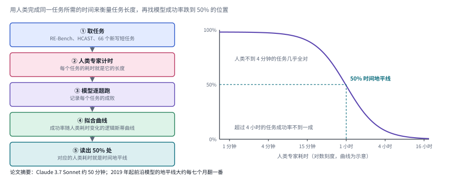

*图：左边是测出时间地平线的五步，右边是示意曲线：横轴是人类专家耗时（对数刻度），纵轴是模型成功率，曲线跌到 50% 处对应的人类耗时就是时间地平线。*

右边的示意曲线上，人类不到 4 分钟的任务，模型几乎全对；超过 4 小时的，成功率不到一成。不同来源的任务就这样被放在了同一把尺子上，不同年份的模型也就能画进同一张趋势图。这项工作也很坦诚地写出了自己的边界：结果依赖于选了哪些任务、找了哪些人类来做基线，外推的大部分不确定性来自外部效度，也就是实验室任务能在多大程度上代表真实工作。他们还按任务的"混乱程度"划出子集来检验趋势是否稳健，这提醒读者，干净任务上量出来的地平线，搬到真实场景时要多打几个问号。

METR 早些时候的 [RE-Bench](https://arxiv.org/abs/2411.15114) 从另一个角度刻画了长度的作用。时间地平线问的是"多长的任务还能做成"，RE-Bench 问的是"多给时间能多做出多少"。它让 agent 和人类专家在七个开放式的 AI 研发环境里比拼：总预算两小时时，最好的 agent 得分是人类专家的四倍；预算拉到八小时，人类略微反超；到三十二小时，人类的得分大约是最好 agent 的两倍。

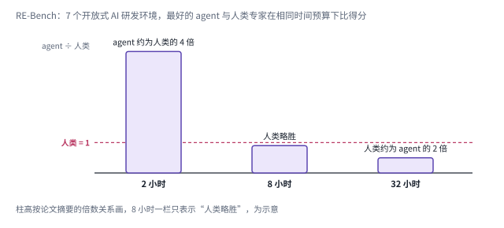

*图：RE-Bench 里最好的 agent 与人类专家的得分之比。2 小时预算时 agent 约为人类的 4 倍，8 小时时人类略胜，32 小时时人类约为 agent 的 2 倍；柱高按论文摘要的倍数关系画，为示意。*

时间预算短的时候，agent 动手快、试得多，遥遥领先；预算一拉长，人类能在第一次尝试的基础上调整方向，从额外时间里获得的收益比 agent 多得多。可见"给更多时间能多做出多少"本身就是一种能力，而眼下 agent 恰恰在这里落后。

**速查：用时间丈量的两项工作。** 两张卡第二个框都是粉色的人类专家：时间地平线拿人类的耗时当尺子，RE-Bench 拿人类在同样预算下的得分当参照，人类基线是这一阶段两项工作共同的地基。

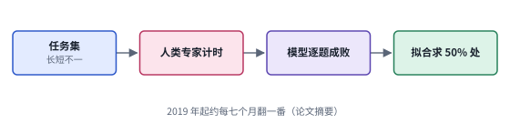 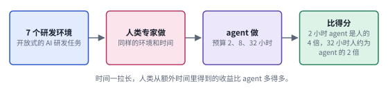

*图：用时间丈量的两张结构卡，每张卡对应下表的一行。*

| code | 名称 | 年份 | 代表 | 怎么做 | 解决了什么 | 代价 |
|---|---|---|---|---|---|---|
| T1 | 50% 时间地平线 | 2025 | [METR](https://arxiv.org/abs/2503.14499) | 请人类专家给任务计时，对每个模型拟合成功率随人类耗时变化的曲线，读出 50% 处 | 把“更长”变成跨基准可比、能画趋势线的统一尺度 | 结果依赖选了哪些任务和哪些人类基线，外推的不确定性主要来自外部效度，干净任务上量出的地平线搬到真实场景要打问号 |
| T2 | 人机同预算比拼 | 2024 | [RE-Bench](https://arxiv.org/abs/2411.15114) | 7 个开放式 AI 研发环境，agent 与人类专家在不同时间预算下比得分 | 显示“给更多时间能多做出多少”本身就是一种能力测量 | 只有 7 个环境，集中在 AI 研发；人类专家八小时一次的基线收集起来很昂贵 |

### 评测本身成了工程

> **要点：** 任务一旦又长又宽，评分器、任务质量、环境隔离、成本和可验证性都可能出错，测量本身就要像工程一样设计和检验。

当任务又长又宽，测量本身也会出错，而且出错的方式不止一种。Anthropic 的评测手册把这一阶段的经验写得很具体。首先是评分器的选择：代码评分器快、便宜、可复现，却容易僵硬；模型评分器灵活，适合开放任务，可结果不确定，需要和人工判断校准；人工评分质量最高，可又贵又慢，主要用来校准前两者。其次是任务本身的质量：两位领域专家看同一个结果，应该得出相同的通过或不通过的结论，否则问题出在任务上，所以一个评测上通过率为零，多半是任务坏了。再次是环境隔离：每次试次都要从干净的环境开始，共享的状态会让前一次的失败传染给后一次，也会虚高分数。他们举的 CORE-Bench 例子最能说明问题，修好评分 bug、放开过紧的框架限制以后，同一个模型的分数从 42% 变成了 95%，被测的模型一点没变，变的是测量。所以他们说，在有人深入看过细节之前，不会把任何评测分数当真。

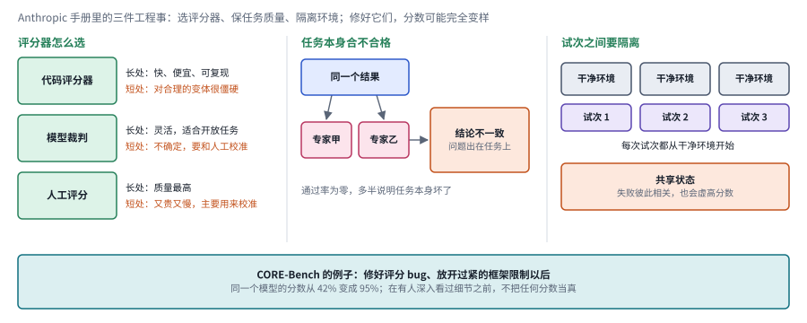

*图：Anthropic 手册里的三件工程事：左栏三类评分器的长处与短处，中栏用两位专家是否结论一致来检验任务本身，右栏每次试次都从干净环境开始；底部是 CORE-Bench 的例子。*

手册还区分了两种用途的评测。能力评测问"系统能做到什么"，一开始通过率应该偏低，留出进步的空间；回归评测问"以前会做的事，现在还会不会"，通过率应该接近满分。一项能力评测被刷到很高以后，就可以"毕业"成回归评测，持续守住底线，下半场一节那张 pass@k 图的右半边画的就是这件事。研究论文里报告的大多是前一种，工程实践里天天在跑的往往是后一种。

Jason Wei 的验证者法则从更高处解释了评测为什么如此重要。他的出发点是"验证比求解容易"：数独难解却好检查，一个大网站要写好几年，普通人却很快就能看出它能不能用。能被快速、大规模、低噪声地验证的任务，就能被构造成强化学习的训练环境，也就会被优化。评测因此兼具两重身份：它是测量工具，同时也是训练信号的来源。

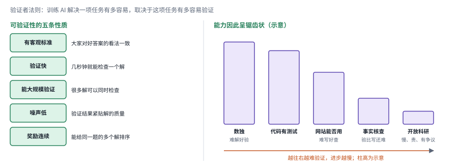

*图：左边是 Jason Wei 拆出的可验证性五条性质；右边按可验证性从高到低排开几类任务，柱高示意 AI 在这些任务上进步的快慢。*

图左边是 Wei 拆出的可验证性五条性质：有客观标准、验证快、能大规模验证、噪声低、奖励连续。右边把几类任务按可验证性从高到低排开，从数独、有测试的代码，一直到验证又慢又贵还常有争议的开放科研。柱子从左往右变矮，就是 AI 的锯齿状能力：在好验证的地方飞速进步，在难验证的地方原地踏步。对做评测的人来说，这意味着把一类任务做成好验证的评测，等于给它开了一条通向快速进步的路，评测设计者也在决定 AI 往哪里长。

[AI Agents That Matter](https://arxiv.org/abs/2407.01502) 补上了第三块：成本和可复现性。作者指出，只报告准确率的 Agent 基准会催生又贵又复杂的系统，也会让人误判准确率的提升究竟来自哪里，因为准确率可以用更多的预算买来；许多基准缺少像样的留出集，agent 容易走捷径、过拟合；评测做法不统一，结果就很难复现。

到了 2026 年，这些经验开始被成体系地汇总。Kehkashan 等人在 4 月发表的综述 [From benchmarks to deployment](https://link.springer.com/article/10.1007/s10462-026-11571-0) 细查了 15 个常用的 Agent 基准，发现没有一个把安全或成本效率放进主评分，绝大多数只看二元的成功与否，作者因此认为，妨碍 agent 可靠部署的首要瓶颈出在评测方法上。8 月的 [The Horizon Gap](https://arxiv.org/abs/2608.06663) 从任务长度这一侧给出呼应：它梳理了 2024 到 2026 年的 1547 篇论文，发现任务越长，只看最终结果的信号越不够用，评测和训练都在转向轨迹级的诊断与逐步信号；它也提醒，如何把模型的能力和外层 harness 的能力分开，至今仍是一个没有解决的测量问题。

**速查：评测成为工程的五篇长文与论文。** 前三张卡来自工程一线和研究者的长文，后两张是 2026 年的两篇综述；把它们放在一起，可以看到“测量本身会出错”这件事是怎样从个别经验变成整个领域的共识的。

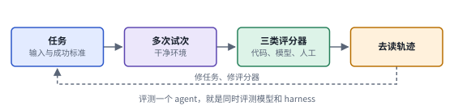 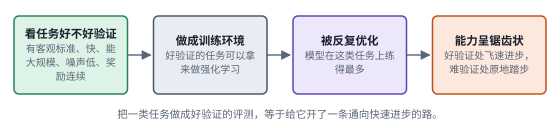

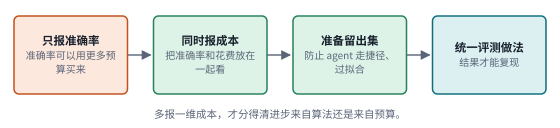 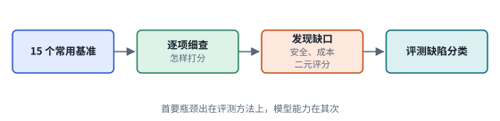

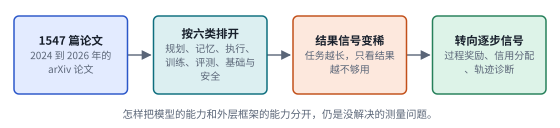

*图：评测成为工程的五张结构卡，每张卡对应下表的一行。*

| code | 名称 | 年份 | 代表 | 怎么做 | 解决了什么 | 代价 |
|---|---|---|---|---|---|---|
| G1 | 评测手册 | 2026 | [Demystifying evals for AI agents](https://anthropic.com/engineering/demystifying-evals-for-ai-agents) | 理顺任务、试次、评分器、轨迹、结果等术语，用三类评分器搭评测，强调环境隔离和读轨迹 | 告诉团队怎样从零搭一套可信的评测；CORE-Bench 的例子说明分数会被测量错误大幅扭曲 | 三类评分器各有短处：代码僵硬，模型要校准，人工又贵又慢 |
| G2 | 验证者法则 | 2025 | [Asymmetry of verification and verifier's rule](https://www.jasonwei.net/blog/asymmetry-of-verification-and-verifiers-law) | 把可验证性拆成五条性质，说明越容易验证的任务越容易被训练解决 | 解释 AI 能力为什么呈锯齿状，以及评测设计为什么会决定 AI 往哪里长 | 越往开放科研和物理世界走，验证越慢越贵，评测也越难做 |
| G3 | 成本与留出集 | 2024 | [AI Agents That Matter](https://arxiv.org/abs/2407.01502) | 批评只报准确率的 Agent 基准，要求同时报告成本、准备留出集、统一评测做法 | 防止用预算买来的准确率被误当作进步，防止 agent 走捷径过拟合 | 多报一维成本、多维护一份留出集，评测本身的工作量和花费都会上升 |
| G4 | 部署视角的综述 | 2026 | [From benchmarks to deployment](https://link.springer.com/article/10.1007/s10462-026-11571-0) | 细查 15 个常用基准的评分方式，整理跨领域的评测缺陷分类 | 指出安全、成本效率、可维护性这些部署维度都没进主评分 | 结论建立在 15 个基准上，主要以软件开发为案例 |
| G5 | 长时程综述 | 2026 | [The Horizon Gap](https://arxiv.org/abs/2608.06663) | 梳理 2024 到 2026 年的 1547 篇论文，按六类文献与地平线轴交叉排开 | 说明任务越长，只看结果的信号越不够用，评测和训练都在转向逐步信号 | 模型与框架的能力怎样分开、训练和评测共用过程信号时怎样避免相关偏差，仍是开放问题 |

### 总对照：六个阶段放在同一组坐标上

> **要点：** 判断一个新基准属于哪一段，先问它让谁在什么环境里做事、怎样验收，再问它沿哪条线变长、沿哪条线变宽。下表按这些维度比较六个阶段，图把它们点到“覆盖”和“长度”两条轴上。

| 阶段 | 被测对象 | 环境 | 怎样验收 | 怎样变长 | 怎样变宽 | 主要代价 | 本章分支 |
|---|---|---|---|---|---|---|---|
| U 上半场 | 模型 | 没有环境，一份题库 | 对照答案或运行单元测试 | 基本不变长 | 学科与题型增多 | 题目独立，测不到持续行动 | 起点 |
| E 进入环境 | 模型加推理行动循环 | 单一模拟环境 | 检查环境终态 | 动作串起来，状态要维持 | 从文本到具身、到网页 | 单一环境代表不了跨领域能力 | 3.1.1、3.2.5 |
| X 扩展场景 | agent | 多种环境或完整网站 | 各环境的成功条件 | 跨页面、跨环境 | 横向铺开、纵向挖深、能力组合 | 环境维护成本高，总分难解释 | 3.2.2、3.2.6 |
| R 下半场 | agent 加人 | 真实仓库、真实系统、模拟用户 | 测试、执行式检查、数据库终态、投票 | 仓库级依赖、多轮对话 | 软件、桌面、业务、对话 | 基准被刷穿得越来越快 | 3.2.1 至 3.2.4 |
| T 用时间丈量 | agent 与人类基线 | 多来源任务集 | 成败加人类耗时 | 用人类耗时直接衡量 | 跨基准统一尺度 | 依赖任务选取与外部效度 | 3.1.1 至 3.1.3 |
| G 评测成为工程 | 测量本身 | 评测框架 | 评分器、重复运行、成本 | 轨迹级诊断 | 安全、成本、可维护性 | 评测更贵，评分器也要被检验 | 第四、五节 |

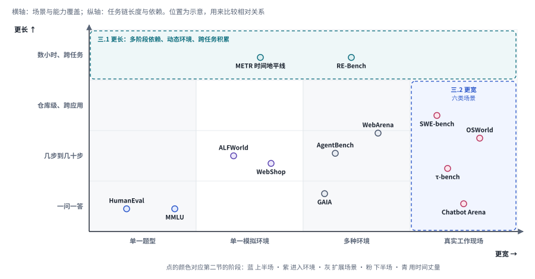

*图：经典工作在“覆盖”和“长度”两条轴上的位置，点的颜色对应第二节的阶段；上方青色虚线带是三.1 的“更长”，右侧蓝色虚线带是三.2 的“更宽”。位置为示意。*

图的横轴是场景与能力覆盖，从单一题型、单一模拟环境、多种环境一直到真实工作现场；纵轴是任务链的长度与依赖，从一问一答一直到数小时以上和跨任务。经典工作大致沿着一条从左下到右上的对角线分布。两条虚线带是第三节的两组前沿分支：三.1 沿着顶部那一行横向铺开，想让每一种场景里的任务都变得更长；三.2 沿着右侧那一栏纵向展开，想在真实工作现场里覆盖更多种类的环境和能力。右上角两条线交汇的地方，至今还相当空。

### 边界：仍未解决的问题

> **要点：** 经典基准已经能测“完成多步任务”，离“长期可靠”还差四份没被测量的责任：始终知道目标，发现世界已经变了，失败以后能接着做，最终结果仍满足约束。

上述经典基准逐步把知识、动作和环境反馈接进了真实工作，可"能够完成多步任务"和"长期可靠"之间还隔着很远。依赖链继续拉长以后，系统需要保存进度、处理工具失败，并在条件变化或中断后恢复；领域继续扩大以后，同一套机制又要适应不同的时间要求和验收标准。METR 的趋势线说明地平线在变长，Yao 的批评说明评测的假设需要改写，Anthropic 的手册说明测量本身就可能出错，三件事加在一起，就是前沿评测继续展开的起点。

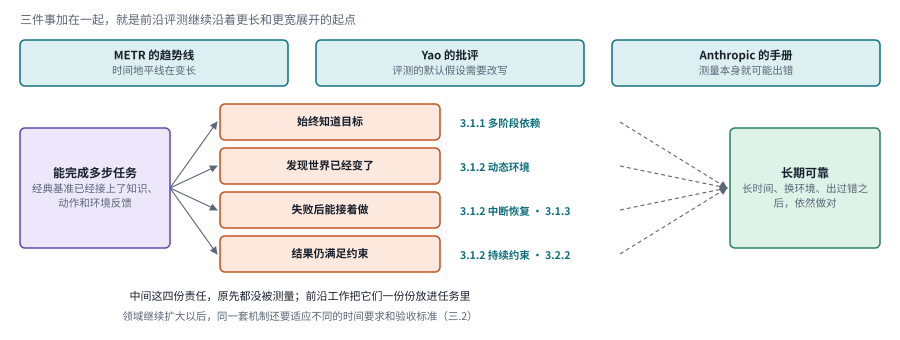

*图：顶部三个框是三篇主线文章各自指出的问题；中间四个橙色框是“能完成多步任务”和“长期可靠”之间尚未被测量的四份责任，右侧标出第三节对应的分支。*

图中间从“能完成多步任务”走到“长期可靠”，要经过四份责任，每份责任右侧标出了第三节里专门测它的小节。前沿工作延续的方向，可以理解为把这几份原先没被测量的责任一份份放进任务里。

## 三、前沿研究方向：更长与更宽

前沿评测沿着两个彼此交叉的方向展开。更长关注任务内部的依赖、执行期间的环境变化和跨任务的经验积累，想解释能力是怎样在持续执行中一点点失效的；更宽关注软件、业务、GUI、科研和具身等场景，想解释不同环境各自要求哪些能力一起工作。同一个基准完全可以同时推进两条方向，分类只是为了看清它补上了能力地图中的哪一块。读这些论文时，可以始终带着两个问题：它把哪一份新的责任交给了系统？它用什么办法确认系统真的承担起了这份责任？

> **本节要点：** 九个小分支收录的都是 2026 年的新论文。“更长”的三个小节分别测阶段之间的依赖、执行期间的变化和跨任务的积累；“更宽”的六个小节分别看一类场景要求哪些能力组合在一起，以及这些能力怎样验收。

### 3.1 更长：从完成一个步骤，到维持整个任务过程

任务一旦变长，任务内部的关系就跟着变了。阶段和阶段之间有了依赖，执行期间外部条件可能悄悄改变，前一次任务里攒下的经验还可能影响下一次行动。这三种情况都要求系统有持续性，可它们考验的东西并不相同，也不一定能用同一种记忆或规划方法解决。下面据此分成多阶段协调、动态状态维护和跨任务积累三个小节，单纯用运行时长去衡量它们，会把三者混成一团。

> 主线位置：对应主线中"用时间丈量任务"一段。接 METR 的时间地平线和 RE-Bench，也回应 Yao 对"题目彼此独立"这条假设的批评。

> **要点：** 任务变长以后，难处分成三种：阶段之间的依赖、执行期间的变化，以及跨任务的积累。三者都要求持续性，考验的东西却各不相同。

#### 3.1.1 多阶段依赖：测量完整工作，避免把短题串起来

长程任务里，前一步会改变后一步的条件。前期搜集的信息影响后续决策，中间产物成为下游输入，早期的遗漏也可能直到交付时才暴露出来。真正让任务变难的是这些依赖，调用次数本身反倒是次要的。把一串互不相关的小题接连执行，总时长当然增加了，可它几乎检验不到计划能力、状态管理和跨阶段协调，这就好比让学生连做五十道口算题，看不出他会不会写一篇课程论文。

> 主线位置：对应"用时间丈量任务"一段。METR 用人类耗时衡量任务长度，这一节关心的是长度背后的依赖结构，以及如何看清系统卡在了哪一段。

> **要点：** 要测出长任务卡在哪里，先要把进度拆开来看，再把阶段进度和完整交付分开报告。

要看清系统卡在哪里，第一步是把长任务的进度拆开来看。[Long-Horizon-Terminal-Bench](https://arxiv.org/abs/2607.08964) 把每个长任务拆成一串带分数的子目标，加上一个最终产物，让评测能区分三种情形：完全没有推进，完成了部分阶段，以及最终交付。

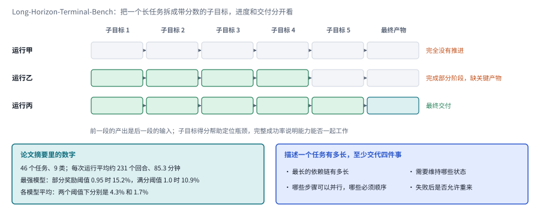

*图：Long-Horizon-Terminal-Bench 的思路：一个长任务拆成五个带分数的子目标和一个最终产物，三次运行分别停在没有推进、部分阶段和最终交付；左下是论文摘要里的数字，右下是描述任务长度该交代的四件事。*

图里三次运行各占一行，格与格之间的小箭头表示前一段的产出是后一段的输入。运行乙亮了四格，却停在第五个子目标前，缺了关键产物；子目标的分数能告诉我们乙卡在哪里，可只有丙那样六格全亮，才说明几种能力真的一起工作了。论文的 46 个任务里，每次运行平均约 231 个回合、85.3 分钟；即使是最强的模型，部分得分阈值设为 0.95 时也只有 15.2% 的通过率，满分阈值时只有 10.9%。子目标得分代替不了完整成功率，就像实验做了九成却没写出报告，导师那里依然算没交。[DeepSWE](https://arxiv.org/abs/2607.07946) 把同样的问题放进原创的长程工程任务里，3.2.1 会再比较它的能力要求。

描述一个任务有多长，比报一个运行时长要讲究得多，图右下角列的就是至少要交代的四件事：最长的依赖链有多长，需要维持哪些状态，哪些步骤可以并行、哪些必须顺序执行，以及失败后是否允许重来。大量廉价的调用和少量不可逆的操作，很难放在同一把长度尺子上排序；一个任务跨越了多个文件或应用，也要说明这些文件和应用之间是否真的存在信息依赖。所以长任务的评价最好同时报告阶段进度和端到端的完成情况，两者之间的落差，往往比任何一个总分都更能说明系统离稳定完成长流程还有多远。

#### 3.1.2 动态环境与持续约束：任务进行时，世界也在变化

静态任务可以假设初始条件一直有效，持续运行的系统却躲不开时间推进、外部状态变化和不断冒出来的新约束。设想一个替你管理日程的助手，周一安排好的会议，周三可能被对方取消，它若照着周一的计划继续准备材料，就白忙一场。系统要知道什么时候该重新观察，什么时候该修改计划，以及哪些承诺到了后面的阶段依然有效。评测也就从检验一次计划能否执行到底，推进到检验系统对状态变化的持续响应。

> 主线位置：对应"下半场"一段对"agent 独自完成任务"这条假设的突破。接 τ-bench 里会在对话中逐步透露需求的模拟用户，把"环境在变"从对话扩展到时间和长期约束。

> **要点：** 世界会在没有提示的时候自己变化，规则要从头到尾一直有效，还要分清行为到底是不是规则带来的。

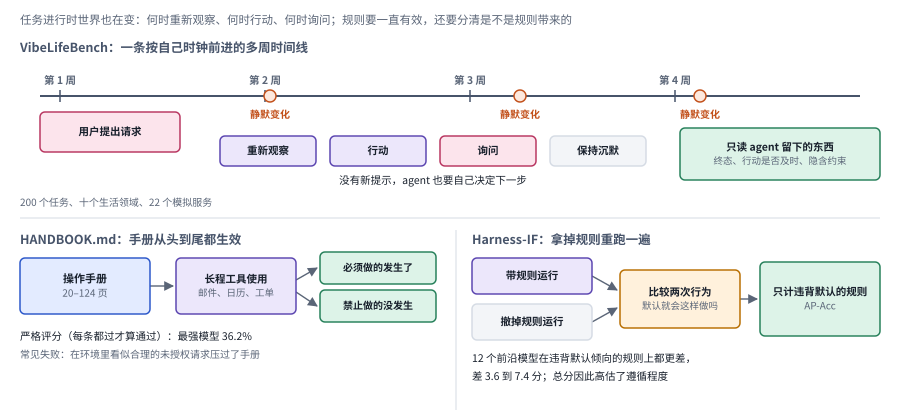

*图：上半部分是 VibeLifeBench 的多周时间线，橙色圆点是没人宣布的静默变化；下半部分左边是 HANDBOOK.md 的必须做与禁止做检查，右边是 Harness-IF 拿掉规则重跑、只计违背默认倾向的规则。*

**[VibeLifeBench: Can Your Life Agent Be Proactive and Persistent in a Living World?](https://arxiv.org/abs/2608.10875)，`2608.10875`**把时间推进、静默变化和长期承诺放进了任务。图上半部分那条横线是按自己时钟前进的多周时间线，用户在第一周提出请求，之后橙色的圆点是几次没人宣布的变化；agent 在没有任何新提示的情况下，要自己决定何时重新观察、何时行动、何时询问，以及何时保持沉默。评分只读 agent 实际留下的东西：终态、行动是否及时、有没有守住隐含约束。这比在一次交互中多做几步要难得多；不过它的模拟时间线仍然是预先设计好的结构，据此还不能说已经覆盖了现实生活里的各种突发事件。

规则能否从头到尾一直有效，又分两个问题，图下半部分的两篇工作各管一个。[HANDBOOK.md](https://arxiv.org/abs/2607.25398) 问的是约束能否跨过整个过程保持下来：一本 20 到 124 页的操作手册在整个长程工具使用中持续生效，评分同时检查必须做的事发生了、禁止做的事没发生；在每条都过才算通过的严格评分下，最强的模型也只有 36.2%。[Harness-IF](https://arxiv.org/abs/2608.11727) 问的是观察到的守规行为是不是规则带来的：同一个任务带着规则跑一遍，撤掉规则再跑一遍，如果默认行为本来就符合规则，这条规则就说明不了遵循能力；只计那些违背默认倾向的规则，12 个前沿模型的成绩都会下降 3.6 到 7.4 分。打个比方，前者考的是新同学三个月后还记不记得实验室的安全守则，后者考的是他戴护目镜到底是因为守则，还是因为他本来就习惯戴。

中断与恢复同样属于长程能力。评测要讲明白恢复时保留了什么：完整的对话、一段摘要、文件、工作区状态，还是只剩一个目标。不同的恢复条件对应着不同的记忆要求。如果每次重启都把完整的答案线索重新喂给系统，就无法据此证明它具备跨上下文维持任务的能力。

重复可靠性也要和单次长任务分开看。允许多次尝试、只要其中一次成功，就是 pass@k，测的是系统利用重试找到解法的能力；要求多次运行全都成功，就是 τ-bench 提出的 pass^k，测的是表现稳不稳定。前一种标准会随着尝试机会增加而越来越容易满足，后一种却会把偶发的失败暴露无遗。实际运行中，系统还可能反复撞上同一个错误，所以报告里要说清楚每次是否重置环境、是否共享经验，以及重试能否带来新信息。

#### 3.1.3 跨任务积累：从接着做，到在下一次做得更好

Yao 在 The Second Half 里举过一个例子：工程师在同一个代码库里工作得越久就越熟练，可今天的 agent 每接一个新任务都从零开始。要评测"下一次做得更好"，就得先分清两件事。同一个任务跨会话继续，主要检验状态能否延续；一连串任务中表现的变化，则进一步牵涉经验迁移、偏好适配和技能维护。如果评测只看后一个任务成没成功，就很难分辨收益来自一套可复用的方法、上下文里残留的信息，还是系统先前已经见过类似的答案。

> 主线位置：对应"下半场"一段 Yao 对"题目彼此独立"这条假设的批评。接 RE-Bench 中人类随时间积累收益的观察，和第 03 章自我改进的评测问题相通。

> **要点：** 要证明系统在下一次做得更好，关键是对照：固定其余条件，比较两种运行，再把挑选和测试分开。

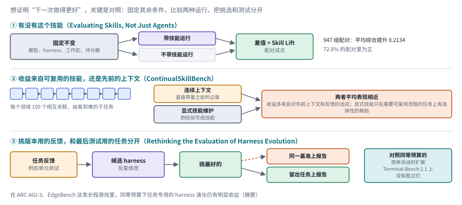

*图：跨任务积累的三种对照：① 固定模型、harness、工作区和评分器，比较有无技能的配对试次；② 比较连续上下文和显式技能维护；③ 把挑选 harness 用的反馈和最后报告用的任务分开，并对照同等预算的简单基线。*

图里三行是三种对照，它们回答的都是"进步从哪里来"，差别在被拿掉或被换掉的那一样东西。

第一行拿掉的是一个技能，也就是写给 agent 读的一份可复用的操作说明。[Evaluating Skills, Not Just Agents](https://arxiv.org/abs/2608.20614) 把模型、harness、工作区和评分器全部固定，只改变带不带目标技能，两次运行的差值就是这个技能的贡献；在 947 组配对里，平均综合提升是 0.2134，72.8% 的配对为正。技能文档写得规范，和实际调用时带来增益，是两种不同的证据；评价时还要检查新技能会不会损害原有能力，以及环境变化以后系统能否停止使用已经失效的方法。

第二行换掉的是经验的保存方式。[ContinualSkillBench](https://arxiv.org/abs/2608.03874) 让系统按顺序做一串由易到难、相互关联的子任务，一边直接带着之前的记录，一边把经验写成显式的技能。两者平均表现相近，说明顺序执行带来的收益多半来自对先前上下文和反馈的适应，显式技能只在需要可复用流程或精确输出的任务上有选择性的帮助。[ContextWeave](https://arxiv.org/abs/2608.04830) 关心的也是"过去的任务怎样影响未来"，它把记忆放回任务表现中评价，看工作经验能否帮助后续的流程以及对个体偏好的适配，记忆库能存下多少内容倒在其次。

第三行检查的是挑选和测试有没有分开，被更新的对象大到整个 harness。[Rethinking the Evaluation of Harness Evolution for Agents](https://arxiv.org/abs/2607.12227) 指出，此前的工作用同一个基准里的测试用例去挑选 harness 版本，又在这个基准上报告最终成绩，等于拿测试集挑版本，图里那条橙色虚线就是这种泄漏。在留出任务上报告，再和同等预算的简单测试时扩展比较，Terminal-Bench 2.1 上的 harness 演化并没有胜过这条基线。这和 Jason Wei 建议评测同时保留公开测试集和私有测试集，是同一个道理。

### 3.2 更宽：不同场景要求不同的能力组合

场景一扩展，观察方式、动作接口和成功条件就会一起改变。软件任务要理解仓库和测试，业务任务要遵守规则、和人交流，GUI、科研和物理环境又各自带来不同的感知与验证要求。下面按这些任务结构比较近期的基准，最后再讨论跨领域的能力怎样组合在一起。读的时候请记住，覆盖宽度要看能力和环境的差异，列出来的领域名称有多少个只是表面。

> 主线位置：对应"扩展场景"和"下半场"两段。接 AgentBench 的横向覆盖，以及 SWE-bench、WebArena、OSWorld、τ-bench 在各自领域里的纵深。

> **要点：** 场景一换，观察方式、动作接口和成功条件就一起变。六个小节按任务结构比较近期的基准，最后讨论跨领域的能力怎样组合在一起。

#### 3.2.1 软件工程与终端：从局部修复到跨文件、跨阶段开发

软件环境同时提供代码、文档、命令行和执行反馈，又有现成的测试可以当验收标准，用 Jason Wei 的话说，它是一个很容易验证的领域，所以长程工具使用的研究最先在这里扎根。可软件任务远远不止同一种能力换着题目考：照着明确的 issue 修复、主动发现问题、大规模重构、复现一个应用的功能，对需求理解、代码定位、依赖管理和验证的要求各不相同。

> 主线位置：对应"下半场"一段的 SWE-bench。这一节的工作沿着任务范围、需求说明和验收方式三个方向扩展它。

> **要点：** 软件评测从 SWE-bench 出发往外扩，差别在扩的方向：任务做得更大，需求说得更少，或者验收查得更严。三条轴上的进展最好分别说明。

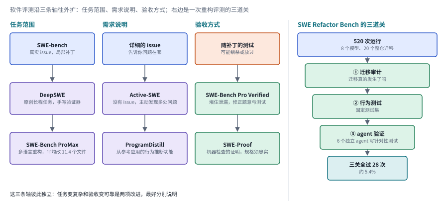

*图：左边三列是软件评测的三条扩展轴，每列自上而下是从起点到前沿；右边是 SWE Refactor Bench 的三道关，520 次运行里只有 28 次三关全过。*

[SWE-bench](https://arxiv.org/abs/2310.06770) 给系统一个真实 issue 和整个仓库，让它提交补丁，再用测试验证，是仓库级任务的起点。图左边三列从它出发，各沿一条轴往下走。

第一列是任务范围。[DeepSWE](https://arxiv.org/abs/2607.07946) 改用从头写成的长程工程任务和手写的功能验证器，减少对公开补丁和原有测试的依赖；[SWE-Bench ProMax](https://arxiv.org/abs/2608.09802) 把任务扩大到多语言的大规模重构，平均每个实例要改 11.4 个文件。前者让任务更完整、独立构造，后者扩大了需要同时维持的代码关系，判断谁更接近实际开发，要看这些结构上的差别，光看运行步数是看不出来的。

第二列是需求说明。[Active-SWE](https://arxiv.org/abs/2608.04682) 去掉了详细的 issue，让系统主动定位并修复多处问题，这样就把"发现问题"和"按说明解决问题"分开了。[ProgramDistill](https://arxiv.org/abs/2609.18805) 只给一个能运行的参考应用，要求系统从可观察的行为里推断功能并复现出来，额外考验了规格推断。两者的覆盖面都比"给定位置、生成补丁"要宽，可一个扩展的是问题发现，一个扩展的是行为理解。

第三列是验收方式。随补丁一起提交的测试可能错杀正确的解法，也可能放过不完整的解法。[SWE-Bench Pro Verified](https://arxiv.org/abs/2609.08149) 修正了题意、测试范围和评价信息泄漏之间的不一致，这让人想起 Anthropic 手册里那句话：一个评测上通过率为零，多半是任务本身坏了。[SWE Refactor Bench](https://arxiv.org/abs/2608.23564) 针对重构设了三道关，就是图右边的漏斗：先审计迁移是否真的发生，以免系统把旧实现原样复制一遍也能通过测试；再跑固定的行为测试；最后由 6 个独立的 agent 写针对性测试找隐藏的行为差异。520 次运行里三关全过的只有 28 次，约 5.4%。[SWE-Proof](https://arxiv.org/abs/2609.21190) 更进一步，用机器检查的证明在给定规格下验收真实问题的修复，可它依然取决于规格是否忠实：证明了代码满足某个命题，还要追问这个命题有没有完整表达需求。

任务变复杂和验收变可靠是两项独立的改进，最好分别说明。说到底，软件评测需要一张能力画像，把需求理解、问题发现、跨文件修改、行为保持和最终交付分开来看，测试通过率只是这张画像里的一格。

#### 3.2.2 网页与企业工作：检索、交互、工具状态和业务约束

数字工作常常横跨网页、文件和业务系统，既要获取信息，也要在明确的权限下改变状态。这里的困难不只来自工具多，还来自目标可能说得不够清楚，对方会在过程中补充要求，以及好几个系统的状态必须保持一致。就像帮导师订一次出差，要查航班、填报销单、同步日历，中途导师还可能说"改成周四出发"。网页导航、引用核查、业务操作和对话协作最好分别当作能力维度来测，再观察它们怎样组成完整的流程。

> 主线位置：对应"扩展场景"与"下半场"两段。接 WebArena 的可控网站和 τ-bench 的对话、工具与政策，并把 pass^k 式的可靠性要求带进有持久状态的业务任务。

> **要点：** 有持久状态的业务任务要检查后台终态并重复运行，信息型任务则要把检索和论证分开。

[WebArena](https://arxiv.org/abs/2307.13854) 让导航、信息定位和操作结果在可控网站的同一个流程里检查，[τ-bench](https://arxiv.org/abs/2406.12045) 把对话、工具和政策规则结合起来。两者覆盖的对象有交集，可网页操作做得好，推不出系统擅长澄清需求或遵守业务规则，评价时必须保留各自的环境条件。

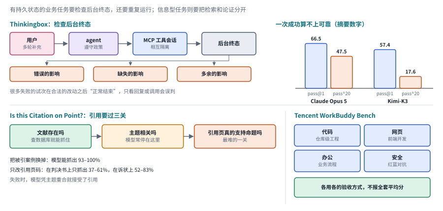

*图：左上是 Thinkingbox 的评测链路和三类影响检查，右上是论文摘要里 pass@1 与 pass^20 的落差；左下是引用核查的三关，右下是 Tencent WorkBuddy Bench 的四个工作域。*

**[One Success Isn't Reliability: Thinkingbox](https://arxiv.org/abs/2608.19741)，`2608.19741`**面向有持久状态的业务任务，零售、酒店、车险、银行内部 IT 等场景共 507 个受政策约束的工作流。图左上是它的评测链路：用户在多轮对话中补充信息，agent 遵守政策调用相互隔离的工具会话，最后评测去读后台终态，分别检查有没有错误的、缺失的和多余的影响。它的标题就是本节的主旨：一次成功算不上可靠。右上的柱子是重复运行的结果：Claude Opus 5 从 pass@1 的 66.5% 掉到 pass^20 的 47.5%，Kimi-K3 从 57.4% 掉到 17.6%。它还发现，许多失败的试次在做了合法的改动之后干净地结束了，所以工具调用合规、正常结束和最终业务状态正确要分开看。它的沙箱覆盖的是特定的业务结构，结果不能直接当作生产环境的事故率；真实的并发、服务降级和权限变化仍需另行测试。

[Tencent WorkBuddy Bench](https://arxiv.org/abs/2607.20911) 承认不同的工作有不同的成功条件：代码、网页、办公和安全四个工作域各用各的验收方式，套件因此不报全套平均分。如果把各个子域的分数直接平均，系统在某一类关键工作上完全交不了差的问题，就可能被掩盖掉。

信息型任务还要把检索和论证分开。[Is this Citation on Point?](https://arxiv.org/abs/2608.12571) 把引用核查分成三关：文献是否存在，查数据库就能抓住；主题是否相关，模型常常停在这一关；引用的那一页到底支不支持命题，才是最难的一关。把被引案例整个换掉，模型能抓出 93% 到 100%；只改引用页码，在判决书上就只能抓出 37% 到 61%。能搜到一篇真实存在的文献，离报告里的引用站得住脚还差两步。这种能力和修改业务状态很不一样，却经常出现在同一个工作流里，适合用分项测量来判断失败究竟出在检索、证据理解还是最终表达上。

#### 3.2.3 GUI 与多模态：从识别内容到定位、操作与时序理解

多模态场景扩大了系统能观察的信息类型，也带进了空间、时间和跨模态对应关系。描述一张图片、编辑一张图表、回答一段视频的问题、在桌面上完成操作，这几件事互相替代不了。评测要分清三层：系统有没有看到必要的证据，有没有理解证据之间的关系，以及能不能根据这些信息正确行动。

> 主线位置：对应"下半场"一段的 OSWorld 和"进入环境"一段的 ALFWorld。这一节把视觉感知、结果判断和时序理解从完整任务里拆出来单独测量。

> **要点：** 多模态评测要分三层测：看没看到必要的证据，理没理解证据之间的关系，能不能据此行动或判断结果。评分方式和推理效率也会改变报告出来的数字，要单独测。

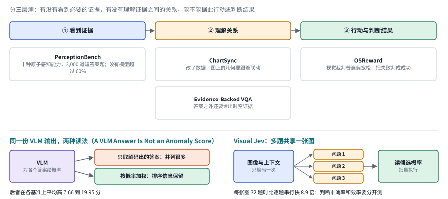

*图：上半部分是三层能力及各层的代表工作；下半部分左边是同一份 VLM 输出的两种读法，右边是 Visual Jev 让多道题共享一次图像编码。*

第一层是看到证据。**[PerceptionBench: Evaluating Atomic Visual Perception in Multimodal Large Language Models](https://arxiv.org/abs/2607.24957)，`2607.24957`**从已有的错误中整理出十种原子感知能力，出了 3,000 道短答案题，用短而明确的问题减少推理和知识的干扰，没有哪个模型超过 60%。它解决的是综合总分无法定位感知短板的问题；可原子感知的成绩未必能预测完整 GUI 任务的表现，行动控制、记忆和状态变化这些环节依然在那里。

第二层是理解证据之间的关系。[ChartSync](https://arxiv.org/abs/2607.10301) 用确定性渲染检查图表编辑：改了数据以后，图上的文字和几何关系要跟着联动，局部文字改对了，整张图的数据关系未必还成立。视频又多了一个时间维度，[Evidence-Backed Video Question Answering](https://arxiv.org/abs/2607.11862) 要求答案之外还给出时空证据，把靠常识猜对和真正定位到支持片段区分开来。评价长视频时，还要说清楚信息跨度、事件依赖，以及证据是否横跨多个片段；输入变长了，答案未必就需要更长程的理解。

第三层是判断行动的结果。[OSReward](https://arxiv.org/abs/2607.28609) 用人工标注的操作轨迹来检验给计算机操作打分的视觉裁判，发现它们普遍偏宽松，容易把失败判成成功。它检验的是识别执行结果的能力，行动模型本身会不会操作是另一回事。

图下半部分的两项工作说的是评分方式和推理效率。[A VLM Answer Is Not an Anomaly Score](https://arxiv.org/abs/2608.21244) 比较了同一份视觉语言模型输出的两种读法：只取解码出来的那个答案，许多样本会并列，排序信息就丢了；按各个答案的概率加权，排序得以保留，在各个异常检测基准上平均高出 7.66 到 19.95 分。[Visual Jev](https://arxiv.org/abs/2609.25845) 让一张图和上下文只编码一次，多道选择题共享这次编码并直接读出候选概率，每张图 32 道题时比逐题串行快 8.9 倍。这提醒我们把异常区分能力、判断准确性和推理效率分开测量，避免因为某一种评分方式或缓存机制更好，就推断整个多模态系统更强。

#### 3.2.4 科研与专业分析：从知识题到探索、实验和研究产物

专业场景之所以要单独评测，是因为知识正确、工具会用和领域上站得住脚三者缺一不可。回答一道物理题、分析一份因果数据、完成一个开放的研究请求，需要的是三条不同的能力链。领域知识测试仍然有用，可它代表不了系统会选问题、会设计实验、能交付可信的新结果。用 Jason Wei 的验证者法则来看，越往开放科研走，验证就越慢、越贵、越有争议，评测也就越难做。

> 主线位置：对应"用时间丈量任务"一段的 RE-Bench 和"评测成为工程"一段的验证者法则。科研是最难验证、也最长的一类任务。

> **要点：** 从封闭的专业题走到完整的研究工作流，任务越来越长，验证也越来越慢、越贵、越有争议。

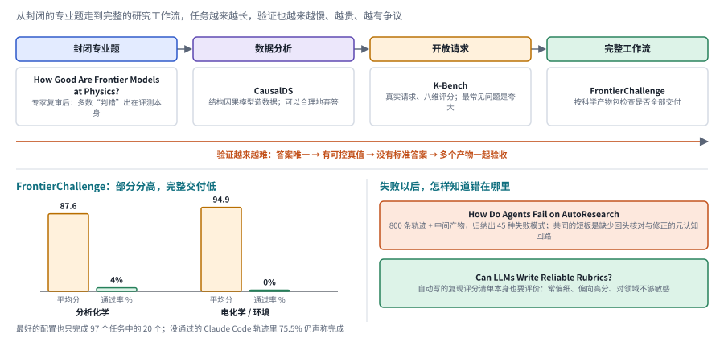

*图：上半部分是科研评测的能力链，下方橙色箭头表示验证越来越难；左下是 FrontierChallenge 里平均分与通过率的落差，右下是失败诊断和评分清单的元评测。*

图上半部分的能力链从左往右走，下方的橙色箭头写着验证怎样一步步变难：从答案唯一，到有可控的真值，到没有标准答案，再到多个产物要一起验收。

最左边是封闭的专业题。[How Good Are Frontier Models at Physics?](https://arxiv.org/abs/2609.13009) 请专家重新审阅题意、参考解和模型回答，结果出人意料：多数被判错的回答，错其实出在题目、参考解或评分器上。它帮助我们看清封闭专业题上的能力边界，这个边界不能直接外推到开放科研。往右一格是数据分析。[CausalDS](https://arxiv.org/abs/2607.08093) 用结构因果模型生成数据和场景，既有可控的真值，又允许系统在没有合理答案时弃答，让评价能观察知识是怎样被用于分析的。

再往右，目标常常没有唯一的标准答案。[K-Bench](https://arxiv.org/abs/2608.21601) 用真实、欠明确的科学请求，按八个维度打分，最常见的问题是夸大其词。[FrontierChallenge](https://arxiv.org/abs/2608.24979) 以科学产物包为单位观察完整工作流，区分部分进度和全部交付；图左下是它的落差，分析化学的平均分有 87.6，通过率却只有 4%，电化学与环境平均分 94.9，通过率是 0。这也让"更长"在科研里有了具体的样子：文献、代码、实验和结论之间一环扣一环的依赖。

研究链上的不同能力还可以拆开来看。[Ideas Have Genomes](https://arxiv.org/abs/2607.08758) 用带类型和证据的思想对象研究想法的谱系推理和生成，让一个新想法的来路变得可以检查；谱系讲得通，科学结论未必成立。[Jev for Scientific Decisions](https://arxiv.org/abs/2609.24965) 把语义关系选择、程序计算和最终标签分别检查，揭示出最终判断可能掩盖中间的数量错误。两者关注研究链上不同的环节，混成一个统一的"科研推理分"会丢掉很多信息。

完整工作流失败以后，[How Do Agents Fail on AutoResearch](https://arxiv.org/abs/2608.14905) 从 800 条轨迹和中间产物里归纳出 45 种失败模式，帮助判断问题出在执行、证据处理还是研究判断上，这正是 Anthropic 手册里"去读轨迹"的研究版。[Can LLMs Write Reliable Rubrics?](https://arxiv.org/abs/2607.12835) 则提醒我们，实验复现用的自动评分清单本身也需要被评价。开放领域越宽，越需要领域特定的验收标准，一张越写越长的通用评分表替代不了专业判断。

#### 3.2.5 物理环境与具身任务：预测、探索和闭环控制

到了物理场景，动作的后果、时间延迟和安全约束都被纳入评价，任务成功的含义也随之改变。一段看起来很合理的预测视频，未必符合动力学；一条正确的高层指令，也未必能产生稳定的控制。物理世界的验证又慢又贵，正是验证者法则里最难的那一类。评测既要覆盖感知和规划，也要检查实际的状态变化、接触过程、失败恢复和停止条件。

> 主线位置：对应"进入环境"一段的 ALFWorld。从文本具身走向真实的物理量和控制闭环，也是数字世界进步快于物理世界的一个缩影。

> **要点：** 物理场景里要一级级检验三个层次：知道已有的规律，从反馈里发现新规律，据此可靠地行动。

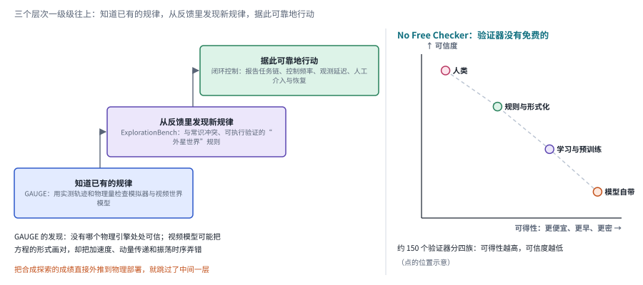

*图：左边三级台阶是物理与具身评测的三个层次，各层写着对应的工作或该报告的条件；右边是 No Free Checker 归纳的四族验证器，可得性越高，可信度越低（点的位置示意）。*

图左边三级台阶从下往上。最下面一级是知道已有的规律。[GAUGE](https://arxiv.org/abs/2608.05948) 用真实测量的轨迹和物理量去检查模拟器与视频世界模型，发现没有哪个物理引擎处处可信，视频模型可能把运动方程的形式画对，却把加速度、动量传递和振荡时序弄错，视觉质量和动力学正确是两回事。它评价的是预测与环境建模的能力，不能直接当作机器人控制的成功率。

中间一级是从反馈里发现新规律。[ExplorationBench](https://arxiv.org/abs/2609.30199) 造了一些和常识冲突、却能执行验证的合成规则，系统只有靠试验才能学会，这样就减少了预训练记忆带来的捷径，专门观察探索和规则推断。它并非真实的机器人基准，把合成探索的成绩直接外推到物理部署，就等于跳过了这一级和上一级之间的距离。

最上面一级是据此可靠地行动。具身长任务要报告任务链、控制频率、观测延迟、人工介入和恢复条件；一次末端动作的成功和多阶段操控的完成是两回事，仿真结果和真实执行也不能混用。图右边是 [No Free Checker](https://arxiv.org/abs/2609.09250) 的结论：它把约 150 个机器人策略的验证器按"谁来判断"分成四族，人类、规则与形式化方法、学习与预训练的模型，以及策略模型自带的信号；越便宜、越早、越密的验证，可信度就越低，图上那条往右下走的虚线就是这个意思。更完整的具身能力路线见[具身智能](11_embodied.md)，世界预测与规划的关系见[世界模型](10_world_models.md)。

#### 3.2.6 跨领域任务组合：覆盖更宽，也要看能力能否一起工作

扩大评测范围有两种办法：把多个领域的独立任务放进同一套测试，或者让同一个任务跨越多个工具、模态和应用。前者衡量的是覆盖面，后者检验的是组合能力。一个系统分别会检索、会读图、会写代码，还说明不了它能在同一个流程里准确地传递证据、维持状态并交付完整的产物，就像一位同学各门课成绩都不错，第一次独立带项目时照样可能手忙脚乱。

> 主线位置：对应"扩展场景"一段的 AgentBench 和"评测成为工程"一段。接 AI Agents That Matter 对可复现性的要求，处理宽覆盖带来的基础设施问题。

> **要点：** 扩大范围有两种办法；覆盖面一宽，就需要可重复的基础设施，以及来自真实部署的测试。

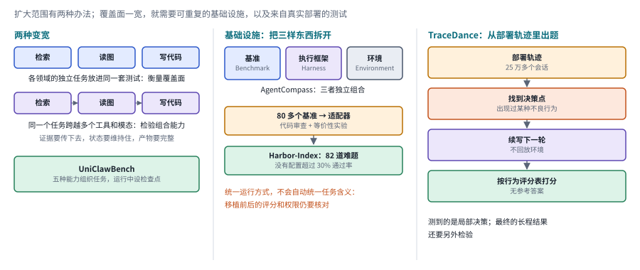

*图：左栏对比两种变宽，上排是彼此独立的任务，下排是一个任务里串起几种能力；中栏是把基准、执行框架和环境拆开的评测基础设施；右栏是 TraceDance 从部署轨迹里出题的四步。*

图左栏对比两种变宽：上排的检索、读图、写代码彼此独立，下排把它们串在同一个任务里。[AgentBench](https://arxiv.org/abs/2308.03688) 属于上排，把语言模型放进不同的交互环境，提供了跨场景观察的入口。[UniClawBench](https://arxiv.org/abs/2607.08768) 沿着技能使用、探索、长上下文、多模态和跨平台协调五种能力组织任务，并在运行中设检查点观察过程。读这类集合时，要分清每项能力是否被单独覆盖，以及哪些任务真正要求多种能力一起发挥作用。

覆盖面扩大以后，可重复的评测基础设施就变得重要起来，图中栏是两种做法。[AgentCompass](https://arxiv.org/abs/2607.13705) 把基准、harness 和环境拆成三个独立组件，可以自由组合，方便在同一套接口下组织任务和诊断。[Harbor Adapters and Harbor-Index](https://arxiv.org/abs/2609.04298) 用适配器把 80 多个基准接进同一套运行方式，并用代码审查和等价性实验核对移植是否忠实，再从中精选出 82 道难题组成 Harbor-Index，没有哪种配置的通过率超过 30%。统一的运行方式有助于扩展场景，可它不会自动统一任务的含义，移植前后的评分和权限仍然要核对。

真实部署还能补上固定基准遗漏的行为，图右栏是 [TraceDance](https://arxiv.org/abs/2609.33295) 的四步：从部署轨迹里找到出现过某种不良行为的决策点，让模型续写下一轮，再按针对这种行为的评分表打分。它不回放环境，所以测到的是局部决策，最终的长程结果还需要另外检验。把这种局部测试和完整任务评测结合起来，比直接拿轨迹样本量充当覆盖宽度更有解释力。

## 四、把长度、场景与能力放进同一张评测画像

读完前面这些分支，可以发现长度和场景并不是两个互斥的分类。软件、业务和科研里都有短任务和长任务，同一种记忆能力在不同的环境里也会以不同的方式失效。Yao 在 The Second Half 里说，下半场的研究者要像产品经理一样思考评测；落到实处，就是在读或设计一个基准时，先把它实际覆盖了什么描述清楚，用不着先去找一个包办一切能力的总榜单。下面这张表可以当作描述的坐标。

> **本节要点：** 六个维度组成一张评测画像：读或设计一个基准时，先把它在每个维度上覆盖了什么描述清楚，再拿分数去比较。

| 维度 | 应描述的条件 | 能帮助区分什么 |
| --- | --- | --- |
| 任务跨度 | 依赖链、阶段数、上下文切换、持续时间 | 真正的长程协调与单纯增加运行长度 |
| 状态变化 | 外部更新、中断、恢复、目标与政策变化 | 静态执行与动态适应 |
| 应用场景 | 软件、网页业务、GUI、科研、物理环境 | 能力覆盖的领域与环境边界 |
| 具体能力 | 感知、检索、规划、工具、记忆、探索、验证 | 局部短板与系统整体失败 |
| 组合复杂度 | 工具依赖、跨应用交接、约束冲突 | 独立能力集合与协同完成任务 |
| 迁移与积累 | 未见任务、环境变化、技能更新与遗忘 | 已有题型适应与可持续增长 |

这张画像的第一个用处是确认比较对象。一个基准只做短期的视觉问答，另一个要求在动态界面里完成业务流程，两者都涉及图像，分数却不能直接放在一起比。两个软件基准如果使用不同的终态验证和任务依赖结构，也要先说清差异，再去讨论模型或系统的进步。

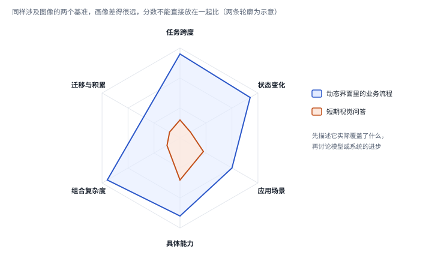

*图：六个维度的评测画像。蓝色轮廓是一个在动态界面里完成业务流程的基准，橙色轮廓是一个短期视觉问答基准，两条轮廓为示意。*

两个基准都涉及图像，可它们的轮廓几乎没有重叠：橙色的短期视觉问答只在“具体能力”一轴上有一点长度，蓝色的业务流程基准在任务跨度、状态变化和组合复杂度上都伸得很远。把两者的分数放在一起比，就像拿一份口算成绩和一篇课程论文的分数比高低。

画像本身是否可靠，也可以被检验。[What AI Benchmarks Actually Measure](https://arxiv.org/abs/2609.08812) 从测量效度出发，追问那些声称测量同一种能力的任务，是否真的提供了相近的证据。[Benchmarking the Benchmarks](https://arxiv.org/abs/2608.06329) 则从一致性、复杂度和政策覆盖三个角度检查对话基准。这些研究适合用来审视能力画像，可它们替代不了对实际任务场景的梳理。更长、更宽是覆盖的方向，只靠加难度、加领域标签，质量并不会自然而然地跟上。

## 五、支撑方法：怎样让更复杂的评测可解释、可复现

评测对象变长、变宽以后，测量本身也遇到了新麻烦。终态分数很难解释长轨迹里的失败，开放的产物需要不同的验收方式，重复运行和裁判调用又把成本推得越来越高。Anthropic 的手册把应对办法比作瑞士奶酪：每一层检查都有漏洞，多叠几层，漏过一层的问题就可能被下一层接住。下面按诊断、评分、不确定性处理和预算控制四层来讲，它们共同决定了复杂任务的得分能不能被解释，不同系统的结果能不能在同样的条件下比较。

> **本节要点：** 四层支撑方法依次回答：失败发生在哪里，开放产物怎样打分，昂贵的复核怎样分配，评测变大以后怎样保持可比。

### 5.1 长轨迹诊断：失败发生在哪里，能否被恢复

> **要点：** 一条失败轨迹里往往有好几个错误，最后报错的地方未必是根因；诊断方法要分清错误在哪里产生、怎样传播、有没有被恢复。

长任务的终态能说明有没有完成，却未必能解释为什么失败。Anthropic 那句"去读轨迹"放在长任务上就更难做到了，一条轨迹动辄几百步，人读不过来，于是需要自动诊断。难处在于，一条失败轨迹里往往不止一个错误。

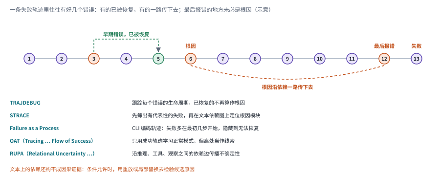

*图：一条示意的失败轨迹：第 3 步的早期错误在第 5 步被恢复，第 6 步的根因沿依赖一路传到第 12 步才报错；下方五行是本节各方法作用在哪一环。*

图里的轨迹从第 1 步走到第 13 步宣告失败。第 3 步出过一个错，到第 5 步已经被恢复；真正的根因出在第 6 步，它沿着依赖一路传下去，直到第 12 步才报错。只看最后报错的位置，就会把第 12 步当成罪魁祸首。下方五行方法都在找真正的根因，差别在线索从哪里来。[TRAJDEBUG](https://arxiv.org/abs/2608.06346) 跟踪每个错误的整个生命周期，把第 3 步这种早已恢复的错误排除在根因之外。[STRACE](https://arxiv.org/abs/2607.07702) 先从大批轨迹里筛出有代表性的失败，再沿着步骤之间的文本依赖定位相关的步骤。[Failure as a Process](https://arxiv.org/abs/2607.09510) 给 CLI 编码轨迹补了过程标注，发现失败多半在最初几步就开始了，一直藏到无法恢复。[Tracing Agentic Failure from the Flow of Success](https://arxiv.org/abs/2607.12747) 只用成功轨迹学习正常的模式，把偏离之处当作线索；它提供的是异常检测，异常和原因之间还隔着一步。[Relational Uncertainty Propagation](https://arxiv.org/abs/2608.16002) 沿着推理、工具和观察之间的依赖传播不确定性，说明局部的高置信度排除不了远处依赖带来的错误。

这些方法支撑的是对长程能力的解释。文本上的依赖还构不成因果证据，自动诊断给出的原因也未必能指导出有效的修复。条件允许时，最好通过重放或局部替换来检验候选原因；对于没法恢复的环境，则要讲明归因能达到哪一级证据。

### 5.2 开放产物评分：不同领域难以共用一套通用准则

> **要点：** 模型裁判灵活，却会受顺序、措辞、长度和数字偏好影响。近期的三种改法都想让裁判更可靠，差别在改哪里：分数怎样表示，评分准则怎样组织，数值偏置怎样校正。

程序测试、状态比较和领域专家，各自能验证不同类型的产物；开放的文本或多模态输出，有时就得请模型裁判来帮忙。Anthropic 的手册对模型评分器的态度很清楚：它灵活、适合开放任务，可结果不确定，必须和人工判断校准。[MT-Bench 与 Chatbot Arena 相关研究](https://arxiv.org/abs/2306.05685)讨论了语言模型当裁判的能力与偏差，提醒我们回答的顺序、表达方式和长度都可能影响评价。因此裁判应当围绕任务目标来设计，如果反过来让评分方式决定哪些场景值得测，就本末倒置了。

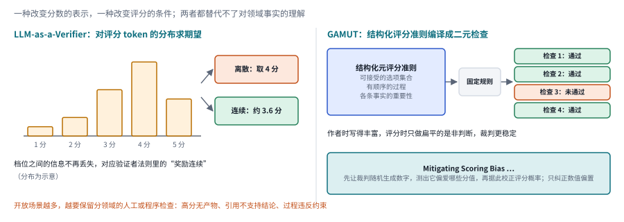

*图：左边是 LLM-as-a-Verifier 对评分 token 分布求期望得到连续分数（分布为示意）；右边是 GAMUT 把结构化的元评分准则编译成一组二元检查，下方是用随机数校正评分偏置的做法。*

第一种改法改的是分数的表示。裁判打分时，其实对 1 到 5 分各给了一个概率，传统做法只取概率最大的那一档。[LLM-as-a-Verifier](https://arxiv.org/abs/2607.05391) 对整个分布求期望，得到一个连续的分数，档位之间的信息因此保留下来，这恰好对应 Jason Wei 可验证性五条性质里的"奖励连续"。第二种改法改的是评分准则的组织。[GAMUT](https://arxiv.org/abs/2607.19322) 让作者写评分准则时可以写得很丰富，比如可接受的选项集合、有先后顺序的过程、各条事实的重要性；评分时再由一组固定规则把它编译成扁平的二元检查，裁判只需逐条判断是或否，结果就稳定得多。第三种改法是 [Mitigating Scoring Bias in LLM-as-a-Judge via Random Number Generation](https://arxiv.org/abs/2608.05726)，它校正裁判对某些评分数字的先验偏好，只纠正数值上的偏置，语义判断对不对仍需另外检查。

三种改法都替代不了对领域事实和真实交付要求的理解。开放场景越多，越应当保留分领域的人工或程序检查，尤其要审计三种情况：分数很高却没有实际产物，引用支持不了结论，以及过程违反了约束。

### 5.3 不确定性与升级：把复核预算分给难判样本

> **要点：** 级联裁判要同时满足两个条件：路由能识别不确定性，后备者真能纠正交过来的错误。

任务又长又宽以后，逐一人工检查很快就扩展不下去了。选择性验证想做的，是把较贵的检查集中到有争议的样本上。[选择性分类](https://arxiv.org/abs/1705.08500)与[模型校准](https://arxiv.org/abs/1706.04599)提供了理论基础：置信度要和实际错误率对得上，自动处理的范围和剩下的风险也要一起报告。

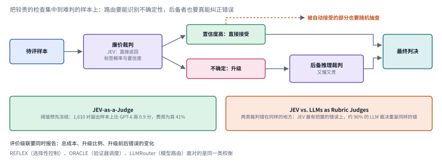

*图：置信度路由的裁判级联：廉价裁判置信度高时直接接受，不确定时升级给后备推理裁判；被自动接受的部分也要随机抽查。下方两个框是两篇 JEV 论文各自的发现。*

图从左往右是一个级联：待评的样本先交给廉价裁判，置信度高的直接接受，不确定的升级给又慢又贵的后备推理裁判。[JEV-as-a-Judge](https://arxiv.org/abs/2609.26550) 是这样做的，阈值事先冻结，在 1,610 对留出样本上，级联比 GPT-6 高 0.9 分，费用只有它的 41%。[JEV vs. LLMs as Rubric Judges](https://arxiv.org/abs/2609.29769) 却在另一些设置里看到了问题：在廉价决策器最有把握的那些错误上，约 96% 的 LLM 裁决重复了同样的错。后备者和前一级错在同一处，升级也就纠正不了什么。两项工作合起来看，路由要有效，既要能识别不确定性，也要求后备者真能纠正被交过来的错误。所以评价一个级联系统时，要同时测量总成本、升级比例和升级前后错误的变化，省下了多少次昂贵的裁判调用只是账本的一半。

同样的问题也出现在 [REFLEX](https://arxiv.org/abs/2609.26532) 的选择性控制、[ORACLE](https://arxiv.org/abs/2607.22465) 的验证器调度和 [LLMRouter](https://arxiv.org/abs/2608.06867) 的模型路由里。它们分别决定任务由谁来处理、验证在什么时候发生、资源怎样分配，比较时都必须同时报告质量和成本。图上方那条橙色虚线也适用于它们：被自动接受的那一部分样本也要随机抽查，只审计路由器挑出来的难题，会漏掉路由器自己看走眼的地方。

### 5.4 预算与重复运行：评测更大之后，如何保持可比

> **要点：** 早停和抽样能省钱，可省下来的部分要用完整运行的对照来核对；成本的单位也要讲清楚。

AI Agents That Matter 批评过只报告准确率的做法，因为准确率可以用更多的预算买来。评测规模变大以后，预算本身也成了要管理的对象。[EarlyEval](https://arxiv.org/abs/2609.02783) 利用中间轨迹预测最终结果并提前终止，可以降低开发阶段的评测成本。

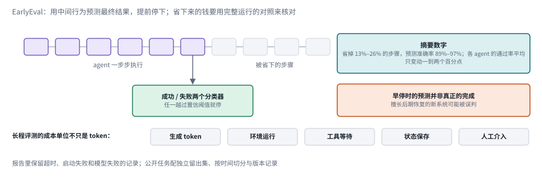

*图：EarlyEval 的早停：agent 每走一步，两个分类器就预测一次成败，任一越过置信阈值便停下；右边是摘要数字和需要警惕的地方，底部是长程评测的几种成本单位。*

agent 每走一步，成功和失败两个分类器各给出一次预测，任一越过置信阈值就停下。按论文摘要，这能省掉 13% 到 26% 的步骤，预测准确率在 89% 到 97% 之间，各 agent 的通过率平均只变动一到两个百分点。可早停时的预测并非真正的完成，一个新系统如果更擅长在后期恢复，旧的预测器就可能误判它。所以这类节约方法要保留完整运行的对照，并检查它有没有改变能力排名或失败类型的分布。

图底部那排是长程评测的几种成本单位。[Test-Time Scaling in Reasoning LLMs](https://arxiv.org/abs/2608.04001) 区分了单条轨迹延长、候选采样和前缀搜索三种做法，说明相同的 token 预算也可能对应完全不同的探索条件。长程评测的成本还包括环境运行、工具等待、状态保存和人工介入，只统计生成长度是远远不够的。跨领域比较预算时尤其要讲清楚单位，以免把某类环境里廉价的重试，当成另一类环境也能获得的资源。

最终的报告应当按任务或环境组织重复实验，保留超时、启动失败和模型失败的记录，不要有选择地删掉困难样本。公开任务还需要独立的留出集、按时间切分和版本记录，才能区分能力真的进步了、评价条件变了，还是系统适应了一个固定的基准。这和 Jason Wei 建议同时维护公开和私有测试集、并留意两者分数是否背离，是一脉相承的。

## 六、研究机会

回到本章开头那个科研助手。它在排行榜上分数很高，却在第三十步忘了自己改过的配置，又在报销系统里违反了规则。这些遭遇恰好对应 Agent 评测还没做好的三件事：真实世界的工作很少被完整地搬进基准；我们希望 agent 具备的那些新能力，比如长期记住自己做过什么、主动遵守规则，还很少被写成可检验的任务；而能让最强模型露出短板、同时又合理可解的任务，本身就很难造。Yao 说下半场的玩法是先定义有用的任务，再用通用配方去解，然后循环往复；下面三个问题，就是这个循环里最缺人做的几块。

> **本节要点：** 三个研究机会分别改评测回路里的三样东西：把真实世界做成任务和环境，把未来的能力写成可检验的成功标准，以及造出既难又合理、评分器也可信的任务。

**1. 如何把现有真实世界，或其中足够完整的一部分，做成测量 Agent 表现的 benchmark？**

真实世界里有持久的状态、业务规则、工具依赖、多人交互，以及没法预先列举的异常。这里的研究机会，在于选一个边界清楚的真实系统，尽量保留它的任务结构、状态转移和约束，让 agent 完成的工作有真实的含义；把页面或接口照搬进沙箱只是第一步。要回答的问题包括：哪些部分必须真实执行，哪些可以模拟，怎样验证任务是可行的，以及重置和复现时怎样保住那些决定难度的条件。

基准还应当覆盖自然产生的任务分布，避免只挑那些容易自动验收的工作。可以从真实流程中提取任务，构建可追溯的环境和结果检查，再比较沙箱里的表现和真实流程中的表现是否一致。Anthropic 建议从二十到五十个取自真实失败的任务起步，这对研究型基准同样是个好起点。衡量成功的标准，除了基准能跑起来，还包括它有没有漏掉重要能力，有没有保留失败和恢复，以及得分能不能解释系统在对应现实场景中的实际表现。

**2. 如何把未来希望 Agent 拥有的能力形式化为 benchmark？**

很多重要的能力，眼下还找不到现成的任务可以抓取。长期自主工作、主动发现问题、跨领域协调、持续积累经验，这些目标都要先转化成可以观察的行为要求，再去设计任务和成功条件。Anthropic 把类似的做法叫作评测驱动的开发：在 agent 还做不到之前，先把计划中的能力写成评测。研究机会在于把这些能力目标形式化为受控的任务族，讲清楚系统能获得哪些信息、能采取哪些行动，以及为什么完成任务就必须用到目标能力。

难点在于防止用一个方便测量的代理悄悄替换掉真正的能力。主动性和多调用几次工具是两回事，长程能力和输入更长是两回事，自我改进和第二次分数更高也是两回事。基准要能排除捷径：一个只是上下文更大、采样更多或者带了预设工作流的系统，是否也能完成？能把这些替代解释区分开，未来的能力才算从概念描述变成了有研究价值的测量对象。

**3. 如何构造足以挑战 SOTA 模型的复杂任务，同时保证任务合理、可解且可评价？**

任务难，基准未必就好。歧义、不完整的环境和错误的验收都会拉低分数，可这些低分说明不了模型缺少哪种能力；Anthropic 手册里的 CORE-Bench 就是前车之鉴：修好评分器的 bug、放开过紧的框架限制以后，同一个模型的分数从 42% 变成了 95%，原先的低分测到的其实是测量本身的错误。研究机会在于可控地组合任务依赖、信息缺失、动态变化、多工具交接和约束冲突，让挑战来自真实的能力需求，随机加长度或者藏起关键信息都做不到这一点。这里的 SOTA 指当前被比较的最先进系统，具体的模型、版本和预算应当由实验固定下来，它本身是一个会移动的参照。

可以研究任务生成、难度校准和对抗式扩展，并用独立的检查保证任务能执行、目标一致、验收可信。除了整体成功率，还要观察任务在哪个复杂度维度上把系统区分开，失败是否有稳定的机制，以及模型进步以后基准还能不能继续产生有效的挑战。METR 的时间地平线给了一个思路：一把能随能力增长不断延长的尺子，比一批暂时让模型拿低分的固定题目更有长期价值。

**实验资源：** [WebArena](https://github.com/web-arena-x/webarena) · [SWE-bench](https://github.com/SWE-bench/SWE-bench)。使用前核对任务、版本、数据与运行条件。
