# 09｜多模态理解：把画面读成可以推理的证据

[首页](../README.md) · [专题索引](../README.md#topics) · [文献目录](../catalog/09_multimodal_gui.md)

## 方向背景：为什么让模型“看懂”这么难

设想你把一张手机拍的电费账单发给助手，问它：“这个月比上个月多交了多少？”照片拍得有点歪，右下角还有一块反光。对人来说这只是扫一眼的事：先找到那张小小的历史用量表，认出“上月”和“本月”两行，读出两个金额，再做一次减法。可对一个模型来说，这句问话背后藏着好几个难题。它要在几百万个像素里找到那张表在哪里，要认清印得很小的数字，要知道哪一行对应哪个月份，最后还要把这些读出来的东西交给语言推理去比较。任何一步看错，后面的推理再漂亮也是在错误的证据上展开。

再换一个场景。实验室组会录了四十分钟的视频，你想知道导师是在第几分钟提到你那组实验、当时屏幕上投的是哪张图。这时难题又多了一层：画面一秒几十帧，模型一次能处理的输入装不下所有帧，必须挑着看、压着看；问题问的是“什么时候”，模型就得知道每一帧在时间轴上的位置；如果是边开会边问，模型还只能利用此刻之前发生的事。导师说的话在声音里，那张图在画面里，最后还得把两者对上。

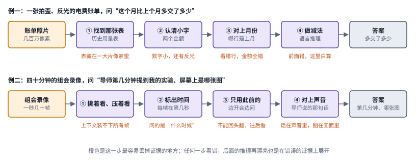

*图：把开头两个例子各拆成四道关。紫色框是模型要完成的一步，橙色字是这一步最容易丢掉证据的地方，示意。*

图里每道关下面的橙色字，写的是这一关最常见的丢证据方式：表藏在一大片像素里，数字小还有反光，看错一行金额就全错；录像那一行则是装不下所有帧、问的是“什么时候”、不能回头翻。四道关里只要有一道丢了证据，最后的答案就是在错误的证据上推出来的。

多模态理解研究的，就是怎样把图片、文档、截图、视频和声音读进模型，让它们变成语言模型能和文字放在一起推理的证据。这十几年的进展，几乎每一步都是在补前一步丢掉的某种证据：先是看不见没见过的物体，后来是看不清小字，再后来是装不下整段视频。所以读这一章的任何一篇工作，都可以先问一句：任务需要的证据原本会在哪一步丢掉，它守住的是哪一关。

多模态这一块在本仓库分成三章。这一章讲“读”，也就是理解；把画面“写”出来的生成模型在[第 16 章](16_generation.md)；让模型看着屏幕或世界去动手的多模态 agent 放在第 19 章。

## 先读这几篇

这个方向有几篇写得特别好的长文，作者都是长期在一线做模型或做工程的人。本章的发展主线以 Chip Huyen 的文章为骨架，Raschka 和 Hugging Face 的几篇补上架构细节和近两年的变化，最后两篇来自 2026 年，一篇模型拆解、一篇综述，用来把视野拉到今天。建议按顺序读。

| 顺序 | 文章 | 为什么读 |
|---|---|---|
| 1 | Chip Huyen，[Multimodality and Large Multimodal Models (LMMs)](https://huyenchip.com/2023/10/10/multimodal.html)（2023-10-10） | 最好的入门读物，本章主线的骨架就来自它。文章分三部分：先讲为什么需要多模态、有哪些数据模态和任务，再拆解 CLIP 和 Flamingo 这两个奠基工作，最后列出当时可见的研究方向，包括接入更多模态、指令跟随、更省的适配器和多模态输出。她把一个多模态系统拆成三个部件：每种模态一个编码器，一个把不同模态的表示对齐到同一空间的方法，以及（对生成式系统来说）一个负责产出文字回答的语言模型。读完这篇，后来几乎所有视觉语言模型的结构图你都能看懂。 |
| 2 | Sebastian Raschka，[Understanding Multimodal LLMs](https://magazine.sebastianraschka.com/p/understanding-multimodal-llms)（2024-11-03） | 如果说 Chip Huyen 讲来龙去脉，Raschka 讲的就是工程内部。他按图像信息怎样进入语言模型把做法归成两类：一类把图像编码成和文字 token 一样大小的向量，拼进序列交给同一个解码器；另一类把图像表示留在序列之外，通过交叉注意力层注入语言模型。随后他逐一拆解了 Llama 3.2、Molmo、NVLM、Qwen2-VL、Pixtral、MM1.5、Aria、Baichuan-Omni、Emu3、Janus 等模型，说明各自落在哪一类。读它能帮你在看到一篇新模型论文时，迅速分清它改的是编码器、连接器还是训练流程。 |
| 3 | Hugging Face（merve、Edward Beeching），[Vision Language Models Explained](https://huggingface.co/blog/vlms)（2024-04-11） | 一篇非常实用的入门手册。它解释了 LLaVA 式的两阶段训练：先冻住图像编码器和语言模型，只训练中间的投影层，让图像特征和文字特征对上；再放开语言模型，和投影层一起做指令微调。作者说这是训练这类模型最常见的方式，并拿端到端训练的 KOSMOS-2 和没有图像编码器的 Fuyu-8B 作对照。文章还介绍了 MMMU、MMBench 等评测，以及 MMBench 把选项轮换顺序、要求每种顺序都答对的 CircularEval，读完会对“分数怎么来的”多一份警觉。 |
| 4 | Hugging Face（merve 等），[Vision Language Models (Better, faster, stronger)](https://huggingface.co/blog/vlms-2025)（2025-05-12） | 一年之间视觉语言模型变了多少，这篇讲得最清楚。全文按趋势组织：任意模态进出的模型、多模态推理模型、小而能干的模型、混合专家解码器、视觉语言动作模型，然后是检测分割计数、多模态安全、多模态检索、多模态 agent 和视频语言模型。视频那一节特别值得读：大多数模型把视频当成一串帧，难点在于帧多且彼此相关，各家的办法都在减少要看的帧或标清每帧的时间，比如 LongVU 按问题挑帧，Qwen2.5-VL 处理不同帧率并标出绝对时间，Gemma 3 把时间戳和帧交错放进提示。 |
| 5 | Hugging Face（merve 等），[Supercharge your OCR Pipelines with Open Models](https://huggingface.co/blog/ocr-open-models)（2025-10-21） | 文档和小字是检验“看清”的试金石，这篇讲清了现代 OCR 已经变成视觉语言模型的一个应用。很多新的 OCR 模型都是从视觉语言模型微调来的，所以能处理低质量扫描、表格、图表和手写，还能直接回答关于文档的问题。作者强调输出格式要按用途来选：要还原版面就用保留布局的 DocTags 或 HTML，要喂给语言模型就用带图片说明的 Markdown，要做程序处理就用 JSON；模型利用框坐标这类版面信息来保持阅读顺序，也减少了幻觉。他们的结论很务实：没有一个模型在所有文档上都最好，一定要在和自己领域相近的数据上测。 |
| 6 | NVIDIA（Tuomas Rintamaki 等），[Introducing NVIDIA Nemotron 3 Nano Omni: Long-Context Multimodal Intelligence for Documents, Audio and Video Agents](https://huggingface.co/blog/nvidia/nemotron-3-nano-omni-multimodal-intelligence)（Hugging Face 博客，2026-04-28） | 一篇 2026 年的模型拆解，适合当作“今天一个完整的理解模型长什么样”的样板来读。它是标准的编码器、投影器、解码器结构：视觉编码器 C-RADIOv4-H 和音频编码器 Parakeet 各自经过一个两层 MLP 投影器接入 Nemotron 3 Nano 30B-A3B，这个语言骨干交错使用 Mamba 层、混合专家层和少量分组查询注意力层。图像这边，它放弃了上一代的切块拼图，改成保持原始长宽比的动态分辨率，每张图用 1,024 到 13,312 个 16×16 的块。视频这边，它用 Conv3D 把相邻两帧融合成一个 tubelet，让语言模型要看的视觉 token 减半，推理时再用高效视频采样（EVS）保留第一帧，之后只留下画面有变化的 token。训练分成多模态对齐与上下文扩展、偏好优化和多模态强化学习几步，强化学习里特意放进了无法回答的样本，让模型学会弃答；文档能力则靠从真实 PDF 合成的约 1140 万条问答撑起来，作者报告这批数据让 MMLongBench-Doc 的总体准确率提高到原来的 2.19 倍。 |
| 7 | Haoxiang Sun、Tao Wang、Li Yuan、Jian Zhao、Jiancheng Lv，[From Structure to Synergy: A Survey of Vision-Language Perception Paradigm Evolution in Multimodal Large Language Models](https://arxiv.org/abs/2606.26196)（arXiv，2026-06） | 一篇 2026 年的综述，把视野拉到整个领域。作者认为已有综述往往把视觉和语言分开讨论，于是把感知当作视觉语言一体的内在能力来研究。他们按“模型靠什么加强感知”给范式排序：先是改视觉编码器，用区域感知模块或多个专门编码器加强局部感知，代表有 Ferret、Honeybee、Eagle；再是加专门的解码器，从框级感知走到像素级分割，代表有 LISA、GLaMM、Sa2VA；然后是不再一次性编码整张图，反复回到图上，调度外部工具、逐步放大搜索或者写代码去看，代表有 SEAL、ZoomEye、ViperGPT、VisualSketchpad；最后是不改架构、只靠指令和强化学习提升感知，并和放大聚焦、自适应用工具、多步推理汇合成以感知为中心的 agent。作者提醒这几个阶段并非严格按时间先后排列，并把高质量数据、通用而细粒度的奖励和高昂的计算成本列为这类 agent 面前的三个难题。本章按粒度和接法讲模型怎么一步步看清，它按感知能力从结构驱动走向协同驱动排同一段历史，两者正好互补。 |

如果还想多读一点，Lilian Weng 2022 年的 [Generalized Visual Language Models](https://lilianweng.github.io/posts/2022-06-09-vlm/) 是最好的前传，它按视觉信息怎样进入语言模型，把大模型时代之前的办法分成四类：图文联合训练，把图像嵌入作为冻结语言模型的前缀，用交叉注意力融合视觉信息，以及不训练、直接组合现成模型。想看高分辨率这一步具体怎么做，可以读 LLaVA 团队的 [LLaVA-NeXT: Improved reasoning, OCR, and world knowledge](https://llava-vl.github.io/blog/2024-01-30-llava-next/)（2024-01-30）和通义千问团队的 [Qwen2-VL: To See the World More Clearly](https://qwenlm.github.io/blog/qwen2-vl/)（2024-08-29）。想知道小模型能把视频理解做到多小，可以读 Hugging Face 的 [SmolVLM2: Bringing Video Understanding to Every Device](https://huggingface.co/blog/smolvlm2)（2025-02-20）。

## 一、先看全景：读、写，以及语义和重建之间的张力

> **要点：** 语言模型只会读一串向量，所以“读图”就是把图翻译成这样一串向量，再和文字问题一起推理。这条流水线上有四处会丢证据：编码器只留语义，缩放和压缩裁掉细节，视频记忆写入时丢掉后来才重要的东西，证据还在却没被读出来。编码器为什么只留语义，取决于它当初被训练成做什么。

可以把语言模型想成一位只会读文字的读者。它读的其实是一串向量，每个向量代表一个词或词的一部分，叫作 token。要让它“看”一张账单，就得先请一位翻译把图翻成同样的一串向量，这些由图变来的向量叫视觉 token；翻译得好不好，决定了读者后面能推理出什么。翻译时漏掉的东西，读者无从知道，也就无从推理。基础的 token、训练与推理概念可以查[大模型入门](../docs/llm_primer.md)。

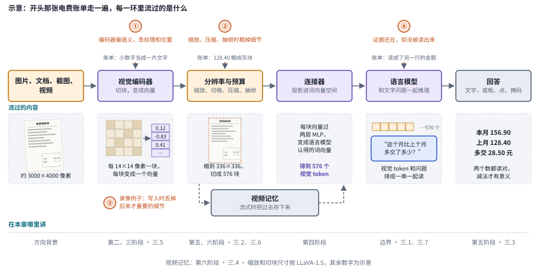

*图：一次读图的证据流水线与四个丢证据的地方。底行写着每一环在本章哪一节讲，示意。*

上图把这次翻译画成一条从左到右的流水线。图片、文档、截图或视频进来，视觉编码器把像素切成小块、每块变成一个向量；接着决定图要缩多小、切几格、压掉多少 token、视频每秒抽几帧，这是分辨率与预算；连接器把视觉向量投影到语言模型认得的词向量空间；语言模型把这些视觉 token 和文字问题放在一起推理，回答可以是一段文字，也可以是框、点、掩码这样的位置。视频多出一个记忆框，边看边答时，过去的内容要先存进去，回答时再取出来。

四个橙色圆圈是证据最容易丢的地方。第一处在编码器，它倾向于只留下“这是什么”，丢掉纹理和精确位置；第二处在预算，缩放、压缩和抽帧会把细节裁掉；第三处在视频记忆，写入时丢掉的细节，可能正是后来才变得重要的那一点；第四处在语言模型，证据明明还在表示里，模型却没有把它读出来。拿账单来说，那串小数字可能在第一处被当成“一片文字”略过，在第二处随着缩图糊掉，也可能明明保留下来，却被语言模型读成了另一行的金额。

第一处为什么会丢，要从编码器怎样训练讲起。一个视觉表示最终擅长什么，取决于它当初被要求做什么。下图把常见的视觉表示排在一根轴上：它们都把一张图变成向量，差别只在训练时被要求保留多少画面细节。最左边的 CLIP 和 SigLIP 被要求让图的向量靠近描述它的那句话，而一句话只描述内容，于是网络学会保留“这是一只猫、它在桌子上”，主动丢掉和文字无关的纹理和位置。往右，DINOv2 和 MAE 不用文字：DINOv2 要求同一张图的不同裁剪得到相似的表示，仍然偏重内容；MAE 要求根据看得见的小块补出被遮住小块的像素，已经开始偏向还原画面。最右边是专为压缩再还原图像训练的表示，比如把图压成一串离散编号的 VQ 码本，以及把图压成连续数值的 VAE，它们保留每一处像素细节，却从没被要求知道这些细节合起来是什么。

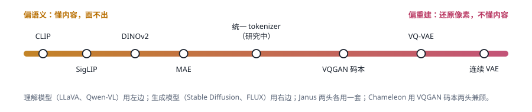

*图：常见视觉表示按“语义”到“重建”排开，左边擅长理解、画不出图，右边擅长还原、几乎不懂内容。*

本章讲的几乎所有理解模型都用左端的表示当编码器，所以它们读得懂、画不出；也正因为左端的表示会主动丢细节，“看清小字”“数清个数”“说准位置”才一再成为难题。生成模型用的是右端的表示，所以它们画得像、读不懂。想把读和写合进一个模型，就得在这根轴上做取舍，这是[第 16 章](16_generation.md)的主题；本章只在三.7 关心其中一个问题：生成那一侧保留下来的细节，能不能反过来帮助理解。

这一章在三章大地图里的位置，可以用读写矩阵来看。任何一个多模态系统都要回答两个问题：视觉信息怎样读进模型，模型的输出写成什么。表里每一行是一种读法：不读图；用一个单独训练的视觉编码器去读，这叫后融合，是今天的主流；不要单独的编码器，把图块直接变成主干模型的 token、从预训练第一天就和文字一起学，这叫早融合，也叫原生。每一列是一种写法，从只输出文字，到输出离散编号或在连续空间里去噪来生成图像，再到调用外部工具来画、输出动作。三列对应三件验收方式不同的事：读出账单上的金额是理解，画一张用电趋势图是生成，替你去缴费网站填表是行动。一个模型在理解基准上拿了高分，只说明它读得准，画得好不好、做得成不成，要分别去测。这一章讲的主要是“只输出文字”那一列。

| 读 ＼ 写 | 只输出文字 | 写离散码本编号 | 在连续潜空间里去噪 | 调用外部工具来画 | 输出动作 |
|---|---|---|---|---|---|
| 不读图 | 纯 LLM | DALL-E、Parti、MaskGIT / Muse、VAR | Imagen、Stable Diffusion、SD3 / FLUX、Sora / Veo / Wan | HuggingGPT、Visual ChatGPT（看不见工具产出的结果） | LLM 规划器加底层控制器（SayCan 一类） |
| 外接编码器读 | ViLBERT / UNITER、Flamingo、BLIP-2、LLaVA、Qwen-VL / InternVL | Janus / Janus-Pro | BAGEL、MetaQuery / BLIP3-o | VisProg / ViperGPT、o3 看图思考、VideoGen-Agent、Blender agent、VISTA | RT-2、OpenVLA、π0 / π0.5、GUI agent |
| 原生 token 读 | Fuyu、EVE | Chameleon、Emu3、Show-o | Transfusion、GPT-4o 生图（推测） | 2026 年原生基座加 agent，正在发生 | 原生多模态 VLA |

越往右下，模型要自己承担的事越多；越往左上，越依赖现成的零件拼装，也越便宜、越成熟。空格说明这个组合还没人做好，或者没有意义。CLIP 不在表里，因为它只把图和文放进同一个向量空间，既不对话也不生成，可几乎所有“外接编码器读”的系统都拿它或它的后代 SigLIP 当编码器。GPT-4o 生图那一格标了“推测”，因为官方没有公开具体做法，这是根据公开表现推断的。

下面的时间轴把三章涉及的技术线按登场先后排开。每一行是一条技术线，从上到下大致是登场顺序；值得留意的是两个汇合点：2020 年的 ViT 让视觉和语言用上了同一种网络结构，2023 年的 LLaVA 让视觉接进了大语言模型，此后几乎每条线的新工作都以语言模型为中心。

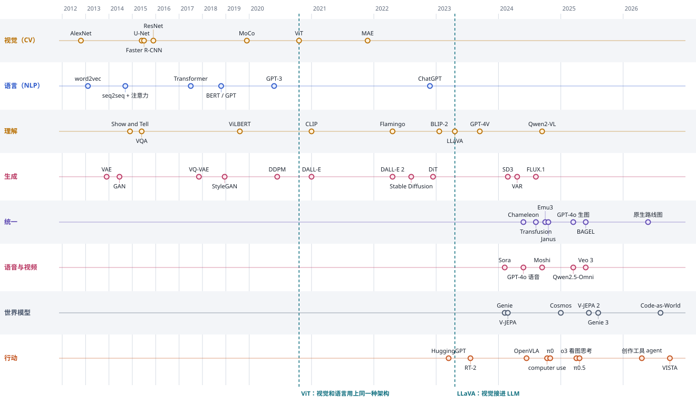

*图：多模态各条技术线的演进时间轴，年份按 arXiv 或发布时间，精确到季度左右。*

## 二、发展主线：从框出物体到看懂一段视频

把一张图读进语言模型，要回答两个问题：图切成什么粒度的单元，每个单元变成一个向量；这些向量从哪里接进语言模型。多模态理解的历史，就是这两个问题的答案一次次更换的过程，每换一次都补上了前一次丢掉的某种证据，又留下新的代价。这条主线以 Chip Huyen 的文章为骨架，借 Lilian Weng 补上大模型之前的那一段，借 Raschka 和 Hugging Face 的几篇补上 2024 年之后的变化，图则来自多模态范式图谱。

> **要点：** 粒度从整图、物体、方块一路细到按原分辨率切块，再加上时间；接法从和语言模型从头一起训练，变成把现成的编码器用越来越薄的连接件接到现成的语言模型上。每一步补上前一步丢掉的证据，留下的代价则是视觉 token 越来越多。

| 阶段 | 内容 | 代表工作 | 本章对应分支 |
|---|---|---|---|
| 起点 | 读图要解决什么：粒度与接法两个问题 | 图谱的总览 | 背景 |
| 第一阶段（2018–2020） | 先找物体：检测框特征加融合 Transformer | ViLBERT、UNITER | 三.1 |
| 第二阶段（2020） | 把图切成方块：视觉和语言用上同一种架构 | ViT | 三.5 |
| 第三阶段（2021–2023） | 用网上的图文对来学：对齐 | CLIP、SigLIP | 三.5、三.7 |
| 第四阶段（2022–2023） | 接进现成的 LLM：四种接法 | Flamingo、BLIP-2、LLaVA、Fuyu | 三.5、三.6 |
| 第五阶段（2024–2025） | 看清：动态分辨率、文档 OCR、定位作为感知输出 | LLaVA-NeXT、Qwen2-VL、NaViT、SigLIP 2、DeepSeek-OCR | 三.2、三.3 |
| 第六阶段（2023 至今） | 加上时间：视频理解与 token 预算 | Video-LLaVA、Qwen2-VL、LongVU、Qwen2.5-VL、SmolVLM2、Nemotron 3 Nano Omni | 三.4 |
| 边界 | 模型到底看见了什么；变小与压缩；读写合一 | 本章前沿分支 | 三.1、三.6、三.7 |

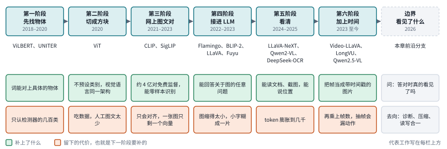

*图：发展主线的六个阶段与边界。每栏上方是代表工作，绿色格是这一阶段补上的东西，橙色格是它留下的代价。*

横着读一栏的橙色格和下一栏的绿色格，就能看出这段历史怎样推进：检测器只认几百类，下一步就不再预设类别；不预设类别的网络太吃数据，下一步就找来网上的四亿对图文；图文对齐只会配对，下一步就接上会说话的语言模型；接上之后图被缩得太小，下一步就想办法看清；看清让 token 膨胀到几千，加上时间又要再乘上帧数。最右边的边界问的是一个更朴素的问题：模型答对的时候，到底看见了没有。

### 起点：读图到底要解决什么问题

> **要点：** 把图读进模型，就是把几十万个像素数字变成语言模型能和文字一起处理的一串向量。这件事拆成粒度和接法两个问题，后面每个阶段都是其中一个答案换了一次。

语言模型只认一种输入：一串 token，每个 token 是一个向量，代表一个词或词的一部分。一张图却是几十万个像素数字。所谓把图读进模型，就是想办法把这几十万个数，变成语言模型能和文字放在一起处理的一串向量。

范式图谱把这件事拆成两个问题。第一个是看什么粒度：整张图浓缩成一个向量，先找出图里的物体、每个物体一个向量，还是把图切成小方块、每块一个向量。粒度越粗，向量越少，细节丢得越多。第二个是怎么接进语言模型：视觉和语言从头一起训练，还是把视觉特征接进一个已经训练好的语言模型；如果接，又从哪个口子接进去。

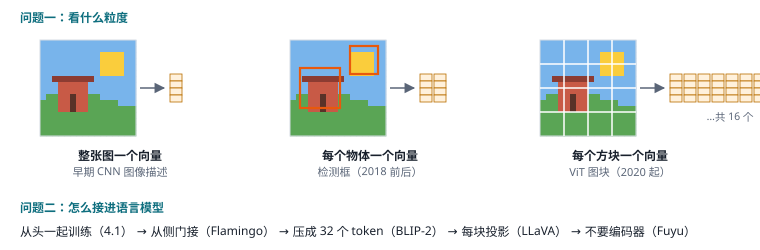

*图：读图的两个问题，看什么粒度（整图、物体、方块）与怎么接进语言模型（从头训练、侧门、压缩、投影、无编码器）。*

### 第一阶段：先找物体

> **要点：** 先用检测器框出物体，每个框一个向量，再和文字一起送进融合 Transformer。粒度第一次细到物体，代价是只能看见检测器认识的那几百类东西。

深度学习早期，最自然的想法是像人一样先认出图里有什么。2018 年前后流行的做法，是先用一个训练好的目标检测器（比如 Faster R-CNN）在图上框出几十个物体，每个框提取一个特征向量，再把这些框的向量和文字 token 排在一起，送进一个 BERT 式的 Transformer 互相看，最后在问答、图文检索这些任务上分别微调。2019 年的 [ViLBERT](https://arxiv.org/abs/1908.02265) 和 [UNITER](https://arxiv.org/abs/1909.11740) 都是这一类，Lilian Weng 把它们归在“图文联合训练”一类里。

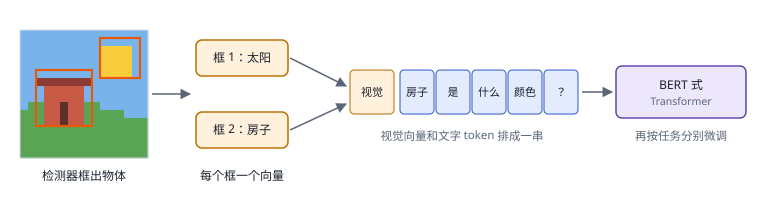

*图：先用检测器框出物体、每个框一个向量，再和文字 token 一起送进融合 Transformer。*

这一步把理解的粒度从“整张图一个向量”细化到了“物体”，模型终于能回答“左边那个人手里拿着什么”。它的短板也来自检测器：检测器只认识训练时见过的几百类物体，没框出来的东西模型就看不见；预训练用的人工标注图文只有几百万对，规模上不去；每个任务还得单独微调一遍。拿那张要比较两个月电费的账单照片来说，答案藏在角落那张历史用量表的第二行，可检测器根本没有“历史用量表第二行”这个类别。要摆脱对检测器的依赖，就得换一种不预设类别的切法。

### 第二阶段：把图切成方块

> **要点：** ViT 不再找物体，直接把图切成同样大小的方块，每块当成一个词。视觉和语言从此用上同一种架构，瓶颈随之转到数据上。

2020 年的 [ViT](https://arxiv.org/abs/2010.11929) 换了一个更朴素的办法，论文标题就说明了一切：一张图值 16×16 个词。它不去找物体，直接把图切成大小相同的小方块。一张 224×224 的图，切成 16×16 像素的方块，正好是 14×14 共 196 块，这是论文给出的设置。每块的像素拉成一长串数字，乘一个矩阵变成一个向量，就成了一个图像 token，然后这些 token 送进 Transformer，处理方式和处理一句话里的词完全一样。

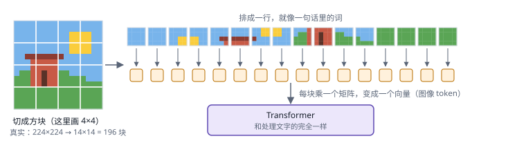

*图：ViT 把图切成固定大小的方块，每块线性映射成一个 token，再交给标准 Transformer。*

这样一来，视觉和语言第一次用上了同一种架构，模型不再依赖检测器认识哪些类别，图里每一块都有自己的 token。之后几乎所有的视觉编码器都是 ViT 或它的变体。可架构统一之后，瓶颈很快转到了数据上：人工标注的图文太少，ViT 本身又是出了名的需要海量数据才能训好。下一步要回答的是，去哪里找足够多的监督信号。

### 第三阶段：用网上的图文对来学

> **要点：** CLIP 把网上天然配对的图和文字当作免费监督，用对比学习把两者放进同一个空间。它让编码器认识了几乎所有概念，却只会配对，而且一张图只剩一个向量。

转折来自 2021 年 OpenAI 的 [CLIP](https://arxiv.org/abs/2103.00020)。网上天然存在海量“图片加一句说明”，Chip Huyen 在文章里讲清了 CLIP 怎样用好这份免费监督。如果把它当分类任务来学，类别必须事先定死；如果让模型根据图生成那句说明，又太死板，因为同一张图可以有无数种说法。CLIP 只问一件更容易的事：这张图和这句话配不配对。它有两个编码器，一个把图变成向量，一个把文字变成向量；一批里放 N 张图和它们各自的说明，算出两两之间的相似度，得到一个 N×N 的表格，训练让对角线上真正配对的分数最高，其余格子压低，这叫对比学习。CLIP 用上了约 4 亿对图文。

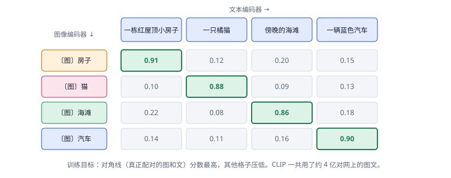

*图：CLIP 在一批图文对上算出相似度矩阵，训练让对角线（真正配对）的分数最高。*

学完之后，CLIP 的图像编码器认识的概念，从几百个固定类别扩大到了网上出现过的几乎所有东西。给它一组文字候选，它能直接判断图里是哪一个，这叫零样本识别。2023 年的 [SigLIP](https://arxiv.org/abs/2303.15343) 把对比损失换成逐对的 sigmoid 损失，训练更省、更好放大，后来成了许多开源模型的默认编码器。

CLIP 的局限也来自它的训练目标。目标只要求图和文的向量靠近，所以它学会的只有配对，不能对话，也不能生成；一句说明只描述内容，所以一整张图最后只剩一个偏语义的向量，物体的位置、小字、数量这类细节大多被丢掉。它能告诉你“这张图像一张账单”，却回答不了“上个月交了多少”。要让模型就图片说出一段话、回答任意问题，还得把这个编码器接到一个会说话的语言模型上。

### 第四阶段：接进现成的大语言模型

> **要点：** 把现成的视觉编码器接到现成的语言模型上，四种接法的差别在于中间的连接件有多厚、从哪里接进去：从改动语言模型内部，到压成几十个 token，到每块直接投影，到连编码器都不要。LLaVA 式的每块投影加两阶段训练成了主流，模型从此能回答关于图片的任意问题。

到了 2022 年，大语言模型已经很强，大家自然想到：别从头训练了，把一个现成的视觉编码器接到一个现成的语言模型上。问题只剩一个，从哪里接进去。范式图谱按时间先后列了四种接法，连接件一种比一种薄。

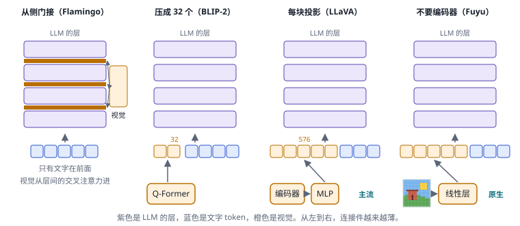

*图：四种把视觉接进语言模型的方式，从侧门交叉注意力（Flamingo）、压缩成少量 token（BLIP-2）、每块投影（LLaVA）到不要编码器（Fuyu）。*

第一种是从侧门接。2022 年 DeepMind 的 [Flamingo](https://arxiv.org/abs/2204.14198) 是 Chip Huyen 选的第二个奠基工作，她称之为大型多模态模型的 GPT-3 时刻，因为它第一次能根据图文混合的输入生成开放的文字回答。Flamingo 让语言模型保持不动，先用一个叫 Perceiver Resampler 的小网络把长短不一的视觉特征压成固定数量的向量，再在语言模型的层与层之间插入带门控的交叉注意力，文字往上走时经过这些新层，就去查询一次视觉特征。好处是语言模型原有的能力一点不受损，它还用网页里图文交错的数据训练，学会了看几个例子就照着做；代价是要在语言模型内部动手术，换一个语言模型就得重新改一遍。

第二种是压缩成少量 token 放在前面，这样就不用动语言模型内部。2023 年初的 [BLIP-2](https://arxiv.org/abs/2301.12597) 把视觉编码器和语言模型都冻住，中间只训练一个小 Transformer，叫 Q-Former，它带着 32 个可学习的“提问向量”，从图像特征里各抽一份信息，得到 32 个 token 放在文字前面。Chip Huyen 特意提到，它在零样本 VQA-v2 上超过了 Flamingo-80B，可训练参数却少了 54 倍。代价是一张图只剩 32 个 token，文档里的小字、图表里的数字、角落里的细节都在这一步丢了。

第三种是干脆不压缩，每一块都投影过去。几个月后的 [LLaVA](https://arxiv.org/abs/2304.08485) 让视觉编码器切出的每一块特征过一层线性层或两层 MLP，直接变成语言模型词向量空间里的一个 token，和文字 token 排在一起；指令数据则用 GPT-4 生成。改进版 [LLaVA-1.5](https://arxiv.org/abs/2310.03744) 用 336×336 的图、14×14 的块，一张图就是 576 个 token。结构简单到谁都能复现，图像 token 和文字 token 地位完全相同，于是成了今天的主流，Raschka 把它归为统一嵌入解码器一类。

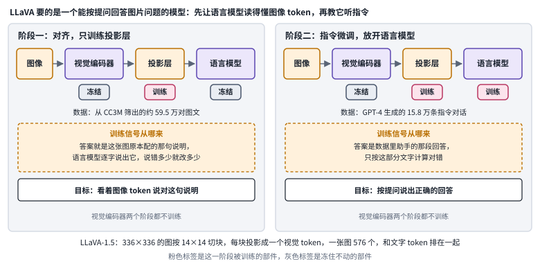

*图：LLaVA 式两阶段训练。粉色标签是这一阶段被训练的部件，灰色标签是冻住不动的部件，按 Hugging Face 入门文章的描述绘制。*

Hugging Face 2024 年的入门文章说，LLaVA 式的两阶段训练是训练视觉语言模型最常见的方式。分两步的原因在于，一开始投影层是随机的，送进去的图像 token 对语言模型来说只是噪声，这时如果一起放开语言模型，原本的语言能力容易被带偏。所以第一阶段把编码器和语言模型都冻住，只训练投影层，让投影出来的图像 token 落在语言模型读得懂的位置上；第二阶段编码器仍然冻住，放开语言模型，和投影层一起在指令数据上微调，教它按提问回答。代价写在结构里：每一块都变成一个 token，图越大，token 越多。

第四种连单独的视觉编码器都去掉。2023 年 Adept 发布的 Fuyu 让图块只过一个线性层就进语言模型，由语言模型自己学会看。这是“原生多模态”的读法，结构最统一，代价是语言模型要从零学视觉，需要大量数据，早期效果落后于有编码器的方案。这条路在 2026 年又被重新拿出来认真研究，见三.5。

这一步让问题的形式变了：模型从给图片分类，变成了按提问者的意思回答关于图片的任意问题。可是把账单照片交给这一代模型，问题马上就暴露了：图被缩到 224 或 336 像素见方，一张手机照片缩下来，表格里的小字就糊成了一片。

### 第五阶段：看清文档、小字和位置

> **要点：** 动态分辨率让模型按图的大小切出不同数量的块，文档、截图和小字终于看得清；定位也被当作一种感知输出来研究。代价是视觉 token 很快膨胀到几千。

LLaVA 团队自己先动了手。2024 年 1 月的 LLaVA-NeXT 博客介绍了 AnyRes：把高分辨率图按 2×2、1×2 到 1×4 这几种网格切开，每一格都是编码器习惯的大小，单独编码，再加上一张缩略的全图，最高支持 672×672 以及 336×1344 这类长条比例，像素数是 LLaVA-1.5 的四倍。作者说，看低分辨率图时产生的幻觉因此少了。

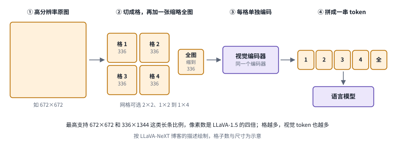

*图：AnyRes 的四步：切格、加缩略全图、每格单独编码、拼成一串 token。格子数与尺寸为示意。*

每一格保住了局部的小字，那张缩略全图则让模型知道这些格子在整张图里怎么摆。AnyRes 的好处是编码器一点不用改，代价也很直接：格子越多，送进语言模型的 token 就越多，而且网格只有几种固定比例。

更彻底的办法是让编码器本身接受任意尺寸。2023 年的 [NaViT](https://arxiv.org/abs/2307.06304) 把不同分辨率、不同长宽比的图切成数量不等的块，打包进同一个序列训练。2024 年 8 月的 Qwen2-VL 博客把这条思路带进了视觉语言模型：它称之为朴素动态分辨率，任意大小的图都映射成数量不等的视觉 token，输入的信息量和图本身更匹配；同时用 M-RoPE 把位置编码拆成时间、高度和宽度三部分，让语言模型同时知道每个 token 在图里哪一行哪一列、在视频里第几帧。为了不让 token 数爆炸，[Qwen2-VL](https://arxiv.org/abs/2409.12191) 还把相邻的 2×2 四个块合并成一个 token，数量直接降到四分之一。2025 年的 [SigLIP 2](https://arxiv.org/abs/2502.14786) 则把多分辨率、保持原始长宽比的变体做进了编码器本身。

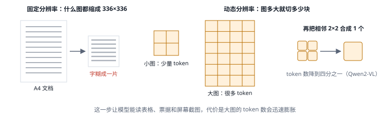

*图：动态分辨率按图的大小切出不同数量的块，再合并相邻块控制 token 数。*

看清之后，文档成了最直接的受益者。Hugging Face 2025 年的 OCR 长文说，现代 OCR 模型很多就是从视觉语言模型微调来的，它们不光能转写，还能处理表格、图表、公式，按用途输出 Markdown、HTML 或 JSON，并用框坐标保持阅读顺序。同一时期的 [DeepSeek-OCR](https://arxiv.org/abs/2510.18234) 把问题反过来问：既然一张图能装下这么多文字，能不能把长文本渲染成图、用少量视觉 token 来压缩上下文？作者报告压缩率在 10 倍以内时 OCR 精度约 97%，压到 20 倍时约 60%。这说明视觉 token 既是负担，也可以是一种很密的编码。

看清还有一层含义：说准位置。账单问题里，模型得把“上月那一行”落到画面的准确位置上，读错一行就全错。Hugging Face 2025 年的文章把这类能力归在“检测、分割与计数”一节：视觉语言模型已经能通过文字提示和专门表示坐标的 token 输出框、点和掩码。说出精确坐标对语言模型并不容易，2023 年的 [Set-of-Mark](https://arxiv.org/abs/2310.11441) 用一种讨巧的办法绕开它：先用分割模型把图切成区域、在每个区域上叠一个数字标号，模型只需要说出编号。[Qwen2.5-VL](https://arxiv.org/abs/2502.13923) 的技术报告则强调它能直接定位物体，并从发票、表单和表格里稳定地抽取结构化数据。拿这个位置去点击按钮、操作软件，就是第 19 章的事了。

下面五张结构卡用同一种画法，从左往右是一次处理流程。它们都在帮模型看清，差别在于改的是语言模型之前还是之后：前两张改的是怎样把大图切得更合适，第三张反过来用图去装文字，这三张都在语言模型之前；后两张改的是怎样把位置说出来，在语言模型之后。

 

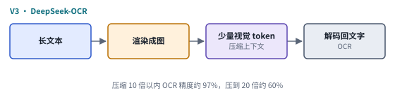 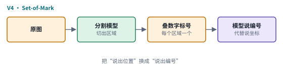

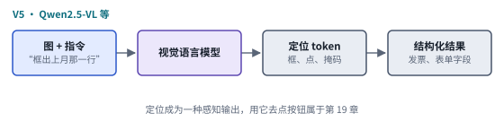

*图：第五阶段五种看清做法的结构卡，每张卡对应下表的一行。*

| code | 名称 | 年份 | 代表 | 怎么做 | 解决了什么 | 代价 |
|---|---|---|---|---|---|---|
| V1 | 切格加缩略图 | 2024 | LLaVA-NeXT（AnyRes） | 高分辨率图按 2×2、1×2 到 1×4 等网格切开，每格单独编码，再加一张缩略全图，token 依次拼接 | 编码器不用改就能看大图，最高支持 672×672 和 336×1344，像素数是 LLaVA-1.5 的四倍，低分辨率带来的幻觉减少 | 格子越多 token 越多；网格只有几种固定比例 |
| V2 | 原生动态分辨率 | 2023–2025 | NaViT、Qwen2-VL、SigLIP 2 | 任意尺寸、任意长宽比的图切成数量不等的块；Qwen2-VL 再把相邻 2×2 块合成一个 token，并用 M-RoPE 标出行、列和帧 | 输入的信息量和图本身更匹配，编码器直接接受原始长宽比 | 图越大 token 越多，高分辨率图很快到几千个 token |
| V3 | 光学压缩 | 2025 | DeepSeek-OCR | 把长文本渲染成图，用少量视觉 token 表示，再解码回文字 | 视觉 token 成了一种很密的编码，可以用来压缩上下文 | 压得越狠越不准：10 倍以内 OCR 精度约 97%，20 倍时约 60% |
| V4 | 区域标号 | 2023 | Set-of-Mark | 先用分割模型把图切成区域，在每个区域上叠一个数字标号，模型只需说出编号 | 把难以说准的坐标换成容易说出的编号 | 标号叠在图上，能指到的区域取决于先行分割切出了什么 |
| V5 | 直接输出位置 | 2025 | Qwen2.5-VL 等 | 模型通过文字提示和定位 token 直接输出框、点和掩码，并从发票、表单里抽取结构化数据 | 定位成了模型自己的感知输出，不必外挂分割模型 | 逐 token 的训练目标和精确率、召回率这类感知指标并不一致（三.3 的 Falcon Perception-HD 专门处理这个问题） |

这一步让多模态模型真正能读表格、读票据、读截图，代价也同样直接：高分辨率图的 token 数很快膨胀到几千，上下文和算力都吃紧。而当输入从一张图变成一段视频，这个数字还要再乘上帧数。

### 第六阶段：加上时间

> **要点：** 视频被当成一叠带时间戳的图片来读，大部分功夫花在压缩 token 和标注时间上。到 2026 年，相邻帧合并和按变化删 token 已经是发布模型的默认流水线。

理解视频最直接的办法，是把它当成一叠图片：先每秒抽一两帧，每帧像图片一样切块变成 token，再按时间顺序排好交给语言模型。麻烦在于数量，一分钟视频每秒抽 2 帧就是 120 帧，每帧哪怕只有两三百个 token，加起来也有好几万个；一小时的视频就完全放不下了。抽帧还有一个代价：两帧之间的快速动作根本没进模型。

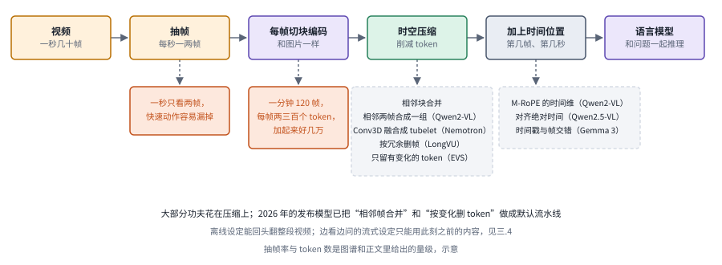

*图：视频理解的流水线。上排是处理步骤，下排橙色框是代价，灰色虚线框是本阶段讲到的代表技巧。*

所以视频流水线在图片的基础上多了两步：时空压缩，让 token 少下来；时间位置，让模型知道每一帧是第几秒。2023 年的 [Video-LLaVA](https://arxiv.org/abs/2311.10122) 让图像和视频先对齐到同一个表示空间再投影进语言模型，展示了 LLaVA 式结构几乎不用改就能看视频。之后的大部分功夫都花在压缩上：相邻的块合并，相邻的两帧合并（Qwen2-VL 把连续两帧合成一组编码），重要的片段多给 token，静止的片段少给。2024 年的 [LongVU](https://arxiv.org/abs/2410.17434) 按帧与帧之间、块与块之间的重复程度自适应地删帧和删细节，让模型在上下文限制内处理小时级视频；Hugging Face 2025 年的文章特别提到它先用 DINOv2 去掉相似的帧，再保留和文字问题最相关的那些。时间位置也要标清楚，除了行和列，还要标上“这是第几秒”：Qwen2.5-VL 处理不同帧率并对齐绝对时间，技术报告称它能把事件定位到秒；Gemma 3 则把时间戳和帧交错放进提示里。

模型变小的趋势也在视频上体现出来。Hugging Face 2025 年 2 月发布 SmolVLM2 时，把 500M 和 256M 两个版本称作当时发布过的最小的视频语言模型，500M 版本的视频能力接近 2.2B 版本，参数还不到它的四分之一，还能在 iPhone 上本地运行。

到了 2026 年，这套压缩手段已经成了模型的标准配置。NVIDIA 4 月发布的 Nemotron 3 Nano Omni 在编码器前用 Conv3D 把相邻两帧融合成一个 tubelet，让语言模型要看的视觉 token 直接减半，推理时再用高效视频采样只保留第一帧的全部 token 和之后画面有变化的部分，静止的地方一律丢掉。相邻帧合并和按内容变化删 token，从论文里的技巧变成了发布模型的默认流水线。

下面四张卡沿用同一画法。它们都在解决视频的 token 太多或时间说不准，差别在各自处理哪一头：T1 说明结构几乎不用改；T2 和 T4 都在压缩，一个按和问题的相关性挑帧，一个按画面有没有变化删 token；T3 专门解决“第几秒”。

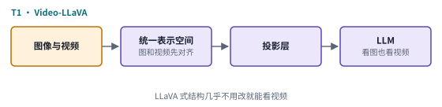 

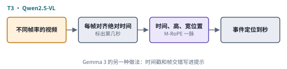 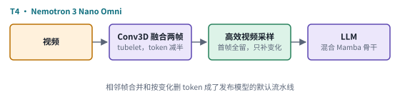

*图：第六阶段四种做法的结构卡，每张卡对应下表的一行。*

| code | 名称 | 年份 | 代表 | 怎么做 | 解决了什么 | 代价 |
|---|---|---|---|---|---|---|
| T1 | 图像视频统一表示 | 2023 | Video-LLaVA | 图像和视频先对齐到同一个表示空间，再投影进语言模型 | LLaVA 式结构几乎不用改就能看视频 | 帧数一多 token 就装不下，压缩问题原样留给后来者 |
| T2 | 按冗余与问题挑帧 | 2024 | LongVU | 按时空冗余自适应地删帧、删细节，先用 DINOv2 去掉相似帧，再保留和文字问题最相关的部分 | 在上下文限制内处理小时级视频 | 删掉的帧不会再回来，后来才变重要的细节可能已经丢了 |
| T3 | 绝对时间编码 | 2025 | Qwen2.5-VL（Gemma 3 为另一做法） | 处理不同帧率，把位置编码的时间维对齐到绝对时间；Gemma 3 则把时间戳和帧交错写进提示 | 模型知道每一帧在第几秒，技术报告称能把事件定位到秒 | 只解决“什么时候”，帧和 token 的数量问题仍要靠压缩 |
| T4 | tubelet 加高效视频采样 | 2026 | Nemotron 3 Nano Omni | 编码前用 Conv3D 把相邻两帧融合成一个 tubelet，推理时保留第一帧的全部 token，之后只留画面有变化的部分 | 视觉 token 直接减半，静止的部分一律丢掉，成为发布模型的默认流水线 | 抽帧仍会漏掉两帧之间的内容，这是整条视频路线共有的代价（见 A3） |

这些做法都假定整段视频已经上传好、问题在看完之后才来。边开组会边提问的需求就满足不了，比如会还没开完，就想知道导师刚才投的是哪张图。这时模型不能回头翻、也不能偷看未来，只能用有限的内存保住过去，这正是三.4 的流式工作在处理的问题。

### 速查：七种读法

> **要点：** 范式图谱里理解范式的六张速查卡加上视频那一张，用同一种画法并排，差别几乎都集中在图像进入语言模型之前的那一两个框上。

下面把六种读图方式和视频理解整理成一组卡片和一张表，方便回查。七张卡都画同一件事，一张图怎样走进语言模型，琥珀色是图像和视觉特征，蓝色是文字，紫色是模型；它们的差别只在中间几个框，也就是粒度和接法。表格每一行写了它补上了前人的什么短板，又留下了什么代价。

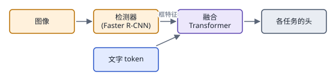 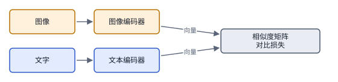 

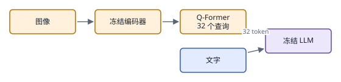 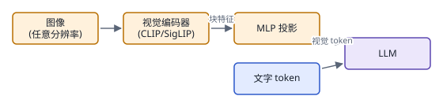 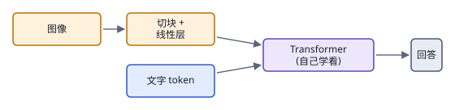

*图：七种读法的结构示意，每张卡对应下表的一行。*

| code | 名称 | 年份 | 代表 | 怎么做 | 解决了什么 | 代价 |
|---|---|---|---|---|---|---|
| R1 | 检测框特征加融合 Transformer | 2018–2020 | Bottom-Up Attention、ViLBERT、LXMERT、UNITER、Oscar | 检测器框出几十个物体、每框一个向量，和文字 token 一起送进 BERT 式 Transformer 预训练，再按任务微调 | 每个物体有了自己的向量，词可以和具体的框对上，能做指代和简单推理 | 只能看到检测器认识的几百类；人工图文只有几百万对；每个任务单独微调 |
| R2 | 双塔对比学习 | 2021–2023 | CLIP、ALIGN、OpenCLIP、SigLIP | 图像编码器和文本编码器各出一个向量，一批 N 对图文两两算相似度，配对的拉高、其余压低 | 网上图文配对是免费监督，CLIP 用了约 4 亿对，学到几乎所有概念，能零样本识别 | 只会对齐，不能对话也不能生成；一张图只剩一个向量，位置、小字、数量多被丢掉 |
| R3 | 冻结 LLM 加交叉注意力 | 2022–2024 | Flamingo、IDEFICS、Llama 3.2 Vision | 重采样器把视觉特征压成固定数量向量，在冻结 LLM 层间插入交叉注意力，只训新层 | 语言能力一点不受损；图文交错数据带来少样本能力 | 要在 LLM 内部动手术，换模型就得重改；视觉信息不在上下文序列里，没法像引用文字那样直接指着某块图说话 |
| R4 | 查询压缩桥 | 2023 | BLIP-2（Q-Former）、InstructBLIP、MiniGPT-4 | 编码器和 LLM 都冻结，只训一个带 32 个查询向量的 Q-Former，输出 32 个 token 作软提示 | 改动全挪到 LLM 外面，参数和训练成本都低，也省上下文 | 压缩太狠，小字、图表数字、角落细节在这一步丢失，后来被 R5 取代 |
| R5 | 编码器加投影层（后融合） | 2023 至今 | LLaVA、Qwen-VL / Qwen2-VL、InternVL、Molmo | CLIP 或 SigLIP 图像塔切块出特征，线性层或两层 MLP 映射成图像 token，和文字 token 一起进 LLM | 不压缩，LLaVA-1.5 一张图 576 个 token；结构简单、易复现；加上动态分辨率就能读文档和截图 | 对比学习的特征偏语义，只能读不能画；图越大 token 越多，高分辨率和长视频很快吃紧 |
| R6 | 无编码器（图块直接进 LLM） | 2023–2024 | Fuyu、EVE、SOLO | 去掉单独的视觉编码器，图块过一个线性层直接进 LLM，由 LLM 自己学看 | 任意分辨率可直接切块，整个模型只有一种结构，视觉和语言从第一天一起学 | 要从像素学起，需要大量数据和算力；早期效果明显落后于有编码器的方案 |
| A3 | 视频理解 | 2023 至今 | Video-LLaVA、Qwen2-VL（M-RoPE）、LLaVA-Video | 每秒抽一两帧，每帧像图片一样编码，再做时空压缩并加上“第几秒”的时间位置编码 | 图像理解的整套架构已经成熟，把帧当成带时间戳的图片，几乎不用改架构就能看视频 | 两帧之间的内容根本没进模型，快速动作会漏；一分钟就有几万个 token，token 预算是最大的瓶颈 |

### 边界：模型到底看见了什么

> **要点：** 越往上走，越难回答模型答对时是否真的看见了。证据可能在编码时就丢了，可能被压缩删掉了，也可能还在却没被用上；分辨这三种情况，是本章诊断、压缩和统一理解三个前沿分支的共同出发点。

主线走到这里，模型已经能读文档、看截图、回答关于一小时视频的问题。可越往上走，越难回答一个朴素的问题：它答对的时候，真的看见了吗？答错的时候，是证据在编码时就丢了，还是证据还在、模型却没用上？语义与重建那根轴已经给出了部分答案：理解模型的编码器本来就只留语义，主动丢细节；为了省 token 做的压缩、剪枝、抽帧，又会再丢一遍。

所以这条边界上的工作，都在把“答错了”拆开，差别在于它们怀疑证据丢在了哪一处。怀疑模型本身没用好证据的，去做诊断，把“看不见”“看错了”“看见了却没说出来”分开（三.1）。怀疑压缩删掉了证据的，在模型越来越小、视觉 token 越来越少的趋势下，检查压缩之后丢的是证据还是利用能力（三.6）；Hugging Face 2025 年的文章把小模型列为最重要的趋势之一。怀疑编码器只留语义的，转向读写合一的统一模型，比如 Chameleon 那样从一开始就把图文都变成 token 混着训练的[统一模型](https://arxiv.org/abs/2405.09818)，看生成那一侧为了画得像而保留下来的细节，能不能反过来帮助理解（三.7）。

2026 年 6 月 Haoxiang Sun 等人的综述 [From Structure to Synergy](https://arxiv.org/abs/2606.26196) 指出了这条边界的走向：加强感知的办法，正从改编码器、加解码器，转向在推理时反复回到图上，放大、调工具、再看一眼，并汇合成以感知为中心的 agent；作者同时提醒，数据质量、细粒度奖励和计算成本是这条路上的三个难题。也就是说，“模型到底看见了什么”正在从一次编码的问题，变成模型能不能在推理时主动回去再看一眼的问题。

看懂之后，下一步自然是动手：看着屏幕去点击、看着画面去操作。让模型根据看到的东西去行动，这条线在第 19 章（多模态 agent）继续；把看到的、想到的画成新的图像和视频，这条线在[第 16 章](16_generation.md)继续。

### 总对照：几族读法放在同一组坐标上

> **要点：** 把第二节的 R、V、A/T 三族速查卡放回“粒度”和“接法”两条轴上，就能看到主线的走向：粒度越来越细，接法越来越薄；前沿分支又回头重访了其中几格。

下图把前面所有速查卡放回读图的两个问题上：横轴是看什么粒度，从整图一个向量、检测框里的物体、固定大小的方块、按原分辨率切出的块，一直到加上时间的时空块；纵轴是怎么接进语言模型，从完全不接、只做对齐，到从头联合训练、从侧门交叉注意力、压缩成少量 token、每块投影，最后是连编码器都不要。

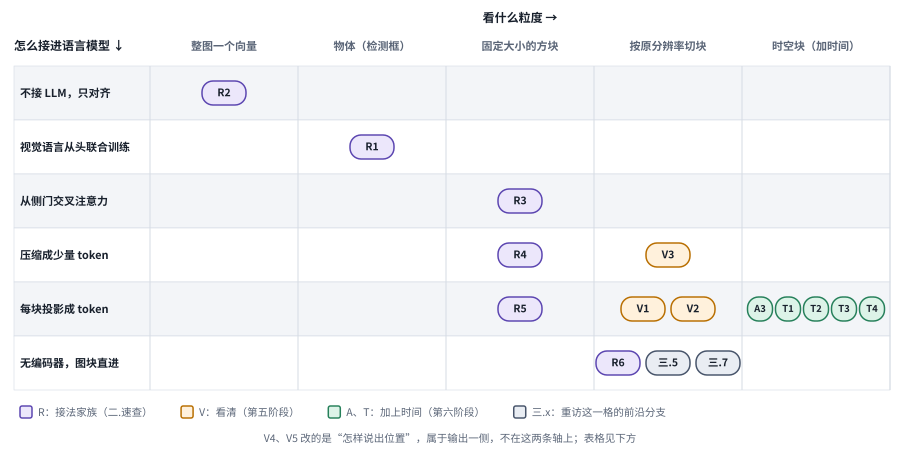

*图：本章各族速查卡在“看什么粒度”和“怎么接进语言模型”两条轴上的位置。灰色圆角块是重访这一格的前沿分支。*

紫色的 R 族沿着对角线往右下走，说明历史上粒度变细和接法变薄几乎是同步发生的。第五、六阶段的 V 族和 T 族几乎都挤在“每块投影”那一行，说明 LLaVA 式接法定型之后，进步主要发生在横轴上，也就是切得更合适、再加上时间。V3 光学压缩落在“压缩成少量 token”那一行，这一行原本属于 R4，也就是 BLIP-2 那种把一张图压成 32 个 token 的做法，它因为丢掉小字和细节被淘汰；V3 以另一种目的重新走了这条路，这次压缩的是渲染成图片的文字。最下面一行的“无编码器”曾经因为效果落后被冷落，现在三.5 的扩展律研究和三.7 的原生统一模型又回到了这一格。

下表把三族放在同一组维度上比较。判断一篇新论文落在哪一族，先问它改的是粒度还是接法，再问它补上的是哪一种丢失。

| 家族 | 看什么粒度 | 怎么接进语言模型 | 补上了什么 | 留下的代价 | 本章分支 |
|---|---|---|---|---|---|
| R 接法家族（R1–R6） | 从整图、物体到固定方块 | 从只对齐、联合训练到侧门、压缩、投影和无编码器 | 视觉终于能接上会说话的语言模型，问题从分类变成任意问答 | 图被缩到 224 或 336 见方，小字和细节在编码与压缩时丢掉 | 三.5、三.6 |
| V 看清家族（V1–V5） | 按原分辨率切块，或切格加缩略图 | 基本沿用每块投影；V3 改为压缩，V4、V5 改输出 | 能读文档、截图和小字，能把位置说出来 | 视觉 token 膨胀到几千；位置输出和感知指标不完全一致 | 三.2、三.3 |
| A/T 时间家族（A3、T1–T4） | 带时间戳的帧和时空块 | 每块投影，前面加时空压缩 | 不改架构就能看视频，能说出事件在第几秒 | 两帧之间的内容没进模型；token 预算仍是最大瓶颈 | 三.4、三.6 |

## 三、前沿研究方向

主线把模型带到了能读文档、看视频的地步，可证据仍会在读图流水线的四处丢掉：编码器只留语义，缩放和压缩裁掉细节，视频记忆写入时丢掉后来才重要的东西，证据还在却没被读出来。2026 年的前沿工作都在守这几处，差别只在守哪一处、怎样守。读每一篇时，可以拿那张拍歪、反光的电费账单来问：这篇工作改善的是“找到那张表”“认清小字”“对上月份”中的哪一步，它的收益能不能一直保留到最后那次减法。

> **本节要点：** 七个分支都在问任务需要的证据丢在了哪里、怎样补回来，按它们守的位置排开：先用诊断找出最早丢证据的一层，再分别处理细节、位置和时间这三类最容易丢的证据，然后回到编码器本身，再看压缩之后证据还用不用得上，最后问生成一侧保留的细节能不能帮理解。第四节的矩阵把每个分支对应到流水线的具体一环。

### 1. 感知诊断：先找出最早的错误

一个看图任务失败了，第一反应往往是“模型没看清”。可仔细想想，读一张账单同时需要找到区域、认出字符、理解表格结构和完成推理，这几件事里任何一件出错，最后的表现都是一样的错答。模型可能把数字认对了，却对错了行；也可能把一个字认错了，却靠周围的版面猜对了答案。如果把所有失败都笼统地归给“视觉能力不够”，提高分辨率、改提示、加训练数据这些改动就都成了盲目的尝试。诊断要做的，就是把输入是否可见、视觉证据有没有被检索出来、内部是否已经编码了正确答案、输出时有没有说出来这几层分开，找出最早卡住表现的那一环。

> 主线位置：边界“模型到底看见了什么”。第三阶段的 CLIP 式编码器为了配对文字只留语义、主动丢细节，第五阶段的动态分辨率又让小字终于看得清；本分支追问，在这之后模型到底还在哪一类视觉能力上不行，错在哪一层。

> **要点：** 把一次失败分到输入、视觉访问、检索、内部编码和读出五层，先用广域审计找弱项，再用原子测试缩小范围，最后用探针和干预确认证据在哪一层丢掉或没被说出来。

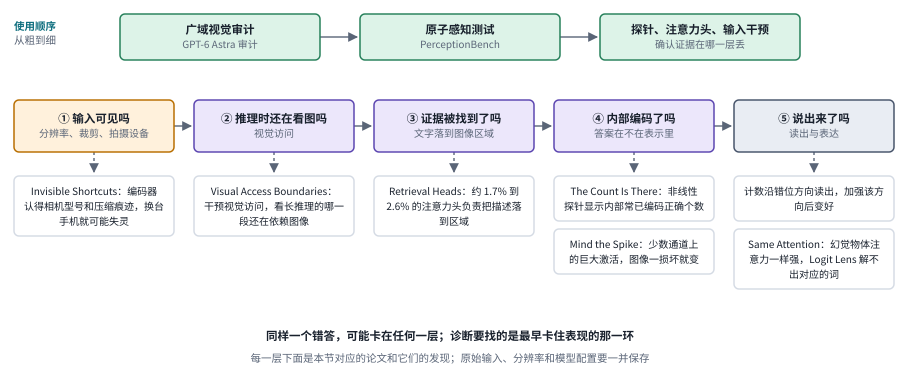

*图：感知诊断的五层与本节论文。顶部是从粗到细的使用顺序，下方每一层挂着检查这一层的工作。*

上图中间那一排是一次读图要过的五层：输入本身可不可见，推理时还在不在看图，文字描述有没有落到正确的图像区域，正确答案在模型内部有没有被编码，以及最后有没有被说出来。每一层下面挂着检查它的论文。最上面那一排是使用顺序：先画一张粗的能力轮廓，再用细的测试缩小范围，最后钻进模型内部确认，一步比一步细。

最粗的一步是画一张全面的能力轮廓。[2609.35718 · Hard Vision, Easy Vision: What GPT-6 Astra Reveals Across Computer Vision](https://arxiv.org/abs/2609.35718) 建立了一套跨能力的视觉审计，把语义解释和几何度量、忠实重建、时序上的密集预测分开来测。方法上，它改变任务与输出的类型，再与合适的参考结果比较，看模型的优势是否稳定。对初学者最有用的是这种按任务画轮廓的视角：同一个模型可能很会描述一个场景，却没办法精确地恢复距离，因为理解模型的编码器偏语义，会主动丢掉精确的几何和位置细节。它的局限也在覆盖面上，审计铺得广，对某一个具体的应用流程未必有足够的诊断力。

往细处钻一步，要找出模型最早在哪里失败。[2607.24957 · PerceptionBench: Evaluating Atomic Visual Perception in Multimodal Large Language Models](https://arxiv.org/abs/2607.24957) 不追求大而全，它从已有基准里找出模型最早失败的那一步，据此构造一套原子感知的分类，再设计只需要短答案的题目，尽量减少知识储备带来的干扰。这样，“模型看不见什么”就变成了一组可以单独测量的子项。它的分类依赖当代的模型和分析器，模型一换代，题目最先暴露的错误也可能跟着变。静态的原子题适合用来查病因，要拿它直接换算整项任务的成功率，就走得太远了。

最细的一步是钻进模型内部，看证据在哪一层丢的。[The Count Is There, but Misaligned: Understanding and Correcting Counting Failures in VLMs](https://arxiv.org/abs/2607.09544) 研究视觉语言模型为什么数不清物体。作者在四个模型、五个计数数据集上训练探针，发现非线性探针能可靠地识别出计数错误，说明模型内部常常已经编码了正确的个数，只是说出来的时候沿着错位的方向读出；他们用因果干预加强这一方向，计数确实变好了。[Retrieval Heads Meet Vision: Uncovering How VLMs Locate and Extract Visual Information](https://arxiv.org/abs/2608.27417) 借鉴语言模型里的检索头，在十一个视觉语言模型里找到了约占 1.7% 到 2.6% 的一小组注意力头，它们对“把文字描述落到图像区域”负有因果责任。[Same Attention, Different Truths: Put Logit-Lens over Visual Attention to Detect and Mitigate LVLM Object Hallucination](https://arxiv.org/abs/2608.07302) 则发现，真实物体和幻觉物体在中后层得到的视觉注意力一样强，差别在于用 Logit Lens 解码高注意力区域时，真实物体能解出对应的词，幻觉物体解不出来；作者据此把幻觉分成“视觉上易混淆”和“上下文先验带偏”两种机制。三篇放在一起看，“看见了却没说出来”是一类很常见、也很可以修的失败。

还有三篇检查的是另一类问题：模型的答案到底依据的是不是画面里的内容。它们怀疑的替代依据各不相同，一篇怀疑长推理早已不再看图，一篇怀疑编码器借用了拍摄设备留下的痕迹，一篇检查少数异常数值是否稳定。[Visual Access Boundaries in Vision-Language Model Reasoning](https://arxiv.org/abs/2607.12815v1)（v1） 在生成过程中按层和按时间屏蔽生成内容对图像 token 的注意力，找出保持准确率所需的最小视觉访问范围，以此判断一段长推理是真的在重新观察，还是只在文字上继续往下延展。该文 [v3](https://arxiv.org/abs/2607.12815v3)已更改题名和摘要，进一步讨论属性表达与先前图像访问的影响；这里两个版本的实验证据分开引用，不混在一起，详见[版本说明](../docs/version_notes.md)。[Invisible Shortcuts: Why Vision Encoders Know Your Camera](https://arxiv.org/abs/2608.05424) 发现，大规模语义监督会让图像处理方式、拍摄设备这类肉眼看不见的像素痕迹和语义产生关联，编码器于是借这些痕迹走捷径；作者人为加强这种关联后，模型对痕迹更敏感，痕迹分布一变表现就下降。这提醒我们，模型换了一台手机拍照就失灵，原因未必出在对象语义上，可能只是它认得的“拍摄指纹”变了。[Mind the Spike: Mechanisms and Brittleness of Visual Massive Activations in Large Vision-Language Models](https://arxiv.org/abs/2609.32808) 研究视觉 token 上的“巨大激活”：有些模型会在少数固定通道上出现比平常大几千倍的数值，作者从权重里找到了触发这种尖峰的方向，发现出现尖峰的往往是和图里其余部分最不相像的那些 token，并发现它非常脆弱，常见的图像损坏就会让它变化。

把这几篇放在一起，可以得到一套分层使用的办法：先用广域的视觉审计发现弱项，再用 PerceptionBench 这样的原子测试缩小错误范围，然后用探针、注意力头和输入干预确认证据在哪一层丢了或没被读出。整个过程中，原始输入、分辨率和模型配置都要一并保存下来，否则某次裁剪失误造成的错误，很可能被误写成模型能力的结论。

### 2. 看清细节：高分辨率、OCR 与文档解析

动态分辨率让模型按图的大小切出不同数量的块，终于能读文档和小字。可“能读”离“读得又准又省”还很远。一页 A4 文档密密麻麻全是字，按原分辨率切块会产生几千个视觉 token；一份几十页的合同，输出的文字又会让语言模型的缓存越长越大。更麻烦的是，自然图像上训练出来的编码器偏语义，字符的笔画、表格的线条恰恰是它最容易丢掉的东西。所以这个分支的工作都在回答同一个问题：怎样把文档里的细节保下来，同时让计算量不至于失控。

> 主线位置：第五阶段“看清”。接 LLaVA-NeXT 把大图切格编码的 AnyRes、Qwen2-VL 按原尺寸切块的动态分辨率、DeepSeek-OCR 把文字渲染成图来压缩的做法，以及 Hugging Face OCR 长文里“按用途选输出格式、在自己领域上测”的建议。

> **要点：** 文档理解要在保住笔画和版面细节的同时控制计算量。这个分支的工作分别改了眼睛、数据、解码和观察策略四处，评测时要把识别、阅读顺序和结构错误分开统计。

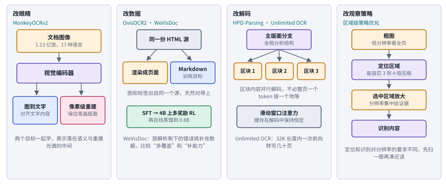

*图：看清文档的四个着力点。每一栏是一类改法，栏内是代表论文的做法。*

这些工作都想让文档读得又准又省，差别在于改的是哪一处：编码器、训练数据、输出文字的解码过程，还是看图的策略。上图按这四处分成四栏。

先看眼睛本身。[MonkeyOCRv2: A Visual-Text Foundation Model for Document AI](https://arxiv.org/abs/2607.11562) 指出，主流视觉编码器在自然图像上预训练，没有面向文档的适配就看不清密集的字符笔画。作者构建了据其所知最大的文档图像预训练语料，含 1.13 亿张、17 种语言的图像，并让模型同时学两件事：图到文字的生成，负责让视觉表示和文本内容对齐；像素级的文档重建，负责保住笔画和版面细节。在从语义到重建的那根轴上，它正好落在中间，说明文档理解需要的表示比普通看图更偏向还原画面的一侧。

再看端到端解析。[OvisOCR2 Technical Report](https://arxiv.org/abs/2607.13639) 是一个 0.8B 的端到端文档解析模型，输入一页文档图像，按自然阅读顺序输出覆盖文字、公式、表格和图片区域的 Markdown。它的数据引擎把筛选过的真实文档标注和合成页面结合起来，合成页面的图像和 Markdown 目标来自同一份 HTML 源，所以标签天然对得上；训练则依次经过监督微调、在 4B 分支上做多项奖励的强化学习、再在线蒸馏到 0.8B 模型。作者报告它在 OmniDocBench v1.6 上得到 96.58 的总分，一个端到端模型站到了过去由流水线方法占据的榜首。[WeVisDoc: From Coverage to Capability for Robust End-to-End Document Parsing](https://arxiv.org/abs/2609.20423) 换了一个角度看数据：它根据文档解析剩下的错误来挑选补充数据，比较“多覆盖一些页面类型”和“针对性地修补某项能力”这两种做法各自带来多少收益。

然后是长文档的计算瓶颈。[HPD-Parsing: Hierarchical Parallel Document Parsing](https://arxiv.org/abs/2607.18839) 观察到，版面必须全局分析，各个区块的内容却可以并行解析，于是用一个主版面分支组织整页结构，再把区块内容分派给并行的分支去解码，打破了整页逐 token 生成的顺序瓶颈。百度的 [Unlimited OCR Works](https://arxiv.org/abs/2606.23050) 在 DeepSeek-OCR 的高压缩编码器之上，把解码器里所有注意力层换成参考滑动窗口注意力，让缓存在整个解码过程中保持恒定，作者报告在标准的 32K 最大长度内，一次前向就能转写几十页文档。两篇工作分别从“并行”和“定长缓存”两个方向回答了同一个问题：文档越长，解码越不该线性变慢。

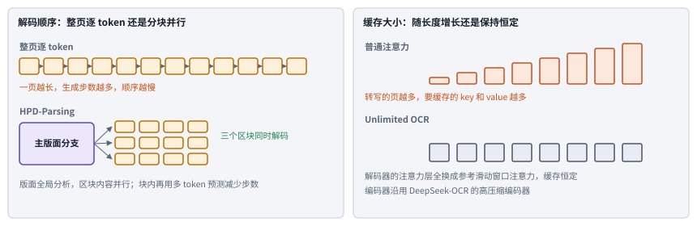

*图：长文档解码的两条路。左边比较整页逐 token 与分块并行，右边比较缓存随长度增长与保持恒定，示意。*

图里补了两处正文没说的细节：HPD-Parsing 在每个区块内部还用一次预测多个 token 的办法减少步数；普通注意力转写的页越多，要缓存的中间结果就越多，显存和速度都跟着变差，Unlimited OCR 换成滑动窗口之后，缓存始终是同样大小。

细节和分辨率之间还有一层更精细的取舍。[Region-Level Policy Optimization for Fine-grained MLLM Perception](https://arxiv.org/abs/2609.19745) 做了一个对照诊断：定位感兴趣的区域和识别区域里的内容，对分辨率的要求不一样，定位能容忍大约三到四倍更强的 token 压缩。于是更省的办法是先用粗图找区域，再把分辨率集中在选中的证据上。人读账单也是这样，先扫一眼找到那张小表，再凑近去读数字。

反过来，文字本身也可以当作图来学。[Scalable Visual Pretraining for Language Intelligence](https://arxiv.org/abs/2607.09657) 质疑“语言模型只能用纯文本训练”这个默认假设：文档和网页里的图表、排版公式和版面承载了文字转写不了的信息，作者系统研究了直接用文档图像做无监督预训练的几种范式，报告它是一种可以扩展的学习方式。[OCG: Optical Character Grounded Visual Reasoning with Flow Matching](https://www.alphaxiv.org/abs/2608.ocg-optical-character-grounded-reasoning) 走得更远，它把视觉推理改写成图到图的生成任务，问题和答案都以字符的形式画在 RGB 图像里，作者报告在 CLEVR 上的精确匹配率达到 94.6%，接近 98.1% 的 OCR 上限。

评测这类工作时要像 Hugging Face 那篇长文建议的那样，在和自己任务相近的文档上测，并把识别错误、阅读顺序错误和结构错误分开统计；一个总分很高的模型，可能恰好在你最关心的那种表格上表现很差。

### 3. 定位与空间理解：把语言落到画面的位置上

“上月那一行在哪里”“杯子在笔记本的左边还是右边”“从门口走到窗边有多远”，这些问题都要求模型把一句语言描述落到画面的具体位置上，或者理解物体之间的空间关系。CLIP 式的编码器为了和文字配对，只留语义、主动丢掉精确位置，所以空间能力一直是视觉语言模型的短板。补强它的路线大致有三条：接入额外的几何或分割模块，带来更精确的信息，代价是部署时多一个组件；直接用空间问答数据微调，可模型可能在学会题目格式的同时损伤原有的语言能力；或者从视频和第一人称经验里自动构造空间监督。这一节的工作都在这几条路之间找办法。

> 主线位置：第五阶段“说准位置”。接 Set-of-Mark 在区域上叠数字标号、让模型只说编号的做法，Qwen2.5-VL 直接输出框和点的能力，以及 Hugging Face 2025 年梳理的检测、分割与计数；这里把定位当作感知输出来研究，用定位去操作界面的部分在第 19 章。

> **要点：** 说准位置可以像别的能力一样被直接训练和优化，输出可以从点一路细到透明度蒙版。补空间能力有三条路：部署时接额外模块，训练时补几何，或者从视频和第一人称经验里造监督。

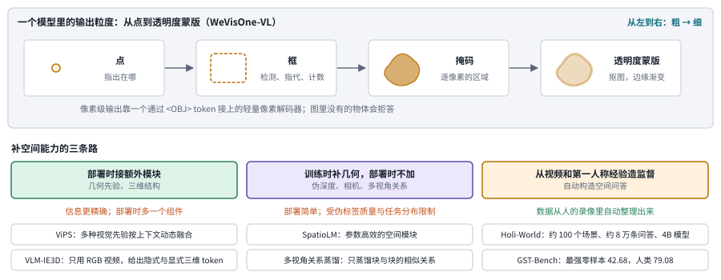

*图：上：一个模型里从点到透明度蒙版的输出粒度；下：补空间能力的三条路，每条路下面是本节的代表论文。*

上图上半部分是“说准位置”可以细到什么程度：点只回答在哪里，框能做检测、指代和计数，掩码给出逐像素的区域，透明度蒙版连边缘的渐变都要还原。下半部分是补空间能力的三条路，它们的分歧在于几何信息什么时候进入模型：第一条在部署时一直带着额外的模块，第二条只在训练时借几何信息，第三条从人的第一人称录像里自动整理出空间问答。

先看把检测、分割和计数统一进一个模型的工作。腾讯的 [WeVisOne-VL: Unified Visual Perception from Objects to Pixels](https://arxiv.org/abs/2610.31329) 用结构化的下一个 token 预测，在一个模型里同时做目标检测、指代定位、计数、OCR、分割和抠图，输出的粒度可以从点和框一直细到掩码和透明度蒙版；像素级输出靠一个通过特殊 `<OBJ>` token 接在模型上的轻量像素解码器。训练是三阶段监督微调加多任务强化学习，作者还报告模型会拒绝回答图里不存在的物体。[Falcon Perception-HD: High Density Perception via Reinforcement Learning](https://arxiv.org/abs/2608.18881) 关注极度拥挤的场景，它指出逐 token 的交叉熵和精确率、召回率这类感知指标并不一致，于是用 GRPO 直接对齐评测指标，为集合形式的输出设计奖励，作者报告在一张图多达 500 个物体的场景里取得了最好的结果。两篇工作都在说明，“说准位置”可以像别的能力一样，被强化学习直接优化。

再看空间推理。下面几篇都想补上空间能力，差别在于几何信息从哪里来、什么时候进入模型。[2608.01899 · SpatioLM: Towards General Physical Spatial Intelligence in Vision-Language Models](https://arxiv.org/abs/2608.01899) 用参数高效的空间模块去激活视觉语言模型里已有的空间知识，训练时用伪深度和相机信息提供监督，推理时就不必再额外接一个大型空间编码器，展示了“训练时补几何、部署时少加组件”的一条路线。它的局限在伪标签的质量和空间任务的分布上。[2608.10864 · Multi-View Relational Distillation for Spatial Reasoning with Vision-Language Models](https://arxiv.org/abs/2608.10864) 换了一个监督对象：它不直接复制几何教师的特征，转而蒸馏不同视角下图像块之间的相似关系。打个比方，它教学生的是“哪两块区域应该对得上”，至于每块区域内部怎么表示，留给学生按原来的图文空间去安排，这正好回应了一个冲突：如果直接要求视觉特征去贴近几何教师的特征，表示就会被拉离原来和文字对齐的空间，语言能力随之受损。[Beyond Single Expert: Harmonizing Diverse Visual Priors in MLLMs for Spatial Understanding](https://arxiv.org/abs/2607.15054) 发现，不同的视觉基础模型提供的空间先验各有所长、适合不同的任务，于是提出 ViPS，用一个低开销的先验代理生成多种先验，再按上下文动态融合。[3D-Aware VLMs with Implicit and Explicit Geometries](https://arxiv.org/abs/2607.21595) 只用 RGB 视频，同时给模型提供捕捉几何先验的隐式 token 和编码重建出的三维结构的显式 token，再用一个三维感知的适配器把它们和二维视觉线索融合起来。

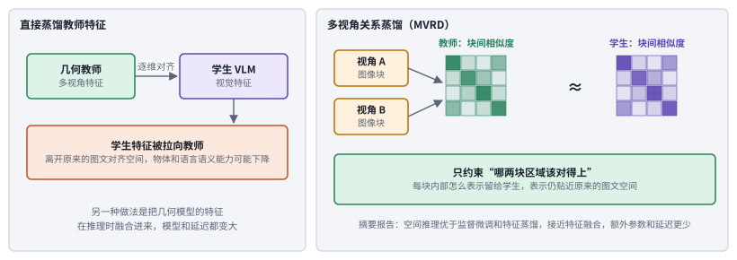

*图：左：直接蒸馏几何教师的特征，学生特征被拉离原来的图文空间；右：多视角关系蒸馏只蒸馏块与块之间的相似度。*

上图右边画出了关系蒸馏的具体做法：同一场景的两个视角各切成图像块，教师先算出块与块之间的相似度表，学生只需要让自己的相似度表和它接近。相似度表只规定哪两块区域应该对得上，每块区域本身用什么向量表示并没有被规定，学生就可以继续待在原来的图文空间里。论文摘要报告，这样做的空间推理好过监督微调和特征蒸馏，接近把几何特征直接融合进来的效果，增加的参数和延迟却少得多。

还有一个更根本的问题：视觉表示本身有没有“空间感”？[SeeSE3: Emergence of 3D Space in Vision Features](https://arxiv.org/abs/2607.14228) 不去回归深度和法向这类以图像为中心的量，转而检查视觉特征空间的结构和三维欧氏变换之间的关系，作者报告，自监督视觉模型虽然从没有直接的三维监督，也已经具备了潜在的三维结构。这说明，靠和文字配对训练出的偏语义表示，和不用文字的自监督表示，在空间信息上保留的东西并不一样。

把空间从单张图扩展到长时间的视频和第一人称经验，难度又上一个台阶。[GST-Bench: Can VLMs Develop Global Spatial Awareness from Video?](https://arxiv.org/abs/2608.05747) 要求模型从连续的视频流里推断没见过的视角，并把第一人称观察映射到俯视图上；作者评测了 22 个模型，最强的零样本模型只得到 42.68 分，人类是 79.08 分。[Holi-World: Building Holistic World Intelligence from Human-Ego Experience](https://arxiv.org/abs/2610.26549) 尝试从源头上补数据：它把人类的第一人称录像自动整理成“世界记录”，把持续存在的场景结构、不断变化的物体状态和交互历史连接起来，从约 100 个自采场景中得到约 8 万条问答，训练出一个 4B 模型，并用独立的人工标注构建评测集。作者报告，用这些数据训练明显改善了模型的空间和时间推理。

定位做准之后，还要把位置用进回答里。下面四篇都在处理这一步，差别在于位置信息在回答的哪个环节被用上。[Qwen-3D: A Generalist 3D Vision-Language Model for Spatial Understanding](https://arxiv.org/abs/2608.02980) 认为三维几何本身就是压缩视觉流的好办法，深度和相机位姿能把不同视角、不同时刻的观察融合成一个持久的场景表示；它还指出已有三维模型用文字 token 传递三维预测，在语言推理和稠密几何预测之间形成瓶颈，于是改进了几何感知的解码。[ReToken: One Token to Improve Vision-Language Models for Visual Retrieval](https://arxiv.org/abs/2607.28627v1)（v1） 针对长上下文里证据明明在、模型却找不到的问题：干扰项越多，表现越差，一次处理所有 token 又太贵。它训练一个可学习的向量作为检索目标，从已经算好的视觉缓存里挑出少量和问题相关的视觉 token。[v2](https://arxiv.org/abs/2607.28627v2)已改名为 *ReToken: Improving Long-Context VLMs with Visual Retrieval Token*，引用时要注明所用的版本。[Mixture-of-Thought-Tokens: Unifying Perception and Reasoning for Free-form Multimodal Grounding](https://arxiv.org/abs/2607.24407) 指出两类已有做法各有短板：用文字输出坐标或编号，对密集的物体感知不够；用特殊 token 表示位置，这些 token 本身没有空间含义，解码时也没有思考步骤。它引入带空间位置的“思考 token”，让定位和推理在同一套中间表示里进行。[MJev-Spatial: System One Spatial Intelligence via Native Attention Matching](https://arxiv.org/abs/2610.22276) 则质疑“空间问答一定要生成文字答案”：选择题的选项、数值区间、图像区域都可以当成候选类别，用骨干模型已有的查询和键投影直接打分，不加任何参数，一次前向就给出答案。作者报告它基于 Qwen3.5-4B，在 12 个基准中的 7 个上排第一，并且在全部 12 个上超过未改动的自回归底座，速度比最快的自回归基线快 2.5 倍。这类“快速直觉式”的系统一模型，是 2026 年 10 月很热的一个话题，热词背景见[热词章](17_hot_words.md)。

比较这些工作时，要分清它改的是输出接口、监督对象、先验来源还是数据来源。公平的比较应当同时报告空间能力、通用问答有没有退化、额外的参数量和延迟；分析失败时，也要把“选错了目标”和“位置偏了一点”分开，这两种失败需要完全不同的修法。

### 4. 视频理解与流式记忆：token 预算、时间定位和实时回答

拿一段四十分钟的组会录像来说。把整段视频上传之后问“导师在第几分钟提到我的实验”，这是离线视频理解，难点在于帧太多装不下、时间要说得准；边开会边问“刚才那张图是谁的”，这是流式视频理解，模型只能利用此刻之前发生的事，没法回头翻、往后看。两种设定都要在 token 预算里做取舍：每秒多看几帧，快速动作不容易漏，上下文却很快被撑满；只存文字摘要很便宜，却可能永久丢掉小字、表情和物体的位置。比较这类系统时，要固定可见的时间范围和帧预算，并把事件发现、时间定位和答案内容分开评价。

> 主线位置：第六阶段“加上时间”。主线把视频当成一叠带时间戳的图片来读，功夫花在两件事上：压缩 token（Qwen2-VL 合并相邻两帧，LongVU 按冗余删帧），以及标清时间（Qwen2.5-VL 对齐绝对时间）。这些做法都假定整段视频已经在手上，本分支还要处理边看边答的流式设定。

> **要点：** 离线视频要在帧预算里把时间说准，流式视频还要在不能回看的条件下用有限内存保住过去。四种流式方案把记忆分别放在后台模块、视觉潜表示、快权重和文字记录里，各有各的省法和丢法。

*图：一分钟视频每秒抽 2 帧就是 120 帧、好几万个 token，所以视频理解的大部分功夫都在压缩上。*

先看一个把视频研究放进同一框架的综述。[Reading, Writing, Sharing, and Interacting with the World through Video](https://arxiv.org/abs/2610.31668) 是一篇 2026 年 10 月的综述，作者把一段观察到的视频看作对潜在世界的一个局部、有损、按时间排列的视图，用四个动作来组织视频研究：读，就是从视频里推断世界的属性；写，就是按条件生成视频；共享，就是用同一套机制结合理解与生成；交互，就是随着动作和新观察到来去预测和更新世界状态。作者特别区分了视频序列内部的时间连贯和底层世界状态的一致，并判断这个领域正从片段级识别转向持续状态、可控变化和以下游决策为依据的评测。本分支讲的基本都在“读”这一格里，“写”在第 16 章，“交互”在[第 10 章](10_world_models.md)和第 19 章。

再看离线视频。下面三篇都想让模型在整段视频上答得又准又快，差别在于盯住的是哪一头：时间说准，回答提速，还是把大模型的推理能力传给小模型。[TimeLens2: Generalist Video Temporal Grounding with Multimodal LLMs](https://arxiv.org/abs/2607.17423) 指出，视频模型能描述发生了什么，却很少能说清支持证据出现在什么时候。它把时间证据当作一组区间来处理，用基于描述的候选、独立定位、多 agent 一致和语义核对构建可靠的多段标注，并设计了一种基于 Wasserstein 距离的时间奖励。[VideoJev: System One Model for Video Understanding and Interaction](https://arxiv.org/abs/2610.18615) 把视频理解当作决策问题：用一个共享的打分头替代自回归生成，直接给候选时间区间和文字选项打分，同一段视频的视觉计算可以缓存、多个问题可以一次前向回答。作者报告，在三个时间定位基准上，4B 和 35B-A3B 两个版本的平均 mIoU 比骨干分别高 6.7 和 10.8 个点，提速 2.8 到 3.1 倍；在四个视频问答基准上和骨干的思考模式表现相当，提速超过 100 倍。[Deep Thought Alignment: Trajectory-Level Latent Distillation for Video Reasoning](https://arxiv.org/abs/2608.16316) 关心怎样把大模型的视频推理能力迁移给小模型：视频推理依赖跨多帧累积的证据，只匹配输出 token 的分布约束不到推理过程中形成的隐表示，于是作者在在线蒸馏之外加上轨迹层面的隐表示蒸馏。

评测也在变。[OmniCompass: A Holistic Benchmark for Omni-Modal Video Grounding and Understanding](https://arxiv.org/abs/2610.18829) 分视觉语言和音视频两个赛道，每个赛道都考“什么时候出现”“出现在哪里”“发生了什么”三件事，每条样本分别用纯文字和文字加图片两种方式指定同一个目标。作者评测了 50 个模型，发现开源模型仍落后于闭源模型，音视频理解上尤其明显；即使是最强的模型，精确的时间和空间定位依然困难，而且同一目标换一种指定方式，预测常常不一致。[BVB: Benchmarking Agentic Video Understanding via Programmatic Reconstruction in Blender](https://arxiv.org/abs/2609.15478) 提出了一个很有意思的检验：如果模型真的看懂了一段视频，它就应该能用代码在 Blender 里把它重建出来。评测从重建结果里能问出多少时空事实、以及重建和原视频在感知上有多像两个角度打分。这比选择题更难糊弄，也把“看懂”和“能复述出结构”联系在了一起。

声音是视频里常被忽略的一半，组会录像里导师说的那句话就在声音里。[Audio-Visual Flamingo: Open Audio-Visual Intelligence for Long and Complex Videos](https://arxiv.org/abs/2607.16107) 面向长而复杂的真实音视频，构建了约 700 万条强调时间、组合和跨模态推理的训练样本，用三阶段课程从短程感知训练到长程多事件推理，并让中间推理步骤显式地落在音视频证据上。[Who Says What: Symbolic Trimodal Binding Mechanisms in Audio-Visual LLMs](https://arxiv.org/abs/2609.31193) 研究多人对话视频里“谁说了什么”这个问题，发现模型内部会用模态各自的符号变量来完成文字、声音和画面的三方绑定，而绑定失败主要出在声音和画面没对上。

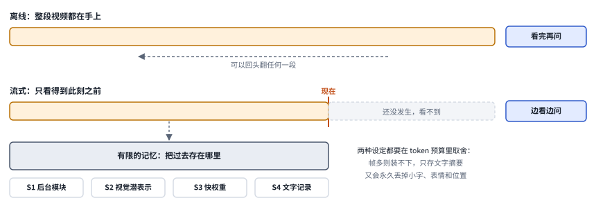

*图：上：离线设定下整段视频都在手上，可以回头翻；下：流式设定只看得到“现在”之前，过去要存进有限的记忆里。*

流式设定下，图中红线标着“现在”，红线右边的内容还没发生，模型看不到；红线左边的内容也不能无限地留着，只能挑一部分存进有限的记忆里。所以下面四种流式方案的差别，几乎全在记忆存在哪里、存成什么。

然后是流式。流式系统的两难在于，它不能偷看未来，又必须在有限的内存里保住过去。[2608.05703 · StreamArena: Toward Continuous, Interactive, and Long-Horizon Agentic Streaming Video Understanding](https://arxiv.org/abs/2608.05703) 先指出了一个评测漏洞：短片段加选择题的评测，可能让一个只看最后几帧的简单基线表现很好。于是它构造了小时级的开放问答，分别测试实时感知、历史回溯、主动互动和工具使用，配套的方法把低延迟的前台和异步运行的记忆后台分开；前后台调度和持续的预处理都应该计入成本。[2608.10949 · StreamFlow: Dynamic Memory Flows for Streaming Video Understanding](https://arxiv.org/abs/2608.10949) 在视觉编码之前先过滤掉时间上的冗余，把长期内容压成可以检索的视觉潜表示，回答时再按注意力的需要把历史证据注入进来；风险在于过滤策略可能提前丢掉了后来才变得重要的细节，评测时要专门安排一些不显眼、时间上隔得很远的事件。

[StreamTTT: Reconciling Real-Time Perception and Long-Term Memory in Streaming VLMs](https://arxiv.org/abs/2608.13416) 换了一种存法：把长程历史写进在线更新的“快权重”里，放在注意力上下文之外，只留一个短的滑动缓存给最近的证据，缓解注意力被稀释的问题。作者报告在 OVO-Bench 上，4B 版本比同规模的 SimpleStream-4B 在实时感知上高 0.6 分、在回溯上高 5.3 分。[OneStreamer: Unifying Perception, Memory, and Proactive Response in Streaming Video Interaction](https://arxiv.org/abs/2610.01762) 则让模型边看边主动写下带时间戳的局部细节描述和已完成事件的摘要，回答时用这些自己写的记录加上最近的视觉窗口，不必回头去翻历史视觉特征。

**速查：流式记忆的四种放法。** 下面四张卡用同一画法，从左往右是视频流进来、被存下、再被用来回答的过程，差别全在中间那个灰框：过去被存成了后台模块里的状态、视觉潜表示、快权重，还是文字记录。

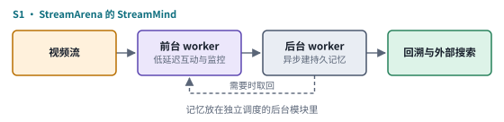 

 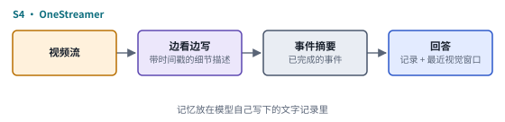

*图：四种流式记忆方案的结构卡，每张卡对应下表的一行。*

| code | 名称 | 年份 | 代表 | 怎么做 | 解决了什么 | 代价 |
|---|---|---|---|---|---|---|
| S1 | 前后台分离 | 2026 | StreamArena 配套方法 | 低延迟的前台负责实时互动和监控，异步运行的后台负责建持久记忆、回溯历史和外部搜索 | 实时响应不被记忆构建拖慢，复用持久状态还能缩短从提问到回答的延迟 | 前后台调度和持续的预处理都要计入成本 |
| S2 | 视觉潜表示记忆 | 2026 | StreamFlow | 编码之前先过滤时间冗余，把长期内容压成可以检索的视觉潜表示，生成时按注意力需要把历史证据注入 | 少花编码计算，回答时仍能取回视觉证据 | 过滤策略可能提前丢掉后来才变重要的细节 |
| S3 | 快权重记忆 | 2026 | StreamTTT | 长程历史写进在线更新的快权重，放在注意力上下文之外，只留短的滑动缓存给最近证据 | 缓解注意力被稀释，OVO-Bench 上回溯比同规模基线高 5.3 分 | 写进权重的历史没法像原始画面那样直接回看核对 |
| S4 | 文字记录记忆 | 2026 | OneStreamer | 边看边写带时间戳的局部细节描述和已完成事件的摘要，回答时用这些记录加最近的视觉窗口 | 不用回头翻历史视觉特征，记录可以复用、也容易检查 | 文字记录会丢掉小字、表情和物体位置这类难以转写的细节 |

还有几篇工作想在不拉长上下文的情况下提高视频回答的质量，差别在于把功夫花在哪：训练目标、开放的训练资源、按需检索，还是多教师蒸馏。**[Internalized Visual Thinking](https://arxiv.org/abs/2608.15869)** 在训练时联合学习文字预测和未来帧潜在表示的预测，推理时直接回答，不再显式地生成未来画面再重新编码。它和视觉思维链的差别，除了少生成几张图，更在于把一部分预测能力放进了训练目标里；报告中的效率和准确率结果适用于所测的主动视频推理设置。[VideoChat3: Fully Open Video MLLM for Efficient and Generalist Video Understanding](https://arxiv.org/abs/2607.14935) 用开放的训练资源构建了一个兼顾运动理解、长视频检索和直播响应的模型，便于区分哪些收益来自骨干模型、哪些来自外部记忆。[Online Video Agent Harness for Long Video Understanding](https://arxiv.org/abs/2609.12818) 根据问题按需去找证据，比较了主动检索和提前把整段视频密集处理一遍的成本。[Video-MOPD: Multi-Teacher On-Policy Distillation for Video Understanding](https://arxiv.org/abs/2609.09300) 从不同的教师那里分别蒸馏理解、科学推理和时间定位能力，考察训练阶段用多个教师，能否让部署时只需要一个简单的学生。让模型主动调用裁剪、放大、检索等工具去长视频里找证据的那一类工作，核心是“看到工具结果再决定下一步”，放在第 19 章讲。

### 5. 视觉编码器与模型结构：眼睛本身还能怎么改

从 ViT 起，视觉编码器基本就固定成了“一个 ViT，用 CLIP 或 SigLIP 的方式预训练”，后面的改进大多发生在连接器、分辨率和训练数据上。可眼睛本身其实还有不少可以改的地方：编码器能不能像语言模型一样用混合专家来扩容，同时不多花算力？能不能干脆去掉单独的编码器，让主干从像素学起？语言和视觉的计算能不能循环多走几遍，用不着一路往上堆层？这三个问题都是先在语言模型上回答过、再搬到视觉上来的。在 Raschka 拆解过的那一长串模型里，编码器恰恰是最少被改动的一块。

> 主线位置：第二到第四阶段的延续。接 ViT 的切块编码、CLIP 和 SigLIP 的图文配对预训练、SigLIP 2 的多分辨率变体，以及 Fuyu 那种去掉编码器、图块直接进语言模型的原生读法（速查表 R5 与 R6）。

> **要点：** 眼睛的改进方向和语言模型越来越像：用混合专家扩容，用扩展律判断能不能去掉编码器，用循环计算让模型多看几遍。比较时要固定数据和算力，并分开报告图像、视频和文档。

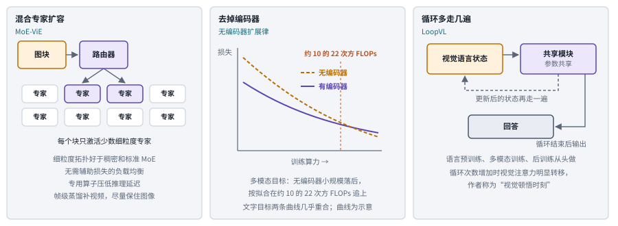

*图：改眼睛的三种做法：混合专家编码器、去掉编码器的扩展律、循环共享模块。中间的曲线只表示趋势，示意。*

上图左栏的混合专家，是由一个路由器为每个图块挑出少数几个专家网络来处理，模型总容量变大，每个块实际花的计算却没有跟着变大。中栏的曲线只表示趋势，交点位置取自论文。右栏是同一个共享模块反复更新视觉语言状态，循环结束后才给出回答。

[MoE-ViE: Mixture of Experts Vision Encoder for Efficient Image and Video Understanding](https://arxiv.org/abs/2608.17402) 系统研究了 CLIP 式视觉编码器的混合专家设计，发现细粒度的专家拓扑比稠密模型和标准混合专家都好得多；作者还提出不需要辅助损失的负载均衡变体，写了专门的算子来压低推理延迟，并用帧级蒸馏增强视频能力，同时尽量保住图像上的知识。这说明在语言模型里已经验证过的扩容办法，搬到眼睛上同样值得认真做。

[How Far Are We from Removing the Visual Encoder? Scaling Laws for Encoder-Free Multimodal Pretraining](https://arxiv.org/abs/2609.35457) 给无编码器路线做了一次系统的扩展律研究，也就是测量损失怎样随模型规模和训练算力变化。无编码器指的是 Fuyu 那种去掉单独的视觉编码器、让图块只过一个线性层就直接进语言模型的做法。作者比较了有编码器和无编码器两种架构，报告了几个发现：去掉编码器会让多模态目标的最优算力分配偏向更大的模型，文字目标的分配则几乎不变；两种架构在文字目标上的损失与算力曲线几乎重合，在多模态目标上则分开，无编码器的模型在小规模时落后，按他们的拟合会在大约 10 的 22 次方 FLOPs 附近追上，这在实际的预训练预算之内。这说明早期 Fuyu、EVE 落后于有编码器的方案，可能主要是规模还不够。

[LoopVL: Recurrent Visual Intelligence](https://arxiv.org/abs/2609.38426) 尝试把循环 Transformer 扩展到视觉语言模型上，用共享的模块反复更新同一个视觉语言状态，从语言预训练、多模态训练到后训练都从头做。作者报告它在多模态理解和视觉推理基准上超过一批同等规模甚至更大的非循环模型，还观察到所谓“视觉顿悟时刻”：随着循环次数增加，视觉注意力会出现明显的转移。这提供了一个有意思的视角，看图也许和推理一样，可以靠多想几遍来加深。

比较这类工作时要固定训练数据和总算力，并分开报告图像、视频、文档三类任务上的变化，因为同一个结构改动对它们的影响可能完全不同。

### 6. 适配与压缩：丢了证据，还是不会用剩下的证据

视觉语言模型正在变小，SmolVLM2 的 500M 版本已经能在手机上看视频。可模型变小、视觉 token 变少、数据分布变化，会带来性质不同的失败。压缩可能直接把任务需要的信息删掉了；适配不足则是信息还在，模型却用不好。这两种情况看起来都是“答错了”，修法却完全不同。所以这一节的工作要分别测输入的保真度、表征能力和跨域泛化，并且检查教师在新的领域里是否依然可靠，别把教师的输出当成理所当然的固定目标。

> 主线位置：边界“变小与压缩”。第四阶段的 LLaVA 式结构让编码器切出的每一块都变成一个视觉 token，第五、六阶段的高分辨率和视频又让这串 token 膨胀到几千上万；本分支压缩的就是这串 token，追问压缩后答错时丢的是证据还是利用能力。

> **要点：** 压缩之后答错，可能是证据被删掉了，也可能是证据还在、模型没用好，两种情况修法完全不同。先检查压缩后的输入里证据还认不认得出，再决定改压缩方式还是做适配训练。

比如压缩输入之后，模型读错了账单角落里的金额。第一步要检查的是，这些数字在压缩后的输入里是否仍然可以辨认。如果数字已经丢了，该调整的是观察和压缩方式；如果证据还在，就可以研究怎样通过训练让模型适应稀疏的输入。

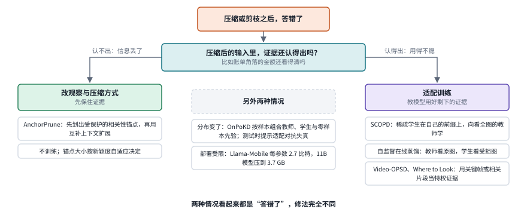

*图：压缩后答错时先问一个问题：证据在压缩后的输入里还认得出吗？两条分支各接本节的不同工作，中间是另外两种情况。*

上图把这个判断画成一个分叉：证据认不出，走左边，改压缩方式把证据保住；认得出，走右边，用训练教模型用好剩下的证据。中间一列是另外两种情况：数据分布变了，或者部署环境装不下原模型。

左边一支是不训练、只改删哪些 token 的剪枝。[AnchorPrune: Relevance-Anchored Contextual Expansion for Visual Token Pruning](https://arxiv.org/abs/2607.07033) 指出，常见的剪枝方法把“和问题相关”与“彼此多样”两个目标混在一起，压缩得很狠时二者会冲突：只看相关性会把预算集中在彼此相似的局部证据上，只看多样性又可能删掉不可缺少的 token。它先构造一个受保护的相关性锚点，再用互补的上下文去扩展，锚点的大小按相关性排序后 token 的新颖度自适应决定。

右边一支是自蒸馏：用同一个模型在更完整的输入上的表现，去教它在稀疏输入上怎么做。[2608.14144 · Self-Supervised Visual On-Policy Distillation](https://arxiv.org/abs/2608.14144) 不去找更强的教师，它让同一个模型分别看原图和受损的图，利用两者之间的信息不对称产生自蒸馏信号。实验强调增强强度和任务的一致性：适度的退化能教会学生利用证据，完全抹掉与答案相关的区域，则只会产生无效的差异。[2609.34044 · SCOPD: Sparse-Context On-Policy Self-Distillation for Efficient Vision-Language Models](https://arxiv.org/abs/2609.34044) 在固定的剪枝表示上反复采样，发现有一部分失败其实可以被恢复，作者把这种现象称为表示利用差距。训练时，它先让当前的稀疏学生生成推理前缀，再由拥有完整视觉上下文的教师在同一前缀上提供监督，学生学的是“在自己会走到的地方该怎么做”。这说明压缩之后的能力损失，并不全是不可逆的信息损失；不过多次采样的诊断本身并非免费，部署时的比较应当固定采样预算。

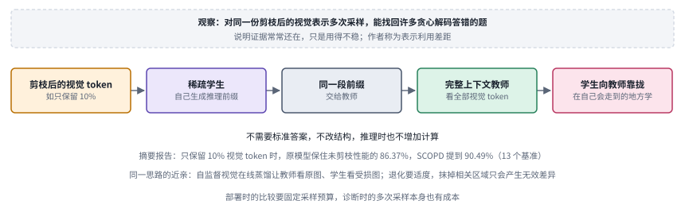

*图：SCOPD 的做法：稀疏学生先写出推理前缀，看得到全部视觉 token 的教师在同一前缀上给监督。数字取自论文摘要。*

因为前缀由学生自己写，训练时的分布和部署时一致。论文摘要报告，只保留 10% 视觉 token 时，原模型保住了未剪枝性能的 86.37%，SCOPD 把这个数字提到 90.49%。

视频上的同类问题更突出，因为长视频的冗余天然就大。[Video-OPSD: Exploiting Privileged Visual Evidence for On-Policy Self-Distillation in Video Large Language Models](https://arxiv.org/abs/2608.27065) 观察到，长视频里只有一小部分帧真正提供回答所需的证据，于是用这些关键帧构建拥有“特权证据”的自教师来指导学生。[Where to Look Matters: On-Policy Self-Distillation for Long-Video Understanding](https://arxiv.org/abs/2608.25356) 用和问题相关的片段指导长视频的自蒸馏，训练时提供聚焦的证据，部署时仍然输入完整的视频。

分叉中间一列的第一种情况是分布变化。**[OnPoKD](https://arxiv.org/abs/2609.10321)** 让一个轻量的控制器综合考虑教师、学生和零样本先验各自的可靠性与分歧，为每个样本构造动态的蒸馏目标，再用验证反馈更新控制策略；控制器只在训练中使用，推理时的架构保持不变。它说明在弱数据和跨域条件下，怎样避免把不可靠的教师信号不加区分地传给学生。[Robustifying Vision-Language Models via Test-Time Prompt Adaptation](https://arxiv.org/abs/2607.09450) 用分布级的对齐和动态缓存做测试时的提示适配，针对对抗性失真，同时检查干净样本上的性能有没有受损。[OPD-V: Visual On-Policy Self-Distillation with Modality Balance](https://arxiv.org/abs/2608.05131) 通过强调或遮蔽相关区域的不同图像视图来平衡蒸馏信号，比较不同模态的监督对视觉推理各有多少贡献。

第二种情况是部署环境装不下原模型。[Llama-Mobile: Efficient 2.7-Bit Quantization of VLMs](https://arxiv.org/abs/2608.21134) 用模型自己生成训练数据来做量化，不需要原始的训练设置，配合一种每参数 2.7 比特、能在 Arm CPU 上高效执行的格式，把 Llama 3.2 11B Vision Instruct 压到 3.7 GB，作者报告在标准视觉问答任务上仍保持较强的表现。

适配研究最终要回到那些可以辨认的输入故障上：低清晰度、反光、遮挡、窗口缩放，或者长历史被压缩。把这些混成一个平均分，鲁棒性的整体提升可能会掩盖关键小字识别上的退化。

### 7. 统一理解：生成能不能帮助看懂

理解要语义，生成要重建，两者天然拉扯：理解模型的编码器只留“这是什么”，生成模型的表示保留每一处像素。可反过来想，生成那一侧为了画得像而保留下来的细节，恰恰是理解模型的眼睛主动丢掉的东西。那么在一个既读又写的统一模型里，生成能力能不能反过来帮助理解？用图像生成教给模型的知识，能不能用文字问出来？这一节的工作都在拿统一模型做实验，问的是读写之间到底是互相帮忙、互相争夺，还是只是共处一室。另一方面，读写合一之后，“这张图是模型看到的还是它画出来的”“它说的内容是不是真的在画面里”也需要统一的核查办法。

> 主线位置：边界“读写合一”。接 Chameleon 一类从一开始就把图文都变成 token 混着训练的统一模型，以及从语义到重建那根轴上的取舍；统一模型的生成部分在第 16 章详细讨论。

> **要点：** 生成侧确实保留了理解侧缺少的细节，可要用起来需要合适的结构解耦和对齐；当理解本身是瓶颈时，再好的生成辅助也帮不上忙。

先看生成侧的表示能不能直接拿来帮理解。[What Generation Knows: Unlocking Fine-Grained Understanding in Unified Multimodal Models](https://arxiv.org/abs/2610.23987) 报告了三个发现：统一模型生成侧的视觉表示对细粒度的语义变化更敏感，能捕捉到理解侧漏掉的、和任务相关的变化，而这种优势依赖正确的空间组织。据此作者提出 GAFU，把生成侧的视觉特征压成少量保留细节的 token，让理解通路按任务去检索。作者报告，在同样的数据上它超过监督微调基线，相对提升最高在 VStar-Bench 上为 20.00%、在 OmniSpatial 上为 17.94%。[Generation as Auxiliary Supervision: Enhancing Visual Understanding at Zero Inference Overhead via Decoupled Embedding Prediction](https://arxiv.org/abs/2608.12209) 走了一条更轻的路：把生成当作表示学习的辅助监督，在一个共享底层、上层并行的解耦结构里做下一个嵌入预测，让生成损失给共享的视觉通路带来更细的空间信息，推理时则不增加任何开销。

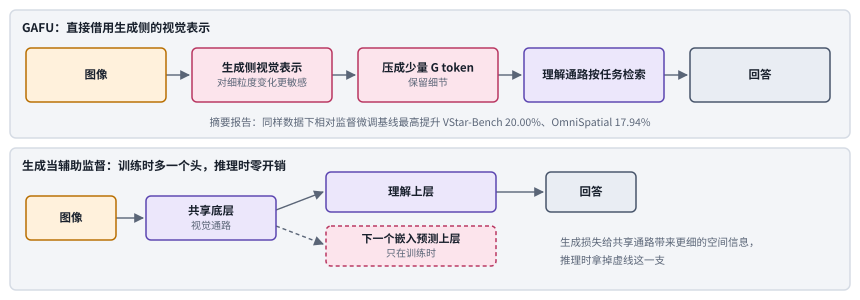

*图：上：GAFU 把生成侧表示压成少量 G token 交给理解通路检索；下：把生成当作训练时的辅助监督，推理时拿掉虚线那一支。*

两种接法都让理解借到了生成侧的细节，差别在于借的时机：GAFU 在推理时直接取用生成侧的表示；辅助监督只在训练时借，图中虚线那一支在推理时拿掉，计算量和原来一样。

再看两者到底是协同还是竞争。[Uncovering Understanding-Generation Synergy in Native Unified Multimodal Models: From Representation, Task to System](https://arxiv.org/abs/2609.01607) 在不依赖预训练视觉部件的受控设置下，从表示、任务和系统三个层面做实验。表示层面，两个目标互相提供有用的信号，可当它们走同一条计算路径时，一方往往会压过另一方，把有冲突的视觉计算分开、保留语义交互的解耦结构能避免这种失衡；任务层面，当理解和生成依赖共享知识时，存在双向的正迁移；系统层面，端到端的统一模型在需要同时理解和生成的复杂任务上，超过了一个匹配的规划器加执行器流水线。[When Does Visual Generation Help Visual Understanding in Unified Multimodal Models?](https://arxiv.org/abs/2608.22174) 给出了一个更冷静的答案：生成的视觉辅助在简单问题上有帮助，推理一复杂就不再可靠；借助“神谕”参考的对照实验表明，瓶颈通常在视觉理解本身，模型连准确的视觉辅助都用不好。随着生成质量提高，它的作用依次从无关的噪声、看似合理却误导的引导，变成真正有用的帮助。

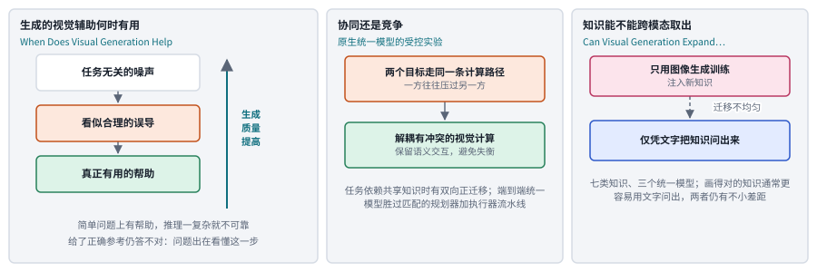

*图：三篇论文的结论：生成辅助随质量提高的三段变化，读写目标共用一条计算路径时的失衡，以及知识从图像生成到文字取用的不均匀迁移。*

图左栏值得多看一眼：三段变化里中间那段最危险，生成质量提高了一些，却给出看似合理的误导。

生成能不能帮理解，还可以在知识层面问：只靠画图学到的东西，能不能用文字问出来。[Can Visual Generation Expand What Unified Multimodal Models Know?](https://arxiv.org/abs/2610.21459) 设计了一套知识迁移探测协议：只通过图像生成训练给模型注入新知识，再测它能否仅凭文字把这些知识取出来。在七类知识、三个统一模型上，视觉监督确实能迁移到语言，但很不均匀；文字对齐和图文交错对齐两种方法能改善迁移，模型在图像里能正确画出的知识通常也更容易用文字问出来，可两者之间仍有不小的差距。这是一个很典型的“知道却说不出”：知识存在于模型里，取用方式却依赖模态。

统一模型的结构也在探索，两篇都去掉了偏语义的外接编码器。[PixelUMM: Encoder-Free Unified Image and Video Understanding and Generation](https://arxiv.org/abs/2609.38597) 探索直接从像素出发统一图像和视频的理解与生成，关注的是共享表示。[SenseNova-U1.5: Towards Native Unified Visual Intelligence](https://arxiv.org/abs/2609.11929) 是一个 8B 的原生统一模型，在既不用单独视觉编码器、也不用 VAE 的结构里理解、推理并生成视觉内容，用空间连贯的图块重建来加强视觉接口，支持最高 4K 的原生分辨率。对理解一侧来说，它们的意义在于：去掉了偏语义的外接编码器之后，模型看到的细节是不是更多了，语义能力又有没有因此变弱。

读写合一之后，核查也需要统一的接口。[2609.11244 · OmniHallu: Unified Hallucination Detection for Cross-Modal Comprehension and Generation in Multimodal Large Language Models](https://arxiv.org/abs/2609.11244) 把图像、视频、音频的理解与生成中的幻觉拆成一条条原子声明，交给各模态的专家去核对并汇总证据，再训练一个低成本的验证器去近似这个过程。它提供了一个统一的检查接口，却取代不了各个模态的专业判据：音频里事件的先后顺序和图像里物体的数量，是两种不同的误差。

把这几篇放在一起，可以得到一个比较稳妥的判断：生成侧确实保留了理解侧缺少的细节，可要把它用起来，需要合适的结构解耦和对齐方法；当理解本身是瓶颈时，再好的生成辅助也帮不上忙。评测这类工作时，要分开报告理解、生成和两者互相帮助的部分，并检查收益是否只出现在细粒度、空间类的任务上。

## 四、方法比较：按丢证据的那一步来选

七个前沿分支都在回答同一个问题：任务需要的证据，是在哪一步丢掉的，又该在哪一步补回来。是编码时被只留语义的编码器丢掉了，是分辨率和 token 预算不够被裁掉了，是抽帧和记忆压缩时丢的，还是证据都在、模型没有读出来？真实的流程里，最好先用诊断找出最早丢证据的那一步，再决定是换编码器、调分辨率、改记忆结构，还是做适配训练，然后检查局部的改善能不能保留到最终答案。下表最右边一列是验收时最该看的东西。

> **本节要点：** 七个分支都在回答同一个问题：证据在哪一步丢掉，又该在哪一步补回来。先用诊断找出最早丢证据的那一步，再按下面的矩阵和表格选路线，并检查局部的改善能不能保留到最终答案。

| 路线 | 主要解决什么 | 必须付出的成本 | 关键验收 |
|---|---|---|---|
| 分层诊断与内部探测 | 分不清看不见、看错了还是没说出来 | 标注、探针和干预实验 | 每类错误单独计数，干预后错误是否消失 |
| 高分辨率与文档专用模型 | 小字、表格、公式看不清 | 视觉 token 和解码长度膨胀 | 识别、阅读顺序、结构三类错误分开 |
| 统一感知与空间监督 | 位置说不准、空间关系脆弱 | 几何或分割监督、额外模块 | 定位误差与通用问答退化同时报告 |
| 视频压缩与流式记忆 | 帧太多、时间说不准、不能回看 | 记忆写入与检索、后台计算 | 固定帧预算下的远距离小事件召回 |
| 编码器结构改造 | 眼睛容量和细节保留不足 | 重新预训练的算力 | 固定数据与算力，分任务比较 |
| 剪枝、自蒸馏与量化 | 视觉计算过重、部署受限 | 增强设计与教师训练 | 固定预算下难例与小字的保留率 |
| 生成辅助理解 | 细粒度和空间细节缺失 | 统一模型训练与对齐 | 理解、生成与互助三部分分开报告 |

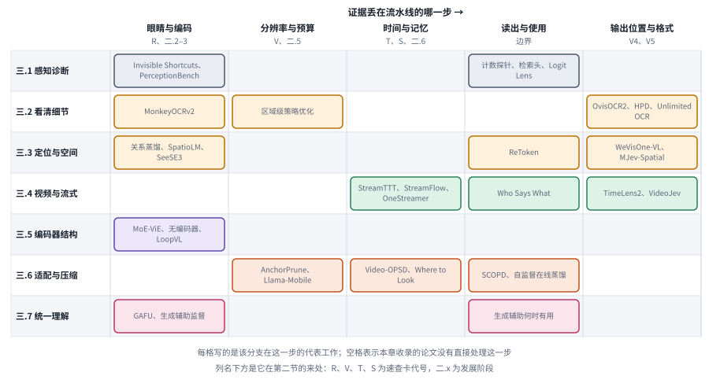

*图：本章七个前沿分支落在证据流水线的哪一步。横轴是读图流水线上的几环，每格写着该分支在这一环的代表工作。*

矩阵的横轴是读图流水线上证据会丢掉的几环，从编码、分辨率与预算、时间与记忆，到读出与使用、输出位置与格式；纵轴是七个前沿分支。竖着看，“眼睛与编码”和“读出与使用”两列最满，说明 2026 年的前沿研究一头在改编码器，一头在追问证据有没有被用上；横着看，三.1、三.3 和三.4 都横跨了好几列，说明诊断、定位和视频这三件事本身就牵涉整条流水线。

这些路线在实际系统里往往要组合起来用，但组合之前最好先有一个简单的基线。如果把账单裁剪一下、放大到原分辨率就能读对，就没必要先去训练一个专用的文档模型；如果视频里的关键事件总在固定位置出现，一个按规则抽帧的脚本可能比复杂的记忆系统更合适。选择更重的方案，理由应当是任务分布在变、证据真的稀疏，或者计算预算确实不允许全看一遍。

## 五、负面结果与开放问题

> **本节要点：** 几个负面结果合起来是一条方法论：用干预实验去找收益和失败的来源，每次只改一个因素。开放问题集中在三处：能否把新观察、长记忆和精确定位绑进同一个评测，眼睛该落在光谱的哪里，以及怎样确认模型引用的证据真的来自画面。

这一章里有好几个负面结果，单看每一个都像是给热闹的方向泼冷水，放在一起却能读出一条很实在的方法论。模型内部常常已经编码了正确的个数，只是没说出来；真实物体和幻觉物体得到的视觉注意力一样多；视觉编码器会靠相机型号、压缩方式这类“拍摄指纹”走捷径，换一台手机拍照就可能失灵；短片段加选择题的视频基准，一个只看最后几帧的简单基线就能拿到不错的分数；稀疏输入下的失败有一部分来自利用不稳，信息本身还在；生成的视觉辅助在复杂推理上不再可靠，瓶颈常常在理解本身。它们共同要求我们去做干预实验，光换更大的模型解释不了收益的来源：遮掉相关区域，替换拍摄设备，固定剪枝表示，屏蔽注意力头，提供神谕参考，然后观察表现在哪里变化。每次只改变一个关键因素，才能把因果关系讲清楚。

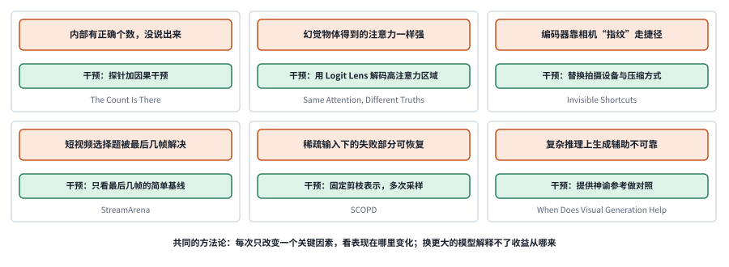

*图：本章的六个负面结果。橙色框是发现，绿色框是得出这个发现用到的干预，最下面一行是论文名。*

六张卡片的绿色框有一个共同点：每次只改变一个因素，要么换掉输入的拍摄设备，要么固定剪枝表示、只改采样，要么给出神谕参考、只看理解这一侧。正是这种一次只动一处的设计，才让“看见了却没说出来”“证据还在却没用好”这类结论站得住。

未解决的问题主要有三组。第一，有没有一个评测，能同时要求细粒度的新观察、长时间的记忆和精确的时间空间定位，把它们绑在同一个任务里考？OmniCompass 和 BVB 往这个方向走了一步，最强的模型在精确定位上依然吃力。第二，眼睛该落在语义与重建光谱的哪个位置？文档模型往重建一侧移，统一模型尝试两头兼顾，无编码器的扩展律又暗示足够大的规模可能让问题换一个样子，目前还没有一个答案能同时照顾读小字、数个数和理解语义。第三，当模型越来越多地依靠压缩后的记忆和自己写下的记录来回答，怎样确认它引用的证据确实来自画面，没有混进它对画面的旧描述？这些问题，都没法靠一个总准确率来回答。

## 六、研究机会

> **本节要点：** 回到账单和录像两个例子，三个研究机会分别对应证据在哪一步丢的、观察能不能按需分配、长时间的证据怎样保存下来又不失真。

拿那张拍歪、反光的电费账单和那段四十分钟的组会录像来说。要让模型真正读对账单，它得先在一张拍歪、反光的照片里找到那张小表，再认清小字，再对上月份，每一步都可能丢证据；要让它答对“导师在第几分钟提到我的实验”，它得在有限的帧预算里不漏掉那一刻，并把声音和画面对上。下面三个方向，分别对应这两个例子里还没被做好的三件事：证据在哪里丢的，观察能不能按需分配，以及长时间的证据怎样保存下来又不失真。

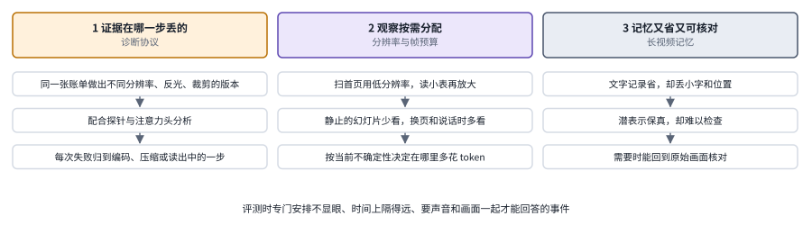

*图：三个研究机会各自的做法，从上往下是一条可以动手的路线，示意。*

三栏分别守着读图流水线上读出、预算和记忆这三处容易丢证据的地方，每一栏从上往下读是一条可以动手的路线。

**1. 如何建立一套能定位“证据在哪一步丢失”的诊断协议？**

现在的大多数评测只给一个最终答案的对错，可读账单这件事至少包含找区域、认字符、对结构、做推理四步。这里的研究机会是设计成套的受控输入，比如同一张账单在不同分辨率、不同反光、不同裁剪下的版本，配合内部探针和注意力头分析，判断每一次失败是编码时丢了、压缩时丢了，还是证据都在却没有读出。计数探针、视觉检索头和 Logit Lens 幻觉分析已经给出了可以借用的工具，把它们组合成可复用的协议，会让后面所有的改进都有明确的靶子。

**2. 如何让模型按需分配分辨率和帧预算？**

区域级策略优化发现，定位和识别对分辨率的需求不同；视频的工作又一再说明，大部分帧是冗余的。读账单时，扫一眼首页用低分辨率就够了，读那张小表才需要放大；看组会录像时，静止的幻灯片页可以少看，有人说话、换页的时刻要多看。可以研究怎样根据当前的不确定性，决定在哪里花更多的视觉 token，并把它作为一种可以学习的分配策略。关键是衡量这些选择是否保留了后续任务需要的信息，只用节省了多少 token 来评价，会漏掉最重要的那部分。

**3. 如何让长视频的记忆既省又可核对？**

流式视频的几种记忆方案，把过去分别存在了后台模块、视觉潜表示、快权重和模型自己写的文字记录里。它们各有各的省法，也各有各的丢法：文字记录省却会丢掉小字和位置，潜表示保真却难以检查。研究机会在于设计一种记忆，既能在需要时回到原始画面核对，又不至于把整段视频都存下来；评测时要专门安排那些不显眼、时间上隔得很远、需要声音和画面一起才能回答的事件，比如“导师说那句话的时候，屏幕上是哪一张图”。

**实验资源：** [LLaVA](https://arxiv.org/abs/2304.08485) · [Qwen2-VL](https://arxiv.org/abs/2409.12191) · [SmolVLM2](https://huggingface.co/blog/smolvlm2) · [Hugging Face 开源 OCR 模型指南](https://huggingface.co/blog/ocr-open-models)。动手之前，请先核对各项目的任务设定、代码版本、数据和运行条件。
