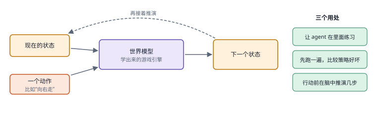
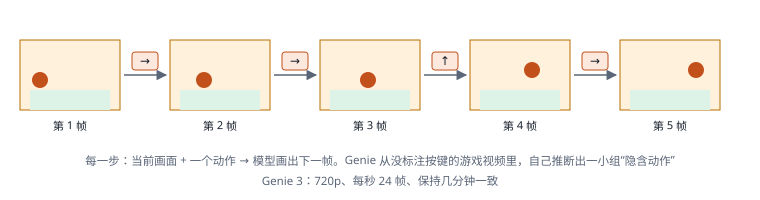
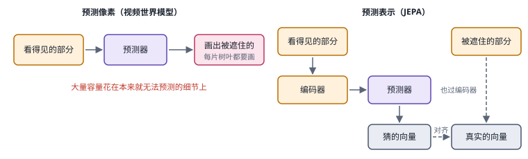
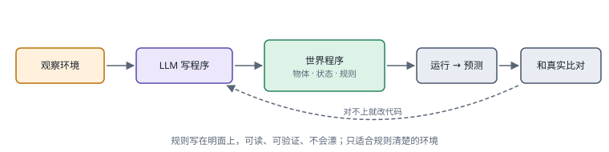
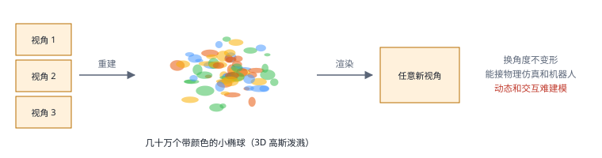

# 10｜世界模型：从预测画面到选择可靠行动

[首页](../README.md) · [专题索引](../README.md#topics) · [文献目录](../catalog/10_world_models.md)

## 方向背景：为什么决策需要世界模型

设想厨房里有一台机器人，它接到的任务是把桌上的玻璃杯放进半开的橱柜。人做这件事几乎不用想，可仔细拆开，脑子里其实悄悄跑了好几遍"预演"：手从这边伸过去会不会碰倒旁边的酱油瓶，杯子握在杯身还是杯口更稳，柜门要是弹回来会不会夹住手腕。我们并没有真的把每种做法都试一遍，因为脑子里有一个关于这个厨房、这只杯子、这扇柜门的小模型，可以先在里面推演，再挑一个看起来最稳妥的动作。

机器人如果没有这样的内部模型，就只剩下一条路：真的去试。试错在模拟器里很便宜，在真实厨房里却又慢又贵，有时还很危险，打碎一只杯子就是一次失败的样本。世界模型想做的，就是让系统学会"环境会怎样变化"，在动手之前比较几种做法可能带来的后果，挑出值得一试的那个，然后用真实看到的结果回头修正自己的预测。它把表示学习、动态建模和规划连在了一起，关心的是预测怎样服务于决策，画面是否逼真倒在其次。

难处在于，"会预测"和"能放心依靠预测做决定"中间隔着很远。相机拍到的只是世界的一部分，杯子被手挡住时它仍然在那里；同样一帧画面，背后可能藏着不同的未来，柜门可能锁着，也可能只是虚掩。动作换一种，预测也必须跟着换，这样模型学到的才是干预的后果，光会续写最常见的剧情是不够的。更麻烦的是，预测的误差会随着推演一步步累积，规划器还会专门往模型最乐观的地方钻：如果模型误以为可以穿过柜门，规划器就会非常高效地找出这条根本不存在的路线。

本章沿着长期一致性、动作条件、潜空间表示、规划、预测成本、显式规则、跨身体动力学与可信评测这几条线展开。读下来会反复遇到同一个提醒：生成质量、预测精度与闭环控制效果是三件事，要分开衡量，一段好看的视频距离一个可靠的世界模型还有不少路要走。

## 先读这几篇

本章的主线借自几篇人写的长文。它们的作者或者亲手做出了这个方向的代表系统，或者花了很长时间整理整个领域，叙事里有取舍、有判断。建议按下面的顺序读，先建立"世界模型到底该预测什么"这个问题意识，再回来看各分支的新论文。

| 顺序 | 文章 | 为什么读 |
|---|---|---|
| 1 | Inkyu Sa（Chef Robotics），[World Models and World-Action Models: An Accessible and Comprehensive Survey](https://chefrobotics.ai/post/world-models-and-world-action-models-an-accessible-and-comprehensive-survey)（2026-08） | 这是作者为自己一份覆盖 220 多项工作、160 多个系统的综述写的导读，也是本章发展主线的骨架。它把整个领域组织成一个"设计空间"，坐标轴是三个问题：模型预测什么，用什么方式生成预测，能不能被动作控制。沿着这个问题，作者把方法分成六族，从潜空间循环状态模型、只预测价值的规划模型，到自回归 token、扩散生成、JEPA 和视频基础模型。他的核心判断很干脆，"no single modeling approach dominates everywhere"，没有哪一族能在所有场景里通吃；他也提醒，画面质量本身证明不了模型学到了世界的规律。文末列出的五个优先方向，包括物理与因果落地、长时程的场景持久、可靠的动作条件、够快的推理和超出画面逼真度的评测，几乎和本章前八个分支一一对应。 |
| 2 | David Ha、Jürgen Schmidhuber，[World Models](https://worldmodels.github.io/)（2018-03） | 一篇可交互的网页文章，开篇就问"agent 能不能在自己的梦里学习"。作者用视觉压缩、记忆预测和一个极小的控制器三件套，让智能体先在学到的模型里练习，再回到真实环境。它最值得读的是"欺骗世界模型"那一节：控制器在梦里找到了让怪物永远不开火的漏洞，梦里得分很高，回到真实环境却一败涂地；把模型的随机性调高之后，学到的策略反倒更稳。这个故事几乎预告了后来所有世界模型研究都要面对的问题。 |
| 3 | Danijar Hafner，[Introducing Dreamer: Scalable Reinforcement Learning Using World Models](https://www.research.google/blog/introducing-dreamer-scalable-reinforcement-learning-using-world-models/)（2020-03） | Dreamer 作者本人写的介绍。它把"学世界模型、在想象中学行为、去环境里收集新经验"这个循环讲得非常清楚，也说明了为什么要在紧凑的潜状态里推演，以及为什么要用一个价值网络和一个动作网络取代每一步都做的昂贵搜索。读完能带走一个关键区分：世界模型可以在部署时用来搜索，也可以在训练时用来"做梦"教会策略，两种用法把计算放在了不同的阶段。 |
| 4 | Jack Parker-Holder、Shlomi Fruchter（Google DeepMind），[Genie 3: A new frontier for world models](https://deepmind.google/blog/genie-3-a-new-frontier-for-world-models/)（2025-08） | 生成式世界模型这条线最有代表性的一篇发布文章。Genie 3 可以从一句文字生成一个能以每秒 24 帧、720p 实时游走的世界，场景能保持几分钟的一致，视觉记忆可以回溯到大约一分钟之前，还能用文字触发"世界事件"，比如改变天气或者加进一个新角色。文章也很坦率地列出了局限：动作空间有限，多个智能体之间的交互难以建模，连续交互只能维持几分钟。读它能直观地看到"视频生成走向可交互世界"走到了哪一步，也能看清剩下的空白在哪里。 |
| 5 | Meta AI，[Introducing the V-JEPA 2 world model and new benchmarks for physical reasoning](https://ai.meta.com/blog/v-jepa-2-world-model-benchmarks/)（2025-06） | 表示空间预测这条路线的代表。文章把世界模型的能力拆成理解、预测和规划三件事，用超过一百万小时的无标注视频预训练编码器和预测器，再只用 62 小时的机器人数据加上动作条件，就让机械臂在没见过的环境里完成抓放任务。同样重要的是它同时发布的三个物理推理基准：人类在上面能拿到 85% 到 95%，而当时的视频模型在 IntPhys 2 上接近随机水平。这组对比把"会预测"和"懂物理"之间的距离量了出来。 |
| 6 | Yixia Li、Hongru Wang 等，[Bridging the Agent-World Gap: Text World Models for LLM-based Agents](https://arxiv.org/abs/2606.09032)（2026-06，`2606.09032`） | 前面五篇讲的都是画面和机器人，这篇综述把视野拉到 2026 年语言 agent 的一侧，是本章文本岔路和三.9 的入口。作者把文本世界模型定义为文字状态上的转移模型：给定一个状态和一个候选动作，预测接下来出现的网页、终端输出、接口返回或者用户回复。他们的判断是，今天大多数语言 agent 只会被动地反应，缺一个关于环境怎样演化的显式模型。全文用两根轴组织文献，一根是状态怎样表示，自然语言、结构化数据还是可执行代码；一根是落在哪类环境，物理、数字、社会还是抽象。构建方式分成学习、提示和程序三类，用途分成训练期和推理期，前者包括把模型内化进策略、充当模拟训练环境和模拟用户，后者包括前瞻搜索和动作验证；评测一节专门讨论模拟器的忠实度。它列出的开放问题，世界模型和策略怎样耦合、世界模型自身要不要推理、怎样落地到物理现实、怎样持续适应，和本章边界一节的老问题一脉相承。 |

如果还想多读一点，OpenAI 2024 年的技术报告 [Video generation models as world simulators](https://openai.com/index/video-generation-models-as-world-simulators/) 是"扩大视频生成规模就能得到世界模拟器"这一主张的原始出处，报告自己也承认 Sora 还模拟不好玻璃破碎这样的基本物理交互。YK Sugi 整理的 [VLAs are dead, long live World Action Models](https://www.eventual.ai/blog/vlas-are-dead-long-live-world-action-models) 记录了 Jim Fan 在 2026 年的一次演讲，他把机器人的发展类比成大语言模型走过的预训练、微调、推理几步，认为以视频世界模型为底座的世界-动作模型会接替 VLA，观点鲜明，适合拿来和本章第 2、5、7 个分支对照着读。DreamerV3 的[项目主页](https://danijar.com/project/dreamerv3/)讲了同一套固定超参数怎样跨越 150 多个任务，Yann LeCun 2022 年的立场文章 [A Path Towards Autonomous Machine Intelligence](https://openreview.net/forum?id=BZ5a1r-kVsf) 则是 JEPA 思路的源头。语言 agent 这一侧，David Silver 与 Richard Sutton 的短文 [Welcome to the Era of Experience](https://storage.googleapis.com/deepmind-media/Era-of-Experience%20/The%20Era%20of%20Experience%20Paper.pdf) 是"让 agent 从自己的经验里学"这一主张的出处，适合和本章文本岔路一节对照着读。想看整张地图，可以翻 [From Masks to Worlds: A Hitchhiker's Guide to World Models](https://arxiv.org/abs/2510.20668)（`2510.20668`）和面向机器人的短教程 [From World Models to World Action Models: A Concise Tutorial for Robotics](https://arxiv.org/abs/2607.00836)（`2607.00836`）。

## 一、基本概念：观察、状态、动作与不确定性

读世界模型的论文，最先要习惯一组看似平常、其实很容易混用的词。更多前置知识见[大模型入门](../docs/llm_primer.md)。

先说表示。Embedding 是把观察编码成的向量；latent（潜表示）强调这是模型内部学到的变量，每一维未必对应某个看得懂的物理量。JEPA（Joint-Embedding Predictive Architecture，联合嵌入预测架构）的想法是在表示空间里预测被遮住的部分或未来的内容，用不着把每个像素都恢复出来。要把它当作世界模型来用，还得给它加上动作条件，并且检验这些表示能不能真的帮助控制。扩散模型靠逐步去噪生成样本，它既能渲染未来视频，也能生成动作，可"能生成"和"学到了环境的转移规律"是两回事。VLA 是视觉、语言到动作的策略模型，它负责选动作；世界模型负责预测动作的后果；agent 系统则把这两者和目标、记忆、工具与反馈组织在一起。

再说观察和状态。观察是相机拍到的东西，状态是决定未来所需的全部信息。杯子被手遮住时，它的位置依然存在，模型不能因为这一帧看不见就把它删掉。常见的做法是把历史压缩成一个隐状态，再学习"隐状态加上动作，得到下一个隐状态"，同时预测奖励、终止或风险。顺着这个结构又能分出三种模型：正向模型回答"这样做会怎样"，逆向模型回答"要达到这个结果该怎么做"，策略则直接给出动作。三者可以共享参数，评测时却最好分开。

预测有两种主要用法。一种是部署时拿它比较候选的未来，也就是规划；另一种是训练时用想象出来的轨迹改进策略，让部署时少做搜索。两种用法都会碰到模型误差和策略钻漏洞的问题，前面那个"以为能穿墙"的例子就是这样。还有一组区分常被忽略：随机性和知识不足。物体在接触时可能真的会随机滑落，也可能只是模型没见过这种材质。前者是世界本身的不确定，后者是模型的无知，补救的办法完全不同，前者要靠概率建模，后者要靠收集新数据或者干脆少信模型。

本章的九个分支分别处理长期视频、动作接口、潜空间、规划、推理预算、显式规则、跨身体迁移、评测，以及语言模型在文字环境里充当的世界模型。其中不少论文来自机器人和生成模型领域，因为同一个预测器可能同时用来训练动作、渲染场景或者提供规划用的表示。它们放在一起比较的标准始终是对决策有没有用，名字里有没有"World"并不重要。

如果想先有一个直观的画面，可以把世界模型想成一台"学出来的游戏引擎"。游戏引擎知道现在的画面，知道玩家按了哪个键，就能算出下一帧；世界模型做的是同一件事，只是它的规则由数据学出来，没有程序员手写。它的用处大致有三种：让 agent 在里面练习，省去真实世界里的试错；先在里面跑一遍策略，用来评测；行动之前在里面推演几步，用来规划。各种做法的分歧，主要在于"状态"用什么来表示，像素、抽象向量、一段程序，还是一个三维场景，下面几节会分别遇到。

*图：世界模型的共同骨架。图出自多模态范式图谱，下同。*

## 二、发展主线：世界模型到底该预测什么

这条主线以 Inkyu Sa 那篇综述导读的问题为骨架：一个世界模型应该预测什么，怎样生成这些预测，能不能被动作控制。把这个问题放回时间里看，过去八年几条重要路线其实是在对它给出不同的回答。2018 年的 World Models 压缩画面再预测压缩后的向量，Dreamer 把预测搬进专为决策训练的潜状态，MuZero 干脆只预测做决定用得上的价值和奖励；2024 年前后，视频生成模型反过来押注"把画面本身预测好"，JEPA 则主张在抽象表示里预测；到了 2026 年，世界-动作模型试图让同一个网络既想象未来又输出动作。与此同时，语言 agent 这一侧也长出了一条岔路：网页、工具和文字游戏里的状态本身就是文字，语言模型可以直接预测它们的下一步，用来规划，也用来在没有奖励的情况下训练 agent。每一种回答都省下了一部分成本，也丢掉了一部分信息，后来的工作很大程度上就是在修补前一种回答留下的缺口。

| 阶段 | 内容 | 代表工作 | 本章对应分支 |
|---|---|---|---|
| 起点 | 压缩画面、预测压缩向量，在"梦"里训练控制器 | World Models（Ha 与 Schmidhuber） | 三.4、三.8 |
| 第一阶段 | 在为决策学到的潜状态里推演和想象 | PlaNet、Dreamer、DreamerV2、DreamerV3 | 三.3、三.4 |
| 岔路 | 只预测奖励、价值和策略，并约束想象长度 | MuZero、MBPO | 三.4、三.8 |
| 第二阶段 | 把视频生成当作世界模拟器，追求可交互和长时一致 | Sora、Genie、Genie 3、Cosmos | 三.1、三.5、三.6 |
| 第三阶段 | 在表示空间预测，再接上动作做规划 | V-JEPA、V-JEPA 2 | 三.3 |
| 第四阶段 | 同一个模型既预测未来又产生动作 | 世界-动作模型（WAM） | 三.2、三.5、三.7 |
| 文本岔路 | 语言模型在网页、工具和文字环境里预测下一状态，用于规划和训练 agent | RAP、WMA、WebDreamer、Early Experience、DreamGym | 三.9 |
| 边界 | 画面逼真之后，物理和因果是否正确 | 欺骗世界模型、物理推理基准 | 三.6、三.8 |

### 起点：在自己的梦里学习

学习环境模型的想法在强化学习里由来已久，可要说哪篇文章让一代研究生对"世界模型"这个词产生直觉，大概非 David Ha 和 Jürgen Schmidhuber 2018 年的 [World Models](https://arxiv.org/abs/1803.10122) 莫属。他们在网页版文章开头引用了系统动力学家 Jay Forrester 的话：我们脑子里装的从来都是世界的模型，用来做决定的也只是这个模型。棒球击球手来不及有意识地计算，靠的正是这种内部预测。

他们把智能体拆成三块。视觉模块 V 是一个变分自编码器，把每一帧 64×64 的画面压成一个小向量；记忆模块 M 是一个循环网络，根据当前向量、动作和隐状态预测下一个向量的分布；控制器 C 小到只有一个线性层，参数从几百到一千左右，用进化策略来优化。这样的分工意味着绝大部分"理解世界"的工作都由 V 和 M 承担，C 只需要在一个很小的空间里做决定。在赛车任务上，这套组合拿到了 906±21 的平均分，越过了 900 分的"解决"门槛；只用视觉特征、去掉 M 的隐状态，分数就明显低得多。

更有意思的是 VizDoom 的实验。M 还学会了预测智能体会不会死，于是它本身就成了一个完整的虚拟环境，控制器可以完全在这个"梦"里训练，再拿回真实游戏中使用。也正是在这里，作者撞上了一个后来困扰整个领域的问题：控制器在梦里找到了一种对抗性的策略，让模型里的怪物永远不开火。梦里的得分很漂亮，可那只是钻了模型不完美的空子。把采样温度调低到 0.1 时，梦变得过于"好说话"，梦里能撑 2086 步，回到真实环境只剩 193 步；把温度调高、给梦加入更多不确定性，策略反而更稳健，在 1.15 时拿到了真实环境里最好的 1092±556。

这一节放在主线开头，是因为它几乎把后来的所有问题都预告了一遍：要不要重建像素，状态怎么压缩，在模型里训练出来的策略会不会钻模型的漏洞，以及模型的不确定性该怎样表达。本章三.4 讨论规划时的模型误差，三.8 讨论"何时可以信任世界模型"，都可以追溯到这个怪物不开火的梦。

### 第一阶段：在紧凑的潜空间里想象

World Models 的 V 和 M 是分开训练的，V 学到的压缩向量服务于重建画面，未必保留了做决定需要的信息。下一步自然的问题就是：能不能直接学一个为预测和决策服务的潜状态，并且在里面推演多步？

2018 年底 Danijar Hafner 等人的 [PlaNet](https://arxiv.org/abs/1811.04551) 给出了第一个有说服力的答案。它学习一个兼有确定部分和随机部分的潜动态模型，处理部分可观测性，并在部署时直接在潜空间里比较大量候选动作序列。PlaNet 证明了从图像学到的模型足够准，可以拿来做规划，但每一步都要搜索很多候选，代价不低。

Hafner 在介绍 Dreamer 的博客里把这个瓶颈讲得很直白：此前的基于模型的智能体被两件事拖住，一是规划太贵，二是"短视"，只能看到有限步数之内的回报。2019 年的 [Dreamer](https://arxiv.org/abs/1912.01603) 的回答是把搜索从部署时挪到训练时。它在潜空间里并行地"想象"大量轨迹，用一个价值网络估计视野之外的回报，再让梯度沿着想象出来的序列反向传回去，直接训练动作网络。训练好之后，动作网络选动作时就不需要再搜索了。博客里给出的结果是，在 20 个基于图像的连续控制任务上，Dreamer 平均得分 823，超过最强的无模型方法 D4PG 的 786，所用的环境交互大约少了 20 倍。

此后这条线不断扩展。[DreamerV2](https://arxiv.org/abs/2010.02193)（`2010.02193`）改用离散的潜表示，成为第一个完全在单独训练的世界模型里学习、在 Atari 上达到人类水平的智能体。[DreamerV3](https://arxiv.org/abs/2301.04104) 则强调用一套固定的超参数跨越 150 多个差异很大的任务，并在没有人类数据和课程的情况下，从零开始在 Minecraft 里挖到了钻石。它提醒我们，"通用"有时候来自一套可靠的训练配方，未必非要新模块：归一化、平衡和变换这些看似琐碎的工程细节，决定了同一个模型能不能在完全不同的奖励尺度下稳定学习。

在 Sa 的分类里，这一族叫潜空间循环状态模型，它们对"预测什么"的回答是：预测一个紧凑的、为决策学到的状态，以及这个状态下的奖励。本章三.3 讨论的潜空间可控性，三.4 讨论的规划与价值，都是在这个阶段的基础上继续追问。

### 岔路：只预测做决定需要的量

与此同时，另一条思路问得更激进：如果最终只是要做决定，为什么还要预测画面，甚至为什么要预测状态？2019 年 DeepMind 的 [MuZero](https://arxiv.org/abs/1911.08265) 学习的模型只负责预测三样东西：奖励、价值和策略，然后在这个模型上做树搜索。它从来不试图还原棋盘或游戏画面，却在围棋、国际象棋和 Atari 上取得了顶尖的成绩。Sa 把这一族称为"价值等价"的规划模型，评价是它们"更进一步，只预测做出好决定所需要的东西"。

同一年的 [MBPO](https://arxiv.org/abs/1906.08253) 则从另一个角度给想象设了一道警戒线。它不让模型从头想象很长的轨迹，只从真实经历过的状态出发，向前推演很短的几步，用这些短轨迹补充训练数据。理由很朴素：模型误差会随步数累积，想象得越远，越像是在梦里做梦。

这两篇工作合在一起，确立了一条贯穿后续研究的原则。预测误差会累积，策略会主动寻找高收益区域，而那些区域往往恰好是模型最不可靠的地方。所以画面要不要重建、潜状态怎么设计、搜索走多远、何时回到真实环境验证，必须放在一起设计。本章三.4 和三.8 有好几篇新论文，其实就是在重新回答 MBPO 当年的问题。

### 第二阶段：把视频生成当作世界模拟器

2024 年，风向从强化学习这一侧转到了生成模型这一侧。OpenAI 在 Sora 的技术报告 [Video generation models as world simulators](https://openai.com/index/video-generation-models-as-world-simulators/) 里提出了一个大胆的主张：扩大视频生成模型的规模，是通向物理世界通用模拟器的一条有前景的路。报告列举了一些"随规模涌现"的能力，包括镜头移动时的三维一致、物体被遮挡后依然存在、动作留下持久痕迹，比如画布上的笔触和汉堡上的咬痕。报告同样承认，Sora 模拟不好许多基本的物理交互，比如玻璃碎裂，长视频里也会出现不连贯和凭空冒出的物体。

这条路线对"预测什么"的回答和前一阶段正好相反：把画面本身预测好，物理理解会随规模自然出现。它的吸引力在于可以复用海量的互联网视频，缺点在于视频里没有动作标签。同年 DeepMind 的 [Genie](https://arxiv.org/abs/2402.15391) 正是为了补这个缺口，它从无标注的游戏视频里学出一组潜在动作，让生成的环境可以被"操控"，生成与行动由此开始靠近。2025 年初，NVIDIA 发布了 [Cosmos](https://arxiv.org/abs/2501.03575)（`2501.03575`）世界基础模型平台，开篇一句是"物理 AI 需要先在数字世界里训练"，目标是提供一个可以为具体机器人或自动驾驶任务微调的通用底座。

Genie 3 的发布文章代表了这条路线在 2025 年走到的位置：实时、可交互、几分钟的一致性、大约一分钟的视觉记忆，还能让 SIMA 智能体在生成的世界里执行导航任务。文章里有一句话值得细品：模型并不知道智能体的目标，它只是模拟动作的后果。这正是世界模型和策略之间的分工。可同一篇文章也列出了它做不到的事，有限的动作空间、多智能体交互、只有几分钟的连续交互。本章三.1 讨论的长期视频记忆，三.5 讨论的生成成本，三.6 讨论的"把状态和渲染分开"，都是在这个阶段暴露出来的问题上继续往前走。

*图：把状态存成像素的视频世界。Genie 从没有按键标注的游戏视频里自己推断出一小组"隐含动作"，什么环境都能造，代价是世界里只有像素，时间一长画面会慢慢漂移。*

### 第三阶段：在表示空间里预测

如果说视频生成路线押注"像素预测得足够好，理解自然会出现"，JEPA 路线押的是另一边。LeCun 在 2022 年的立场文章里提出了一套以可配置的预测式世界模型为核心的自主智能架构，并主张用自监督训练的分层联合嵌入结构来学习它。背后的直觉不难理解：世界充满了无法也无需预测的细节，打个比方，树叶怎么晃、水面怎么反光，强迫模型逐像素预测这些东西，会把容量浪费在和决策无关的地方。Sa 的导读也把这一族概括为"避开像素，去预测场景里真正要紧的抽象表示"。更好的做法是先把观察编码成抽象表示，再在表示空间里预测。

2024 年的 [V-JEPA](https://arxiv.org/abs/2404.08471) 把这个想法用到了视频上：遮住视频的一部分，让模型预测被遮部分的表示，靠这种方式学视觉特征。2025 年的 [V-JEPA 2](https://arxiv.org/abs/2506.09985)（`2506.09985`）把它推成了一个完整的世界模型。Meta 的博客把训练分成两段：第一段只用一百多万小时无标注视频学习"世界怎样变化"，第二段再用不到 62 小时的 DROID 机器人数据给预测器加上动作条件。部署时给出目标图像，模型在表示空间里做模型预测控制，每一步重新规划；在没见过的环境里，抓取放置新物体的成功率达到 65% 到 80%。

这一阶段的贡献在于证明了一条省力的路：大量无动作的视频负责学"世界怎样运转"，少量带动作的数据负责学"我的动作怎样影响世界"。它留下的问题也很清楚：可预测的表示未必是可控的表示，低预测误差未必意味着保留了接触、受力这些对操作至关重要的变量。Meta 博客最后提到的两个方向，跨多个时间尺度规划的分层 JEPA 和融合视觉、声音、触觉的多模态 JEPA，正好对应本章三.3 和三.7 的若干新论文。

*图：把状态存成抽象向量的 JEPA。树叶怎么晃、水面怎么反光这些无法预测的细节不再占用容量，代价是预测结果是一串向量，人看不到它"想象"出了什么。*

### 第四阶段：同一个模型既想象又行动

到 2026 年，机器人领域出现了一个新名字：世界-动作模型（World Action Model，WAM）。Sa 的导读给出了一个干净的区分：世界模型预测接下来会发生什么，最多给出一个动作建议；世界-动作模型还要直接产生到达目标所需的动作。他观察到，越来越多的系统让同一个模型兼任模拟器、策略，有时还兼任评估器，各族架构也在融合，循环潜模型和 Transformer 混在一起，扩散和自回归混在一起，模拟和动作生成混在一起。

Jim Fan 在 2026 年的一次演讲里把这件事说得更激进。按 YK Sugi 的整理，他认为 VLA 太"头重"，把大部分能力押在语言上，而机器人真正缺的是物理；以视频世界模型为预训练底座、再用动作数据微调的 WAM 会接替 VLA，数据来源也会从遥操作逐渐转向第一人称的人类视频，神经模拟器则为强化学习提供环境。这个判断是否成立还有待时间检验，但它很好地解释了为什么本章这么多新论文都带着"WAM"这个后缀。

WAM 把三个老问题重新推到台前。动作怎样写进一个原本为视频设计的模型，这是三.2 的问题；部署时到底要不要把未来完整画出来，这是三.5 的问题；人的视频和机器人的动作怎样对上，这是三.7 的问题。

### 文本岔路：让语言模型预测网页和工具的下一步

前面几个阶段谈的都是画面和机器人。2023 年以后，另一类 agent 也开始需要世界模型，那就是在网页、终端、接口和文字游戏里办事的语言模型 agent。它们碰到的难处和厨房里的机器人惊人地相似：真实网站上有很多做了就撤不回的操作，下单、发邮件、删文件，每一次试错都可能留下真实的后果；在线强化学习要搭环境、跑长轨迹，很多任务还拿不到可以验证的奖励。与此同时，这类环境里的"状态"本身就是文字，一个网页、一段命令行输出、一条接口返回，语言模型在预训练时已经读过海量这样的文本，大致知道点一下"加入购物车"之后页面会变成什么样子。于是一个很自然的念头出现了：让语言模型自己充当世界模型，在文字里预演动作的后果。

最早把这层关系挑明的是 2023 年的 [RAP](https://arxiv.org/abs/2305.14992)（`2305.14992`，Reasoning with Language Model is Planning with World Model）。作者认为，语言模型一步步推理时之所以不善于规划，是因为缺少一个能预测状态变化、模拟长期后果的内部世界模型。他们让同一个模型一边扮演世界模型预测下一个状态，一边扮演 agent 提出候选步骤，再用蒙特卡洛树搜索把推理树一点点长出来。这和 MuZero 在学到的模型上做树搜索是同一个结构，只是状态从棋盘换成了文字。第二年的 [Can Language Models Serve as Text-Based World Simulators?](https://arxiv.org/abs/2406.06485)（`2406.06485`）泼了一盆冷水：作者用文字游戏的状态转移建了 ByteSized32-State-Prediction 基准，结论是 GPT-4 的表现虽然可观，在没有新办法之前仍然算不上可靠的世界模拟器。

到了网页 agent 身上，这个念头开始有了实际用处。2024 年的 [WMA](https://arxiv.org/abs/2410.13232)（`2410.13232`，Web Agents with World Models）先做了一个诊断：GPT-4o、Claude-3.5-Sonnet 这样的模型并不擅长预料自己动作的后果，这正是它们在长任务里反复犯不可逆错误的原因之一，比如一遍又一遍地买下不能退的机票。它训练模型预测下一步的观察，又注意到完整的 HTML 又长又充满重复，于是只让模型用自然语言描述前后两页之间真正变化的部分，这和 Dreamer 把预测搬进紧凑潜状态是同一种省力的思路。同年俄亥俄州立大学的 [WebDreamer](https://arxiv.org/abs/2411.06559)（`2411.06559`，Is Your LLM Secretly a World Model of the Internet?）让语言模型同时担任世界模型和价值函数，执行之前先想象每个候选动作会把页面带到哪里。它在 VisualWebArena 上接近树搜索的效果，效率高出四到五倍，还能用在没法回退的真实网站上。论文也报告了一个很有分寸的发现：只想象一步效果最好，看得更远反而变差，原因是模拟出来的后续动作会幻想出页面上根本不存在的选项。这又一次印证了 MBPO 当年给想象长度设下的那道警戒线。

到这里，文本世界模型主要还是部署时的规划工具。David Silver 与 Richard Sutton 2025 年的短文 [Welcome to the Era of Experience](https://storage.googleapis.com/deepmind-media/Era-of-Experience%20/The%20Era%20of%20Experience%20Paper.pdf) 把目光拉到了训练上。他们认为依靠人类数据的时代正在接近极限，下一阶段的 agent 要靠自己和环境交互产生的经验来进步；让推理落地的一种办法，就是学一个预测"自己的动作会给世界带来什么后果"的模型，并随着经验不断修正它的预测错误。可语言 agent 所在的很多环境给不出可以验证的奖励，一步跨到依靠奖励的强化学习并不现实。

Meta 与俄亥俄州立大学 2025 年的 [Agent Learning via Early Experience](https://arxiv.org/abs/2510.08558)（`2510.08558`）正是冲着这道缝来的，论文在引言里把自己放在 Silver 与 Sutton 所说的"经验时代"和当下的"人类数据时代"之间。它的出发点很朴素：模仿专家示范扩展得很慢，泛化也弱；强化学习需要奖励，很多环境又给不出来。那就让 agent 在专家走过的状态上自己提出一些别的动作，真的去执行，把环境返回的下一个状态记下来。这些"自己动手换来的后果"不需要任何奖励，就能当作监督。论文给了两种用法。第一种叫隐式世界建模，让策略模型先学会预测"在这个状态下做这个动作，环境会返回什么"，因为状态是文字，这就是普通的下一个词预测，学完之后再在同一组参数上用专家示范学动作。第二种叫自我反思，把专家动作和自己尝试的其他动作各自的后果摆在一起，让模型写出专家那样做为什么更好，再连同专家动作一起学。在八个环境、几种模型上，这两种做法相对纯模仿平均提升了约 9.6 个点的成功率，分布外提升约 9.4 个点；在有奖励的环境里，从这些检查点出发再做强化学习，最终成绩也更高，这些都是作者自报的结果。和前面几篇相比，这里的世界模型没有被单独部署成一个模拟器，它被吸收进了策略本身，成了模仿学习和强化学习之间的一座桥。

Meta 团队随后又往前走了一步，2025 年底的 [DreamGym](https://arxiv.org/abs/2511.03773)（`2511.03773`，Scaling Agent Learning via Experience Synthesis）和早期经验共享了部分作者。它把环境动态蒸馏成一个靠逐步推理生成状态转移和反馈的"经验模型"，让 agent 在里面大量收集轨迹做在线强化学习。为了让模拟别跑偏，它用真实的离线数据初始化经验回放池，再不断加入新的交互；它还会按当前策略的水平自动生成更有挑战的任务，形成一份在线的课程。作者报告，在本身没法直接做强化学习的 WebArena 上，它比所有基线高出 30% 以上；在能做却很贵的环境里，只用合成交互就追平了 GRPO 和 PPO；先在合成经验里训练、再转到真实环境，所需的真实交互少了很多。这几乎就是 Ha 与 Schmidhuber"在梦里学习"的文本版本，只是梦从赛车画面换成了网页和工具调用。

这条岔路回答的是同一个问题，换了一种状态。画面世界里，状态要靠学出来的潜变量去近似；文字世界里，状态本身就能被语言模型直接读写，代价是幻觉和过时的知识会像像素漂移一样在多步推演中累积。2026 年 6 月的综述 [Bridging the Agent-World Gap: Text World Models for LLM-based Agents](https://arxiv.org/abs/2606.09032)（`2606.09032`）给这条线做了第一次系统整理，它把文本世界模型的用途分成训练期和推理期两类，前者包括把模型内化进策略、充当模拟训练环境，后者包括前瞻搜索和动作验证，正好对应上面早期经验、DreamGym 和 WebDreamer 三种用法。这条线也把世界模型从机器人领域带进了 agent 训练，和[第 05 章](05_rl_and_distillation.md)讨论的强化学习、[第 04 章](04_training_data.md)讨论的训练环境与数据合成直接相连，GUI 一侧的屏幕状态预测则可以对照[第 09 章](09_multimodal_gui.md)来读。2026 年的大规模网页模拟器、用世界模型验证 GUI 动作等新进展，放在本章三.9。它在多步推演中会不会越走越偏，也就把我们带到了下面的边界。

### 边界：画得像，物理就对了吗

每一个阶段都把预测做得更逼真、更通用，可"预测像"和"可以放心规划"之间的距离一直没有消失。Sa 的导读专门用一节讨论这件事，他的结论是，画面质量本身证明不了模型学到了世界的规律；视频模型在熟悉的情形里表现很好，一旦物理条件超出训练分布就会失灵，生成的未来可能看起来令人信服，却违反了守恒定律。当这些模型被拿去控制机器人或车辆时，这样的错误比生成一段视频严重得多。

V-JEPA 2 一起发布的三个基准给了这个判断一组数字。IntPhys 2 要求区分物理上可能和不可能的场景，MVPBench 用只差一点点的视频对防止模型靠表面线索猜答案，CausalVQA 考察反事实和预判。人类在三个基准上都有 85% 到 95%，当时的视频模型在 IntPhys 2 上接近随机水平，在 CausalVQA 上能回答"发生了什么"，却答不好"如果当时那样做会怎样"。

回头看，2018 年那个怪物不开火的梦从来没有真正醒来。Sa 列出的下一代世界模型的优先方向，包括物理与因果落地、长时程场景持久、可靠的动作条件、够快的推理，以及衡量物理一致性、可控性、规划用途和分布外表现的评测，也就是本章三.6 和三.8 试图回答的问题。

## 三、前沿研究方向

下面九个分支收录的以 2026 年的新论文为主，第九个分支为了交代文本世界模型的来龙去脉，也收了几篇 2025 年底的工作。它们大致沿着"预测能否服务决策"这条线排开：先让时间演化和动作条件被正确表示，再讨论潜状态是否适合规划、未来信息是否必须显式画出来，最后处理可执行规则、跨身体接触和预测的可信度。不同路线可以组合使用，但视频质量、状态一致性和真实行动收益是三件事，读每篇论文时都可以问一句：它改进的是哪一件，又用什么证据把它和另外两件联系起来。每个分支第一段之后标出了它在上面那条主线上的位置。

### 1. 长期视频：画面连续与隐藏状态连续是两回事

世界模型需要记住的是决定未来变化的状态，视频画面只是这个状态投到相机上的一个影子。物体离开视野后还在不在，被挡住的容器是不是已经打开，几分钟前的某个动作改变了什么，这些都可能在很久以后才影响任务。只保证相邻帧平滑，是检验不出这些隐藏关系的；长期评估应当包含遮挡后的恢复、离开再回访，以及同一状态在不同视角下的观察。

> 主线位置：第二阶段，视频生成作为世界模拟器。接 Sora 报告里的"物体恒存"和 Genie 3 约一分钟的视觉记忆，继续追问记忆能维持多久、记住的是画面还是状态。

举两个例子就能体会这里的难处。机器人暂时转身之后，桌上的杯子不该被重置；互动游戏里被挪到盒子下面的球，在看不见的时候也应当一直存在。长期视频研究常常从抑制视觉漂移入手，这是对的，可图像一致和状态记忆终究是两个目标：一个模型完全可以稳定地把同一张桌子重画一百遍，却忘了球藏在哪个盒子底下。

先看"让预测更自洽"这一面。[2607.11836 · Cycle-World: Mitigating Error Accumulation in Long-term Video World Models via Reverse-Prediction Cycle Consistency](https://arxiv.org/abs/2607.11836) 用反向预测来检查生成出来的序列，训练时加入循环一致性约束，推理时再用反向模型修正潜表示，尽量不让误差被写进历史。它对付的是逐段生成造成的漂移，适合用来观察训练约束和在线校正怎样配合。它的局限也要看清楚：正着推和倒着推都一致，并不保证因果是对的，一个前后自洽的错误过程同样能通过检验；推理时的在线梯度修正也要算进成本。

再看"自洽画面背后有没有一个持续的世界"这一面。[2608.30692 · Can Video World Models Track Unobserved World States?](https://arxiv.org/abs/2608.30692) 设计了一个遮挡换位游戏，把"画得好"和"记得住"拆开来测，发现模型在训练长度之内输出逼真，到了更长的交换链上却守不住规则。研究比较了可修改的循环状态和固定的历史缓存，强调状态必须能随事件更新，光把旧 token 一直追加保存是不够的。这个负面结果的意思是，像素损失可能根本没有逼着模型去保存看不见的状态，并没有断言所有视频模型都记不住东西；要推广到开放环境，状态还得能被新的观察纠正。

把两篇放在一起对照，就能看见两个不同的问题：前者让预测更自洽，后者检查自洽的画面背后是否真有一个持续的世界。设计实验时，最好专门安排离屏变化、遮挡后重现和更长的行动链，单纯把视频播放得更长说明不了什么。

长期预测还要在表示、历史利用和持续生成机制之间做选择，下面几篇各自押了一个方向。[AlayaWorld: Long-Horizon and Playable Video World Generation](https://arxiv.org/abs/2607.06291) 构建了一个可以操控的长时视频世界，结合相机控制和提示动作，适合作为交互生成系统的实现入口，可以看作 Genie 3 那类系统的开放版本。[Addressable Memory for Video World Models](https://arxiv.org/abs/2608.07408) 用可寻址的缓存和位置处理改进历史检索，解决的是视觉记忆在长推演中难以被重新访问的问题，类似给模型的记忆加上了索引。

[ReWorld: An Interactive World Model with Long-Horizon Memory](https://arxiv.org/abs/2608.23565) 则在固定大小的缓存里保留曾经见过的地点信息，检验相机长时间离开之后能不能恢复同一个场景。它和可寻址记忆一样，关心的是"回来时世界还是不是原来那个世界"。

### 2. 动作条件：控制编码怎样对应真实后果

动作的含义要相对于身体、坐标系和环境来解释。同一组控制数值在两台不同的机械臂上，末端可能走出完全不同的路线；同一个手势落在不同的物体上，也会带来不同的接触后果。所以动作条件模型要处理表示对齐、执行约束和训练覆盖这几件事，给视频模型添一个动作标签就以为得到了可靠的因果预测，是远远不够的。

> 主线位置：第四阶段，世界-动作模型。接 Genie 从视频里学潜在动作的思路和 V-JEPA 2 的动作条件微调，对应 Sa 列出的"可靠的动作条件"这一优先方向。

先说动作数据从哪里来。**[RynnWorld-Teleop](https://arxiv.org/abs/2607.06558)**让人的手部姿态去驱动一个生成式世界模型，合成机器人视角的视频，同时保留可以重定向的动作标注，用来构造训练轨迹。它改变的是数据采集方式，想减少示范数据和某一台具体物理设备之间的绑定，和 Jim Fan 所说的"从遥操作转向人类视频"是同一个方向。生成出来的轨迹看起来完整，真实动力学却未必正确，后续要在重定向环节和真实机器人训练中检验效果，视觉逼真替代不了控制验证。

视觉模型见过无数物体如何运动，却未必知道"关节目标零点二"意味着什么。不同的机器人、坐标系和相机，会让同一个数字带来不同的画面变化。所以动作接口远远超出了输入格式的范畴，它关系到预测模型能否把控制和结果正确地对应起来。下面两篇工作沿着两个相反的方向解决这件事。

第一个方向是把动作画进画面里。[2607.19343 · Masked Visual Actions for Unified World Modeling](https://arxiv.org/abs/2607.19343) 把动作写成部分露出的实体像素轨迹：给定机器人怎么动，模型预测场景怎样反应；给定目标物体怎么动，模型反过来恢复与之相容的机器人行为。这样它就能借用视频预训练得到的视觉先验，让正向和逆向两种条件共用一个接口。局限在于，像素轨迹到可执行的控制之间还要再做一次映射；原文也承认，学到交互上的相关性和掌握因果规律是两回事，生成出一个相容的动作，也给不出真实的安全保证。

第二个方向是让模型对动作的不同写法保持一致。[2609.23252 · Robot World Models Are Not Invariant to How the Actions Are Written](https://arxiv.org/abs/2609.23252) 检查了绝对关节目标和相对增量这两种物理上等价的写法，发现模型可能对同一条命令轨迹给出不同的预测。研究先验证两种写法的信息是否可以互相恢复，再讨论在目标上取平均、加入一致性惩罚等修复办法；直接对输出取平均，对某些方向值的预测并不合适。剩下的难例说明，加一种数据增强远远算不上普遍的不变性保证，首先得证明这个变换确实保留了任务需要的信息。

这里于是形成了两条路线：把动作视觉化，让模型用起来顺手；或者显式约束不同编码在物理上的等价。前者可能牺牲精确的控制信息，后者需要一个可以检验的变换定义。好的评测应当在相同的起点重放同一条物理轨迹，只改变动作的写法，相机和任务保持不变，这样才能把动作接口的影响单独拎出来。

动作条件的实现方式决定了模型怎样区分不同的干预，下面三篇都在找一种"视频模型听得懂"的动作语言。[FlowWAM: Optical Flow as a Unified Action Representation for World Action Models](https://arxiv.org/abs/2607.13017) 用光流统一机器人运动和未来生成，让动作和视觉变化落进相近的表示空间。[Hydra-0: Action Flow for Generalist World Modeling and Control](https://arxiv.org/abs/2608.18077) 用图像空间里的流把不同机器人以及人类的物体运动提示连在一起，探索跨身体共享的控制线索。

[An Action Is Worth One Patch: Unified World-Action Modeling with PatchWAM](https://arxiv.org/abs/2609.25961) 把每一步动作写成一个视觉 token，尝试去掉单独的动作专家模块。接口确实简单了，可简化之后还剩下多少控制精度，需要单独检查。

### 3. 潜空间与 JEPA：可预测的表示是否适合控制

潜在表示可以去掉和任务无关的细节，问题是哪些细节无关，要看动作的目标是什么。背景的纹理也许无关紧要，接触的边缘或者材质却可能决定一次抓取是否成功。预测损失低，说明这个表示容易被预测，却说明不了它保留了控制必需的变量。比较时应当检查表示对不同干预是否敏感，并把重建、预测和下游控制三项分开报告。

> 主线位置：第一阶段的潜状态和第三阶段的 JEPA 在这里汇合。接 Dreamer 系列和 V-JEPA 2 的"无动作预训练加少量动作微调"，追问可预测的表示是否也是可控的表示。

先看一篇走"多模态显式监督"路子的工作。**[RynnWorld-4D](https://arxiv.org/abs/2607.06559)**同时生成 RGB、深度和光流，用来对齐外观、几何和运动信息。和只预测像素的视频模型相比，它显式地加上了对结构和时间变化的约束。值得检查的是这几种模态彼此是否一致，是否更接近动作所需要的状态，以及额外的监督和生成成本有多大；输出的模态多了，也保证不了所有物理关系都正确。

逐像素重建会把背景纹理也当作目标，控制真正在意的却可能是夹爪和物体的相对位置。在表示空间里预测，能卸掉视觉细节的负担，这正是 LeCun 当年的论点；随之而来的新风险是表示坍缩、丢掉物理状态，或者把两种在执行上截然不同的情况映射成相近的向量。所以预测误差低，并不能自动推出规划就会容易。

[2608.09381 · JEPA-WAM: Learning Vision-Language-Action Policies with Joint-Embedding World Modeling](https://arxiv.org/abs/2608.09381) 在预训练好的 V-JEPA 空间里，用一个共享的预测器把"当前到未来"的表示和连续动作的生成连在一起，并保持图像块级别的对应，让转移监督直接影响控制特征。它回应的是"预测分支和动作分支各学各的"这个问题。限制在于，共享空间带来的收益要和预训练先验、机器人数据量分开评估；遇到没有覆盖到的接触状态，语义上的相似仍可能掩盖动作上的差别。

[2608.06799 · Is Forward Prediction Enough? Physical State Grounding for JEPA World Models](https://arxiv.org/abs/2608.06799) 更进一步指出，正向预测既保证不了单个潜状态能认出机器人的本体状态，也保证不了两个潜状态之间的差异能反映关节的变化。它在训练时加入本体状态和多步关节变化的落地目标，再分别用探针、冻结表示上的规划和策略学习三种方式检验。额外的监督没有增加推理时的组件，却提高了对训练数据的要求；能从表示里读出物理量，离完整地识别动力学还有距离，可控性还要继续检验。

表示预测路线之间的差别，要结合训练目标和后续的决策用途来理解。[PhyLatent: Learning Dynamics-Relevant Representations for JEPA World Models](https://arxiv.org/abs/2608.05720) 针对局部潜空间里和动态相关的退化设计了表示约束，检查相邻的潜状态是否保留了在控制上重要的差异。[LpWM: A Case for Sparse Representations in World Models](https://arxiv.org/abs/2608.22764) 用稀疏表示支持更简单的动态预测和规划，它关心的是表示的几何形状，没有一味加深预测器。

[LeVJEPA: Efficient & Scalable Video Pretraining without the Heuristics](https://arxiv.org/abs/2608.27395) 则回到预训练本身，简化视频表示预训练中防坍缩和目标设计的种种技巧，提供一个更便宜的视觉基础。它在动作条件控制上的收益还需要另外证明。

JEPA-WAM 强调预测和动作的耦合，Physical State Grounding 强调表示和本体状态、关节变化之间的对应。要判断两者是否互补，应当在同一个编码器上固定规划器，只改变训练目标；否则一个更好的搜索器很容易被误认成一个更好的潜空间。

### 4. 规划与价值：模型准确，也可能搜索不到好动作

规划除了需要一个准的预测器，还需要生成候选动作、评估后果，并在预算内做出选择。一个世界模型的平均误差可能很小，却恰好在最关键的接触或失败区域不准；搜索又可能偏爱模型最容易高估的路线。评估时应当把预测器、候选分布和价值函数各自的作用分开，并检查模型误差在多步搜索中怎样累积，别把规划失败一股脑儿归到预测精度头上。

> 主线位置：第一阶段和岔路。接 PlaNet 的潜空间搜索、Dreamer 用价值网络代替长程搜索、MuZero 的价值等价思路，以及 MBPO 对想象长度的约束。

举个例子，在固定的搜索预算下，随机生成的长动作序列可能很少走到有意义的状态。这时单独提高预测精度未必有用，规划器首先得有能覆盖有效路径的候选，然后才轮到价值估计去挑选。这正是 PlaNet 到 Dreamer 那一步想绕开的困难。

[2608.17163 · Q-Learning With World Models](https://arxiv.org/abs/2608.17163) 把世界模型搜索放在 Q-learning 之上：策略和价值仍然用真实的转移来训练，只在采样和评估时挑选想象中价值高的动作。这样就避免了把大量带偏差的想象轨迹直接当作学习的真值，可以看作 MBPO 那条警戒线的又一种画法。限制在于，部署时的搜索依然依赖预测的可靠性，价值函数在陌生状态下也可能失准；就算不在想象中训练，决策照样会受到模型错误的影响。

[2607.17973 · SAGE: Subgoal-Conditioned Action Generation for Latent World Model Planning](https://arxiv.org/abs/2607.17973) 用不同时间跨度的潜在子目标来引导动作提案，替代从随机序列起步。冻结的世界模型负责评估这些候选并指导细化，让有限的预算更容易覆盖有意义的未来。它改进的是搜索提案的质量，环境规律并没有被重新学习。局限在于子目标生成器本身也可能偏离可达状态；应当单独报告可达性、候选数和推理时间，别把一个额外的模型当成免费的先验。

规划的效果同时取决于候选动作、价值判断和模型误差，局部改善未必能独立兑现成控制收益。[World Action Planner: Generalizable Decision-Making with Action-Conditioned World Models](https://arxiv.org/abs/2607.27599v1)（v1） 先借助想象轨迹全局优化动作计划，再在相邻候选之间做局部搜索，研究在新场景和新任务组合中的泛化。[v2](https://arxiv.org/abs/2607.27599v2)题名增加了 Robot；不同版本的题名与方法对应见[版本说明](../docs/version_notes.md)。[LeFlow: Generative Latent Flow Planning for World Models](https://arxiv.org/abs/2608.24855) 在潜空间学习可以复用的流式计划，想减少每次任务都从头优化的开销，思路上接近 Dreamer"把搜索挪到训练时"的做法。

[Representation World Model: Learning States, Transition and Executable Plans in Representation](https://arxiv.org/abs/2609.29171) 学习状态、转移和可执行的表示路径，把规划出来的路径和动作的实现联系起来，检查的是路径真的走得通，向量彼此接近还不够。

Q-Learning With World Models 约束的是价值学习的信号来源，SAGE 改善的是部署时的候选提案，两者处理不同的环节，组合起来的效果值得研究。验证时最好分三步检查：模型能否预测风险，提案机制能否覆盖有效路径，价值估计能否选对候选。三个环节的收益混在一起报告，就很难知道到底是哪里变好了。

### 5. 显式未来与效率：必须把未来完整画出来吗

不同任务需要的未来信息量差别很大。为了避开障碍，也许只需要预测几个关键的空间关系；为了生成一份给人检查的计划，完整的画面又很有价值。所以效率研究应当先想清楚未来表示是为哪种决策服务的，再在像素、潜状态和规则模拟之间做选择，并把数据生成、蒸馏和实际运行的成本分开计算。

> 主线位置：第四阶段，世界-动作模型的部署成本。接第二阶段视频模拟器的生成开销和第一阶段 Dreamer"训练时想象、部署时不搜索"的思路，对应 Sa 列出的"够快的推理"。

先看一篇从整条开发流程找效率的工作。**[MoWorld](https://arxiv.org/abs/2607.06216)**把三维原生数据生成、预训练、蒸馏和高效推理放进同一条管线，强调世界模型在实际交互中的效率。比较它的运行效率时，要同时考虑分辨率、硬件、动作条件和控制闭环。它说明效率可以来自整个开发流程，减少采样步数只是其中一种手段。

世界-动作模型训练时联合预测视频和动作，部署时却未必要把每一轮视频去噪都跑完。直接砍掉未来分支当然很快，可能也顺手砍掉了动作所需要的预测上下文。所以问题应当从"有没有未来视频"换成"动作在什么时候利用了哪些未来信息"。

[2608.10860 · Flex-π: A Multi-Stream World-Action Model with Compute Flexibility](https://arxiv.org/abs/2608.10860) 把 RGB、几何和语义信号放进一个共享的潜空间，用按流随机丢弃等训练方式，让同一个检查点适应不同的输入输出组合。部署时可以只输出动作，也可以联合生成。它提供的是一个可以调节的计算预算，并没有声称哪一种模式永远最好。比较时应当固定传感器、训练监督和实际硬件，看哪个任务值得为更多的预测流付费。

[2609.34981 · What Makes World Action Models Generalize? An Empirical Study of Test-Time Future Modeling](https://arxiv.org/abs/2609.34981) 在骨干、数据和预算都匹配的对照中比较显式未来和潜式未来，发现去掉未来条件可能伤害泛化，而收益主要来自准备未来表示的最初几步。作者据此提出 Simple-WAM：对完全加噪的视频 token 只做一次前向计算，并相应调整训练时的噪声日程，也就是训练采用哪些噪声强度、各占多少比例。所以它没法直接拿任意一个现成模型删掉后续去噪步骤。这个结果比"视频没用"精确得多：完整渲染可能是冗余的，未来条件依然有价值。结论还需要在更多动作头和分布变化上验证，推广到"任何未来分支都可以删"就走得太远了。

这个分支最需要的是把时延拆开：编码、未来处理、动作解码、通信和控制周期各占多长？如果只报告神经网络前向的耗时，就可能忽略机器人真正在等新观察的那段时间。

降低预测成本的办法，可以是缩小生成的范围，也可以是换一种计算方式，前提都是保留决策真正需要的信息。[Foresight Without Seeing: Latent Futures for World Action Models](https://arxiv.org/abs/2608.11605) 把预测和渲染分开，用动态寄存的表示提供未来上下文，研究不生成图像时还能保留哪些先见信息，这和 JEPA"在表示里预测"的主张一脉相承。[Faster-WAM: Do World Action Models Need Deep Action Modules?](https://arxiv.org/abs/2608.02365) 用一个轻量的动作头复用视频模型的特征，检查深层动作模块是否必要，没有一刀切地把所有组件都缩小。

[Think Like a World Model, Act Like a VLA: Distilling World-Model Representations into Compact Robot Policies](https://arxiv.org/abs/2609.24682) 则把世界模型的表示蒸馏进一个紧凑的策略，把预测知识留在训练期，部署时不再承担完整模拟的开销。这和 Dreamer 当年"在想象中训练策略、部署时直接出动作"的思路遥相呼应。

### 6. 可执行规则：世界状态与摄像机看到的画面分开

显式的规则或程序状态可以直接检查对象之间的关系和动作是否合法，代价是要事先决定哪些变量和规则值得建模。纯视觉生成表达起来很灵活，却很难保证长程一致；结构化模拟可控，又可能覆盖不了开放的环境。两者怎么取舍，应当看任务需要多少可验证性、多少开放性，看起来"更像视频"或者"更符号化"本身说明不了优劣。

> 主线位置：第二阶段视频模拟器暴露出的边界。接 Genie 3 用文字触发"世界事件"、Sora 报告里状态变化不总是正确的问题，回应 Sa 所说的"物理与因果落地"。

*图：把状态存成程序。规则写在明面上，人能读、能逐条验证，执行多少步都不会漂；它只适合规则清楚、能用代码说清的环境。*

如果门在离屏期间被锁上，之后的画面就应当体现这一事件，模型不该根据最近一帧看到的样子重新去猜门的状态。游戏引擎把规则、状态和渲染分开，给学习型世界模型提供了一个结构上的启发：先决定发生了什么，再决定从某个视角看到了什么。

[2608.25927 · Code World Model: Coding Agent as World Brain](https://arxiv.org/abs/2608.25927) 让一个编程 agent 维护持续的状态和可执行的规则，再通过代理表示和代理视频去约束视频模型的渲染。它把"世界怎样演化"和"看起来是什么样"分了工，便于表达持续的后果。限制在于，程序可能实现了错误的规律，代理表示也可能漏掉重要的接触信息；程序能跑通只说明它内部一致，和真实物理是否相符是另一个问题，规则必须拿外部观察来检验。

[2608.06257 · MASS: Multiplayer World Models with Authoritative Shared State](https://arxiv.org/abs/2608.06257) 面向多玩家环境，用一个学到的逻辑引擎根据所有玩家的联合动作更新一个权威的共享状态，再按需渲染不同玩家的相机视图。这样就避免了每个视角各自维护一个彼此矛盾的世界，也正好对上了 Genie 3 坦言难以处理的"多个智能体交互"。和手写的游戏引擎不同，它的状态转移仍是学出来的。实验里的类型化状态和受控游戏提供了清楚的检验，扩展到开放的连续世界时，状态怎么定义、部分观察怎么处理、未知对象怎么办，仍然是难题。

两条路线都把渲染降成了"生成观察"这一步，规则的来源却不同：一个靠编程推理写出程序，一个靠学到的逻辑引擎拟合状态转移。它们适合和纯视频模型比较隐藏状态、跨视角一致性和长时间的后果，单比画质意义不大。

把一致性的要求提前放进模型结构里，也要检查这些抽象能不能覆盖目标环境。[From Pixels to States: Rethinking Interactive World Models as Game Engines](https://arxiv.org/abs/2607.14076) 从游戏引擎的角度重新审视交互模型，主张数据里要包含动作和状态线索，帮助区分场景外观和状态机制。[Code as Worlds: Agentic Discovery of Executable World Representations for Physical Reasoning](https://arxiv.org/abs/2608.27549) 从文字或视频里恢复可执行的模拟，为物理量的估计提供监督；读的时候要检查程序给出的解释和真实场景是否吻合。

[Code Plans, Diffusion Renders: Open-Ended Generative World Modeling](https://arxiv.org/abs/2609.26458) 让代码负责计划和离屏演化，扩散模型负责渲染，探索在开放环境中可以持续更新的状态接口。标题本身就是这一分支的一句话总结。

### 7. 跨身体与接触：外观先验可以共享，动力学要单独验证

跨身体迁移意味着感知、动作空间和可达区域同时在变。人类视频提供了任务的语义和物体如何运动，却未必包含机器人能执行的动作。所以要先分清楚三种做法：用视频形成目标先验，适应模型内部的记忆，直接模仿控制信号。比较时还要说明跨身体对齐依赖了什么训练数据，否则"零样本"三个字很容易被高估。

> 主线位置：第四阶段，世界-动作模型的数据来源。接 Jim Fan"从遥操作转向第一人称人类视频"的判断，以及 V-JEPA 2 博客提到的融合触觉的多模态方向。

**[WAM-TTT](https://arxiv.org/abs/2607.06988)**在一个冻结的世界-动作模型里适应一块轻量的记忆，用测试时的人类视频做自监督预测；为了让这块记忆服务于控制，此前还用配对的人类与机器人数据做过元训练。所以"测试时不需要机器人动作标注"和"整个方法从没用过跨身体监督"是两回事。它适合用来说明测试时适应的前提条件，提醒我们别把部署时输入少误读成训练假设也少。

人手、两指夹爪和多指灵巧手可能完成同一个语义任务，自由度和接触方式却完全不同。一个数值动作在画面上产生什么效果，还取决于相机放在哪里。所以"零样本迁移"必须说清楚到底没有什么：是没有目标任务的训练，还是没有任何目标身体的数据？是否仍然用到了标定视频？

[2608.26103 · Zero-WAM: In-Context World-Action Modeling from Human Videos for Open-Ended Task Generalization](https://arxiv.org/abs/2608.26103) 把人类视频当作新任务的上下文说明，通过合成人机语义配对数据和未来分块预测目标，迫使策略从示范提示里读出任务信息。它把泛化问题变成了任务指定问题，比单纯换一句语言指令走得更远。限制在于，合成配对的过程可能保留了固定的任务结构；评测时应当把新物体、新动作组合和新身体分别留出，以免"没见过名字"被误当成真正学会了新技能。

[2609.09155 · SyncWorld: Visual Calibration Enables World Models as Zero-Shot Simulators](https://arxiv.org/abs/2609.09155) 用包含画面和动作的标定片段，在上下文里告诉模型当前这套装置的动作与画面怎样对应。这样模型不用更新参数，也能理解新相机、新摆位或新身体下的控制。标定虽然算不上额外训练，却仍然是额外的信息和采集成本；比较零样本结果时要把它显式算进去，并检查标定片段是否覆盖了所有可控的自由度。

接触又带来了视觉之外的信息需求：物体有没有在滑，压力是不是在增大，画面上可能几乎看不出变化。所以迁移评测除了改变相机和外形，还要改变摩擦、质量和触觉硬件，才能知道模型共享的到底是外观还是动态。

跨身体与接触任务要求进一步区分环境先验、动作接口和身体特有的动力学。[XEWorld: Can Action-Conditioned World Models Generalize to Unseen Robot Embodiments?](https://arxiv.org/abs/2608.05799) 用没见过的机器人检验动作条件模型，诊断二维视觉上的匹配和真正的运动学迁移之间的差别。[ViTacWorld: Scaling Visuo-Tactile World Models for Contact-Rich Robot Manipulation](https://arxiv.org/abs/2607.22530) 建模动作条件下的视觉和触觉未来，用于生成接触轨迹和评价策略，回应那些相机看不到的交互线索。

[DexTouch-WM: Learning Action-Conditioned Tactile World Models from Human Touch for Dexterous Robot Manipulation](https://arxiv.org/abs/2609.20649) 借用人类的触觉数据改进机器人对接触动态和运动的预测。它把"从人类视频学"推广到了"从人类触觉学"，读的时候要检查不同传感器之间的对应关系是怎样建立的。

### 8. 评测与信任：预测得像，不代表可以放心规划

生成质量指标衡量的主要是输出和数据分布或参考画面有多接近，任务可靠性要求的则是模型被拿去做决策时依然有效。这中间最要紧的是罕见的失败、分布外的动作，以及模型的不确定性有没有被正确处理。可信使用并不要求模型永远不出错，它要求系统知道什么时候该回到真实环境拿反馈，什么时候该采取保守动作，什么时候该停止规划。

> 主线位置：主线的边界。接 Ha 与 Schmidhuber"控制器欺骗世界模型"的实验、MBPO 对想象长度的约束，以及 V-JEPA 2 一起发布的物理推理基准，对应 Sa 所说的"超出画面逼真度的评测"。

专家轨迹上的预测往往很准，因为动作和未来高度相关，模型只需要续写一个常见的过程。规划器却会去尝试各种非常规的动作，恰好走出训练分布。这和那个让怪物不开火的控制器是同一回事。所以评价世界模型时，必须包含那些合理但不专业的动作，以及预测器和规划器互相作用之后才出现的错误。

[2608.24885 · Do Robotic World Models Really Follow Actions? Diagnosing and Aligning Action-Conditioned Generation for Policy Learning](https://arxiv.org/abs/2608.24885) 用 WorldEcho 扩大动作的分布，分别衡量画面的完整性和动作带来的轨迹变化，再用 WorldSync 从分布覆盖、表示落地和干预对齐三方面改进模型。它的重要贡献是把"是否跟随动作"单独拿出来检验。原文承认，长时间、多种身体和开放环境的覆盖仍然不足；视觉和轨迹指标也包办不了碰撞力、材料变化这些物理要求。

[2608.11174 · VIScore: Diagnosing Planning-Relevant Quality in Latent World Models](https://arxiv.org/abs/2608.11174) 的检查范围超出了编码器本身，它同时衡量表示、预测器和搜索规划器的可达性、能力与幻觉，研究哪些指标更能解释任务的成败。它指出，自监督表示里那些看起来很好的性质未必能直接提升规划。限制在于，跨设置的相关性仍然不足以构成因果解释；要说某个诊断分数更准，需要通过干预模型组件来确认它确实指导了有效的修复。

评价世界模型应当围绕预测、物理一致性和决策用途展开，光看画面质量是不够的。下面三篇各自盯住了"想象"和"执行"之间的一道缝。[BadWAM: When World-Action Models Dream Right but Act Wrong](https://arxiv.org/abs/2607.15207) 用视觉扰动揭示了"想象正常、执行失败"的脱节，警示我们只靠检查预测出来的未来来做安全检查，可能会漏报。它的标题几乎就是 2018 年那个梦的反面：这一次梦是对的，手却做错了。[WorldSimProbe: Diagnosing Simulator Faithfulness in Action-Conditioned World Models for Embodied Manipulation](https://arxiv.org/abs/2608.09298) 分别检查动作的实现和交互响应是否一致，定位模拟器在哪一个环节偏离了真实的后果。

[Dual-Frontier: When Can an Agent Trust Its World Model?](https://arxiv.org/abs/2609.26293) 比较预测带来的收益和模型的不确定性，再决定要不要采纳模型的建议，探索什么时候应当拒绝一个高风险的想象。Ha 与 Schmidhuber 当年用调高温度来让策略更稳，这篇工作则把"信不信模型"做成了一个显式的决策。

所以一份世界模型的报告，至少应当包含一步误差、多步漂移、动作敏感性、规划成功率、真实交互次数和总计算预算。预测的成绩和决策的成绩要并排展示，只有这样，才能分清楚变好的是画面、是状态，还是行为。

### 9. 文本世界模型：让语言模型预测环境的下一步

网页、终端、接口和对话环境里的状态都写成文字，语言模型可以直接读写它们，这让"造一个世界模型"变得前所未有地便宜：同一个基座模型，换一段提示或者微调一下，就能预测点击之后的页面、命令之后的输出。难处也随之换了形状。文字状态看起来一清二楚，模型却可能凭预训练的记忆编出一个早已过时的页面，或者在多步推演里悄悄改掉某个变量；开放网页又远比文字游戏复杂。这个分支要回答的，是文本世界模型在多大范围内可信，以及它最适合用在训练、规划还是验证上。

> 主线位置：文本岔路。接 RAP 与 WebDreamer 的"语言模型即世界模型"、早期经验的隐式世界建模和 DreamGym 的经验合成，同时受岔路一节 MBPO 想象长度约束的提醒。

先读综述。[2606.09032 · Bridging the Agent-World Gap: Text World Models for LLM-based Agents](https://arxiv.org/abs/2606.09032) 把文本世界模型定义为文字状态上的转移模型，用两根轴整理文献：状态写成自然语言、结构化数据还是可执行代码，环境属于物理、数字、社会还是抽象领域。构建方式分成学习、提示和程序三类，程序这一类和本章三.6"代码即世界"是同一个想法落在了 agent 环境上。作者提出的开放问题里，最值得研究生留意的是世界模型和策略怎样耦合：早期经验把两者合成一组参数，DreamGym 把它们分成模拟器和学习者，哪种耦合更好，目前还缺少对照。

再看"语言模型到底能当多好的世界模型"。[2512.18832 · From Word to World: Can Large Language Models be Implicit Text-based World Models?](https://arxiv.org/abs/2512.18832) 在 ALFWorld、SciWorld、TextWorld、WebShop 和 StableToolBench 五个文字环境里，把世界建模当作下一状态预测来系统评测，分保真与一致、规模与鲁棒、对 agent 的用处三层来看。微调后的模型在 ALFWorld 和 SciWorld 上的下一状态准确率接近 99%，开放的购物环境明显更弱；结构化环境大约两万条轨迹就饱和，开放环境还要更多数据。它的局限说得很清楚：收益取决于行为覆盖和环境复杂度，开放环境里漂移更大，把模拟锚定在真实观察上会好很多。这和 MBPO 只从真实状态出发做短推演的思路几乎一样。[2510.11892 · R-WoM: Retrieval-augmented World Model For Computer-use Agents](https://arxiv.org/abs/2510.11892) 从电脑操作这一侧给出相近的诊断：语言模型认得出下一步状态，准确率超过 75%，可要让整段操作流程和真实过程对上，很少超过 65%。作者的办法是从外部教程里检索最新的事实来支撑模拟，在 OSWorld 和 WebArena 的子集上带来最多 23.4% 和 16.3% 的相对提升，推演越长收益越明显。

然后是把模拟器做大。[2602.14721 · WebWorld: A Large-Scale World Model for Web Agent Training](https://arxiv.org/abs/2602.14721) 用一百多万条开放网页交互训练出一个网页模拟器，支持三十步以上的长推演，并为模拟质量专门建了一个九个维度的 WebWorld-Bench。作者报告，用它合成的轨迹训练 Qwen3-14B，在 WebArena 上提升了 9.2%；把它当作推理期搜索的世界模型时，效果超过 GPT-5。这些数字都来自作者自己的评测，模拟器在九个维度上"接近 Gemini-3-Pro"能否换成真实网站上的稳健收益，仍要在作者没见过的站点上检验。和它对照着读的是 [2602.10090 · Agent World Model: Infinity Synthetic Environments for Agentic Reinforcement Learning](https://arxiv.org/abs/2602.10090)，它走了另一条路：合成一千个由代码驱动、以数据库为后端的工具环境，作者的理由是这样的状态转移比语言模型模拟的更可靠、更一致，奖励也更好设计。两篇放在一起，正好是本章三.6"规则写成程序"和"规则交给生成模型"那组取舍在 agent 环境里的翻版。

最后是世界模型的第三种用途。[2610.11942 · Right Screen, Wrong Transition: World Models as Verifiers for GUI Agents](https://arxiv.org/abs/2610.11942) 指出，GUI agent 的安全是"转移"的性质，只看屏幕的监控可以被重放一张合法的界面骗过去。作者训练了一个不需要解码器的动作条件世界模型 LGWM，用大约 185 万条真实界面转移，直接在表示空间里预测下一屏，验证就变成了比较预测和实际观察两个向量。在专门构造的 RSWT-Bench 上，它不需要额外训练就拿到 0.987 的 AUC，每次判断只要 17 毫秒，和最强的闭源视觉语言模型没有显著差别，比要先生成画面的 Code2World-8B 高出约十个点，后者光生成就要九十多秒。这条路其实是 JEPA"在表示里预测"的思路搬到了屏幕上；作者也承认证据只来自这个诊断基准，离证明真实 GUI 行为的整体安全还很远。

把这些工作串起来看，文本世界模型已经有了三种清楚的角色：在训练期被吸收进策略或充当合成环境，在推理期做前瞻搜索，在执行前做转移验证。三种角色对模型准确度的要求并不一样，验证只需要分辨"对不对得上"，合成训练环境却要整段轨迹都可信。读这一分支的论文时，可以先问它把世界模型用在哪个角色上，再看它用什么证据说明模型在这个角色上足够可靠。

## 四、方法比较：按部署目标选择路线

读完九个分支，很容易被一长串带"World"和"WAM"的论文名淹没。其实正如 Sa 所说，这是一个由"预测什么、怎样生成、能否被动作控制"定义的设计空间，没有哪一种路线能在所有地方通吃。选择哪条路线，要看决策需要什么样的状态，以及预测在什么阶段被使用：视频、潜动态和显式规则各自保留不同的信息，在线搜索和提前训练策略则把计算放在不同的阶段。下面这张表把几条路线的状态载体、长处和代价放在一起，最右一列也可以当作审自己实验设计的清单。

| 路线 | 状态载体 | 主要优势 | 主要失效与成本 |
|---|---|---|---|
| 视频预测 | 像素或视觉潜表示 | 可复用生成先验、直观检查 | 隐藏状态缺失、去噪时延 |
| JEPA 潜动态 | 预测表示 | 少处理外观细节 | 表示未必可控或可识别 |
| 世界—动作联合模型 | 未来表示与动作 | 预测监督可直接塑造策略 | 未来条件与动作分支耦合不清 |
| 模型搜索加真实学习 | 想象候选与真实价值更新 | 减少错误想象充当训练真值 | 搜索仍会利用模型漏洞 |
| 代码或权威状态 | 程序、类型化状态 | 可追踪持续后果、跨视角一致 | 规则归纳与状态设计错误 |
| 标定和上下文迁移 | 任务示范与装置映射 | 无需每次更新参数 | 额外提示数据不能忽略 |
| 语言模型当文本世界模型 | 网页、终端输出、接口返回等文字状态 | 复用预训练知识，无需奖励即可产生监督，能合成大量经验 | 幻觉与知识过时，开放网页上多步漂移 |

同一个任务完全可以混用几条路线。比如用代码记住柜门有没有锁上，用视觉模型预测杯子被手挡住之后的画面，再用一个低维的动力学模型检查机械臂能不能够到柜子深处。混合的价值在于每个组件承担清楚的职责；如果三个模块都在暗中猜测世界的状态，接口多了反而可能带来更多的不一致。

如果只看"世界被存成什么"，这些路线可以归成四种。前三种在上面的分支里都已经出现过，第四种把世界存成真正的三维结构：NeRF 用一个网络记住空间里每一点的颜色和密度，3D 高斯泼溅改用几十万个带颜色的小椭球拼出场景，再加上时间就是 4D。它的几何天然一致，换个角度看东西不会变形，还能直接接进物理仿真器给机器人用；让它动起来、能交互，目前还比生成视频难得多。

| 做法 | 世界存成什么 | 人能看到它的预测吗 | 跑久了会不会漂 | 适合 |
|---|---|---|---|---|
| 视频世界（Genie） | 一帧帧像素 | 能，直接是画面 | 会 | 造训练环境、长尾场景 |
| JEPA | 抽象向量 | 看不到 | 不涉及像素，较稳 | 规划、学表示 |
| 代码即世界 | 一段程序 | 能，规则可读 | 不会 | 规则清楚的环境 |
| 三维场景 | 三维结构 | 能，可任意视角渲染 | 几何不会变形 | 仿真、机器人 |

## 五、负面结果与仍未解决的问题

这一章里最有价值的几项发现，有不少是负面结果，它们一起说明了单凭视频质量给模型排序为什么靠不住。隐藏球实验说明，多跑几步去噪未必能得到正确的状态算法；动作参数化实验说明，物理含义相同的命令可能因为写法不同被模型区别对待；潜表示诊断说明，分布结构更漂亮的表示未必更利于规划；未来建模的消融则说明，完整渲染和有用的预测条件要分开看待。文本世界里也有同样的信号：WebDreamer 发现只想象一步最好，R-WoM 的探测显示语言模型认得出下一步状态，却很难让整段流程和真实过程对上。这些证据合在一起，反对只按视频质量或单步误差给模型排序，也呼应了 Sa 关于"画面质量证明不了物理理解"的判断。

还有几个关键问题悬而未决：怎样用有限的真实干预找出模型的盲区；怎样同时做好长期的状态更新和低延迟的控制；怎样把提案不足、预测错误和价值错误这三类失败分开；怎样让模型知道自己什么时候预测不准。一个实用的方向是事先规定回退条件，让不确定的预测触发重新观察或者更保守的动作，别总让搜索去挑想象收益最高的那条路。

## 六、研究机会

回到开头那台要把玻璃杯放进橱柜的机器人。它要真正做好这件事，得过三道关：先要学会一个能区分"从左边伸手"和"从右边伸手"有什么不同后果的模型，光能把厨房画得逼真是不够的；然后要在这个模型并不完美时，依然知道哪些预测可以信、哪些地方该再看一眼；最后，换到另一户人家的厨房、换成另一台手臂，它还要能把学到的东西带过去。这三道关正好对应下面三个研究问题，每一个都还有很大的空白。

**1. 如何学习真正支持行动选择的世界模型，而不只预测合理观察？**

预测误差的平均值未必反映那些对决策重要的差异，一个模型可能很擅长生成常见的未来，却分不清两个候选动作的后果。就像厨房里的机器人，它要知道的是"从左边伸手会不会碰倒酱油瓶"，至于酱油瓶的标签是否清晰并不重要。研究机会在于把动作干预、任务约束和决策价值纳入表示与训练，明确哪些细节必须保留。检验时应当用反事实动作和闭环选择来比较，单比视频质量或重建指标说明不了问题。

**2. 如何在模型不可靠时仍然进行有效规划？**

搜索会主动访问模型认为价值高的状态，也就可能专门利用模型的错误，2018 年那个让怪物不开火的控制器就是最早的例子。可以研究不确定性、真实交互和模型内搜索怎样联合分配，决定什么时候相信预测，什么时候补一次观察，什么时候干脆停下来。关键是在预算之内减少模型偏差造成的决策损失，并检查风险估计能否覆盖规划器挑出来的那些困难状态。

**3. 如何让世界模型适应新的环境和身体，并保留可迁移结构？**

换一个厨房、换一台机械臂，外观、动力学、动作接口和隐含的规则可能同时在变，固定不变的模型很容易在新条件下失效。研究机会在于把可共享的环境知识和特定身体、特定任务的机制分开，只用有限的真实反馈去更新必要的部分。评价时应当同时看适应速度、旧知识能否保住，以及动作后果是否正确，别把视觉上的相似当成动力学上的迁移。

**实验资源：** [Flex-π 官方项目页](https://flex-pi.github.io/)。使用前核对任务、版本、数据与运行条件。
