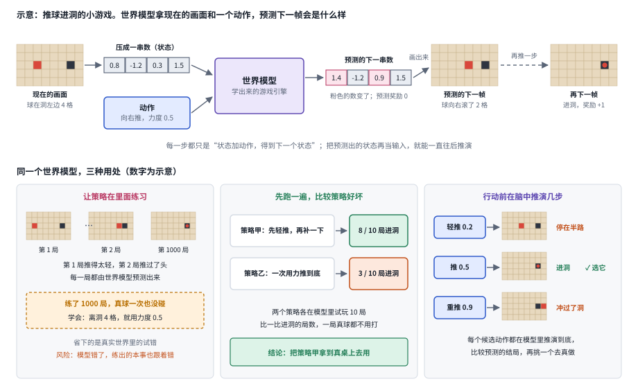
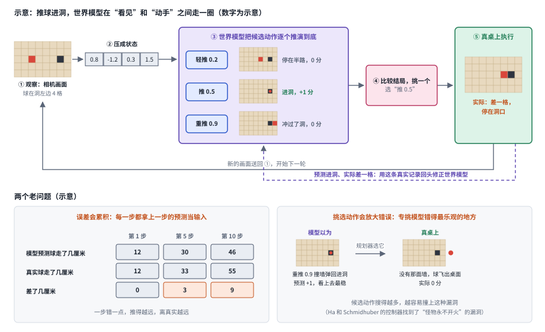
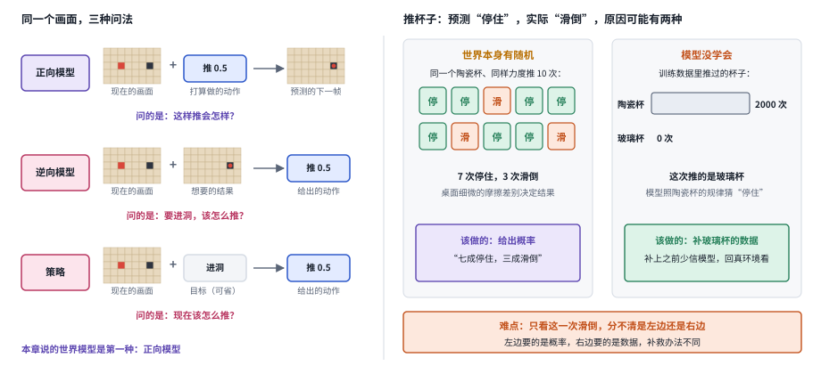
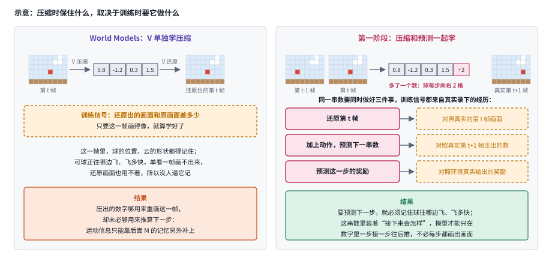
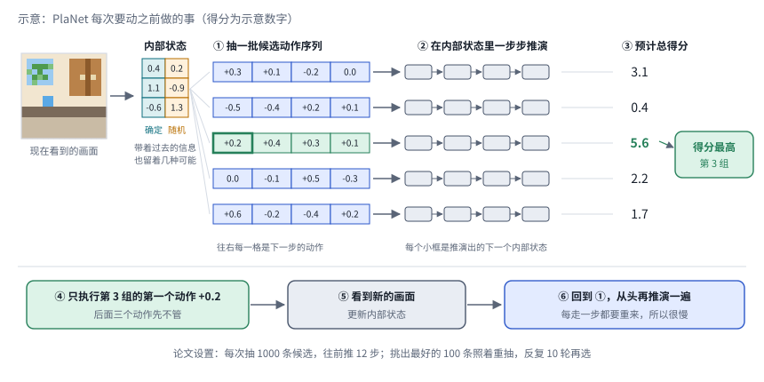
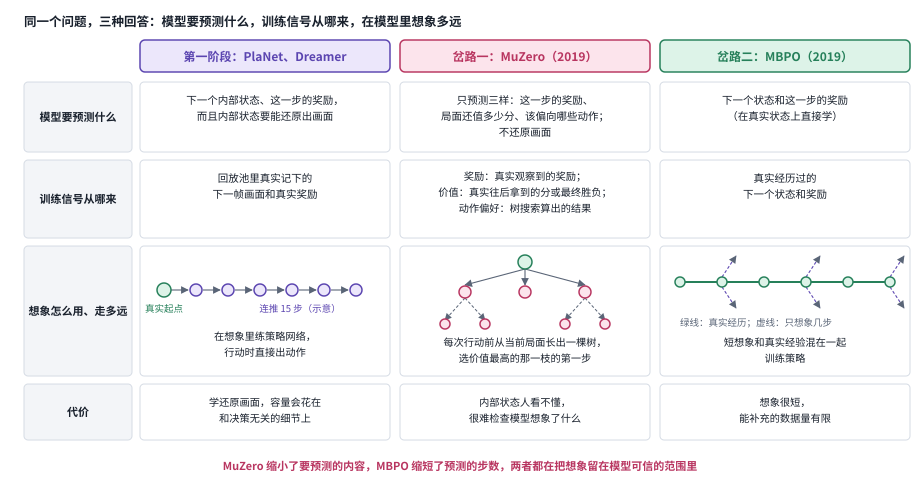
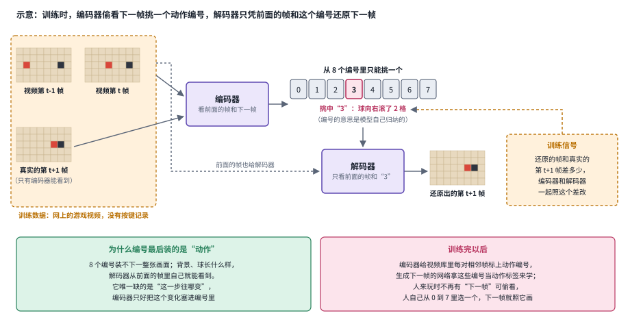
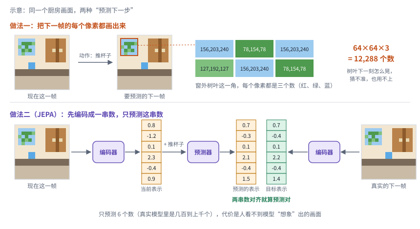
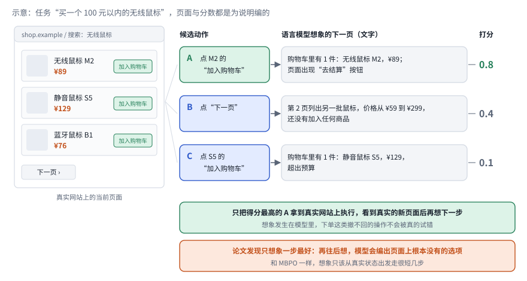
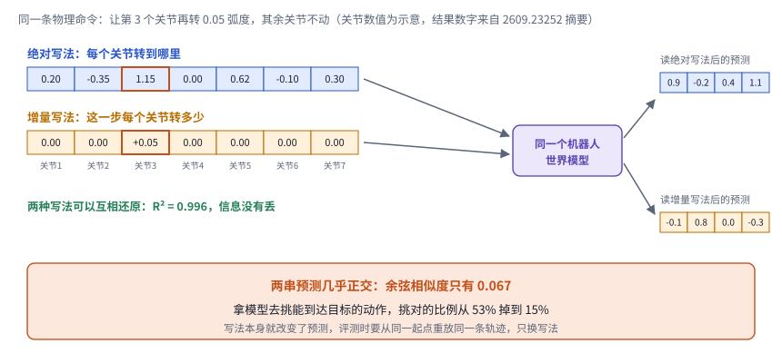

# 10｜世界模型：从预测画面到选择可靠行动

[首页](../README.md) · [专题索引](../README.md#topics) · [文献目录](../catalog/10_world_models.md)

## 方向背景：为什么决策需要世界模型

人在动手之前，会先在脑子里把几种做法的后果预演一遍，再挑一个去做。设想厨房里有一台机器人，它接到的任务是把桌上的玻璃杯放进半开的橱柜。人做这件事几乎不用想，可仔细拆开，脑子里其实悄悄跑了好几遍"预演"：手从这边伸过去会不会碰倒旁边的酱油瓶，杯子握在杯身还是杯口更稳，柜门要是弹回来会不会夹住手腕。我们并没有真的把每种做法都试一遍，因为脑子里有一个关于这个厨房、这只杯子、这扇柜门的小模型，可以先在里面推演，再挑一个看起来最稳妥的动作。

世界模型就是要给机器人装上这样一个内部模型，因为没有它，机器人只剩下一条路：真的去试。试错在模拟器里很便宜，在真实厨房里却又慢又贵，有时还很危险，打碎一只杯子就是一次失败的样本。世界模型让系统学会"环境会怎样变化"，在动手之前比较几种做法可能带来的后果，挑出值得一试的那个，然后用真实看到的结果回头修正自己的预测。所以世界模型看重的是预测能不能帮机器人挑对动作，画面画得逼不逼真倒在其次。

难处在于，模型的预测会出错，而机器人要拿这些预测来做决定。相机只拍到世界的一部分，杯子被手挡住时它仍然在那里，模型得自己记住；同样一帧画面，柜门可能锁着，也可能只是虚掩，接下来的发展并不唯一。一步预测里的小误差，推演十步之后会越滚越大。更麻烦的是，机器人会在模型里比较很多种做法，挑出看起来最好的那个，于是模型在哪里错得最乐观，机器人就最容易选中哪里：如果模型误以为手可以穿过柜门，穿门而过就成了最快的方案。

正因为预测会出错，本章会反复提醒，下面三件事要分开衡量：模型生成的画面像不像，它预测的下一步准不准，机器人靠它做决定时任务有没有做成。一段画得很像的视频，预测可能并不准；预测得准的模型，机器人拿来挑动作时也可能被它带偏。

## 先读这几篇

本章的主线借自几篇人写的长文。它们的作者或者亲手做出了这个方向的代表系统，或者花了很长时间整理整个领域，叙事里有取舍、有判断。建议按下面的顺序读，先建立"世界模型到底该预测什么"这个问题意识，再回来看各分支的新论文。

| 顺序 | 文章 | 为什么读 |
|---|---|---|
| 1 | Inkyu Sa（Chef Robotics），[World Models and World-Action Models: An Accessible and Comprehensive Survey](https://chefrobotics.ai/post/world-models-and-world-action-models-an-accessible-and-comprehensive-survey)（2026-08） | 这是作者为自己一份覆盖 220 多项工作、160 多个系统的综述写的导读，也是本章发展主线的骨架。它把整个领域组织成一个"设计空间"，坐标轴是三个问题：模型预测什么，用什么方式生成预测，能不能被动作控制。沿着这个问题，作者把方法分成六族，从潜空间循环状态模型、只预测价值的规划模型，到自回归 token、扩散生成、JEPA 和视频基础模型。他的核心判断很干脆，"no single modeling approach dominates everywhere"，没有哪一族能在所有场景里通吃；他也提醒，画面质量本身证明不了模型学到了世界的规律。文末列出的五个优先方向，包括物理与因果落地、长时程的场景持久、可靠的动作条件、够快的推理和超出画面逼真度的评测，几乎和本章前八个分支一一对应。 |
| 2 | David Ha、Jürgen Schmidhuber，[World Models](https://worldmodels.github.io/)（2018-03） | 一篇可交互的网页文章，开篇就问"agent 能不能在自己的梦里学习"。作者用视觉压缩、记忆预测和一个极小的控制器三件套，让智能体先在学到的模型里练习，再回到真实环境。它最值得读的是"欺骗世界模型"那一节：控制器在梦里找到了让怪物永远不开火的漏洞，梦里得分很高，回到真实环境却一败涂地；把模型的随机性调高之后，学到的策略反倒更稳。这个故事几乎预告了后来所有世界模型研究都要面对的问题。 |
| 3 | Danijar Hafner，[Introducing Dreamer: Scalable Reinforcement Learning Using World Models](https://www.research.google/blog/introducing-dreamer-scalable-reinforcement-learning-using-world-models/)（2020-03） | Dreamer 作者本人写的介绍。它把"学世界模型、在想象中学行为、去环境里收集新经验"这个循环讲得非常清楚，也说明了为什么要在紧凑的潜状态里推演，以及为什么要用一个价值网络和一个动作网络取代每一步都做的昂贵搜索。读完能带走一个关键区分：世界模型可以在每次行动前用来逐个推演候选动作，也可以在训练时生成想象的轨迹，让策略在里面练习，两种用法把计算放在了不同的阶段。 |
| 4 | Jack Parker-Holder、Shlomi Fruchter（Google DeepMind），[Genie 3: A new frontier for world models](https://deepmind.google/blog/genie-3-a-new-frontier-for-world-models/)（2025-08） | 生成式世界模型这条线最有代表性的一篇发布文章。Genie 3 可以从一句文字生成一个能以每秒 24 帧、720p 实时游走的世界，场景能保持几分钟的一致，视觉记忆可以回溯到大约一分钟之前，还能用文字触发"世界事件"，比如改变天气或者加进一个新角色。文章也很坦率地列出了局限：动作空间有限，多个智能体之间的交互难以建模，连续交互只能维持几分钟。读它能直观地看到"视频生成走向可交互世界"走到了哪一步，也能看清剩下的空白在哪里。 |
| 5 | Meta AI，[Introducing the V-JEPA 2 world model and new benchmarks for physical reasoning](https://ai.meta.com/blog/v-jepa-2-world-model-benchmarks/)（2025-06） | 表示空间预测这条路线的代表。文章把世界模型的能力拆成理解、预测和规划三件事，用超过一百万小时的无标注视频预训练编码器和预测器，再只用 62 小时的机器人数据加上动作条件，就让机械臂在没见过的环境里完成抓放任务。同样重要的是它同时发布的三个物理推理基准：人类在上面能拿到 85% 到 95%，而当时的视频模型在 IntPhys 2 上接近随机水平。这组对比把"会预测"和"懂物理"之间的距离量了出来。 |
| 6 | Yixia Li、Hongru Wang 等，[Bridging the Agent-World Gap: Text World Models for LLM-based Agents](https://arxiv.org/abs/2606.09032)（2026-06，`2606.09032`） | 前面五篇讲的都是画面和机器人，这篇综述把视野拉到 2026 年语言 agent 的一侧，是本章文本岔路和三.9 的入口。作者把文本世界模型定义为文字状态上的转移模型：给定一个状态和一个候选动作，预测接下来出现的网页、终端输出、接口返回或者用户回复。他们的判断是，今天大多数语言 agent 只会被动地反应，缺一个关于环境怎样演化的显式模型。全文用两根轴组织文献，一根是状态怎样表示，自然语言、结构化数据还是可执行代码；一根是落在哪类环境，物理、数字、社会还是抽象。构建方式分成学习、提示和程序三类，用途分成训练期和推理期，前者包括把模型内化进策略、充当模拟训练环境和模拟用户，后者包括前瞻搜索和动作验证；评测一节专门讨论模拟器的忠实度。它列出的开放问题，世界模型和策略怎样耦合、世界模型自身要不要推理、怎样落地到物理现实、怎样持续适应，和本章边界一节的老问题一脉相承。 |

表外还有几篇原始出处，适合想多读一点时对照着看。OpenAI 2024 年的技术报告 [Video generation models as world simulators](https://openai.com/index/video-generation-models-as-world-simulators/) 是"扩大视频生成规模就能得到世界模拟器"这一主张的原始出处，报告自己也承认 Sora 还模拟不好玻璃破碎这样的基本物理交互。YK Sugi 整理的 [VLAs are dead, long live World Action Models](https://www.eventual.ai/blog/vlas-are-dead-long-live-world-action-models) 记录了 Jim Fan 在 2026 年的一次演讲，他把机器人的发展类比成大语言模型走过的预训练、微调、推理几步，认为以视频世界模型为底座的世界-动作模型会接替 VLA，观点鲜明，适合拿来和本章第 2、5、7 个分支对照着读。DreamerV3 的[项目主页](https://danijar.com/project/dreamerv3/)讲了同一套固定超参数怎样跨越 150 多个任务，Yann LeCun 2022 年的立场文章 [A Path Towards Autonomous Machine Intelligence](https://openreview.net/forum?id=BZ5a1r-kVsf) 则是 JEPA 思路的源头。语言 agent 这一侧，David Silver 与 Richard Sutton 的短文 [Welcome to the Era of Experience](https://storage.googleapis.com/deepmind-media/Era-of-Experience%20/The%20Era%20of%20Experience%20Paper.pdf) 是"让 agent 从自己的经验里学"这一主张的出处，适合和本章文本岔路一节对照着读。想看整张地图，可以翻 [From Masks to Worlds: A Hitchhiker's Guide to World Models](https://arxiv.org/abs/2510.20668)（`2510.20668`）和面向机器人的短教程 [From World Models to World Action Models: A Concise Tutorial for Robotics](https://arxiv.org/abs/2607.00836)（`2607.00836`）。

## 一、基本概念：观察、状态、动作与不确定性

> **要点：** 世界模型是一台学出来的模拟器：给它现在的状态和一个打算做的动作，它预测接下来会怎样。机器人先在模拟器里比较几种做法，再挑一个去真做。难点在于模拟器会出错，而且出错时很难分辨原因。

可以把世界模型想成一台学出来的游戏引擎。游戏引擎知道当前的画面和玩家按下的键，就能算出下一帧；世界模型做的是同一件事，只是它的规则从数据里学出来，没有人手写。更多前置知识见[大模型入门](../docs/llm_primer.md)。

*图：用一个推球进洞的小游戏走一遍世界模型的骨架（数字为示意）。上排：现在的画面先压成一串数，加上动作“向右推，力度 0.5”，世界模型预测出下一串数，画出来就是球向右滚了 2 格的下一帧；把预测再当输入，就能接着推出球进洞的再下一帧。下排是同一个模型的三种用处：让策略在里面练上千局、先在里面试跑比较两个策略、行动前把几个候选动作推演到底再挑一个。*

游戏引擎手里有完整的游戏状态，机器人手里却只有观察，所以世界模型要先从观察里凑出状态。观察是机器人实际拿到的东西，比如一帧相机画面，或者 agent 看到的一个网页；状态是预测未来所需要的全部信息。两者常常不一样：杯子被手挡住时，这一帧画面里没有它，可它的位置仍然决定着接下来会发生什么。所以世界模型通常先把过去一段时间的观察压缩成一个内部状态，再用这个状态加上动作去预测下一个状态。这个内部状态是模型自己学出来的一串数字，论文里常叫“隐状态”或“潜表示”，其中每个数字未必对应某个看得懂的物理量。

世界模型自己并不做决定，做决定的是另一部分，下图用推球进洞的小游戏把两者放进同一个循环走了一圈。第一步，相机拍下球在洞左边 4 格的画面；第二步，把画面压成一串数，作为状态；第三步，世界模型把轻推、推 0.5、重推三个候选动作逐个推演到底，预测出停在半路、进洞、冲过了洞三种结局；第四步，比较这三种结局，挑出推 0.5；第五步，在真桌上执行，球实际差一格，停在了洞口。新的画面送回第一步，开始下一轮。“预测进洞、实际差一格”这条真实记录也没有浪费，它沿着虚线回去，用来修正世界模型。

*图：世界模型在决策闭环里的位置（数字为示意）。上排是推球进洞走的一圈：观察、压成状态、世界模型推演三个候选动作、挑一个、在真桌上执行，再用真实结果回头修正世界模型。下排是两个老问题：推演步数越多，预测和真实差得越远；规划器专挑模型错得最乐观的动作。*

第四步“挑一个”在论文里有两种常见做法。一种在每次行动前，把候选动作逐个放进世界模型推演，挑后果最好的那个，这叫规划，做这件事的程序叫规划器。另一种事先在世界模型里反复练习，练出一个看到状态就直接给出动作的网络，这个网络叫策略。由此有三种用法，骨架图下排画的就是它们：训练时让策略在模型里练习，省掉真实世界的试错；行动前在模型里搜索候选动作，也就是规划；评测时先把一个策略放进模型里试跑，估计它到真实环境里会表现如何。

不管用哪一种用法，世界模型都只是对真实世界的近似，难免出错，由此带来闭环图下排的两个老问题，这一章会反复碰到它们。第一个问题是误差会累积。模型每推一步，都拿自己上一步的预测当输入，一步错一点，十步之后可能已经离真实情况很远：图左下的表里，第 1 步预测和真实都是球走了 12 厘米，到第 5 步差了 3 厘米，到第 10 步已经差了 9 厘米。第二个问题是挑选动作会放大错误。无论是规划还是练策略，本质上都是在模型里找后果最好的做法，而模型错得最乐观的地方，恰恰显得后果最好。图右下就是一例：模型误以为桌边有一面墙，重推 0.9 会撞墙弹回洞里，于是在模型里，重推是拿分最稳的动作，规划器会毫不犹豫地选它，到了真桌上却没有那面墙，球直接飞出了桌面。搜索得越仔细，越容易找到这类漏洞。2018 年 Ha 和 Schmidhuber 的实验里就发生过这样的事：控制器在学出来的游戏模型里找到一个让怪物永远不开火的漏洞，在模型里得分很高，回到真实游戏却一败涂地。

要防住这类错误，就得让模型知道自己什么时候可能出错，难处在于世界本身也有随机性，一次预测出错时分不清原因。机器人用同样的力度推同一个杯子，桌面上细微的摩擦差别，可能让杯子这次停住、下次滑倒。于是，当模型预测“会停住”而杯子实际滑倒了，背后有两种可能：也许世界本来就是有时停、有时滑，模型没有学错，只是这一次碰上了少见的情况；也许模型从没见过这种材质的杯子，规律根本没有学会。只看这一次结果，两者分不清。可它们的补救办法不同：前一种情况，模型该做的是给出概率，比如“多半停住，偶尔滑倒”；后一种情况，该做的是补充这种材质的数据，或者在补上之前少信模型，回到真实环境里再看一眼。

下图右半边画的就是这个难点；左半边列出读论文时常见的三种模型，它们回答不同的问题，读论文前值得先分清：正向模型拿状态和动作预测下一个状态，问的是“这样做会怎样”，本章说的世界模型就是这一种；逆向模型拿状态和想要的结果反推动作，问的是“要达到它该怎么做”；策略只看状态，有时再加一个目标，直接给出动作。所以一篇论文说“世界模型效果好”时，值得先确认它评的是哪一种。

*图：左边是同一个推球画面的三种问法：正向模型拿画面和“推 0.5”预测下一帧，逆向模型拿画面和“进洞”的结果反推出“推 0.5”，策略只看画面（可以再加目标）直接给出“推 0.5”。右边是推杯子时预测出错的两种可能原因（数字为示意）：同一个陶瓷杯推 10 次，7 次停住、3 次滑倒，这是世界本身的随机，该给出概率；训练时推过 2000 次陶瓷杯、0 次玻璃杯，这次推玻璃杯猜错，是模型没学会，该补数据。*

## 二、发展主线：世界模型到底该预测什么

> **要点：** 本节讲到的每个世界模型做的都是同一件事：给它现在的状态和一个动作，它预测接下来会怎样。八年来各条路线的分歧只在一处，就是“接下来”用什么来表示：一张压缩过的画面，一串只为做决定而学出来的数字，只有分数（每一步得多少分、局面还值多少分），完整的视频画面，或者语言 agent 面对的下一段文字。预测得越完整，人越容易检查模型想象了什么，计算也越贵；预测得越少，越省算力，模型错在哪里也越难看出来。每条新路线多半是在补上一条路线留下的缺口。

本节顺着“模型预测什么”这个问题按时间往下走，因为预测什么，决定了模型能拿来做什么、要花多少计算。这个问题取自 Inkyu Sa 的综述导读，他用三个问题组织整个领域：模型预测什么，用什么方式把预测生成出来，以及预测会不会随着给定的动作改变。下表列出各阶段给出的回答和代表工作，最后一列是本章第三节里接着追问的分支。

| 阶段 | 内容 | 代表工作 | 本章对应分支 |
|---|---|---|---|
| 起点 | 压缩画面、预测压缩后的向量，让策略在"梦"里练习 | World Models（Ha 与 Schmidhuber） | 三.4、三.8 |
| 第一阶段 | 在为做决定学到的内部状态里推演和想象 | PlaNet、Dreamer、DreamerV2、DreamerV3 | 三.3、三.4 |
| 岔路 | 只预测奖励、价值和策略，并限制想象的长度 | MuZero、MBPO | 三.4、三.8 |
| 第二阶段 | 把视频生成当作世界模拟器，追求可交互和长时一致 | Sora、Genie、Genie 3、Cosmos | 三.1、三.5、三.6 |
| 第三阶段 | 在表示空间里预测，再接上动作做规划 | V-JEPA、V-JEPA 2 | 三.3 |
| 第四阶段 | 同一个模型既预测未来又产生动作 | 世界-动作模型（WAM） | 三.2、三.5、三.7 |
| 文本岔路 | 语言模型在网页、工具和文字环境里预测下一个状态，用于规划和训练 agent | RAP、WMA、WebDreamer、Early Experience、DreamGym | 三.9 |
| 边界 | 画面逼真之后，物理和因果是否正确 | 欺骗世界模型、物理推理基准 | 三.6、三.8 |

把表里的代表工作按年份排开，能看出各条路线前后接力。下面的时间轴里，前两条线集中在 2018 到 2020 年，视频世界和表示空间在 2024 到 2025 年接上，世界-动作模型和文本岔路是最近两年最密集的地方；最下面的边界一行从 2018 年延续到 2026 年，每隔一两年就有一项工作发现预测得像的模型在决策上靠不住。

*图：世界模型主线时间轴。2018 到 2022 年的列被压窄，方便看清最近几年的密集工作；"文字模拟器测评"指 2024 年那篇检验语言模型能否充当文字世界模拟器的论文，"文本 WM 综述"指 2026 年的文本世界模型综述。*

### 起点：在自己的梦里学习

> **要点：** World Models 把智能体拆成三块：V 把画面压成一个小向量，M 预测下一个向量，C 根据两者选动作。M 学得足够好时可以代替真实游戏，C 就能完全在 M 生成的"梦"里练习；也正是在梦里，C 第一次找到了钻模型漏洞的办法。

David Ha 和 Jürgen Schmidhuber 2018 年的 [World Models](https://arxiv.org/abs/1803.10122) 让很多人第一次对"世界模型"这个词有了直觉。他们的网页版文章从人讲起：系统动力学家 Jay Forrester 说过，我们脑子里装的从来只是世界的模型，做决定时用的也是这个模型；棒球击球手来不及有意识地计算球路，挥棒靠的就是这种内部预测。

他们照这个思路把智能体拆成三块。第一块 V 是一个压缩网络（变分自编码器），把每一帧 64×64 的画面压成一个小向量。V 的训练方式是把压缩后的向量再还原成原来的画面，还原得越像越好，所以这个小向量保住的是画面里的信息，未必是做决定要用的信息。第二块 M 是一个循环网络，它带着一份随时间更新的记忆（论文叫隐状态），根据当前的向量和动作预测下一个向量；因为未来不唯一，它给出的是下一个向量可能落在哪里的概率分布。M 的学习答案来自录像：作者先让玩家随便乱按，录下一万局，把每一帧都用 V 压成向量，M 要预测的就是录像里真实的下一个向量。第三块 C 就是策略，论文叫它控制器，它只看 V 的向量和 M 的记忆，用一个线性层给出动作。看懂世界的工作几乎全由 V 和 M 承担，所以 C 可以很小，在赛车任务里只有 867 个参数，小到不用梯度、靠一种反复随机试探的进化算法就能调好：每次随机改一批参数，让它们各跑几局，留下总分高的那些，总分就是游戏给出的奖励之和。这套组合在赛车任务上拿到 906±21 分，越过了 900 分的"解决"门槛；只给 C 看 V 的向量、不给 M 的记忆，分数降到 632±251。

*图：上半部分是三件套的分工，下半部分是 VizDoom 里 M 当环境、C 在梦里训练的实验和两种温度下的结局。数字都来自原文；橙色表示失败或风险，绿色表示真实环境里的检验。*

M 学得足够好时，就能代替真实游戏，这是“在梦里练习”能成立的前提，作者在 VizDoom 游戏里检验了它。游戏里怪物会朝玩家扔火球，玩家要左右躲开，活得越久分越高。作者先让玩家在真实游戏里随便乱按，录下一万局，用这些录像训练 V 和 M。这一次 M 除了预测下一步的向量 z，还学着预测玩家这一步会不会死。有了这两样，M 自己就能扮演整个游戏：C 给出一个动作，M 告诉它下一刻的画面会变成什么样、玩家死没死。于是 C 可以完全不碰真实游戏，只在 M 生成的这个“梦”里反复练习，练好之后再拿回真实游戏检验。

梦能代替游戏，也就能被钻空子，VizDoom 实验第一次暴露了策略会钻模型的漏洞。M 只是对游戏的近似，C 又能看到 M 的记忆，于是 C 在梦里找到了一种动作方式，让梦里的怪物永远不扔火球。作者用一个叫温度的旋钮控制 M 采样时的随机程度。温度调到 0.1 时，梦几乎没有随机性，怪物几乎从不开火，C 在梦里能撑 2086 步，回到真实游戏只剩 193 步，比随便乱按的 210 步还差。温度调到 1.15 时，梦里的火球变得难以预料，C 找不到可以一直钻的空子，回到真实游戏拿到了最好的 1092±556 步。这就是第一节说的第二个老问题：策略在模型里找后果最好的做法，而模型错得最乐观的地方（这里是“怪物不开火”）恰恰显得后果最好，于是被策略专门找了出来；让模型多表达一些不确定，这类漏洞就更难被钻。

这个实验留下了三个问题，都能从上面的故事里直接读出来。第一，V 只靠把画面还原回来学会压缩，所以它的向量保住的是重画画面所需的信息，可 C 做决定用不着画面的每个细节，压缩时该不该只保住做决定要用的信息？第二，C 在梦里找到了让怪物不开火的漏洞，怎样让在模型里练出来的策略不去钻这种漏洞？第三，温度调高、梦变得更难预料之后，C 回到真实游戏反而更稳，这说明模型把自己的不确定表达出来是有用的，可它该怎样表达？

### 第一阶段：在紧凑的潜空间里想象

> **要点：** World Models 的 V 只学怎样把画面还原回来，压出的数字未必对做决定有用。这一阶段让模型在学压缩的同时，学着预测下一步会变成什么样、能得多少分，于是可以只在这串数字里一步步往后推演。推演有两种用法：PlaNet 每次动手前先推演很多种做法，再挑最好的；Dreamer 事先在推演里把一个会出动作的网络练好，动手时直接用它。

第一阶段要回答的，是 World Models 留下的第一个问题：把画面压成一串数时，该保住哪些信息。下图用一个小球向右飞的画面说明这件事。左边是 World Models 的做法：V 单独训练，唯一的要求是把这一帧还原得像，所以它会记住球在哪、云长什么样；可球正往哪边飞，单看一帧看不出来，还原画面也用不着，没人逼它记。右边是这一阶段的做法：压缩和预测一起训练，同一串数除了要还原画面，还要在加上一个动作之后预测出下一串数，并预测这一步的奖励，这些答案都来自真实录下的经历。要预测得准，这串数就必须装着“接下来会怎样”，模型于是可以只在这串数里一步接一步往后推，每一步都不必画出画面。这串数论文里叫内部状态，所有可能的内部状态合起来，叫潜空间。

*图：示意。左边只练还原画面，压出的数够重画这一帧，却不含球的速度；右边同一串数还要预测下一步和奖励，于是多出一个“球每步向右 2 格”的数。数字和画面都是为说明编的；第一阶段的 PlaNet 和 Dreamer 训练时同时要求还原画面、预测下一个内部状态和奖励，这一点来自论文。*

在内部状态里推演出来的结果，到底能不能拿来决定下一步怎么动，PlaNet 第一次给出了令人信服的肯定回答。在此之前，只看画面学出一个准到能拿来挑动作的模型，一直是个难题。Danijar Hafner 等人 2018 年底的 [PlaNet](https://arxiv.org/abs/1811.04551) 只看画面，在有物体接触、画面看不全、很少给分的连续控制任务上，用比强无模型方法（不学世界模型、直接靠大量试错学策略的方法）少得多的试玩次数，达到了和它们接近、有时更高的成绩。它的内部状态由两部分组成：一部分是确定的，像传送带一样把过去看到的信息一步步往后带；另一部分带随机性，用来表示同一个局面接下来可能有好几种走法。PlaNet 只训练世界模型，学习的答案全部来自真实玩过的几局：模型要能从内部状态还原出当时真实的画面，还要预测出当时环境真实给出的奖励，差得越多改得越多。它没有单独训练策略，挑动作全靠临场推演。PlaNet 挑动作的办法很直接。每次要动之前，它随机生成 1000 条候选动作序列，每条在内部状态里往后推演 12 步，算出预计能拿多少分；再围绕得分最高的那些序列重新生成一批，这样反复 10 轮，最后只执行最好那条序列的第一个动作。看到新画面后，它把整个过程从头再做一遍。下图把这一轮拆成六步画了出来，为了看得清，候选只画了 5 条，每条只往后推 4 步。

*图：示意。左边是现在的画面和压出来的内部状态；中间每一行是一条候选动作序列，箭头右边是它在内部状态里一步步推演出的结果，最右是预计总得分；得分最高的第 3 组只执行第一个动作 +0.2，看到新画面后整轮重来。得分为示意数字，底部的设置来自论文。*

这种挑动作的办法有两个毛病，Hafner 在介绍 2019 年 [Dreamer](https://arxiv.org/abs/1912.01603) 的博客里也是从这两个毛病讲起的。第一个毛病是慢：机器人每真正动一下，PlaNet 都要把上万条序列各推演 12 步，这些计算下一步又要从头来过。第二个毛病是只看得见眼前：模型每一步预测都有一点误差，推演得越远，误差叠加得越多，所以推演只能停在十几步；十几步之后才拿得到的分数，PlaNet 在比较候选时完全看不到。打个比方，一条路前十几步都没有分、再往后有一大笔分，另一条路眼前就有一点小分，PlaNet 会选后者。这里的分数指环境每一步给出的奖励。

Dreamer 用两个网络分别治这两个毛病。第一个是策略网络，论文叫动作网络，它看到内部状态就直接给出动作；练好之后，真正行动时用不着临场推演上万条候选，慢的毛病就没有了。第二个是价值网络，它估计从某个状态出发、一直往后总共还能拿到多少分，这个估计叫价值。想象只推演 15 步，可在最后一步的状态上加上价值网络的估计，15 步之外的分数也算了进来，只看眼前的毛病就缓解了。

想象里没有人给标准答案，两个网络学习用的分数全部来自世界模型自己的预测。第一步学世界模型时，它除了学会预测下一个内部状态，还学会了预测这一步能得多少分，学的依据是回放池里记下的、环境实际给出的奖励。想象的起点也来自真实经验：从回放池里取出一段真实经历，把其中的画面压成内部状态，从这些状态出发往后想象。到了想象里，策略网络每给出一个动作，世界模型就推出下一个状态，同时报出这一步的预测奖励；15 步的预测奖励加起来，再加上价值网络对第 15 步之后的估计，就是这条想象轨迹的预计总分。策略网络的目标是让这个总分尽量高：整条想象轨迹都是由网络一步步算出来的，所以可以直接算出“动作往哪边改一点，总分会涨还是会跌”，策略网络就照着这个方向调整。价值网络的目标是估得准：它对某个状态给出的估计，要接近从这一步起想象出的奖励，加上后面那个状态的估计。这个答案里有一部分是价值网络自己的估计，听上去像循环论证；可答案里还有世界模型报出的实打实的奖励，每轮训练都把这部分信息往前传一点，估计就越来越准，强化学习里把这种做法叫自举。两个网络都只在想象里学，真实环境给出的奖励只通过世界模型间接起作用。博客报告，在 20 个以图像为输入的连续控制任务上，Dreamer 平均得分 823，高于最强的无模型方法 D4PG 的 786，所用的环境交互约少 20 倍。

*图：Dreamer 的三步循环。每一栏从上到下是这一步做什么、训练信号从哪来、目标是什么、交出什么：①对照回放池里真实的下一帧和奖励学世界模型，交给②当练习场；②从回放池里的真实状态出发想象 15 步，用世界模型预测的奖励加价值估计算出预计总分，练出策略网络，交给③；③不训练，只用策略在真实环境里行动，新经验写回①的回放池。左下是它要治的 PlaNet 的两个毛病，右下是作者博客里报告的结果。*

这三步一环扣一环，目的只有一个：在真实环境里试得尽量少，却练出一个好策略。第一步用真实经验学世界模型，学好的模型交给第二步当练习场；第二步在模型里想象大量轨迹，按世界模型预测的奖励把策略网络练好，交给第三步；第三步用这个策略在真实环境里行动，攒下的新经验写回回放池，下一轮的世界模型就学得更准。真实环境只在第三步出现，大部分练习都发生在模型的想象里，所以 Dreamer 需要的真实交互少得多。

此后 DreamerV2 和 DreamerV3 把同一套循环推到了 Atari 和 150 多个任务上，训练信号的来源和 Dreamer 相同：世界模型对照回放池里真实的画面和奖励来学，策略在想象里按世界模型预测的奖励来学。[DreamerV2](https://arxiv.org/abs/2010.02193)（`2010.02193`）把内部状态换成离散变量，成为第一个只在学到的世界模型里练策略、就在 Atari 游戏上达到人类水平的智能体。[DreamerV3](https://arxiv.org/abs/2301.04104) 用一套固定的超参数跨越 150 多个差异很大的任务，还在没有人类数据、没有课程安排的情况下，从零开始在 Minecraft 里挖到了钻石。它的通用性主要来自一套稳健的训练配方。不同任务的奖励大小可以差好几个数量级，DreamerV3 先用一个变换把大小悬殊的数值压到相近的范围再学习，再配上其他几处让训练保持稳定的处理，同一套设置就能在这些任务上都学起来。

回到本节开头的问题，世界模型到底该预测什么，PlaNet 和 Dreamer 这一族的做法是：往后推演时只推那串学出来的内部数字和每一步的奖励，不再把画面画出来。因为内部状态短，一次能并行推演大量轨迹，这是它们能在推演里挑动作、练策略的前提。Sa 在综述里把这一族叫作潜空间循环状态模型，“潜空间”指那串内部数字，“循环”指状态一步接一步往后推。

**速查：潜空间这一族的四种做法。** 四张卡用同一种画法，从左往右是一轮流程，底部的虚线是绕回下一轮的路。这一族的分歧集中在两处：推演候选放在每次行动之前，还是放在训练时，以及靠什么让一套方法跨越差别很大的任务。

 

 

*图：潜空间这一族的四张结构卡，每张卡对应下表的一行。*

| code | 名称 | 年份 | 代表 | 怎么做 | 解决了什么 | 代价 |
|---|---|---|---|---|---|---|
| L1 | 潜空间搜索 | 2018 | [PlaNet](https://arxiv.org/abs/1811.04551) | 学一个兼有确定和随机部分的内部状态；每次要动之前，在内部状态里推演大量候选动作序列，执行最好那条的第一个动作后再从头推演 | 证明了只看画面学到的模型也准到可以拿来挑动作，用不着人手写环境的规则 | 每动一步都要推演上万条候选，很慢；只推演十几步，看不到更远的分数 |
| L2 | 想象中训练 | 2019 | [Dreamer](https://arxiv.org/abs/1912.01603) | 在内部状态里并行想象大量 15 步的轨迹，价值网络估计第 15 步之后还能拿多少分，按想象轨迹的总分直接调整策略网络 | 真正行动时不再临场推演候选；20 个图像控制任务平均 823 分，环境交互约少 20 倍（作者博客） | 策略是在想象里练的，模型的误差会被带进策略，策略钻模型漏洞的老问题仍在 |
| L3 | 离散内部状态 | 2020 | [DreamerV2](https://arxiv.org/abs/2010.02193) | 把内部状态换成离散变量，完全在单独训练的世界模型里学策略 | 第一个这样学到 Atari 人类水平的智能体 | 仍靠重建画面来学内部状态，一部分容量花在和决策无关的细节上 |
| L4 | 固定配方 | 2023 | [DreamerV3](https://arxiv.org/abs/2301.04104) | 一套固定的超参数配上归一化、平衡、变换等稳健化技巧，跨越 150 多个任务 | 不必为每个领域重新调参，没有人类数据和课程也能在 Minecraft 里挖到钻石 | 通用性来自一整套工程细节，评测集中在有奖励信号的模拟任务里 |

### 岔路：只预测做决定需要的量

> **要点：** 第一阶段的模型训练时仍要把画面还原回来，想象也一推十几步。另一条思路在这两处都往回收：MuZero 只预测做决定用得上的几样数（每步得多少分、局面还值多少分、该偏向哪些动作），完全不还原画面；MBPO 只从真实经历过的状态出发想象很短几步。一个缩小了要预测的内容，一个缩短了想象的长度，合起来说明想象能走多远，要看模型有多可信。

*图：三种做法并排比较。每一列从上到下：模型要预测什么，训练信号从哪来，在模型里想象怎么用、走多远，代价。MuZero 的训练信号取自论文：奖励目标是真实观察到的奖励，价值目标是真实往后拿到的分或最终胜负，动作偏好的目标是树搜索算出的结果。*

把三种做法并排放在一起，才看得出岔路改动的是第一阶段的哪两处。第一阶段的模型既要预测下一步，又要能把画面还原回来，想象一推就是十几步；画面里大量和做决定无关的细节占着模型的容量，推得越远误差也积得越多。MuZero 把要预测的东西减到只剩做决定用得上的几个数，训练信号也跟着换成了真实的分数、胜负和搜索结果，从此不再需要画面；MBPO 保留了预测下一个状态，却把想象缩短到从真实状态出发的几步。两者付出的代价也不同：前者的内部状态人看不懂，后者能补充的数据有限。

第一阶段的模型训练时仍要还原画面，MuZero 说明连这一步也可以省掉，预测得少，照样能做出好决定。既然最终只是要做决定，2019 年 DeepMind 的 [MuZero](https://arxiv.org/abs/1911.08265) 就让模型只预测三样东西：每一步的奖励、每个状态的价值，以及策略在这个状态下倾向于选哪些动作。下图左边是它的三个部分："表示"把观察变成一个隐状态，这个隐状态不必长得像画面；"动态"接过隐状态和一个动作，推出下一个隐状态，同时预测这一步的奖励；"预测"从每个隐状态读出价值和策略。在这个模型上，MuZero 做树搜索：从当前隐状态出发，把每个候选动作推一步，再从每个结果出发继续推，长成一棵树，最后选价值最高的那一枝的第一步。这三样预测的学习答案都来自它自己真实下过的棋、玩过的局：奖励对照游戏真实给出的分数，价值对照这一局后来真实的得分或结局，策略对照树搜索在这一步最终更偏向哪些动作。所以模型从来不需要对照画面，只需要让这三样数对得上。它从不还原棋盘或游戏画面，却在围棋、国际象棋和 Atari 上取得了顶尖成绩。Sa 把这一族叫作"价值等价"的规划模型，意思是只要模型对每个动作算出的价值和真实世界一致，它的内部长什么样都无所谓；他的评价是，这一族"更进一步，只预测做出好决定所需要的东西"。

*图：左边是 MuZero 的表示、动态、预测三部分和其上的树搜索；右边是 MBPO 短分支想象的示意，曲线形状只是示意，不对应具体数据。*

MuZero 缩小了预测的内容，同一年的 [MBPO](https://arxiv.org/abs/1906.08253) 则缩短了预测的长度，只从真实状态出发想象几步。第一节说过，模型每推一步都拿自己上一步的预测当输入，误差会越积越大。所以 MBPO 不让模型从头想象一长段，只从真实经历过的状态出发向前推几步，把这些短轨迹和真实经验混在一起训练策略。它的模型照真实经历学：给定状态和动作，预测真实记下的下一个状态和奖励。策略则用一种常规的强化学习算法学，目标是让奖励之和尽量高，奖励在真实数据里来自环境，在短轨迹里来自模型的预测。图右边画的就是这个对比：紫色的短分支都长在绿色的真实轨迹上，离真实不远；橙色那条从头想象的长线，越往后离真实会走的路越远。

两篇工作合起来说明，模型只在一定范围内可信，想象应该留在这个范围里。范围有限，是因为每步的小误差会越积越大，而挑选动作又专挑模型错得最乐观的地方；MuZero 缩小了要预测的内容，MBPO 缩短了预测的步数，都是在把想象留在可信的范围里。

**速查：只预测决策量的两种做法。** 两张卡都不追求把世界画出来：一个只保留做决定用得上的量，一个只在离真实很近的地方使用模型。

 

*图：只预测决策量的两张结构卡，每张卡对应下表的一行。*

| code | 名称 | 年份 | 代表 | 怎么做 | 解决了什么 | 代价 |
|---|---|---|---|---|---|---|
| V1 | 价值等价模型 | 2019 | [MuZero](https://arxiv.org/abs/1911.08265) | 学到的模型只预测奖励、价值和策略，在这个模型上做树搜索 | 不必还原棋盘或画面，就在围棋、国际象棋和 Atari 上取得顶尖成绩 | 隐状态说不出世界长什么样，很难拿来检查模型到底想象了什么 |
| V2 | 短分支想象 | 2019 | [MBPO](https://arxiv.org/abs/1906.08253) | 只从真实经历过的状态出发向前推几步，用这些短轨迹补充训练数据 | 把误差的累积限制在很短的范围内 | 远期的收益仍要靠真实数据和价值估计，想象能补充的数据量有上限 |

### 第二阶段：把视频生成当作世界模拟器

> **要点：** 前面的路线都在设法少预测画面，2024 年起的视频生成模型反过来押注：把画面本身预测好，对物理的理解会随规模出现。这条路有一个缺口，网上的视频里没有记录动作，生成的世界没法被操控；这一阶段的工作先补上动作，再把生成做到实时可玩，只是一致性还只能维持几分钟。

前面几条路线都在设法少预测画面，2024 年起的视频生成路线反过来，要把画面本身预测好。这一年，OpenAI 在 Sora 的技术报告 [Video generation models as world simulators](https://openai.com/index/video-generation-models-as-world-simulators/) 里提出，扩大视频生成模型的规模，是通向物理世界通用模拟器的一条有前景的路。报告列举了随规模出现的能力：镜头移动时三维结构保持一致，物体被遮挡后依然存在，动作留下持久的痕迹，比如画布上的笔触和汉堡上的咬痕。报告也承认，Sora 模拟不好玻璃碎裂这样的基本物理交互，长视频里会出现不连贯和凭空冒出的物体。这条路线的吸引力在于可以用海量的互联网视频训练，缺口在于视频里没有动作，模型只能看着世界往下演，没法被人或策略操控。

同年 DeepMind 的 [Genie](https://arxiv.org/abs/2402.15391) 就是来补这个缺口的，它从没有按键记录的视频里自己归纳出动作。它的训练数据是互联网上的游戏视频，没有任何按键记录。它先把每一帧切成一组离散的小块编号（token），再用一个网络看相邻两帧，判断这两帧之间发生了一小组"隐含动作"里的哪一个；这些隐含动作是模型自己归纳出来的几种画面变化方式，没有人标注过。最后一个网络拿着前面各帧和一个隐含动作，生成下一帧，生成的帧再接回去继续往下推。三个网络的学习答案都是视频里真实的画面：切块编号的网络要能把编号还原成原来那一帧；归纳隐含动作的网络靠“编码再还原”学出来，用不着另做环境：训练时，它的编码器同时看前面各帧和真实的下一帧，从只有 8 个编号的小码本里挑一个，和它成对搭起来的解码器看不到下一帧，只凭前面各帧和这个编号去还原下一帧。两个网络的参数一开始都是随机的，靠同一个训练信号一起从零学：还原得和真实下一帧差多少，两者就一起改多少。解码器的唯一用处，就是逼编码器挑出有意义的编号。8 个编号装不下一整张画面，背景和角色的样子解码器从前面各帧里自己就能看到，它唯一缺的是这一步往哪变，所以编码器只能把真正决定画面怎么变的那部分信息塞进编号里，下图把这个过程画了出来。训练完以后解码器就不用了，编码器给视频库里每对相邻帧标上动作编号；生成下一帧的网络拿这些编号当动作，要预测出真实下一帧的那组编号。生成好的世界交给人玩时，人每一步从这组隐含动作里选一个，下一帧就按这个动作画出来，生成的世界就这样被操控起来了。

*图：Genie 的隐含动作怎样学出来（示意）。编码器偷看真实的下一帧，从 8 个编号里挑一个（这里是“3”，球向右滚了 2 格）；解码器只凭前面的帧和这个编号还原下一帧，还原的帧和真实下一帧的差就是两者共同的训练信号。8 个编号装不下整张画面，只装得下“这一步往哪变”。训练完以后，人从 0 到 7 里选编号，下一帧就照它画。*

*图：上半部分是 Genie 的三个部件（时空视频分词器、潜在动作模型、自回归动态模型，见论文摘要）；下半部分是视频世界这一阶段的四个代表。*

2025 年，视频世界有了可供微调的底座，也做到了实时交互，只是交互维持不了太久。年初 NVIDIA 发布了 [Cosmos](https://arxiv.org/abs/2501.03575)（`2501.03575`）世界基础模型平台，开篇一句是"物理 AI 需要先在数字世界里训练"，它提供一个通用底座，供具体的机器人或自动驾驶任务微调。同年 Genie 3 的发布文章代表了这条路线走到的位置：从一句文字生成 720p、每秒 24 帧、可以实时游走的世界，场景能保持几分钟一致，视觉记忆能回溯约一分钟，还能用文字触发天气变化之类的世界事件。DeepMind 让 SIMA 智能体在这些世界里执行导航任务，文章特意说明 Genie 3 并不知道智能体的目标，它只根据智能体的动作模拟后果；这正是第一节说的分工，世界模型负责预测后果，选动作的是策略。文章也列出了做不到的事：动作空间有限，多个智能体的交互难以建模，连续交互只能维持几分钟。

*图：把状态存成像素的视频世界。每一步拿当前画面加一个动作，画出下一帧。这种做法什么环境都能造，代价是世界里只有像素，时间一长画面会慢慢漂移。*

**速查：视频世界这一族的四种做法。** 四张卡的起点都是大量视频，差别在第二、三个框：有没有动作，动作从哪里来，生成的世界能被谁操控。

 

 

*图：视频世界这一族的四张结构卡，每张卡对应下表的一行。*

| code | 名称 | 年份 | 代表 | 怎么做 | 解决了什么 | 代价 |
|---|---|---|---|---|---|---|
| G1 | 规模化视频生成 | 2024 | [Sora 报告](https://openai.com/index/video-generation-models-as-world-simulators/) | 扩大视频生成模型的规模，观察随规模出现的能力 | 出现三维一致、物体恒存、动作留下持久痕迹等能力，可以用海量互联网视频训练 | 视频里没有动作；玻璃碎裂等基本物理交互模拟不好，长视频会不连贯、凭空冒出物体 |
| G2 | 隐含动作 | 2024 | [Genie](https://arxiv.org/abs/2402.15391) | 从无标注游戏视频的相邻两帧里归纳出一小组隐含动作，再拿前面各帧加一个隐含动作逐帧生成下一帧 | 生成的环境可以被操控，生成和行动开始靠近 | 世界只存成像素，时间一长画面会慢慢漂移 |
| G3 | 世界基础模型 | 2025 | [Cosmos](https://arxiv.org/abs/2501.03575) | 提供一个通用的世界基础模型平台，再为具体的机器人或自动驾驶任务微调 | 物理 AI 可以先在数字世界里训练，不同任务共用一个底座 | 落到具体任务上仍要微调，底座和任务之间的差距要单独检验 |
| G4 | 实时可交互世界 | 2025 | [Genie 3](https://deepmind.google/blog/genie-3-a-new-frontier-for-world-models/) | 从一句文字生成 720p、每秒 24 帧、可以实时游走的世界，还能用文字触发世界事件 | 几分钟的一致和约一分钟的视觉记忆，能让 SIMA 智能体在里面执行导航任务 | 动作空间有限，多个智能体的交互难以建模，连续交互只能维持几分钟 |

### 第三阶段：在表示空间里预测

> **要点：** 视频生成要把下一帧的每个像素都猜出来，包括树叶怎么晃这类既猜不准、也和做决定无关的细节。这一阶段先把画面压成一串数字，只预测这串数字；先用大量没有动作的视频学世界怎样变化，再用少量机器人数据学动作的影响，最后拿它挑动作、控制机械臂。

第三阶段认为，世界模型没有必要逐个像素地预测未来。世界模型要预测下一个状态。在视频里，下一个状态就是下一帧画面，这意味着模型要把画面里的每个像素都预测出来。上一阶段的视频生成路线正是这样做的，它押注像素预测得足够好，对世界的理解自然会出现。Yann LeCun 在 2022 年的立场文章里提出了相反的看法：世界里充满了无法预测、也无须预测的细节，比如树叶怎么晃、水面怎么反光，强迫模型逐个像素去预测这些东西，会把容量浪费在和做决定无关的地方。他据此提出 JEPA（联合嵌入预测架构）：先用一个编码器把画面变成一串数字，这串数字叫表示，相当于第一节说的内部状态，然后只在表示之间做预测。Sa 的导读也这样概括这一族："预测抽象特征，避开无法预测的视觉细节"。下图拿同一个厨房画面把两种做法并排摆出来：上排要把下一帧的一万多个数都猜对，连窗外树叶怎么晃也得猜；下排先把画面压成一小串数，预测器只需要猜出下一串数，再和真实下一帧编码出来的那串数对齐。

*图：示意。上排放大了窗外树叶的一角，每个像素都是红、绿、蓝三个数，一帧 64×64 的画面就有 12,288 个数；下排的表示只画了 6 个数，真实模型里要多得多。*

*图：上排是预测像素的做法，要把被遮住的每片树叶都画出来；下排是 JEPA，看得见的部分经过编码器，再由预测器猜出被遮部分的表示，和被遮部分自己经过编码器得到的表示对齐。代价是预测结果是一串数字，人看不到模型"想象"出了什么。*

V-JEPA 系列把这个想法从看懂视频一路推到了控制机器人。2024 年的 [V-JEPA](https://arxiv.org/abs/2404.08471) 按图里下排的办法学视频：遮住视频的一部分，让一个叫预测器的网络根据看得见部分的表示，猜出被遮部分的表示。学习的答案是被遮部分自己的表示：把没遮的原视频交给编码器的一个缓慢跟随的副本，读出被遮那几块的表示，预测器猜的和它差多少就改多少。猜得准，说明表示抓住了画面怎样随时间变化。2025 年的 [V-JEPA 2](https://arxiv.org/abs/2506.09985)（`2506.09985`）把它变成了可以控制机器人的世界模型，训练分两段。第一段只用一百多万小时无标注视频，照 V-JEPA 的办法学"世界怎样变化"，不需要任何动作标签。第二段把编码器冻住，只用不到 62 小时的 DROID 机器人视频训练一个接受动作的预测器，它学的是"当前的表示加一个动作，得到下一个表示"，学习的答案是机器人视频里真实下一帧经过冻住的编码器得到的表示，动作就是视频里机械臂真实做过的动作；论文把得到的模型叫作 V-JEPA 2-AC。真正控制机械臂时，它这样挑动作：把当前图像和目标图像都编码成表示，试候选的动作序列，挑预测结果最接近目标表示的那一组，只执行第一个动作，再看着新画面重新规划。Meta 的博客报告，在没见过的环境里，机械臂抓取放置新物体的成功率达到 65% 到 80%。

*图：V-JEPA 2 的两段训练与表示空间里的规划。数字来自 Meta 的博客与论文摘要；规划部分的画法是示意。*

没有动作标注的视频能不能帮上机器人？这一阶段的回答是能，而且很省数据：大量没有动作的视频负责学世界怎样运转，少量带动作的数据负责学机器人的动作怎样影响世界。它留下的问题是，容易预测的表示未必适合控制。预测误差低，可能恰恰因为表示里丢掉了接触、受力这些难以预测的变量，而抓取和放置正要靠它们。Meta 博客最后提到的两个方向，跨多个时间尺度规划的分层 JEPA（比如把烤蛋糕拆成一串小步骤）和融合视觉、声音、触觉的多模态 JEPA，都还在探索之中。

**速查：表示空间这一族的三种做法。** 三张卡的第二、三个框都落在表示上，差别在有没有接上动作、能不能拿来规划：立场文章给出方向，V-JEPA 学会看懂视频，V-JEPA 2 走到了控制。

 

*图：表示空间这一族的三张结构卡，每张卡对应下表的一行。*

| code | 名称 | 年份 | 代表 | 怎么做 | 解决了什么 | 代价 |
|---|---|---|---|---|---|---|
| J1 | 表示空间预测的主张 | 2022 | [A Path Towards Autonomous Machine Intelligence](https://openreview.net/forum?id=BZ5a1r-kVsf) | 先把观察编码成表示，再在表示之间预测，以世界模型为核心设计自主智能体 | 不必逐像素预测树叶怎么晃、水面怎么反光，容量留给和决策有关的内容 | 立场文章给出的是架构设想，怎样训练、怎样接上动作，要由后续工作回答 |
| J2 | 视频遮挡预测 | 2024 | [V-JEPA](https://arxiv.org/abs/2404.08471) | 遮住视频的一部分，让预测器根据看得见部分的表示猜出被遮部分的表示 | 用无标注视频学到视觉特征，用不着重建像素 | 还不接受动作，要当世界模型用还得接上动作，并检验表示能否帮助控制 |
| J3 | 无动作预训练加动作微调 | 2025 | [V-JEPA 2](https://arxiv.org/abs/2506.09985) | 一百多万小时视频预训练，再用不到 62 小时机器人数据训练接受动作的预测器，朝目标图像规划，每一步重新规划 | 没见过的环境里，抓取放置新物体的成功率达到 65% 到 80% | 容易预测的表示未必适合控制，接触、受力这些对操作要紧的变量未必被保留下来 |

### 第四阶段：同一个模型既想象又行动

> **要点：** 世界-动作模型让同一个网络既预测未来又输出动作，通常以视频生成模型为底座。它把三个老问题推到台前：动作怎样写进视频模型，机器人干活时要不要先把未来一帧帧画出来，人的视频怎样对上机器人的动作。

到 2026 年，机器人领域开始让同一个网络既预测未来又输出动作，这类模型叫世界-动作模型（World Action Model，WAM）。Sa 的导读给出了区分：世界模型预测接下来会发生什么，最多给出一个动作建议；世界-动作模型还要直接产生到达目标所需的动作。下图上半部分把两者并排画出。左边的世界模型只预测后果，选动作的是另外的策略或规划器；右边的世界-动作模型接收观察和指令，由同一个网络同时给出未来和动作。Sa 观察到，越来越多的系统让同一个模型兼任模拟器和策略，有时还兼任评估器。

*图：左上是世界模型，右上是世界-动作模型；下排三个问题分别对应三.2、三.5、三.7。*

Jim Fan 在 2026 年的一次演讲里走得更远，他判断 WAM 会接替 VLA。按 YK Sugi 的整理，他认为 VLA（看画面、读指令、直接输出动作的策略）太"头重"，大部分能力押在语言上，而机器人真正缺的是物理知识；以视频世界模型为底座、再用动作数据微调的 WAM 会接替 VLA，训练数据会从遥操作逐渐转向第一人称的人类视频，神经网络做的模拟器则为强化学习提供环境。这个判断还有待检验，不过本章很多新论文的名字确实都带着"WAM"。

把视频生成模型改造成会出动作的模型，会碰到下图下排的三个问题。视频模型原本在没有动作的视频上训练，动作怎样写进去，是三.2 的问题；把未来一帧帧画出来，要让生成模型从一团噪声出发一轮轮去噪，机器人每出一段动作都得等它画完，真正控制时到底要不要画，是三.5 的问题；第一人称视频里是人手，机器人用的是夹爪，两者的动作怎样对上，是三.7 的问题。这一阶段还没有像 Dreamer 那样公认的奠基作，所以这里不画结构卡，代表系统放在这三个分支里，本节末尾的总对照图也把它们单独列成一行。

### 文本岔路：让语言模型预测网页和工具的下一步

> **要点：** 网页、终端和文字游戏里的状态本身就是文字，语言模型可以直接预测一个动作之后会出现什么。这条岔路先把它用在 agent 行动前预想后果，再用在拿不到奖励时训练 agent。

2023 年以后，在网页、终端、接口和文字游戏里办事的语言模型 agent 也开始需要世界模型，原因和厨房机器人一样：在真实环境里试错又慢又贵。真实网站上有很多做了就撤不回的操作，下单、发邮件、删文件，每次试错都可能留下真实后果；在线强化学习要搭环境、跑长轨迹，很多任务还给不出能验证对错的奖励。另一方面，这类环境里的状态本身就是文字，一个网页、一段命令行输出、一条接口返回都是。语言模型在预训练时读过海量这样的文本，大致知道点一下"加入购物车"之后页面会变成什么样。于是可以让语言模型自己充当世界模型，在文字里预演动作的后果。

*图：语言模型当世界模型的三种用法：行动前先想一步，把预测能力吸收进策略，当作合成的训练环境。下方橙框是共同的风险；第四种用法，执行前验证一个转移，放在三.9。*

最早把语言模型的推理和世界模型联系起来的是 2023 年的 [RAP](https://arxiv.org/abs/2305.14992)（`2305.14992`，Reasoning with Language Model is Planning with World Model），它把一步步推理看成在世界模型上做规划。作者认为，语言模型一步步推理时不善于规划，是因为缺少一个能预测状态变化、模拟长期后果的世界模型。他们让同一个模型身兼两职，一边提出下一步候选，一边扮演世界模型预测这一步之后的状态，再用树搜索把推理一步步展开。RAP 不训练任何模型，搜索时给每一步打分的依据也来自同一个模型，比如它对这一步有多大把握。这和 MuZero 在学到的模型上做树搜索是同一个结构，只是状态从棋局换成了文字。第二年的 [Can Language Models Serve as Text-Based World Simulators?](https://arxiv.org/abs/2406.06485)（`2406.06485`）检验了这件事有多可靠：作者用文字游戏的状态转移建了 ByteSized32-State-Prediction 基准，结论是 GPT-4 的表现虽然可观，仍然算不上可靠的世界模拟器。

在网页 agent 身上，这个想法开始有了实际用处。2024 年的 [WMA](https://arxiv.org/abs/2410.13232)（`2410.13232`，Web Agents with World Models）先做了诊断：GPT-4o、Claude-3.5-Sonnet 这样的模型不擅长预料自己动作的后果，这是它们在长任务里反复犯不可逆错误的原因之一，比如一遍又一遍地买下不能退的机票。WMA 训练模型预测下一步的页面，又发现完整的 HTML 又长又重复，于是只让模型用自然语言描述前后两页之间变化的部分。训练用的答案这样造出来：先让一个现成的语言模型扮演 agent，在网站上照指令操作，收集大量“这一页、这个动作、下一页”的记录；再用程序逐项比对前后两页，列出哪些元素新增、删除或改动，交给大模型改写成一段自然语言描述。世界模型学的，就是看到这一页和这个动作时写出这段描述。只写变化的部分，和 Dreamer 把预测放进紧凑的内部状态是同一种省力的思路。同年俄亥俄州立大学的 [WebDreamer](https://arxiv.org/abs/2411.06559)（`2411.06559`，Is Your LLM Secretly a World Model of the Internet?）不专门训练模型，直接让现成的语言模型既当世界模型，又给想象出的页面打分（论文叫价值函数）：执行之前，先想象每个候选动作会把页面带到哪里，再挑分数最高的那个去做。它在 VisualWebArena 上接近树搜索的效果，效率高出四到五倍，还能用在没法回退的真实网站上。论文还发现，只想象一步效果最好，看得更远反而变差，因为模拟出来的后续动作会幻想出页面上根本不存在的选项。这和 MBPO 的结论一致：误差会随步数累积，想象只该从真实状态出发走很短几步。

*图：示意。左边是真实网站上的搜索结果页；中间三条是候选动作，语言模型为每一条用文字写出点下去之后的页面，再给这个想象出的页面打分；只有得分最高的 A 被拿到真实网站上执行。页面内容和分数都是为说明编的。*

文本世界模型起初只在 agent 行动前帮它预想后果，随后被用到了训练上，转折来自 David Silver 与 Richard Sutton 2025 年的短文 [Welcome to the Era of Experience](https://storage.googleapis.com/deepmind-media/Era-of-Experience%20/The%20Era%20of%20Experience%20Paper.pdf)。他们认为依靠人类数据的时代正在接近极限，下一阶段的 agent 要靠自己和环境交互得到的经验进步；办法之一，是学一个预测"自己的动作会给世界带来什么后果"的模型，并随着经验不断修正它。难处在于，语言 agent 所在的很多环境给不出能验证的奖励，没法直接做依靠奖励的强化学习。

Meta 与俄亥俄州立大学 2025 年的 [Agent Learning via Early Experience](https://arxiv.org/abs/2510.08558)（`2510.08558`）绕开了缺奖励的难处：它拿动作的后果当监督，这些后果不带奖励，却足以让 agent 学会预料环境，世界模型也就被吸收进了策略本身。论文把自己放在 Silver 与 Sutton 所说的"经验时代"和当下的"人类数据时代"之间。它的出发点是，模仿专家示范扩展得很慢、泛化也弱，强化学习又需要奖励。于是让 agent 在专家走过的状态上自己提出别的动作，真的去执行，把环境返回的下一个状态记下来。这些自己动手换来的后果不带奖励，却可以当作监督：学习的答案就是环境真实返回的那个下一状态。论文给了两种用法。第一种叫隐式世界建模：先让策略学预测"在这个状态下做这个动作，环境会返回什么"，状态是文字，所以这就是普通的下一个词预测；学完之后，再在同一组参数上模仿专家动作。第二种叫自我反思：把专家动作的后果和自己尝试的后果摆在一起，让模型写出专家那样做为什么更好，再连同专家动作一起学。作者报告，在八个环境、几种模型上，两种做法相对纯模仿平均提升约 9.6 个点的成功率，分布外约 9.4 个点；在有奖励的环境里，从这些检查点出发再做强化学习，最终成绩也更高。RAP、WMA 和 WebDreamer 把世界模型单独放在一边，供 agent 随时查询；这里的世界模型没有单独部署，它被吸收进了策略本身，成了模仿学习和强化学习之间的一座桥。

*图：Early Experience 的数据怎样产生、怎样使用。第一行是在专家状态上换一个动作、记下环境返回；第二行是隐式世界建模和自我反思两种用法。数字是作者自报的平均提升。*

Meta 团队随后又把世界模型做成了合成的训练环境，让 agent 在里面做在线强化学习。2025 年底的 [DreamGym](https://arxiv.org/abs/2511.03773)（`2511.03773`，Scaling Agent Learning via Experience Synthesis）和 Early Experience 共享部分作者，它把环境的变化规律蒸馏成一个"经验模型"，这个模型逐步推理，生成状态转移和反馈，agent 在里面大量收集轨迹做在线强化学习。agent 学习用的奖励，由经验模型在生成每一步时一并给出，训练时用不上真实环境的奖励。为了不让模拟跑偏，它用真实的离线数据初始化经验回放池，再不断加入新的交互；它还按当前策略的水平自动生成更难的任务，形成一份随训练推进的课程。作者报告，在没法直接做强化学习的 WebArena 上，它比所有基线高出 30% 以上；在能做却很贵的环境里，只用合成交互就追平了 GRPO 和 PPO 这两种常用强化学习算法在真实环境里的成绩；先在合成经验里训练、再转到真实环境，所需的真实交互少了很多。这几乎是 Ha 与 Schmidhuber"在梦里学习"的文本版本，梦从赛车画面换成了网页和工具调用。

画面世界里，状态要靠学出来的内部状态去近似；文字世界里，状态本身就能被语言模型直接读写，代价是幻觉和过时的知识会像像素漂移一样，在多步推演中越积越多。2026 年 6 月的综述 [Bridging the Agent-World Gap: Text World Models for LLM-based Agents](https://arxiv.org/abs/2606.09032)（`2606.09032`）给这条线做了第一次系统整理，它把用途分成训练期和推理期：训练期包括把模型内化进策略、充当模拟的训练环境，推理期包括前瞻搜索和动作验证，正好对应 Early Experience、DreamGym 和 WebDreamer 三种用法。这条线也把世界模型带进了 agent 训练，和[第 05 章](05_rl_and_distillation.md)讨论的强化学习、[第 04 章](04_training_data.md)讨论的训练环境与数据合成直接相连，GUI 一侧的屏幕状态预测可以对照[第 09 章](09_multimodal_gui.md)来读。

**速查：文本岔路的六种做法。** 前四张卡把语言模型当作 agent 行动前可以随时询问的世界模型，后两张把它用在训练上。每张卡最右边的框说明世界模型的预测最后被用来做什么。

 

 

 

*图：文本岔路的六张结构卡，每张卡对应下表的一行。*

| code | 名称 | 年份 | 代表 | 怎么做 | 解决了什么 | 代价 |
|---|---|---|---|---|---|---|
| T1 | 语言模型即世界模型 | 2023 | [RAP](https://arxiv.org/abs/2305.14992) | 同一个模型一边提出候选步骤，一边扮演世界模型预测下一状态，用树搜索展开推理 | 逐步推理有了可以向前模拟的状态，结构上和 MuZero 的树搜索相同 | 每一步都要调用模型扮演世界模型，树越大开销越大；预测出的状态没有外部校验 |
| T2 | 文字模拟器测评 | 2024 | [Can Language Models Serve as Text-Based World Simulators?](https://arxiv.org/abs/2406.06485) | 用文字游戏的状态转移建 ByteSized32-State-Prediction 基准，逐项检查模型的预测 | 量出了 GPT-4 当文字世界模拟器的可靠程度 | 结论是表现可观、仍不可靠；测的是文字游戏，开放环境要另外检验 |
| T3 | 只预测变化 | 2024 | [WMA](https://arxiv.org/abs/2410.13232) | 训练模型预测下一步的页面，只用自然语言描述前后两页之间变化的部分 | 让网页 agent 动手前能预料动作后果，也避开了又长又重复的完整 HTML | 要专门训练世界模型；描述变化时可能漏掉对决策要紧的细节 |
| T4 | 想一步再行动 | 2024 | [WebDreamer](https://arxiv.org/abs/2411.06559) | 语言模型既当世界模型又给结果打分，执行前先想象每个候选动作会把页面带到哪里 | 在 VisualWebArena 上接近树搜索，效率高出四到五倍，能用在没法回退的真实网站上 | 看得更远反而变差，模拟出来的后续动作会幻想出页面上不存在的选项 |
| T5 | 隐式世界建模 | 2025 | [Early Experience](https://arxiv.org/abs/2510.08558) | 在专家状态上自己试别的动作并记下环境返回，先学预测后果或写反思，再学专家动作 | 不需要奖励也能得到监督；八个环境上相对纯模仿平均提升约 9.6 个点（作者自报） | 需要一个能真实执行替代动作的环境；世界模型融进了策略，难以单独检查它预测得准不准 |
| T6 | 经验合成 | 2025 | [DreamGym](https://arxiv.org/abs/2511.03773) | 把环境的变化规律蒸馏成靠推理生成转移和反馈的经验模型，用真实离线数据初始化回放池，按策略水平自动出新任务 | 在没法直接做强化学习的 WebArena 上比基线高 30% 以上，合成交互追平 GRPO 和 PPO（作者自报） | 模拟可能跑偏，要靠真实数据锚定；当训练环境用时，对整段轨迹可信度的要求最高 |

### 边界：画得像，物理就对了吗

> **要点：** 每个阶段都把预测做得更逼真、更通用，可画得像、预测得准、靠它做决定行得通，是三件要分开衡量的事。物理推理基准给其中的差距量出了数字，2018 年那个钻模型漏洞的问题至今没有解决。

画面质量本身证明不了模型学到了世界的规律，Sa 的导读专门用一节讨论这件事。他指出，视频模型在熟悉的情形里表现很好，物理条件一旦超出训练时见过的范围就会失灵，生成的未来可能看起来令人信服，却违反守恒定律。这些模型被拿去控制机器人或车辆时，这样的错误比生成一段视频严重得多。

*图：三把尺子。下排的例子分别来自 Sora 报告、V-JEPA 2 一起发布的物理推理基准、World Models 的 VizDoom 实验和三.8 的 BadWAM。*

图上排把这件事拆成三把尺子，下排四个例子说明一把尺子量得好看，推不出另一把也好看。生成质量问画得像不像；预测精度问预测得准不准，包括看不见的状态和物理因果；闭环控制问靠它做决定行不行，看规划成功率、真实交互次数和出错时的代价。下排第一个例子里，Sora 报告承认画面逼真时基本物理仍然不对。2018 年 World Models 里的控制器 C 在模型的梦里得分很高，回到真实游戏却一败涂地，问题出在梦不准。2026 年的 BadWAM（见三.8）正好反过来：它用视觉扰动让世界-动作模型想象出的未来看起来正常，执行的动作却被带偏，所以只检查模型想象出的未来来保证安全，会漏掉这类失败。

第二把尺子量出来的差距很大：和 V-JEPA 2 一起发布的三个基准上，人类都有 85% 到 95%，当时的视频模型在 IntPhys 2 上接近随机水平。IntPhys 2 要求区分物理上可能和不可能的场景；MVPBench 用只差一点点、答案相反的视频对出题，两题都答对才算分，防止模型靠表面线索猜；CausalVQA 考察因果、反事实和预判，视频模型在上面能回答"发生了什么"，却答不好"如果当时那样做会怎样"。

这些差距也决定了下一代世界模型该往哪里走。Sa 列出的优先方向包括物理与因果落地、长时程场景持久、可靠的动作条件、够快的推理，以及衡量物理一致性、可控性、规划用途和分布外表现的评测。

### 总对照：几族方法放在同一组坐标上

> **要点：** 把这一节讲过的几族方法放进同一组坐标：横轴是世界被存成什么，纵轴是预测用在哪里。一族方法落在哪一格，基本决定了它该和谁比较、最怕哪一种失败。

下图的横轴是世界被存成什么，从像素和视频，到加上几何与触觉，到抽象表示、价值与奖励、程序与规则，最后是文字状态；纵轴是预测用在哪里，分成训练期在想象里练策略或合成数据、运行时推演未来供搜索或交互、运行时由同一个网络直接出动作，以及评测与验证。每个格子里是落在这里的代表工作，主线上的经典工作和第三节的新论文混在一起，同一篇论文只放在它最主要的位置。

*图：全章总对照。格子的颜色对应纵轴的用途；空格表示这一组合在本章收录的工作里还很少见。*

空格也有信息。价值与奖励这一列几乎没有直接出动作的工作，因为这一族本来就把选动作交给搜索；程序与规则这一列还很少被拿来做评测和验证，可规则写在明面上，本应最容易检查。下表把六族结构卡按同样几个维度并排，每一格背后的原因写在同编号的速查卡和对照表里。

| 家族 | 预测什么 | 预测用在哪里 | 动作从哪来 | 主要优点 | 主要代价 | 本章分支 |
|---|---|---|---|---|---|---|
| L 潜空间想象 | 为做决定学到的紧凑内部状态和奖励 | 行动前临场推演候选（PlaNet），或训练时在想象里练好策略（Dreamer） | 规划器，或在想象中练出的策略 | 推演便宜，可以并行想象大量轨迹 | 模型误差会被策略利用；仍要靠重建画面学状态 | 三.3、三.4 |
| V 只预测决策量 | 奖励、价值和策略 | 每次行动前做树搜索（MuZero）；从真实状态出发的短分支补充训练数据（MBPO） | 树搜索或策略 | 不必还原画面，想象长度可控 | 隐状态难以检查，远期仍靠真实数据 | 三.4、三.8 |
| G 视频世界 | 完整的未来画面 | 合成训练环境、交互模拟 | 隐含动作或外接的策略 | 用海量视频训练，人能直接看到预测 | 物理和看不见的状态不可靠，生成贵 | 三.1、三.5、三.6 |
| J 表示空间 | 抽象表示 | 行动前在表示里推演候选，挑最接近目标的 | 规划器 | 不在无关的细节上花容量 | 表示未必适合控制，人看不到它想象了什么 | 三.3 |
| W 世界-动作模型 | 未来和动作一起 | 运行时由同一个网络出动作 | 网络自己 | 预测未来的训练直接塑造策略 | 每次出动作都要算未来，耗时长；预测未来的部分和出动作的部分怎样配合还不清楚 | 三.2、三.5、三.7 |
| T 文本世界模型 | 文字状态 | 推理期前瞻、训练期内化或合成环境、执行前验证 | 语言模型 agent | 用上预训练知识，无需奖励即可产生监督 | 幻觉和过时知识，多步推演会漂移 | 三.9 |

## 三、前沿研究方向

九个分支追问的是同一件事：世界模型的预测怎样才能帮机器人或 agent 做出更好的决定。画面好看、内部状态前后一致、真实任务做得更好，是三种不同的成绩，一个模型可以在第一种上很强，在第三种上毫无起色。所以读每篇论文都可以先问它改进的是哪一种成绩，再看它拿什么证据把这种成绩和真实任务联系起来。收录的论文以 2026 年为主，第 9 个分支为了交代文本世界模型的来龙去脉，也收了几篇 2025 年底的工作。

> **本节要点：** 九个分支各自处理一种“预测帮不上决定”的情况：记不住看不见的东西，听不懂动作，内部状态丢了关键信息，搜不到好动作，算未来太慢，规则和画面混在一起，换了身体就不灵，不知道该不该信模型，以及文字环境里的预测。它们的共同结论是，画面像不像、预测误差小不小，都要放回“靠它做决定，任务成没成”里检验。

### 1. 长期视频：画面连续与隐藏状态连续是两回事

世界模型要记住的是决定未来的状态，画面只是这个状态从某个角度拍下来的样子，两者可以一个对、一个错。设想一个游戏：一个球扣在三个杯子中的一个下面，杯子随后被来回交换。画面上始终看不到球，可模型要想在最后掀开杯子时画对球在哪里，就得在看不见的时候一直记着球跟着哪个杯子走。一个模型完全可以把每一帧都画得平滑逼真，却在这里记错，所以检验长期记忆要专门测三件事：东西被挡住之后还记不记得，相机离开再回来时场景是否还原，同一个场景从不同角度看是否一致。

> 主线位置：主线第二阶段，也就是把视频生成模型当作世界模拟器的那一段。OpenAI 的 Sora 报告提到了物体被挡住后仍然存在的“物体恒存”，DeepMind 的 Genie 3 能回溯大约一分钟前的画面；本分支追问这种记忆能维持多久，记住的是画面还是状态。

> **要点：** 画面前后连得上，和背后的世界前后连得上，是两个要分开检验的目标。本分支依次看三件事：生成的画面会不会越画越歪，看不见的东西（比如扣在杯子下的球）有没有被一直记着，相机离开再回来时场景能不能还原。

长视频世界模型要过三关，下图由浅到深排成三栏：画面别越画越歪，看不见的东西别忘，离开再回来世界还是原来那个。每栏底部写着这一关的局限或检验办法。

*图：长期视频的三关。左栏是 Cycle-World 先倒推检查、再写进历史的做法；中栏是扣杯换位实验，杯子和交换是示意，规则与结论来自 2608.30692 的摘要；右栏是两种让早先画面找得回来的记忆办法和一个开源的长视频世界。*

第一关是画面会越画越歪，Cycle-World 的办法是每生成一段先检查，确认没歪再写进历史。视频模型一段接一段地生成，每一段都以前面生成的内容为输入，一段里的小错会被当成历史接着用，越往后偏得越远，这就是误差累积在视频上的样子。[2607.11836 · Cycle-World: Mitigating Error Accumulation in Long-term Video World Models via Reverse-Prediction Cycle Consistency](https://arxiv.org/abs/2607.11836) 另外准备了一个倒着预测的模型：刚生成一段，就用它从这一段倒推回去，看能不能回到这一段的起点。回不去，说明这一段已经偏了，生成时就据此把这一段修正后再写进历史；训练时，同一个倒推模型也被用来约束正向生成，逼它生成能倒推回去的视频。这个检查有一个局限：正着推和倒着推对得上，只说明这段过程前后自洽，一个前后自洽却违反物理的过程同样能通过；生成时多做一轮修正，也要算进成本。

第二关比画面自洽更深：画面连得上时，背后有没有一个一直被记着的世界。[2608.30692 · Can Video World Models Track Unobserved World States?](https://arxiv.org/abs/2608.30692) 做的正是开头说的扣杯游戏：球扣在三个杯子中的一个下面，杯子不断交换，模型要生成交换过程的视频，并在最后画对球在哪里。这样就能把“画得好”和“记得住”拆开测。模型在训练时见过的长度之内，也就是五次交换以内，画面逼真，球的位置也对；交换次数一多，画面依然逼真，球却跟丢了。作者分析了模型内部记东西的两种方式：一种只往后追加，每一步的信息写进去之后就不再改动；另一种可以随时改写，每交换一次，记录就跟着更新。他们的结论是，要跟住球，记录必须能随事件改写。这个结果说明，只要求每个像素画对的训练目标，并不会逼着模型记住看不见的东西；它没有断言所有视频模型都记不住。要推广到开放环境，这份记录还得能被新的画面纠正。

第三关是离开再回来：相机转走很久再转回来，桌子还应当是原来那张桌子。难处在于模型能存的历史有限，早先的画面要么被丢掉，要么埋在一大堆历史里找不出来。下面三篇各给出一种做法。[Addressable Memory for Video World Models](https://arxiv.org/abs/2608.07408) 发现，视频生成得比训练时长以后，模型就认不出早先画面在历史里的位置了；它把早先的画面压缩存起来，给每一格记忆配一个训练时见过的位置编号，视频再长也找得回来，而且这个办法不需要重新训练。[ReWorld: An Interactive World Model with Long-Horizon Memory](https://arxiv.org/abs/2608.23565) 让记忆的总量保持固定，另外存一批地标画面，生成时按相机此刻的位置和朝向，找回离得最近的那几张地标。[AlayaWorld: Long-Horizon and Playable Video World Generation](https://arxiv.org/abs/2607.06291) 提供了一个开源、能用相机和动作操控的长视频世界，可以看作 Genie 3 这类能实时游走的生成世界的开放版本。检验这类工作的办法都一样：让相机绕一大圈回到起点，看还原出来的是不是同一个场景，单纯把视频播得更长说明不了什么。

### 2. 动作条件：控制编码怎样对应真实后果

视频模型从海量视频里学会了物体通常怎样运动，却从没见过机器人的控制数值，所以给它加一个动作输入，它未必能把控制和后果对上。机械臂的一条命令是一串数，比如七个关节各转到什么角度；同一串数在两台不同的机械臂上，手的位置可能走出完全不同的路线；同一个推的动作，推在杯子上和推在海绵上，后果也不一样。本分支要解决的就是这件事：找一种视频模型看得懂的动作写法，并确认换一种写法不会改变预测。

> 主线位置：主线第四阶段，也就是让同一个模型既预测未来、又输出动作的世界-动作模型。它接着两条线索：Genie 从没有按键记录的视频里自己归纳出一小组“隐含动作”，V-JEPA 2 用 62 小时机器人数据给预训练好的模型加上动作输入。这也是 Inkyu Sa 综述列出的优先方向之一：让模型可靠地按给定的动作预测。

> **要点：** 本分支在找视频模型看得懂的动作写法：把动作画进画面，画成每个点往哪移，当成画面里的一个小块，或者借人手的姿态。同时有一项检查发现，同一条命令换一种等价的数字写法，模型给出的预测就几乎完全变了。

动作可以写成好几种样子，下图左列是本分支出现的五种，它们都送进中间同一个视频世界模型，由它预测机器人和物体接下来怎么动。

*图：同一个机器人动作的五种写法与同一个视频世界模型。右上是 Masked Visual Actions 一个接口的两种用法；中间橙框的数字来自 2609.23252 的摘要；底部是检验写法影响的办法和作者的修补。*

在找写法之前，先要有带动作的数据，而机器人示范既少，又和某一台具体设备绑在一起，有一篇工作借人手的姿态来造这种数据。**[RynnWorld-Teleop](https://arxiv.org/abs/2607.06558)** 让操作员动手，把手的姿态一帧帧送进一个生成式世界模型，模型从一张参考图出发，合成机器人视角的视频；记录下来的手部姿态再换算成具体机器人的动作，就得到一条既有画面、又有动作的训练轨迹，全程不需要真机器人。Jim Fan 在 2026 年一次演讲里主张机器人数据要从遥操作转向人类视频，这篇工作走的是同一个方向。生成出来的轨迹物理上未必正确，要拿到真实机器人上检验。

第一种写法是把动作画进画面，让视频模型用它熟悉的方式理解动作。[2607.19343 · Masked Visual Actions for Unified World Modeling](https://arxiv.org/abs/2607.19343) 在视频里只露出某个东西的一段运动轨迹，其余部分遮住让模型补全，训练时的答案就是被遮住的那部分真实画面。露出机器人怎么动，模型就补出物体怎样反应，这是预测后果；露出希望物体怎么动，模型就补出和它相容的机器人动作，这是反推动作。两种用法共用一个接口，都能借上视频预训练里学到的物体运动知识。代价是画面里的轨迹还要再换算一次，才能变成机器人能执行的控制数值；原文也承认，学到交互上的关联和真正掌握因果是两回事，补出一个相容的动作给不了安全保证。

同样借画面写动作，还有三篇换了别的画法。[FlowWAM: Optical Flow as a Unified Action Representation for World Action Models](https://arxiv.org/abs/2607.13017) 用光流写动作。光流是一张和画面一样大的图，记下画面里每个点下一刻往哪个方向移、移多远；机器人的运动和画面的变化都写成光流，两者就落进了同一种格式。[Hydra-0: Action Flow for Generalist World Modeling and Control](https://arxiv.org/abs/2608.18077) 也把机器人动作写成画面里的运动，让不同机器人、不同任务共用这一种写法；它还发现，反过来给出人推动物体时物体怎么动，模型能推出机器人该怎么动。[An Action Is Worth One Patch: Unified World-Action Modeling with PatchWAM](https://arxiv.org/abs/2609.25961) 把每一步动作按固定规则换成一个和画面小块同样格式的小块，和画面切成的小块一起送进模型，于是用不着再单独加一个处理动作的模块；接口简单了，控制精度还剩多少要单独检查。

第二种思路反过来检查写法，结果发现同一条命令换一种等价的写法，模型的预测就几乎完全变了。机械臂的命令有两种常见写法：绝对写法写“每个关节转到哪个角度”，增量写法写“这一步每个关节再转多少”，物理上说的是同一件事。[2609.23252 · Robot World Models Are Not Invariant to How the Actions Are Written](https://arxiv.org/abs/2609.23252) 用一种写法训练世界模型，再把同一条命令换成另一种写法交给它。两种写法几乎能完全互相换算，衡量换算准不准的 R² 达到 0.996（1 表示完全准确），可见信息没有丢；模型对同一个未来给出的两份预测，相似度却只有 0.067（1 表示完全一致，0 表示毫不相干），按目标挑动作的正确率从 53% 掉到 15%。作者试了几种修补：在目标上取平均，多数情况下能恢复任务表现；加一项要求两种写法预测一致的惩罚，能补上最坏的情况；对方向这类输出直接取平均并不合适。剩下的难例说明，多加一种数据变换算不上普遍的保证，先得确认这个变换确实保住了任务需要的信息。

*图：同一条命令写成两串数。绝对写法给出七个关节各自的目标位置，增量写法只在第 3 个关节上写 +0.05；两串数能互相还原，送进同一个世界模型后得到的预测却几乎无关。关节数值是示意，R²、余弦相似度和 53% 到 15% 来自 2609.23252 的摘要。*

两种思路各有代价，所以评测要能单独看出写法本身的影响。把动作画进画面，模型用起来顺手，却可能丢掉精确的控制数值；要求不同写法给出一样的预测，又得先说清哪些写法算等价。要单独看出写法的影响，评测应当从同一起点重放同一条动作，只换写法，相机和任务都不变。

### 3. 潜空间与 JEPA：可预测的表示是否适合控制

世界模型在内部状态里预测，可以省掉和任务无关的细节，难处在于哪些细节无关要看任务。抓一只杯子时，背景墙纸的纹理无关紧要，杯沿在哪、杯子是瓷是纸，却决定了抓不抓得住。如果学到的内部状态恰好把杯沿和材质丢了，模型照样能把下一步预测得很准，因为丢掉的东西它也不必再预测；挑动作时拿着这样的状态，却分不清两种抓法的后果。所以预测误差低只说明这个状态容易预测，比较方法时要把还原画面、预测下一步和实际控制三项成绩分开报告。

> 主线位置：主线第一阶段和第三阶段在这里汇合。第一阶段是 Dreamer 系列在为做决定学出来的内部状态里想象；第三阶段是 V-JEPA 2，先用一百多万小时没有动作标注的视频预训练，再用少量机器人数据接上动作。本分支追问，容易预测的内部状态是否也适合控制。

> **要点：** 内部状态预测得准，只说明它容易预测，未必保住了控制需要的东西。本分支的论文分别改动压缩画面的那一步、内部状态本身和往下推一步的那部分网络，检查状态里有没有留下控制必需的量。

下图中间一行是在内部状态里预测的世界模型怎样工作：先把一帧画面压成一串数，这串数就是内部状态；再把它和一个动作一起交给负责往下推一步的网络，推出下一串数；最后比较推出的结果来挑动作。上下六个框标出各篇论文改的是哪一环。

*图：在内部状态里预测的世界模型（中间一行）与本分支各篇论文改动的环节（上下六个框，示意）。*

只在内部状态里预测，省掉了逐个像素重建背景纹理，这正是 Yann LeCun 提出 JEPA 时的论点；可它也带来两种风险，本分支前两篇论文各处理一种。第一种风险是所有画面被压成几乎同一串数，这在论文里叫坍缩：既然每次都一样，下一串数永远猜得准，模型却什么都没记住。第二种风险更隐蔽：整体没有坍缩，可两种执行起来截然不同的情况被压得很近，模型分不开。[LeVJEPA: Efficient & Scalable Video Pretraining without the Heuristics](https://arxiv.org/abs/2608.27395) 对付的是第一种：它只用一个压缩网络，加上一项名为 SIGReg 的约束，这项约束要求压出来的数在整体上散得足够开，可以证明这样不会坍缩；以往的视频预训练为了防坍缩要叠好几种技巧，它都省掉了，训练也更便宜。它在带动作的控制上有没有收益，还需要另外证明。[PhyLatent: Learning Dynamics-Relevant Representations for JEPA World Models](https://arxiv.org/abs/2608.05720) 对付的是第二种：它指出防住整体坍缩还不够，列出三种局部的失败，外观变了而物体实际状态没变时内部状态却跟着变，不同的物理状态被压得分不开，不同动作带来的不同未来也分不开，再针对每一种设计一项训练目标。[LpWM: A Case for Sparse Representations in World Models](https://arxiv.org/abs/2608.22764) 换了一个角度，让那串数大部分为零，每种情况只点亮少数几个位置；作者论证，在这样又长又稀疏的表示里，简单的线性计算就能近似复杂的变化规律，它改的是表示的形状，没有一味加深网络。

预测下一步准，还保证不了内部状态里读得出机器人自己的身体状态，[2608.06799 · Is Forward Prediction Enough? Physical State Grounding for JEPA World Models](https://arxiv.org/abs/2608.06799)（图里的 PSG-JEPA）专门补这一点。机器人自己的身体状态，主要是各个关节此刻的角度，论文称之为本体状态。作者在训练时加了两项要求：从单个内部状态里要能读出当时的关节角度，从两个内部状态之差里要能读出这段时间关节转了多少。这两项只在训练时用，使用时网络结构和计算量都不变。检验分三种：直接试着从内部状态里读出物理量，在不再改动的内部状态上挑动作，以及用它来学策略。这两项要求意味着训练数据里要有关节角度的记录（这是本章的推断）；能读出关节角度，离掌握整个环境怎样变化也还有距离。

[2608.09381 · JEPA-WAM: Learning Vision-Language-Action Policies with Joint-Embedding World Modeling](https://arxiv.org/abs/2608.09381) 改的是往下推一步的那部分网络，让预测未来和给出动作共用它，两件事就不再各学各的。它建在预训练好的 V-JEPA 表示上，同一个网络既推出未来的表示，又生成连续的动作，并且保留画面各个小块之间的位置对应。这样，预测未来时得到的训练信号会直接塑造出动作要用的特征。共享带来的收益，要和预训练本身的贡献、机器人数据量分开评估；遇到训练里没见过的接触状态，画面看起来相似，仍可能掩盖动作上的差别。

**[RynnWorld-4D](https://arxiv.org/abs/2607.06559)** 从画面这一端加料：从一张带深度的图和一句指令出发，它同时生成未来的彩色画面、深度图和光流，也就是每个点往哪移，用几何和运动的显式信息约束学到的东西，让预测离机器人手部的动作更近。要检查的是三种输出彼此是否一致、多生成两种输出要多花多少计算；输出的种类多了，也保证不了物理关系都正确。

这几篇改的环节不同，所以比较时要用同一个压缩网络、固定挑动作的办法，只换训练目标；否则一个更好的挑动作办法，很容易被误认成一个更好的内部状态。

### 4. 规划与价值：模型准确，也可能搜索不到好动作

规划失败可能出在三个环节中的任何一个，从外面看却是同一种失败。规划要做三件事：先提出一批候选动作，再用世界模型推演每个候选的后果，最后估计哪个后果最好并选出来。比如在固定的计算预算下，随机生成的长动作序列很少走到有意义的状态，这时把世界模型改得再准也没用，因为好动作根本不在候选里。反过来，候选够好、模型平均误差也小，模型却可能恰好在接触物体或快要失败的关键时刻不准，而挑选又偏爱模型最容易高估的路线。所以评估时要把三个环节分开，别把失败都归到预测精度上。

> 主线位置：主线第一阶段和它旁边的岔路。PlaNet 每动一步都要在内部状态里推演大量候选动作序列，很慢；Dreamer 改为训练时在想象中学一个价值网络和一个动作网络，真正行动时看到状态直接给出动作；MuZero 的模型只预测奖励、价值和策略；MBPO 只从真实经历过的状态出发想象很短几步，挡住误差累积。

> **要点：** 规划失败可能出在提出候选、推演后果或估分挑选任何一环。本分支的论文各自加固一环，比较时要把三个环节各自带来的收益分开报告。

下图上排是规划的三个环节加上最后的真实执行，下方是本分支在每一环动手的论文。

*图：规划的三个环节与本分支论文的落点。右下的绿框是 Q-Learning With World Models 的做法：执行后的真实结果回流去学价值。*

提出候选这一环的两篇工作，都想让候选一开始就离好动作近一些，免得从随机序列开始搜。[2607.17973 · SAGE: Subgoal-Conditioned Action Generation for Latent World Model Planning](https://arxiv.org/abs/2607.17973) 先在内部状态里定下一个子目标，也就是希望过一段时间先到达的中间点，再照着这个子目标生成候选动作序列，用来代替随机生成；这些子目标覆盖了好几种时间跨度。不再改动的世界模型负责推演这些候选、给它们打分。它改进的是候选的质量，没有重新学环境规律。子目标本身也可能指向到不了的状态，所以应当单独报告子目标能不能到达、用了多少候选、花了多少时间。[LeFlow: Generative Latent Flow Planning for World Models](https://arxiv.org/abs/2608.24855) 针对的是每次规划都从头算一遍的开销：它学一个能反复使用的生成器，给定当前状态和目标，直接画出一条从现在到目标的内部状态路径，再由不再改动的世界模型检验，摘要报告规划时间降了一个数量级。这和 Dreamer 把挑动作的功夫挪到训练时是同一种思路。

推演后果这一环的两篇工作，都在想象里处理整段计划。[World Action Planner: Generalizable Decision-Making with Action-Conditioned World Models](https://arxiv.org/abs/2607.27599v1)（v1）分两步：先在世界模型里推演整段动作计划，找出可能失败的地方并修改；再在要执行的那一步，比较几个相邻候选的推演结果，挑最好的去做。它关心的是在新场景、新的任务组合里能不能泛化。[v2](https://arxiv.org/abs/2607.27599v2) 题名增加了 Robot；不同版本的题名与方法对应见[版本说明](../docs/version_notes.md)。[Representation World Model: Learning States, Transition and Executable Plans in Representation](https://arxiv.org/abs/2609.29171) 干脆不做搜索：它直接在表示里连一条从当前状态到目标的路径，再从路径上相邻的两个点反推中间该做的动作，论文把这种反推叫逆动力学。为了让这样连出来的路径真的走得通，训练时它要求路径上每一段都能反推出正确的动作，光让路径上的点彼此挨得近还不够。

估分挑选这一环要防的是，把带着误差的想象当成真的拿去学。这里的价值，指从某个状态出发、往后一共能拿到多少分的估计；Q-learning 是一种常用的强化学习方法，它学的就是“在这个状态做这个动作”的价值。以往不少方法直接在想象出来的轨迹上学价值和策略，误差会一步步滚进去。[2608.17163 · Q-Learning With World Models](https://arxiv.org/abs/2608.17163) 让价值和策略只用真实经历来学，世界模型的想象只在挑动作时出场：采样一批候选动作，挑想象中价值最高的那个去做。这样带偏差的想象就不会被当成学习材料，和 MBPO 守的是同一条线。它的局限在于，挑动作时仍然依赖预测，遇到没见过的状态，价值估计也可能不准，所以就算不在想象里学，决策照样会受模型错误的影响。它管的是价值从什么数据里学，SAGE 管的是挑动作时的候选，两者处理不同的环节，组合起来的效果值得研究。

### 5. 画未来的代价：必须把未来完整画出来吗

世界-动作模型干活时要不要先把未来画出来，取决于它出动作时到底用到了未来的哪些信息。这类模型训练时同时学两件事：预测接下来的视频，以及输出动作，两份答案都来自示范录像，一份是真实的后续画面，一份是当时记录下来的动作。未来视频通常由扩散模型生成，扩散模型从一团随机噪声出发，一轮轮去掉噪声，最后才得到清楚的画面，每一轮都要把整个大网络算一遍。机器人每出一小段动作，如果都要等这些轮次算完，一次决定就要等很久；一篇论文估计，把未来往前推演一遍，每次决策要花几秒。可不同任务需要的未来差别很大：绕开一个障碍，也许只需要知道几步之后手和障碍离多远；要给人检查一份计划，完整的未来画面才有用。所以这个分支先问动作到底用了未来的哪些信息，再决定未来要算到什么程度。

> 主线位置：主线第四阶段，即世界-动作模型干活时的计算成本。它接着第二阶段把视频生成当作模拟器带来的生成开销，也接着第一阶段 Dreamer 在训练时用想象练好策略、真正行动时直接给出动作的思路，对应 Inkyu Sa 综述列出的优先方向“够快的推理”。

> **要点：** 把未来完整画出来往往是多余的，未来的信息本身却有用：干活时彻底不算未来，模型换了环境就容易出错，而好处几乎全来自去噪的第一轮。比较速度时，要把一次决策的耗时拆成几段分别记。

下图上排从左到右，机器人干活时花在未来上的计算越来越少；中排三篇从别的地方省计算；最下面一条把一次决策的耗时拆成几段（示意）。

*图：干活时要为未来花多少计算。毫秒数来自各论文摘要，硬件不同，不宜直接横向比较；最下面一条是示意。*

未来的好处几乎全来自去噪的第一轮，这是 [2609.34981 · What Makes World Action Models Generalize? An Empirical Study of Test-Time Future Modeling](https://arxiv.org/abs/2609.34981) 的对照实验得出的结论。这篇工作要裁决两种做法谁对。一种做法每出一段动作，都把未来视频从噪声一轮轮去噪成清楚的画面，论文叫显式做法；另一种为了提速，干活时完全不算未来、只出动作，论文叫潜式做法。作者让两者用同样的网络、同样的训练数据和同样的计算预算比较，发现在和训练时相似的任务上两者打平；可一旦环境被扰动、示范数据变少，或者换成没练过的任务，不算未来的做法都明显变差。再往下拆，差距几乎全部来自去噪的第一轮：让模型为未来做好内部的准备，就已经拿到了好处，把未来真正画清楚并没有带来更多。作者据此提出 Simple-WAM：干活时把一段全是噪声的未来视频送进网络，只算一遍，不再一轮轮去噪；训练时也相应调整加噪的方式，也就是训练用哪些强度的噪声、各占多少比例，让模型习惯这种用法。所以拿一个现成的模型直接删掉后面几轮去噪，得不到同样的效果。摘要报告，它在换环境、换任务时的表现超过显式做法，速度和潜式做法相当。这个结论还要在更多种出动作的方式和更大的环境变化下验证。

既然好处来自为未来做准备，下一步就是把这份准备再压小，两篇工作走了两种办法。[Foresight Without Seeing: Latent Futures for World Action Models](https://arxiv.org/abs/2608.11605) 提出的 ForeWAM 只准备一次：把当前画面和几段用噪声填充的未来位置一起送进视频模型，算一遍，把这一遍得到的中间结果存起来；出动作本身也要一轮轮去噪，每一轮都直接读这份存好的结果，不再重算视频模型，最后由一层很薄的网络把它变成动作。摘要报告，在 NVIDIA A800 显卡上一次出动作只要 88.7 毫秒，比之前的 Fast-WAM 快 6.27 倍。它只在模型内部准备未来、不把未来画出来，和 JEPA 只在内部状态里预测的主张一脉相承。[Think Like a World Model, Act Like a VLA: Distilling World-Model Representations into Compact Robot Policies](https://arxiv.org/abs/2609.24682) 更进一步，干活时连世界模型都不带。标题里的 VLA 指看画面、读指令、直接输出动作的策略网络，它从没学过世界会怎样回应动作。作者先把一个冻住的世界模型在所有训练画面上跑一遍，把它的内部特征存下来，训练 VLA 时额外要求它的内部特征尽量和这些存下的特征一致；训练结束后，干活时用的策略和普通 VLA 一样大，在消费级 RTX 5090 显卡上一次 32 毫秒。这和 Dreamer 在训练时用世界模型练好策略、行动时直接出动作是同一个思路。

除了少算未来，还有三篇从别处省计算：让模型按需选择输出什么，把出动作的那部分做薄，以及把整条开发流程一起优化。[2608.10860 · Flex-π: A Multi-Stream World-Action Model with Compute Flexibility](https://arxiv.org/abs/2608.10860) 让同一个训练好的模型可以按需开关输出。它把普通画面、三维几何和物体语义三种信号压进同一种内部表示，训练时随机丢掉其中几种，让模型习惯缺了哪种都能工作；用的时候可以只出动作图快，也可以连同未来一起生成。比较时要固定传感器、训练数据和硬件，才看得出哪个任务值得为多预测几种信号多付计算。[Faster-WAM: Do World Action Models Need Deep Action Modules?](https://arxiv.org/abs/2608.02365) 问的是出动作的那部分要不要和视频网络一样深。之前的设计让出动作的网络跟着 30 层的视频网络一样深，它只接一层，再让这一层直接读视频网络每一层的中间结果，摘要报告一次出动作 66.5 毫秒，比 Fast-WAM 快 3.2 倍。**[MoWorld](https://arxiv.org/abs/2607.06216)**把造训练数据、预训练、压缩去噪轮数和推理这几步放进同一条流程一起优化，摘要报告在专用的神经网络芯片（NPU）上最高每秒 50 帧，可以实时交互，说明省计算也可以来自整条开发流程。

上面这些毫秒数只算了网络本身跑一遍的时间，机器人实际要等的时间更长。一次决策还包括把画面编码、把动作指令传给机械臂，以及等下一帧画面到来；这些时间不记下来，比较速度时就会漏掉机器人真正在等的那一段。

### 6. 可执行规则：世界状态与摄像机看到的画面分开

只看最近几帧的视频模型会漏掉画面之外发生的事，游戏引擎式的分工能补上这一点。设想机器人转身的时候，有人把柜门锁上了。等它转回来，柜门看上去和之前一模一样，可这次拉门会拉不开。一个只根据最近几帧画面猜状态的视频模型，会以为门还能拉开；要画对，它就得知道镜头之外发生过“上锁”这件事。游戏引擎把这件事处理得很干净：规则先根据玩家的动作，更新一份记录全部事实的游戏状态，这份状态是唯一的标准答案，没人看的时候也照常变化；渲染再从某个视角把它画出来。本分支的工作就借这种分工，先决定发生了什么，再决定画出来是什么样子。

> 主线位置：主线第二阶段，即视频模拟器暴露出的边界。Genie 3 能用文字触发“世界事件”，比如改变天气，却难以建模多个智能体之间的交互；Sora 报告也承认模拟不好玻璃破碎这样的基本物理交互。本分支回应 Inkyu Sa 综述所说的“物理与因果落地”。

> **要点：** 先决定发生了什么，再决定画出来是什么样子。本分支的工作把规则、状态和画面分开处理，差别在于规则从哪里来：由编程 agent 写成代码，或者由一个网络从数据里学出来。

*图：把状态存成程序。观察环境，让 LLM 写出包含物体、状态和规则的程序，运行它得到预测，和真实结果比对，对不上就改代码。规则写在明面上，可读、可验证、不会漂；它只适合规则清楚的环境。*

把规则写成程序和让视频模型直接生成画面各有短处，本分支的工作想把两者的长处拼起来。上图是最直接的做法：让语言模型把环境写成一段程序，规则清楚可查，可事先要决定哪些物体、状态和规则值得写进去，开放环境里总有写不全的东西；纯视频生成正好相反，什么都能画，过一阵子却记不住之前发生了什么。下图上排画出游戏引擎的循环，下表列出本分支五篇工作的规则从哪里来、画面怎么来。

*图：游戏引擎式的世界模型。上排循环是示意，下表内容来自各论文摘要。*

规则的第一种来源是让编程 agent 写成代码，有三篇工作这样做。[2608.25927 · Code World Model: Coding Agent as World Brain](https://arxiv.org/abs/2608.25927) 的分工最清楚：编程 agent 判断发生了什么事件、会带来什么后果，写出代码来更新一份持续存在的世界状态；再把这份状态转成一段粗略的示意视频，逐帧标出东西大致在哪里、怎么动，论文叫代理视频，用它约束视频模型画出精细的画面。世界怎样变由代码负责，看起来什么样由视频模型负责。程序能跑通只说明它自己前后一致，规律对不对还要拿真实观察来检验，示意视频也可能漏掉接触这类重要信息。[Code as Worlds: Agentic Discovery of Executable World Representations for Physical Reasoning](https://arxiv.org/abs/2608.27549) 也让 agent 写程序，它从一段文字描述或真实视频出发，反复做五件事：提出一个描述这个物理场景的程序，运行它，把结果画出来，和原来的观察对照，不对就改。验证通过的程序能算出场景里各种物理量的具体数值，作者用它们给视觉语言模型做定量物理推理的训练数据；读的时候要检查程序给出的解释和真实场景是否吻合。[Code Plans, Diffusion Renders: Open-Ended Generative World Modeling](https://arxiv.org/abs/2609.26458)（图里的 CoDeR）同样让代码负责规则和画面之外的变化，扩散模型负责画出来，用来造能长期记住发生过什么、有多个角色互动的开放世界。

规则也可以由网络学出来，[2608.06257 · MASS: Multiplayer World Models with Authoritative Shared State](https://arxiv.org/abs/2608.06257) 就这样做，它面向多玩家游戏。它学一个“逻辑引擎”，每一步拿到所有玩家的动作，更新一份所有人共享的游戏状态，状态里记的是类型明确的事实，它是唯一的标准答案，转移规则没有一条是手写的；再学一个“渲染引擎”，按每个玩家的视角从这份状态画出各自的画面。这样就避免了每个视角各记一套、彼此矛盾的世界，也正对上 Genie 3 坦言难以处理的多智能体交互。摘要报告，在多人贪吃蛇测试上，它的状态更准、各视角之间更一致，能让 1024 名玩家同时在里面连续推演 10000 步。受控的小游戏提供了清楚的检验；换到开放的连续世界，状态该怎么定义、看不全时怎么办、遇到没见过的物体怎么办，仍然是难题。

检验这些方法需要带着真实状态的数据，[From Pixels to States: Rethinking Interactive World Models as Game Engines](https://arxiv.org/abs/2607.14076) 提供的就是这种数据。它主张交互世界模型的训练数据要同时包含动作和状态，并用《黑神话：悟空》90 多小时的游戏录像，逐帧对齐了玩家按了什么、游戏内部的真实状态和屏幕画面。有了它，就能把这类方法和纯视频模型放在一起，比谁记得住看不见的状态、不同视角是否一致、很久之前的动作后果是否还在，单比画质意义不大。

### 7. 跨身体与接触：外观先验可以共享，动力学要单独验证

从人类或别的机器人迁移时，外观和任务上的知识也许可以共享，身体怎样运动、怎样接触物体却要单独验证。人手、两指夹爪和多指灵巧手可以完成同一个任务，比如把杯子放进柜子，可它们的关节数目、能够到的范围和接触物体的方式完全不同。人类视频里有大量“杯子怎样被拿起、柜门怎样被推开”的信息，却没有机器人能执行的动作数值。论文里常说的“零样本”，意思是到了新情况不再给训练数据也能工作，这时要说清楚到底没用什么：没有目标任务的训练，没有目标身体的任何数据，还是连标定录像都没有。

> 主线位置：主线第四阶段，即世界-动作模型（同时预测未来和输出动作）的数据来源。它接着 Jim Fan 在 2026 年演讲里“从遥操作转向第一人称人类视频”的判断，以及 V-JEPA 2 博客提到的融合触觉的多模态方向。

> **要点：** 读“零样本”（换到新机器人上不再收集数据就直接用）结果时要分清两件事：用的时候额外给了模型什么信息，训练时用过哪些人和机器人之间（或不同机器人之间）的配对数据。几乎每一种“不需要机器人动作”的说法，都在别处付出了信息。

下图是本分支六篇工作的信息账本：第二列是用的时候额外给模型的信息，第三列是训练时用过的连接人和机器人、或连接不同机器人的信息；两个触觉模型主要做预测，第二列写的是它们预测什么。

*图：跨身体迁移的信息账本，内容来自各论文摘要。*

模型从一台机器人迁移到另一台时，带过去的主要是画面上的相似，诊断工作 [XEWorld: Can Action-Conditioned World Models Generalize to Unseen Robot Embodiments?](https://arxiv.org/abs/2608.05799) 测出了这一点。它在完全相同的场景里换上一台训练时没见过的机器人，看接受动作输入的世界模型能不能画对这台机器人怎么动。结论是画不画得对，取决于新机器人和见过的机器人长得像不像，和它们的关节结构、手臂运动方式像不像关系不大。模型更像是在二维画面上套用见过的样子，难以把一串关节数值变成连贯的画面运动；就算用少量新机器人的数据微调，补上新外观的同时又会忘掉旧机器人。

正因为身体的运动带不过去，迁移方法都要另外给模型交代新身体或新任务，三篇工作交代的方式不同。**[WAM-TTT](https://arxiv.org/abs/2607.06988)**用人类视频来引导机器人，它的前提是一块事先练好的记忆。作者在世界-动作模型里放一小块可以改写的记忆，先用配对好的人和机器人数据专门练过怎样写这块记忆，让写进去的内容真的能影响机器人的动作。练好之后把模型冻住，用的时候只看一段没有标注的人类视频，让模型预测这段视频接下来的画面，借这个过程改写这块记忆，模型其余部分一律不动。所以“用的时候不需要机器人动作”是真的，可整个方法用过人机配对的数据，两件事要分开说。[2608.26103 · Zero-WAM: In-Context World-Action Modeling from Human Videos for Open-Ended Task Generalization](https://arxiv.org/abs/2608.26103) 把一段人类视频当作新任务的说明书，就像给语言模型写一段提示。人机配对数据很少，作者就把机器人轨迹自动转成内容对应的人类视频，得到 7.42 万对；训练时要求模型根据人类视频预测接下来的一段，逼它从视频里读出任务，免得它只靠记住训练过的任务蒙对。摘要报告，在七个没见过的仿真任务上平均成功率 47.0%。合成的配对可能带着固定的任务套路，评测时应当把新物体、新动作组合和新身体分别留出来测，以免把“没见过这个任务名”误当成学会了新技能。[2609.09155 · SyncWorld: Visual Calibration Enables World Models as Zero-Shot Simulators](https://arxiv.org/abs/2609.09155) 给模型看一段标定录像：一小段同时记下画面和动作的录像，把这台装置能动的每个方向都动一遍，告诉模型在这个相机、这个摆位、这个身体下，某个动作数值在画面上会变成什么样子。模型不更新参数，就能模拟新装置下动作的后果。标定算不上训练，却仍是额外的信息和采集成本，比较“零样本”结果时要算进去。

接触这件事还需要画面之外的信息，因为物体有没有在滑、压力是不是在增大，画面上可能几乎看不出来，两篇工作因此连触觉一起预测。[ViTacWorld: Scaling Visuo-Tactile World Models for Contact-Rich Robot Manipulation](https://arxiv.org/abs/2607.22530) 给定机器人的动作，同时预测接下来的画面和触觉传感器的读数。真实触觉数据贵，又和具体传感器绑定，它就先用公开的真实触觉数据加上仿真里造的数据预训练，再用机器人真实执行任务的录像微调；训练好的模型既可以合成带触觉的轨迹来训练策略，也可以用来给策略打分。[DexTouch-WM: Learning Action-Conditioned Tactile World Models from Human Touch for Dexterous Robot Manipulation](https://arxiv.org/abs/2609.20649) 让人手也能提供触觉数据：人手和机器人灵巧手贴上布局相同的柔性压力传感阵列，再把人手的动作换算成机器人手的动作，这样人手操作的录像就能拿来训练同一个预测机器人的模型。实验里机器人数据固定为 5 小时，人手数据从 0 加到 100 小时，模型对机器人画面、几何和接触的预测都明显变好。迁移评测因此除了换相机和外形，还要换摩擦、重量和触觉硬件，才知道模型共享的是外观还是物理。

### 8. 评测与信任：预测得像，不代表可以放心规划

在专家示范上量出来的预测精度会高估世界模型。专家的每个动作都和接下来的画面高度相关，模型只需要续写一个常见的过程，所以预测往往很准。规划器却会去试各种不寻常的动作，正好走出训练数据覆盖的范围，模型在那里错得最多；挑选动作又专找后果看起来最好的地方，最乐观的错误最容易被选中。2018 年 Ha 和 Schmidhuber 的实验里，控制器就在学到的游戏模型里找到了让怪物永远不开火的漏洞，在模型里得分很高，回到真实游戏却一败涂地。所以评测要包括合理但不专业的动作，以及规划器和模型配合起来才出现的错误；可信也不要求模型永远不错，只要求系统知道什么时候该回真实环境再看一眼。

> 主线位置：主线的边界，也就是画面逼真之后物理和因果是否正确的问题。它接着 Ha 与 Schmidhuber 的这个实验、MBPO 只从真实状态出发想象很短几步的约束，以及和 V-JEPA 2 一起发布的物理推理基准，人类在那些基准上能拿到 85% 到 95%，当时的视频模型在 IntPhys 2 上接近随机水平。本分支对应 Inkyu Sa 综述所说的“超出画面逼真度的评测”。

> **要点：** 从输入动作到真实执行要经过好几步，每一步都可能让“预测得像”变成“挑错动作”。本分支的论文各查其中一步，最后一篇规定了在什么条件下才采纳模型的建议。

下图上排是从输入动作到真实执行的一条链，下方每个框查其中一步，中间是 Dual-Frontier 的判断条件。

*图：从想象到执行，每一步上的检查，以及 Dual-Frontier 什么时候采纳模型的建议。数字来自各论文摘要。*

第一步要查的是模型听不听动作。[2608.24885 · Do Robotic World Models Really Follow Actions? Diagnosing and Aligning Action-Conditioned Generation for Policy Learning](https://arxiv.org/abs/2608.24885) 先做了一个叫 WorldEcho 的检查：给模型输入各种离专家示范很远、但仍然合理的动作，看生成的视频里机器人是不是真按这些动作在动，画面是否完好。结果是模型照专家动作能画对，换成别的动作就常出两种错：无视输入的动作照旧往下画，或者画面直接崩坏。作者再提出 WorldSync 来改进：训练时覆盖更多样的动作，让模型中间的表示和机器人实际怎么动挂上钩，并要求“换一个动作”在预测里带来的变化，和真实未来里的变化一致。原文承认长时间、多种机器人和开放环境的覆盖仍然不足，画面和轨迹指标也管不到碰撞力、材料变化这些物理要求。[WorldSimProbe: Diagnosing Simulator Faithfulness in Action-Conditioned World Models for Embodied Manipulation](https://arxiv.org/abs/2608.09298) 把“听不听动作”再拆成两半来查：输入的动作有没有让机器人做出对应的运动；周围物体的反应，是不是由机器人实际做出的运动引起的，比如手没碰到杯子，杯子就不该动。它在 1.8 万多个测试样例上查了六个开源模型，发现动作一换花样，模型把动作画对的能力就系统性地下降。

第二步要查的是模型和规划器配合得好不好，[2608.11174 · VIScore: Diagnosing Planning-Relevant Quality in Latent World Models](https://arxiv.org/abs/2608.11174) 发现，单看内部状态本身的性质，说明不了规划能不能成功。很多在内部状态里规划的模型，会约束内部状态的数值分布，让它接近一个标准的正态分布，这在自监督学习里被认为有好处。作者比较了两种目标相同、细节不同的约束，发现一种对自监督学习有利，却帮不了规划；另一种在陌生数据上提高了规划成功率。于是他们提出 VIScore，把三样东西放在一起量：把画面压成内部状态的编码器，预测器能不能把内部状态推到想去的地方，以及规划器会不会被模型幻想出来的路线骗。摘要报告，按这个分数给模型排序，和按规划成功率排序，两者的一致程度（秩相关）在见过和没见过的模型、数据上都超过 0.75。相关仍不足以构成因果解释，要说这个分数更准，还需要动手改模型的某个部分，确认分数能指导有效的修复。

第三步要查的是想象和执行对不对得上。人们常以为世界-动作模型更安全，因为它出的动作可以拿它想象的未来来核对。[BadWAM: When World-Action Models Dream Right but Act Wrong](https://arxiv.org/abs/2607.15207) 只对输入画面做很小的改动，就打破了这种对应：一种攻击只管把动作推向失败，让成功率从 96.5% 掉到 43.1%；另一种攻击更隐蔽，在把动作带偏的同时，让模型想象的未来看上去依然正常。所以只拿预测出来的未来做安全检查，可能会漏掉这类失败。2018 年那次是梦本身不准，这一次梦是对的，手却做错了。

查完每一步，还要决定什么时候信模型，[Dual-Frontier: When Can an Agent Trust Its World Model?](https://arxiv.org/abs/2609.26293) 给出了一条规则。它先证明了一件事：一次靠世界模型做出的决策失败了，如果只看这次交互的记录，分不清该怪挑动作的规则，还是该怪世界模型预测错了。所以它不靠事后归因，事前就设一道条件：世界模型建议某个动作时，会预测这个动作比别的做法多拿多少分；只有当多拿的分大于模型误差的可靠上限，也就是模型在这件事上最坏可能错多少，才采纳这个建议；否则先花几次试验，核实世界模型在这里准不准。

这些检查合起来，一份世界模型报告至少应包含六项：只预测一步时的误差，多步推演后偏得多远，换动作时预测是否跟着变，靠它规划的成功率，用了多少次真实交互，以及总共花了多少计算。预测和决策的成绩并排放，才能分清变好的是画面、状态还是行为。

### 9. 文本世界模型：让语言模型预测环境的下一步

网页、终端、接口和对话环境里的状态本身就是文字，语言模型可以直接读写，这让造一个世界模型变得很便宜：同一个基座模型，换一段提示或者微调一下，就能预测点击之后的页面、命令之后的输出。难处也随之换了形状。文字状态看起来一清二楚，模型却可能凭预训练时的记忆编出一个早已过时的页面，或者在多步推演里悄悄改掉某个变量，开放的网页又远比文字游戏复杂。这个分支要回答的是文本世界模型在多大范围内可信，以及它最适合用在训练、行动前预想还是执行前核对上。

> 主线位置：主线的文本岔路。2023 年的 RAP 让同一个语言模型一边预测下一个状态、一边提出候选步骤，再做树搜索；2024 年的 WebDreamer 在执行网页动作之前，先让语言模型想象每个候选动作的结果；2025 年的 Early Experience 让策略先学预测自己动作的后果，DreamGym 用一个经验模型合成训练轨迹。MBPO 的约束在这里同样适用：想象只从真实状态出发走很短几步，免得误差越积越大。

> **要点：** 文本世界模型已经有三种用法：训练时被吸收进策略或充当合成的训练环境，行动前用来预想后果，执行前用来核对这一步的结果对不对。核对只要分辨对不对得上，当训练环境却要整段轨迹都可信，三种用法对准确度的要求很不一样。

下图按对准确度的要求从低到高排了四栏用法，底部是这一切的前提：先量清楚语言模型到底能当多好的世界模型。

*图：文本世界模型的四种用法与准确度要求。数字都是作者自报。*

[2606.09032 · Bridging the Agent-World Gap: Text World Models for LLM-based Agents](https://arxiv.org/abs/2606.09032) 是这条线的综述，它给文献搭了一个框架，也留下一个最值得追的开放问题。它把文本世界模型定义为文字状态上的转移模型，也就是给定一个文字写成的状态和一个动作，写出下一个状态；再用两根轴整理文献：状态写成自然语言、结构化数据还是可执行代码，环境属于物理、数字、社会还是抽象领域。造这种模型的办法分三类：训练一个模型来学，写提示让现成的语言模型来扮演，或者写成程序，最后一类和三.6 里让编程 agent 写出环境规则是同一个想法。它的开放问题里最值得留意的是世界模型和策略怎样搭配：Early Experience 把两者合进同一组参数，DreamGym 把它们分成模拟器和学习者，哪种更好还缺少对照。

语言模型在规则固定的文字环境里能当很准的世界模型，到了开放环境就明显变弱，这是 [2512.18832 · From Word to World: Can Large Language Models be Implicit Text-based World Models?](https://arxiv.org/abs/2512.18832) 量出来的，也是三种用法共同的前提。它在 ALFWorld、SciWorld、TextWorld、WebShop 和 StableToolBench 五个文字环境里，给模型当前的文字状态和一个动作，看它能不能写对下一个状态。微调后的模型在 ALFWorld 和 SciWorld 这类规则固定的文字家务和科学实验游戏里，准确率接近 99%，在开放的购物网站 WebShop 上明显更弱；规则固定的环境大约两万条轨迹就学饱了，开放环境还要更多数据。开放环境里模拟偏得更快，让模拟随时对照真实观察会好很多，和 MBPO 只从真实状态出发想象几步是同一个道理。

用来在行动前预想后果时，单步准还不够，整段推演都要对得上，[2510.11892 · R-WoM: Retrieval-augmented World Model For Computer-use Agents](https://arxiv.org/abs/2510.11892) 在操作电脑的任务上量出了这个差距。语言模型判断下一步状态的准确率超过 75%，可要让整段操作流程和真实过程对上，很少超过 65%。作者的办法是从外部的操作教程里检索最新的步骤说明，用它们来校正模拟，在 OSWorld 和 WebArena 的子集上带来最多 23.4% 和 16.3% 的相对提升，推演越长收益越明显。

当合成训练环境用时要求最高，因为 agent 要在模拟出来的网站里连续走几十步。[2602.14721 · WebWorld: A Large-Scale World Model for Web Agent Training](https://arxiv.org/abs/2602.14721) 用一百多万条开放网页上的交互训练出一个网页模拟器，学的是这些交互里真实出现的下一个页面，能连续模拟三十步以上，并专门建了从九个方面打分的 WebWorld-Bench 来量模拟质量。作者报告，用它合成的轨迹训练 Qwen3-14B，在 WebArena 上提升了 9.2%；把它当作行动前预想后果的世界模型时，效果超过 GPT-5。这些都是作者自己的评测，模拟器在九个方面“接近 Gemini-3-Pro”能否换成真实网站上的收益，还要在没见过的网站上检验。[2602.10090 · Agent World Model: Infinity Synthetic Environments for Agentic Reinforcement Learning](https://arxiv.org/abs/2602.10090) 走了另一条路：合成一千个由代码驱动、背后是数据库的工具环境，理由是代码算出来的状态变化更可靠，奖励也更好设计。两篇放在一起，正好对应三.6 里规则交给程序还是交给生成模型的那组取舍，只是搬到了 agent 的工具环境里。

要求最低的是执行前核对，[2610.11942 · Right Screen, Wrong Transition: World Models as Verifiers for GUI Agents](https://arxiv.org/abs/2610.11942) 用这个思路给 GUI agent 做安全检查。GUI agent 指看着屏幕点按钮、填表单的 agent。作者指出，判断它是否安全要看从这一屏到下一屏的变化，只看当前屏幕的监控可以被骗：重放一张看起来合法的界面，监控就会放行。作者用大约 185 万条真实的界面变化训练了一个世界模型 LGWM，它不把下一屏画出来，只在内部表示里预测下一屏，核对时比较“预测的下一屏”和“实际出现的下一屏”两个向量是否接近。在专门构造的 RSWT-Bench 上，它不需要额外训练就拿到 0.987 的 AUC（这个指标越接近 1，越能把正常和异常的变化分开），每次判断只要 17 毫秒，和最强的闭源视觉语言模型没有显著差别，比要先把画面生成出来的 Code2World-8B 高出约十个点，后者光生成就要九十多秒。这是 JEPA 只在内部状态里预测的思路搬到了屏幕上；作者也承认证据只来自这个诊断基准，离证明真实 GUI 操作的整体安全还很远。

## 四、方法比较：按用途选择路线

选路线要看两件事：做决定需要什么样的状态，以及预测在什么时候用。Inkyu Sa 的综述把世界模型的方法看成一个设计空间，坐标是三个问题：预测什么，用什么方式把预测生成出来，预测会不会随给定的动作改变；他的判断是没有哪一种路线能在所有场景里通吃，所以只能按这两件事来挑。视频、内部状态和写成程序的规则，保留下来的信息不同；每次行动前逐个推演候选，和事先在模型里把策略练好，则把计算放在了不同的时候。下表按这两件事比较几条路线。

> **本节要点：** 选路线先看做决定需要什么状态、预测在什么时候用。只要每个部分负责什么说得清楚，同一个任务就可以混用几条路线。

| 路线 | 状态载体 | 主要优势 | 主要失效与成本 |
|---|---|---|---|
| 视频预测 | 像素或视觉内部状态 | 可复用视频生成学到的知识、人能直接检查 | 看不见的状态容易丢，一轮轮去噪让出动作变慢 |
| JEPA 表示预测 | 预测出的内部状态 | 少花力气在外观细节上 | 状态未必保留控制需要的量 |
| 世界-动作模型 | 未来表示与动作 | 预测未来的训练信号直接塑造策略 | 动作用了哪些未来信息不清楚 |
| 模型里挑动作，真实数据上学价值 | 想象出的候选动作，价值只用真实经历学 | 想象错了也不会被当成训练答案 | 挑动作时仍会利用模型漏洞 |
| 代码或共享的游戏状态 | 程序、类型明确的状态记录 | 能追踪持续的后果，各视角一致 | 规则写错、状态设计漏项 |
| 标定录像和人类视频提示 | 一段示范或标定录像 | 用的时候不必更新参数 | 额外的录像要算进成本 |
| 语言模型当文本世界模型 | 网页、终端输出、接口返回等文字状态 | 复用预训练知识，无需奖励即可产生监督，能合成大量经验 | 幻觉与知识过时，开放网页上多步推演会偏 |

只要每个部分负责什么说得清楚，同一个任务完全可以混用几条路线。设想一台要把玻璃杯放进半开橱柜的机器人：用代码记住柜门有没有锁上，用视觉模型预测杯子被手挡住之后的画面，再用一个只描述机械臂关节运动的简单模型检查手能不能够到柜子深处。反过来，如果三个模块都暗中猜世界的状态，接口多了反而更不一致。

如果只看世界被存成什么，这些路线可以归成四种，其中第四种在本章的九个分支里还没有单独出现：视频世界存一帧帧像素，JEPA 存抽象向量，代码即世界存一段程序，第四种存真正的三维结构。NeRF 用一个网络记住空间里每一点的颜色和密度，3D 高斯泼溅改用几十万个带颜色的小椭球拼出场景，再加上时间就是 4D。它的几何天然一致，换个角度看东西不会变形，还能直接接进物理仿真器给机器人用；让它动起来、能交互，目前还比生成视频难得多。

*图：显式三维场景。从几个视角的画面重建出几十万个带颜色的小椭球，再从任意新视角渲染；换角度不变形，能接物理仿真和机器人，难在动态和交互（示意）。*

| 做法 | 世界存成什么 | 人能看到它的预测吗 | 跑久了会不会漂 | 适合 |
|---|---|---|---|---|
| 视频世界（Genie） | 一帧帧像素 | 能，直接是画面 | 会 | 造训练环境、长尾场景 |
| JEPA | 抽象向量 | 看不到 | 不涉及像素，较稳 | 规划、学表示 |
| 代码即世界 | 一段程序 | 能，规则可读 | 不会 | 规则清楚的环境 |
| 三维场景 | 三维结构 | 能，可任意视角渲染 | 几何不会变形 | 仿真、机器人 |

## 五、负面结果与仍未解决的问题

本章最有价值的几项发现是负面结果，它们都说明单凭视频质量或单步误差给模型排序靠不住。三.1 的实验把球扣在杯子下面再不断交换杯子，交换次数一多，模型画得再逼真也跟丢了球。三.2 的实验把同一条命令写成“关节转到哪里”和“这一步转多少”两种物理上等价的形式，模型却给出几乎无关的预测。三.5 的对照实验发现，把未来完整画出来往往是多余的，干活时完全不算未来又会让模型换了环境就出错。三.8 的 VIScore 发现，内部状态在自监督学习里看起来漂亮的性质，未必让规划变好。文字环境里也一样：WebDreamer 发现语言模型只往前想象一步效果最好，再多想几步就会幻想出页面上不存在的选项；R-WoM 的测试显示，语言模型认得出下一步状态，整段流程却很难和真实过程对上。这些结果共同印证了 Inkyu Sa 的判断，画面质量证明不了模型学到了世界的规律。

> **本节要点：** 本章最有价值的发现多是负面结果，它们反对只按视频质量或单步误差给模型排序。悬而未决的问题都和“知道自己哪里会错”有关。

仍未解决的问题都从“知道自己哪里会错”出发。先要用有限的几次真实试验找出模型在哪些情况下不可靠；找到之后，还要分清一次失败出在候选动作不够好、预测错了还是对后果的估分错了，才知道该修哪一环，而 Dual-Frontier 已经证明，只看交互记录分不清这一点。修的时候又要兼顾长期记住状态和快速出动作，两者都在争同一份计算。一个实用的方向是事先规定什么时候退回：预测不确定时，先重新看一眼环境，或者换一个更保守的动作，别让挑选总去选想象里收益最高的那条路。

## 六、研究机会

下面三个研究问题，对应一台厨房机器人要过的三道关。设想它要把玻璃杯放进半开橱柜，要真正做好这件事，得过三道关：学会一个能分清“从左边伸手”和“从右边伸手”后果有何不同的模型，光把厨房画得逼真不够；在这个模型并不完美时，依然知道哪些预测可以信、哪些地方该再看一眼；换到另一户人家的厨房、换成另一台机械臂，还能把学到的东西带过去。

> **本节要点：** 三个研究问题对应厨房机器人要过的三道关：学一个能区分动作后果的模型，在模型不完美时仍然会规划，以及换了环境和身体还能迁移。

**1. 如何学习真正支持行动选择的世界模型，而不只预测合理观察？**

平均预测误差未必反映对决策重要的差异，一个模型可能很擅长生成常见的未来，却分不清两个候选动作的后果。厨房机器人要知道的是“从左边伸手会不会碰倒酱油瓶”，酱油瓶的标签画得清不清楚并不重要。研究机会在于训练时就让模型见到“换一个动作会怎样”的对比，并把任务要求和每个后果值多少分纳入训练，明确哪些细节必须保留。检验时应当给同一个局面换不同的动作，看模型预测的后果差别对不对，再让机器人真的按模型挑出的动作去做，看任务成没成；单比视频质量或还原画面的指标说明不了问题。

**2. 如何在模型不可靠时仍然进行有效规划？**

挑动作时会主动走向模型认为收益高的状态，也就会专门利用模型的错误，2018 年 Ha 和 Schmidhuber 的控制器在模型里找到让怪物永远不开火的漏洞就是如此。可以研究模型有多不确定、真实交互和在模型里搜索三者怎样分配预算，决定什么时候相信预测，什么时候补一次观察，什么时候干脆停下来。关键是在预算之内减少模型偏差造成的决策损失，并检查风险估计能否覆盖规划器挑出来的那些困难状态。

**3. 如何让世界模型适应新的环境和身体，并保留可迁移结构？**

换一个厨房、换一台机械臂，外观、物理规律、动作的写法和隐含的规则可能同时在变，固定不变的模型很容易在新条件下失效。研究机会在于把可共享的环境知识和特定身体、特定任务的机制分开，只用有限的真实反馈去更新必要的部分。评价时要同时看适应速度、旧知识能否保住，以及动作后果是否正确，别把视觉上的相似当成物理规律上的迁移。

**实验资源：** [Flex-π 官方项目页](https://flex-pi.github.io/)。使用前核对任务、版本、数据与运行条件。
