# 11｜具身智能与 VLA：把语言、视觉和控制接成闭环

[首页](../README.md) · [专题索引](../README.md#topics) · [文献目录](../catalog/11_embodied.md)

## 方向背景：机器人的经验从哪里来

想象这样一个场景：你对家里的机器人说一句"把桌上那个蓝色杯子递给我"。对人来说，这件事几乎不用思考。可对机器人来说，它要先在一堆杯子、碗和水壶里认出哪一个是"蓝色杯子"，再判断从哪一侧伸手才不会碰倒旁边的东西，接着控制手指以合适的力度握住杯柄，在移动过程中保持杯子不倾斜，最后在你伸出手的那一刻及时松开。如果杯子里有水，握得太紧可能捏变形，握得太松又会滑落；如果你半路改口说"算了，放回去吧"，它还得立刻停下来重新安排。一句简单的话，背后是语义理解、空间判断、力的控制和实时反应同时在起作用。

奇怪的地方在于，这些对人毫不费力的事，恰恰是机器最难学会的。下棋、解题、写代码这类人觉得费脑子的活，计算机早就做得很好；拿杯子、叠衣服、拧瓶盖这类人不假思索的动作，机器人至今做得磕磕绊绊。这个现象叫 Moravec 悖论。一个朴素的解释是，人从来没有把"怎样拿杯子"写下来过：握力怎么随杯子的重量调整，手指碰到杯柄时该怎样微调，这些知识藏在每个人的身体里，几乎没有进入过文字。语言模型可以读完整个互联网，从里面学到"杯子会碎"；可互联网上没有一份记录告诉它握住一只杯子时每一毫秒该怎样用力。

所以，具身智能最根本的问题可以问得很直白：机器人的经验从哪里来？回头看这个领域几十年的几次范式转移，每一次都是在换一种获取经验的办法，每一种办法都补上了上一种的短板，同时暴露出新的短板，新的短板就是下一次转移的起点。

视觉、语言、动作模型（VLA）是这条路走到今天的主要形态。它把视觉观察和语言指令直接映射成机器人动作，给跨任务、跨身体的学习提供了一个统一的接口。可它也继承了整条历史留下的难题：身体结构、控制频率和接触特性决定了动作的实际含义，两个外观相似的场景，背后的动力学可能完全不同；具身里的"泛化"有好几层意思，能不能理解新的指令，能不能在新的房间里工作，能不能操作没见过的物体，能不能换一台机器人照样做。到了 2026 年，又冒出一个新问题：模型本身已经会很多事，怎样把任务讲给它听，开始和模型能力一样决定成败。

本章沿着“经验从哪里来”这条线来讲这段历史，骨架借自 Sergey Levine 的两篇长文和 Physical Intelligence 的博客系列。读的时候可以始终带着那只蓝色杯子：机器人握住它的本事，是工程师写进去的，是在模拟器里练出来的，是看人示范学来的，是从网页上借来的常识，还是它自己在一次次失手之后攒下来的？

## 先读这几篇

这一章的主线以 Sergey Levine 的两篇文章为两端。2022 年那篇在 VLA 出现之前就断言，机器人学习最终要靠机器人自己在真实世界里攒下的大量经验；2025 年那篇在各种替代数据最热闹的时候，回过头来追问人类视频和模拟数据到底能替代多少真机数据。夹在两者之间的近两年细节，主要来自 Physical Intelligence 的博客系列，它几乎按时间顺序记录了一家公司怎样一步步把 VLA 从"能动"推到"能在陌生人家里干活"，再推到"能从自己的经验里变好"和"能被语言引导"。再配上 Lilian Weng 对 sim2real 的经典综述和 Chris Paxton 对 2026 年行业的几次观察，基本能拼出这个方向的全貌。

| 顺序 | 文章 | 为什么读 |
|---|---|---|
| 1 | Sergey Levine，[Self-Improving Robots and the Importance of Data](https://sergeylevine.substack.com/p/self-improving-robots-and-the-importance)（Learning and Control，2022-08） | 这是本章主线的起点。Levine 先算了一笔账：GPT-3 读过的文本，一个人要读上百辈子，今天的模型比人类费数据得多，而机器人领域连这样一份语料都没有。他的回答是让机器人自己去造数据，一台设计成熟的机器人可以量产，每台在干活时都在积累同步的感知与动作经验，他估算一千万台服务机器人一年就能攒下约一百亿小时。文章也坦白这条路有两个难处：要先造出足够多能干活的机器人，现有的监督学习和强化学习方法又都不太适合吸收这种没有标签、因果结构复杂的数据，所以他寄希望于自监督的目标条件学习和离线强化学习。读完能带走一个贯穿全章的判断：机器人学习的瓶颈首先在经验，算法其次。 |
| 2 | Sergey Levine，[Sporks of AGI](https://sergeylevine.substack.com/p/sporks-of-agi)（Learning and Control，2025-07） | 主线的另一端，一篇关于数据的"唱反调"文章。标题里的 spork 是勺叉，一件能凑合当勺子也能凑合当叉子、可两样都做不好的餐具。Levine 用它比喻仿真、人类视频和手持夹爪这些替代真机数据的办法：每一种都把学到的行为限制在一个"交集"里，模型越强，越能分辨替代数据和真实数据的差别，这个交集反而越小。他的结论很鲜明，真实的机器人经验不可或缺，替代数据更适合当作"世界上可能发生什么"的背景知识来用。和第 1 篇对照着读，能看出他三年里的立场一以贯之，读本章第三段和第五段的数据之争时，也可以拿这篇文章的视角去审视每一篇新论文。 |
| 3 | Physical Intelligence，[π0: Our First Generalist Policy](https://www.pi.website/blog/pi0)（2024-10）与 [π0.5: a VLA with Open-World Generalization](https://www.pi.website/blog/pi05)（2025-04） | 这两篇是第四段"向互联网借常识"的骨架。π0 那篇讲清楚了第二代 VLA 的基本配方：用约 30 亿参数的视觉语言模型做骨干，外接一个用流匹配生成连续动作的"动作专家"，控制频率最高到每秒 50 次，训练数据来自 8 种不同的机器人。作者很克制，称它只是"原型"和"一小步"。π0.5 那篇把重心从灵巧转向泛化，提出异构数据联合训练像一份"课程"，并用消融实验说明网络数据主要帮助识别新物体，其他机器人的数据则在所有条件下都重要。它也坦白模型"远谈不上完美"，高层推理和底层动作都会出错。 |
| 4 | Physical Intelligence，[π\*0.6: a VLA that Learns from Experience](https://www.pi.website/blog/pistar06)（2025-11）与 [π0.7: a Steerable Model with Emergent Capabilities](https://www.pi.website/blog/pi07)（2026-04） | 这两篇分别是第五段和第六段的骨架。π\*0.6 回答"模仿学习之后怎么办"：控制策略在连续的物理环境中运行，小错误会把机器人带到训练数据没覆盖的状态，错误随之累积；他们的 Recap 方法把示范、人工纠正和基于价值函数的强化学习合在一起，在最难的任务上让吞吐量提高了一倍以上。π0.7 则把问题推到"怎样把任务讲给模型听"：模型可以用语言、关于速度和质量的元数据以及视觉子目标来引导，第一次用空气炸锅时，一步步的语言指导就让它做得好得多。两篇连读，能看到同一个团队怎样从"让机器人自己变好"走到"让人更会使唤机器人"。 |
| 5 | Lilian Weng，[Domain Randomization for Sim2Real Transfer](https://lilianweng.github.io/posts/2019-05-05-domain-randomization/)（Lil'Log，2019-05） | 第二段"在模拟器里自己试"最好的入门。Lilian Weng 把域随机化讲得很透：在模拟器里随机化纹理、光照、质量、摩擦、动作延迟等参数，让真实世界看起来只是这一大堆随机环境里的又一个样本。她给了两种理解它为什么有效的角度，一种把选随机范围看成双层优化，一种把它看成跨许多环境的元学习，带记忆的循环策略更容易适应没建模的动力学；还整理了用任务表现、真实数据或模拟数据来自动调整随机范围的几类方法。文章以 OpenAI 的灵巧手为例，读完能明白 sim2real 为什么在运动控制上大获成功，又为什么在接触复杂的操作上屡屡碰壁。 |
| 6 | Chris Paxton，[How Much Is Robot Deployment Data Worth?](https://itcanthink.substack.com/p/how-much-is-robot-deployment-data)（It Can Think!，2026-07） | 一篇给"部署数据飞轮"降温的文章，适合和第 1 篇对照着读。Paxton 认为，大多数机器人部署需要庞大的专门团队来维护，很难规模化；已经部署的机器人成功率本来就高，很少遇到新情况，失败和纠正数据攒得太慢，难以明显改进模型。他举的例子是一项拧螺母任务，成功率从 90.2% 提到 98% 花了大约四个月。他的建议是主动去找新情况，比如派运营团队进不同的家庭，而不要指望新颖的经验从部署里自然冒出来。文章结尾仍然乐观，只是提醒"这可能要花一阵子"。 |
| 7 | Chris Paxton，[Dexterity is the Frontier: Thoughts on IROS 2026](https://itcanthink.substack.com/p/dexterity-is-the-frontier-thoughts)（It Can Think!，2026-10） | 一位长期做机器人学习的研究者对最新会议的现场观察，本章用它来收尾。他的判断是，研究重心正从两指夹爪转向多指灵巧手，触觉传感因此重新变得必要，因为多指和手内操作让腕部相机越来越难看清接触；而触觉至今没有像图像那样的统一标准，各家实现差别很大。文章也提到 UMI 一类的采集工具正在扩展到触觉手套和外骨骼。它适合在读完技术部分之后，用来校准"下一步难点在哪里"。 |

如果还想多读一点，Levine 在两篇主线文章之间还写过几篇值得一读的长文：[How Robots Can Learn End-to-End From Data](https://sergeylevine.substack.com/p/how-robots-can-learn-end-to-end-from-data-3d879b0a2ba1)（2021-04）讲为什么要让机器人直接从数据里学行为技能，[Understanding the World Through Action](https://sergeylevine.substack.com/p/understanding-the-world-through-action-rl-as-a-foundation-for-scalable-self-supervised-learning-636e4e243001)（2021-10）主张把强化学习当成可扩展的自监督学习，[General-Purpose Pre-Trained Models in Robotics](https://sergeylevine.substack.com/p/general-purpose-pre-trained-models)（2022-10）和 [The Promise of Generalist Robotic Policies](https://sergeylevine.substack.com/p/the-promise-of-generalist-robotic)（2024-10）则一前一后记录了通用机器人策略从设想到成形的过程。Eric Jang 的 [Software and Hardware for General Robots](https://evjang.com/2020/11/28/moravec-bots.html)（2020-11）和 [How Can We Make Robotics More like Generative Modeling?](https://evjang.com/2022/07/23/robotics-generative.html)（2022-07）分别从 Moravec 悖论和研究迭代速度两个角度解释机器人为什么难。Physical Intelligence 博客里还有几篇和本章分支一一对应的研究短文，下文各段会逐一提到。Chris Paxton 的 [In-Context Learning Results Hint at a "GPT Moment" for Robotics](https://itcanthink.substack.com/p/in-context-learning-results-hint)、[What Do Robotics Leaderboards Tell Us About The State of Robot Learning?](https://itcanthink.substack.com/p/what-do-robotics-leaderboards-tell) 和 [Robot Hands Are Getting Better](https://itcanthink.substack.com/p/robot-hands-are-getting-better) 也都很值得一看。

## 一、先看全景：一个闭环、六段经验、两个频率

> **要点：** 具身系统做的事是一个闭环：听懂指令、看清场景、算出动作、在物理世界里执行，再看回来。闭环里的三层节奏差得很远，模型重新看画面的次数可能远少于控制器每秒的输出。整章的历史，就是在换着办法给这个闭环装进本事。

先看闭环。下图上半部分是一个具身系统在一次任务里做的事。左边是两路输入，一路是语言指令，比如“递给我蓝色杯子”，一路是相机画面、机器人自身的关节状态和触觉这些观察。它们先进入任务层，由视觉语言模型或规划器决定下一步做什么，比如“去抓杯子”；再交给技能层，由 VLA 算出具体怎样抓，也就是接下来的一串动作；控制层的控制器负责把这串动作变成电机指令，跟踪位置、速度或力；最后机器人在物理世界里真的动起来，碰到的接触、摩擦、形变，以及人随时改口，都会变成新的画面和触觉，沿着下方的虚线回到起点。这里说的动作，可以是关节的目标角度，可以是夹爪末端的位移，也可以是未来一小段时间的控制序列。左上角的虚线框圈出了 harness，指包在模型外面、决定任务怎样讲给模型、执行中谁来检查和纠正的那一整套东西，它到 2026 年才成为一个独立的研究对象（三.10）。基础的参数、token、训练与推理概念可以先查[大模型入门](../docs/llm_primer.md)。

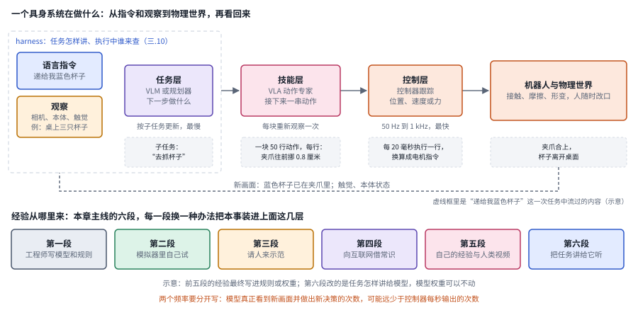

*图：上半部分是一次任务里的闭环，三层下方标出了各自的节奏；下半部分是本章主线的六段，每一段代表一种给闭环装进本事的办法。示意图。*

三层下方那行小字写着各自的节奏，它们差得很远：任务层按子任务更新，最慢；技能层每生成一串动作才重新看一次画面；控制层每秒要输出几十到上千次指令，π0 的动作最高到每秒 50 次，Figure 的人形机器人 Helix 02 的全身控制层到了 1 kHz。技能层之所以能比控制层慢，是因为今天的策略常常一次算出接下来的一整串动作，这叫动作分块，它为什么有效要到第三段才讲得清；控制器拿到这串动作，再一个个高频地执行。于是就有了两个频率。下图右边是一条约一秒长的时间轴，上面一行密密的竖线是控制器的输出，下面只有两个圆点，代表模型真正看到新画面、算出一整块动作的时刻；两个圆点之间那半秒，控制器的每一次输出都在执行早先算好的计划。一台机器人“以 50 Hz 运行”，可能只是在高频地播放半秒前算好的计划。这本身没有对错，动作因此才平滑；麻烦出在报告时把两种频率混成一个数字，读者就会以为模型每秒都在做几十次新的决策，所以控制频率和模型重新观察的频率要分开写。

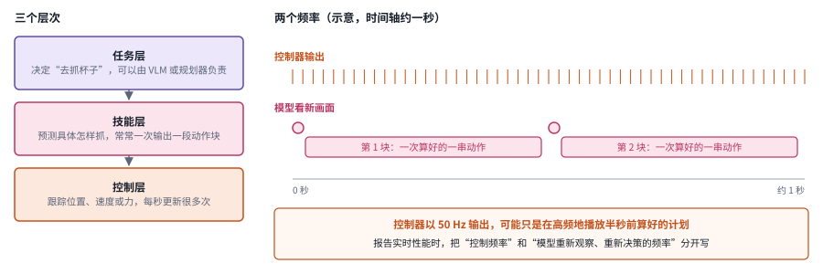

*图：三个层次和两个频率。时间轴上的块数和长度是示意，实际的块长和重新观察的间隔因模型而异，第三节的三.2、三.3 会细讲。*

闭环图的下半部分是本章主线的六段。它们都在回答同一个问题：机器人做事的本事从哪里来，差别只在经验的来源。工程师把本事写成规则，机器人在模拟器里自己试，人来示范，从互联网上借常识，回到机器人自己的经验和人类视频；到了 2026 年，第六段把重点放在怎样把任务讲给模型。前五段最后都把经验写进了规则或权重，第六段改的是讲法，模型的权重可以一点不动。下图把六段展开，每一行写着这一段的经验从哪里来、补上了什么、又卡在了哪里。按行往下读，每一行卡住的地方正好是下一行出发的理由：规则写不全，于是让机器人去模拟器里试；模拟器算不准布料和接触，于是请人来示范；示范没有常识，于是借互联网；模仿学到的上限是示范者，于是回到自己的经验；等模型会的事多起来，讲法本身又成了瓶颈。

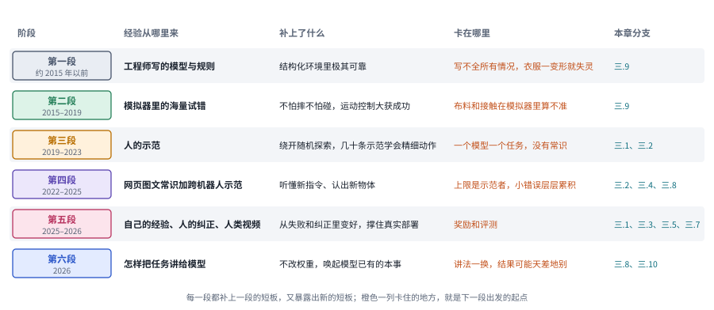

*图：六段主线一览。每一行的"卡在哪里"取自第二节各段的结尾，也和"回看"一节里那张对照表的最后一列一致。*

下图把主线上的代表工作按段分行排开，位置按 arXiv 编号或博客发布时间，精确到月。第一段的经典方法大多早于本章关心的时间窗口，和第二段的模拟器工作合在第一行。从图上看，几段并没有一刀切地前后接替：2010 年的 DAgger 早早就给模仿学习的老毛病开好了方子；第四段的 VLA 在 2023 到 2025 年密集出现的同时，第五段的真机强化学习已经在 2024 年开始；足式与人形这条支线则一直延续到 2026 年。

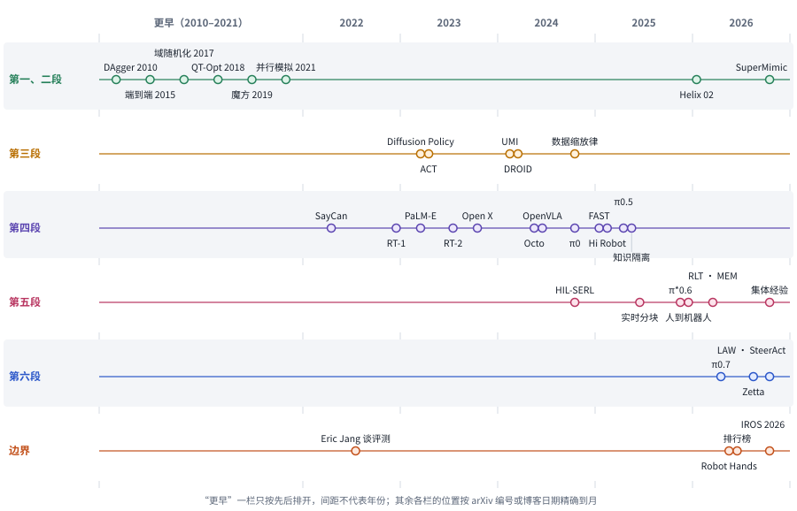

*图：主线代表作按段分行。"更早"一栏压缩了 2010 到 2021 年，只按先后排开；"边界"一行是几篇讨论评测和灵巧手的文章，第一个点是 Eric Jang 2022 年谈机器人研究迭代慢的那篇。*

## 二、发展主线：从工程师写模型，到把任务讲给机器人听

这一节的骨架来自 Sergey Levine 的两篇长文和 Physical Intelligence 的博客系列。把具身智能几十年的历史按"经验从哪里来"排开，会看到一条很清楚的线：先由工程师把世界写成模型，再让机器人在模拟器里自己试，然后请人来示范，接着向互联网借常识，最后回到机器人自己的经验和人类的视频；到了 2026 年，模型本身已经会很多事，新的瓶颈变成了怎样把任务讲给它听。每一段都补上了上一段的短板，也暴露出新的短板。

> **本节要点：** 六段的差别只在机器人的经验从哪里来：工程师写进去，模拟器里试出来，看人示范学来，从网页上借来常识，自己在失手之后攒下来，最后是人把任务讲得更清楚。每一段卡住的地方，就是下一段出发的理由。

| 阶段 | 内容 | 代表工作 | 本章对应分支 | 速查卡 |
|---|---|---|---|---|
| 引子 | Moravec 悖论：对人最容易的事，对机器人最难 | Robot Olympics | （全章背景） | |
| 第一段（约 2015 年以前） | 工程师把世界写成模型：感知、建模、规划、控制 | SLAM、采样式运动规划、模型预测控制 | 三.9 | |
| 第二段（2015–2019） | 在模拟器里自己试，sim2real；足式与人形支线 | 端到端视觉运动策略、QT-Opt、域随机化、灵巧手转魔方、大规模并行模拟 | 三.9 | S1 至 S5 |
| 第三段（2019–2023） | 请人来示范，模仿学习复兴；数据从哪来 | DAgger、ACT、Diffusion Policy、UMI、DROID | 三.1、三.2 | I1 至 I4 |
| 第四段（2022–2025） | 向互联网借常识：VLA 与跨本体数据 | SayCan、RT-2、Open X-Embodiment、OpenVLA、π0、FAST、知识隔离、Hi Robot、π0.5 | 三.2、三.4、三.8 | V1 至 V8 |
| 第五段（2025–2026） | 回到自己的经验和人类的视频；撑住真实部署的时间尺度 | HIL-SERL、π\*0.6、RLT、人到机器人迁移、实时动作分块、MEM、集体经验学习 | 三.1、三.3、三.5、三.7 | E1 至 E7 |
| 第六段（2026） | 可引导的通才：怎样把任务讲给机器人 | π0.7、Zetta、LAW、SteerAct、2026 年 10 月的各家模型 | 三.8、三.10 | H1 至 H4 |
| 边界 | 评测和灵巧手 | 排行榜之争、多指灵巧手与触觉 | 三.6、三.9、第五节 | |

### 引子：为什么对人最容易的事，对机器人最难

> **要点：** 拿杯子、叠衣服这类人不假思索的动作，恰恰是机器人最难学会的，因为这种知识几乎从没被写下来。整个领域的历史，就是在一次次寻找这种知识的来源。

2025 年底，Physical Intelligence 发了一篇题为 [Moravec's Paradox and the Robot Olympics](https://www.pi.website/blog/olympics) 的博客。所谓"机器人奥运会"，是 Benjie Holson 提出的一组挑战任务：往面包上抹花生酱、洗一只油腻的平底锅、用钥匙开锁、把袜子翻过来，分成五个项目，每个项目有铜、银、金三档。这些事情没有一件需要高深的推理，任何一个成年人都能随手做完，可它们恰好是机器人最怕的那一类。博客把原因说得很干脆：人对自己的身体技能并没有显式的理解，所以这种知识没法直接写成程序，只能从数据里学。

更早的时候，Eric Jang 在 [Software and Hardware for General Robots](https://evjang.com/2020/11/28/moravec-bots.html)（2020-11）里也讨论过这个悖论。他认为这一点也不奇怪：物理现实复杂得无可救药，进化又把人的感知运动能力打磨得毫不费力，所以下棋这种推理反而比基本的运动技能更容易造出来。他还提醒，把"给我做顿饭"拆成一个个"拿起物体"的软件接口，看似整洁，其实掩盖了真实操作里抓取边界模糊、技能难以衔接的麻烦。

两篇文章说的是同一件事：机器人缺的那种知识，在人类留下的文字和代码里几乎找不到现成的来源。整个领域的历史，就是在一次次寻找这种知识的来源。最先想到的办法，是让最懂物理的人亲手把它写出来。

拿一件家务来看这堵墙有多厚：把一件揉成一团的 T 恤从洗衣篮里拿出来，叠好，放到桌上。这件事几乎集齐了机器人最怕的东西。衣服的形状没有定数，每次抓起来都不一样；捏起布边、抖开、压平全靠接触和摩擦，这些力很难算准，也很难在模拟器里还原；整件事要几十个步骤，中间一步的衣角没捏住，后面都会跟着错；哪里是领口、哪面是正面，又需要常识。下面每一段的方法，都会在其中某一点上碰壁，下一段正是为了绕开这堵墙才出现的。下图标出了每类难点主要压在哪一步：形状没有定数，压在最开始的抓起和找领口上；接触和摩擦贯穿抖开、压平和对折；几十步串成一条链，每一步都逃不掉；常识主要用在找领口和判断正反面上。

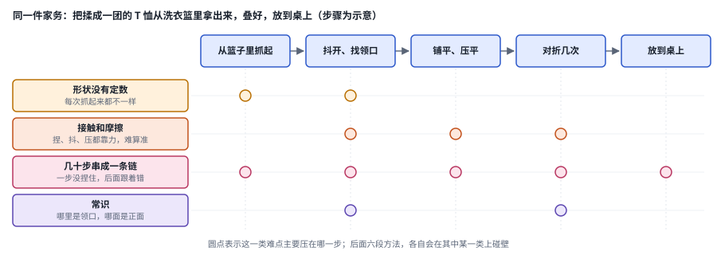

*图：叠 T 恤的五个步骤和四类难点。步骤划分是为了说明问题做的示意，真实任务可能拆得更细。*

### 第一段：工程师把世界写成模型（约 2015 年以前）

> **要点：** 最早的办法是让最懂物理的人亲手把世界写成模型，感知、建图、规划、控制一环扣一环。它在结构化环境里极其可靠，一旦遇到没建过模的东西，补模型的成本就会爆炸。

经典机器人学的做法是一条模块化的流水线。先感知，再用 SLAM（同时定位与建图）弄清楚"我在哪、环境长什么样"，然后用 RRT、PRM 这类采样式规划器在构型空间里搜索一条不会碰撞的路径，最后交给底层控制器去跟踪；更复杂的系统会用模型预测控制，在每个控制周期里借动力学模型向前优化一小段动作，只执行第一步，下一个周期再重新算。Boston Dynamics 的液压 Atlas 和 MIT 的猎豹机器人能跑能跳，主要靠的就是精确的模型加上这类优化控制。

模型预测控制值得单独画出来，因为它的节奏后来在机器人学习里一再出现。下图从左往右是一个控制周期：先读出当前状态，再借动力学模型向前优化未来一小段动作，图里是 a1 到 a6；然后只把第一步 a1 交给电机，其余几步全部丢掉；等下一个周期拿到新状态，再从头算一遍。这样做的好处是每一步都基于最新的状态，模型的小误差没有机会一路累积下去；代价是每个周期都要解一次优化，而且整件事的前提是动力学模型足够准。

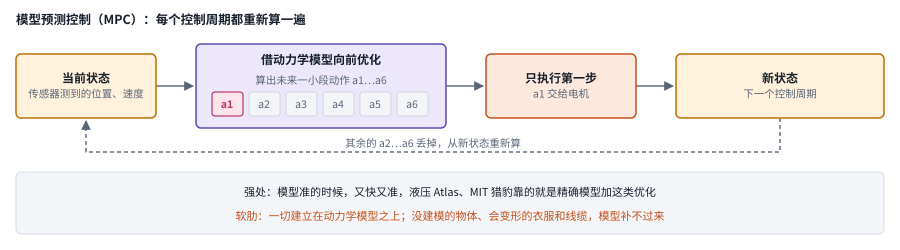

*图：模型预测控制的一轮。图里的 a1 到 a6 只是示意，实际的预测长度由任务和算力决定。*

这个“一次算一段，只执行开头，再重新看”的节奏，后来在学出来的策略里一再出现，区别只在那一小段动作改由神经网络直接生成，用不着再靠动力学方程去优化。

这条流水线在结构化的环境里非常可靠。汽车厂的焊接臂可以把同一个动作重复上百万次，精度极高，今天仍然是工业的主力。它的软肋也正在这里：每一个环节都依赖精确的几何和动力学模型，以及大量手写的规则。一旦遇到没有建模过的物体、变了的光照，或者衣服、线缆这种会变形的东西，整条流水线就会失灵，补模型的成本很快就会爆炸。

Levine 在 2021 年的 [How Robots Can Learn End-to-End From Data](https://sergeylevine.substack.com/p/how-robots-can-learn-end-to-end-from-data-3d879b0a2ba1) 里把问题换了个问法。他说，图像分类和语音识别都是"被动的识别"，机器人需要的是主动的行为技能，而开放世界里的行为技能多到写不完，只能从数据里学。他列出了开放世界机器人学习的三个要素：从多样的已有数据中学习，快速掌握新任务和新环境，以及自主地完成这两件事。开放世界里的东西多到建不完模型，于是很自然地，有人想让机器人自己去试，从试错里学。

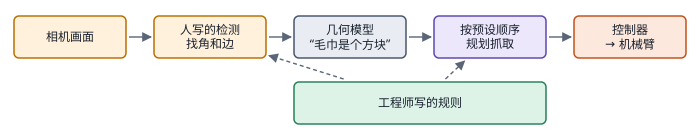

*图：第一段的做法。相机画面经人写的检测算法变成几何信息，再按预设顺序规划抓取，交给控制器执行；所有知识都写在规则里。2010 年伯克利的 PR2 叠毛巾在 50 次实验里 50 次成功，可叠一条要大约 20 分钟。*

### 第二段：在模拟器里自己试（2015–2019），以及足式与人形这条支线

> **要点：** 真机试错太慢，于是让机器人在模拟器里不知疲倦地试，再靠域随机化把策略搬到真机上。这条路在运动控制上大获成功，在接触丰富的操作上屡屡碰壁。

深度强化学习就是在这个时候进入机器人领域的。强化学习让机器人自己去试，按人写的奖励判断做得好不好，逐步改进它的策略，也就是根据当前观察选择动作的那套规则，在深度学习里通常是一个神经网络。2015 年 Levine 等人的 [End-to-End Training of Deep Visuomotor Policies](https://arxiv.org/abs/1504.00702) 用一个卷积网络从原始像素直接输出电机力矩，完成拧瓶盖、挂衣架这类任务，说明感知和控制可以一起学，用不着拆成模块。随后几年，Google 把一排机械臂放在一起日夜抓取，2018 年的 [QT-Opt](https://arxiv.org/abs/1806.10293) 用超过 58 万次真实抓取做强化学习，在没见过的物体上报告了 96% 的抓取成功率。

可真机试错实在太慢了。每次失败都要有人去复位，机器还容易损坏，奖励也很难设计。于是大家把目光转向模拟器：在模拟器里，机器人可以不知疲倦地试上成千上万遍，不怕摔也不怕碰。剩下的问题是怎样把模拟器里练出来的策略搬到真机上，这就是 sim2real。2017 年 Tobin 等人提出的[域随机化](https://arxiv.org/abs/1703.06907)给出了最核心的技巧：既然模拟器永远模拟不准，那就把纹理、光照、质量、摩擦这些参数都随机化，让真实世界看起来只是又一种随机情况。Lilian Weng 的 [Domain Randomization for Sim2Real Transfer](https://lilianweng.github.io/posts/2019-05-05-domain-randomization/) 系统地整理了这条线，她特别提到，带记忆的策略能在执行中摸清当前环境的动力学，就像在许多个环境之间学会了怎样快速适应。这条路最著名的成果是 OpenAI 2019 年的 [Solving Rubik's Cube with a Robot Hand](https://arxiv.org/abs/1910.07113)：灵巧手完全在模拟中训练，表现够好就自动加大随机范围，环境越练越难，最后在真机上转动了魔方。

同一套办法在两类任务上的结局很不一样，图的右半边把两种结局并排。

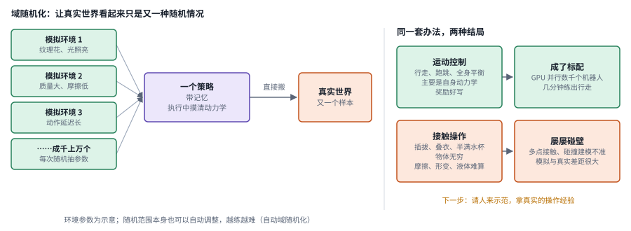

*图：左边是域随机化的流水线，环境参数为示意；右边对照运动控制和接触操作两种结局。*

这条路在**运动控制**上最成功。四足和人形的行走、跑跳、全身控制，主要涉及机器人自身的动力学，物理容易模拟，奖励也好写，只要不摔倒、跟上指定的速度就行。2021 年 Rudin 等人的 [Learning to Walk in Minutes Using Massively Parallel Deep Reinforcement Learning](https://arxiv.org/abs/2109.11978) 在一块 GPU 上并行模拟数千个机器人，平地上的行走策略不到四分钟就能练出来。从此"GPU 并行模拟、强化学习加域随机化"成了足式和人形运动控制的标配，一直延续到今天：Figure 在 2026 年 1 月发布的 [Helix 02](https://figure.ai/news/helix-02) 里，最底层的全身控制器就是在二十多万个并行模拟环境里、用一千多小时重定向的人类动作数据训练出来的。2026 年 10 月的 [SuperMimic: Scaling Humanoid Whole-Body Control with One Differentiable World Model](https://arxiv.org/abs/2610.28480) 是这条支线上的新进展，它从模拟器的转移数据里学一个可微的世界模型，让人形控制器在想象的短时展开里拿到解析梯度，作者报告单块 GPU 三小时的训练就超过了基线在 128 块 GPU 上训练七天的回报（三.9）。

可一旦从走路换成操作，事情就变了。插拔、叠衣服、拿起一只半满的水杯，涉及的是机器人之外的物体和接触，物体种类无穷无尽，摩擦、形变和液体在模拟器里又很难算准，sim2real 在这里屡屡碰壁。Lilian Weng 在综述里也写到，即便是灵巧手转方块这个例子，多个同时发生的接触和不完美的碰撞建模也让模拟和真实之间的差距很大。要拿到真实的操作经验，最直接的办法是请人来示范。

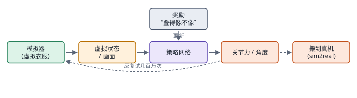

*图：第二段的做法。策略在模拟器里反复试几百万次，按人写的奖励更新，最后搬到真机上。刚体和行走算得准，布料和接触算不准，叠衣服就卡在这里。*

**速查：第二段的五项工作。** 下面五张结构卡用同一种画法，从左往右是一轮流程，虚线是绕回去的那条路。并排看就能发现，它们的差别主要在经验从哪里来：S1 和 S2 直接在真机上攒，S3 到 S5 改在模拟器里攒，而模拟器的参数又从固定变成随机，再变成随训练自动加难。

 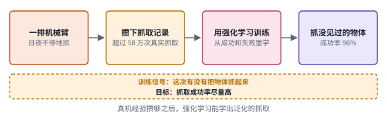

 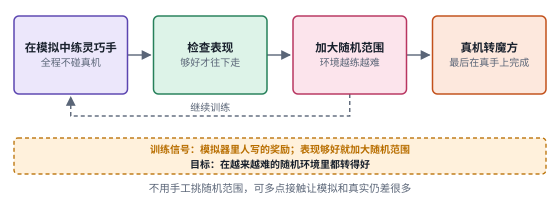

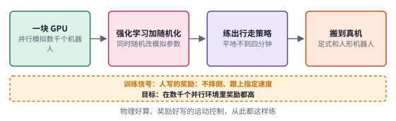

*图：第二段五项工作的结构卡，每张卡对应下表的一行。*

| code | 名称 | 年份 | 代表 | 怎么做 | 解决了什么 | 代价 |
|---|---|---|---|---|---|---|
| S1 | 端到端视觉运动策略 | 2015 | [End-to-End Training of Deep Visuomotor Policies](https://arxiv.org/abs/1504.00702) | 一个卷积网络从原始像素直接输出电机力矩，拧瓶盖、挂衣架这类任务一起学 | 说明感知和控制可以一起学，用不着拆成模块再由人设计中间的几何表示 | 仍在真机上试错，每次失败都要有人复位，机器容易损坏，经验攒得很慢 |
| S2 | 大规模真机抓取强化学习 | 2018 | [QT-Opt](https://arxiv.org/abs/1806.10293) | 一排机械臂日夜抓取，用超过 58 万次真实抓取做强化学习 | 在没见过的物体上报告 96% 的抓取成功率，说明真机经验攒够之后，强化学习能学出泛化的抓取 | 经验全靠真机一次次抓出来，任务一旦从抓取换成更长、更复杂的操作，这份代价就很难承受 |
| S3 | 域随机化 | 2017 | [Domain Randomization](https://arxiv.org/abs/1703.06907) | 把纹理、光照、质量、摩擦等模拟参数随机化，让一个策略在所有随机环境里都练得过去 | 模拟器永远模拟不准，那就让真实世界落进随机范围之内，策略搬到真机上也像遇到又一种随机情况 | 随机范围怎样取本身是个问题，后来有几类方法专门自动调整它；多点接触、形变这类模拟器算不准的现象，随机化也补不回来 |
| S4 | 自动域随机化转魔方 | 2019 | [Solving Rubik's Cube with a Robot Hand](https://arxiv.org/abs/1910.07113) | 灵巧手完全在模拟中训练，表现够好就自动加大随机范围，环境越练越难 | 免去手工挑随机范围，最后在真机上转动了魔方 | Lilian Weng 指出，多个同时发生的接触和不完美的碰撞建模，让这个例子里模拟与真实的差距依然很大 |
| S5 | 大规模并行模拟 | 2021 | [Learning to Walk in Minutes](https://arxiv.org/abs/2109.11978) | 一块 GPU 上并行模拟数千个机器人，强化学习加域随机化 | 平地行走策略不到四分钟就能练出，成了足式和人形运动控制的标配，一直延续到 Helix 02 和 SuperMimic | 好用的前提是物理好算、奖励好写，换成接触丰富的操作，这两个前提都不再成立 |

### 第三段：请人来示范，模仿学习复兴（2019–2023）

> **要点：** 请人来示范，绕开了随机探索的高昂代价，模仿学习因此复兴。它的老毛病是误差累积，真正让它好用起来的是动作分块和生成式的动作分布，而怎样更便宜地采到更多示范，成了这一段的暗线。

模仿学习的思路很朴素：找人遥操作机器人把任务做一遍，也就是人通过主从臂、VR 设备或手柄远程控制机器人，记录下每一刻的观察和动作，再训练一个网络去模仿，本质上就是监督学习。这个办法绕开了随机探索的高昂代价，可它有一个出名的毛病。模型只要在某一步犯了个小错，就会进入示范里从来没有出现过的状态，在那里它更不知道该怎么做，于是错得更多。2010 年 Ross 等人的 [DAgger](https://arxiv.org/abs/1011.0686)（A Reduction of Imitation Learning and Structured Prediction to No-Regret Online Learning）把这个问题形式化，并给出了一个朴素的解法：让策略自己去跑，在它实际到达的状态上请专家标注正确动作，再加回训练集。十几年后 π\*0.6 博客里讲"小错误会累积成失败"，说的还是同一件事。

DAgger 之所以有效，是因为示范终于覆盖到了策略真正会走到的地方，包括走偏之后的那些状态，训练时见过的状态和执行时遇到的状态对上了号。

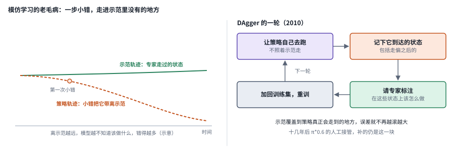

*图：左边是误差累积的示意，右边是 DAgger 的一轮。π\*0.6 让人在机器人出错时接管、演示怎样恢复，补的也是左图里那片"示范之外"的区域。*

真正让模仿学习"好用起来"的是 2023 年的两项工作。[ACT](https://arxiv.org/abs/2304.13705) 配了一套低成本的双臂遥操作硬件，让模型一次预测一整段动作，也就是动作分块，用时间上的连贯性压住误差的累积，几十条示范就能学会穿扎带这样的精细双臂任务。[Diffusion Policy](https://arxiv.org/abs/2303.04137) 则把扩散模型搬到动作空间，也就是像生成图片那样，从一团随机噪声出发一步步去噪，最后得到一段动作。它解决了一个更根本的麻烦，叫多解问题：从杯子左侧抓和从右侧抓都合理，如果模型学的是两者的平均，就可能直直撞向杯身，而生成式的动作分布可以同时容纳几种合理的做法。前者处理的是时间结构，后者处理的是动作分布，两者后来几乎成了所有 VLA 的标配（三.2）。下图左边对比逐步决策和动作分块：逐步决策每一步的小抖动都会叠加起来，分块给出的一整段动作则连贯得多。

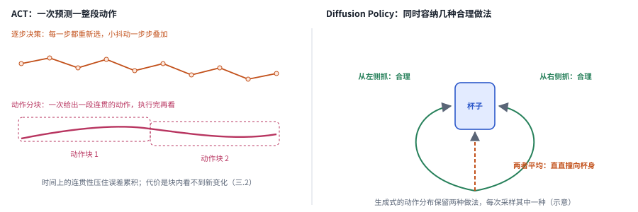

*图：左边对比逐步决策和动作分块，右边是 Diffusion Policy 处理的多解问题。两边的轨迹都是示意。*

分块也有它的代价：一块动作执行的过程中，模型看不到新的变化。块该多长、执行多少步再重新看，后来成了一个专门的研究问题（第五段的实时动作分块，三.2）。

Eric Jang 在 2022 年写过一篇 [How Can We Make Robotics More like Generative Modeling?](https://evjang.com/2022/07/23/robotics-generative.html)，他的判断是，机器人学落后于生成式建模，主要落后在研究迭代的速度上：真机评测太慢，要把成功率测准到百分之一左右可能要花几个月，而生成模型几分钟就能跑完一轮基准；一旦有了大而多样的数据集，大多数学习方法都能表现得不错。同一年，Levine 在 [Self-Improving Robots and the Importance of Data](https://sergeylevine.substack.com/p/self-improving-robots-and-the-importance) 里把话说得更直接：数据的数量本身就是一种质量，机器人学习最终要靠大规模的具身经验。两人从不同方向指向了同一个结论，下一步的关键在数据从哪里来。

于是，怎样更便宜地采到更多示范，成了这一段的另一条暗线。2024 年的 [UMI](https://arxiv.org/abs/2402.10329) 设计了一种手持的夹爪装置，人拿着它去做日常操作，不需要机器人在场，记录下来的数据再迁移给机器人用；同年的 [DROID](https://arxiv.org/abs/2403.12945) 在三个大洲的 564 个真实场景里，用统一的机械臂平台采集了约 7.6 万条、350 小时的示范。数据的来源从此变得五花八门，它们的差别值得放在一起看一看：

| 来源 | 例子 | 保真度 | 成本与量级 |
|---|---|---|---|
| 主从臂遥操作 | ACT 的双臂硬件、DROID | 观察和动作与机器人一一对应，质量最高 | 每小时成本高，必须有真机和熟练的操作员；DROID 约 350 小时 |
| 手持夹爪 | UMI | 动作近似机器人夹爪，要处理身体差异 | 不需要机器人，便携，单位成本低 |
| 人类穿戴设备 | Generalist 的穿戴采集 | 记录人手动作，和机器人身体差异更大 | Generalist 自报超过 50 万小时 |
| 人类第一视角视频 | 日常活动视频 | 规模巨大，没有机器人动作标签，要靠反推 | 几乎不受限 |
| 数据工厂 | 智元的 [AgiBot World](https://arxiv.org/abs/2503.06669) | 真机遥操作，标准化流程加人工核验 | 超过 100 万条轨迹、217 项任务 |
| 模拟与合成数据 | 域随机化、银河通用等团队的 [GraspVLA](https://arxiv.org/abs/2505.03233) | 动作精确，物理和外观与真实有差距 | 十亿帧级的合成抓取数据，生成成本相对低 |
| 部署与自主运行 | π\*0.6、集体经验学习 | 来自真实任务，含失败和纠正 | 边际成本低，需要奖励、价值函数或人工纠正 |

这张表的每一行都在用不同的方式回答"经验从哪里来"，也各自留下了不同的缺口，本章三.1 会把这些缺口逐一拿出来讨论。和语言模型相比，机器人的数据仍然少得可怜：开源的跨本体数据集大约一百万条轨迹，最大的几家公司自报的真机加人类数据也只在几万小时量级，而一小时 50 Hz 的动作也不过十八万个时间步，其中大量还是重复的。2024 年的 [Data Scaling Laws in Imitation Learning for Robotic Manipulation](https://arxiv.org/abs/2410.18647) 发现，策略的泛化能力大致随训练环境数和物体数呈幂律增长，环境和物体的多样性远比示范的绝对数量重要。

把这七种来源放到两条轴上，取舍会看得更直观。下图横轴是数据和机器人动作的对应程度，越往右，记录下来的动作越能直接拿给机器人执行；纵轴是可获得的量级，越往上越容易攒得多。主从臂遥操作在右下角，质量最高，量却最少；人类第一视角视频在左上角，规模几乎不受限，可里面没有一个机器人能直接执行的动作。理想的数据应当落在右上角，又多又准，可那个角落至今是空的。各家公司押注的路线不同，其实就是在用不同的办法往那个角落挪。

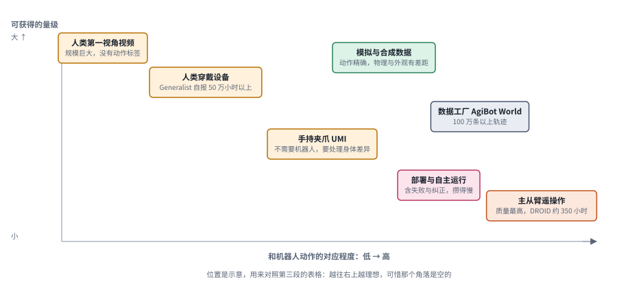

*图：第三段数据来源表的七行放在两条轴上。位置是示意，用来比较相对的取舍，没有按具体数字定标。*

可示范数据还有一个更根本的局限。几万条示范可以教会机器人把杯子拿起来，却教不会它"什么是蓝色杯子""哪一只是恐龙玩具"这类常识；示范又贵又窄，换个桌布颜色，模仿学来的策略就可能失灵。而常识在互联网上是现成的，同一时期的视觉语言模型已经展示了网络规模预训练带来的语义泛化。下一步，就是把视觉语言模型接进来。

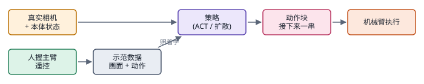

*图：第三段的做法。人握着主臂遥控录下示范，策略照着学，一次输出接下来的一串动作（动作块）。录够叠 T 恤的示范就能叠 T 恤，换成叠裤子就得重新录。*

**速查：第三段的四项工作。** 四项都在让模仿学习好用起来，差别在改的是“怎样从示范里学”还是“示范怎样采”：I1 处理误差累积，I2 和 I3 分别处理动作的时间结构和动作的分布，这三项属于前者；I4 处理示范从哪里来，属于后者。这两条线后来一直并行发展，三.2 和三.1 分别接着它们往下走。

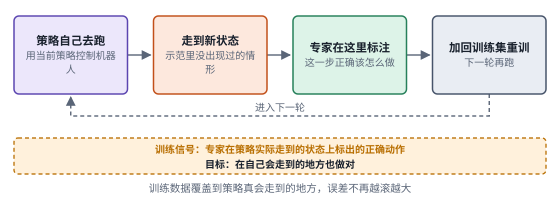 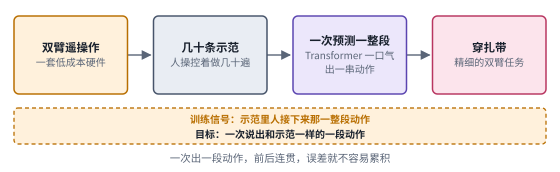

 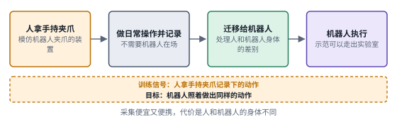

*图：第三段四项工作的结构卡，每张卡对应下表的一行。*

| code | 名称 | 年份 | 代表 | 怎么做 | 解决了什么 | 代价 |
|---|---|---|---|---|---|---|
| I1 | 在线补标注 | 2010 | [DAgger](https://arxiv.org/abs/1011.0686) | 让策略自己去跑，请专家在它实际到达的状态上标注正确动作，加回训练集重训 | 训练数据覆盖到策略真正会走到的状态，误差累积这个老毛病有了一个朴素的解法 | 每一轮都要专家在线标注，专家的时间成了新的瓶颈 |
| I2 | 动作分块 | 2023 | [ACT](https://arxiv.org/abs/2304.13705) | 配一套低成本双臂遥操作硬件，让模型一次预测一整段动作 | 时间上的连贯性压住了误差累积，几十条示范就能学会穿扎带这样的精细双臂任务 | 一块动作执行期间看不到新变化，块长怎样取后来成了专门的问题（三.2、三.3） |
| I3 | 生成式动作分布 | 2023 | [Diffusion Policy](https://arxiv.org/abs/2303.04137) | 把扩散模型搬到动作空间，以观察为条件从噪声一步步去噪出一段动作 | 几种合理的做法都能被保留下来，模型不会因为取平均而撞向杯身 | 扩散要小步走很多步才能生成一段动作，第四段 π0 改用的流匹配，正是为了用更少的步数走到终点（见第四段的路径图） |
| I4 | 手持采集 | 2024 | [UMI](https://arxiv.org/abs/2402.10329) | 人拿着模仿机器人夹爪的手持装置直接做日常操作，记录的数据再迁移给机器人 | 采集不需要机器人在场，便携、单位成本低，示范可以走出实验室 | 人和机器人的身体不同，迁移时要处理这份差异；Levine 在讨论替代数据的 Sporks of AGI 一文里，把手持夹爪也算作一种替代数据 |

### 第四段：向互联网借常识，VLA 与跨本体数据（2022–2025）

> **要点：** 示范又贵又窄，教不会常识，而常识在互联网上是现成的。这一段把视觉语言模型一步步接进机器人：先在高层挑技能，再把动作也变成 VLM 的输出，最后用流匹配动作专家和异构数据配方，让模型走进陌生人的家。

最早的嫁接是从高层开始的。语言模型擅长分解任务，却不知道眼前这台机器人到底会什么，它可能建议"用海绵擦桌子"，而机器人根本没有拿海绵的技能。2022 年的 [SayCan](https://arxiv.org/abs/2204.01691) 给出了一个漂亮的折中：语言模型给每个候选技能打一个"对完成任务有多大帮助"的分，技能自带的价值函数再给出"在当前状态下能不能做成"的分，两者相乘来挑选下一步。它解决的是高层计划和实际能力之间的脱节，底层的动作本身仍然要靠一个个单独训练的技能来完成。这种"语言选技能、技能自己学"的分工，后来在本章三.8 的 agent 系统和三.10 的具身 harness 里以新的面貌重新出现。

下图是一个示意的例子。指令是把桌上洒的东西擦干净，候选技能有四个。语言模型觉得“拿起海绵”最有用，可价值函数知道眼前根本够不着海绵，这一项的分数很低；两列相乘之后，“拿起抹布”两头都过得去，被选中执行。语言模型提供常识，价值函数提供对这台机器人实际能力的估计，谁也不用去学对方的那部分。

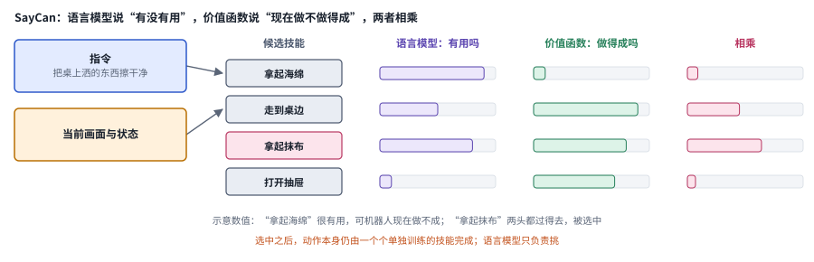

*图：SayCan 的打分示意。四个候选技能和条形长度都是为了说明机制编的，没有对应论文里的具体数值。*

SayCan 里的技能是一个个分开训练的，任务一多，经验就无法共享。2022 年 Google 的 [RT-1](https://arxiv.org/abs/2212.06817) 尝试用一个 Transformer 策略承接几百种任务的机器人数据，证明了多任务数据可以喂给同一个模型。同一时期的 [PaLM-E](https://arxiv.org/abs/2303.03378)（PaLM-E: An Embodied Multimodal Language Model）则从另一个方向走过来，把图像和机器人状态直接编码进一个大型语言模型的输入，让语言模型"看见"具身场景，主要用于生成高层计划。真正把这两条线接上的是 2023 年的 [RT-2](https://arxiv.org/abs/2307.15818)。它的想法非常直接：既然视觉语言模型输出的是 token，那就把机器人动作也离散化成一串 token，让同一个模型在网页图文数据和机器人示范上联合训练。这样一来，网络上学到的语义知识就能迁移到动作里，机器人可以执行一些机器人数据里从未出现过的语义指令。VLA 这个名字也正是从这里流行起来的。

Levine 在 2022 年的 [General-Purpose Pre-Trained Models in Robotics](https://sergeylevine.substack.com/p/general-purpose-pre-trained-models) 里提过一个问题："能不能预训练出控制任意机器人做任意任务的策略？"他认为这样的模型要在三个方向上泛化：同一类里的不同机器人、不同任务、不同环境；而当时的数据集要么机器人多样、任务单调，要么任务丰富、只有一种机器人。如果每个实验室都只用自己那台机器人的数据，数据永远不够。2023 年，众多机构联合发布了 [Open X-Embodiment](https://arxiv.org/abs/2310.08864)（Open X-Embodiment: Robotic Learning Datasets and RT-X Models），把来自多种机器人的数据整理成统一格式，并训练了 RT-X 系列模型。在这批数据之上，开放模型开始出现：2024 年的 [Octo](https://arxiv.org/abs/2405.12213)（Octo: An Open-Source Generalist Robot Policy）提供了一个可以在新机器人上快速微调的开源通用策略；同年的 [OpenVLA](https://arxiv.org/abs/2406.09246) 沿着 RT-2 的路线，基于开源视觉语言模型训练出一个公开权重的 VLA，成了此后大量学术工作的起点。

Levine 在 2024 年的 [The Promise of Generalist Robotic Policies](https://sergeylevine.substack.com/p/the-promise-of-generalist-robotic) 里回看这一步，把它称为第一个"缺失的环节"：预训练给了机器人视觉和语义知识，关键是怎样把预训练模型"粘"到机器人身上。他写道，Open X-Embodiment 汇集了大约一百万次试验、约一万小时，只用一种机器人的数据去构建机器人基础模型，永远不可能规模化；他也坦白，当时的通用策略"更像 GPT-2，离 GPT-4 还远"。迁移过去的是语义和表示能力，动作在物理上能不能做成，仍然取决于身体和交互经验。语言预训练里没有任何接触控制数据，杯柄该握多紧，网页上学不到。

RT-2 把动作切成离散 token，这在慢速的抓放任务上够用，遇到需要高频、精细控制的任务就力不从心了。VLA 这个名字流行之后，人们说的 VLA 都是这样一类模型：把视觉、语言以及机器人自身的状态映射成动作，骨干通常是一个预训练过的视觉语言模型。2024 年 10 月，Physical Intelligence 发布了 [π0](https://arxiv.org/abs/2410.24164)，把第三段的动作分块、生成式动作分布和 VLA 合到了一起。按照 [π0 博客](https://www.pi.website/blog/pi0)的介绍，它以一个约 30 亿参数的视觉语言模型为骨干，再接上一个用流匹配生成连续动作的动作专家，也就是专门负责输出动作的一小块网络，可以输出每秒最多 50 次的电机指令；训练数据融合了开源机器人数据集、网络图文数据，以及他们在 8 种机器人上采集的灵巧操作数据。博客把它类比成语言模型的预训练加后训练，作者也没有回避它的稚嫩，称它是"一个原型"，并说通用机器人策略"还处在婴儿期"。

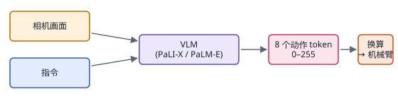

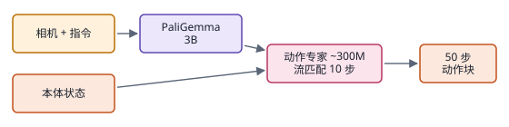

*图：把动作塞进 VLM 的两条路。RT-2 把每个动作维度均分成 256 档，像说话一样把动作"说"出来，55B 的模型每秒只能出 1 到 3 次动作，衣角滑落只要零点几秒；π0 在 30 亿参数的 PaliGemma 后面接一个约 3 亿参数的动作专家，用流匹配从噪声走 10 步，一次生成 50 个连续动作。*

流匹配和扩散一样从噪声出发生成动作，区别在于它学的是一条从噪声到动作的近乎直线的路径，所以走更少的步数就能到终点，这对每秒要出几十次动作的机器人很要紧。它和今天主流的文生图、文生视频模型是同一个训练方法，只是终点从一张图换成了一段机器人动作。下面这张图对比了两种路径，更完整的讲解在[第 16 章《多模态生成》](16_generation.md)。

此后半年的几项工作都在打磨这套配方。2025 年 1 月的 [FAST](https://arxiv.org/abs/2501.09747)（FAST: Efficient Action Tokenization for Vision-Language-Action Models）借鉴图像压缩的思路，用离散余弦变换加字节对编码给动作序列做 token 化，[FAST 博客](https://www.pi.website/research/fast)报告每段动作只需 30 到 60 个 token，约为此前做法的十分之一，基于它的自回归模型训练速度约为 π0 的 5 倍，代价是逐个 token 解码让推理慢了不少。5 月的[知识隔离](https://arxiv.org/abs/2505.23705)（Knowledge Insulating Vision-Language-Action Models: Train Fast, Run Fast, Generalize Better）则发现了一个更隐蔽的问题：动作专家回传的梯度会侵蚀视觉语言骨干，训练变慢，语言遵循也变差。他们的办法是切断这部分梯度，同时用 FAST 的离散动作 token 和网络数据继续训练骨干。[知识隔离博客](https://www.pi.website/research/knowledge_insulation)报告，在收拾餐桌任务上，这种做法达到目标水平所需的训练步数比 π0 少约 7.5 倍。本章三.2 关于动作表示的讨论，就是这一步的延续。

有了流畅的动作，下一个问题就冒出来了。[π0.5 博客](https://www.pi.website/blog/pi05)开篇就说，机器人最大的障碍在泛化，敏捷和灵巧倒在其次：它要面对新物体、新布局和新的任务含义，并且要在物理、视觉和语义三个层面同时应对。2025 年 2 月的 [Hi Robot](https://arxiv.org/abs/2502.19417)（Hi Robot: Open-Ended Instruction Following with Hierarchical Vision-Language-Action Models）先从语言这一侧切入。按 [Hi Robot 博客](https://www.pi.website/research/hirobot)的说法，π0 是反应快、熟练的"系统 1"，另一个高层视觉语言模型是会"自言自语"、把复杂指令拆成小步骤的"系统 2"，高层模型还能实时接住用户的插话，比如用户说"那个不是垃圾"，它会把这句话对应到画面里的物体上，重新安排去向。博客报告，在收拾桌子、做三明治和购物三类任务上，它的指令遵循准确率平均约 76%，没有分层的 VLA 约 36%，GPT-4o 约 30%。

两个月后的 [π0.5](https://arxiv.org/abs/2504.16054) 把高层和低层合进了同一个模型：先输出一段文字形式的子任务，相当于思维链，再由流匹配动作专家输出约一秒长的 50 步动作块。它真正的看点是数据配方。π0.5 把机器人示范、图像描述、视觉问答、目标检测、高层子任务标注、口头指令示范以及其他机器人的数据混在一起训练，作者把这种混合比作一份"课程"。消融实验给出了很有信息量的结果：去掉网络数据，主要伤害对新物体类别的识别；去掉其他机器人和其他环境的数据，则在所有条件下都明显变差。他们还在训练中从未出现过的真实家庭里测试铺床、收碗、清扫地面，发现训练环境数量达到约 100 个之后，表现就接近直接在测试环境里训练的基线。这是第一次有团队公开地、成规模地把 VLA 放进陌生的家庭，本章三.4 关于"究竟换了什么"的讨论、三.8 关于高层和低层怎样分工的讨论，都接在这里。

消融的结论和 Levine 当年的设想一脉相承：通用策略要同时在机器人、任务和环境三个方向上泛化，网络数据只管得了其中认出新东西的那一部分。

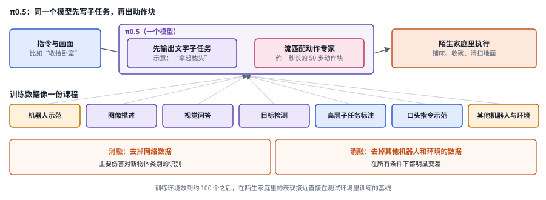

*图：π0.5 先写子任务再出动作块，下半部分是训练数据的七类来源和两项消融结论。子任务的文字是示意。*

π0.5 博客的结尾写得很坦率：模型"远谈不上完美"，常常在高层的语义推断和底层的电机指令上都犯错。这背后是模仿学习留下的老问题。模仿学到的上限就是示范者的水平，部署时的小错误还会把机器人带到示范没覆盖的地方，层层累积。π0.5 列出的下一步方向里，第一条就是从自主经验中学习。要再往上走，机器人得从自己的经验里学。

**速查：第四段的八项工作。** 八项都在把视觉语言模型接进机器人，差别在于它们处理的是接法上的哪一环，可以分成三组。V1 到 V3 回答"常识怎样进来"：先在高层挑技能，再让同一个 VLM 直接说出动作，再把多种机器人的数据汇到一起。V4 到 V6 回答"动作怎样出去"：流匹配动作专家，动作 token 的压缩，以及怎样避免动作训练把骨干带坏。V7 和 V8 回答"高层和低层怎样分工"，从两个模型走到一个模型。

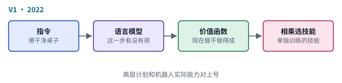 

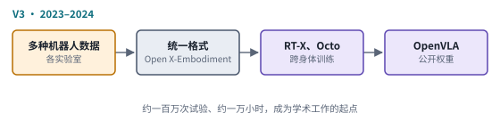 

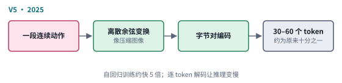 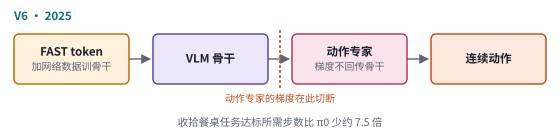

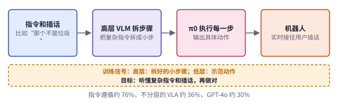 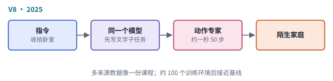

*图：第四段八项工作的结构卡，每张卡对应下表的一行。*

| code | 名称 | 年份 | 代表 | 怎么做 | 解决了什么 | 代价 |
|---|---|---|---|---|---|---|
| V1 | 语言选技能 | 2022 | [SayCan](https://arxiv.org/abs/2204.01691) | 语言模型给候选技能打"有没有用"的分，技能的价值函数打"现在做不做得成"的分，两者相乘挑下一步 | 语言模型不知道机器人会什么，价值函数正好补上这份信息，高层计划和实际能力因此对上了号 | 底层动作仍靠一个个单独训练的技能，任务一多，技能之间的经验无法共享 |
| V2 | 动作说成 token | 2023 | [RT-2](https://arxiv.org/abs/2307.15818) | 把每个动作维度均分成 256 档，让同一个 VLM 在网页图文和机器人示范上联合训练，像说话一样输出动作 | 网络上学到的语义知识迁移到了动作里，机器人能执行机器人数据里从未出现过的语义指令 | 动作太粗；55B 的模型每秒只能出 1 到 3 次动作，高频精细的任务跟不上 |
| V3 | 跨本体数据与开放模型 | 2023–2024 | [Open X-Embodiment](https://arxiv.org/abs/2310.08864)、[Octo](https://arxiv.org/abs/2405.12213)、[OpenVLA](https://arxiv.org/abs/2406.09246) | 把多种机器人的数据整理成统一格式，在上面训练 RT-X、Octo 和公开权重的 OpenVLA | 只用一种机器人的数据永远不够，汇集起来的约一百万次试验让跨身体训练成为可能，开放权重也成了学术工作的起点 | Levine 坦白当时的通用策略"更像 GPT-2"；迁移过去的主要是语义和表示，动作能不能做成仍取决于身体 |
| V4 | 流匹配动作专家 | 2024 | [π0](https://arxiv.org/abs/2410.24164) | 约 30 亿参数的 VLM 骨干接一个流匹配动作专家，一次生成连续的动作块，最高每秒 50 次 | 把第三段的动作分块、生成式动作分布和 VLA 合到一起，高频精细的灵巧操作也能做 | 作者自称"一个原型"；它仍以示范为师，本事的上限是示范者 |
| V5 | 动作压缩成 token | 2025 | [FAST](https://arxiv.org/abs/2501.09747) | 借图像压缩的思路，用离散余弦变换加字节对编码把一段动作压成 30 到 60 个 token | token 数约为此前做法的十分之一，基于它的自回归模型训练速度约为 π0 的 5 倍 | 逐个 token 解码，推理慢了不少 |
| V6 | 知识隔离 | 2025 | [Knowledge Insulating VLA](https://arxiv.org/abs/2505.23705) | 切断动作专家回传给 VLM 骨干的梯度，同时用 FAST 的离散动作 token 和网络数据继续训练骨干 | 动作专家的梯度会侵蚀骨干，让训练变慢、语言遵循变差；隔离之后，收拾餐桌任务达标所需的训练步数比 π0 少约 7.5 倍 | 骨干和动作专家要分开设计、分开喂数据，训练配方更复杂 |
| V7 | 系统 1 与系统 2 | 2025 | [Hi Robot](https://arxiv.org/abs/2502.19417) | 高层 VLM 把复杂指令拆成小步骤，实时接住用户插话，π0 负责执行 | 开放指令遵循：三类任务上准确率平均约 76%，没有分层的 VLA 约 36%，GPT-4o 约 30% | 高层和低层是两个模型，要分别训练再对接，π0.5 后来把两者合进了一个模型 |
| V8 | 子任务推理与数据课程 | 2025 | [π0.5](https://arxiv.org/abs/2504.16054) | 同一个模型先输出文字子任务，再出 50 步动作块；七类异构数据混合训练 | 泛化到训练中从未出现过的家庭，训练环境约 100 个以后接近直接在测试环境里训练的基线 | 作者坦言"远谈不上完美"，高层语义推断和底层电机指令都会出错 |

### 第五段：回到自己的经验和人类的视频（2025–2026）

> **要点：** 模仿学到的上限是示范者，部署时的小错误还会层层累积。这一段让机器人回到自己的经验，反馈来自人的纠正、价值函数、在线强化学习和一整支机队；人类第一视角视频在机器人数据打好底子之后重新派上用场；实时分块和记忆则撑住了真实部署的时间尺度。

从自主经验中学习，其实是 Levine 早就预告的事。他在 2021 年的 [Understanding the World Through Action](https://sergeylevine.substack.com/p/understanding-the-world-through-action-rl-as-a-foundation-for-scalable-self-supervised-learning-636e4e243001) 里主张让智能体去追求一切可能达成的结果，再用离线强化学习吸收所有收集到的经验，让强化学习成为一种可扩展的自监督学习；2022 年又断言机器人学习最终要靠机器人自己在真实世界里攒下的经验；2024 年的 The Promise of Generalist Robotic Policies 里，他又举了两类反馈：人用自然语言给出的纠正，以及机器人根据自己的结果做的强化学习。2024 年的 [HIL-SERL](https://arxiv.org/abs/2410.21845)（Precise and Dexterous Robotic Manipulation via Human-in-the-Loop Reinforcement Learning）在真实机器人上结合人工介入和强化学习，学会了一批精密而灵巧的操作任务。Levine 在文中提到，在线缆布置、电路板装配这类任务上，强化学习训练出的机器人达到了 100% 的成功率，节拍也比模仿学习快两到三倍。

2025 年 11 月的 [π\*0.6](https://arxiv.org/abs/2511.14759)（π\*0.6: a VLA That Learns From Experience）把这条路线带到了大规模 VLA 上。[π\*0.6 博客](https://www.pi.website/blog/pistar06)先解释了为什么模仿不够：控制策略在连续的物理环境里运行，小错误会把机器人带离训练分布，错误再层层累积，这是只输出一次结果的语言模型不太会遇到的。可让策略在自己的失败上反复练习，如果只是照抄过去的行为，又只会把错误强化。他们的 Recap 方法分三步：先用示范教会基本动作，再让人在机器人出错时接管，演示在它实际会到达的状态上该怎么恢复，最后训练一个价值函数来估计每个局面有多大希望，用价值的变化（也就是优势）给每段动作打上标注，策略以这些标注为条件，执行时就可以被引导到高优势的动作上。博客报告，用自主经验训练之后，最难任务的吞吐量提高了一倍以上，失败率降低一半以上；机器人可以从早上五点半一直做咖啡到晚上十一点半。2026 年 3 月的 [Precise Manipulation with Efficient Online RL](https://www.pi.website/research/rlt) 又往前走了一步：从 VLA 内部抽出一个"RL token"，只在它上面训练一个小的演员和评论家，让任务里最精细的那一段在真机上做在线强化学习。博客报告，拧螺丝、插网线这类任务的关键阶段最多快了 3 倍，插网线只用了大约 15 分钟的机器人数据。

Recap 的第二步补的，正是 DAgger 当年补的那块区域：示范里没出现过、策略自己跑偏后才会走到的状态。第三步让失败的经验也有了用处：价值的变化告诉模型哪些动作让局面变差了，策略也就不会把它们当作示范去照抄。

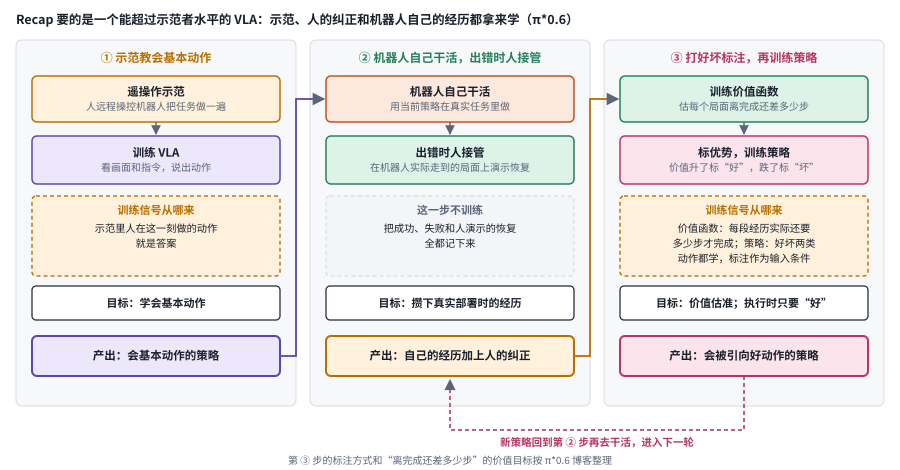

*图：π\*0.6 的 Recap 三步，排列方式按博客的叙述整理。*

自己的经验也可以来自一整支机队。2026 年 10 月的 [Learning from Fleet Experience: A Collective Learning Paradigm for Robots](https://arxiv.org/abs/2610.25736) 指出，靠人工纠正来学习需要操作员盯着机器人随时介入，机队一大就难以为继。他们让部署中的机器人共享执行经验：遇到失败时，用失败的上下文去全队共享的成功经验里检索相关片段，把那些片段的动作当作监督来微调，不必再采集新的专家示范或纠正。作者报告，五项真实操作任务的成功率在 93.3% 到 99.2% 之间，在多阶段的手机包装任务上，用 96 台机器人学习让成功率从 79.2% 提到 98.3%。另一条路干脆让机器人自己去探索：同月的 [Scaling Online Exploration for Robot Agents](https://arxiv.org/abs/2610.22496) 让一个通用编程 agent 在真机和模拟里在线试错，把试出来的有效动作序列编译成模块化的程序，作者报告很多任务不需要人类示范，探索的规模越大，在新环境里的泛化越好。这两篇分别放在本章三.7 和三.8 细讲。

同一时期还有一项发现让人类第一视角视频重新回到了舞台中央，这类视频是人戴着相机记录的日常活动，规模大，可里面没有机器人能直接执行的动作。2025 年 12 月的 [Emergence of Human to Robot Transfer in VLAs](https://www.pi.website/research/human_to_robot) 把它当成又一种"机器人身体"，用三维手部位置作为动作，加入 π0.5 的微调后，在只有人类示范出现过的几个场景里，表现大约翻了一倍。更有意思的是，这种迁移能力随着机器人预训练数据的规模和多样性增长而出现，机器人数据越多，模型反而越能吸收人类数据。这让第一视角视频的价值一下子变得具体起来，2026 年 10 月的 [Holi-World](https://arxiv.org/abs/2610.26549) 和 [EgoXperience](https://arxiv.org/abs/2610.26625) 都在想办法把第一视角视频变成更结构化的经验，前者把视频整理成场景、物体状态和交互历史，后者从单段视频里重建相机、手和物体，本章三.1 会把它们放回数据的讨论里。用视频生成模型和世界模型去"想象"经验，是另一条正在快速发展的路线，比如把未来画面和动作一起预测的世界-动作模型，[第 10 章](10_world_models.md)已经讲过，这里不再重复。

真实经验多起来以后，时间尺度的问题也随之变得突出。模型从演示视频走向连续工作几十分钟的部署，第一个碰到的是延迟。几十亿参数的 VLA 推理需要时间，最初的动作分块是同步执行的：机器人做完一块，停下来等推理，再做下一块。2025 年 6 月的[实时动作分块](https://arxiv.org/abs/2506.07339)（Real-Time Execution of Action Chunking Flow Policies）在 [Real-Time Action Chunking with Large Models](https://www.pi.website/research/real_time_chunking) 这篇博客里解释说，这些停顿在训练数据里根本不存在，它们拖慢速度，还让精细任务更难完成；如果在动作进行中途切换到新的动作块，又会出现不连续的跳变。他们把切换动作块看成一个"补全"问题：推理期间必然会被执行的那几步动作固定为上一块的值，模型只补全其余部分。在他们的测试里，人为加入 200 毫秒的延迟时吞吐量几乎不变，推理延迟超过 300 毫秒时仍能完成划火柴、插网线这样的精细动作。

下图把三种接续动作块的方式并排：同步执行会停顿，中途直接切换会跳变，实时动作分块冻结了推理期间必然执行的那几步，新块的开头因此和正在执行的动作严丝合缝地接上。

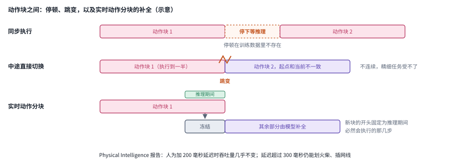

*图：三种接续动作块的方式。冻结的步数和块长是示意，实际取决于推理延迟和控制频率。*

第二个是记忆。2026 年 3 月的 [VLAs with Long and Short-Term Memory](https://www.pi.website/research/memory) 博客说得很直白：单项技能已经做得不错，瓶颈越来越多地落在机器人怎样调度这些技能去完成复杂任务上。清理整个厨房需要记住哪些已经做完、看不见的东西放在哪里、哪种做法刚刚失败过。他们的 MEM 方案把记忆分成两种：短期记忆保留最近的原始画面，用一个高效的视频编码器处理；长期记忆则写成自然语言笔记，由模型在选择子任务的同一套推理过程中自己决定记什么。博客报告这让模型能跟踪长达约 15 分钟的任务，并在抓筷子失败后换个方向再试。本章三.3 的实时推理和三.5 的长期记忆，就是在这两个问题上继续深挖。

这一段也留下了一场至今没有定论的争论：替代数据到底能不能代替真机数据。Levine 在 [Sporks of AGI](https://sergeylevine.substack.com/p/sporks-of-agi) 里的立场很鲜明，仿真、人类视频和手持夹爪都只能学到一个"交集"里的行为：既要在机器人上可行，又要能用这种方式采集，还要恰好不暴露两者之间的差距；模型越强，越能察觉自己看到的是替代数据，这个交集就越小。他建议把替代数据当作"世界上会发生什么"的背景知识来做预训练，真正教机器人"该怎么做"的，还得是真实的机器人经验。人到机器人迁移的结果和他可以互相印证：人类数据在真实机器人经验打好底子之后，才开始真正派上用场。另一边，Generalist 在 2026 年 4 月的 [GEN-1](https://generalistai.com/blog/gen-1) 里报告，预训练数据全部来自人类穿戴设备、不含任何机器人数据，规模超过 50 万小时，每项任务只用约 1 小时机器人数据微调，几项任务的平均成功率约 99%，这些都是公司自报的数字。至于真机数据本身，Chris Paxton 在 [How Much Is Robot Deployment Data Worth?](https://itcanthink.substack.com/p/how-much-is-robot-deployment-data) 里泼了一盆冷水：已经部署的机器人很少遇到新情况，失败和纠正攒得太慢，部署飞轮未必像大家想的那样转得起来。

到 2026 年，模型本身已经会很多事。新的瓶颈慢慢从"模型会不会"变成了"我们会不会讲"：同一个模型，任务说法换一换，结果可能天差地别。这就把主线带到了最后一段。

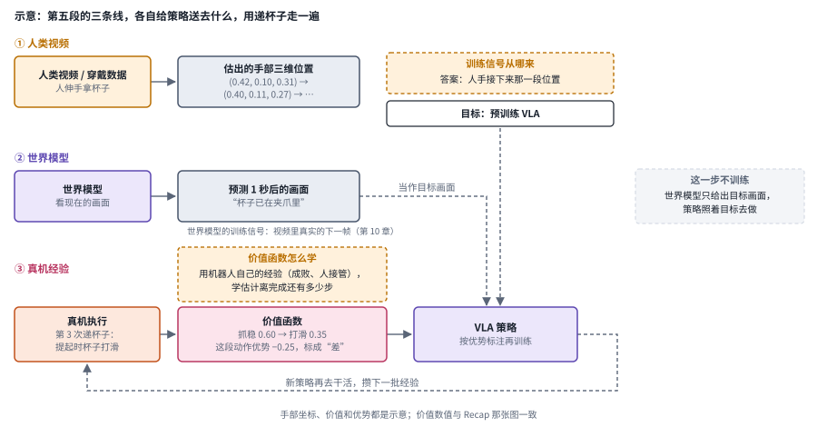

*图：第五段的三条线。人类视频和穿戴数据用来预训练，世界模型预测未来画面，真机上的成功、失败和人的纠正交给价值函数，策略再按"比平均好多少"去学。*

**速查：第五段的七项工作。** 七项都在让机器人超出示范者的水平、撑住真实部署，差别在补的是哪一块，分成三组：E1 到 E4 让机器人从自己的经验里变好，区别在于反馈从哪里来，是人的介入、价值函数、在线强化学习，还是机队里别的机器人；E5 让人类视频在机器人数据打好底子之后派上用场；E6 和 E7 撑住真实部署的时间尺度，一个处理延迟，一个处理记忆。

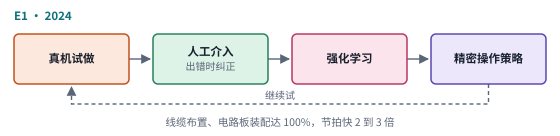 

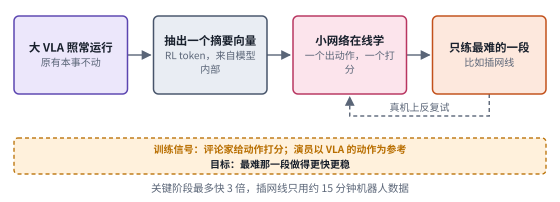 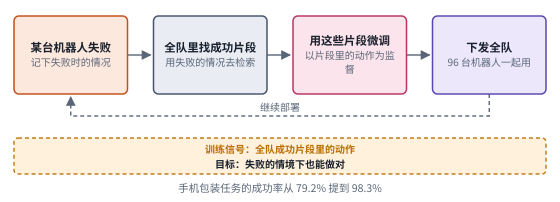

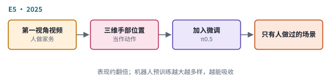 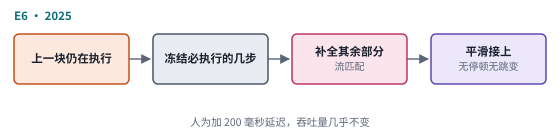

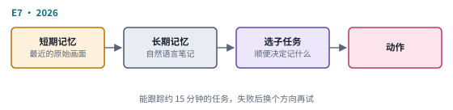

*图：第五段七项工作的结构卡，每张卡对应下表的一行。*

| code | 名称 | 年份 | 代表 | 怎么做 | 解决了什么 | 代价 |
|---|---|---|---|---|---|---|
| E1 | 人在回路的真机强化学习 | 2024 | [HIL-SERL](https://arxiv.org/abs/2410.21845) | 真机上试做，出错时人工介入纠正，用强化学习更新策略 | 精密而灵巧的操作不再受示范者水平限制；Levine 提到线缆布置、电路板装配达到 100% 成功率，节拍比模仿学习快两到三倍 | 训练过程离不开人工介入，机器人一多，人盯着的成本就跟着涨 |
| E2 | 以优势为条件的策略 | 2025 | [π\*0.6 / Recap](https://arxiv.org/abs/2511.14759) | 示范教基本动作，人在出错时接管演示恢复，价值函数给每段动作标优势，策略以优势为条件 | 自己的失败也能用来学，模型被引向好动作，最难任务的吞吐量提高一倍以上，失败率降低一半以上 | 依赖人工接管和专门训练的价值估计（第六节第 3 个问题） |
| E3 | 关键阶段在线强化学习 | 2026 | [RLT](https://www.pi.website/research/rlt) | 从 VLA 内部抽出一个 RL token，只在上面训练小的演员和评论家，对任务里最精细的那一段做在线强化学习 | 大模型保留原有本事，小网络在真机上快速学会最难的一步：关键阶段最多快 3 倍，插网线只用约 15 分钟机器人数据 | 只覆盖挑出来的关键阶段；挑哪一段、怎样判断这一段做成了没有，仍要按任务来设定 |
| E4 | 集体经验学习 | 2026 | [Learning from Fleet Experience](https://arxiv.org/abs/2610.25736) | 失败时用失败的上下文去全队共享的成功经验里检索片段，以片段的动作为监督微调，再下发全队 | 不再靠操作员盯着每台机器人纠正；手机包装任务上 96 台机器人一起学，成功率从 79.2% 提到 98.3% | 检索到的成功片段是否适用于失败的情境，全队都没成功过的长尾情况能否覆盖，都还要单独检验 |
| E5 | 人到机器人迁移 | 2025 | [Emergence of Human to Robot Transfer](https://www.pi.website/research/human_to_robot) | 把人类第一视角视频当成又一种身体，三维手部位置当作动作，加入 π0.5 的微调 | 在只有人类示范出现过的几个场景里，表现大约翻倍，人类视频的价值第一次变得具体 | 迁移能力要等机器人预训练数据的规模和多样性上去才出现，先得有足够多的机器人数据打底 |
| E6 | 实时动作分块 | 2025 | [Real-Time Execution of Action Chunking Flow Policies](https://arxiv.org/abs/2506.07339) | 推理期间必然执行的几步冻结为上一块的值，模型只补全其余部分 | 动作块之间既没有停顿也没有跳变：加 200 毫秒延迟吞吐量几乎不变，超过 300 毫秒仍能划火柴、插网线 | 冻结的那几步仍是旧计划，推理期间出现的新变化要等下一块才反映出来 |
| E7 | 长短期记忆 | 2026 | [MEM](https://www.pi.website/research/memory) | 短期记忆保留最近的原始画面，用高效的视频编码器处理；长期记忆写成自然语言笔记，选子任务时一并决定记什么 | 清理整个厨房这类长任务需要记住做过什么、东西放在哪；MEM 能跟踪约 15 分钟的任务，失败后换个方向再试 | 写成文字的长期记忆可能丢掉接触细节（三.5） |

### 第六段：可引导的通才，怎样把任务讲给机器人（2026）

> **要点：** 模型本身已经会很多事，新的瓶颈变成了怎样把任务讲给它听。π0.7 用更丰富的提示引导同一个模型，空气炸锅的例子把"讲法决定成败"摆到了台面上，同期的几篇论文开始把这一层当作独立的研究对象。

2026 年 4 月的 [π0.7](https://www.pi.website/blog/pi07) 博客提出，机器人基础模型还没有表现出语言模型那样广泛的技能重组能力，而 π0.7 展现了"最初的迹象"。它的关键做法是让模型以更丰富的提示为条件：除了语言，还有关于动作速度和质量的元数据、控制方式（关节还是末端），以及可以在测试时由一个轻量世界模型生成的视觉子目标图像。作者特别强调，把来自多种机器人、人类视频和各种策略自主运行的数据不加区分地混在一起，效果并不好；正是这些元数据消除了行为的歧义，让质量较差的自主数据也能放进训练集而不教坏模型。博客还报告，π0.7 在一台从没采集过叠衣数据的双臂 UR5e 上零样本叠衣，成功率和第一次上手这台机器人的资深遥操作员相当。

博客里最耐人寻味的是空气炸锅的例子。第一次只给一句"把红薯放进空气炸锅"，机器人做了个像样的尝试，起手几次失误，没能做完；改成像教第一次用这台电器的人那样一步步下指令之后，它做得好多了。TechCrunch 在[对这次发布的报道](https://techcrunch.com/2026/04/16/physical-intelligence-a-hot-robotics-startup-says-its-new-robot-brain-can-figure-out-tasks-it-was-never-taught/)里引用了研究员 Lucy Shi 的说法：早期实验里这个任务的成功率是 5%，团队花了大约半小时打磨怎样把任务讲给模型，成功率就升到了 95%。用她的原话说，有时候失败的原因不在机器人，也不在模型，"在我们自己，是我们不擅长提示工程"。这组数字只出现在采访里，博客和技术报告都没有给出，读的时候要当作研究员的口头自述来看。报道还提到，整个训练集里和空气炸锅相关的只有两段数据。更重要的是，这种指导还能沉淀下来：博客写道，几轮指导之后，他们用这些指导指令微调出一个高层策略，由它自己生成语言子任务去驱动 π0.7，在完全不增加遥操作数据的情况下改善了自主执行。

下图把这两件事画在一起：上半部分是四路提示共同进入同一个通用策略，下半部分是讲任务的人怎样被一个训练出来的高层策略替代。

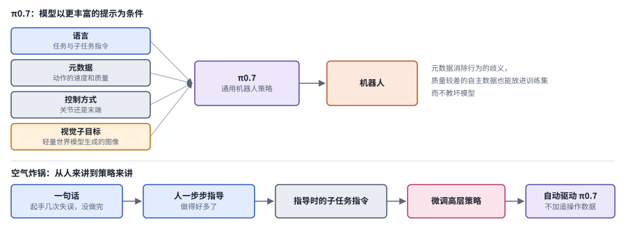

*图：上半部分是 π0.7 的四路提示，下半部分是空气炸锅例子里从"人来讲"到"策略来讲"的过程。采访里 5% 到 95% 那组数字没有画进图里，原因见正文。*

这件事的意义在于，它把语言模型 agent 那边早已熟悉的一个现象带进了具身领域：模型外面那一层"怎样讲任务、谁来讲、讲错了怎样纠正"的东西，也就是 harness，可以决定大部分的成败。同一时期的几篇论文都在围绕这一层做文章，差别在于改的是这一层的哪一部分：外围的检查和恢复，执行中的进度判断，还是模型内部。[Zetta](https://arxiv.org/abs/2608.16590) 保持基础策略冻结，只在外围在线运行代码形式的检查器和恢复技能，再离线进化这些部件；[LAW](https://arxiv.org/abs/2610.23334) 让一个视觉语言模型在机器人执行时边做边检查子任务是否完成；[SteerAct](https://arxiv.org/abs/2610.25632) 不改权重，在推理时用少量带成败标签的轨迹去引导动作模型的内部特征；还有两篇论文直接测试了通用多模态大模型 GPT-6 Astra 能在多大程度上绕开专门的策略、直接控制机器人。这些工作在本章新增的三.10 里展开，它们和[第 18 章《Harness 工程》](18_harness_engineering.md)讨论的 harness 工程是同一件事在物理世界里的样子。

**速查：第六段的四项工作。** 四项都不改或少改模型权重，只改“讲任务”这件事，分别对应它的四个环节：H1 是谁来讲，从人换成训练出来的高层策略；H2 是执行中谁来查、出错后谁兜底；H3 是边做边查，判断一个子任务做完了没有；H4 不碰输入，直接在模型内部找到对应的开关。四项合起来正好拼出一个具身 harness 的雏形，三.10 会把它们放回同一张结构图里。

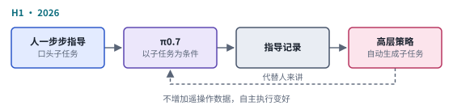 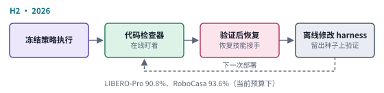

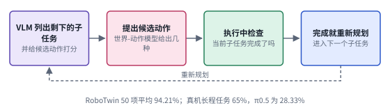 

*图：第六段四项工作的结构卡，每张卡对应下表的一行。*

| code | 名称 | 年份 | 代表 | 怎么做 | 解决了什么 | 代价 |
|---|---|---|---|---|---|---|
| H1 | 指导与高层策略 | 2026 | [π0.7](https://www.pi.website/blog/pi07) | 训练时以子任务语言指令为条件，人可以实时一步步指导；再用指导时的指令微调一个高层策略，自动生成子任务驱动 π0.7 | 同一个模型，讲法一换，表现大不相同；人摸索出来的讲法沉淀成可复用的策略，不加遥操作数据就改善了自主执行 | 采访里的 5% 到 95% 只是口头数字；讲法对结果的影响有多大、人要调多久，还缺系统的测量（第六节第 4 个问题） |
| H2 | 自我进化的闭环 harness | 2026 | [Zetta](https://arxiv.org/abs/2608.16590) | 基础策略冻结；运行时代码检查器盯着，干预前先验证，再交给恢复技能；离线聚类失败，修改检查器、恢复技能和工具，在留出种子上验证有效才收进来 | 执行时就能调整，不必等一轮结束才反思：LIBERO-Pro 上 90.8%，RoboCasa 上 93.6%，推理加速 11.1 倍 | 结果是在作者当前的执行预算下报告的；检查器会误判，误判的代价要单独算 |
| H3 | 边做边查 | 2026 | [LAW](https://arxiv.org/abs/2610.23334) | VLM 规划剩余子任务，给世界-动作模型提出的候选动作打分，执行时异步判断当前子任务是否完成，完成就重新规划 | 长程任务的子任务交接有了把关：RoboTwin 50 项平均 94.21%，三项真实长程任务平均 65%，π0.5 为 28.33% | 只检查子任务是否完成，整份计划是否合理不在检查范围内；状态判断一旦出错，系统会很自信地跳到下一步 |
| H4 | 推理时内部引导 | 2026 | [SteerAct](https://arxiv.org/abs/2610.25632) | 稀疏自编码器给出候选特征，时间描述子刻画特征随时间的变化，按成败参考库挑出任务相关的特征，在线决定何时、多大力度干预 | 不改权重，唤起模型已有的能力；每项任务只需 24 条带成败标签的轨迹，成功率相对提高约 10% | 每项任务仍要先收集带成败标签的参考轨迹，挑出来的特征是否可靠要按任务检验 |

2026 年 10 月各家的发布，也可以放在“怎样把任务讲给机器人”这个框架下看。它们共同的方向，是把“高层怎样讲、低层怎样做”拆成可以分别优化的两层；分歧主要在数据从哪里来。Physical Intelligence 在 10 月 13 日开放了 [API beta](https://www.pi.website/blog/api-beta)，用户上传自己的数据、在他们托管的算力上微调，再通过托管网关在自己的机器人上做推理；页面没有写明开放的是哪一个模型，只说最新的模型微调更省数据。Google DeepMind 在 7 月 30 日发布了 Gemini Robotics 2 系列，其中的 [Gemini Robotics ER 2](https://blog.google/innovation-and-ai/models-and-research/google-deepmind/gemini-robotics-er-2/) 被定位成机器人的"高层大脑"，负责空间推理、多步规划和与人对话，再把电机执行交给低层的 VLA，还能调用工具、从视频里跟踪任务进度；官方报告它在五档任务进度分类上的准确率是 57.4%，可见"判断做到哪一步了"本身仍是个难题。NVIDIA 的 GR00T N1.7 在 7 月进入了 LeRobot，官方说明它用约 3.2 万小时真机和人类第一视角数据、约 8000 小时模拟数据预训练，长程推理靠任务和子任务两级分解。Figure 的 [Helix 02](https://figure.ai/news/helix-02) 在原有的高层推理和 200 Hz 视觉运动策略之下加了一个 1 kHz 的全身控制层，手指尖的触觉能感知 3 克的力，演示了 4 分钟不间断地装卸洗碗机。Generalist 的 [GEN-1](https://generalistai.com/blog/gen-1) 押注人类穿戴数据。国内几家的路线各有侧重：宇树以人形和四足硬件平台为主，配合开源的模拟强化学习训练管线，运动控制走的是第二段那条路，先在模拟器里用强化学习练好，再搬到真机上；智元的 GO-1 建立在自己的 AgiBot World 数据工厂之上，用潜在动作表示来吸收大规模数据，也就是让模型自己学一种内部的动作编码，不必和某台机器人的关节一一对应；银河通用相关团队的 GraspVLA 押注十亿帧级的合成抓取数据；自变量发布了把感知、语言、动作和物理预测放进同一个网络训练的 WALL-B，并开源了 WALL-OSS 和世界模型 WALL-WM。这些路线在数据来源上的分歧，几乎就是第三段那张数据来源对照表的现实版，那张表比较了遥操作、手持夹爪、穿戴设备、第一视角视频、数据工厂、模拟合成和部署运行七种来源。

### 回看：同一个瞬间，衣角从夹爪里滑掉了

> **要点：** 把同一个瞬间交给六种方法，差别一下子就清楚了；再问三个问题，就能给任何一篇新论文在主线上定位。

几种方法的差别，放到一个具体的瞬间里看最清楚。假设机器人已经捏起 T 恤的一个肩角，正要往上提，布从夹爪里滑了出去，落回桌上。下面这张表是根据各段方法的工作方式推想出来的，用来帮助理解，并不对应某篇论文里的具体实验。

| 方法 | 它大概会怎样反应 | 原因 |
|---|---|---|
| 手写规则 | 工程师写过"检测到滑落就回到第 3 步"，它会重来；没写过，就按原计划继续，对着空气折叠 | 它只会处理写进规则里的情况 |
| 模拟器强化学习 | 可能会去重新抓，抓的位置和力度却常常不对 | 模拟器里的布滑落的方式和真布不一样 |
| 模仿示范 | 示范里有人重抓过，它就照着重抓；没有，它会愣住 | 它只见过示范里出现过的局面 |
| RT-2 式 VLA | 等它下一次出动作时，衣角早已落地 | 每秒只出 1 到 3 次动作 |
| π0 式 VLA | 半秒内重新看一眼画面，生成新的一段动作；示范里重抓够多，它就能捡起来 | 动作块执行到一半就重新生成，本事仍以示范为限 |
| 经验与视频 | 会去重抓，而且这种失误越来越少 | 它从自己以前的失败和人的纠正里学过 |

再把几段放进同一张表。读一篇新的机器人论文时，先问三个问题，基本就能定位它站在主线的哪一段：策略的知识从哪里来，动作用什么形式输出，它怎样变得更好。

| 方法 | 知识从哪来 | 数据：模拟器还是真机 | 输出 | 学新任务要什么 | 卡在哪里 |
|---|---|---|---|---|---|
| 手写规则 | 工程师的规则 | 没有训练数据 | 规划好的路径 | 重新写规则 | 写不全所有情况 |
| 模拟器强化学习 | 海量虚拟试错加人写的奖励 | 模拟器，在线试错 | 关节力或角度 | 新的模拟场景和奖励 | 软物体和接触算不准 |
| 模仿示范 | 这个任务的几十到几百条示范 | 真机示范，离线学习 | 动作块 | 重新录示范、重新训练 | 一个模型一个任务，没有常识 |
| RT-2 式 VLA | 网页图文加机器人示范 | 真机示范，离线学习 | 动作 token | 一句新指令，常常零样本 | 太粗、太慢 |
| π0 式 VLA | 网页图文加上万小时跨机器人示范 | 真机示范，离线学习 | 50 步连续动作块 | 少量示范微调 | 上限是示范者 |
| 经验与视频 | 示范、自己的经验、人的纠正、穿戴数据和视频 | 真机在线试错，从预训练模型起步 | 连续动作块，可加未来画面 | 在真机上跑、被纠正、再训练 | 奖励和评测 |

对做大模型的人，有一个好记的对应：模仿示范像 SFT，VLA 像拿预训练好的基座来做 SFT，经验与视频像 SFT 之后的强化学习，再加上用合成数据和视频扩大预训练。机器人这条路更难走的地方，在于每一条数据都要在物理世界里真实地发生一次。

### 边界：评测和灵巧手

> **要点：** 两条边界反复出现，至今没有答案：真机评测又慢又贵、难以横向比较；身体本身，尤其是多指灵巧手和触觉，仍在快速变化。安全与停止则横跨所有层。

把这几段放在一起读，能看到两条反复出现、至今没有答案的边界。下图把具身系统的闭环再画一遍，标出它们落在哪里。评测的问题压在"模型与 harness"这一环：我们想知道模型到底好不好，可真机评测慢、贵、条件难以复现，大多数数字又来自公司自己的任务。身体的问题压在"身体与物理世界"这一环：手怎样做、触觉怎样表示，这些硬件层面的选择还没有定型，模型学到的东西也就跟着难以迁移。顶上那个跨层的框是安全与停止，它同时连着模型和身体，因为高层觉得合理的事，底层未必做得到；底层报告的成功，下一步也未必接得住。

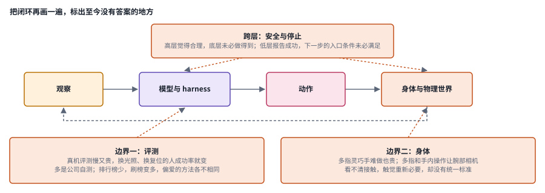

*图：橙色框是三处至今没有答案的地方，虚线箭头指向它们压在闭环的哪一环。*

第一条是评测。真机评测又慢又贵，同一个策略换个光照、换个复位的人，成功率都会变，Eric Jang 早在 2022 年就把它列为机器人迭代慢的首要原因。几乎每一篇主线博客都在结尾承认模型离完美还远，报告的又大多是公司自己的任务和自己的对照，TechCrunch 在报道 π0.7 时也指出，机器人领域基本没有标准化的基准，外部验证很难做。Chris Paxton 在 [What Do Robotics Leaderboards Tell Us About The State of Robot Learning?](https://itcanthink.substack.com/p/what-do-robotics-leaderboards-tell)（2026-06）里比较了几个主要的排行榜：NVIDIA 内部运行的模拟基准、志愿者在真实机械臂上分布式评测的 RoboArena、以及 AI2 的移动机器人模拟平台 MolmoSpaces。他的观察是，基准很多，能持续更新的排行榜很少；随着榜单有了公信力，刷榜开始变多，RoboArena 就出现过志愿者没跑完分配的评测；不同榜单偏爱的方法也很不一样，有的榜单上靠前的甚至是一个任务与运动规划器。他的结论很直白："我们其实还不知道哪种做法最好。"

第二条是身体本身。Paxton 在 [Robot Hands Are Getting Better](https://itcanthink.substack.com/p/robot-hands-are-getting-better)（2026-05）里写道，人手把力量、轻巧、适应性和密集的触觉集成在一个手指大小的包里，约有 22 个自由度，是通用机器人落后的关键原因之一；两指夹爪能应付大量抓放，可手内转动、抓细长物体和使用工具都需要多指灵巧手。顶级的商用灵巧手单只可能超过五万美元，开源设计已经把成本压到几百到一千多美元，他预计五年内会出现几千美元级别的好用灵巧手。几个月后，他在 [Dexterity is the Frontier: Thoughts on IROS 2026](https://itcanthink.substack.com/p/dexterity-is-the-frontier-thoughts) 里又观察到，研究重心正从两指夹爪转向多指灵巧手和接触丰富的操作；两指夹爪时，腕部相机往往能从夹爪形变推断出受力，换成多指和手内操作，相机越来越难看清接触，触觉传感因此重新变得必要，可触觉至今没有像图像那样的统一标准。本章三.6 的触觉与灵巧手、三.9 的全身控制与评测，正好落在这两条边界上。

最后还有一个贯穿始终的问题是安全与停止。当机器人从桌面走向人形、从实验室走进家庭，"出了问题能不能稳妥地停下来"这件事，就和"能不能把任务做完"同样重要。本章第三节的各个分支，大多可以看成是在这些边界上的局部推进。

### 总对照：五组速查卡和十个分支放在同一组坐标上

> **要点：** 把第二节五组速查卡放进一张表，按同样几个维度比较；再把主线代表作和第三节的十个分支放到共同的坐标上，就能看清每个分支在继承哪一段的遗产。

把这一节的五组方法放进一张表。想快速判断一篇新论文属于哪一族，先问它的经验从哪里来、改的是闭环里的哪一层、靠什么信号变好；表格只放结论，每一格背后的原因写在前面同编号的速查卡和对照表里。

| 家族 | 经验从哪里来 | 改的是哪一层 | 靠什么变好 | 主要优点 | 主要代价 | 本章分支 |
|---|---|---|---|---|---|---|
| S 第二段 | 模拟器里的试错，少数直接来自真机 | 控制层与技能层 | 人写的奖励 | 量几乎不受限，不怕摔也不怕碰 | 布料、接触、形变算不准，操作上屡屡碰壁 | 三.9 |
| I 第三段 | 人的示范 | 技能层的动作分布与时间结构 | 模仿示范，加上 DAgger 式的在线补标注 | 绕开随机探索，几十条示范就能学会精细动作 | 一个模型一个任务，没有常识，示范又贵又窄 | 三.1、三.2、三.7 |
| V 第四段 | 网页图文加跨机器人示范 | 任务层和技能层一起，动作接口重新设计 | 联合训练与数据配方 | 听懂新指令、认出新物体，能进陌生的家 | 上限是示范者，动作能否做成仍取决于身体 | 三.2、三.4、三.8 |
| E 第五段 | 自己的经验、人的纠正、机队共享、人类视频 | 技能层的更新，加上实时执行和记忆 | 价值函数、优势、在线强化学习、检索 | 能超过示范者，撑住真实部署的时间尺度 | 奖励和评测难做，人工接管和复位成本高 | 三.1、三.3、三.5、三.7 |
| H 第六段 | 怎样把任务讲给模型 | 任务层之上的 harness，以及模型内部特征 | 指导、检查器、恢复技能、推理时引导 | 不改权重就能唤起已有能力 | 讲法敏感，人工调试和推理成本难以计量 | 三.8、三.10 |

下图换一个角度，把主线代表作放到两条共同的轴上。横轴是经验从哪里来，也就是主线的六段；纵轴是改动落在闭环的哪一层，分成数据与经验、动作表示、实时执行与反馈、任务组织与讲法四行。每个格子里放的是这一段里集中改这一层的代表作，空格表示这一段的代表作没有集中改这一层。顺着格子看，会看到一条大致从左上走到右下的对角线：早期的工作多半在改动作本身，越往后，改动越多落在经验怎样回流到模型、任务怎样讲给模型这两件事上。数据那一行从第二段一直延伸到第六段，说明"经验从哪里来"这个问题从来没有被一劳永逸地解决，每一段只是换了一种回答。

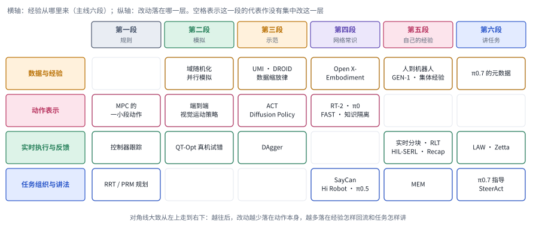

*图：主线代表作的两轴总对照。格子的归属按第二节正文的叙述整理，同一项工作只放在它最主要的那一格。*

再把第三节的十个前沿分支放回主线。下图横轴是主线六段加上边界，纵轴是十个分支，涂色的格子就是每个分支开头"主线位置"一行标出的段。可以看到，前沿研究最密集的地方是第五段，有五个分支落在这里，说明"回到自己的经验"这一步仍在快速展开；第六段刚刚出现，只有三.8 和三.10 两个分支；第一段没有分支，那套经典方法如今多半作为底层的控制器继续工作。

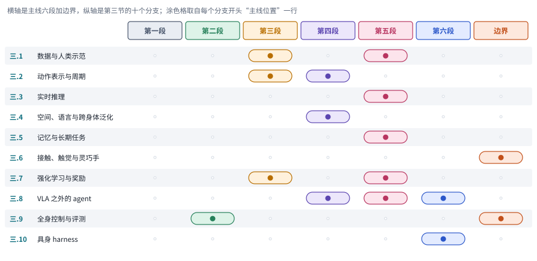

*图：十个前沿分支在主线上的位置，可以当作第三节的目录来用。*

## 三、前沿研究方向

主线走到 2026 年，一个 VLA 已经能听懂指令、在陌生的家里干活，还能从自己的经验里变好，可让它稳稳地把桌上的蓝色杯子递给你，仍然要过好几道关：数据够不够多样，动作能不能及时反应，记不记得刚才做过什么，抓得稳不稳，失败了能不能学，任务讲得清不清楚。下面十个分支收录的大多是 2026 年的新论文，各守其中一关。读的时候可以问两个问题：它改进的是理解目标、及时动作、稳定接触还是失败恢复中的哪一环？它用什么证据说明这份改进在真实部署中也成立？这些环节往往分别受不同部件的限制，很难压缩成一个 VLA 成功率。

> **本节要点：** 十个分支按一个策略从训练到部署要过的关排开：数据、动作表示、实时推理、泛化、记忆、接触、强化学习、高层组织、全身控制与评测，以及任务怎样讲。每个分支的论文都只在一关上推进，评价时要问它改进的是哪一环，证据能不能撑到真实部署。

### 1. 数据与人类示范：数量、保真度和任务覆盖不能互换

说起机器人数据，人们最先想到的往往是"多少小时"。可示范数量只是数据规模的一个维度。设想有人把"从桌上拿起杯子"重复采集了一千遍，机器人在这一个动作上会越来越稳，可它依然学不会接近、接触、移动和释放之间的各种组合变化，更学不会在杯子被人碰歪之后怎样调整。人类视频、遥操作和自动采集又各有各的脾气：遥操作的动作和机器人完全对应但很贵，人类视频容易扩展却看不到机器人该怎么动。所以挑选数据之前，先要弄清楚缺的到底是基本动作、动作之间的衔接，还是组合覆盖，再去比较数据量，避免用更多相似的轨迹掩盖结构上的空缺。

> 主线位置：第三段的“数据从哪来”和第五段的人类视频。接 UMI 的手持采集、DROID 和 Open X-Embodiment 的大规模真机数据，Physical Intelligence 发现机器人数据打好底子之后人类视频才开始管用，以及 Levine 在 Sporks of AGI 里对替代数据的怀疑。

> **要点：** 数据的数量、保真度和任务覆盖是三件事，补哪一件要先想清楚。SIEVE 从已有示范里按组合覆盖挑数据，HiFi-UMI 把手持采集的保真度做上去，第一视角视频这条线则在一道道工序里把人的经验整理成结构化的记录。

下图上排是数据规模的三个维度：数量是多少条、多少小时；保真度是观察、动作和时间同步是否对得上；任务覆盖是基本动作之间的衔接和组合有没有被覆盖到。这一节的论文各自在其中一个维度上下功夫。右下是第一视角视频变成机器人监督要过的几道工序，最后一步用虚线画出，因为它还没被检验：整理好的人类经验，到底能替代多少真实的机器人经验。

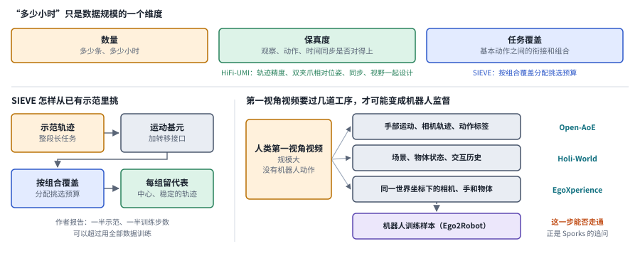

*图：本分支论文的位置。上排三个维度各对应一类改进，左下是 SIEVE 的流程，右下是第一视角视频变成机器人监督要过的工序，虚线那一步尚待检验。*

先看怎样从已有数据里挑。**[SIEVE](https://arxiv.org/abs/2607.06442)**把示范看成可复用的运动基元和它们之间转移接口的组合，先发现这种结构，再按组合覆盖分配挑选预算，最后在每一组里保留有代表性的轨迹，作者报告只用一半示范、一半训练步数，就能超过用全部数据训练。和只按整段轨迹质量或单步动作来筛选的做法相比，它更关心长任务里可以复用的连接结构。这个思路好不好用，取决于分段和结构识别是否可靠；抽取出来的基元是一种有用的任务分解，未必是唯一正确的那一种。

再看数据从哪里来。遥操作数据能精确对应机器人动作，采集却昂贵；人类视频容易扩展，可里面没有可以直接执行的机器人控制。有人想到借视频生成模型的视觉先验来初始化策略，问题在于，这些原本为内容创作服务的表示，未必保留了动作需要的细节。所以每条数据路线都应当说清楚，观察、动作、时间同步和任务标签分别从哪里来。

[2607.08639 · Native Video-Action Pretraining for Generalizable Robot Control](https://arxiv.org/abs/2607.08639) 从具身需求出发，专门设计了语义与动作联合的 tokenizer、因果预训练、稀疏专家骨干和异步控制，没有走"把双向视频生成器改造成策略"的老路。它把表示、时间因果性和部署节拍放在一起设计。由于训练配方和模型结构同时变了，收益很难单独归到视频规模头上；要知道新任务能力从哪来，还得按 tokenizer、预训练方向和执行机制分别做消融。

[2607.25895 · HiFi-UMI: Learning Deployable Manipulation Policies from High-Fidelity UMI Data Alone](https://arxiv.org/abs/2607.25895) 则把力气花在采集保真度上，轨迹精度、双夹爪相对位姿、同步和视野一起设计，研究高质量的手持采集能否减少目标机器人上的后训练数据。它挑战了"总得再加一点真机数据当锚点"的惯常做法，恰好可以和 Levine 的批评对照着读：他认为手持夹爪这类替代数据只能学到人和机器人都做得到的那个"交集"里的行为，真实的机器人经验不可或缺。它在所测装置上的部署成功，推广到别的身体之前还要单独验证；硬件标定、重建验证和采集覆盖本身也是成本，"零机器人后训练"的说法容易让人忽略这部分投入。

这两篇工作一个改善模型吸收经验的方式，一个改善经验本身的质量。真要比较时，应当固定任务范围，报告失败示范、传感同步、目标身体的曝光程度和人工复位，按小时数给数据集排座次说明不了多少问题。

把数据做大还有好几条路，它们的差别在于数据从哪里来：真机轨迹，还是人类第一视角视频。每条路都要分别检查数据来源、动作对应关系和实际任务覆盖。[Xiaomi-Robotics-1: Scaling Vision-Language-Action Models with over 100K Hours of Real-World Trajectories](https://arxiv.org/abs/2607.15330) 用多样的真实轨迹研究数据规模与新任务适配的关系，关注的是独立任务的覆盖，避免把相近轨迹重复计作多样性。[Open-AoE: An Open Egocentric Manipulation Dataset and Toolchain for Embodied Learning](https://arxiv.org/abs/2607.14183) 从日常第一视角视频中构建手部运动、相机轨迹和动作标签的工具链，降低了处理这类数据的门槛。

沿着人类数据这条线继续往下走，[Ego2Robot: Scalable Robot Data Synthesis from Egocentric Human Data](https://arxiv.org/abs/2608.02580) 把人类第一视角的经验转换成机器人训练样本，研究视觉、任务和身体变化下的迁移，可以和 Physical Intelligence 的人到机器人迁移结果对照着读，那项工作发现，机器人预训练数据足够多之后再加入人类第一视角视频，在只有人类示范过的场景里表现大约翻了一倍。[HIL-UMI: Bringing Human-in-the-Loop Post-Training of Vision-Language-Action Models to Universal Manipulation Interface](https://arxiv.org/abs/2609.20659) 针对策略的盲点去采集人类纠正示范，把数据选择和部署中的失败连接起来，让示范不再漫无目的地增加。它和 π\*0.6 里"人在机器人出错时接管"的思路一脉相承，只是把采集设备换成了 UMI。

人类第一视角视频这条线上，2026 年 10 月又出现了两篇把视频变成结构化经验的工作。[Holi-World: Building Holistic World Intelligence from Human-Ego Experience](https://arxiv.org/abs/2610.26549) 用一条自动流水线把第一视角录像整理成场景、物体状态和交互历史的结构化记录，从大约 100 个自采场景里生成约 8 万条问答对，训练出一个 40 亿参数的视觉语言模型，作者报告它在自建基准和 EgoDynamic4D 上的空间与时间推理都有提升。[EgoXperience: Learning World-Grounded Egocentric Representations from Human Experience](https://arxiv.org/abs/2610.26625) 则从单目第一视角视频里一次前向计算就重建出相机运动、场景几何、手和物体在同一个世界坐标系里的度量位置，作者报告相机、手和深度误差比最强基线分别降低 68.9%、65.6% 和 42.9%。两篇都还停在"让模型看懂人怎样和世界交互"这一步，摘要里没有机器人实验。它们整理出来的结构化经验能不能像人到机器人迁移那样变成机器人可用的动作监督，正是 Levine 在 Sporks of AGI 里追问的那个问题，也就是这类替代数据到底能替代多少真实的机器人经验，值得后续工作专门检验。

### 2. 动作表示与周期：分块为什么有效，何时又妨碍反应

动作分块是第二代 VLA 的标配。它让模型一次规划出一段平滑的行为，也减少了逐步调用大模型的开销。可环境在这段时间里并不会静止：你伸手接杯子时，手的位置一直在变。块的长度因此同时牵动三件事，计算成本、动作平滑程度和纠错的机会。比较不同方法时，要标清楚模型重新观察、重新规划和底层控制各自的频率，执行器高频输出动作，并不说明模型每一次都做了新的闭环决策。

> 主线位置：第三段的模仿学习复兴和第四段的第二代 VLA。接 ACT 一次预测一整段动作的分块，Diffusion Policy 用去噪生成保留多种合理做法，以及 π0 的流匹配动作专家和 FAST 把动作压成少量 token 的改进。

> **要点：** 动作分块的好处，可以拆成历史长度、预测长度和实际执行长度三个数来看。两篇机制研究发现，起作用的是非马尔可夫表达和隐式集成，长开环主要在帮短历史策略；其余几篇分别处理块的接缝、曲线表达、离散化，以及继续执行还是重新规划。

这里尤其要把预测长度和实际执行长度分开：一次预测十步，并不要求十步都闭着眼睛执行完。重新观察之后，系统可以保留仍然适用的动作，也可以整段重来，所以分块带来的好处未必依赖长时间的开环执行，也就是闭着眼睛执行、不看新观察的那一段。下图把三个数画在同一条时间轴上：“现在”左边是能看到的历史，右边是一次预测的全部动作，其中粉色的前几格是真正执行的前缀。

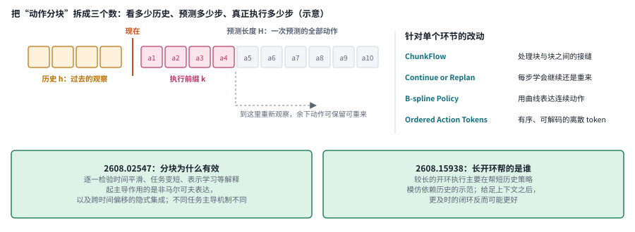

*图：历史长度、预测长度和执行前缀三个数。格子数量是示意，下方两框概括了 2608.02547 和 2608.15938 的结论。*

[2608.02547 · Why Does Action Chunking Improve Behavioral Cloning Performance in Robotic Control?](https://arxiv.org/abs/2608.02547) 用对照实验逐一检验了几种流行的解释，包括时间平滑、有效任务长度缩短和表示学习，最后强调的是两点：非马尔可夫表达，以及跨时间偏移的隐式集成。非马尔可夫在这里指光看当前画面不足以解释示范动作，必须结合历史；隐式集成指模型学到了当前动作和多个过去观察之间的关系。不同任务上起主导作用的机制并不相同，从某一种设置里得出的解释，推不出所有策略都该用同样的块长。

[2608.15938 · Revisiting Open-Loop Execution in Robotics: Toward Reactive, Higher-Performing Policies](https://arxiv.org/abs/2608.15938) 接着往下挖，发现较长的开环执行主要是在帮助短历史策略去模仿依赖历史的示范；一旦给足上下文，长开环就失去了这份好处，更及时的闭环反而可能更好。它把"动作分块有效"拆成了表示容量和执行反馈两个问题。它的证据依赖所测的专家行为和任务，部署时还要算上推理延迟，长历史策略如果算得太慢，同样会丢掉反应上的优势。

两篇研究合起来，要求比较时同时报告历史长度、预测长度、实际执行的前缀长度和总算力。回到递杯子的例子：机器人需要记住自己刚才抓空过一次，这要靠历史；又要在人的手移动后立刻调整，这要靠及时的闭环。这两种需求，一个固定的块长满足不了。

还有几篇工作只改动作块的一个环节，差别在改的是哪一个：块与块之间的接缝，动作用什么曲线表达，动作怎样离散成 token，以及什么时候该重新规划。评价时要同时看动作是否连贯、对反馈是否敏感。[ChunkFlow: Towards Continuity-Consistent Chunked Policy Learning](https://arxiv.org/abs/2607.12992) 用接缝感知训练和重叠融合等机制处理动作块边界的抖动，它针对的是连续性这一个问题，历史依赖要靠别的机制解决。[B-spline Policy: Accelerating Manipulation Policies via B-spline Action Representations](https://arxiv.org/abs/2607.09648) 用 B 样条曲线表达连续动作，减少逐点输出的负担；轨迹变得平滑之后，紧急情况下的快速反应是否还在，要单独检验。

[Ordered Action Tokens for Visuomotor Policy Learning](https://arxiv.org/abs/2607.21670) 把连续动作编码成有序、可解码的离散 token，为不同预算下的生成提供结构，思路上和 FAST 的动作 token 化是近亲。[Continue or Replan? Bernoulli-Continuation Policy Learning for Adaptive Horizon Execution](https://arxiv.org/abs/2608.03483) 让策略自己学习"继续执行还是重新规划"，执行周期随状态变化，从此不必固定地信任整段动作。

### 3. 实时推理：不要把旧计划的高频播放当成新决策

实时这件事，看的是从感知到动作的整条链路能否跟上环境的变化速度，单独让某个网络的前向计算变快，未必能换来更及时的反应。缓存、异步执行和提前预测都能省时间，代价是状态可能已经过时：机器人还在执行半秒前算好的动作，杯子却已经被人拿走了。所以这类研究应当同时记录缓存命中、错误复用和重新计算的条件，尤其要检查在突发变化下系统还能不能及时纠正。

> 主线位置：第五段，撑住真实部署的时间尺度。接 Physical Intelligence 的实时动作分块，它首先把“动作块之间的停顿和跳变”当成一个独立的研究问题提了出来，办法是冻结推理期间必然执行的那几步、只补全其余部分。

> **要点：** 实时看的是从看到新画面到做出新决策的整条链路。有的论文压缩编码和动作头，有的复用计算，有的让小策略在大模型的动作块上快速修改，有的把等待期间仍在发生的控制写进学习状态；省下来的时间，都要拿"状态是否已经过时"来检验。

下图把从感知到动作的链路拆成五段：看到新画面、视觉编码、骨干推理、动作生成和执行，中间几行列出本节各篇论文主要缩短的是哪一段。TurboVLA 换了更轻的编码和动作生成组合，ActionCache、FlashVLA 和动作头设计那篇都在动作生成这一段做文章，Reflex 则在执行端专测对时延敏感的任务。下方三个框是另一条思路：两篇强化学习论文不去压缩链路，改为让系统学会在延迟存在的情况下照样做对；最右边那个橙色框，是所有加速办法共同要面对的代价。

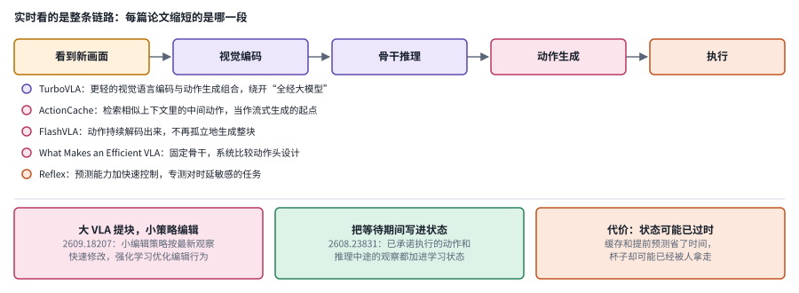

*图：从看到新画面到做出新决策的链路，以及本节论文各自作用的位置。*

先看复用计算这条路。**[ActionCache](https://arxiv.org/abs/2607.06370)**用多模态的键保存中间动作，在相似的上下文中把它们检索出来，作为流式动作生成的起点，再继续细化。它复用的是过去的计算过程，并没有简单地把上一段最终动作再播一遍。摘要里的加速主要针对动作头，换算成整机加速还要打折扣；真正部署时，视觉编码、检索、通信和控制的开销都得算进去，还要检查相似的状态是否真的需要相似的动作。

等待推理的时候，环境并不会暂停。异步推理让机器人不必停下来等计算，可已经承诺执行的动作会改变状态，普通的学习算法如果对此视而不见，就会把动作和它的后果对错号。降低延迟因此既是架构问题，也是学习状态和调度的问题。下面两篇论文都把强化学习用在了这件事上。

[2609.18207 · Reinforcement Learning for Real-Time Vision-Language-Action Policies](https://arxiv.org/abs/2609.18207) 让大 VLA 提出动作块，再由一个小的编辑策略根据最新观察快速修改，并用强化学习来优化编辑行为。这样既保留了大策略的先验，又给反应路径留出较小的计算预算，像是在大模型和执行器之间加了一个"反射弧"。原文讨论里写明，实验由人来复位，并使用任务专用的成功检测器；所以部署成本里还包括训练反馈和环境维护，报告里的"无人工干预"说的是执行环节，整个流程并非无人参与。

[2608.23831 · Learning to Act While Waiting: RL Finetuning of Generalist Robot Policies Under Inference Latency](https://arxiv.org/abs/2608.23831) 把已承诺执行的动作和推理中途的观察都加进学习状态，让决策条件重新接近马尔可夫。它的重点在于让强化学习知道等待期间哪些控制仍在发生，网络本身的速度倒在其次。利用中途观察的完整机制依赖视觉语言骨干和动作专家可以分开的结构，换一个模型之前，应先核对输入噪声、缓存和时间对齐的条件，再谈延迟上的收益。这篇论文和实时动作分块的"冻结已承诺动作"思路正好可以对照着读：一个在推理时处理，一个在训练时处理。

一个重要的对照是：在相同的真实时间里能完成多少可靠的操作，相同动作步数下的得分只是参考。实验还应测试延迟抖动、相机掉帧和通信排队，实验室里稳定的延迟，代表不了部署时的情况。

加速只有在缩短了"看到新画面到做出新决策"的等待时，才可能改善闭环表现。[TurboVLA: Real-Time Vision-Language-Action Model at 32 Hz on an RTX 4090 with <1 GB VRAM](https://arxiv.org/abs/2607.27205) 绕开了"所有动作都要经过大型语言模型"这条必经之路，探索更轻的视觉语言编码和动作生成组合。[FlashVLA: Streaming Action Decoding for Fast and Asynchronous VLA Inference](https://arxiv.org/abs/2608.27384) 让动作被持续地解码出来，告别孤立地生成整块，为异步执行提供了更平滑的更新接口。

还有两篇从任务和设计空间两头补充。[Reflex: Enabling Fast and Predictive Vision-Language-Action Models for Reaction-Critical Manipulation](https://arxiv.org/abs/2608.14379) 把预测能力和快速控制结合起来，并专门用对时延敏感的任务测试动态反应。[What Makes an Efficient VLA? Navigating Action-Head Design, Scaling, and Latency](https://arxiv.org/abs/2609.13984) 固定骨干，系统比较各种动作头设计，指出初始化和表示对齐可能比新增生成结构更重要，这和知识隔离那篇博客关心的"骨干与动作专家怎样相处"是同一类问题，那篇博客发现动作专家回传的梯度会侵蚀视觉语言骨干，于是切断了这部分梯度。

### 4. 空间、语言与跨身体泛化：究竟换了什么

"泛化"这个词在具身论文里被用得很宽：换背景、换物体、换说法、换任务组合、换一台机器人，都可以叫泛化，可它们考验的是完全不同的能力。在一个新房间里操作熟悉的杯子，和把同一个策略装到一台新机器人上，难度不在一个量级。所以评测时应当一次讲清楚哪些因素变了、哪些保持不变，再去看感知注意、动作映射和任务语义各自起了什么作用。

> 主线位置：第四段，向互联网借常识。接 RT-2 把网页上的语义知识迁移到动作里，Open X-Embodiment 汇集多种机器人的数据，Levine 设想的要同时在机器人、任务和环境三个方向上泛化，以及 π0.5 在陌生家庭中的测试。

> **要点：** 泛化至少分语义、空间和身体三类，评测时一次只改一类，再逐步组合。零样本跨身体迁移还要再分两种，预训练里见没见过目标身体，结论会明显不同。

**[Pelican-VLA 0.5](https://arxiv.org/abs/2607.06655)**把视觉语言理解、未来帧生成和动作预测放在一起训练，并在感知和动作之间设置了一组可学习的瓶颈 token。报告把操作相关物体和接触区域上的注意变化与这个接口联系起来，并考察了新场景和新身体。注意力热图可以提供机制上的线索，可要宣称完整的因果解释还嫌单薄；理解作者的归因时，最好结合接口替换实验和任务结果一起看。

[2609.02546 · ZETA: A Controlled Study of Zero-Shot Cross-Embodiment VLA Transfer for Tabletop Manipulation](https://arxiv.org/abs/2609.02546) 做了一件看似简单、却很少有人认真做的事：把"严格零样本迁移"和"预训练时其实见过目标身体的零样本迁移"区分开，在受控的目标身体上比较动作表示、源身体多样性和辅助训练的作用。结果表明，哪怕预训练里只有一点点目标身体的数据，结论也会明显改变，所以两种情况必须分开报告。它所测的设置主要是固定桌面和两指夹爪，移动底盘、灵巧手和长期任务还需要单独评价。

[2608.18433 · The Embodiment Gap in Robot Foundation Models](https://arxiv.org/abs/2608.18433) 把部署前仍需完成的工作定义为"身体适配差距"，按可共享的结构和适配阶段整理已有研究，评价的眼光也从成功率扩展到了适配过程。这是一篇概念与综述性的工作，贡献在评价框架，没有训练出一个统一的控制器。它要求把坐标标定、动作映射、数据采集和硬件接口这些隐性投入都列出来，让"可以迁移"和"不需要工程"这两件事不再被混为一谈。Levine 说当时的通用策略更像 GPT-2，这篇论文可以看作对这句话的一份细致注解。

这组工作共同说明，泛化实验最好一次只改变一类因素，再逐步组合。以递杯子为例，可以依次改变指令措辞、杯子位置、相机姿态和夹爪型号；如果四样同时改，就算失败了也不知道该修哪里。下图把这三类变化并排：语义是换一种说法或换一个任务含义，空间是换位置、换相机姿态、换布局，身体是换夹爪或换机器人。

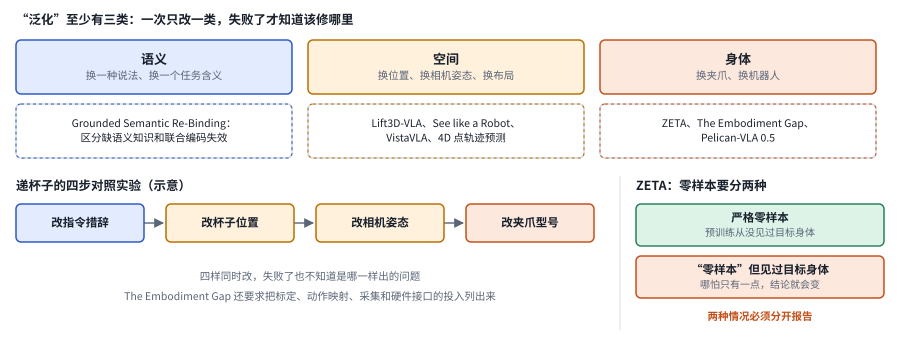

*图：泛化的三类变化和本节论文的位置；左下的四步实验是示意。*

下面几篇方法各补一类泛化，差别在补的是空间还是语言。空间这一侧的三篇都给 VLA 补上它从二维图像里读不出的几何，差别在几何用什么形式表示。[Lift3D-VLA: Lifting VLA Models to 3D Geometry and Dynamics-Aware Manipulation](https://arxiv.org/abs/2607.06564) 给 VLA 增加显式的三维几何和动态信息，减少只凭二维外观选动作的脆弱性。[See like a Robot: Robot-Centric Pointmaps for VLA Models](https://arxiv.org/abs/2607.11498) 用以机器人夹爪为参照的点图来表达深度，让表示贴近执行时所用的坐标，固定相机的坐标系从此退居次要。

[VistaVLA: Geometry- and Semantic-Aware 3D Gaussian-Grounded VLA for Robotic Manipulation](https://arxiv.org/abs/2607.12356) 用带语义的紧凑三维高斯表示来组织场景，把物体是什么、在哪里和怎么操作连接起来。语言这一侧，[Grounded Semantic Re-Binding for Robust Instruction Generalization in Vision-Language-Action Models](https://arxiv.org/abs/2608.02497) 关注的是指令换个说法之后视觉和语言的绑定变得不稳，于是重新建立落地关系，并区分了"缺少语义知识"和"联合编码失效"这两种不同的病因。它和知识隔离博客里"动作训练侵蚀语言遵循"的发现可以互相参照。

空间表示也在往四维走。[Learning the 4D World through Point Trajectory Forecasting](https://arxiv.org/abs/2610.28594) 让一个世界模型在根据多视角视频和语言指令预测未来画面的同时，预测场景中持续存在的那些三维点的运动轨迹，用一份共享的三维运动描述把各个相机的画面绑在一起。把机器人动作当成又一种 token、和未来视频一起去噪之后，作者报告点轨迹监督提高了模拟和真机操作的成功率，真机部分是在 Franka 机械臂上做的三项抓放任务。它和上面几篇三维表示的工作目标相近，差别在于几何信息来自对未来运动的预测；世界-动作模型这条线的更多工作见[第 10 章](10_world_models.md)。

### 5. 记忆与长期任务：记住事实之外，还要记住交接条件

长任务的难点常常藏在子技能之间的交接处：上一步是不是真的完成了，物体现在在哪里，下一步需要的姿态是否已经满足。在记忆里存一句"已经抓到杯子"，可能掩盖了抓得不稳或者姿态别扭这样的细节，而这些细节正好决定了下一步能不能接上。所以记忆应当和可以检测的状态、技能的前置条件对应起来；比较不同方法时，要看中断后的恢复、局部重试和任务重排，单纯增加历史帧数说明不了问题。

> 主线位置：第五段，长期记忆。接 Physical Intelligence 的 MEM，它把记忆拆成原始画面构成的短期记忆和自然语言笔记构成的长期记忆，让模型能跟踪约 15 分钟的任务。

> **要点：** 长任务的难点藏在子技能的交接处。记忆可以写进模型内部，也可以写在外面，MEM 两种都用；BATON 则把交接时的出口条件和入口条件显式地写了出来。

再看一个更具体的困难：眼前这只杯子可能已经洗过，也可能还没洗，这种任务状态并不总能从单帧画面里读出来。把历史全部堆进上下文，成本太高；只用文字记下来，又可能丢掉接触细节。长期操作还需要知道上一项技能留下的状态能否被下一项技能接着用。下面两篇论文给出了方向相反的两种答案。

[2607.15275 · RoboTTT: Context Scaling for Robot Policies](https://arxiv.org/abs/2607.15275) 用测试时训练的快速权重来保存历史，训练和推理期间都通过梯度更新这个递归状态，并配合长序列训练。这里的测试时训练并没有重新训练整个机器人，只是把记忆写进模型内部一块可更新的状态里。它提供了一条兼顾长上下文和有限部署开销的路线；风险在于记忆更新可能混进错误的经验，长上下文带来的收益也要和训练时的序列预算分开计算。

[2608.09410 · Skills in Weights, Memory in Code: Hybrid Learning for Memory-Dependent Robot Manipulation](https://arxiv.org/abs/2608.09410) 则把低层技能留在权重里，把高层的记忆管理交给可执行代码，通过执行反馈改进管理策略，并用本体感觉信号和多帧视觉来判断阶段状态的更新。它减少了为每一种依赖历史的任务重新采集完整示范的需要。阶段完成的验证器可能误判，代码中记录的状态也可能和真实环境脱节，所以系统应当保留可追溯的证据和重新观察的机制。

两种方法正好构成内部状态压缩与外部显式记忆的对照。前者和策略结合得更紧，后者更方便检查和修改；谁更好，取决于要保存的是连续的传感细节，还是离散的任务事实。MEM 把两者都用上了，原始画面管短期，语言笔记管长期，这或许是一个值得参考的折中。

下图按记忆放在哪里把这组论文分成三栏：写进模型内部，写在外面，以及 MEM 那样两者兼用。下半部分是 BATON 对交接的处理：子任务 A 自己报告成功之后，还要过一道出口条件，看抓得稳不稳、姿态对不对，再和子任务 B 的入口条件对上，交接才算完成。

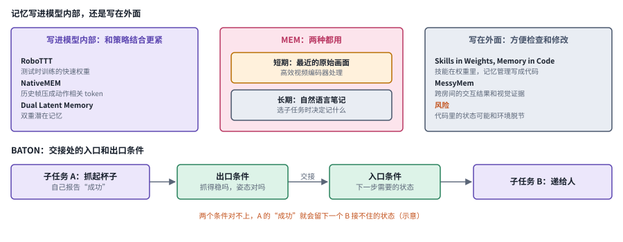

*图：记忆放在哪里的三种选择，以及 BATON 的入口和出口条件。交接的例子是示意。*

写进模型内部的还有两篇，它们都把历史压成模型内部的一组向量，也就是潜表示，这些向量由模型自己学出来，未必对应能直接读出来的物理量。[NativeMEM: Native Memory Compression for Long-Horizon Robotic Manipulation](https://arxiv.org/abs/2607.06678) 把历史帧压缩成与动作相关的 token，用策略自己的视觉编码器保留长时信息，并检查压缩是否遗失了罕见的线索。[Dual Latent Memory in Vision-Language-Action Models for Robotic Manipulation](https://arxiv.org/abs/2607.07608) 通过双重潜在记忆来组织操作历史，缓解只依赖短时间观察带来的偏差。

写在外面的另两篇把注意力放在交接和移动上。[Don't Drop the BATON: Long-Horizon Robot Manipulation via Agentic Subtask Exploration and Transition-aware Memory](https://arxiv.org/abs/2608.16889) 为技能交接显式建模入口条件和出口条件，防止上一个子任务"成功"了，却留下一个下一步无法接手的状态，标题里的接力棒比喻非常贴切。[MessyMem: Learning-from-Doing Memory for Mobile Manipulation](https://arxiv.org/abs/2609.15976) 记录跨房间的交互结果和细粒度的视觉证据，让移动操作的机器人不再反复去探索已知会失败的路径，这正对应 MEM 博客里的那种能力：机器人抓筷子失败之后，记得这次失败，换个方向再试。

### 6. 接触、触觉与灵巧手：增加传感器还不够

接触控制的关键，是把感觉到的变化和可以执行的动作联系起来。传感器更丰富，策略未必就更好，因为不同身体的关节、接触位置和力学响应都不一样。要把问题拆成几块来看：传感器的标定，从人手到机器人手的映射，以及执行中的闭环修正。还要检查一种方法依赖了多少人工指导，换了新物体或新手型之后，哪些假设仍然成立。

> 主线位置：边界一节的灵巧手。接 Chris Paxton 的两次观察：研究重心正从两指夹爪转向多指灵巧手，多指操作让腕部相机越来越难看清接触，触觉因此重新变得必要，却至今没有统一的标准。

> **要点：** 接触失败要先分清病因，多加一组传感器只是最省事的猜测。触觉可以从数据入口、输入表示、记忆或预测修正等不同位置进入控制，TacForcing 则在承认动作块存在的前提下，让新的触觉尽快影响下一块。

先从数据入口说起。**[AnyDexRT](https://arxiv.org/abs/2607.08341)**结合自监督的指尖对应关系、少量人类指导和与接触相关的姿态修正，改善灵巧手遥操作中的动作重定向。它解决的是示范者身体和执行者身体之间的接口问题，任务规划不在它的范围内。报告中所说的"免标定"并非完全不需要适配信息，少量人类指导和接触分类器仍然承担了一部分条件。

看见夹爪碰到了杯子，并不能告诉你杯子有没有在滑、压力是否合适。灵巧手有多个接触点和很多自由度，问题更复杂：同样的手指姿态，在不同摩擦下会产生完全不同的结果。触觉不仅要进入模型的输入，还要在接触变化之后及时影响动作。Paxton 说多指操作让腕部相机越来越难看清接触，讲的正是这个困境。

[2608.01402 · Demystifying When and Why VLAs Fail in Contact-Rich Tasks and How to Fix Them](https://arxiv.org/abs/2608.01402) 先做诊断，把接触任务中的失败拆成精度问题和力信号问题，分别追溯到生成策略的训练匹配方式和力信号的结构，再用有针对性的机制组合来修复。它的价值在于先分清病因，给原有架构多接一组传感器只是最省事的一种猜测。所测的接触任务和力传感条件有限，迁移到新材料、新工具和新接触模式之前，要先检验诊断是否仍然成立。

[2608.25798 · TacForcing: Streaming Action Generation with Execution-Time Tactile Feedback](https://arxiv.org/abs/2608.25798) 把动作专家改成流式生成，保留尚未完成的动作块的中间状态；每执行完一块，就用新的触觉信息继续生成，并限制触觉更新只作用于下一个待执行的块。这样就解决了动作块内部触觉信息过时的问题，也不需要另外拼接一套高频控制器。它和实时动作分块在精神上很接近，都是在承认动作块存在的前提下，想办法让新信息尽快进来。代价是生成缓存、触觉时间戳和执行调度必须严格对齐，传感噪声和缺测仍需单独处理。

下图右上角把触觉进入控制的位置排成一列：数据入口，策略的输入，记忆，以及对未来接触的预测和修正。这一节的论文各占其中一处。

*图：上半部分是接触失败的两类病因和触觉进入控制的四个位置，下半部分是 TacForcing 的流式生成示意。*

其余几篇的差别，就在触觉从哪个位置进入控制。[TouchWorld: A Predictive and Reactive Tactile Foundation Model for Dexterous Manipulation](https://arxiv.org/abs/2607.07287) 把触觉预测和快速修正分开，比较"对未来接触的预判"和"实时反馈"怎样共同支持灵巧任务。[FM-VLA: Force-based Memory for Vision-Language-Action Models in Contact-Rich Manipulation](https://arxiv.org/abs/2607.18231) 把力觉历史当作记忆，保存图像难以分辨的接触阶段和交互变化，正好和上一个分支的记忆问题接上。

[ReTouch: Empowering Contact-Rich Dexterous Manipulation with Online-Refined Tactile Prediction](https://arxiv.org/abs/2608.01824) 用结构化的触觉 patch 保留每根手指的身份和局部接触信息，并借执行反馈在线修正预测。[DeCAL: Towards Physically-Grounded Dexterous Vision-Language-Action Models via Contact-Aware Latent Co-Imagination](https://arxiv.org/abs/2609.09119) 把指尖触觉、视觉和语言放进一个共同"想象"接触的潜空间，研究精细动作和陌生物体的适配。Paxton 提到触觉还没有统一标准，这几篇论文用的触觉表示各不相同，比较时尤其要留意这一点。

总结起来，接触失败诊断那篇研究从精度和力信号入手修改学习机制，TacForcing 改变的则是触觉反馈接入动作生成的时机。评测时应当报告滑落、用力过大、卡住和插入偏差这些具体的错误类型，以及传感频率、校准方式和恢复动作；一次精巧的成功演示，说明不了系统在第一百次尝试时会怎样。

### 7. 强化学习与奖励：失败的整段轨迹不应否定所有动作

设想机器人递杯子时，前面接近、识别、规划路径都做得很好，偏偏在最后松手时杯子滑落了。如果奖励只看最终结果，这一整段轨迹都会被判为失败，前面那些正确的步骤也一起受罚。稀疏的结果奖励很难区分局部的贡献，密集的奖励又可能让策略去优化一个错误的代理目标。比较不同的奖励与学习方法时，要讲清楚哪些信号来自真实传感器、哪些来自人工规则、哪些来自学习出来的模型，并记录安全约束在探索过程中是否始终有效。

> 主线位置：第五段，回到自己的经验。接 DAgger 在策略实际到达的状态上补标注、HIL-SERL 的人在回路真机强化学习、π\*0.6 用价值函数估计每个局面有多大希望并据此引导策略的 Recap 方法，以及 RLT 的在线强化学习和机队共享经验的集体学习。

> **要点：** 稀疏的结果奖励会让做对的步骤一起受罚。Temporal GRPO 按可检测的阶段分配信用，DenseReward 用合成的失败训练逐帧奖励，集体经验学习则让一台机器人的失败借另一台的成功来补。

模仿学习很难覆盖所有需要恢复的状态，这正是 π\*0.6 博客开篇讲的问题，所以在线反馈很重要。可"最后成功给一分"的奖励太稀疏，而且把同一个优势值分配给整段轨迹，会把前面做对的步骤和最后的失败一起惩罚。奖励的质量、信用的分配和真实采样的安全，必须放在一起考虑。

[2608.13026 · Temporal GRPO: Beyond Trajectory-Level Credit in Vision-Language-Action Reinforcement Learning](https://arxiv.org/abs/2608.13026) 把轨迹对齐到可以检测的任务阶段，只在进入同一阶段的轨迹之间做比较，再把阶段内的优势分配给对应的动作区间。它针对的是轨迹级信用混淆，单纯提高奖励频率并不能解决这个问题。前提是阶段必须能被可靠地检测出来；如果阶段边界来自错误的视觉判断，局部奖励反而会更自信地奖励错误动作，所以检测质量要单独评价。

[2607.13033 · DenseReward: Dense Reward Learning via Failure Synthesis for Robotic Manipulation](https://arxiv.org/abs/2607.13033) 在模拟中合成碰撞、抓空、掉落和恢复这些失败数据，训练一个以视觉和语言为条件的逐帧奖励模型。它回应的是真实失败采集太贵、而成功轨迹的重新标注又缺少真实失败形态的问题。模拟出来的失败和真实材料、传感、接触未必一致，这恰好是 Levine 在 Sporks of AGI 里警告过的情形，模拟这类替代数据和真实世界之间总有差距，模型越强，越会学到只在替代数据里成立的东西；逐帧评分更细，未必更真，关键要看它能否正确排序真实的恢复轨迹。

还有几篇工作改进的是自主经验怎样回流，差别在于靠价值估计还是靠真机在线更新。价值函数这条线上，[RynnValue: Scaling Robotic Value Foundation Models with Temporal Distance](https://arxiv.org/abs/2608.09853) 用到达语言目标的有向时间距离来组织价值监督，探索在异构数据之间更可比较的任务进度信号，可以看作把 π\*0.6 那类估计"每个局面有多大希望"的价值函数做大做通用的一种尝试。[Beyond Imitation: Self-Improving Robot Policies via Off-Policy Q-Planning](https://arxiv.org/abs/2608.21204) 在已有的模仿策略之外，通过离策略的价值估计和规划来利用自己的成功与失败经验，降低直接把基础策略改坏的风险。

真机在线学习这条线上，[VLA-Precision: Asymmetric Co-Bootstrapping for Efficient Real-World Online RL of Vision-Language-Action Models](https://arxiv.org/abs/2609.04355) 通过不对称的协同更新提升精细操作能力，同时约束在线交互中的策略漂移。[Scaling Bimanual Household Manipulation from 1,500 hours of Demonstrations to On-Policy Corrections](https://arxiv.org/abs/2609.03591) 把家庭双臂示范和策略失败时的人类纠正结合起来，研究大规模数据和针对性纠错各自起什么作用，和 Recap 里"示范加纠正"的前两步思路相通。

Temporal GRPO 和 DenseReward 一个处理奖励在时间上的归属，一个处理奖励信号的来源，可以作为互补的方向来比较。如果训练出来的策略学会了利用奖励模型的视觉捷径，就需要真实的任务终点和独立的检查来兜底；只用同一个奖励网络来宣布系统进步，说服力是不够的。

下图上半部分用递杯子的例子对比两种信用分配：接近、识别、规划路径都做对了，偏偏松手时滑落，轨迹级的分配让前三步一起受罚，按阶段比较则保住了前三步的评价。下半部分是机队共享经验的一轮：某台机器人失败，检索、微调、下发，再回到继续部署。

*图：上半部分对比两种信用分配和 DenseReward 的奖励来源，下半部分是集体经验学习的一轮。四个阶段的划分是示意。*

把自主经验从一台机器人扩到一整支机队，又是另一番景象。[Learning from Fleet Experience: A Collective Learning Paradigm for Robots](https://arxiv.org/abs/2610.25736) 注意到，依赖人工纠正的学习需要操作员盯着每台机器人，机队一大就撑不住。他们提出的失败引导经验检索微调，用失败时的上下文去全队共享的成功经验里找相关片段，把这些片段的动作当作训练监督，不再采集新的专家示范或纠正；再配一个容错的异步训练系统，协调数据收集、策略优化和策略下发。作者报告，在五项真实操作任务上，用未参与数据收集的机器人各测 120 次，成功率在 93.3% 到 99.2% 之间；在多阶段的手机包装任务上，96 台机器人一起学习让成功率从 79.2% 提到 98.3%。它和 Paxton 对部署数据的怀疑正好形成对照：Paxton 担心部署中的机器人很少碰到新情况，这篇工作的回答是，机队里某台机器人的失败，可以借另一台机器人的成功来补。检索到的成功片段是否真的适用于失败的情境，这套办法又能否覆盖全队都没成功过的长尾情况，都还需要单独检验。

### 8. VLA 之外的 agent：规划、程序与技能如何协作

VLA 通常提供的是从观察和指令到动作的策略，可任务选择、工具切换、异常处理和长期经验管理，完全可以交给外部系统来做。把技能写成程序，便于检查，同时也带来接口和版本维护的成本。研究中应当讲清楚高层系统控制哪些决策、低层策略负责哪些反馈，免得把整套系统的成功都算在一个动作模型头上。

> 主线位置：第四段的分层推理，延伸到第六段。接 SayCan 用语言模型挑技能、技能的价值函数把关，Hi Robot 让高层模型拆指令、低层 π0 执行的分工，π0.5 把高层子任务和低层动作合进同一个模型的做法，以及让编程 agent 在真机上在线探索的工作。

> **要点：** 高层 agent 擅长组合技能、管理状态，低层策略擅长局部接触，系统问题在于把两者分开，并设计好重试和验证的接口。2026 年的几篇工作把"技能写成代码"一路推进到探索和视觉预见里。

两边各有所长：低层策略擅长局部接触，却不太会重新理解目标；编程 agent 擅长组合技能、管理状态，可解析几何规则未必能应付不规则物体的抓取。真正的系统问题是把各自擅长的事分开，并设计好重试和验证的接口。这和当年 SayCan 用价值函数给语言模型"把关"是同一个思路，只是现在的两端都强大了许多。

[2607.08448 · Harness VLA: Steering Frozen VLAs into Reliable Manipulation Primitives via Memory-Guided Agents](https://arxiv.org/abs/2607.08448) 把冻结的 VLA 包装成可以重试的接触技能，和少量解析技能组合在一起，利用执行轨迹、成功规则和失败模型去学习每个技能的适用范围。高层负责语义上的重新定位和接触前的准备，低层保留精细接触的能力。"冻结模型"说的是 VLA 权重不动，系统层面仍有学习成本，记忆构建、任务反馈和技能边界都需要适配。

[2609.12541 · Agent as Policy for Robotic Manipulation](https://arxiv.org/abs/2609.12541) 让一个通用 agent 根据视觉证据编写程序、发出动作，并随物理结果修改程序，还把成功的流程保存下来，缩短重复任务的时间。它展示了运行时推理和编程可以构成一种策略接口；至于让任意 LLM 直接输出关节角是否安全，这篇论文并没有给出证明。机器人提供的接口、可用的程序原语和执行时延都是能力的一部分，要和训练型 VLA 在相同的感知与动作条件下对齐比较。

这组研究让"agent 和 VLA 谁取代谁"的争论失去了意义。更实际的问题是：哪些状态由代码维护，哪些技能由学习出来的策略实现，哪些动作必须被几何或安全控制器拒绝。跨层的日志应当能说明一次失败是从计划、感知还是执行开始的。

下图把这一节的论文按层摆开：上层是高层 agent，负责理解目标、组合技能、管理状态、重试与验证；下层是局部接触和精细动作；中间是接口与验证，跨层日志也放在这里。向下的箭头是调用，向上的箭头是执行反馈。

*图：高层 agent 与低层技能的分工，以及本节论文落在哪一层。层的划分按本节正文整理。*

落在上层的两篇都在管理多种技能和长期经验，差别在管的是策略的调度还是交互知识的保存。[RoboHarness: Memory-Driven Orchestration of Heterogeneous Robot Policies for Long-Horizon Planning](https://arxiv.org/abs/2607.18060) 用记忆驱动的编排来协调多种异构策略，让长期任务可以调用不同的技能，所有能力也就不必都塞进同一个模型。[ABot-AgentOS: A General Robotic Agent OS with Lifelong Multi-modal Memory](https://arxiv.org/abs/2607.10350) 保存可以追溯的多模态交互知识，把对话、图像和机器人过去完成的任务连在一起，强调证据的复用。

另两篇工作把 agent 推向更通用的接口。[Show-Harness: Just a VLM Agent Can Play Robots](https://arxiv.org/abs/2609.10522) 用一套共享的语义动作接口，让视觉语言 agent 控制不同的机器人，关注接口设计对跨身体使用的影响。[EmbodiedSWE: Coding Agents for Long Horizon Dexterous Robotics](https://arxiv.org/abs/2609.27308) 让编程 agent 先产出经过验证的复杂机器人解法，再把它们转成示范数据，把运行时编程和离线策略学习连接了起来。后一种做法很像 π0.7 博客里"先用语言一步步指导，再把指导训练成高层策略"的思路，只是把语言换成了代码。

2026 年 10 月的两篇工作把编程 agent 又往前推了一步。[Scaling Online Exploration for Robot Agents](https://arxiv.org/abs/2610.22496) 提出的 RAX 框架让一个通用编程 agent 编写机器人控制代码，在没有动作示范、没有手工动作原语、也没有价值函数引导的条件下在线探索，把找到的有效动作序列编译成覆盖感知、规划和控制的模块化程序。作者报告，它在单臂、双臂、灵巧手、移动和人形等多种模拟系统上平均超出最强基线 37.4%，在真机上学会了依赖记忆、操作铰接物体、高精度和柔性物体等任务，还能组合此前探索中验证过的技能。它把 Levine 早年设想的"自主探索积累经验"换成了代码的形式，经验沉淀在程序里，人可以读，也可以改。[Agentic World Action Models](https://arxiv.org/abs/2610.30136) 则把代码、未来视频和机器人动作当成三路耦合的生成流放进同一个架构：代码部分产生可复用的技能程序和控制逻辑，视频和动作部分预测未来画面和电机指令。作者还搭了一条自动给机器人和人类视频标注程序、再把反复出现的例程归并成技能库的流水线，报告在 RoboTwin 2.0 和真实双臂任务上超过了 VLA 和世界-动作模型基线。这两篇和 Harness VLA、EmbodiedSWE 放在一起读，能看到"技能写成代码"正从高层编排一路往下渗透到探索和视觉预见。

### 9. 全身控制与评测：语言遵循和安全停止都需独立检验

全身行为要同时满足任务目标、身体平衡、接触要求和空间限制。机器人照着语言指令做了，却造成了危险；或者稳稳地站住了，却没有完成任务，这两种情况都没法用一个成功率来概括。评测时应当分别观察指令理解、动作是否可行、失败后能否恢复，以及停止机制是否可靠，尤其要避免只展示连续成功的片段，而把人工接管和重置的成本藏起来。

> 主线位置：第二段的足式与人形支线，以及边界一节的评测问题。接 GPU 上大规模并行模拟加域随机化练出的运动控制，Helix 02 的 1 kHz 全身控制层，Paxton 发现各排行榜偏爱的方法很不一样，以及几篇博客反复承认的可靠性与安全问题。

> **要点：** 全身任务要同时检查语言意图、平衡、接触、碰撞和停止，一个成功率概括不了。RoboFollow 用场景熵揭开指令遵循的幻象，可停止性价值决定停下还是回退，SuperMimic 和 T2-z 分别处理算力和看不见的物理属性。

机械臂固定在桌边时，平衡、碰撞和机身能否通过都可以忽略；换成人形机器人，这些都变成了核心约束。任务成功也可能只是因为场景里只有一种可做的动作：桌上只放了一只杯子，机器人就算完全不看指令也能拿对。高成功率因此需要和真正的指令使用区分开来。

[2609.25636 · RoboFollow: Unveiling the Instruction Following Mirage in Embodied Agents](https://arxiv.org/abs/2609.25636) 提出用"高场景熵"来做诊断，也就是让同一个场景容纳多个不同的动作分支，使语言真正影响选择；再逐层扰动布局和语义，分别检查意图理解和执行。它发现强基线在简单层级上表现很好，到了更深的指令条件就不再可靠。为了隔离变量，它简化了物体和动作，复杂的真实场景还需补测；但它确实揭开了视觉捷径造成的"指令遵循幻象"，和 Hi Robot、π0.5 关心的开放指令遵循正好形成呼应。

[2609.02358 · Humanoid Safe Stop via Learned Stoppability Value](https://arxiv.org/abs/2609.02358) 把紧急停止写成一个"可达且避险"的问题，联合学习停止策略和可停止性估计，只有当几个不同的估计都认为可行时才执行停止，否则转入回退方案。它说明"立刻停下"在不同时刻是不同的动作，身体当前的状态决定了能否稳稳地停住。估计器本身仍然可能出错，所以学习出来的模块代替不了独立的硬件防护和部署责任。

全身任务应当同时检查语言意图、局部接触、平衡、碰撞和停止恢复。只报告平均成功率，会掩盖那些罕见却代价很高的失败，也体现不出不同机器人上额外需要的控制适配。

下面几篇把通用模型带到全身控制上，差别在处理的是哪一种全身难题：移动中操作，拥挤环境里穿行，换一具身体，以及看不见的物理属性。[HAF: Adapting Generalist VLAs to Humanoid Whole-Body Loco-manipulation via Hierarchical Action Flow and Spectral Latent RL](https://arxiv.org/abs/2608.16837) 用分层动作流和在模型内部表示空间里进行的强化学习，把通用 VLA 适配到全身的移动操作上，区分了可以共享的语义和需要专门处理的身体控制。[TANGO: Humanoid Navigation in Cluttered Environments with a Whole-Body Vision-Language-Action Model](https://arxiv.org/abs/2609.09158) 把拥挤环境中的导航从二维路径规划提升为手臂、躯干和步态的协同，检验机器人能否真正从狭窄的空间里穿过去。

[X-WBC: A Cross-Embodiment Foundation Model for Humanoid Whole-Body Control](https://arxiv.org/abs/2609.15213) 在多种人形身体上联合训练全身控制，研究经验共享和硬件差异能否兼容，可以看作把 Open X-Embodiment 汇集多种机器人数据一起训练的思路搬到了人形机器人上。[RoboTwin-Phys: Do WAMs and VLAs Understand the Physical World?](https://arxiv.org/abs/2609.26292) 改变质量、摩擦和关节动态来测试策略，揭示出只改变视觉场景发现不了的物理脆弱性。一只装满水的杯子和一只空杯子看起来一模一样，可握法完全不同，这正是这类测试要捕捉的东西。

人形全身控制的另一个瓶颈是算力。[SuperMimic: Scaling Humanoid Whole-Body Control with One Differentiable World Model](https://arxiv.org/abs/2610.28480) 指出，让一个人形控制器跟踪大量人类动作，要么把每个动作的专用策略有损地蒸馏到一起，要么用巨大的算力训练单一策略。它改为从模拟器记录的转移数据里学一个覆盖所有动作共享动力学的可微世界模型，世界模型和跟踪策略一起训练，策略通过在想象的短时展开上反向传播拿到解析梯度。作者报告，单块 GPU 训练三小时就超过了基线在 128 块 GPU 上训练七天的回报，在约 13 万个基准动作里只失败 25 个（基线失败 179 个），策略也迁移到了真实的宇树 G1 上。这是主线第二段那条"在模拟器里练运动"的支线在 2026 年的延续；算力不再是扩展的主要瓶颈之后，动作库的质量和模拟与真实动力学之间的差距就会变得更显眼。物理属性这一侧，[T2-z: Test-Time Optimization of Environment Latents for Robotic World Models](https://arxiv.org/abs/2610.22364) 给机器人世界模型加了一个可学习的环境潜变量，用来表示摩擦、质量、弹簧刚度这类看不见的因素；测试时模型保持冻结，只用一次或几次交互去优化这个潜变量。作者报告，在 7 个模拟设置和 4 个真实任务上，物体预测误差从 15.20 降到 7.00，动作成功率从 33.73% 提到 72.96%。它和 RoboTwin-Phys 揭示的物理脆弱性正好是一问一答：一满一空两只杯子看起来一样，那就让机器人先碰一碰，再推断该怎样握。

下图把这一节的四个问题放进四格：指令遵循要靠场景熵来检验，停止要先问能不能稳稳停住，人形控制的算力瓶颈靠可微世界模型来破，看不见的物理属性靠测试时碰一碰来推断。

*图：全身控制与评测的四个问题，图中的数字均为作者报告。*

### 10. 具身 harness：任务怎么讲、谁来讲

同一个模型、同一台机器人、同一个从没练过的任务，只是把"怎么向模型讲这个任务"改了半个小时，成功率就可能从几乎全败变成几乎全成。π0.7 让机器人把红薯放进空气炸锅的例子，让具身领域第一次正面碰上了语言模型 agent 那边早已熟悉的现象：模型外面那一层东西，包括任务怎样拆、指令怎样措辞、执行中谁来检查、出错后谁来纠正，可以决定大部分的成败。这一层叫 harness。它在具身场景里引出三个问题：任务由谁来讲，是人、视觉语言规划器，还是训练出来的高层策略；执行中怎样及时发现做错了；以及在不动权重的前提下，还能从模型里唤起多少它本来就会的本事。

> 主线位置：第六段，可引导的通才。接 SayCan 用价值函数给语言模型把关、Hi Robot 让高层模型拆指令的分工、π0.5 先写子任务再出动作的推理，以及 π0.7 跟随人的一步步指导、再把指导训练成自动高层策略的做法；和[第 18 章《Harness 工程》](18_harness_engineering.md)讨论的是同一件事在物理世界里的样子。

> **要点：** 具身 harness 正在长出和语言模型 harness 相似的结构：有人或高层策略讲任务，有检查器边做边查，有恢复技能兜底，还有持续改进这一切的机制。报告结果时，这一层的配置和成本要和模型分开写清楚。

先从"人来讲"说起。[π0.7](https://www.pi.website/blog/pi07) 训练时就以子任务语言指令为条件，所以能跟随实时的口头指导：第一次只给一句"把红薯放进空气炸锅"，机器人起手几次失误，没能做完；像教第一次用这台电器的人那样一步步下指令，它就做得好多了。[TechCrunch 的报道](https://techcrunch.com/2026/04/16/physical-intelligence-a-hot-robotics-startup-says-its-new-robot-brain-can-figure-out-tasks-it-was-never-taught/)引用研究员 Lucy Shi 的话说，这个任务早期的成功率是 5%，花大约半小时打磨讲法之后升到了 95%。这组数字来自采访中的口头自述，博客和技术报告都没有给出，也没有说明试了多少次，所以它更适合当作一个现象的提示来读。真正有研究价值的是接下来那一步："谁来讲"可以从人换成模型。博客写道，几轮指导之后，他们用指导时说过的那些子任务指令微调出一个高层策略，由它自动生成语言子任务去驱动 π0.7，在不增加任何遥操作数据的情况下改善了自主执行。人花半小时摸索出来的讲法，被沉淀成了一个可以复用的策略，这和语言模型那边把好的提示和工作流蒸馏进模型，是同一个思路。

再看"模型来讲，并且边做边查"。[2610.23334 · LAW: Unifying Language, Action, and World Modeling for Agentic Physical Intelligence](https://arxiv.org/abs/2610.23334) 把一个约 20 亿参数的视觉语言模型和一个世界-动作模型接成闭环，用语义上的子任务进度把两者连起来：视觉语言模型负责规划剩下的子任务，给世界-动作模型提出的候选动作打分，并在机器人执行的同时异步判断当前子任务是否已经完成，判断为完成就记下这一刻的观察、重新规划、进入下一个子任务。作者报告，它在 RoboTwin 的 50 项模拟任务上平均成功率为 94.21%，在三项真实长程任务上平均 65%，对比之下 π0.5 为 28.33%，Fast-WAM 为 25%。这种"边做边查"让人想起三.5 里的 BATON，它要求上一个子任务的出口条件和下一个子任务的入口条件对得上，交接才算完成；它检查的是子任务是否完成，整份计划是否合理并不在检查范围里，状态判断一旦出错，系统会很自信地跳到下一步。

第三种思路把 harness 写成代码，让它在部署中自己长进。[2608.16590 · Zetta ζ: An Efficient Closed-Loop Embodied Harness for Self-Evolving Physical Intelligence](https://arxiv.org/abs/2608.16590) 指出，以往的具身 harness 在执行时只照着固定的技能走，要等一轮结束才回头反思。Zetta 改为在线调整执行：运行时有快速的代码检查器盯着，发现失败苗头就提议切换执行方式，干预之前先经过一道验证，通过了才交给专门的恢复技能接手；离线阶段再把失败聚类、诊断原因，提出检查器、恢复技能和工具的修改，只有在留出的随机种子上验证有效的修改才被收进可复用的 harness。整个过程中基础策略的权重保持冻结，在 RoboCasa 上用的是没有微调过的 GR00T N1.5。作者报告，在他们当前的执行预算下，LIBERO-Pro 上的成功率为 90.8%，RoboCasa 上为 93.6%，推理加速 11.1 倍，成功率还随自我探索经验的增加继续上升。它和三.8 的 Harness VLA 一脉相承，都把冻结的策略当成一块可靠的积木，把改进的力气花在外面那一层。

以上几种做法改的都是模型的输入或外围，另一条路直接在模型内部拧旋钮。[2610.25632 · SteerAct: Unlocking Action Models through Few-Shot Temporal Steering](https://arxiv.org/abs/2610.25632) 用一个预训练的稀疏自编码器给出候选的内部特征，再用一种时间描述子刻画每个特征的激活随时间怎样变化，这样不同的执行轨迹就可以直接比较，不必逐帧对齐。离线时，它用成功和失败的参考轨迹挑出一个和任务相关的特征，建好参考库；在线时，把正在进行的特征轨迹和参考库对比，决定什么时候干预、调多大的力度。作者报告，每项任务只需 24 条带成败标签的轨迹，任务成功率相对未引导的模型提高约 10%，测试覆盖了 π0.5、Fast-WAM、RoboTwin 2.0、DexJoCo 和真实操作。如果说提示工程是换一种说法去唤起模型已有的能力，SteerAct 就是在模型内部找到那个对应的开关直接拨一下；它和空气炸锅的例子指向同一个猜测。那个任务只给一句指令时成功率是 5%，讲法打磨好之后升到 95%，可见 5% 的时候，模型很可能已经"会"这个任务的各个动作，只是没被正确地唤起。

走到最极端，干脆不要专门的机器人策略，让一个通用多模态大模型直接当控制器。2026 年 10 月有两篇论文用 GPT-6 Astra 认真测了这件事。[2610.28259 · Large Multimodal Models for Direct Robot Control: GPT-6 as a Beginning](https://arxiv.org/abs/2610.28259) 用一个轻量的 agent 框架让它做闭环操作，发现它能利用深度信息，能从示范里学到简单的策略，也能借触觉修正动作；作者报告它在 RoboDojo 上的成功率为 26.92%，在 RoboTwin 2.0 上为 76.0%，但语义推理和物理执行之间有明显的鸿沟，在他们新建的几何约束基准 LIBERO-GeoMotion 上零样本成功率只有 11.1%，真机上的动作可行性、精确控制、安全和推理延迟都还是问题。[2610.22471 · Has GPT-6-Astra Achieved Embodied Intelligence?](https://arxiv.org/abs/2610.22471) 是商汤 SenseNova 与一个联合研究团队署名的报告，在 12 个覆盖桌面操作、人形、移动平台和灵巧手的基准上评测，评测协议允许模型从训练示范里做上下文学习，执行步数最多放宽到常规的 10 倍，在这种条件下作者报告了"前所未有"的表现。他们也试了把 GPT-6 Astra 当作高层推理者、π0.5 当作低层控制器的 harness，发现这样有效却很贵：在 RoboDojo 上逐个审查每个动作，成功率 23.61%，花掉约 766 万 token；每次审查四个动作，成功率 25.83%，token 降到约 280 万。真机上，刚性物体抓放 18 次成功 17 次，插插头 11 次一次也没成功。作者的结论措辞很讲究：GPT-6 Astra 已经大体跨过了"具身胜任"的门槛，离"实用的具身智能"还有距离。他们还建议未来的基准从真实需求出发、不提供领域内示范，并且在模型思考时让时钟照常走。

下图把这一节的几篇论文拼成一张结构图：最左边一列是谁来讲，中间是执行子任务的机器人策略，右上是边做边查的检查器和恢复技能，右下是离线进化，下方粉色框是直接在模型内部引导特征的那条路。

*图：具身 harness 的结构，按本节论文拼成，每个框里标出对应的工作。*

把这几篇放在一起，能看到具身 harness 正在长出和语言模型 harness 相似的结构：有人或高层策略负责讲任务，有检查器负责边做边查，有恢复技能负责兜底，还有在模型内部或外部持续改进这一切的机制。它也带来一个评测上的新要求。一个成功率背后，现在可能藏着半小时的人工调提示、一个专门训练的高层策略、一套不断进化的检查器，或者几百万 token 的推理开销；报告结果时，应当把 harness 的配置、人工投入、检查器的误判率和推理成本一起写清楚，否则模型的能力和"我们怎样问它"会一直缠在一起，谁也说不清进步来自哪一边。

## 四、方法比较：不要用一个成功率替代部署说明

> **本节要点：** 具身方法改变的东西各不相同，能否叠加取决于身体、传感器和控制频率是否匹配。比较成功率之前，先看清每条路线承担的职责和要付出的适配成本；第二节末尾的总对照图和总对照表，可以和这张表对照着读。

具身方法改变的东西各不相同：有的改示范学习，有的改动作接口，有的改实时反馈，有的改高层组织，还有的只改任务怎样讲给模型。它们能不能叠加使用，取决于身体、传感器和控制频率是否匹配。下面这张表把几条主要路线放在一起，比较成功率之前，先看清每条路线实际承担的职责和要付出的适配成本。最右边一列是证据不够充分时最值得追问的地方，拿来审自己的实验设计也很合适。

| 路线 | 学习或改动对象 | 擅长解决 | 关键代价与验证 |
|---|---|---|---|
| 行为克隆与动作分块 | 示范动作分布 | 多任务基本技能与时间结构 | 分布偏移、历史长度、开环比例 |
| 视觉语言预训练加动作头 | 语义与控制接口 | 指令、物体知识迁移 | 身体曝光、动作坐标、部署延迟 |
| 实时编辑与状态增强 | 快速反应或延迟状态 | 动态任务 | 时间戳、缓存、实际闭环频率 |
| 触觉与力觉策略 | 接触表示和执行反馈 | 滑动、插入、灵巧操作 | 传感校准、同步、硬件差异 |
| 外部记忆与程序 agent | 技能编排、状态管理 | 长期任务与恢复 | 验证器错误、程序副作用 |
| 在线强化学习与集体经验 | 奖励、价值、策略和共享经验 | 超越示范、修补失败 | 复位、奖励可信度、风险预算、检索是否适用 |
| 具身 harness 与推理时引导 | 指令、子任务生成、运行时检查、内部特征 | 不改权重唤起已有能力 | 提示敏感性、人工调试时间、检查器误判、token 成本 |

一份可以复查的报告，应当写明训练中见过哪些身体、每种任务有多少独立场景、失败后由谁复位、动作频率和新观测频率各是多少、实验中有没有人临时调整物体，以及任务指令是谁写的、调了多久。系统成本也远不止模型参数和 GPU 显存，设备、标定、人员和故障停机都要算进去。主线里那几篇博客报告的结果大多来自公司内部评估，借鉴时同样可以用这份清单去追问。

## 五、负面结果与未解问题

> **本节要点：** 好几处直觉被推翻了：分块的好处不止平滑，高频可能只是在播放旧计划，讲法一改，成功率能从 5% 跳到 95%。仍然悬而未决的，是时间尺度、奖励、替代数据和跨层安全这几件事。

把这一章的论文放在一起，会看到好几处"直觉被推翻"的地方。动作分块的好处远不止让轨迹平滑，而一旦给足历史，长开环的收益可能就消失了；模型泛化能力再强，身体接口仍然需要适配；任务成功率高，可能是因为场景让机器人绕开了语言，比如桌上只放了一只杯子，机器人完全不看指令也能拿对；控制频率高，可能只是在高频地播放旧计划；同一个模型，任务讲法改一改，成功率可能从 5% 跳到 95%；一个在 12 个基准上表现惊人的通用大模型，到了真机上插插头却一次也没成功。这些发现提醒我们，研究需要做机制上的对照，把更大的模型、更长的动作块、更多的数据和更精心的提示叠在一起，再笼统地归因为"智能增强"，什么也解释不了。

仍然悬而未决的问题也很清楚。长期历史、高频反馈和复杂语义能否以合理的成本同时满足？奖励模型能否覆盖真实的失败，又不诱使策略去钻空子？人类视频、穿戴数据和部署数据各自能替代多少真机示范？还有一个更棘手的问题是安全边界怎样跨层传递：高层 agent 觉得任务合理，底层动作未必可以执行；低层技能报告自己成功了，后续阶段的入口条件也未必满足。一个可靠的系统应当允许暂停、补充观察和人工接管。Physical Intelligence 在 π0.5 博客里把"在陌生情境下主动求助"列为未来方向，说的也是这件事。

## 六、研究机会

> **本节要点：** 让机器人稳稳地递一只蓝色杯子，要过四道坎，对应四个研究问题：怎样拿到覆盖真实差异的经验，怎样连接不同的时间尺度，怎样在长期运行中安全地自适应，以及怎样系统地测量和优化具身 harness。

要让机器人稳稳地把桌上那只蓝色杯子递到你手里，至少要跨过几道坎：它得见过足够多样的杯子、桌面和递接方式，才知道这一次该怎么做；它得在理解"递给我"这句话的同时，对你手的移动及时做出反应；它还得在一次次失手之后变得更稳，最好用不着先摔碎很多只杯子才学会；最后，你对它说话的方式本身，也会影响它能不能做对。前三道坎分别对应主线第三段讲的数据来源、第五段讲的时间尺度和自主经验，最后一道对应第六段的具身 harness，每一个都还有大片空白，适合作为选题的起点。

**1. 如何获得覆盖真实交互差异的具身经验，而不只增加示范数量？**

物体、身体、接触和场景的组合让真实数据空间迅速膨胀，人类视频、仿真和机器人轨迹又各自提供不同的监督。Levine 认为真实经验不可替代，π0.5、人到机器人迁移和 GEN-1 的结果又显示多来源数据在合适条件下确实有用。研究机会在于建立一套能够选择和对齐这些来源的数据机制，把稀有的失败、恢复和接触变化纳入学习。关键是识别出哪些经验真正提高了机器人在未见环境中的执行能力，并算清获得这些经验的实际成本。以递杯子为例，一千条顺利递出的示范，可能抵不上十条"杯子被碰歪后重新调整"的示范；Paxton 说新颖的经验要主动去找，这句话也可以变成一个具体的研究问题：怎样设计采集，才能最快地碰到模型还不会的情况。

**2. 如何连接语言目标、长期计划与实时控制的不同时间尺度？**

高层推理需要较长的计算时间，低层控制却必须及时响应新的观察。实时动作分块让新算出的动作块在推理期间无缝接上正在执行的动作，MEM 把记忆分成最近的原始画面和长期的语言笔记两层，它们分别从执行和记忆两头处理了这个问题，可两者如何在同一个系统里协同，还没有成熟的答案。可以研究分层策略、动作分块和异步更新的联合设计，让高频执行不会长时间沿用过时的计划。评价时应当改变环境动态、时延和任务阶段，检查语义遵循、接触稳定和恢复能力能否同时保持；比如在机器人递杯子的半途，让人突然改口或者移动手的位置。

**3. 如何让机器人在长期运行中自主适应，同时限制试错损失？**

部署环境总在变化，离线策略不可能覆盖所有情况，而真实的试错又有物理代价。π\*0.6 显示了示范、纠正和自主经验结合起来能显著提高吞吐量，可它依赖人工接管和专门训练的价值估计；集体经验学习想用机队里别的机器人的成功来替代人工纠正，又要面对检索是否适用的问题。研究机会是把记忆、可调用技能和在线学习结合起来，在明确的安全边界内获取反馈、更新行为。评价时要看跨任务的收益、人工接管的频率、旧技能能否保持，以及紧急停止是否可靠，几段精彩的成功动作说明不了这些。

**4. 如何系统地测量和优化具身 harness？**

π0.7 把红薯放进空气炸锅的任务，据研究员在采访里说，打磨半小时讲法之后成功率从 5% 升到了 95%，这个故事目前只是一句采访里的数字。一个很实在、几乎没人做过的题目，是固定任务和机器人，系统地改写任务描述的粒度、措辞和子任务拆法，画出成功率的分布，看看两个极端之间到底隔着哪些因素。再往前一步，可以比较"谁来讲"的几种选择：人、视觉语言规划器、从指导数据里训练出的高层策略，各自值多少分，什么时候插入纠正最划算，检查器误判一次要付出多大代价。还可以借 SteerAct 这类在模型内部找出任务相关特征的方法去读模型的内部状态，看在讲法不同的两次执行里，差别出在对任务的理解、对物体的定位，还是动作生成那一步。回到那只蓝色杯子，如果"递给我"和"把杯子递到我手上，杯口朝上"能让同一台机器人的表现差出一大截，那么怎样说话，本身就是具身智能要研究的一部分。

**实验资源：** [OpenVLA 官方项目页](https://openvla.github.io/)。使用前核对任务、版本、数据与运行条件。
