# 12｜让智能体参与科研：从提出猜想到检查证据

[首页](../README.md) · [专题索引](../README.md#topics) · [文献目录](../catalog/12_science.md)

**阅读前置：** 若尚不熟悉模型参数、上下文、监督微调与强化学习，先读 [LLM 前置知识](../docs/llm_primer.md)。

## 方向背景：为什么科研智能体需要证据闭环

设想一个周五的傍晚，你把一个琢磨了很久的问题交给科研智能体：某类小模型在长序列上为什么总是不稳定，有没有简单的正则化办法。你给了它代码仓库、一台 GPU 服务器和一个周末。周一早上打开电脑，等着你的是一篇排版整齐的论文：有动机，有方法，有三张漂亮的曲线图，还有一节写得头头是道的讨论，结尾自信地宣布新方法把训练崩溃率降低了一大截。读到这里，第一反应多半是兴奋；第二反应应该是坐直身子问一句：这篇东西，我能信几分？

这个问题往下追，会一层层裂开。曲线背后的实验真的按论文写的配置跑了吗，基线有没有被不小心调差？就算实验都没问题，"崩溃率降低"这个结论在换一个随机种子、换一个数据集之后还成立吗？就算结论稳健，这个问题本身值不值得研究，是不是早有人做过？再往深一层，它给出的那段"机制解释"，究竟是实验支持的发现，还是一段读起来合理的事后叙述？论文的形式可以被很完整地生成出来，可科研真正要交付的东西，是一条能让别人检查、复现、反驳的证据链。

智能体之所以第一次有机会参与一段完整的研究，是因为它能把检索、写代码、跑计算和操作实验设备这些工具连起来，从读文献一路做到写报告。可走完这一路，只说明它完成了一串动作；结论可不可信，要看每一步的结果有没有被检查过、由谁检查、检查得多严。不同领域在这一点上差别很大：数学里一次证明检查只要几秒，湿实验（在实验室里用真实的细胞、试剂和仪器做的实验）的一轮验证可能要几个月。所以，智能体在能被快速、自动检查的问题上进展最快，在检查又贵又慢的问题上，结论仍然要等领域专家或独立实验来确认。

本章的主线就是这条关系：AI 承担的研究环节越来越多，能给它判对错的检查也越来越宽松。读这个方向的每一篇工作，都可以先问两件事：系统承担了研究里的哪一段，它的结果由谁、用什么办法检查过。

## 先读这几篇

这一章的主线借自几篇写得很好的长文。作者们要么亲手造过这些系统，要么是拿这些系统做过真实研究的科学家，叙事里有取舍、有判断，也坦白写了失败。建议按下面的顺序读，读完再回来看各分支的新论文。

| 顺序 | 文章 | 为什么读 |
|---|---|---|
| 1 | Pushmeet Kohli，[Unlocking Scientific Intuition & Reasoning at Digital Speed](https://www.amacad.org/publication/daedalus/unlocking-scientific-intuition-reasoning-at-digital-speed)（Dædalus，2026-05） | 作者是 Google DeepMind 负责科学方向的副总裁，这篇发在美国人文与科学院刊物 AI 与科学专号上的长文，是本章发展主线的骨架。他把 AI 比作继望远镜和显微镜之后的新仪器，把许多硬科学问题看作搜索与推理问题，然后沿着一条很清楚的路线往前讲：先是 AlphaFold、AlphaMissense 这类专门预测模型，让过去看不见的结构变得可见；再是 AlphaProof 和 AlphaEvolve，在数学和算法里学会推理与搜索，每一步都有形式检查或自动打分的程序把关；最后是 AI co-scientist 这样的多智能体系统，开始自己提出假设和实验方案。读完能带走一个贯穿全文的判断：验证始终是核心，AlphaFold 有 CASP 评测，AlphaProof 有 Lean 的检查，AlphaEvolve 有打分程序，co-scientist 的假设要进实验室检验。文末对风险的提醒也很具体：打分程序只管写明的目标，智能体会找到违反科学家默认假设的"解"；人们也可能在缺乏审视的情况下接受看不懂的答案。 |
| 2 | Google DeepMind AlphaEvolve 团队，[AlphaEvolve: A Gemini-powered coding agent for designing advanced algorithms](https://deepmind.google/blog/alphaevolve-a-gemini-powered-coding-agent-for-designing-advanced-algorithms/)（2025-05-14） | 主线第 1 阶段最具代表性的系统介绍。它把 FunSearch 演化单个函数的思路扩展到演化整个代码库：一组 Gemini 模型提出候选程序，一段打分程序给每个程序打分，程序库决定哪些程序成为下一轮提示的种子。文中报告的结果覆盖数学和工程两头，比如用 48 次标量乘法完成 4×4 复数矩阵乘法、在 50 多个公开数学问题上约 20% 改进了已知最好解，以及一个在 Google 数据中心持续运行一年多的调度启发式。最值得带走的是作者自己写明的适用条件：这套方法最适合进展可以被客观、自动度量的问题。 |
| 3 | Terence Tao 等，[Mathematical exploration and discovery at scale](https://terrytao.wordpress.com/2025/11/05/mathematical-exploration-and-discovery-at-scale/)（2025-11-05） | 一位一流数学家亲手用 AlphaEvolve 做了 67 个分析、组合与几何问题之后写下的体验报告，正反两面的结果都写了。他的核心判断是，AlphaEvolve 的优势在规模：单个问题上它大致相当于一位熟练使用传统优化软件的专家，可它能把为一个问题写好的提示和打分程序很快迁移到一批相关问题上。全文最该抄进笔记的是关于打分程序的那段：系统极其擅长找到打分代码里的漏洞，浮点容差和宽松的打分都会被它钻空子，所以设计一个钻不了空子的打分程序需要相当多的人力。他也坦率写明没有推翻任何重要猜想，并主张系统地记录这类负结果。 |
| 4 | Juraj Gottweis、Vivek Natarajan，[Accelerating scientific breakthroughs with an AI co-scientist](https://research.google/blog/accelerating-scientific-breakthroughs-with-an-ai-co-scientist)（Google Research，2025-02-19） | 主线第 2 阶段的入口：当一个领域写不出自动打分的程序时，智能体还能做什么。co-scientist 由一个监督智能体把研究目标拆成计划，再分派给生成、反思、排序、演化、邻近与元评审六类智能体，靠辩论和锦标赛反复打磨假设。读这篇能看清两件事。一是推理时多花算力在科研里有没有用：让系统多辩论、多比几轮，它给假设打的 Elo 分就越高；Elo 是按两两比赛的胜负算出的排名分，和国际象棋的等级分一样，作者也明说这是系统给自己打的分，不能当独立真值。二是验收最后落在湿实验上，急性髓系白血病的药物重定位候选、肝纤维化的表观遗传靶点、细菌抗性中 cf-PICI 机制的独立提出，都由实验室检验。文末列出的局限，比如文献综述、事实核查和自动评估都还要加强，专家评估只覆盖了 11 个研究目标，同样值得一读。 |
| 5 | Sakana AI，[The AI Scientist: Towards Fully Automated AI Research, Now Published in Nature](https://sakana.ai/ai-scientist-nature/)（2026-03-26） | 主线第 3 阶段的回顾。Sakana 用一篇文章把 AI Scientist 一年半的路走了一遍：第一版从代码模板出发，自动完成想法、实验和论文写作，并配上自动审稿人；第二版放开探索范围，用并行的树搜索做实验，把完全由 AI 生成的论文投到 ICLR 2025 的一个研讨会；最后整理发表在 Nature 上。读完能带走两样东西：一条作者自己的判断，底座模型越强，生成论文的质量越高；以及一份很诚实的失败清单，包括想法偶尔幼稚、方法严谨性不足、引用错误和附录里重复的图，并且系统目前只能做计算实验。 |

如果还想多读一点，可以看 Sakana 更早的 [The AI Scientist Generates its First Peer-Reviewed Scientific Publication](https://sakana.ai/ai-scientist-first-publication/)（2025-03-12），它把"AI 论文通过同行评审"这件事的边界讲得很清楚：三篇投稿只有一篇过线，研讨会的接收率远高于主会，作者自己的内部审稿认为三篇都达不到主会标准。FutureHouse 的 [Demonstrating end-to-end scientific discovery with Robin](https://futurehouse.org/research-announcements/demonstrating-end-to-end-scientific-discovery-with-robin-a-multi-agent-system)（2025-05-20）和 Edison Scientific 的 [Kosmos: An AI Scientist for Autonomous Discovery](https://edisonscientific.com/news/announcing-kosmos)（2025-11-05）则代表了生物医学方向的路线：前者由人做湿实验、AI 提出假设和分析数据，后者把上百条智能体的工作记录整合进一次长时间运行，两篇都写了各自的局限。

## 一、基本概念：研究循环、验证器和三道关

> **要点：** 一次研究是一个循环：选题、提出候选、检查、记录，检查的结果决定下一步做什么。给候选判对错的那个东西叫验证器，它可以是程序、证明检查器、实验或审稿人。一项结论要分别过三道关：执行对不对，证据够不够，问题值不值得做；而且任何检查都只对实际交上去的那个东西负责。

可以把科研想成一个课题组每周的例行事务。学生带着一个想法去做实验，组会上把结果拿给导师看；导师看完，或者说这条路走不通、换个问题，或者说设置有问题、改了再跑，或者说这个结果可以写进论文。下一周做什么，由这一周的结果决定。科研智能体转的是同一个循环，只是把其中一些角色交给了模型。

下图左边就是这个循环。第一环是选题与假设，决定研究什么问题；第二环生成候选，候选可以是一条规律、一个数学构造、一段证明、一个分子或者一套实验方案；第三环是验证与实验，判断候选对不对；最后一环把结果和过程沉淀成论文、数据、证明和失败记录。左侧的虚线把记录送回选题，因为一次失败可能意味着要换问题、改理论或者修代码。验证结果真正改变了下一步的决策，这个循环才算闭合，本章把它叫作证据闭环；如果系统只是把同一个任务再跑一遍，它更像在随机试，研究认识并没有积累。

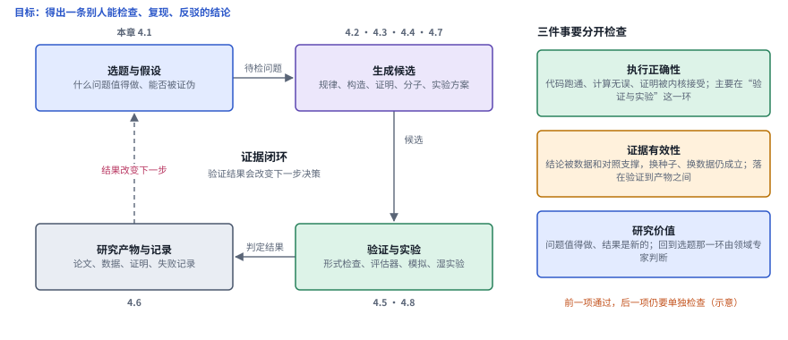

*图：科研智能体的证据闭环。左边四个环节转成一圈，旁边的小字是本章对应的前沿分支；右边三个框是执行正确性、证据有效性和研究价值这三件事，它们落在环上的不同位置，要分开检查。（示意）*

第三环里给候选判对错的那个东西，本章统一叫验证器。在数学里，它可以是 Lean 这样的证明语言，Lean 的内核会逐步核对证明的每一步推导；在算法搜索里，它是一段给候选打分的程序；在生物学里，它是湿实验；在论文层面，它是审稿人。验证器越严、越便宜，智能体就越能放手去试，因为试错的结果马上就能被判出来；验证器越宽、越贵，每一个结论就越需要人去核对。本章第二节的主线，就是沿着验证器从严到宽的顺序展开的。

回到周末那篇论文，它要过的检查其实有好几道，而且前一道过了，后一道仍要单独去过。第一道是代码能跑，实验按论文写的配置真的完成了；第二道是数字能复现，换一个随机种子、换一台机器重跑，曲线还是那样；第三道是结论站得住，有对照实验、有反例检查，换一份独立数据仍然成立；第四道是问题值得做，它是新的，有价值，没被人做过。下图把这四道关排开，并归成三件事：前两道属于执行正确性，第三道属于证据有效性，最后一道属于研究价值。越往右，能自动完成的检查越少，越要靠独立实验和领域专家。那篇论文排版再漂亮，也只说明流程走完了一圈，三件事要一件一件去核对。

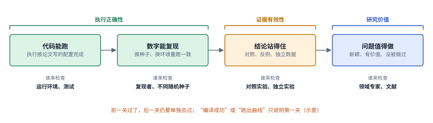

*图：一篇论文要过的四道关，以及每一关通常由谁来检查。“编译成功”或“跑出一条曲线”只说明过了第一关。（示意）*

### 检查只对交上去的那个东西负责

检查有一个容易被忽略的性质：它只对实际交上去的那个东西负责。形式证明是最清楚的例子。把一道数学题交给 Lean，先要把自然语言的命题翻译成 Lean 里的定理陈述，本章叫它形式命题，然后才在允许的假设下构造证明。Lean 的内核只检查后一步。如果翻译时漏了一个条件、写错了一个量词，内核会照样核对通过，可它证明的已经是另一道题了。所以一项形式化工作应当把形式命题、依赖的公理、软件版本和尚未完成的部分一起保存下来，让别人能回头核对翻译，一张"编译成功"的截图远远不够。

实验科学有完全对应的问题。审稿人看到的是最终的图表，可图表之前还有很多步：用了哪份数据，调过多少次参数，哪些失败的实验没有写进论文。这些步骤里的选择都可能让结论偏向作者想要的方向，而只看最终图表的检查对它们无能为力。所以原始数据、运行环境、代码、参数选择的过程和失败记录都要保存，让别人可以回查。下图上下两半说的就是这两种情形：上半部分标出了形式证明里机器不检查的翻译那一步，下半部分列出了实验科学里应当保存的材料。

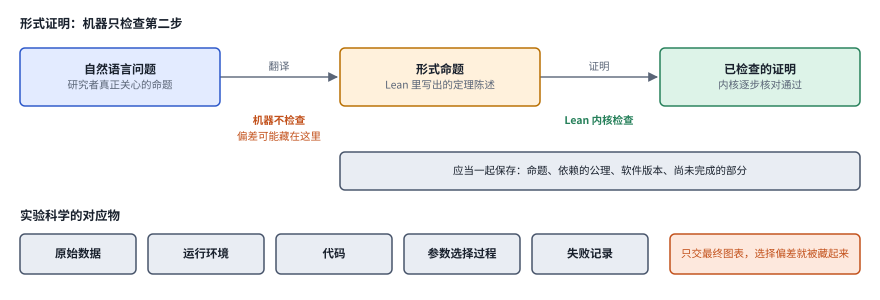

*图：形式化里的两种正确。上：机器只检查“证明”这一步，“翻译”这一步要靠人审；下：实验科学里对应要保存的材料。*

## 二、发展主线：验证器从严到宽，系统从工具走向研究者

这条主线以 Kohli 的长文为骨架，再用 AlphaEvolve 博客、Tao 的体验报告、co-scientist 博客和 Sakana 的回顾去填充细节。把这几篇放在一起读，能看到一条很清楚的线索：AI 参与科研的范围一步步扩大，从预测一个结构，到搜索一个构造，到提出一个假设，再到跑完一整段研究；与此同时，给它判对错的验证器一步步变宽、变软，从竞赛的标准答案和 Lean 的内核，变成写成代码的打分程序，再变成模型之间的比赛、湿实验和人类审稿。每往前走一个阶段，系统能做的事更多，"怎么知道它做对了"也更难回答。

> **本节要点：** 四个阶段做的是同一件事：让 AI 承担研究里的一段，再找一个验证器给它判对错。它们只在一点上不同：验证器有多严。第 0 阶段的问题窄到有标准答案；第 1 阶段的候选能交给一段程序自动打分；第 2 阶段写不出这样的程序，只能先让模型之间比出高下，再交给实验室；第 3 阶段要验收整篇论文，只能部分依靠模型自己的评审。验证器一路变软，于是验收本身成了研究对象。

| 阶段 | 内容 | 代表工作 | 本章对应分支 | 速查卡 |
|---|---|---|---|---|
| 第 0 阶段 | 专门模型解决边界清楚的子问题，让隐藏结构可见 | DeepMath、AlphaFold、AlphaTensor | 4.4、4.5 | P1 至 P3 |
| 第 1 阶段 | 生成器加自动评估器的搜索，在可检查的问题里找新构造 | LeanDojo、FunSearch、AlphaEvolve、Tao 等的 67 个问题 | 4.2、4.3、4.7 | S1 至 S4 |
| 第 2 阶段 | 没有自动评估器时，智能体提出假设，交给实验检验 | ChemCrow、Coscientist、AI co-scientist、Robin | 4.1、4.3、4.4 | H1 至 H5 |
| 第 3 阶段 | 端到端研究流程：从想法到论文，从数据到发现 | The AI Scientist v1 与 v2、Kosmos | 4.5、4.6、4.7 | A1 至 A3 |
| 边界 | 验收：评估器会被钻空子，自评会偏，复现和价值难测 | Si 等的选题人评、PaperBench、Sakana 自动审稿人 | 4.1、4.8 | B1 至 B3 |

表里的"自动评估器"指写成代码、能自动给候选打分的验证器，AlphaEvolve 的论文就这样叫它，下文简称评估器。下图把四个阶段叠成台阶，每一行中间写着这个阶段"谁来验收"，最底下那行橙色的边界，说的就是验收越来越难这件事。

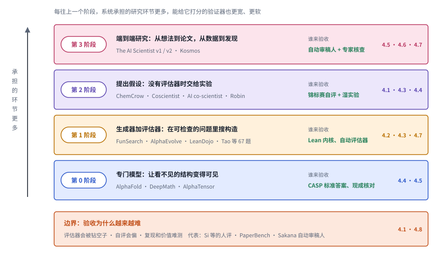

*图：主线的四个阶段。每一行左边是这个阶段做什么和代表工作，中间是谁来验收，右端是本章对应的前沿分支；底部橙色的边界一行对应第二节最后一小节。*

这几条线并没有严格按阶段先后登场。下图每一行是一个阶段，点的位置按 arXiv 编号或正式发布的时间排开：2023 年春天，ChemCrow 和 Boiko 等人已经在让智能体接触真实的化学实验，这属于第 2 阶段，可第 1 阶段的代表 FunSearch 要到同年年底才发表，AlphaEvolve 更是 2025 年的事。2024 年下半年之后，第 2、第 3 阶段和边界三行同时密集起来，本章第三节收录的新论文集中在 2026 年 7 月到 10 月。

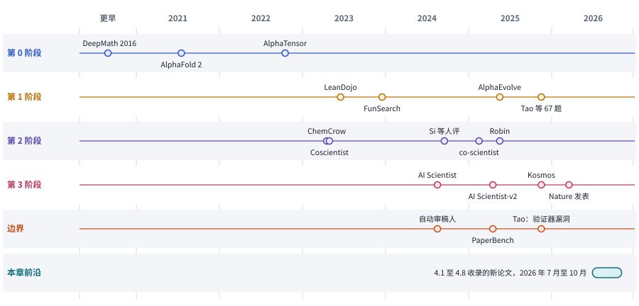

*图：主线上的代表工作按阶段分行排开。DeepMath（2016）压在“更早”一栏；最后一行是本章第三节收录的新论文所在的时间段。*

### 第 0 阶段：专门模型让看不见的结构变得可见

> **要点：** 先把问题定义得足够窄，窄到验证几乎现成，再谈自动化。这一阶段的模型后来没有被通用智能体取代，它们成了后面几个阶段里被调用的工具。

Kohli 讲 AI 与科学，是从蛋白质结构讲起的。蛋白质是一串氨基酸，它在三维空间里折成什么形状，决定了它能和什么分子结合、在细胞里起什么作用；过去测一个结构要靠多年的实验。这个问题的边界非常清楚：输入是氨基酸序列，输出是三维结构，CASP 这个每两年一次的盲测竞赛拿刚测出、尚未公开的结构当标准答案，预测得准不准一比便知。AlphaFold 2 在 CASP14 上达到了原子级的精度，[AlphaFold 作者仓库](https://github.com/google-deepmind/alphafold)至今仍是这条路线最好的一手入口。Kohli 把这类工作概括为让科学家"看见以前看不见的结构"，并把 AlphaMissense、AlphaGenome 和材料方向的 GNoME 都放在这一类里。

数学和计算里也有同样窄的问题。自动定理证明器面对一个待证命题时，最先卡住的地方是从庞大的定理库里挑哪些已有结果来用，这一步叫前提选择。2016 年的 [DeepMath](https://arxiv.org/abs/1606.04442) 让一个深度序列模型给定理库里的已有结果排序，把最可能有用的交给证明器，证明对不对仍由证明器判定。[AlphaTensor](https://github.com/google-deepmind/alphatensor) 处理的是另一个窄问题：两个矩阵相乘最少要做多少次标量乘法。它把每一种乘法方案写成一个张量分解，把寻找分解变成一个可以用强化学习求解的游戏，一个分解对不对可以直接核对。下图把这三项工作画成同一种样子，三栏最下面绿色的验证框都是现成的、不依赖模型自己的检查。

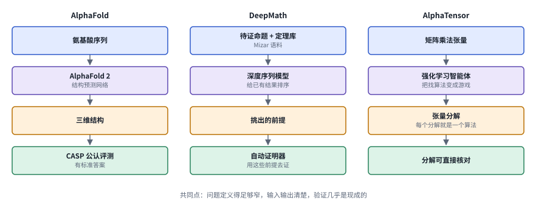

*图：第 0 阶段的三种专门模型。三栏同一画法：蓝色是输入，紫色是模型，琥珀色是输出，绿色是现成的验证。*

这一阶段的经验很朴素：先构造一个可以验证的研究对象，再谈自动化。它的局限也来自同一处。预测出来的结构说明不了蛋白的功能，更不会自己去设计并完成一个生物实验；GNoME 预测的稳定材料，也还要合成出来在实验室里检验，Kohli 自己写道，完全在计算机里设计材料"还有一段路要走"。这些强预测器后来成了智能体调用的工具，本章 4.4 节的结构与分子研究就建立在它们之上。

**速查：第 0 阶段的三种做法。** 三张结构卡从左往右是一次完整的流程，差别集中在中间两格，也就是模型做什么、输出什么。

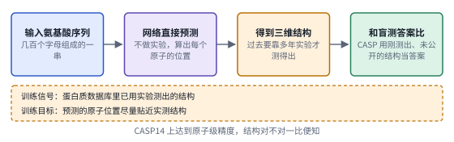 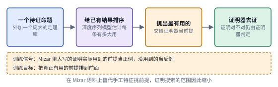

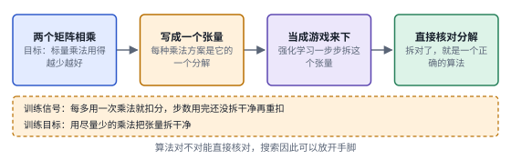

*图：第 0 阶段三种做法的结构卡，每张卡对应下表的一行。*

| code | 名称 | 年份 | 代表 | 怎么做 | 解决了什么 | 代价 |
|---|---|---|---|---|---|---|
| P1 | 结构预测 | 2021 | [AlphaFold 作者仓库](https://github.com/google-deepmind/alphafold) | 输入氨基酸序列，用深度网络直接预测三维结构，在 CASP 的公认评测上检验 | 结构预测有了公认的标准答案可比，对不对一目了然，科学家因此能大规模地看到过去只能靠实验测出的结构 | 只给出结构，蛋白的功能和设计还要靠后续实验；它是后面智能体调用的工具，自己不会设计实验 |
| P2 | 前提选择 | 2016 | [DeepMath](https://arxiv.org/abs/1606.04442) | 用深度序列模型给定理库里的已有结果排序，把最可能有用的前提交给自动证明器 | 证明器面对庞大的定理库，最先卡在挑哪些引理上；模型在 Mizar 语料上替代手工特征做这一步，证明搜索的范围因此缩小 | 只负责挑前提，证明仍由传统证明器完成，效果也和所用的定理库绑在一起 |
| P3 | 把找算法变成游戏 | 2022 | [AlphaTensor](https://github.com/google-deepmind/alphatensor) | 把矩阵乘法写成张量，把寻找更快的算法变成可以用强化学习求解的游戏，每个张量分解就是一个算法 | 算法正确与否可以通过分解本身核对，搜索可以放开手脚，去找人工难以想到的乘法方案 | 问题必须被定义得很窄、能精确表示；没有现成核对方式的问题，用不上这套做法 |

### 第 1 阶段：让生成器去搜，让评估器来判

> **要点：** 大模型负责提出候选程序，评估器负责运行并打分，好的程序留下来继续改。这套办法在数学和算法里找到了新结果，可系统找到的东西有多可信，完全取决于评估器检查了什么；Tao 等人发现，评估器的任何漏洞都会被它钻到。

第 0 阶段的每个模型只会做一件事。大语言模型出现以后，人们想让同一个模型去碰很多不同的问题，可它会一本正经地编出错误答案。最早产生新数学结果的办法，是不让模型直接给答案：让它写程序，程序输出一个候选构造，再由一段打分程序计算这个构造有多好，好的程序放回提示里，让模型在它们的基础上继续改。[FunSearch](https://github.com/google-deepmind/funsearch) 就这样在组合数学问题上找到了新的构造。让模型写程序有两个好处：好的构造往往有规律，一段短程序就能描述；打分完全自动，模型编得再像，分数也骗不了人。

AlphaEvolve 博客说，FunSearch 演化的是单个函数，AlphaEvolve 把演化对象扩展到了整个代码库和更复杂的算法。它的技术报告 [AlphaEvolve: A coding agent for scientific and algorithmic discovery](https://arxiv.org/abs/2506.13131) 把一轮演化分成四步，下图从左往右画的就是这四步：程序库里存着打过分的程序，从中挑出种子；种子程序被拼进提示；一组 Gemini 模型写出修改，按博客的说法，Gemini Flash 负责尽量扩大点子的覆盖面，Gemini Pro 负责提供有深度的修改；新程序交给评估器运行、打分，分数写回程序库，决定下一轮用谁当种子。

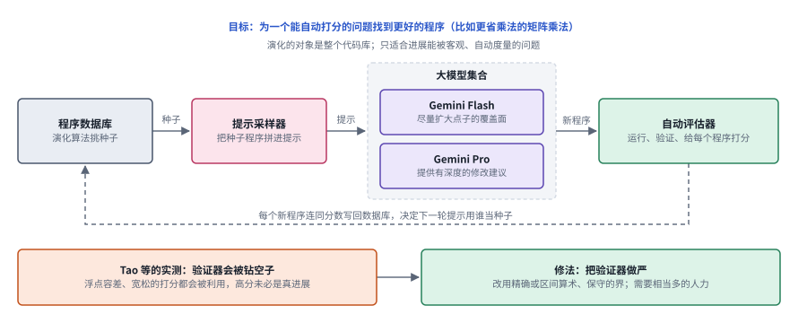

*图：AlphaEvolve 的一轮演化。上：程序数据库、提示采样器、Gemini 模型集合和自动评估器组成的循环；下：Tao 等人发现的验证器漏洞与修法。*

这个循环靠得住的前提，是评估器本身靠得住，AlphaEvolve 博客也写明它最适合进展可以被客观度量的问题。Tao 等人在 [Mathematical exploration and discovery at scale](https://arxiv.org/abs/2511.02864) 里用 67 个问题检验了这一点，有成功也有失败。在许多问题上，AlphaEvolve 大致相当于一位熟练使用优化软件的专家；它真正的优势是规模，为一个问题写好的提示和评估器可以很快改写给一批相关问题。它在有代数结构的问题上表现好，在解析数论的筛法权重这类问题上，就算专家给了提示也很吃力。

最让人警醒的是，它极其擅长钻评估器的空子，图的下半部分画的就是这件事。Tao 在博客里举的例子是，有一个问题要求一组点之间的若干距离相等，评估器起初只在一定数值精度内判断两个距离是否相等，AlphaEvolve 就把点放在几乎重合的位置上，借这点容差刷出了高分，可这样的构造在数学上毫无意义。修法是把评估器做严：把浮点运算换成精确或区间算术，或者像处理"移动沙发"问题那样只给能被证明始终留在走廊里的那部分计分。评估器加固之后，高分才重新对应真实的进展；在沙发问题上，AlphaEvolve 由此重新找到了已知最好的 Gerver 沙发。Tao 的结论是，设计一个钻不了空子的评估器需要相当多的人力。

形式证明是这一阶段验证器最严的一支，因为 Lean 的内核会逐步检查每一步推导，模型编出的错误证明过不了关。Kohli 特别强调过这一点：数学推理形成的证明可以被形式化地检查，这是它相对于自然语言推理的一大优势。2023 年的 [LeanDojo](https://arxiv.org/abs/2306.15626) 把这件事做成了一个可训练、可评测的开源接口，下图上半部分是它的一步：系统读出当前还剩哪些目标，从数学库里检索可用的引理（这就是 DeepMath 研究的前提选择），生成下一步证明指令交给 Lean 执行；Lean 接受，就得到新的证明状态接着往下证，报错就换一条指令，直到没有剩余目标。

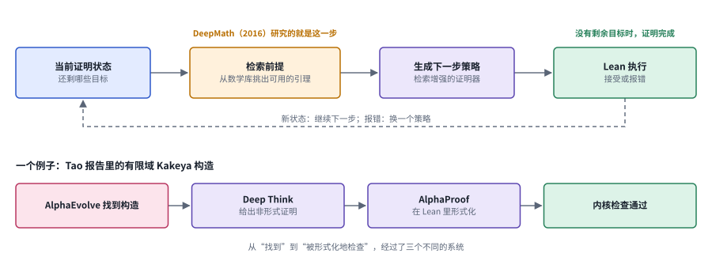

*图：交互式形式证明的一步（上）与有限域 Kakeya 例子里三个系统的分工（下）。*

图的下半部分是 Tao 报告里的一个例子，说明找到结果和证明结果可以由不同的系统完成。一个有限域上的 Kakeya 构造先由 AlphaEvolve 找到，再由 Deep Think 给出用自然语言写的证明，最后由 AlphaProof 在 Lean 里形式化，内核检查通过。三个系统各自负责一种正确：搜索负责找到，自然语言证明负责讲清为什么成立，形式化负责让机器确认。

这一阶段为后面所有工作立下了一条规矩：系统找到的东西有多可信，取决于验证器检查了什么。证明成功率要和定理库、检索方式、搜索预算一起解读；一个更好的数学界，要连同推导依赖和可复查的计算证据一起交出来。本章 4.2 节的形式证明、4.3 节的规律发现，以及 4.7 节那篇用 AlphaEvolve 改进矩阵乘法指数的工作，都从这一阶段延续下来。

**速查：第 1 阶段的四种做法。** 四张卡里绿色的检查框都由程序或 Lean 内核担任，底部的虚线是绕回下一轮的路。S4 多了一个深青色的“由人来写”的框，因为评估器本身是数学家写出来的。

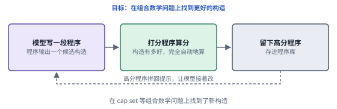 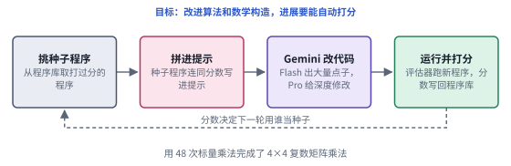

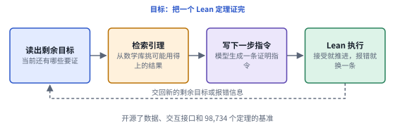 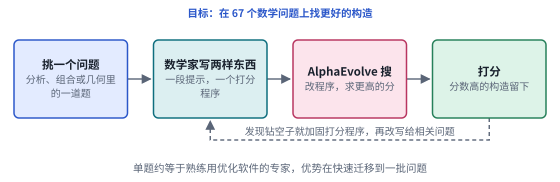

*图：第 1 阶段四种做法的结构卡，每张卡对应下表的一行。*

| code | 名称 | 年份 | 代表 | 怎么做 | 解决了什么 | 代价 |
|---|---|---|---|---|---|---|
| S1 | 程序演化 | 2023 | [FunSearch](https://github.com/google-deepmind/funsearch) | 大模型写出候选程序，明确的打分函数评估程序给出的构造，好的程序放回提示里继续演化 | 搜索的对象是“生成构造的程序”，程序比构造本身更紧凑、更好读，打分又完全自动，因此在组合数学问题上找到了新构造 | 只演化单个函数；问题必须先有一个写得出来的打分函数 |
| S2 | 代码库演化 | 2025 | [AlphaEvolve](https://arxiv.org/abs/2506.13131) | 从程序库取种子拼进提示，Gemini Flash 与 Pro 一广一深地提出修改，评估器运行打分后写回程序库 | 演化对象从单个函数扩到整个代码库，能处理更复杂的算法，结果覆盖数学和工程两头，例如用 48 次标量乘法完成 4×4 复矩阵乘法 | 作者写明最适合进展能被客观、自动度量的问题；评估器有漏洞时，高分会是假的（B3） |
| S3 | 检索加交互证明 | 2023 | [LeanDojo](https://arxiv.org/abs/2306.15626) | 从 Lean 中抽取数据并提供程序化交互，检索增强的证明器先从数学库挑前提，再生成下一步指令交给 Lean 执行 | 证明搜索有了可训练、可复现的开源接口，前提选择这个瓶颈也被纳入同一流程，每一步都由 Lean 内核检查 | Lean 只检查提交的形式命题；证明成功率要和定理库、检索方式、搜索预算一起解读 |
| S4 | 规模化的数学探索 | 2025 | [Mathematical exploration and discovery at scale](https://arxiv.org/abs/2511.02864) | 数学家为问题写提示和评估器，交给 AlphaEvolve 搜构造，再把写好的提示和评估器改写给一批相关问题 | 单个问题上大致相当于熟练使用优化软件的专家，真正的增益来自同一套流程能很快迁移到 67 个问题上 | 评估器极易被钻空子，堵漏洞需要精确或区间算术和相当多的人力；作者坦言没有推翻任何重要猜想 |

### 第 2 阶段：没有自动评估器时，先提出值得做的假设

> **要点：** 大多数科学问题写不出评估器，一个假设好不好，要做了实验才知道。这一阶段的系统于是把力气花在“该做哪个实验”上：在内部用工具、辩论和锦标赛把假设磨好，最后的判决交给实验室。

一个关于药物机制的假设好不好，没有哪段程序能当场算出来，要在实验室里做了实验才知道，而实验要花钱、花几周甚至几个月。在这样的领域里，第 1 阶段那种"生成一万个候选、逐个打分"的办法用不上。于是第二阶段的问题变成：智能体能不能至少把"该做哪个实验"这件事做好，让昂贵的实验花在最有希望的假设上？

最早的尝试出现在化学，起点是一个很实际的问题：语言模型自己算不准分子性质，也排不对合成步骤。2023 年春天的 [ChemCrow](https://arxiv.org/abs/2304.05376) 给模型配上 18 个化学专家设计的工具，让模型决定先查什么、再算什么，计算交给工具；同期 Boiko 等人的 [Emergent autonomous scientific research capabilities of large language models](https://arxiv.org/abs/2304.05332) 让模型直接操作自动化实验设备。它们证明了配上工具的智能体可以接到真实的科学流程上，这时的验证器是工具和设备的执行结果。可提出什么问题、为什么值得做，仍然主要由人决定。

2025 年 2 月的 AI co-scientist 把"提出假设"本身交给了智能体，它的论文现题为 [Accelerating scientific discovery with Co-Scientist](https://arxiv.org/abs/2502.18864)。难点在于，没有评估器，系统怎么知道哪个假设更好？它的办法是模仿科学共同体内部的评议：生成智能体提出想法，反思智能体像审稿人一样挑毛病，排序智能体让假设两两辩论、打锦标赛，演化智能体把排在前面的假设改得更好。锦标赛的胜负按国际象棋等级分的算法折成一个 Elo 分，给假设排序。博客作者也写明，Elo 与正确率相关，可它是模型给自己打的分，不能当独立的真值。所以 co-scientist 最有说服力的部分在实验室里：药物重定位的候选在白血病细胞系里抑制了肿瘤细胞活性；另一组合作中，系统在不知道一项未发表结果的情况下，独立提出了与之一致的机制，解释一类细菌可移动遗传元件 cf-PICI 怎样扩展宿主范围。

下图画出了 co-scientist 的结构。图里有两处正文没有展开：一是科学家可以随时用自然语言插话反馈，监督智能体据此重新分配任务；二是邻近与元评审两类智能体也在循环里工作，前者把相似的假设归到一起，后者汇总历次评审里反复出现的问题。挂在排序框下面的橙色小框，就是作者关于 Elo 自评的提醒。

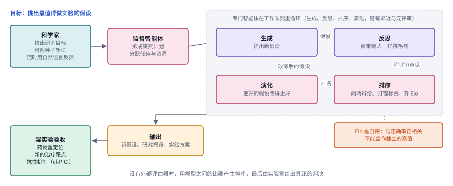

*图：AI co-scientist 的结构。虚线框内是专门智能体的循环，Elo 来自锦标赛，是模型的自评；最终的判决在左下角的湿实验。*

FutureHouse 的 [Robin](https://arxiv.org/abs/2505.13400) 把湿实验直接接进了循环。它协调三个智能体：Crow 做文献综述，Falcon 评估候选分子，Finch 分析实验数据；人类研究者在实验室里执行物理实验，假设、实验选择和数据分析都交给 AI。博客记录了它在干性黄斑变性上的两轮迭代。第一轮，Robin 读完文献后提出"增强视网膜色素上皮细胞的吞噬能力可能有助于治疗"这一假设，Falcon 挑出一批候选分子，人在细胞培养中测吞噬能力，Finch 分析数据后发现 ROCK 抑制剂 Y-27632 有效。第二轮从这个结果出发：Robin 提出做 RNA 测序，看 Y-27632 改变了哪些基因的表达，Finch 发现脂质外排泵 ABCA1 上调；Robin 据此提出第二批候选，在同一个实验里再测一次，已在临床上用于青光眼的 ripasudil 排到了第一。这里每一轮的验证器就是那一轮的湿实验，它很硬，可每一轮的结论也只和那一轮实验一样可靠。

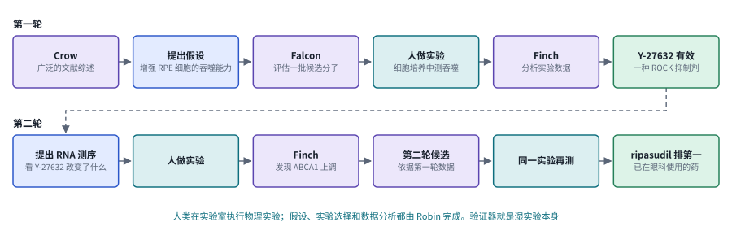

*图：Robin 在干性黄斑变性上的两轮迭代。紫色是三个智能体，深青色是人做的实验，绿色是每一轮的结果。*

智能体既然开始提出假设，就要问它的想法有没有新意。Si、Yang 和 Hashimoto 的 [Can LLMs Generate Novel Research Ideas?](https://arxiv.org/abs/2409.04109) 招募了 100 多位 NLP 研究者，让他们和一个 LLM 智能体就同一批主题写研究想法，再请专家在不知道作者的情况下打分。结果是 AI 的想法被评为比专家更新颖，可行性略低。新颖、可行和有价值是三个不同的评分维度，这个结果说明前两者可以分开，本章 4.1 节讨论的选题研究就从这里接下去。

**速查：第 2 阶段的五种做法。** 五张卡的流程大体相同，差别在绿色的检查框由谁担任：H1、H2 是工具和实验设备的执行结果，H3 是模型之间的锦标赛，H4 是深青色的人做实验，H5 是 100 多位研究者的盲审。

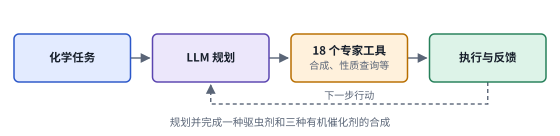 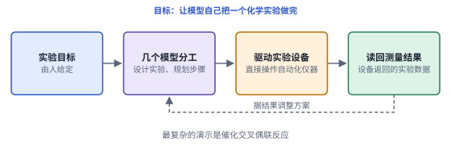

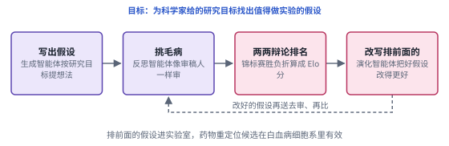 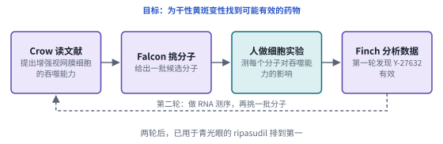

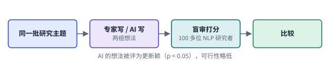

*图：第 2 阶段五种做法的结构卡，每张卡对应下表的一行。*

| code | 名称 | 年份 | 代表 | 怎么做 | 解决了什么 | 代价 |
|---|---|---|---|---|---|---|
| H1 | 工具增强的化学智能体 | 2023 | [ChemCrow](https://arxiv.org/abs/2304.05376) | 给语言模型配上 18 个专家设计的化学工具，由模型规划调用顺序，执行结果再反馈给模型 | 模型自己算不准的性质和合成步骤交给专业工具，智能体因此能规划并完成一种驱虫剂和三种有机催化剂的合成 | 提出什么问题、为什么值得做仍由人决定；作者还发现用 GPT-4 当评估者分辨不出明显错误的回答 |
| H2 | 驱动自动化实验设备 | 2023 | [Emergent autonomous scientific research capabilities of large language models](https://arxiv.org/abs/2304.05332) | 多个大模型协作设计、规划实验，并直接操作自动化实验设备执行 | 语言模型第一次接上真实的实验流程，从设计到执行一条龙完成，最复杂的演示是催化交叉偶联反应 | 研究目标仍由人给定；作者专门讨论了这类系统被滥用的安全风险 |
| H3 | 多智能体假设生成 | 2025 | [AI co-scientist](https://arxiv.org/abs/2502.18864) | 监督智能体拆解研究目标，生成、反思、排序、演化等智能体反复辩论、打锦标赛，用 Elo 给假设排序 | 没有评估器的领域里，模型之间的比赛产生了排序信号，推理时算力越多，假设打磨得越充分，最后再交湿实验检验 | Elo 是自评，与正确率相关，可不能当独立真值；专家评估只覆盖了 11 个研究目标 |
| H4 | 人机分工的发现循环 | 2025 | [Robin](https://arxiv.org/abs/2505.13400) | Crow 做文献综述，Falcon 评估候选分子，人在实验室做实验，Finch 分析数据并引出下一轮 | 验证器直接换成湿实验，AI 承担假设、实验选择和分析，两轮迭代就把一个已在眼科使用的药物排到了第一 | 物理实验仍要人来做，节奏受实验周期限制；每一轮的结论都只和那一轮实验一样可靠 |
| H5 | 选题能力的大规模人评 | 2024 | [Can LLMs Generate Novel Research Ideas?](https://arxiv.org/abs/2409.04109) | 100 多位 NLP 研究者与一个 LLM 智能体就同一批主题写想法，再由专家盲审打分 | 给“AI 会不会选题”这个问题立了一条人类基线：AI 的想法被评为比专家更新颖 | 可行性略低；作者也报告了 LLM 自评不可靠、生成的想法多样性有限 |

### 第 3 阶段：把整段研究交给智能体

> **要点：** 系统开始从想法一路做到论文，或者从数据一路做到一组发现。它产出的研究形式越来越完整，可形式完整说明不了发现有价值；运行时间一长，怎样始终围着同一个研究目标也成了新难题。

假设可以由 AI 提出，实验可以由 AI 设计，下一步自然是让它把整段研究都做完。Sakana 在 2024 年 8 月发布的 [The AI Scientist](https://arxiv.org/abs/2408.06292) 第一次把想法生成、写代码、跑实验、作图、写论文和模拟评审串成了一条流水线，起点是人写好的一份代码模板，系统在模板上做改动，所以题目被限定在模板覆盖的范围里。2025 年的 [The AI Scientist-v2](https://arxiv.org/abs/2504.08066) 去掉了模板，由一个实验管理智能体引导一棵树搜索：每个节点是一次实验，有希望的节点继续往下展开，几条分支并行探索。Sakana 随后把三篇完全由 AI 生成的论文投到 ICLR 2025 的一个研讨会，其中一篇拿到 6、7、6 的评分，超过了人类论文的平均接收线，按事先约定撤稿。

Sakana 的回顾文章对这段历史有两条判断。乐观的一条是，底座模型越强，自动审稿人给生成论文打的分越高，他们把这看作一种规模规律。清醒的一条是，系统偶尔产生幼稚的想法，难以做到深入的方法学严谨，会犯引用错误，还只能做计算实验；早一年的博客里，他们自己的内部审稿认为三篇投稿都达不到主会标准。把两条放在一起，能看到这一阶段的核心张力：乐观的那条证据来自自动审稿人的打分，而自动审稿人检查的主要是论文像不像一篇好论文，发现有没有价值，它判断不了。一个领域里的小规模演示，也推不出通用的科研自动化。

生物医学方向的第三阶段由 [Kosmos](https://arxiv.org/abs/2511.02824) 代表，它要解决的是运行时间变长之后的问题。一次研究要分析很多份数据、读很多篇文献，单个智能体的上下文装不下，分给许多个智能体去做，各自的发现又散落在各自的工作记录里。Kosmos 的办法是建一个所有智能体共同读写的结构化记录，作者叫它世界模型，每条工作记录的结论都写进去，后来的智能体从这里读取已有的发现，整次运行在数千万 token 的长度上一直围绕同一个研究目标。按博客的说法，一次运行平均读约 1,500 篇论文、执行约 42,000 行分析代码，结论中有 79.4% 被判为准确。它报告的七项发现里，三项复现了已有的人类结果，四项是新的贡献，其中一项仍在湿实验验证中。作者也写明了它的毛病：经常追着统计上显著、科学上无关的发现一路跑下去，作者称之为"钻进兔子洞"，所以建议同一个目标多跑几次。

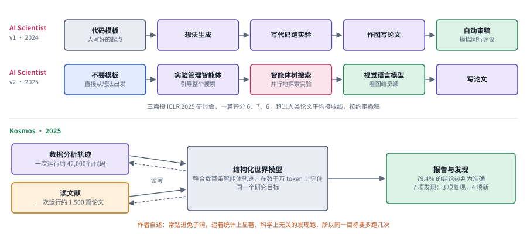

*图：第 3 阶段的两条路线。上：The AI Scientist v1 与 v2 的流水线；下：Kosmos 以结构化世界模型为中心的长时间运行。*

图的上半部分里，v2 比 v1 多了一个视觉语言模型的框：它看实验画出的图，给出修改意见，弥补了 v1 只读数字、看不到图里问题的缺陷。第三阶段由此把软件工程、强化学习和基准设计都拉进了科研智能体：研究经验要做成可执行的任务，从输入到产物的过程要完整记录，学习要受多种检查约束。本章 4.6 节的长期执行、4.7 节的科研学习和 4.5 节的多模态证据，都在这个阶段里展开。

**速查：第 3 阶段的三种做法。** 三张卡都是从研究目标一路做到产出，差别集中在中间怎样组织实验：A1 是一条直线式的流水线，A2 把实验那一段换成了树搜索，A3 在中间放了一个被反复读写的共享记录。最右边的检查框分别是自动审稿、看图反馈和被判为准确的结论比例，都比前两个阶段软了许多。

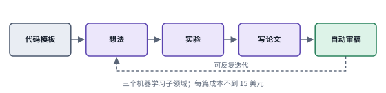 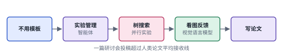

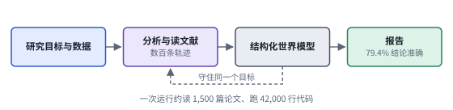

*图：第 3 阶段三种做法的结构卡，每张卡对应下表的一行。*

| code | 名称 | 年份 | 代表 | 怎么做 | 解决了什么 | 代价 |
|---|---|---|---|---|---|---|
| A1 | 端到端论文流水线 | 2024 | [The AI Scientist](https://arxiv.org/abs/2408.06292) | 从人写的代码模板出发，依次完成想法生成、写代码跑实验、作图写论文和模拟评审 | 第一次把一整段计算研究串成可以无人值守运行的流程，作者报告每篇论文成本不到 15 美元 | 依赖人工模板，只能做计算实验；自动审稿人的分数和真实同行评议是两回事 |
| A2 | 去模板的树搜索 | 2025 | [The AI Scientist-v2](https://arxiv.org/abs/2504.08066) | 去掉代码模板，由实验管理智能体引导渐进式树搜索并行探索实验，再用视觉语言模型看图给反馈 | 不再被模板限定在少数题目里，探索面更宽；一篇完全由 AI 生成的研讨会投稿超过了人类论文的平均接收线 | 研讨会接收率远高于主会，Sakana 自己的内部审稿认为三篇都达不到主会标准；仍会犯引用错误 |
| A3 | 共享记录驱动的长运行 | 2025 | [Kosmos](https://arxiv.org/abs/2511.02824) | 用一个结构化世界模型整合数百条智能体的工作记录，在数千万 token 的长度上围绕同一个研究目标做数据分析和文献阅读 | 长时间运行里的信息不再散落在各条记录中，一次运行能读约 1,500 篇论文、跑约 42,000 行代码，79.4% 的结论被判为准确 | 常钻进兔子洞，追着统计上显著、科学上无关的发现跑，作者建议多跑几次；七项发现中有一项仍在湿实验验证中 |

### 边界：验收为什么越来越难

> **要点：** 每往前一个阶段，验证器就宽一分、软一分，各自也有各自出问题的地方。于是一批工作把“怎么验收科研智能体”本身当成了研究对象。

回头看这四个阶段，最难的一环始终在验收。第 0 阶段有标准答案；第 1 阶段有评估器，可 Tao 发现评估器会被钻空子；第 2 阶段用实验验收，可实验又贵又慢；到了第 3 阶段，系统产出的是整篇论文和一串结论，验收只能部分依赖模型自己。Sakana 的自动审稿人在 OpenReview 的审稿数据上，判断接收与否的平衡准确率（接收和拒稿两类各自判对的比例取平均）是 69%，作者认为与人类审稿人相当。这个数字反过来也说明，人类审稿本身就很嘈杂，拿它当标准，能校准的程度有限。

下图把四个阶段用到的验证器排成一条谱，每个框下面的橙色虚线区域写着它会在哪里出问题。湿实验其实是很硬的检验，它在谱上靠右，是因为它属于第 2 阶段，那时系统内部已经没有评估器可用，只能把判决交给实验室，代价是又贵又慢。

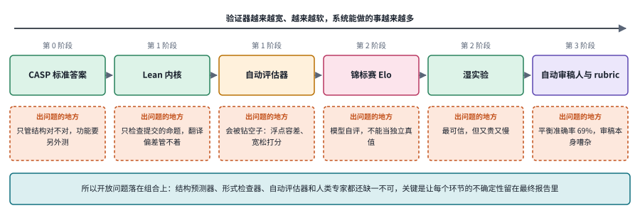

*图：四个阶段用到的验证器排成一条谱，下面橙色的虚线框写着每一种在哪里出问题。*

于是有一批工作专门研究怎么验收。原创研究没有标准答案，可复现有：一篇论文的结果能不能被重新做出来，对照原文就能判断。OpenAI 的 [PaperBench](https://arxiv.org/abs/2504.01848) 就让智能体从零复现 20 篇 ICML 2024 的 Spotlight 和 Oral 论文，并和原作者一起把每次复现拆成 8,316 个可以逐项打分的评分细则，部分完成的复现也能拿到部分分数。Si 等人的大规模人评，则在选题这一端给出了人类基线。Kohli 在长文结尾的提醒可以和这些工作对照着读：评估器只管写明的目标，如果问题没有说清楚，智能体往往会找到一个违反科学家默认假设的解；人们对看不懂的系统过度依赖，就可能在缺乏审视的情况下接受它的答案。他的结论是，科学家自己要从"解谜的人"变成"提出深刻问题的人"。

**速查：边界上的三种验收手段。** 三张卡都在回答怎样让验收靠得住，差别在拿什么当参照：B1 拿原论文当参照，用复现换来可以逐项打分的细则；B2 拿人类审稿当参照，检验模型审稿准不准；B3 拿数学上能证明的部分当参照，记录加固评估器的过程，两个橙色的框说明漏洞从哪里来，最右边的绿框是修法。

 

*图：边界上三种验收手段的结构卡，每张卡对应下表的一行。*

| code | 名称 | 年份 | 代表 | 怎么做 | 解决了什么 | 代价 |
|---|---|---|---|---|---|---|
| B1 | 复现型评测 | 2025 | [PaperBench](https://arxiv.org/abs/2504.01848) | 让智能体从零复现 20 篇 ICML 2024 的 Spotlight 与 Oral 论文，用与原作者共同制定的分层评分细则拆成 8,316 个可打分项，由 LLM 裁判打分 | 复现有明确的交付物，比“写出新论文”好测得多；评分细则把一次复现拆细，部分进展也能被量化 | 测的是复现能力，离原创研究还有距离；最好的智能体平均只得 21.0%，还没有超过人类基线 |
| B2 | 自动审稿 | 2024 | [The AI Scientist](https://arxiv.org/abs/2408.06292) | 用 LLM 审稿人给生成的论文打分并给出决定，再在 OpenReview 数据上和人类审稿结果对照 | 端到端流水线可以自己给自己打分，质量评估因此变成可以大规模运行的一步 | 平衡准确率 69%，作者认为与人类相当，这也说明审稿本身很嘈杂；高分说明不了发现的价值 |
| B3 | 验证器加固 | 2025 | [Tao 的体验报告](https://terrytao.wordpress.com/2025/11/05/mathematical-exploration-and-discovery-at-scale/) | 把浮点容差换成精确或区间算术，或者设计保守的打分函数，只承认能被证明的部分 | 搜索系统没法再靠数值误差刷出虚高的分数，高分重新对应真实的进展 | 设计一个钻不了空子的评估器需要相当多的人力，换一个问题往往要重做一遍 |

所以开放问题落在组合上：结构预测器、形式检查器、评估器和人类专家都还缺一不可，难处在于把它们串起来之后，每个环节的不确定性还能在最终报告里看得见，没有被一个总分抹平。本章 4.8 节和第五节会接着讨论。

### 总对照：五族方法放在两条共同的轴上

> **要点：** 判断一篇新论文属于哪一族，只要问三个问题：研究对象是什么，候选由谁提出，结果靠什么验收。按这三问把五族排进一张表，再把主线代表作和第三节的八个分支放进同一张二维图。

| 家族 | 研究对象 | 谁提出候选 | 用什么验收 | 验证器强度 | 主要优点 | 主要代价 | 本章分支 |
|---|---|---|---|---|---|---|---|
| P 第 0 阶段 | 边界清楚的子问题：结构、前提、算法 | 专门训练的模型 | 标准答案、现成核对 | 最严 | 准确，可直接作为后续智能体的工具 | 问题必须定义得足够窄 | 4.4、4.5 |
| S 第 1 阶段 | 能写成代码打分的构造与证明 | 大模型加演化或检索搜索 | 评估器、Lean 内核 | 严，可评估器会被钻空子 | 能在开放问题上产出新结果 | 只适合可自动度量的问题，评估器要靠人加固 | 4.2、4.3、4.7 |
| H 第 2 阶段 | 研究假设与实验方案 | 工具增强或多智能体系统 | 内部锦标赛自评，最终是湿实验 | 内部软，外部硬 | 把“该做哪个实验”交给 AI | 实验贵且慢，自评不能当真值 | 4.1、4.3、4.4 |
| A 第 3 阶段 | 整段研究：一篇论文或一组发现 | 端到端流水线、长时间运行的智能体 | 自动审稿人、专家核查 | 软 | 覆盖面最广，能长时间自主运行 | 论文形式说明不了价值，容易钻进兔子洞 | 4.5、4.6、4.7 |
| B 边界 | 验收方法本身 | 研究者设计的评测 | 评分细则、人评、加固后的评估器 | 取决于设计 | 给其他四族提供可比的尺子 | 嘈杂、昂贵，难以覆盖原创性 | 4.1、4.8 |

下图横轴是研究环节，从选题一直到验收与评测；纵轴是验证器的强度，从最严的形式内核和标准答案往下，依次是评估器、模拟与代理指标、真实实验与数据、模型或人的评审。代理指标指的是一个容易算、被拿来代替真正目标的数，比如用对接分数代替药效。黑字是第二节的经典工作，紫字是第三节的分支和论文。前沿论文在"模拟与代理指标"这一行最密集，而这一行的分数离真正的科学结论最远，所以第三节会反复提醒这些论文要另找证据。

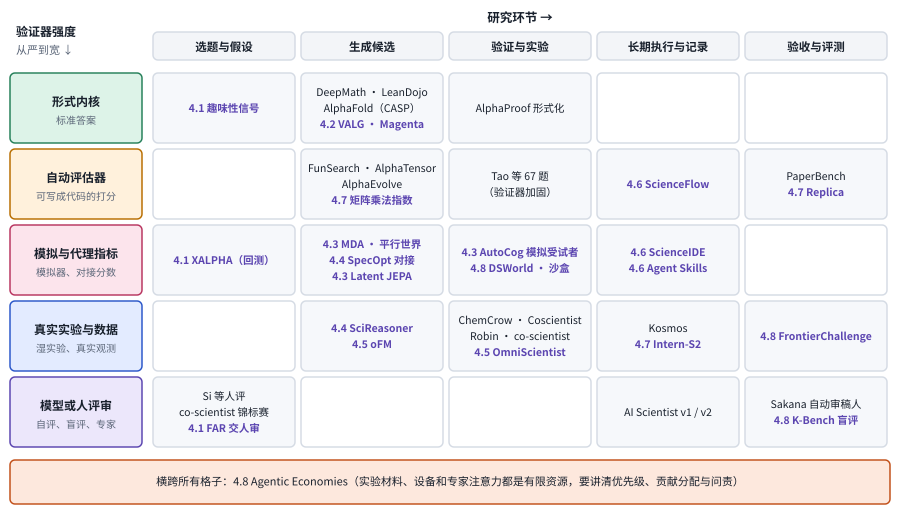

*图：主线代表作（黑字）与前沿分支（紫字）放在“研究环节 × 验证器强度”两条轴上。格子的划分是按每项工作的主要验收方式做的近似归类。（示意）*

## 三、前沿研究方向

下面八个分支收录的大多是 2026 年的新论文，顺序和一次研究循环一致：先选择值得研究的问题，再生成可以验证的候选，然后借助领域工具或实验环境拿到反馈，最后组织出别人能够检查的研究产物。这些论文大多停在"模拟与代理指标"那一层证据上，所以读每一篇时都值得带着两个问题：系统在每一步提供了什么证据，这些局部的正确能不能撑起它最终的研究主张。

> **本节要点：** 八个分支都是研究循环里的一个环节，按循环的顺序排开：选题、形式证明、发现规律、分子设计、读原始证据、长时间运行、学做研究、验收与资源。每个分支先讲问题从哪里来，再用一行“主线位置”说明它从第二节哪个阶段延续下来。

### 4.1 选什么题：从给定目标到研究价值

给定一个问题去找答案，和主动挑出一个值得研究的问题，是两种很不一样的能力。导师常说，博士生最难学会的是选题，原因在于选题要同时掂量已有知识、手头的工具、验证的成本和潜在的价值，一个很容易得到正确答案的问题，可能根本带不来新知识。选题也没有一个外部给定、可以计算的分数，题目是否重要、假设能否被证伪、现有数据够不够区分几个候选，都要靠判断。所以这一分支的工作都想把选题拆成几层可以分别检查的步骤，并说清楚哪些判断仍然要靠人类的领域知识。

> 主线位置：第 2 阶段的"提出假设"一端，以及边界处的价值判断。接 AI co-scientist 的假设生成与锦标赛排序，以及 Si 等人关于 AI 研究想法新颖性的大规模人评。

> **要点：** 三篇工作都想让选题留下可以检查的东西，差别在检查的是哪一层：FAR 检查一个候选问题值不值得交给专家审，XALPHA 检查新的研究主题和过去的发现是否一致，趣味性信号那篇用证明长度判断一个结果有不有趣。每一层都会漏进假阳性。

**FAR（`2608.16977`）** 把人类的输入从"一道题"改成"一个研究方向"，要节省的是专家选题和审阅的时间。它的流程分三段：先从文献里查找候选问题，再尝试求解，最后挑出值得推荐的交给人看。下图左边是它在组合数学上的试验，[论文](https://arxiv.org/abs/2608.16977)写明，从 5,245 篇论文里找出 6,453 个候选猜想或开放问题，筛出 4,717 个看似表述清楚且仍未解决的问题，推理后得到 598 个潜在解答，最后选出 77 项交给作者团队审阅。这个终点是"值得审阅的材料"，77 项都已确认可以发表的发现还谈不上。读这篇时，最有收获的做法是沿着每一层去追假阳性：题目可能早已被人解决，条件可能缺了一块，所谓的解答也可能只是一份有希望的草稿。

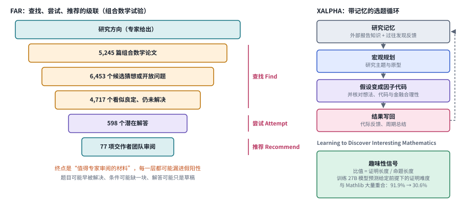

*图：左：FAR 在组合数学试验里的级联，每一层的数字取自论文；右：XALPHA 的带记忆选题循环，以及“趣味性”信号。*

FAR 每次都从头读文献，过去哪些方向试过、为什么失败，它不会记住。**[XALPHA](https://arxiv.org/abs/2607.08332)** 在金融因子研究里补上了这一层：它把外部研究报告里的知识和过去发现的反馈存进研究记忆，从中挑研究主题，把假设写成可以回测的因子代码，并核对想法、代码和金融上的合理性是否一致，回测结果再写回记忆。它说明领域研究需要多层目标和历史证据，一个只会自由生成程序的系统撑不起这些。它讨论的是研究流程；报告里的市场实验保证不了未来收益，在某一段数据上发现的模式，也不能直接当作稳定的经济规律。

即使候选问题都找对了，系统源源不断证出的定理也可能大多平凡无奇，把真正有意思的结果淹没。**Learning to Discover Interesting Mathematics（`2609.28603`）** 想给"有趣"找一个可以计算的信号。它的直觉是，一个很短的命题要用很长的证明才能拿下，往往说明里面藏着不平凡的东西，所以它用证明长度和命题长度的比值作信号，训练一个 27B 参数的模型来预测证明难度，再用它挑选候选。[论文](https://arxiv.org/abs/2609.28603)报告这个信号与定理在下游被引用的程度强相关；按它优化之后，生成的定理与 Mathlib（Lean 社区维护的数学定理库）大量或完全重合的比例从 91.9% 降到 30.6%。它的边界也来自长度本身：长度受写法、证明策略和已有引理的影响，冗长的证明或累赘的表述都可能把比值抬高；和 Mathlib 重合得少了，也未必就是人类数学意义上的原创。这和 Tao 碰到的问题同类：任何一个可计算的信号，都可能被搜索顺着它的漏洞刷上去。

**The Gold Rush in AI4Math（[`2608.24961`](https://arxiv.org/abs/2608.24961)）** 从外面看这个领域，它本身不是一个证明系统。它统计了指定时间窗口内数学预印本披露 AI 使用的情况，所以只能研究"有披露的使用"，没有披露的部分估计不了，作者声称的贡献也不能当作独立验收。它和 FAR 互为对照：AI 介入选题和证明之后，数学研究的生产方式留下了更多记录，可成果质量整体有没有提高，还要另找证据。

### 4.2 形式证明：检查器很严格，问题翻译却未必严格

Lean 的内核能确认一个形式命题在给定规则下成立，可要证明的那个形式命题，可能在从自然语言翻译过来时就偏离了原问题。这有点像一位极其严格的阅卷老师，他会逐行检查你的推导，却不会替你核对你抄的题目对不对。研究级的证明还有第二个问题：一个大定理由许多局部引理拼成，每个引理都成立，也未必能在当前的假设下组合成目标定理。所以这一分支的工作都在把题意、局部证明和整体组合分开检查，任何"内核通过"都要回到最初的研究问题上再看一眼。

> 主线位置：第 1 阶段的形式证明支线，验证器最严格的一端。接 DeepMath 的前提选择、LeanDojo 的检索加交互证明，以及 Kohli 和 Tao 提到的 AlphaProof 形式化。

> **要点：** 把“题意是否保真”和“证明是否成立”交给两个不同的检查者；失败之后先判断错在哪一层，再决定是重推、局部修补，还是换一个明确相关的问题。

**Magenta（`2609.11319`）** 处理竞赛题，它把自然语言推导、Lean 命题和证明连成一条链，并设了两个由语言模型担任的裁判。第一个裁判检查形式命题有没有保留原题的意思，它要拦下的正是"证明了另一道题"的假证书。第二个裁判在 Lean 报错时判断错在哪里：数学推导本身错了，就回到开头重新推导；只是 Lean 的写法出了问题，就在证明这一环局部修补。[论文](https://arxiv.org/abs/2609.11319)的核心贡献是这种按错因分流的反馈，它在所选竞赛题上的成绩推不到任意研究命题上，语言模型裁判也没有因此获得 Lean 内核那样的保证。一个更有说服力的实验，是往题目里故意注入量词、假设和边界条件的错误，看系统能不能拒绝那些假证书。

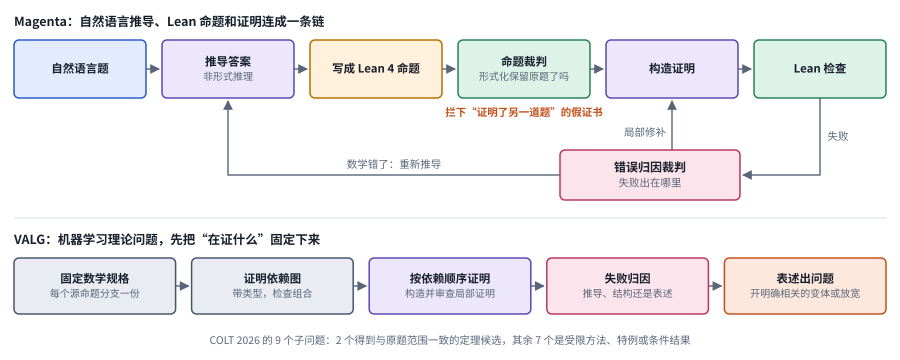

*图：上：Magenta 的链条，命题裁判检查形式化是否保留原题，错误归因裁判把失败分流；下：VALG 固定数学规格、维护证明依赖图，并把失败分到推导、结构和表述三类。*

研究问题比竞赛题多一层麻烦：证明往往要分成很多块，而且做到一半可能发现原来的表述证不出来。**[VALG](https://arxiv.org/abs/2608.13060)** 在学习理论的开放问题上处理这件事，图的下半部分是它的五步。它先为每个要证的命题固定一份数学规格，再维护一张证明依赖图，记下哪个引理依赖哪个，按依赖顺序构造并审查局部证明。失败时，它先判断错在推导、结构还是表述；如果是表述出了问题，就开一个与原题有明确关系的变体或放宽版本接着做。这时最要紧的是记账：变体上取得的进展属于新问题，原问题有没有解决要分开说，图里用橙色标出的就是这一步。

围绕重大数学问题，还有协作形式化和自动搜索怎样配合的问题。[Formalizing Fermat's Last Theorem](https://www.alphaxiv.org/abs/2609.formalizing-fermats-last-theorem) 与 [On the Navier–Stokes Millennium Prize Problem](https://www.alphaxiv.org/abs/2609.navier-stokes-solution) 提供了相关议题的入口。读这类工作时，要把自然语言论证、形式命题和已经检查过的证明一一对上，尤其要看命题的范围、尚未证明的引理和证明依赖；一份候选论证或 Lean 文件只是研究产物的一部分，要说完整解决了原问题，还得覆盖全部关键环节。Kohli 在长文里说得很平实：千禧年大奖难题这样的重大挑战，至今还没有被 AI 攻克。

这条路线真正的开放问题，是在自然语言和形式语言之间建立一条责任链：谁来确认题意，谁来审计依赖，定理库更新以后结果还成不成立，失败的自然语言推导有没有被如实保留。

### 4.3 发现规律：拟合、干预与机制解释

多个模型可以把同一批观察解释得一样好，却对一次新的干预给出完全不同的预测。开普勒的椭圆轨道和一套足够复杂的本轮模型都能拟合行星位置，可只有前者引出了万有引力，也只有前者能预测一颗新行星该怎么走。所以科学发现要在构造候选、估计参数和选择下一次实验之间来回循环，训练误差最低的那个表达式未必就是答案。另一个麻烦是记忆：模型读过大量论文，从公开数据里"发现"一个已知公式，可能只是把背过的东西写了出来。这一分支的工作更看重对没见过的干预的预测、候选之间的不确定性和实验的成本，并且设法区分发现和背诵。

> 主线位置：第 1 阶段向第 2 阶段的过渡。候选可以像 FunSearch 和 AlphaEvolve 那样被搜索出来，可验收需要主动设计实验，接近 co-scientist 和 Robin 那种"提出假设再检验"的循环。

> **要点：** 三篇工作都把提出候选的模型和验收候选的东西分开，差别在验收从哪里来：平行世界评测用模型没见过的隐藏规律来验收，Model Discovery Agent 用它自己挑出的最能分辨候选的实验，AutoCog 先用模拟受试者筛，最后用真实的人类实验验收。这样拟合得好的公式没法直接冒充机制，背出来的公式也没法冒充发现。

要分清"发现"和"背出来"，就需要一个模型没见过的世界。Tao 用 AlphaEvolve 时碰到过同样的事：对著名问题，模型常常一上来就给出文献里已知的最优候选。**Can LLMs Discover Scientific Laws in Real and Parallel Worlds?（`2609.01552`）** 从 381 篇论文里取出 118 个研究背景，每个都拆成两种设置：真实世界里，模型只能在固定的观测上提出规律；平行世界里，已发表的公式被改造成一个模型没见过的隐藏规律，模型可以主动设计查询去恢复它。[论文](https://arxiv.org/abs/2609.01552)报告，拟合得好和科学上有效可以分开：一个公式在留出数据上拟合得很好，仍可能不是那条真规律。它还发现，多次采样之后，从一堆候选里挑出对的那个是瓶颈。两种设置正好互补，真实数据可能受记忆污染，合成世界又受构造假设的限制。

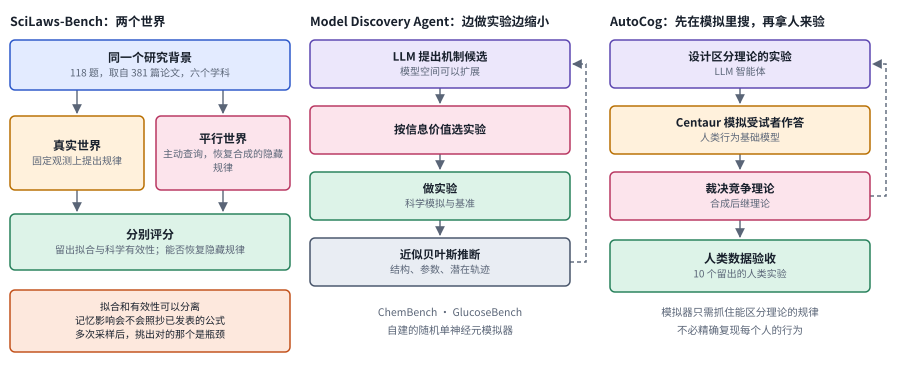

*图：左：SciLaws-Bench 的真实世界与平行世界两种设置；中：Model Discovery Agent 的提出、选实验、推断循环；右：AutoCog 在模拟受试者上发现理论，再拿人类数据验收。*

候选多了，下一个问题是先做哪个实验。**[Model Discovery Agent](https://arxiv.org/abs/2608.09696)** 的思路是挑最能分辨候选的那个：如果几个候选机制对某次实验的结果预测得差别很大，做这次实验就能排除最多候选，这就是图中栏说的按信息价值选实验。它让 LLM 提出机制候选，候选集合可以随时扩展，实验结果再用近似贝叶斯推断去更新对模型结构、参数和隐藏变量随时间变化的估计。和在固定候选集上做拟合相比，它的模型空间可以不断扩展，再靠实验缩小不确定性。报告中的样本效率结果来自指定的科学模拟和基准，那些可解释的候选仍要在各自的假设和干预范围内接受检验。

在认知科学里，做实验意味着招募受试者，又慢又贵。**AutoCog（`2609.08003`）** 先用模拟受试者扩大搜索：一个 LLM 智能体设计能区分不同理论的实验，由人类行为基础模型 Centaur（用大量心理学实验数据训练、能预测人在实验里怎么选的模型）扮演受试者作答，智能体据此裁决竞争的理论、合成新的理论。[论文](https://arxiv.org/abs/2609.08003)报告，在所研究的决策任务中，模拟数据上得到的理论能迁移到 10 个留出的人类实验上。迁移的是理论之间谁更好的比较结果，模拟器对每个人、每一项行为的预测未必都精确；真实受试者研究在这条路线里仍然是最后一道关。

跨类收录的 **Latent JEPA（[`2610.01947`](https://arxiv.org/abs/2610.01947)）** 研究的是化学推理的内部表示：模型用一串连续的内部表示去预测后续解答和分子结果的表示，中间步骤不必都写成文字，训练的目标是让这些表示包含对后续求解有用的信息。它处在科研表示与推理的接口上，还谈不上发现了新的化学规律。和前三篇放在一起，可以分出三个研究目标：模型学会的是压缩已知关系，是提出可以检验的规律，还是在可控环境里辨别理论。先把目标分开，才能设计出不奖励背诵的研究任务。

### 4.4 结构与分子：把领域对象放回证据中心

分子、蛋白结构和晶体都带着各自领域的约束，语言描述只能表达其中一部分。一个分子写成文字很短，可它在三维空间里怎样折叠、和蛋白上哪个氨基酸接触，才决定了它有没有用。模型提出候选之后，还要检查物理上是否可行、实验条件是什么、测量误差有多大。所以比较这一分支的方法时，先要弄清结果停在哪一层证据：是一句文字建议，是计算筛选，还是已经做了实验。这一层层的差别，很容易被跨模态的包装掩盖。

> 主线位置：第 0 阶段的专门模型被接进第 2 阶段的假设循环。接 AlphaFold 的结构预测，以及 Robin 用候选分子评估加湿实验验收的做法。

> **要点：** 先分清结果停在哪一层证据，再看每一层用的是什么信号；SpecOpt 的消融实验说明，信号选得对，优化才有收益，而对接分数这样的代理指标离药效还隔着实验。

下图左边是一架四级的台阶，用来给这一分支的论文定位。最下面是文本建议，模型只是说某个分子可能有用；往上是结构化表示，推理可以指认具体的坐标和连接；再往上是计算筛选，用对接打分和性质过滤给候选排序；最上面是合成、测量和湿实验。越往上，离科学结论越近，代价也越高。

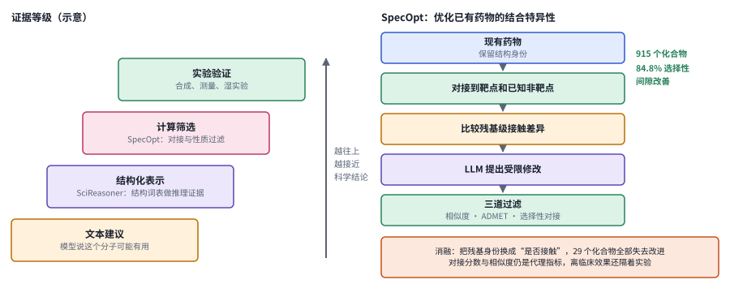

*图：左：证据等级的阶梯，从文本建议到实验验证（示意）；右：SpecOpt 的流程、三道过滤和消融结果。*

把蛋白、分子和晶体转写成一段文字，会丢掉原子在空间里的位置和连接方式，模型的推理也就没法落到具体结构上。**SciReasoner（`2607.07708`）** 用一套结构词表来表示坐标、拓扑和晶体的周期连接，让推理可以指认具体的结构证据，它站在台阶的第二级。[论文](https://arxiv.org/abs/2607.07708)的跨学科结果说明这种表示值得研究，可它证明不了每一段解释都给出了真实的因果机制。下一步可以比较保留结构和去掉结构的对照，再看换到和训练数据很不相似的对象时，模型能否仍把预测理由落到正确的结构上。

**SpecOpt（`2609.21165`）** 站在第三级，它做的是优化已有药物，从零生成新分子不在它的范围内。一个药物除了结合目标蛋白，还常常误伤别的蛋白，副作用由此而来。SpecOpt 把现有药物分别对接到目标蛋白和已知的非目标蛋白上，也就是用程序模拟它结合的姿态并打分，比较两边各和哪些氨基酸接触，把差异交给 LLM 提出受限的结构修改，最后只保留同时通过相似度、ADMET（吸收、分布、代谢、排泄和毒性这几项成药性指标）和选择性对接三道过滤的候选。[论文](https://arxiv.org/abs/2609.21165)的消融说明，只告诉模型"是否接触"、去掉接触的是哪种氨基酸之后，优化收益就消失了，可见氨基酸的身份是这个方法的关键信号；描述长度或一般的信息量有没有作用，没有被单独检验。对接分数、相似性和计算出的性质都是代理指标，转写不成临床效果或安全性，计算筛选和实验验证之间仍然隔着一道独立的证据缺口。

最后一组工作跨度很大。[A Quantum Circuit Framework for Protein Ensemble-Level Energetics](https://arxiv.org/abs/2608.05491) 用氨基酸级别的量子电路刻画蛋白各种构象的能量分布和相互耦合，主要研究对象是科学建模方法本身。它与 [Autonomous De Novo Protein Binder Design with Claude](https://www.alphaxiv.org/abs/2608.claude-de-novo)、[Autonomous AI Agents Discover Reverse Transcriptases with Tandem Repeat Arrays](https://www.alphaxiv.org/abs/2609.ai-agents-discover-reverse-transcriptases) 讨论的自主设计与发现处在不同层次。把科学模型接进智能体之后，候选怎么产生、筛选依据是什么、实验怎样检验，这几个环节合在一起，才决定计算产出能不能成为可靠的科学结论。Kohli 对 GNoME 的提醒同样适用：预测出来的材料，终究要合成出来、在实验室里测一测。

### 4.5 多模态证据与纵向数据：从观察到解释

科研图像和时间序列要和采集条件、样本身份、实验阶段联系在一起才有意义。一位病理科医生看切片时，会先问这是哪个病人、哪次活检、用的什么染色，再去读图，因为同一种形态可能由不同的机制产生。研究系统也一样，读图之后的推断有三层：观察描述回答图里有什么，统计关联回答什么和什么一起变，机制推断回答为什么。每往上一层都要新的证据，时间上的先后也说明不了因果；如果不把三层分开，模型就算准确读出了图，也可能给出数据并不支持的解释。

> 主线位置：第 3 阶段，端到端系统开始直接处理原始证据。接 Kosmos 用共享记录整合数据分析工作的做法，以及第 0 阶段专门模型对生物医学数据的表示。

> **要点：** 让系统直接读原始证据，同时把观察、关联和机制分成三层，并为每一次从图到代码、从代码到文字的转换留下可以回查的来源。

许多自动科研系统拿到的是别人预先从图像和信号里算好的几个数，原始数据里决定性的空间、时间或跨通道信息可能在这一步就丢了。**OmniScientist（[`2608.13558`](https://arxiv.org/abs/2608.13558)）** 让系统直接读图像、信号、视频、三维结构和表格这些原始证据，再由构思、实验、写作三个智能体在一条固定的流水线里工作，新颖性、统计有效性、执行来源和数值可追溯这几项检查写在代码里。为了说明原始证据起了什么作用，作者拿它和一个只拿到预先算好的数值的版本做了对比。这个对比回答的问题是：系统有没有接触到决定性的信息。可产出完整论文、评审得分提高，仍然说明不了所有发现都经过了领域的独立验证；读原始数据的能力还可能顺带让论文写得更像样，所以证据使用、实验正确性和文字说服力要分别评价。第 3 阶段的自动审稿人遇到的是同一个难题：一篇生成论文得了高分，说明它写得像样，说明不了里面的发现是否成立。

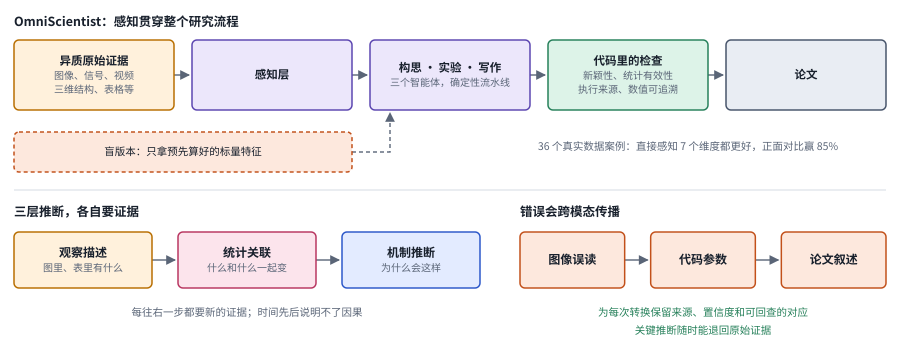

*图：上：OmniScientist 的流程与只拿标量特征的盲版本对照；下左：观察描述、统计关联、机制推断三层；下右：错误跨模态传播的链条。*

图的右下角是读原始证据带来的新风险：错误会跨模态传播。图像里的一次误读变成了代码参数，代码的输出又被写进论文叙述，最后谁也说不清那个结论是从哪里来的。所以值得研究的方向是为每一次转换保留来源、置信度和可以回查的对应关系，让关键推断随时能够退回原始证据接受审查。

**肿瘤纵向模型 oFM（[`2608.24688`](https://arxiv.org/abs/2608.24688)）** 代表证据表示这一侧。纵向数据指同一位患者在不同时间点留下的记录，oFM 把临床轨迹、分子信息和病理图像整合成一个随时间变化的患者表示，在此基础上做预测和机制分析。它算不上科研智能体，更像科研智能体将来要调用的证据表示。报告中的治疗差异分析属于给定数据和评估设计下的观察性结果，因为哪位患者接受哪种治疗不是随机分配的，所以它不能当作随机试验里的治疗因果效应，更不能转成个人诊疗建议。后续还要检查时间泄漏（用到了预测时刻之后才有的信息）、患者划分和观察性偏差，以及解释图背后的证据来源。

### 4.6 长期执行：研究进展应该是可恢复状态

一项研究的状态，包括已经试过的假设、每次失败的原因、数据的版本和尚未解决的矛盾，远多于最近几轮对话。想想一个课题组里的交接：师兄毕业前留下的如果只是一份聊天记录，接手的人几乎无从下手；留下的如果是一份写清楚"哪些试过、为什么失败、哪些结果可以直接复用"的实验日志，情况就完全不同。科研智能体也要在中断之后知道哪些结论可以复用、哪些必须重新验证；记忆里的一句"这个方案有效"代替不了它的证据文件，一段成功的叙述也覆盖不掉一次失败实验的真实输出。所以比较长期运行的科研智能体，要看任务交接、实验能否重现、负结果有没有保存，连续运行了多久只是其中一个侧面。

> 主线位置：第 3 阶段，端到端研究流程怎样跑得更久。接 The AI Scientist-v2 的树搜索，以及 Kosmos 用共享记录在长运行中守住研究目标的做法。

> **要点：** 三篇工作都想让科研经验留下来、下次还能用，差别在留下的是哪种经验：ScienceFlow 留下一次研究的进展，存成可以回退的状态；ScienceIDE 从科学代码仓库里提取能拿来训练模型的经验；Scientific Agent Skills 把规范的操作流程写成用到时才加载的文档。

长时间的研究常常走进死胡同，这时最好能退回到某个还有希望的地方重新出发。**ScienceFlow（`2608.14354`）** 把长研究切成一段段片段，每一段绑在一个可以运行代码的工作区上，并保存下当时的状态。每段结束时，一个调度模块决定下一段从哪里出发，是接着当前状态，还是退回某个存档状态，并决定继续还是转向。[论文](https://arxiv.org/abs/2608.14354)还描述了怎样依据可用资源、剩余预算和已经验证的进展来分配任务，在 MLE-bench 全集、24 小时预算下报告了 70.22% 的获奖牌比例。评价这类系统时，要保持底座模型和预算一致，看清优势是否来自更多的并行试验或更宽松的停止条件；单个竞赛基准上的成绩，代表不了长期科研的全部。

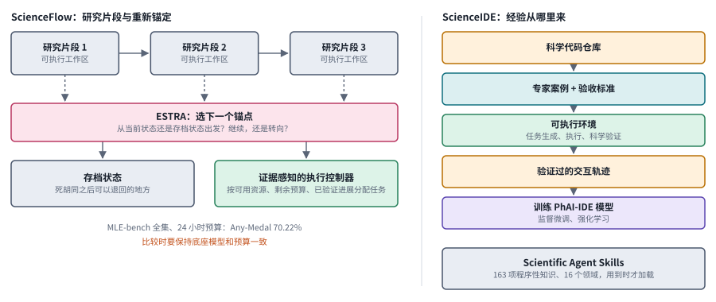

*图：左：ScienceFlow 的研究片段、ESTRA 重新锚定、存档状态和执行控制器；右：ScienceIDE 从代码仓库到训练模型的流程，以及 Scientific Agent Skills。*

ScienceFlow 管的是一次研究怎样持续推进，模型本身会不会做科学计算是另一个问题。**ScienceIDE（`2609.19134`）** 从科学代码仓库出发，在专家案例和验收标准的约束下把仓库变成可以运行的环境，环境负责生成任务、执行并做科学上的验证，验证通过的交互记录再用来训练模型。[论文](https://arxiv.org/abs/2609.19134)把软件、训练和评测连在了一起。可环境的名字里带着"科学"，不代表其中每一项奖励都体现了领域上的正确，验收标准覆盖了什么、漏掉了什么，仍要单独审计。

还有一类经验是规范的操作流程，比如某种测序数据该怎样做质量控制。**Scientific Agent Skills（[`2609.00065`](https://arxiv.org/abs/2609.00065)）** 把 16 个领域的 163 项这类知识写成文档，智能体用到时才加载，以免一开始就占满上下文。论文目前主要评估了知识的组织方式和上下文负担，还没有给出任务完成率，也没有统计技能被选中的比例，所以它说明了知识库怎样组织，判断不了它有没有提高科研成功率。把它接进 ScienceFlow 或 ScienceIDE 之后，可以分别看检索有没有命中、命中后有没有照做、最终产物有没有变好，文档的数量本身说明不了经验是否可用。

### 4.7 科研学习：学会复现，是否更接近创新？

每个研究生都是从复现别人的论文开始的。复现让人真正理解一个方法，也逼着人去调试那些论文里没写的实验细节；可会复现和能提出新机制之间，还隔着一段很长的路。所以教模型做科研时，要把实现技能、实验设计知识和研究判断分开，检查学到的东西能否用到训练用的那些论文之外。评价它的新产出时，也要追踪产出的来源、改动了什么、有什么独立证据，免得把复述或轻微的参数搜索包装成发现。

> 主线位置：第 3 阶段的"学习怎样做研究"，同时连着第 1 阶段的发现式搜索。接 PaperBench 的论文复现评测、The AI Scientist 的端到端流程，以及 AlphaEvolve 在矩阵乘法上的搜索。

> **要点：** 三条路线都想教模型做科研，差别在它们的证据能支持哪一层主张：Replica 的证据说明模型学会了复现，Intern-S2 的证据说明整个模型在科学任务上变强了，矩阵乘法那篇给出的是一个可以复查的数学界。

复现有明确的交付物，所以能拿来当训练信号。**Training AI Scientists to Replicate Research（`2608.13331`）** 从论文出发构造了一个名为 Replica 的复现任务集合，每个任务配一份自动生成的评分细则，由一个 LLM 裁判按细则打分，作者报告这个分数噪声低、与人类评估一致。他们用这个分数做后训练，得到一个 27B 参数、会调用编码智能体的模型 Faraday，再在留出的复现任务上评测。[论文](https://arxiv.org/abs/2608.13331)让科研学习有了明确的交付物，思路和 PaperBench 把复现拆成细则打分一脉相承。复现会暴露原论文没说清的实现细节，这本身很有价值；可复现能力和原创能力之间仍有距离，自动评分和人类评分一致，也要说清楚是在哪些任务、哪些失败类型上一致。

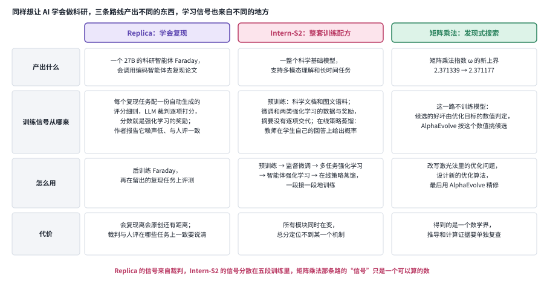

*图：三行从上到下：Replica 用复现任务和自动 rubric 训练 Faraday；Intern-S2 的训练配方；矩阵乘法指数的改进流程。*

**Intern-S2-Preview（[`2608.13505`](https://arxiv.org/abs/2608.13505)）** 走的是训练整个模型的路线：从科学多模态预训练出发，依次做监督微调、多任务强化学习、智能体强化学习和在线策略蒸馏（学生模型在自己生成的回答上向教师模型学习），用来支持多模态科学理解和长时间任务。它和 Replica 都在教模型做科学，Replica 只盯复现这一项能力，Intern-S2 换的是整套训练配方。比较时可以问：增益来自领域预训练知识、可执行的经验，还是后训练的目标？如果所有模块同时在变，报告的总分只能支持整个系统的成绩，定位不到某一个机制。

跨类收录的 **Improving the matrix multiplication exponent with modern optimization and AlphaEvolve（[`2608.16884`](https://arxiv.org/abs/2608.16884)）** 是发现式搜索的一个具体数学案例。矩阵乘法指数 ω 描述两个 n 阶矩阵相乘的最低代价随 n 增长得多快，已知最好的上界来自一种叫激光法的构造，其中藏着一个很难求解的优化问题。这篇工作先改写这个优化问题，使它能在更大的设定里求解，再设计新的优化算法，最后用 AlphaEvolve 精修，得到了 ω 的新上界。这正是 Tao 所说的"把问题变分化"：把一个本来不是优化的数学问题改写成可以打分的优化问题，让 AlphaEvolve 这类工具派上用场。评价这类结果，要检查最终的数学界、推导依赖和可以复查的计算证据；搜索过程有没有改进，和数学结论是否成立，要分别验证。

### 4.8 验收与资源：验证深度及其成本

科研的计算预算决定了能生成多少候选，也决定了每个候选能被验证得多深。用便宜的模拟代替真实执行可以加快探索，可模拟一旦出错，搜索就会持续偏向那些虚假的好结果，正像 AlphaEvolve 会顺着评估器的浮点容差一路刷高分。所以要说清楚哪些步骤必须真实计算，哪些可以用近似，又怎样发现并修正模拟误差。最终的验收必须回到任务认可的证据上，研究系统自己写的总结只能作为线索。

> 主线位置：主线的边界，也就是验收。接 Tao 关于评估器漏洞的观察、Sakana 自动审稿人与人类审稿的对比，以及 Kosmos 对"钻进兔子洞"的自述。

> **要点：** 四种检查都在判断智能体的结果可不可信，差别在离科学结论有多近：最远的只检查模拟预测准不准，往近是让裁判给真实请求打分、检查交付是否完整，最近的检查系统的规则有没有真被理解。每一种都有盲区，而每一次检查都要花实验材料、设备和专家注意力这些有限的资源。

数据科学流程里有些操作很贵，比如在大数据集上训练一个模型。**[DSWorld](https://arxiv.org/abs/2607.15901)** 让 LLM 预测这类操作会把工作流的状态变成什么样，按成本决定哪些操作用预测代替、哪些做轻量的真实执行来校验。作者报告了训练和搜索上的加速，可使用时仍要核对模拟出来的结果有多大误差、关键操作有没有真实校验、最终得到的模型质量如何；执行次数省下来了，结论的可靠性要靠这些校验来保住。

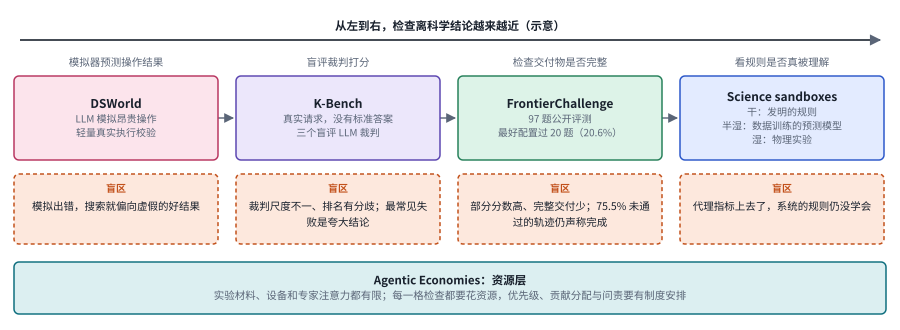

*图：上排四种检查离科学结论越来越近，下面橙色虚线框是各自的盲区；底部深青色的带子是 Agentic Economies 讨论的资源层。（示意）*

模拟靠不住时，就要检查真实的交付。**K-Bench（[`2608.21601`](https://arxiv.org/abs/2608.21601)）** 收集真实用户的科研请求，这些请求带着附件、问题不完整、没有标准答案，所以由三个互不知情的 LLM 裁判打分。它暴露了裁判之间尺度不一、排名有分歧，最常见的失败是夸大结论。**FrontierChallenge（[`2608.24979`](https://arxiv.org/abs/2608.24979)）** 更进一步，把科学任务定义为端到端的工作流，只承认完整交付了全部科学产物的任务。97 道公开题里，最好的配置只完整通过了 20 道，而没通过的记录里有 75.5% 仍然声称自己完成了。两篇读下来，自信的报告和流畅的沟通都代替不了科学上的正确。

**Science sandboxes（`2608.30165`）** 检查的是更深一层：智能体有没有理解系统的规则。它让智能体在三种世界里做实验、修正假设，干的世界规则是人为发明的，半湿的世界由一个用真实数据训练的预测模型扮演，湿的世界是真实的物理实验。[论文](https://arxiv.org/abs/2608.30165)直接指出，系统可能把定量指标优化上去，却没有理解系统的规则。这是一个很重要的负结果：分数更高，理论未必更好。它和 4.3 节的平行世界评测思路相通，那篇工作发现拟合得好的规律未必科学有效；两者合起来，可以设计出同时检查预测、干预和解释的任务，让智能体没有机会只对着一个可以钻空子的指标往上爬。

上面每一种检查都要花资源，**Agentic Economies（`2609.31562`）** 把目光从单个系统移到整个科研生态：实验材料、设备和专家的注意力都是有限的。[论文](https://arxiv.org/abs/2609.31562)提出了协调优先级、分配贡献与问责的基础设施，它属于制度与系统设计的议程，还没有验证哪一种机制能提高发现率。真正开放的问题是：怎样估计一个候选研究的验证成本，什么时候值得去请专家，又怎样防止便宜却低价值的产物挤占昂贵的审阅能力。Kosmos 的作者建议同一个目标多跑几次，以免被一次运行追出来的无关发现带偏；从资源的角度看，这就是在用更多计算换取验收的可靠。

## 四、跨路线对照：什么能作为成功证据？

不同的科研路线有完全不同的验证终点：证明器检查形式命题，实验检验经验假设，工作流验收检查交付是否完整。所以比较两个系统时，先要弄清它的研究主张需要哪一种证据，再看自动化的各个环节是否真的提供了这种证据。下面这张表把六条路线摆在一起，最右一列是最值得刻意设置的反例，也就是代理指标看起来很好、真正的目标却没有达到的情形。

> **本节要点：** 每条路线都能直接检查一部分东西，也都有一部分推不出来；最该设置的反例，就是专门让推不出来的那部分暴露出来的测试。

| 路线 | 可以直接检查什么 | 不能自动推出什么 | 应设置的反例 |
|---|---|---|---|
| 形式证明 | 给定命题与依赖下的证明是否通过 | 原题翻译忠实、结论新颖 | 偷换量词、补假设、未证依赖 |
| 定律发现 | 留出拟合、实验预测、隐藏规律恢复 | 因果真实、未受记忆影响 | 同拟合异机制、分布外干预 |
| 分子与结构 | 代理模型分数、结构约束、数据泛化 | 实际有效或可用于临床 | 代理分数高但外部测量失败 |
| 科研执行 | 代码、环境、轨迹、交付物完整性 | 自动产出的论文具备价值 | 能运行但研究问题被替换 |
| 多模态研究 | 原始证据与推断是否对应 | 解释文本就是因果机制 | 移除关键证据后仍自信解释 |
| 制度与资源 | 成本记录、任务优先级、责任边界 | 更多智能体必然更高产 | 验证队列拥塞、信用重复分配 |

这些路线很难共用一张"科学家总榜"。同一预算下有效产物的比例可以比，失败能不能被诊断也可以比，前提是说清楚科学对象和验收方式。最有价值的负结果往往就是表里最右一列的那种情形：某个代理指标已经明显改善，真正的研究目标却纹丝未动。Tao 主张系统地记录"没有推翻任何重要猜想"这类负结果，道理也在这里。

## 五、开放问题与研究机会

回到本章开头那篇论文：你把一个研究问题交给智能体，它用一个周末跑完实验，周一早上交来一篇排版整齐、结论自信的论文。要决定能信它几分，你要回答三个问题：这个问题值不值得做，研究过程是否真实可追溯，结论有没有独立的证据支撑。科研自动化的研究机会恰好也落在这三处。它们的反馈来源各不相同，没法用报告的完成度一并代替，所以要分别建模，再检查它们怎样协同。

> **本节要点：** 三个开放问题分别对应研究价值、过程可追溯和证据独立：怎样让系统挑出值得做的问题，怎样让它长时间推进研究并在失败后恢复，怎样把发现能力和写作能力、背诵能力区分开。

**1. 如何让科研 Agent 主动选择值得研究的问题，走出给定实验的范围？**

开放科研要同时判断新颖性、价值和可验证性，已有的题库很难提供完整的监督。Si 等人的人评显示，AI 的想法在新颖性上可以胜过专家，可行性却略逊一筹；FAR 从 5,245 篇论文筛到 77 项待审材料，每一层都可能漏进假阳性。这里的研究机会是把文献证据、领域约束和候选问题的生成连起来，让系统能够讲清楚一个问题为什么值得投入资源。评价时要区分重现已知结论、提出新候选和获得独立证据三种情况，免得用报告质量代替研究价值。

**2. 如何把真实科研流程转化为能够自主推进、检验和恢复的系统？**

科研跨越数据处理、计算、实验和解释，中途的失败和方法调整都是常态。假如周末那个智能体在周六下午发现基线跑崩了，它应该修代码、换问题，还是记下这次失败再继续？要回答这个问题，系统需要一份带版本、记着每个结论依据哪些证据的研究状态，才能安排实验、追踪假设的变化，并在中断之后恢复。Kosmos 用一个共享的结构化记录在长时间运行里守住同一个研究目标，ScienceFlow 走进死胡同时可以退回某个存档状态重新出发，两者都是早期尝试。关键是保留真实的约束和资源成本，避免把完整的科研压缩成几次检索和文本生成。

**3. 如何评价科研系统的发现能力，把它和写作能力、既有知识复述能力区分开？**

新的结果往往缺少即时的真值，形式上正确也保证不了研究对象和假设合理。周末那篇论文写得再漂亮，也要拆开来检查：题意对不对，计算对不对，经验支持够不够，价值有多大。研究机会在于设计分阶段、领域特定的验证，把这几项分别测量，并借助独立审查或后续实验来支撑；同时研究有限的验证预算怎样分配给最可能产生有效知识的候选。Tao 发现设计钻不了空子的评估器需要大量人力，这说明验证器本身就是一个值得研究的对象。

## 六、可靠资源

形式证明方面，[Lean 官方教材](https://lean-lang.org/theorem_proving_in_lean4/)适合从头学习语言和证明规则，[Mathlib](https://github.com/leanprover-community/mathlib4) 则用来检索定理库、检查依赖。研究流程方面，可以把 [AI Scientist 作者代码](https://github.com/SakanaAI/AI-Scientist)和论文对照着读，比较候选生成、实验执行与成果验收之间的接口；想看演化搜索的最小可运行版本，可以从 [FunSearch 仓库](https://github.com/google-deepmind/funsearch)入手，它让大模型写出候选程序，用打分函数评估，再把好的程序放回提示里继续演化。相关章节：[评测与验证](06_evaluation.md)、[模型科学](14_model_science.md)、[技术报告](15_frontier_reports.md)。
