# 13｜效率与循环架构：少算一些，真的会更快吗？

[首页](../README.md) · [专题索引](../README.md#topics) · [文献目录](../catalog/13_efficiency_and_architecture.md)

## 方向背景：为什么效率必须按完整任务衡量

agent 干活时，模型大部分时间在“读”，很少在“写”，中间还夹着大量等待工具的空档。设想让一个编程 agent 去修一个仓库里的 bug。它先读需求，再列目录、打开几个文件、跑一遍测试、看报错、改两行代码、再跑测试，前前后后五十来步才收工。每一步，它都要把系统提示、工具说明和到目前为止的全部历史重新交给模型，模型读完这一大段上下文，最后只吐出一小段函数调用，接着就是等工具返回。Manus 团队在一篇工程博客里给过一个很直观的数字：他们的 agent 平均每产出 1 个 token，要先读进去大约 100 个 token。

模型一旦被放进多轮循环，效率的单位就从单次调用变成了整个任务。过去谈推理加速，默认的场景是一问一答：一段提示进去，一段回答出来，量的是每秒生成多少 token。放进多轮循环之后，成本摊到了整个任务上：上下文越滚越长，同一段开头被反复读取，多个子 agent 并行运行，工具执行的时间也算在等待里。Anthropic 在介绍自家多 agent 研究系统时说，agent 通常比普通对话多用约 4 倍的 token，多 agent 系统则多用约 15 倍。效率因此决定的远不止账单，它还决定 agent 一次能承受多少探索、多少回溯，以及能不能部署在有限的硬件上。

难点在于，“快”是一个牵涉很多层的结果。参数少了，运算量未必少；运算量少了，等待时间未必短；单个算子快了，省下的几毫秒可能又被数据搬运、请求排队或者工具等待吃掉。每一种加速办法省下的是不同的资源，只有放回具体的任务、硬件和质量要求里，才能判断它到底让任务快了多少。所以本章读每一项加速，都先问它省了哪一种资源，再问这份节省能不能一路兑现到完整任务上。

## 先读这几篇

这一章的主线借自几篇写得很好的长文。前三篇讲清了“时间到底花在哪里”这件事，从单个算子一直讲到整套推理服务；后两篇把视角移到模型架构和 agent 任务上。它们大多带着可以手算的例子，读完再去看本章的新论文，很多结论都能自己估算出个大概。最后两篇是 2026 年的综述，一篇收拢推理服务系统里围绕 KV 缓存的工作，一篇收拢 agent 层面的效率工作。

| 顺序 | 文章 | 为什么读 |
|---|---|---|
| 1 | Horace He，[Making Deep Learning Go Brrrr From First Principles](https://horace.io/brrr_intro.html)（2022） | 一切效率分析的起点。作者把深度学习程序的耗时拆成三块：真正在做浮点运算的计算时间，把张量在显存里搬来搬去的带宽时间，以及 Python 解释器、框架调度和内核启动带来的额外开销。他的核心判断很简单：先弄清自己卡在哪一块，再去对症下药。卡在计算上，就该让矩阵乘法用满 Tensor Core；卡在带宽上，算子融合是最有效的手段；卡在开销上，就要靠追踪编译或 CUDA Graphs。文中用连续两次余弦运算说明融合能把显存读写从四次降到两次，读完会对“运算少不一定快”有切身体会。本章第二节的第 1 层就来自这篇。 |
| 2 | Jacob Austin、Sholto Douglas 等，[How To Scale Your Model 第 7 章：All About Transformer Inference](https://jax-ml.github.io/scaling-book/inference/)（2025-02） | 本章主线的骨架。这本在线书的推理一章按“由内到外”的顺序展开：先讲 KV 缓存为什么必要，再讲预填充受计算限制、逐 token 生成受带宽限制，然后讲批大小怎样在吞吐和延迟之间拉扯，接着介绍缩小 KV 缓存的各种手段，包括分组查询注意力、局部注意力、跨层共享、量化和分页注意力，最后落到服务引擎的设计：连续批处理、前缀缓存、预填充与解码分离，以及推测解码。它给出的估算方法很好用：一步生成的时间下界，大致等于这一步要读的全部字节（参数加 KV 缓存）除以显存带宽。读完它，本章大部分论文在哪一层发力都能一眼看出来。 |
| 3 | kipply，[Transformer Inference Arithmetic](https://kipp.ly/transformer-inference-arithmetic/)（2022-03） | 一篇“只用纸笔估算推理性能”的经典博客。作者推导了 KV 缓存每个 token 的大小，指出每个 token 的前向计算约为参数量两倍次的浮点运算，又用 A100 的算力与带宽之比（约 208）解释为什么小批量解码几乎总是被显存带宽卡住。最有意思的是它的诚实：用这套简单模型估算 13B 模型的单卡延迟得到约 16.8 毫秒，实测是 22.0 毫秒，作者把差距逐项拆给读者看。它教给读者的，是先估一个下界、再解释偏差的工作方式。 |
| 4 | Lilian Weng，[Why We Think](https://lilianweng.github.io/posts/2025-05-01-thinking/)（2025-05） | 这篇长文主要讲测试时计算，也就是模型在回答时多花的计算，其中“在连续空间里思考”一节正好是本章循环架构的背景。她把多想一会儿分成两个方向：横向是多生成几步 token，纵向是让同一组层反复计算，并沿着 Adaptive Computation Time、Universal Transformer 一路讲到 2025 年 Geiping 等人的循环深度模型。她的出发点是：一个网络能做到什么，取决于它在一次前向里能用多少计算；如果测试时能多算，并且训练它学会用这份资源，它就会更好。她也提醒，这类模型训练很脆弱，隐藏状态可能塌缩，增加循环次数后的表现还会饱和。 |
| 5 | Yichao 'Peak' Ji，[Context Engineering for AI Agents: Lessons from Building Manus](https://manus.im/en/blog/Context-Engineering-for-AI-Agents-Lessons-from-Building-Manus)（2025-07） | 一线 agent 产品团队写的工程复盘，把效率问题直接放到了完整任务上。作者认为 KV 缓存命中率是生产环境 agent 最重要的单一指标，因为它同时决定延迟和成本；他举的例子是，按 Claude Sonnet 的价格，命中缓存的输入 token 比未命中的便宜十倍。由此引出一串很实用的做法：开头保持稳定，系统提示开头别放精确到秒的时间戳；上下文只追加、不回改；工具列表不在任务中途增删，改用解码时屏蔽 logits 的方式限制可选动作；把文件系统当成可恢复的外部记忆。读它可以把前几篇里抽象的“前缀缓存”落到具体的产品决策上。 |
| 6 | Jiantong Jiang、Peiyu Yang、Rui Zhang、Feng Liu，[Towards Efficient Large Language Model Serving: A Survey on System-Aware KV Cache Optimization](https://arxiv.org/abs/2607.08057)（arXiv，2026-07） | 读完前面几篇，再用这篇 2026 年的综述把第 2、3 层的工作一次铺开。作者只收不重训、不改模型结构的服务期方法，按三个问题归类：什么时候做（执行与调度，包括围绕 KV 缓存的请求调度、把传输和计算重叠起来的流水线、预填充与解码分离、把计算卸载到 CPU 或存储），放在哪里（KV 缓存怎样在显存、内存、SSD 和 CXL 内存池之间搬动，又怎样在集群的设备之间调度），以及存成什么样（量化、低秩近似、剪枝合并这些压缩手段，PagedAttention 式的分页分配和前缀共享，以及 H2O、StreamingLLM、SnapKV 这类在预算内淘汰缓存的做法）。它的几条总结和本章的主线正好呼应：“存成什么样”这一类研究得最多，贡献了大部分显存节省，直接作用于延迟和吞吐的却是“什么时候做”这一类；KV 压缩虽然热门，却很少和其他做法联合设计；能耗普遍没有被报告；而所有类别的方法都会带来质量损失。作者因此把尾延迟、能耗、最坏情况下的失效和统一的评测协议列为接下来的机会。 |
| 7 | Xiaofang Yang、Lijun Li 等（上海人工智能实验室、复旦等），[Toward Efficient Agents: Memory, Tool learning, and Planning](https://arxiv.org/abs/2601.14192)（arXiv，2026-01，2026-07 修订） | 这篇综述把视角放到本章最外面的第 5 层。作者认为 agent 的效率对真实部署至关重要，却常常被忽视，于是把 agent 的成本拆成处理的 token 数、推理延迟和外部工具调用次数三项，并给效率下了两种定义：在固定成本预算下效果更好，或者在效果相当时成本更低，两者合起来看就是效果与成本之间的最优边界（帕累托前沿）。全文按记忆、工具使用和规划三块组织：记忆这边讨论怎样构建和压缩文本记忆与参数化记忆、怎样管理和检索；工具这边讨论先用检索器缩小候选工具、并行调用工具、用强化学习训练模型少调用工具，以及只在自己没把握时才调用工具；规划这边讨论快慢两条路径的自适应预算、把任务路由给更小的模型，以及在多 agent 系统里精简通信，因为不加控制时 token 数量会爆炸。作者观察到，实现各异的方法常常收敛到几条共同原则上，比如用压缩给上下文设上限、在奖励里惩罚多余的工具调用、对搜索加以控制。它还整理了评测协议和效率指标。 |

如果还想多读一点，Anthropic 的 [How we built our multi-agent research system](https://www.anthropic.com/engineering/multi-agent-research-system)（2025-06）从另一个角度谈 agent 的成本：在他们的评测里，token 用量一项就解释了约 80% 的表现差异，并行启动子 agent 和并行调用工具能把复杂查询的研究时间缩短最多 90%，代价是多 agent 系统要用掉约 15 倍于对话的 token，所以只适合价值足够高的任务。

## 一、基本概念：agent 的一步里，时间花在哪里

> **要点：** agent 干一步活，时间花在了哪里？它每一步都把越来越长的输入整段读一遍，只写出一小段调用，然后等工具返回；读远多于写，开头不变的那部分可以存下来，下一步直接复用。省钱也有好几本账：存储、运算、单个请求的等待时间、单位时间能处理的请求数，一项改动常常省了这一本、多花了那一本。

模型推理分两步，先把输入整段读一遍，再一个一个地写出输出，读的时候记下的中间结果叫 KV 缓存。可以把它想成一位翻译在工作。他先把整份原稿读一遍，边读边在本子上记下每一句的要点；然后一个字一个字地写译文，每写一个字都要翻回本子看看前面记了什么。读原稿可以一目十行，写译文却只能一个字接一个字。模型也一样：先把输入整段读一遍，这一步叫预填充，它可以对所有 token 同时计算；然后逐个生成输出，这一步叫解码，每生成一个 token 都要等上一个生成完。读输入时，模型为每个 token 算出一对向量，叫键和值，存起来供后面生成时查阅，这份存储就是 KV 缓存，相当于翻译的那本笔记。

放到编程 agent 里，每一步都要把越来越长的输入从头读一遍，却只写出一小段调用，下图用一个修日期解析 bug 的 agent 画出了这样的一步。第 t 步交给模型的输入有 31,200 个 token：开头是 2,000 个 token 的系统提示和 3,000 个 token 的工具说明，每一步都一样；后面是 25,000 个 token 的历史，里面有读过的 dateparse.py、上一次的测试输出和之前的调用；最后是刚追加的 1,200 个 token 的新观察。模型先预填充，把这一大段读一遍，其中上一步已经读过的 30,000 个 token 可以从缓存里直接复用；再解码，连思考在内写出约 300 个 token，最后是一段调用 run_tests 的 JSON；然后 pytest 跑 8 秒，这段时间模型只能空等；报错信息被追加到历史末尾，下一步再从头读一遍。底下那根长条是这一步的读写比例，约 100 比 1，和 Manus 报告的比例相当。

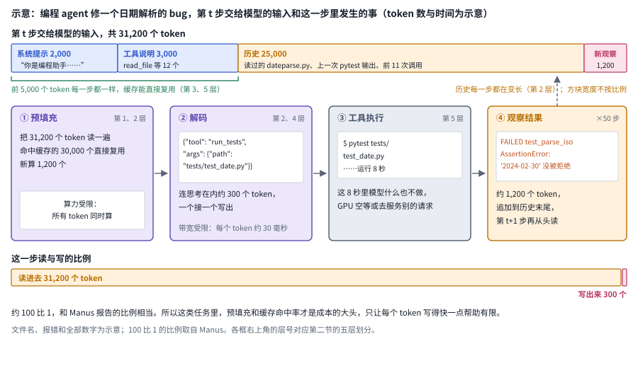

*图：编程 agent 修一个 bug 的第 t 步。上排是交给模型的输入，下排是一步里依次发生的四件事，每格里是这一步实际流过的东西，右上角的层号对应第二节的五层划分；底部长条是读写比例。文件名、报错和数字为示意，100 比 1 取自 Manus。*

既然每一步都从头读，开头不变的那部分就可以复用，这是全章最实用的一个观察，写在图的左上角：系统提示和工具说明只要一个字不改，这一步的开头就和上一步一模一样，它们的 KV 缓存可以直接拿来用，省掉这一段的预填充，这叫前缀缓存。在读远多于写的 agent 里，这份复用省下的比解码快一点要多得多，Manus 的整套上下文工程几乎都在围绕这一点做取舍。下图把同一个 agent 连续三步的输入按长度画了出来：第 2、3 步只有末尾新追加的一小段要预填充；可只要系统提示开头放一个每步都变的时间戳，第 3 步就得把六千多个 token 从头读一遍。

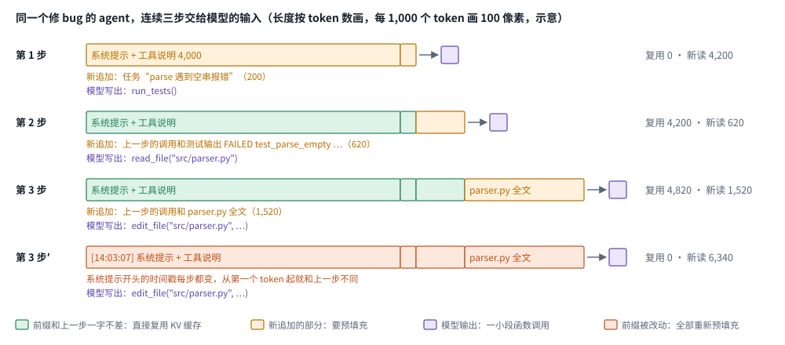

*图：同一个修 bug 的 agent 连续三步的输入，绿色是能直接复用缓存的前缀，琥珀色是新追加、要预填充的部分；最后一行开头多了一个每步都变的时间戳，复用全部落空。token 数为示意。*

### 几种不同的预算

模型推理的成本要记在几本不同的账上。这就像要让一位翻译交稿更快，可以给他配更快的笔，可以让他少翻笔记，也可以让好几位翻译同时开工，每种办法省下的东西不一样，付出的代价也不一样。参数量是模型有多少独立的权重，决定了要占多少存储；运算量是一次前向要做多少次浮点运算，论文里常写作 FLOPs；显存里装着权重、计算中的临时数据和 KV 缓存；延迟是一个请求从发出到拿到结果花的时间；吞吐是单位时间里能处理多少请求或 token。

这几样经常朝不同方向走。参数少的模型可能要多算几遍；一次处理很多请求能提高吞吐，可每个请求要排更久的队，延迟反而变长；运算量少了，如果数据要在显存里多搬几趟，等待时间照样不短。所以读一篇效率论文，第一件事是看清它省的是哪一项，又在哪几项上和对手做了对齐。只说“快了”或“小了”，读者没法判断这份节省在自己的任务上能不能兑现。

## 二、发展主线：从一个算子到一整个任务，时间花在哪里

效率研究的这些年可以读成一架由内向外的梯子：每往外走一层，要考虑的东西就多一些，局部的节省也就越难原样兑现到最终的等待时间上。这条主线以《How To Scale Your Model》推理一章的展开顺序为骨架，再用 Horace He 的三种瓶颈作为最底下的一层，用 Lilian Weng 和 Manus 的文章补上架构与 agent 两层。

> **本节要点：** 效率研究想回答的始终是：时间花在哪里，怎样少花。这些年的工作可以按看的范围由小到大排成五层：一个算子，一次完整的生成，许多请求一起服务，模型结构本身该给每个 token 分多少计算，最后是整个 agent 任务。范围越大，局部的节省越容易在别处被抵消。

| 层级 | 内容：时间花在哪里 | 代表工作 | 本章对应分支 | 速查卡 |
|---|---|---|---|---|
| 第 1 层 | 单个算子：计算、显存搬运、调度开销 | Horace He 的三种瓶颈、FlashAttention、LLM.int8()、GPTQ | 三.7 | O1 至 O4 |
| 第 2 层 | 单次生成：预填充受算力限制，解码受带宽限制，KV 缓存成为主角 | kipply 的推理算术、MQA、GQA、MLA、Speculative Decoding、StreamingLLM、H2O | 三.5、三.6 | K1 至 K5，S1 至 S3 |
| 第 3 层 | 多个请求一起服务：批处理、缓存管理与调度 | PagedAttention、SGLang、Sarathi-Serve、DistServe | 三.8 | V1 至 V4 |
| 第 4 层 | 每个 token 分到多少计算：稀疏激活、循环深度、自适应停止、状态模型 | Switch Transformers、Universal Transformers、ACT、循环深度模型、Mamba | 三.1 至三.4 | A1 至 A5 |
| 第 5 层 | 完整任务：多轮上下文、工具等待、多 agent 并行 | Manus 的上下文工程、Anthropic 的多 agent 系统 | 三.4、三.6、三.8 | G1 至 G3 |
| 边界 | 省下的资源能否兑现为端到端收益 | 本章各分支里的负结果 | 第四、五节 | |

第 4 层和前三层的问法不同：前三层问的是给定一个模型怎样把它跑快，第 4 层改模型本身。下图把五层叠成梯子，每一层右端标出本章对应的前沿分支，最底下那条橙色的边界，说的就是局部节省兑现失败的地方。

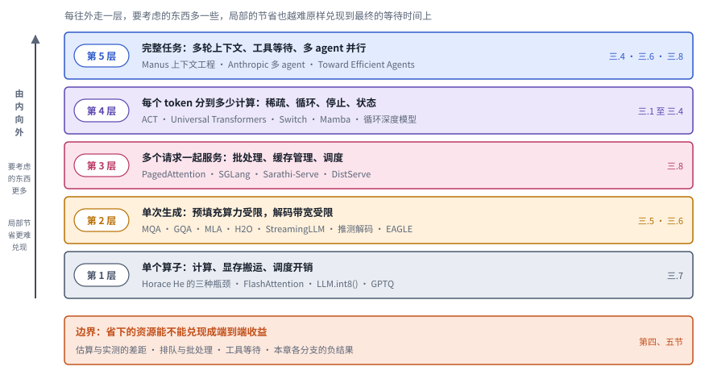

*图：效率研究的五层梯子。每一层右端标出本章对应的前沿分支；第 4 层从架构切入，和前三层“给定模型怎样跑快”的思路互相补充。*

这几层的研究节奏很不一样。下图每一行是梯子上的一层，点的位置按 arXiv 编号或发布时间排开：第 4 层的源头最早，自适应计算时间和 Universal Transformers 都早于今天的大模型；第 2 层的工作在 2023 年最密集；第 3 层的服务系统集中在 2023 年下半年到 2024 年初；第 5 层直到 2025 年才有成体系的工程复盘。本章第三节收的新论文都在 2026 年下半年，画在右下角那段青色的带子上。

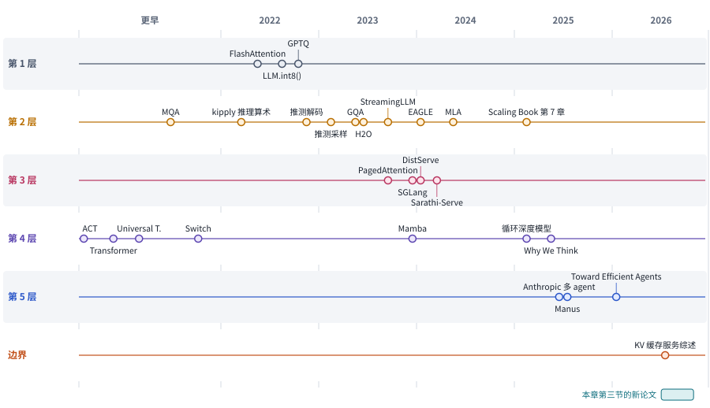

*图：主线代表工作按梯子分行排开。2016 到 2021 年的工作压在“更早”一栏；Horace He 的文章只知道年份，没有画进来。*

### 第 1 层：先弄清楚卡在哪里

> **要点：** 一个算子跑得慢，先要问时间卡在哪里：计算、显存搬运，还是调度开销。这一层的工作都从这个诊断出发，共同的教训是，数据怎样在显存里流动，本身就是算法的一部分。

诊断的第一步，是把耗时分成计算、带宽和开销三块，这是 Horace He 在 2022 年那篇文章里的分法。他打过一个比方：GPU 像一座工厂，计算单元是车间，显存是仓库，数据要从仓库运到车间才能加工；车间再快，运货的路堵了，整座工厂照样闲着。第一块是计算，主要是大矩阵乘法，这是你花钱买 GPU 想要得到的东西。第二块是带宽，像逐元素的余弦、归一化这类操作，几乎所有时间都花在把数据读进来、写回去上，算力再强也帮不上忙。第三块是开销，Python 解释器、框架分发、内核启动都在这里，它通常不随问题规模增长，所以一个简单的诊断方法是把批量翻倍，看运行时间是否也大致翻倍。

卡在带宽上时，最有效的对策是算子融合，下图下半部分是他的例子。对同一个张量连做两次余弦，不融合时，第一次余弦要从显存读进来、把中间结果写回去，第二次再读进来、再写回去，一共四次显存读写；融合成一个内核以后，中间结果留在片上，只需要读一次输入、写一次输出。两次余弦的运算量一点没少，省下的全是搬运。这类操作在运算量里占比很小，在运行时间里却不小：他举的 BERT 例子里，非矩阵乘法的操作只占约 0.2% 的浮点运算，实际算力利用率却远低于矩阵乘法。

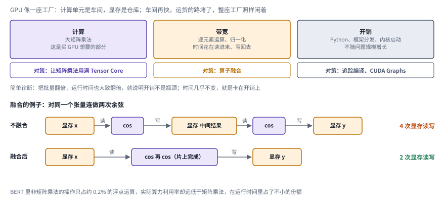

*图：Horace He 的三种耗时和对策；下方是两次余弦的融合示例，显存读写从四次降到两次。*

2022 年的 [FlashAttention](https://arxiv.org/abs/2205.14135)（`2205.14135`）把省搬运的思路用到了注意力上：公式一个字不改，只改数据流动的路线，速度和能处理的序列长度就都上了一个台阶。标准实现要先算出整张序列长度乘序列长度的分数矩阵写回显存，再读回来做 softmax，再写回去，再读回来乘上值矩阵；序列越长，这张中间矩阵越大，来回搬运也越重。FlashAttention 把输入切成小块，一次只把一块搬进片上存储，在块内算分数、边算边更新 softmax 需要的统计量、把结果累加到输出上，完整的分数矩阵从头到尾没有落回显存。下图用一个查询对 4 个键演示两种算法。标准实现算出 4 个分数，写回显存，读回来做 softmax，再写回、再读回乘上值，得到 2.502。FlashAttention 先搬进前两个键，记下当前最大值 2、分母 1.368 和分子 1.736；第二块里出现了更大的分数 3，就把旧的分母和分子都乘上 e⁻¹ 再加上新的项，最后 3.967 除以 1.585，同样得到 2.502。序列长到 4096 时，那张被省掉的分数表每个头、每层约有 32 MB。

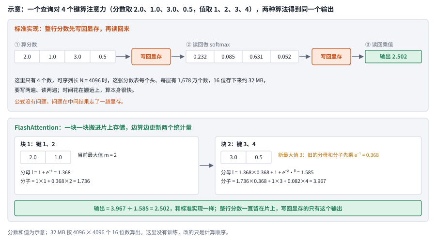

*图：同一行注意力的两种算法。上：标准实现，橙色框是分数写回显存的两次；下：FlashAttention 分两块计算，靠最大值、分母和分子三个数把结果接起来。分数和值为示意，32 MB 按 4096 × 4096 个 16 位数算出。*

低精度是这一层的另一条线，它从“每个数存几位”入手减少搬运：权重从 16 位降到 8 位或 4 位，同样的带宽就能多运一倍甚至几倍的数。难处在于误差。2022 年的 [LLM.int8()](https://arxiv.org/abs/2208.07339)（`2208.07339`）发现，大模型里会系统性地冒出少数数值特别大的特征维度，而 8 位量化要按最大的那个数来定刻度，直接压成 8 位就会严重损伤精度，于是把这些离群维度单独留在 16 位里计算，其余绝大部分数值用 8 位。同年的 [GPTQ](https://arxiv.org/abs/2210.17323)（`2210.17323`）用少量校准数据和近似的二阶信息估计每个权重对误差有多敏感，一次性把权重压到每个 3 到 4 位。两篇都说明，位宽降下来之后，误差落在哪里、算子能不能真的用上低精度，决定了收益能不能兑现。

离群值为什么致命，用一行数字就能看清。8 位量化要拿整行里绝对值最大的数来定刻度，一个 60 混进来，刻度就粗到 0.47 一格，其余零点几的数几乎全被压成 0；LLM.int8() 把这一维单独拿出去走 16 位，剩下的数换上自己的细刻度，误差就降到千分之几。

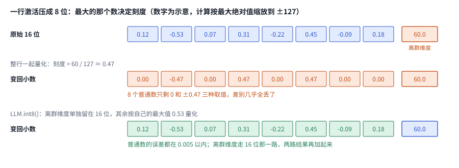

*图：同一行激活的三种样子：原始 16 位，整行一起压成 8 位再变回小数，以及 LLM.int8() 把离群维度分出去之后的结果。数值为示意，量化按最大绝对值缩放到 ±127 计算。*

**速查：第 1 层的四种做法。** 四张卡都在缩短数据从显存到计算单元的那段路，差别在怎么缩短：前两张让数据少往返几趟，后两张让每个数占的位数更少。

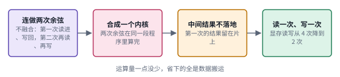 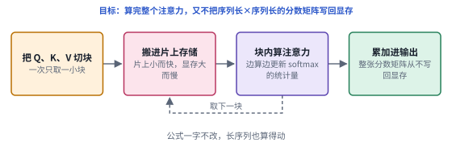

 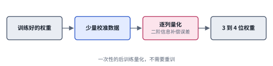

*图：第 1 层四种做法的结构卡，每张卡对应下表的一行。*

| code | 名称 | 年份 | 代表 | 怎么做 | 解决了什么 | 代价 |
|---|---|---|---|---|---|---|
| O1 | 算子融合 | 2022 | [Making Deep Learning Go Brrrr](https://horace.io/brrr_intro.html) | 把一串逐元素的小算子合成一个内核，中间结果留在片上 | 带宽受限的操作不再反复往返显存，两次余弦的读写从四次降到两次 | 要靠编译器或手写内核来实现；对已经卡在计算上的大矩阵乘法帮助有限 |
| O2 | IO 感知的注意力 | 2022 | [FlashAttention](https://arxiv.org/abs/2205.14135) | 分块把 Q、K、V 搬进片上存储，块内算注意力，完整的分数矩阵不写回显存 | 注意力公式不变，显存读写大幅减少，更长的序列也算得动 | 内核要贴着硬件写；它省的是搬运，注意力本身的运算量没有减少 |
| O3 | 混合精度分解 | 2022 | [LLM.int8()](https://arxiv.org/abs/2208.07339) | 把系统性出现的离群特征维度留在 16 位里算，其余绝大部分数值用 8 位 | 大模型里冒出的离群值不再拖垮 8 位推理的精度 | 两路计算要拆开再合并；收益取决于算子能否真正用上低精度 |
| O4 | 后训练量化 | 2022 | [GPTQ](https://arxiv.org/abs/2210.17323) | 用少量校准数据和近似的二阶信息，一次性把权重压到每个 3 到 4 位 | 不重训就能把权重存储压到 16 位时的四分之一左右 | 误差会在层间累积，位数低到 2、3 位时退化明显（三.7 的 Quantization Degradation） |

### 第 2 层：一次生成里，解码被带宽卡住

> **要点：** 生成一段回答时，为什么快不起来？因为每写一个 token 都要把全部权重和 KV 缓存从显存读一遍，时间几乎都花在读上。于是有两条路：让每一步要读的东西变少，或者让一次读进来的东西多干点活，一次确认好几个 token。

把视角从单个算子放大到一次完整的生成，会发现解码几乎总是被显存带宽卡住，预填充则受算力限制。kipply 2022 年的博客用纸笔算清了这件事。每生成一个 token，前向计算大约需要参数量两倍次的浮点运算，同时要把全部权重从显存里读一遍。A100 的算力和带宽之比约为 208，意思是每读进一个字节，要做两百多次运算才能让计算单元忙起来。解码一次只处理一个 token，批量又小的时候，运算远远填不满这个比例，于是时间几乎全花在读权重上。《How To Scale Your Model》用 TPU v5e 做了同样的推算，结论是 bf16 下大约要攒到 240 个 token 的批量，解码才能摸到算力上限。预填充正好相反，因为长提示天然带来大量可以同时计算的运算。

agent 恰好两头都占：每一步都要预填充一段很长的输入，再解码一段很短的输出，下图把这两个阶段并排画了出来。左边的预填充让提示里的 8 个 token 一起进入同一次前向，顺手把每个位置的键和值写进 KV 缓存；右边的解码每一步只有一个新 token，却要把全部权重和 KV 缓存读一遍，并且每走一步，缓存就多一格。

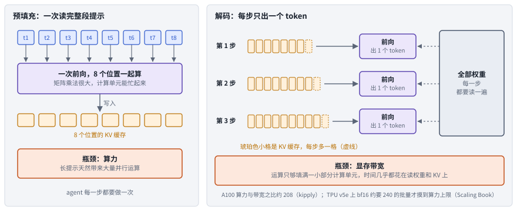

*图：预填充与解码。左边一次前向处理整段提示，受算力限制；右边每步只出一个 token，却要重读权重和不断变长的 KV 缓存，受显存带宽限制。*

既然解码的时间花在“读”上，就有两条路：要么让每一步读的东西变少，要么让一次读进来的东西多干点活。先看第一条路。权重的大小是固定的，KV 缓存却随历史变长、随并发变多，所以压缩的目标落在缓存上。缓存里装的是实打实的数：每个 token 在每一层各留下一列键和一列值，预填充一次写下整段提示的列，解码每步再添一列，并把已有的列全部读一遍。设一个示意配置：32 层，每层 8 组键值，每组 128 维，每个数 16 位；按下图下半部分的乘式算，一个 token 就要占 128 KB，编程 agent 的上下文到两万个 token 时，每生成一个 token 都要读约 2.4 GB。

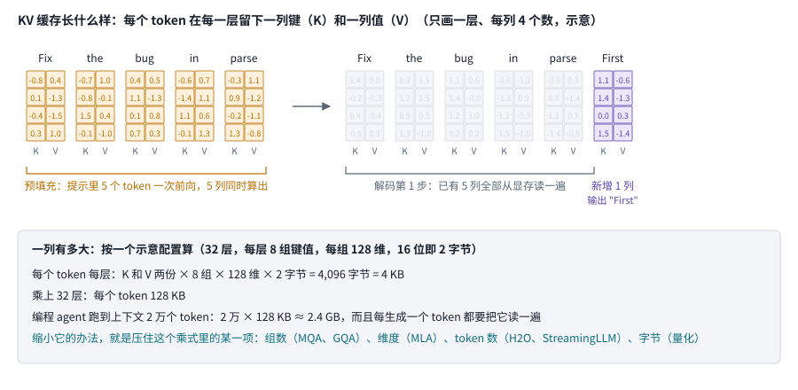

*图：KV 缓存的样子。左边预填充一次算出提示里 5 个 token 的键值列，右边解码第 1 步新增一列，同时读一遍已有的 5 列；下方按示意配置算出一列的大小。数值为示意。*

那个乘式里的每一项，都是一个可以压的因子。下图把缓存的大小拆开：同时处理多少条序列，每条保留多长的历史，有多少层，每层有多少组键值，每组多大维度，每个数用几个字节。压住任何一个因子，缓存都会变小。

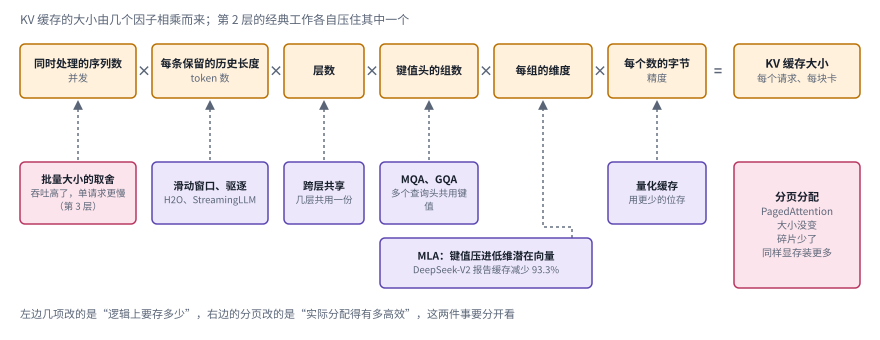

*图：KV 缓存大小由几个因子相乘而来，下排是各自压住某个因子的经典做法；右侧的分页分配改的是实际分配效率。*

最早压住“组数”的是 2019 年 Noam Shazeer 的 [Fast Transformer Decoding: One Write-Head is All You Need](https://arxiv.org/abs/1911.02150)（`1911.02150`）。注意力有很多个头，每个头本来各存一组键和值；他提出的多查询注意力（MQA）让所有头共用一组，解码时要反复读入的张量一下子小了很多，质量只略有下降。2023 年的 [GQA](https://arxiv.org/abs/2305.13245)（`2305.13245`）取了个折中，让若干个头共享一组键值，并且展示了照原来的预训练目标继续训练，只用原始预训练约 5% 的计算，就能把现成的多头模型改造成这种结构。2024 年的 [DeepSeek-V2](https://arxiv.org/abs/2405.04434)（`2405.04434`）提出多头潜在注意力（MLA），把键值压进一个低维向量，同时压住了组数和维度，报告的 KV 缓存比自家 67B 模型减少了 93.3%。跨层共享压的是层数，量化压的是字节。图最右边的分页分配不在这个乘式里，它改的是同样大小的缓存在显存里放得有多紧凑。

上面这些办法让每个 token 存得更少，可历史一长，缓存终究装不下，另一组工作于是考虑压住“历史长度”，只保留一部分 token。2023 年的 [H2O](https://arxiv.org/abs/2306.14048)（`2306.14048`，Heavy-Hitter Oracle for Efficient Generative Inference of Large Language Models）观察到少数 token 贡献了大部分注意力分数，于是只保留最近的 token 和这些“重击手”。这里的分数就是模型解码时本来就要算的注意力权重，按每个 token 累计收到多少来排；挑选规则是人定的，没有为它另外训练任何东西。同年的 [StreamingLLM](https://arxiv.org/abs/2309.17453)（`2309.17453`，Efficient Streaming Language Models with Attention Sinks）发现模型会把大量注意力投向开头几个 token，哪怕它们在语义上并不重要；如果把它们丢掉，长输入就处理不稳，保住这几个“注意力汇”再加一个只看最近一段的滑动窗口，就能稳定地处理很长的输入流。下图在同一段 agent 上下文上比较两种规则：预算都是 8 个 token，H2O 按分数挑，StreamingLLM 按位置挑，结果都丢掉了指出 bug 所在的“第 42 行”。它们为后来的缓存裁剪研究立下了基线，也留下一个问题：被丢掉的那部分，在哪些任务上其实是关键证据？

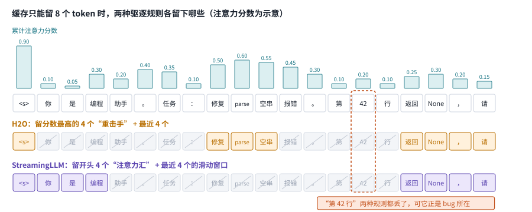

*图：同一段 20 个 token 的上下文，缓存预算 8 个。H2O 留下累计注意力最高的 4 个加最近 4 个，StreamingLLM 留下开头 4 个加最近 4 个；虚线框里的“42”两种规则都没留下。注意力分数为示意。*

第二条路是让一次读进来的东西多干点活。解码慢，是因为大模型每次读一遍权重只产出一个 token；如果能让它读一遍权重就确认好几个 token，等待就短了。2022 年底 Google 的 [Speculative Decoding](https://arxiv.org/abs/2211.17192)（`2211.17192`）和 2023 年初 DeepMind 的 [Accelerating Large Language Model Decoding with Speculative Sampling](https://arxiv.org/abs/2302.01318)（`2302.01318`）几乎同时提出了这个想法：先让一个便宜的草稿模型猜几个 token，再让要加速的那个大模型一次性检查。下文把后者叫作目标模型，它是现成的模型，推测解码不改它的参数；草稿模型是另外准备的小模型，只负责猜。下图是一轮的四步。草稿模型逐个猜出 4 个 token；目标模型对这几个位置做一次前向，只读一遍权重就把它们的概率一起算出来；然后从左往右逐个检查，目标模型给这个 token 的概率不低于草稿模型就直接收下，否则按两者之比的概率收下，一旦某个位置被拒绝，就在这里按修正后的分布重新采一个 token，后面的草稿全部作废。这套接受规则保证了输出的分布和直接用目标模型采样完全一致，后者报告在 70B 的 Chinchilla 上取得了 2 到 2.5 倍的解码加速。

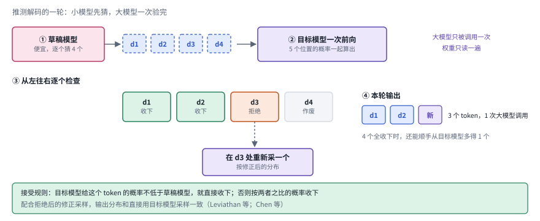

*图：推测解码的一轮。被拒绝的位置之后，草稿全部作废；绿色框里的接受规则保证输出分布不变。*

放到具体的 token 上，接受规则就是逐个比两个概率：目标模型给的概率不低于草稿给的，就收下；低于草稿给的，就按两者之比抛一次硬币。下图里第三个草稿 token 被拒，后面的草稿随之作废，可这一轮仍然只花一次目标模型前向，就拿到了三个 token。

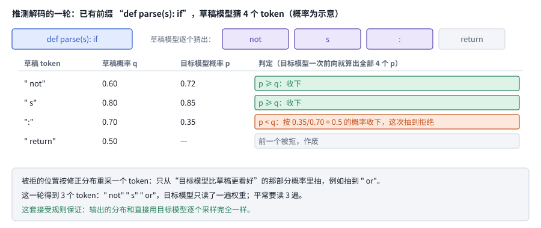

*图：推测解码在一段代码上的一轮。表中逐行写出草稿概率 q、目标模型概率 p 和判定；被拒的位置从修正分布里重采一个 token。概率为示意。*

草稿猜得越准，每轮收下的 token 越多。2024 年的 [EAGLE](https://arxiv.org/abs/2401.15077)（`2401.15077`）因此不再用独立的草稿模型猜 token，改为训练一个挂在目标模型上的小网络，叫草稿头，让它猜目标模型倒数第二层的特征，训练时拿目标模型在训练文本上真实算出的特征当答案，目标模型本身不动，再喂入提前一步的 token 序列来降低不确定性。《How To Scale Your Model》对推测解码的评价很到位：它用额外的运算换更低的延迟，在批量小、算力闲置时最有用。本章三.5 的新论文都在这条线上，讨论的是草稿从哪里来、缓存怎么省、任务变了怎么办。

**速查：缩小 KV 缓存的五种做法。** 五张卡都让解码每一步少读一些缓存，差别在压的是哪个因子：前三张压每个 token 存多少，后两张压保留多少个 token。

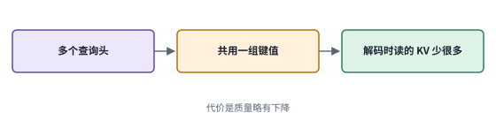 

 

*图：缩小 KV 缓存的五张结构卡，每张卡对应下表的一行。*

| code | 名称 | 年份 | 代表 | 怎么做 | 解决了什么 | 代价 |
|---|---|---|---|---|---|---|
| K1 | 多查询注意力 | 2019 | [MQA](https://arxiv.org/abs/1911.02150) | 所有注意力头共用一组键和值 | 解码时要反复读入的键值张量小了很多 | 质量略有下降 |
| K2 | 分组查询注意力 | 2023 | [GQA](https://arxiv.org/abs/2305.13245) | 若干个查询头共享一组键值；现成的多头模型用约 5% 的原始预训练计算就能改造过来 | 在多头注意力和 MQA 之间取折中，缓存缩小，质量更接近多头 | 要额外做一段改造训练；分组数是缓存和质量之间要调的一个旋钮 |
| K3 | 多头潜在注意力 | 2024 | [DeepSeek-V2](https://arxiv.org/abs/2405.04434) | 把键值压进一个低维的潜在向量，缓存里只存这个向量 | 报告的 KV 缓存比自家 67B 模型减少 93.3% | 多了一步压缩和投影，注意力的结构比多头注意力复杂 |
| K4 | 重击手驱逐 | 2023 | [H2O](https://arxiv.org/abs/2306.14048) | 按累计注意力分数保留少数“重击手” token，再加上最近的 token，其余驱逐 | 历史很长时缓存有了上限 | 被丢掉的部分，在某些任务上可能正是关键证据（三.6） |
| K5 | 注意力汇 | 2023 | [StreamingLLM](https://arxiv.org/abs/2309.17453) | 保住开头几个吸走大量注意力的 token，再加一个滑动窗口 | 能稳定地处理很长的输入流 | 窗口之外的中间内容被丢掉，需要精确回看的任务会受影响 |

**速查：让一次读入多干活的三种做法。** 三张卡的流程几乎一样，差别在草稿从哪里来：一个独立的草稿模型，还是目标模型自己的特征。卡片顶上一行写着这一轮要达成的目标，虚线上写着交给下一轮的东西。

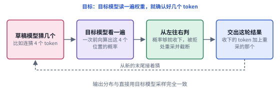 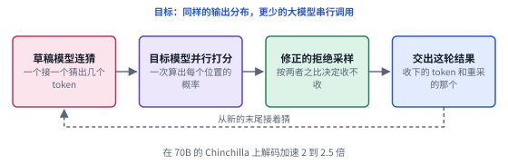

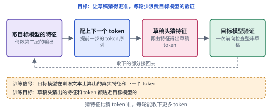

*图：推测解码的三张结构卡，每张卡对应下表的一行。*

| code | 名称 | 年份 | 代表 | 怎么做 | 解决了什么 | 代价 |
|---|---|---|---|---|---|---|
| S1 | 推测解码 | 2022 | [Speculative Decoding](https://arxiv.org/abs/2211.17192) | 草稿模型先猜几个 token，目标模型一次并行验证，按校正规则接受或拒绝 | 减少目标模型串行调用的次数，输出分布保持不变 | 要多养一个草稿模型；草稿被拒时花在它身上的计算白费 |
| S2 | 推测采样 | 2023 | [Speculative Sampling](https://arxiv.org/abs/2302.01318) | 与上一行几乎同时独立提出，配一套修正后的拒绝采样 | 在 70B 的 Chinchilla 上取得 2 到 2.5 倍的解码加速 | 用额外运算换延迟，批量一大、算力不再闲置时，账可能算不过来 |
| S3 | 特征级草稿 | 2024 | [EAGLE](https://arxiv.org/abs/2401.15077) | 草稿头去猜目标模型倒数第二层的特征，再喂入提前一步的 token 序列来降低不确定性 | 草稿猜得更准，每轮能收下更多 token | 草稿头要针对每个目标模型单独训练 |

### 第 3 层：很多请求一起来，调度成了算法

> **要点：** 许多请求同时到达时，难处在哪里？缓存怎么分配、开头相同的请求怎么复用、预填充和解码谁先谁后，本身就成了算法。一项模型层面的节省，要接进这些机制里才能变成真实的收益。

许多请求一起服务时，批处理会让吞吐和延迟互相拉扯。真实的服务里，几十上百个请求同时到达，长短不一，有的刚开始预填充，有的已经生成到一半。下图用一个 70 亿参数的模型算了一笔示意账：一次只服务一个请求，每一步要读 14 GB 权重和 2.4 GB 缓存，只写出 1 个 token；把 8 个请求拼成一批，读一遍权重就能服务 8 个请求，吞吐从每秒约 120 个 token 涨到约 480 个。代价也在图上：KV 缓存随批量线性增长到约 19 GB，每一步慢了一倍，新到的请求还要等下一批。《How To Scale Your Model》把这个两难放在推理一章的中心：同一套硬件，追求低延迟和追求低成本会走向完全不同的配置。

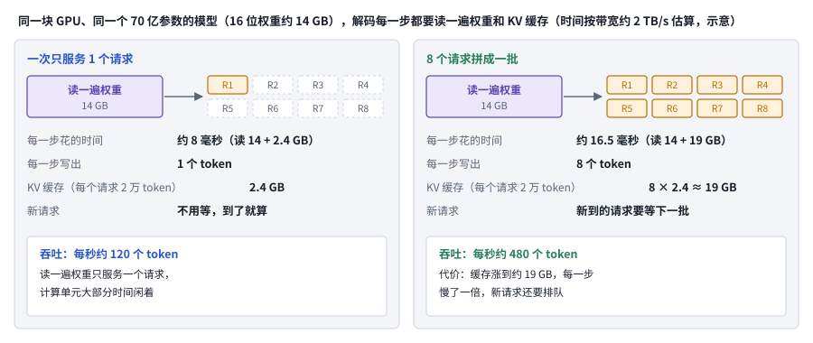

*图：同一个 70 亿参数的模型，一次服务 1 个请求和把 8 个请求拼成一批。时间按约 2 TB/s 的显存带宽估算，数字为示意。*

显存于是成了最紧的资源。每条序列最终有多长事先不知道，如果按最长可能预留连续的空间，大部分都会空着。2023 年的 [PagedAttention](https://arxiv.org/abs/2309.06180)（`2309.06180`）借用操作系统的分页思想，把每条序列的缓存切成固定大小的小块，写满一块再分配下一块，用一张块表记下每块放在显存的哪里，物理位置不必连续。碎片少了，同一块显存能装下更多并发请求，配套的 vLLM 也成了常用的开源推理引擎。块表还带来一个好处：两个请求开头相同，它们的第一块可以指向同一份缓存，只存一次。

同年的 [SGLang](https://arxiv.org/abs/2312.07104)（`2312.07104`）把这种共享推广成一棵基数树（RadixAttention）：根节点是所有请求共用的系统提示和工具说明，往下分出各段对话的历史，每来一个新请求，就沿树找到最长的公共开头，只有末端那段新输入需要重新预填充。这正是 Manus 那句“KV 缓存命中率最重要”在系统一侧的落脚点：agent 的系统提示、工具说明和对话历史大段重复，复用得好，预填充就能省掉一大半；可开头里改动一个字，这棵树就要从那里断开，后面的缓存全部作废。

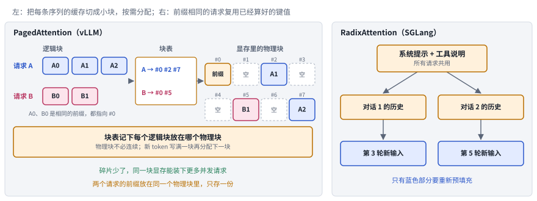

*图：左边是 PagedAttention 的块表与物理块（编号示意），相同的前缀共用一个物理块；右边是 RadixAttention 的前缀树。*

预填充和解码混在一起调度，又会互相干扰。一个带着长提示的新请求进来，它的预填充会占满一整批，正在解码的请求只能停下来等，用户看到的就是输出突然卡住。2024 年的 [Sarathi-Serve](https://arxiv.org/abs/2403.02310)（`2403.02310`）把长预填充切成大小相近的块，每一块和正在进行的解码拼在同一批里执行，解码就一直在往前走。同年的 [DistServe](https://arxiv.org/abs/2401.09670)（`2401.09670`）干脆把两个阶段放到不同的 GPU 上，前一组算完把 KV 缓存传给后一组，两组分别按首 token 延迟和每 token 延迟配置资源，代价是中间多了一次缓存搬运：一段长提示的 KV 缓存按前面的估算可达几个 GB，要整段从一组 GPU 传到另一组。下图把三种调度方式画在同一条时间轴上：A、B、C 三个请求正在逐 token 输出，新请求 D 带着 8,000 个 token 的提示进来。混在一起时，D 的整段预填充占满一批，A、B、C 一个字也出不来；Sarathi-Serve 把 D 切成 4 块、每块 2,000 个 token，每一批里 A、B、C 照样各出一个 token；DistServe 让第一组 GPU 做 D 的预填充，把约 1 GB 的 KV 缓存传给第二组，第二组只做解码，A、B、C 完全不受打扰。

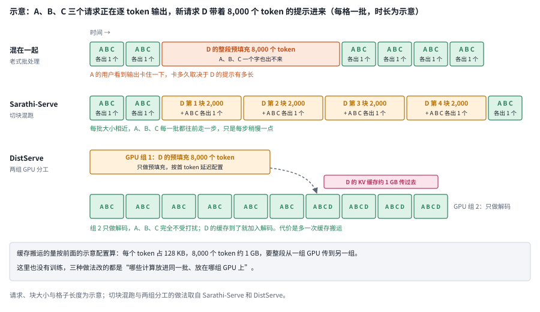

*图：一个 8,000 token 的新请求到来时的三种调度。横向是时间，每格是一批；第二行切块混跑，第三行分到两组 GPU。请求、块大小与格子长度为示意，1 GB 按前面每 token 128 KB 的示意配置算出。*

这一层的教训是，一项模型层面的节省，要接进这些批处理和缓存机制里才能变成真实的收益；接不进去，单独测时再快，上线后也可能变慢。跳层方法就是一个例子：它让简单的 token 跳过一部分层，理论上省了计算，可离开现代服务引擎单独运行时，反而变慢了。

**速查：第 3 层的四种做法。** 四张卡都让同样的硬件服务更多请求，差别在管的是哪件事：前两张管缓存放在哪里、能不能复用，后两张管预填充和解码谁先谁后。

 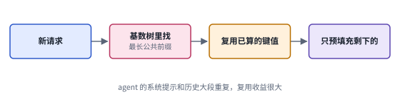

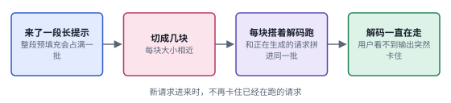 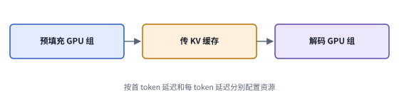

*图：第 3 层四种做法的结构卡，每张卡对应下表的一行。*

| code | 名称 | 年份 | 代表 | 怎么做 | 解决了什么 | 代价 |
|---|---|---|---|---|---|---|
| V1 | 分页 KV 缓存 | 2023 | [PagedAttention](https://arxiv.org/abs/2309.06180) | 借用操作系统的分页思想，把每条序列的缓存切成小块按需分配，用块表记录映射 | 碎片少了，同一块显存能装下更多并发请求；配套的 vLLM 成了常用的开源推理引擎 | 每个缓存状态的大小没有变；分页和管理信息也要占额外空间 |
| V2 | 前缀树复用 | 2023 | [SGLang](https://arxiv.org/abs/2312.07104) | 用基数树组织缓存，共享前缀的请求复用已经算好的键值 | agent 的系统提示、工具说明和历史大段重复，预填充能省掉一大半 | 收益取决于前缀是否稳定，前缀一改动，复用就从那里断开 |
| V3 | 切块预填充 | 2024 | [Sarathi-Serve](https://arxiv.org/abs/2403.02310) | 把长预填充切成大小相近的块，和正在进行的解码拼在同一批里执行 | 新请求进来时不会卡住已经在跑的请求 | 一段长提示要分好几批才算完，它自己的首 token 会来得晚一些 |
| V4 | 预填充解码分离 | 2024 | [DistServe](https://arxiv.org/abs/2401.09670) | 把两个阶段放到不同的 GPU 上，按首 token 延迟和每 token 延迟分别配置资源 | 两个阶段不再互相干扰，各自可以按自己的目标扩容 | 两组 GPU 之间要传 KV 缓存 |

### 第 4 层：每个 token 该分到多少计算

> **要点：** 每个 token 都走完全部层、用上全部参数，这样分配计算合理吗？这一层的方法改的是模型结构本身：有的让同一组层反复多算几遍，有的让难的输入多算、简单的少算，有的让每个 token 只用一部分参数，有的换一种保存历史的方式，让存下的东西不随历史变长。

第 4 层从架构入手，问每个 token 到底该分到多少计算，这条线索比前三层开始得更早，前三层讨论的都是给定一个模型怎样把它跑快。普通的 Transformer 对每个 token 一视同仁：不管是一个逗号还是一道题的关键一步，都走完全部层、用上全部参数。

第一种改法是让同一组层反复用。2017 年的 [Attention Is All You Need](https://arxiv.org/abs/1706.03762)（`1706.03762`）用注意力取代了循环网络，让序列中所有位置可以同时计算，奠定了今天大模型的基本结构。仅仅一年后，Dehghani 等人的 [Universal Transformers](https://arxiv.org/abs/1807.03819)（`1807.03819`）又把循环请了回来，这次换成在深度方向上循环：同一组层反复作用于每个位置的表示。Lilian Weng 在《Why We Think》里点明了它和普通 Transformer 的关系：循环步数固定时，它就等价于一个各层共用同一组参数的多层 Transformer。所以它省下的是权重，每多转一轮，运算就多一遍。

循环之后自然要问转几轮。Alex Graves 2016 年的 [Adaptive Computation Time for Recurrent Neural Networks](https://arxiv.org/abs/1603.08983)（`1603.08983`）给出的办法是自适应计算时间（ACT）：网络每走一步，一个停止单元给出停下的概率，累计够了就停；训练时除了任务本身的损失，每多走一步还要记一笔“思考代价”，停止单元因此学会在答得好的前提下早点停，于是简单的输入早点停、困难的输入多走几步。Universal Transformers 用它来决定每个位置的循环次数。Weng 评价说，这项工作早于大模型，却开创了同一个方向。

另一种改法是让每个 token 只用一部分参数。2021 年的 [Switch Transformers](https://arxiv.org/abs/2101.03961)（`2101.03961`）把一层里的前馈网络复制成很多份“专家”，由一个路由器为每个 token 只选其中一个，训练信号仍是语料里真实的下一个 token，另加一项惩罚专家负载不均的损失，这种结构叫混合专家（MoE）。专家越多，总容量越大，单个 token 的计算却保持不变；它把“模型大小”拆成了存储容量和活跃计算两项，同时带来了路由和负载均衡的新问题。

第四种改法从信息怎样保存入手。2023 年的 [Mamba](https://arxiv.org/abs/2312.00752)（`2312.00752`）则从信息怎样保存入手：注意力要为每个历史 token 都存键和值，Mamba 用选择性状态空间模型替代注意力，生成时只维护一个固定大小的状态，从一个 token 传给下一个，缓存因此不再随历史变长。下图把这四种分配方式和普通的层堆叠并排画出。

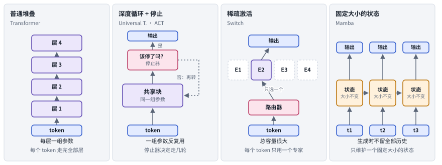

*图：每个 token 分到多少计算的四种方式。第二栏的虚线是停止器说“否”时绕回去再转一轮的路。*

2025 年，这条线迎来了转折：测试时让循环块多转几圈，推理表现就随之上升。Geiping 等人的 [Scaling up Test-Time Compute with Latent Reasoning: A Recurrent Depth Approach](https://arxiv.org/abs/2502.05171)（`2502.05171`）训练了一个 35 亿参数、用 8000 亿 token 训练的模型，在标准 Transformer 里放一个可以反复调用的循环块，某些情况下的计算负载相当于一个 500 亿参数的模型。下图上半部分是它的一次前向：开头几层（论文叫 Prelude）把输入变成向量，循环块从一个随机初始化的状态出发，每一轮读入上一轮的状态和重新注入的输入向量，转若干轮之后，由末尾几层（Coda）把状态变回下一个 token 的概率。下半部分是训练方式：训练信号是语料里真实的下一个 token，每个序列随机抽一个循环次数，平均 32 轮；为了让显存不随轮数增长，只对最后 8 轮做反向传播，这叫截断反传。

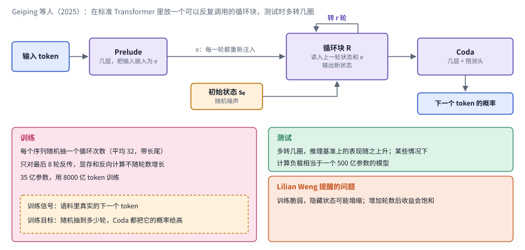

*图：循环深度模型的结构与训练方式。随机抽取的循环次数、只反传最后 8 轮等训练细节取自原论文。*

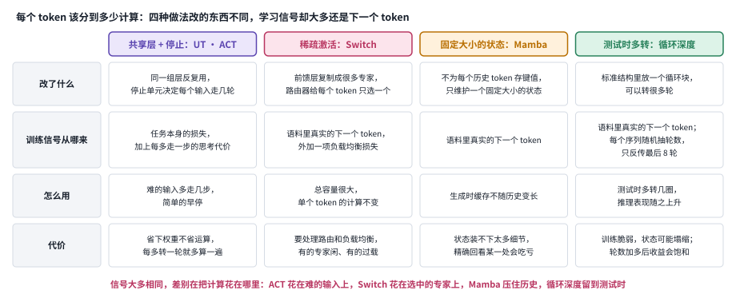

*图：第 4 层四种做法的对比。每一列是一种做法，四行依次是改了什么、训练信号从哪来、怎么用和代价。*

把这四种做法并排放，会发现它们的学习信号大多相同，差别在计算花在哪里。Switch Transformers、Mamba 和循环深度模型都拿语料里真实的下一个 token 当训练信号，Switch 另加一项负载均衡损失；ACT 用任务本身的损失，再给每多走一步记一笔思考代价。信号既然差不多，比较它们时就看计算花在了哪里：ACT 花在难的输入上，Switch 花在选中的专家上，Mamba 压住了要保存的历史，循环深度模型把多出的计算留到测试时。

循环深度模型也带来了新的训练问题。Lilian Weng 把这类工作看作纵向的“多想一会儿”，和横向多生成思维链 token 互为补充，也坦率地指出了它的问题：只反传最后几轮，隐藏状态容易塌缩成同一个值，需要小心调参；增加循环次数后的收益会饱和，能否外推到更多轮仍是未知数。由此引出四个问题：每多转一轮就多算一遍，那么循环的收益来自结构，还是来自多花的计算；共享参数被反复使用、隐藏状态容易塌缩，训练怎样才能稳定；ACT 让难的输入多走几步，那么哪些 token 值得多转几圈；Geiping 的模型要用 8000 亿 token 从头训练，已经训练好的模型能不能不重训也循环起来。

“循环”这个词在本章还有另外两种用法，读论文时要分清。下图左边是上面说的跨深度循环，同一个 token 的表示反复经过同一个共享块；中间是跨时间递归，状态从前一个位置传给后一个，Mamba 属于这一类；右边是工具循环，也就是开头那个 agent 与外部环境之间一轮轮的往返。三者的缓存方式、训练方法和验证要求各不相同。

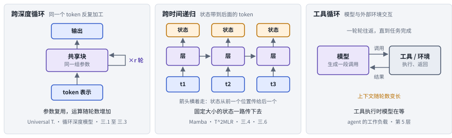

*图：三种循环。跨深度循环在同一个 token 上反复加工，跨时间递归把状态带到后面的 token，工具循环是模型和外部环境之间的往返。*

**速查：第 4 层的五种做法。** 五张卡都在决定每个 token 用多少计算，差别在调的是哪一项：ACT 调步数，Universal Transformers 和循环深度模型复用同一组层，Switch Transformers 调用到的参数，Mamba 调历史的保存方式。ACT 和 Universal Transformers 两张卡里那条回绕的虚线是“再走一步”的路，Mamba 卡里的虚线则把状态带到下一个 token。

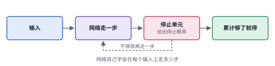 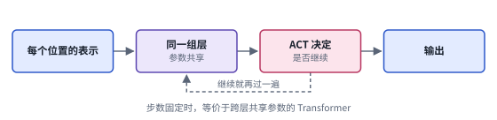

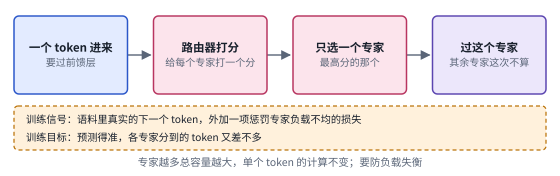 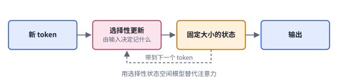

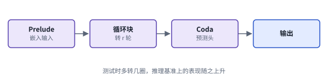

*图：第 4 层五种做法的结构卡，每张卡对应下表的一行。*

| code | 名称 | 年份 | 代表 | 怎么做 | 解决了什么 | 代价 |
|---|---|---|---|---|---|---|
| A1 | 自适应计算时间 | 2016 | [ACT](https://arxiv.org/abs/1603.08983) | 循环网络每走一步，停止单元给出一个停止概率，累计够了就停 | 网络自己学会在每个输入上走多少步，简单的输入可以早点停 | 停止判断本身会出错，也要花计算（三.3） |
| A2 | 深度方向的循环 | 2018 | [Universal Transformers](https://arxiv.org/abs/1807.03819) | 同一组层反复作用于每个位置的表示，循环次数可以由 ACT 决定 | 把循环请回 Transformer；步数固定时等价于跨层共享参数的多层模型 | 多转一轮就多算一遍，省下的只是权重 |
| A3 | 稀疏激活 | 2021 | [Switch Transformers](https://arxiv.org/abs/2101.03961) | 每个 token 只经过众多专家中的一个 | 总容量可以做得很大，单个 token 的计算保持不变 | 带来路由和负载均衡的新问题；全部专家的参数仍要放在显存里 |
| A4 | 选择性状态空间 | 2023 | [Mamba](https://arxiv.org/abs/2312.00752) | 用选择性状态空间模型替代注意力，生成时只维护固定大小的状态 | 缓存不再随历史长度增长 | 固定大小的状态在长上下文的精确回忆上吃亏，三.6 的 DART、Sparse Delta Memory 都在补这一点 |
| A5 | 循环深度模型 | 2025 | [Recurrent Depth](https://arxiv.org/abs/2502.05171) | 在 Prelude 和 Coda 之间放一个可以反复调用的循环块，训练时随机抽循环次数，只反传最后几轮 | 测试时多转几圈，推理表现随之上升，某些情况下计算负载相当于 500 亿参数的模型 | 训练脆弱，隐藏状态可能塌缩；增加轮数后的收益会饱和 |

### 第 5 层：放大到完整任务

> **要点：** 放大到一整个 agent 任务，成本又花在哪里？前几层的问题全都还在，又多了越来越长的多轮上下文、工具等待和多个 agent 并行。工程团队的经验是，在读远多于写的 agent 里，开头的缓存能不能复用，比解码快一点更能决定成本。

到了最外面的 agent 层，成本的大头是预填充和缓存命中率，Manus 的文章说得很直白：agent 的输入输出比大约是 100 比 1，上下文每一步都在变长，输出却往往只是一段结构化的函数调用，所以预填充和缓存命中率才是成本的大头。他们的前四条做法都为了让第 3 层那棵前缀树不断开：保持开头稳定，上下文只追加不回改，序列化时保证 JSON 键的顺序固定，以及不在任务中途增删工具。最后一条最巧妙：工具列表一改，开头就变了，所以他们让列表保持不动，改为在解码时屏蔽不该选的工具对应的 logits，也就是把那些选项的生成概率压到零。

前缀保得再稳，上下文终究会变得太长，Manus 的第五条做法因此是把文件系统当作外部记忆：网页正文可以从上下文里丢掉，只要留下 URL，需要时就能重新打开。这是一种可以恢复的压缩，和第 2 层那些丢了就找不回来的缓存驱逐正好互补。下图把这五条做法放到同一个修 bug 的 agent 上，每一行左边是会让缓存断开的写法，右边是 Manus 的写法。开头写一个精确到秒的时间，整段缓存每一步都从第一个 token 起失效；回头删掉第 3 步的输出，第 3 步之后的缓存全部作废；同一个调用今天先写 path、明天先写 line，token 就对不上；为了这一步只用浏览器而删掉其余 11 个工具，开头就变了，所以改为在解码时把那些工具名的概率压到零；一张 8,000 token 的网页存进文件，上下文里只留 URL 和路径。

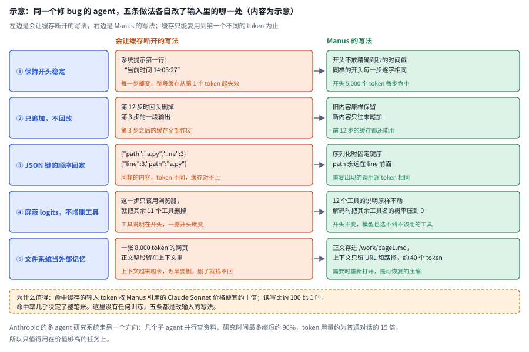

*图：Manus 的五条做法，放在同一个修 bug 的 agent 上，左边是会让缓存断开的写法，右边是 Manus 的写法；底部是 Anthropic 多 agent 系统在时间和 token 上的取舍。具体内容为示意。*

在任务层面，延迟和成本可以朝相反的方向变化，图的下排 Anthropic 的多 agent 经验说明了这一点：并行的子 agent 和并行的工具调用能把复杂查询的研究时间缩短最多 90%，总 token 用量却成倍上升，值不值取决于任务本身有多大价值。

这一层的研究目前还很零散。2026 年的综述 [Toward Efficient Agents](https://arxiv.org/abs/2601.14192) 开始把这些碎片收拢起来：它把 agent 的成本拆成 token 数、延迟和工具调用次数，主张同时看固定成本下的效果和固定效果下的成本，并按记忆、工具使用和规划三块梳理已有工作；它观察到的几条共同原则，比如给上下文设上限、在奖励里惩罚多余的工具调用，和 Manus 的经验遥相呼应。

**速查：第 5 层的三份经验。** 三张卡都在降低完整任务的成本，差别在出处和成熟度：两张来自工程复盘，一张来自综述，它们给出的更多是工作方式，离成套的方法还有距离。

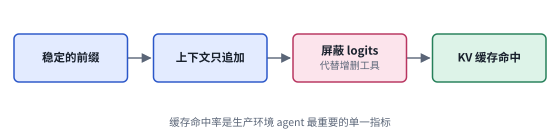 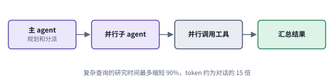

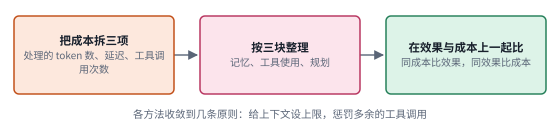

*图：第 5 层三份经验的结构卡，每张卡对应下表的一行。*

| code | 名称 | 年份 | 代表 | 怎么做 | 解决了什么 | 代价 |
|---|---|---|---|---|---|---|
| G1 | 上下文工程 | 2025 | [Manus](https://manus.im/en/blog/Context-Engineering-for-AI-Agents-Lessons-from-Building-Manus) | 前缀稳定、上下文只追加、固定序列化顺序、屏蔽 logits 限制动作、文件系统当外部记忆 | 把 KV 缓存命中率做高；按 Claude Sonnet 的价格，命中的输入 token 比未命中的便宜十倍 | 为了不破坏前缀，工具列表和上下文都不能随手改，设计上多了约束 |
| G2 | 多 agent 并行 | 2025 | [Anthropic 多 agent 研究系统](https://www.anthropic.com/engineering/multi-agent-research-system) | 主 agent 规划并分派，多个子 agent 并行工作、并行调用工具 | 复杂查询的研究时间最多缩短 90% | token 约为普通对话的 15 倍，只适合价值足够高的任务 |
| G3 | agent 效率综述 | 2026 | [Toward Efficient Agents](https://arxiv.org/abs/2601.14192) | 把成本拆成 token 数、延迟和工具调用次数，按记忆、工具使用和规划三块梳理已有工作 | 主张在效果与成本的帕累托前沿上比较方法，并整理了评测协议和效率指标 | 它是一份整理，各方法的数字来自不同设置，难以直接横向比较 |

### 边界：省下的东西能不能兑现

> **要点：** 省下的东西为什么常常兑现不了？范围每往外扩一层，局部节省被稀释或抵消的机会就多一些；已有研究里的负结果，准确地标出了兑现失败的位置。

局部的节省在梯子的每一层都可能兑现失败，就连最底层的估算也会落空。kipply 用纸笔估出 13B 模型单卡延迟约 16.8 毫秒，实测是 22.0 毫秒，差了约三成，原因是带宽达不到标称值、中间操作有额外开销、内核启动也要时间。往外走，到了服务层，排队和批处理会改变每个请求的实际延迟；到了任务层，工具等待和上下文重读又可能把模型层面的加速吞掉。已有研究里有不少负结果，比如门控循环省了内存却增加了延迟、跳层脱离服务引擎后反而变慢、复杂的缓存选择器输给了保护提示后的随机裁剪，它们的价值就在于准确地标出了这些兑现失败的位置。下图把它们按层排开。

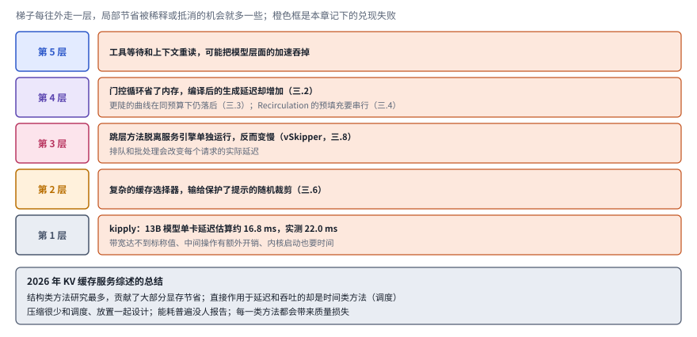

*图：省下的资源在梯子的每一层可能怎样漏掉。橙色框里的例子分别来自 kipply 的博客和 2026 年的论文。*

2026 年 7 月一篇关于服务系统中 KV 缓存优化的[综述](https://arxiv.org/abs/2607.08057)从更大的范围印证了这一点：研究最多的压缩类方法贡献了大部分显存节省，真正直接作用于延迟和吞吐的却是调度类方法，压缩又很少和调度、放置一起设计；能耗普遍没人报告，每一类方法都会带来质量损失，尾延迟和最坏情况下的失效也常常被平均指标掩盖。所以一份可信的性能报告至少要写明输入输出长度、并发数、请求到达的方式、设备、数值精度、缓存策略、质量要求和失败重试。只测单次模型调用，得到的是模型性能，离完整任务的成本还隔着好几层。

### 总对照：六族方法放在同一组坐标上

> **要点：** 拿到一篇新的效率论文，怎样很快看清它？先问三件事：它落在五层里的哪一层，省下的是哪一种资源，结果是精确的还是近似的。按这三问可以把前面的方法排进一张表，再看同一个改动在几种预算上各自是省是费。

| 家族 | 所在层 | 主要省下 | 精确还是近似 | 主要优点 | 主要代价 | 本章分支 |
|---|---|---|---|---|---|---|
| O 算子与低精度 | 第 1 层 | 显存读写、权重存储 | 融合与 FlashAttention 保持结果；量化是近似 | 不改模型结构就能提速或省显存 | 内核要贴着硬件写；量化误差会在层间累积 | 三.7 |
| K 缩小 KV 缓存 | 第 2 层 | KV 存储和每步读取 | MQA、GQA、MLA 改了模型结构；驱逐是近似 | 解码每步读得少，同样显存能放下更大的批量 | 结构改动要训练；驱逐可能丢掉关键证据 | 三.6 |
| S 推测解码 | 第 2 层 | 串行等待 | 满足校正条件时保持目标分布 | 延迟下降，输出分布不变 | 草稿成本和拒绝浪费；批量大时收益缩小 | 三.5 |
| V 服务与调度 | 第 3 层 | 排队、碎片、重复的预填充 | 保持结果 | 同样的硬件服务更多请求 | 新方法要和这些机制兼容，工程量大 | 三.8 |
| A 计算分配架构 | 第 4 层 | 独立权重或每 token 计算 | 改变了模型本身 | 能按 token 或按难度分配计算 | 训练不稳、停止判断出错；省权重时常常多花计算 | 三.1 至三.4 |
| G agent 工作负载 | 第 5 层 | 重复预填充、等待时间 | 保持结果 | 直接作用于完整任务的成本和时间 | 研究零散，缺少统一的评测 | 三.4、三.6、三.8 |

表里“精确还是近似”一列分的是加速有没有改变输出。精确的加速保持输出不变，或者保持输出的概率分布不变，满足校正条件的推测解码就属于这一类；近似的加速接受一定误差，换取存储或速度，量化、跳层和缓存裁剪属于这一类。近似方法完全可以可靠，前提是讲清误差有多大，并给出完整的质量随成本变化的曲线，只挑最省的那一个点来报告是远远不够的。

同一个改动在几种预算上常常是有省有费。下图每一行是一种做法，每一列是一种预算，绿色表示这一项省了，橙色表示多花了或者带来风险，灰色表示基本不变，虚线表示要看具体实现。循环复用省下了权重，却多花了运算和串行等待；MoE 用很大的总参数换来不变的激活计算；量化省下存储，风险落在误差上；推测解码多养一个草稿器来换更短的串行等待；缓存裁剪省下存储和读取，却可能丢掉关键证据。没有哪一行是全绿的。

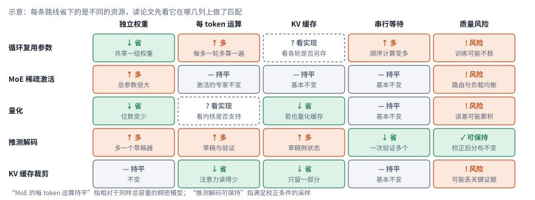

*图：五种做法在五种预算上的升降（示意）。每格第二行写出原因；“质量风险”一列是这条路线最常见的失效方式。*

把六族方法和第三节的八个分支放进同一个格子，会看到第 4 层那一列最拥挤，这正是循环架构的争议所在。下图横轴是梯子的五层，纵轴是主要省下的资源，青色的标签是第二节的方法家族，灰色的是第三节的分支。第 4 层那一列里，前四个分支都挤在“运算量”和“权重存储”两行上，这正是循环架构的争议所在：省下权重和多花运算往往同时发生。

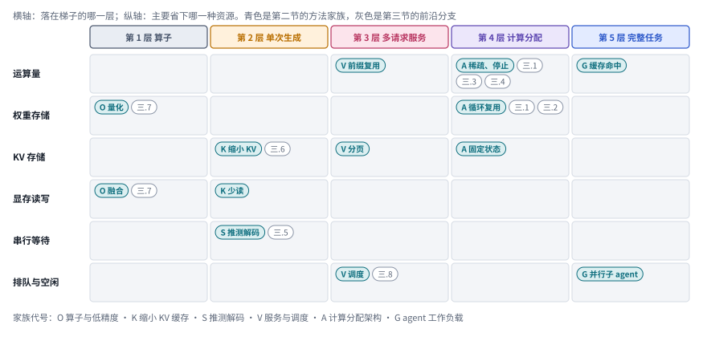

*图：方法家族与前沿分支在两条轴上的位置。一个分支可以出现在好几格里，表示它同时动了几种资源。*

## 三、前沿研究方向

下面八个分支收录的都是 2026 年的新论文。前四个分支集中在主线的第 4 层，讨论循环与自适应深度这类“给每个 token 分配计算”的架构问题；后四个分支沿着第 2、1、3 层往外走，分别对应推测解码、长上下文缓存、低精度和完整服务。读这些论文时，建议始终带着两个问题：它省下的是哪一种资源，它用什么证据说明这份节省在完整任务上依然成立。

> **本节要点：** 2026 年的新论文在追问什么？大多是同一个问题：某一种节省能不能兑现成完整任务上的收益。前四个分支落在模型结构上，后四个依次落在单次生成的解码和缓存、数值精度以及多请求的服务上。

### 1. 公平比较：循环收益来自结构，还是额外计算？

循环模型比普通模型分数高时，首先要问的是：它是因为结构更好，还是因为多算了？让同一组参数多转几轮，模型就能在不增加权重的情况下获得更深的计算路径。这听上去像是白捡的深度，可我们等待的是完整结果，参数文件变小本身并不缩短等待，多转的每一轮都要花时间、花运算。和不共享参数的模型比较时，“参数量相同”与“每 token 运算量相同”是两种条件，循环之外的输入输出模块、注意力的组织方式、是否提前停下，又都会改变每一轮的成本。这个分支的论文首先就是在把比较条件厘清。

> 主线位置：第 4 层，循环深度的公平比较。接 Universal Transformers 的跨层共享参数和 Geiping 等人的循环深度模型，同时借用 Switch Transformers 把“总容量”和“活跃计算”分开记账的思路。

> **要点：** 循环模型比普通模型分数高，是结构更好，还是多算了？答案取决于对齐了哪几项预算：运算、参数和缓存三项同时对齐，剩下的收益才有把握归给结构；只说对齐了计算，背后的口径可能不同。这组工作还试了另外两种加计算的办法：把共享细到专家一级，或者把额外计算加在序列方向。

比较条件选得不同，结论就不同：只有运算、参数和 KV 缓存几项同时接近相等，剩下的差别才有较大把握归给结构。下图上排是同一个循环模型在三种比较条件下的样子。按参数相同来比，循环模型每个 token 的运算明显多出一截，分数高了也说不清是结构好还是多算了；按每 token 运算相同来比，参数这一项又对不齐了；三项同时对齐，才是第三种、也是最有说服力的条件。

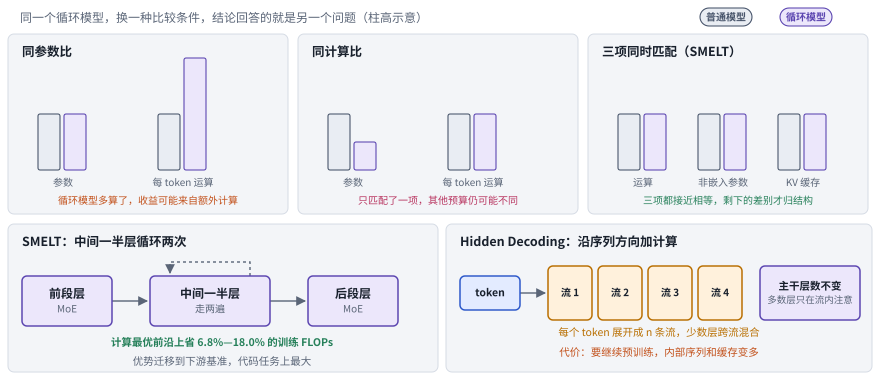

*图：上排是循环模型的三种比较条件（柱高示意），下排是 SMELT 的中间层循环和 Hidden Decoding 的沿序列扩展。*

真正把预算账算细的是 **SMELT（`2609.01343`）**。它研究循环的 MoE 模型，设计是前段层和后段层各走一遍、中间一半层走两遍，并在每 token 运算量、非嵌入参数和 KV 缓存三项都接近匹配的条件下和普通模型比较。为了说明节省了多少，作者对每种结构拟合了计算最优前沿，也就是在不同训练预算下，通过选择模型规模和训练量所能达到的最低损失。[论文](https://arxiv.org/abs/2609.01343)报告，循环结构在这条前沿上节省 6.8% 到 18.0% 的训练 FLOPs，优势还迁移到了下游基准，其中代码任务上的收益最大。三项预算同时匹配之后仍然观察到收益，这项实验就排除了“只是多算了”这个最主要的混杂因素。当然，这些结果有其模型规模、数据和拟合范围，训练计算上的节省也没法按相同比例换算成推理服务的加速。

同样写着“计算匹配”，预算口径却未必相同，**Loop the Loopies!（[`2607.16051`](https://arxiv.org/abs/2607.16051)）** 和 SMELT 放在一起读就能看到这一点。它同样在计算匹配的条件下比较循环 MoE 和普通 Transformer，可两篇的 matched compute 背后，预训练数据、有效层数、激活专家数、训练时长和调参范围都可能有差别。更有说服力的做法是报告完整的质量与计算曲线，避免拿某个循环模型的最佳点去对照普通模型一个没有调好的点。

共享参数不一定要以整个循环块为单位。**MoRE（[`2609.18176`](https://arxiv.org/abs/2609.18176)）** 让邻近几层共用一个专家池，再给每层一个深度嵌入，让专家知道自己正在服务哪一层。它让人看到，参数复用可以有很多种粒度，共享整层、共享专家、共享缓存，各自带来的信息约束都不一样。真正的研究问题是哪些模块确实在重复做相似的事，哪些位置必须保留独立的容量；把一切权重共享都笼统地叫作“更深的思考”，会把这些区别抹掉。

**[Hidden Decoding at Scale](https://arxiv.org/abs/2607.08186)**（`2607.08186`）换了一个方向加计算。它不沿深度循环，把每个 token 展开成几条内部计算流，多数层只在流内做注意力，少数层跨流混合，主干的层数一层没加。代价是需要继续预训练，内部序列和缓存也变多了。拿它和深度循环比较大规模训练下的兼容性很合适，只是要记住“主干没有扩大”的意思仅限于层数，训练和推理成本都实打实地增加了。

### 2. 稳定循环：重复访问会改变训练动力学

循环模型训练起来很脆弱，根源在于共享参数被多次使用，Lilian Weng 介绍循环深度模型时特意提到，隐藏状态可能塌缩成同一个值。具体说，同一次参数更新会同时作用于好几轮计算，对某一轮有利的变化，可能破坏另一轮；梯度的大小和状态的分布，也可能随循环次数一起漂移。截断反传又加了一层困难：只有最后几轮拿得到梯度，早期轮次很难学会为后面铺路。所以研究循环的稳定性，要把初始化、归一化、训练时的轮数和测试时的轮数分开来看，还要观察多轮之后的状态是否收敛到有用的结果，训练损失下降只是其中一个信号。

> 主线位置：第 4 层，循环模型怎样训得稳。接 Geiping 等人在循环深度模型中用到的随机循环次数与截断反传，以及 Universal Transformers 的共享参数结构。

> **要点：** 同一组参数被反复使用，训练怎样才能稳？这组论文从三处下手：调各层输出叠加回去时的缩放，用门控限制每一轮改动多少，或者改训练信号，让每一轮都有自己的学习目标。

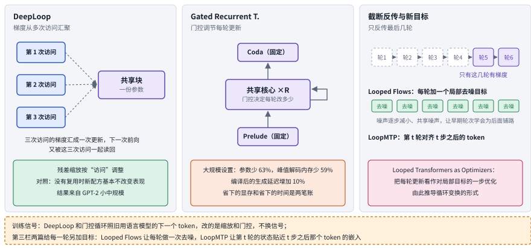

*图：稳定循环的三种思路。左栏的对照来自 DeepLoop，中栏的数字来自 Gated Recurrent Transformers 摘要中的大规模设置，右栏是三篇改训练信号的工作。*

从残差缩放下手的 **DeepLoop（`2607.13491`）** 指出，普通深层网络那套成熟的残差缩放规则在循环模型里会失效，缩放要按访问次数来调。那套规则用来控制每一层对总输出贡献多大；可在循环模型里，同一个共享块在一次前向里被访问好几次，几次访问的梯度汇成一次更新，下一次前向又被几次访问一起用上，所以缩放要按访问次数来调。[论文](https://arxiv.org/abs/2607.13491)据此修改了缩放配方，结果来自所测的小中规模语言模型，还谈不上对任意架构的稳定性保证。它设计了一个很好的对照：没有参数复用时，新配方基本不改变表现，只有启用复用后才显出收益，可见收益确实来自对复用的处理。

缩放之外，也可以直接限制每一轮改动多少，**Gated Recurrent Transformers（`2608.15062`）** 用门控做这件事。它在固定的输入和输出模块之间放一个共享核心，用门控决定每一轮的更新改动多少，免得某一轮把状态推得太远。[论文](https://arxiv.org/abs/2608.15062)坦率地给出了一项具体的权衡：参数量和峰值解码内存都大幅下降，可在某个大规模设置下，编译后的生成延迟增加了 10%。这算不上失败，它把省了什么、付出了什么都摆在了明处，正好印证了第 1 层的判断：省下的显存和省下的时间是两笔账。

前两篇改的是结构里的数值，剩下三篇从训练信号入手，处理截断反传带来的早期轮次学不到东西的问题。**Thinking with Looped Flows（[`2609.11801`](https://arxiv.org/abs/2609.11801)）** 给每一轮加上局部的去噪目标，噪声逐轮减小，早期轮次也就拿得到自己的训练信号；**LoopMTP（[`2608.03624`](https://arxiv.org/abs/2608.03624)）** 让第 t 轮去预测 t 步之后的 token，让不同轮次分担不同远近的预测；**Looped Transformers as Optimizers（[`2609.37379`](https://arxiv.org/abs/2609.37379)）** 把每一轮状态更新解释成对某个局部目标的一步优化，由此推导出循环变换的形式。前两篇改变了训练信号，后一篇约束了变换的结构。它们都提供了有用的设计工具，可哪一篇都没有证明多转几轮总是有效，在训练范围之外的轮数和不同任务上，稳定性仍然要单独测。

### 3. 深度诊断与自适应：更陡的曲线也可能更差

评价一种动态深度方法，得在相同的平均预算下比较计算在样本之间分配得合不合理，因为停止判断本身也会犯错。Graves 提出自适应计算时间时的愿景很美好：简单的输入早点停，困难的输入多想一会儿。可停早了可能漏掉必要的推理，停晚了可能在错误的方向上越陷越深，只看最大深度下的表现会把这些问题藏起来。深度带来的收益、做停止判断的成本、以及分布变化之后停止判断是否依然准确，这三件事要分开测。

> 主线位置：第 4 层，自适应深度。接 Adaptive Computation Time 和 Universal Transformers 的动态停止，也回应 Lilian Weng 对循环深度“增加轮数后会饱和”的疑问。

> **要点：** 多转的那几轮值不值？三篇工作的问法不同：比较哪类任务受益，检查把循环截短来测收益的做法准不准，让每个 token 自己决定转几轮。合起来的教训是，曲线涨得快的方法，在相同计算下仍可能落后。

多转几轮并非对所有任务都有用，**What Makes Recurrence Effective（`2609.36636`）** 在知识类和推理类任务上比较了训练范围内外的循环次数。[论文](https://arxiv.org/abs/2609.36636)报告，推理任务可以从更多循环中受益，知识任务的表现却会下降，难题也不总是能从更多轮计算中获益；输入输出层的布局、历史状态如何注入、是否告诉模型当前是第几轮，都会影响结果。所以循环次数没法当作普遍有效的“思考预算”来用，困难样本也不会自动地值得多算。

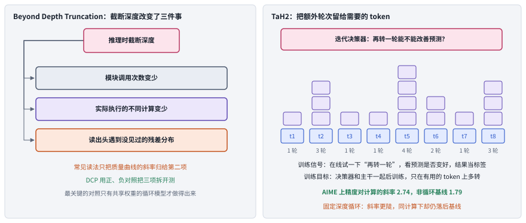

*图：左边是深度截断同时改变的三件事，右边是 TaH2 按 token 分配循环次数（每个 token 的轮数为示意，数字取自论文摘要）。*

判断多转的几轮有没有用，常见的测法本身就不可靠，这是 **Beyond Depth Truncation（`2609.19934`）** 的发现。常见的测法是推理时把循环截短，看质量掉多少，可它同时改变了三件事：模块调用的次数变少了，真正执行的不同计算变少了，最后负责读出结果的那一层还被放到了训练时没见过的输入分布上。常见的读法把质量的下降全部归给第二件事，可第三件事本身就会造成损伤。[论文](https://arxiv.org/abs/2609.19934)用一组正、负对照把三件事拆开来测。这和 Horace He 强调的“先诊断再优化”是一个道理，诊断工具不可靠，后面的结论就跟着不可靠。

前两篇做的是诊断，**TaH2（`2609.35748`）** 则动手分配，让每个 token 决定自己转几轮。它训练一个决策器，对每个 token 判断再转一轮能不能改善预测，于是有的 token 走了 4 轮，有的只走 1 轮；决策器和主干一起后训练，监督信号是在线得到的“再转一轮是否更好”的标注。[论文](https://arxiv.org/abs/2609.35748)先指出一个容易被忽视的现象：一些循环模型的准确率随计算增长得更快，可因为起点低，在相同的计算点上仍然落后于普通模型。按 token 分配之后，它把增长的速度和同计算下的水平都提了上去。剩下的开放问题是决策器本身的开销、判断失误的代价，以及换到别的任务还准不准。

曲线更陡、起点更低的方法在相同计算下仍会落后，所以一份可信的报告要同时给出相同预算下谁做得更好、达到相同质量时谁花得更少，下图是 TaH2 指出的这个现象的示意。方法 B 的曲线更陡，投入越多涨得越快，可它的起点低得多，在竖虚线标出的实际可用预算处，它的质量仍然落后于方法 A；横虚线代表一个质量门槛，A 用更少的计算就跨了过去。单凭斜率来概括测试时多算的能力，很容易得出误导性的结论。

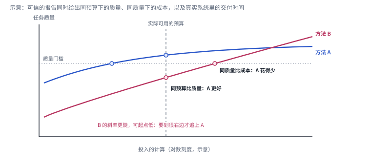

*图：质量与成本曲线的两种读法（示意）。竖线是同预算比质量，横线是同质量比成本；两条曲线要到很右边才相交。*

### 4. 冻结模型与局部回流：有些循环可以免去重训

前面三个分支的循环模型大多要从头训练或者大规模继续预训练，成本很高，所以有人转而在现成的模型上动小手术，让它把深层算出的东西送回浅层再用一遍。这类局部修改便宜得多，可也受制于原模型已有的表示和接口。而且冻结权重往往伴随着别的组件要训练，适配器、停止判断或选择规则都可能需要学习。比较这类方法时，要说清楚哪些组件被训练了、哪些输入被重复处理了，以及新增的计算是在提供新信息，还是只把已有的错误再重复一遍。

> 主线位置：第 4 层向第 5 层过渡。架构上接 Universal Transformers 的深度循环和跨时间递归，任务上接 agent 的工具循环；预填充代价的分析则回到第 2 层的预填充与解码之分。

> **要点：** 已经训练好的模型，能不能不重训也循环起来？这组工作把深层的信号送回浅层，省掉从头训练的成本，差别在送什么、送到哪里：只送两层之间新增的信息，送给下一个 token，或者在推理时送回较早的层，最后一种的代价落在预填充上。还有一篇把循环模型拿到多步工具调用上检验。

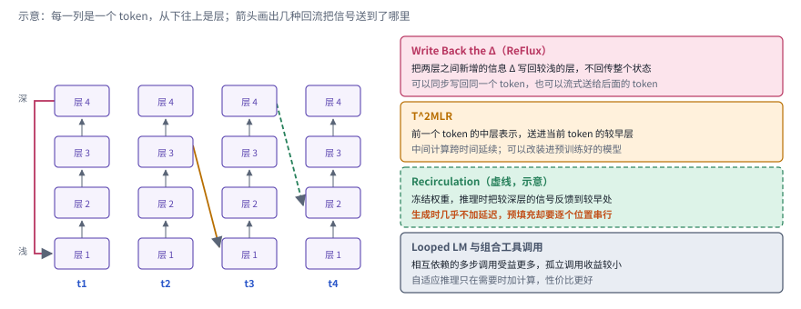

*图：几种回流把信号送到了哪里（示意）。每列一个 token，自下而上是层；右侧是每篇工作的要点与代价。*

**Recirculation（`2608.17981`）** 冻结模型权重，在推理时把较深层的信号反馈到较早处，让现成模型对同一段输入多加工一遍。[论文](https://arxiv.org/abs/2608.17981)有一个很重要的限制：生成阶段增加的延迟很小，预填充却要逐个位置串行处理。开头那个每读 100 个 token 才写 1 个的编程 agent，正是长提示、短回答的任务，预填充的代价很可能决定净收益是正是负；只展示生成速度，就会把主要成本藏起来。

同样把信号送回较浅的层，**Write Back the Δ（[`2609.32457`](https://arxiv.org/abs/2609.32457)）** 回传得更省：它只把两层之间新增的那部分信息写回较浅的层，避免回传整个状态，并且学习怎样选择和组合回流的路径。

**T^2MLR（[`2607.15178`](https://arxiv.org/abs/2607.15178)）** 把信号送往另一个方向：前一个 token 的中间层表示，被送进当前 token 的较早层，让中间计算跨越时间延续下去。它既不是对同一个 token 反复做完整前向，也和把文字笔记写进上下文不同，属于第 4 层说的跨时间递归，也就是把状态从前一个 token 带到后面的 token。

循环带来的收益要放到真实任务里检验，**Looped Language Models Improve Compositional Tool Calling（[`2608.18171`](https://arxiv.org/abs/2608.18171)）** 在工具调用任务上做了这件事，发现收益取决于任务结构。它区分了孤立的调用和相互依赖的多步调用：后者需要把前一步的结果用到下一步，受益更多，孤立调用的收益较小。所以收益来自任务结构，没法笼统地全部归功于工具调用格式写得更准。

这组研究共同提出了一个问题：哪些状态值得再加工一遍，哪些状态可以跨步保留？一个可行的实验是固定底座模型和输出预算，分别改变反馈的位置、反馈的内容和循环次数。如果同时增加了可训练模块和测试时计算，就应当承认结论属于整个新系统，把功劳全部记在“冻结模型也能循环”上是不公平的。

### 5. 推测解码：草稿质量、缓存与工作负载共同决定收益

推测解码的收益要把草稿成本、验证成本、每轮收下的 token 数和并发条件放在一起算，它的账只是看起来简单，下图按示意成本算了两种情形。草稿每轮猜 4 个，接受率 0.8 时平均每轮收下约 3.4 个 token，每个 token 只花不用推测解码时的四成多；接受率掉到 0.3，平均每轮只收下约 1.4 个，被拒之后的草稿全部作废，花在它们身上的计算白费，账几乎打平。接受率又会随着领域、草稿中的位置和上下文变化，固定的草稿长度不一定适合所有任务。《How To Scale Your Model》提醒过，推测解码是用额外运算换延迟，在批量小时最划算，批量一大、算力不再闲置，验证那一步也不再便宜，账就可能算不过来。这个分支的论文都按这本总账来算，单单比较一次生成了多少候选 token 说明不了什么。

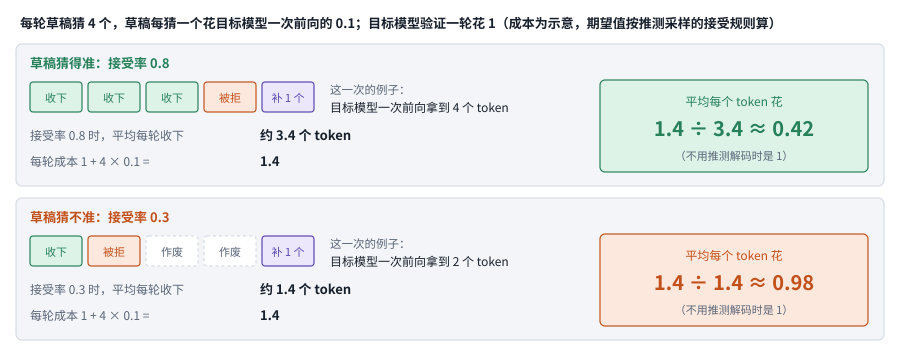

*图：同样每轮猜 4 个草稿，接受率 0.8 和 0.3 时平均每个 token 的花费。成本为示意，期望收下的 token 数按推测采样的接受规则计算。*

> 主线位置：第 2 层，让一次读入的权重多干点活。接 Speculative Decoding、Speculative Sampling 的校正规则和 EAGLE 的特征级草稿。

> **要点：** 推测解码的收益还能从哪里挖？这组论文各改流水线上的一环：草稿从哪里来，草稿侧要存多少状态，验证怎么排，以及目标模型本身在变时怎么办。改动越深，越要分清它还能不能保证输出分布不变。

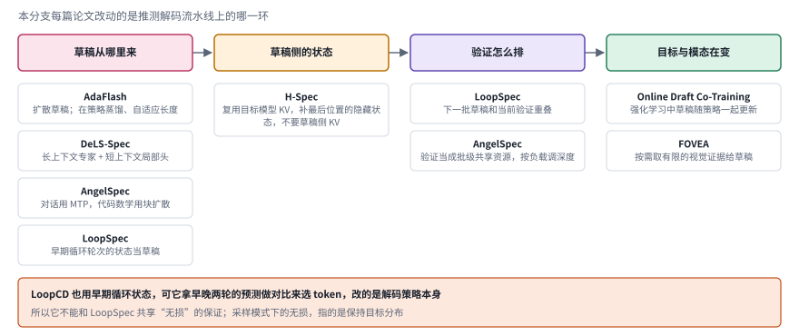

*图：推测解码流水线上的四个环节和改动各环节的论文；LoopSpec 和 AngelSpec 同时动了两环。*

草稿本身的质量是第一环，这里负责猜 token 的一方统称草稿器，它可以是独立的草稿模型，也可以是挂在目标模型上的草稿头。扩散式草稿器在这里有个特别的问题：它能一次并行写出好几个位置，可各个位置的质量参差不齐。**[AdaFlash](https://arxiv.org/abs/2607.19223)**（`2607.19223`）分析了这种草稿器在不同领域、不同位置上的接受率波动，用在策略蒸馏让它适应部署时的分布，也就是草稿器在自己写出的草稿上向目标模型学习，再用一个自适应长度的输出头决定每次猜几个。它把草稿的训练和运行时的分配联系了起来，并行草稿是否越长越快，要靠数据说话。

草稿器的结构、任务分工和状态开销也都可以改，下面三篇各改一项。**DeLS-Spec（[`2607.07409`](https://arxiv.org/abs/2607.07409)）** 把固定的并行草稿器当作长上下文的专家，再加一个可以单独训练的短上下文局部头；**AngelSpec（[`2607.25852`](https://arxiv.org/abs/2607.25852)）** 让对话交给一种草稿器，代码和数学交给另一种，并把验证当成整批请求共享的资源来排。**H-Spec（[`2609.24197`](https://arxiv.org/abs/2609.24197)）** 盯着第 2 层的老问题，也就是显存：草稿模型本来也要存一份自己的 KV 缓存，H-Spec 改为复用目标模型的缓存，再补上最后一个位置的隐藏状态，从而省掉这一份。三篇分别处理草稿结构、任务分工和状态开销，仅凭每轮收下的 token 数没法给它们排出一个公平的总榜。

循环模型给推测解码提供了一个天然的草稿来源：早期轮次的状态已经能给出一个粗略的预测。**LoopSpec（`2609.17184`）** 用早期轮次的状态产生草稿，用后期状态验证，并让下一批草稿和当前的验证重叠起来。[论文](https://arxiv.org/abs/2609.17184)宣称在其校正机制下实现了无损解码。在采样模式中，“无损”的含义是保持输出的概率分布，任意两次随机运行逐 token 相同并不在承诺之内。**LoopCD（[`2610.02185`](https://arxiv.org/abs/2610.02185)）** 也用早期状态，可它拿早晚轮次之间的差异当信号来挑 token，改变的是解码策略本身，所以不能和 LoopSpec 共享同样的无损保证。

草稿要跟上的东西也可能在变：目标模型可能还在训练，多模态任务需要的视觉信息也随时不同。**Online Draft Co-Training（[`2609.07108`](https://arxiv.org/abs/2609.07108)）** 研究在长时间的强化学习训练里，草稿器和目标模型一起更新时会遇到哪些系统障碍；**FOVEA（[`2608.22883`](https://arxiv.org/abs/2608.22883)）** 研究多模态草稿在什么时候需要多少视觉信息，指出给草稿加多少视觉输入，要和草稿任务真正的信息需求相匹配。下一步的实验应当同时报告草稿计算、接受率、验证成本和每个请求的缓存占用，并且分清固定不变的目标、正在训练的目标，以及视觉信息不断变化的任务。

### 6. 长上下文：压缩历史，不能把关键证据一起删掉

长上下文的成本有三块：处理输入要花的算力，存储缓存要占的显存，以及每一步都要把缓存读一遍的带宽。一个修 bug 的编程 agent 跑到第五十步时，上下文里已经堆满了文件内容、测试输出和之前的思考，三块成本都在涨。滑动窗口、状态压缩和外部检索都改变了信息被访问的方式，对需要精确回看某一行代码的任务，影响可能和对只需要大意的任务完全不同。比较这类方法时，要检查质量退化发生在哪一类依赖上，还要确认预填充和解码两个阶段的成本都被算了进去。

> 主线位置：第 2 层，KV 缓存的裁剪与压缩，同时触及第 5 层 agent 的上下文管理。接 H2O、StreamingLLM 的缓存驱逐，MQA、GQA、MLA 的结构性压缩，以及 Mamba 的固定大小状态；Manus 的“可恢复压缩”可以作为任务层面的参照：网页正文可以从上下文里丢掉，只要留下 URL，需要时就能找回。

> **要点：** 上下文越来越长，成本该从哪一块压？这组方法各压一块：只留一部分缓存，同时省存储和读取；把缓存挪到主机内存，只省显存；用固定大小的状态代替逐 token 的缓存；复用别处做好的预填充。“读得少”和“存得少”要分开评估。

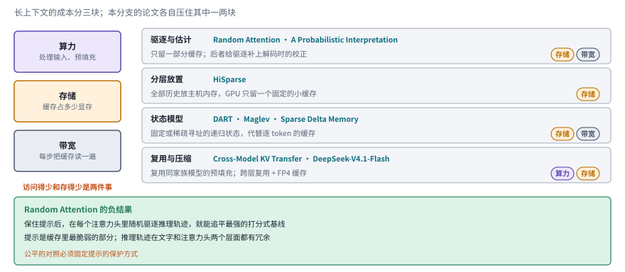

*图：长上下文的三块成本与四类做法，标签表示每类主要压住的成本；底部是 Random Attention 的发现。*

驱逐这条路先要读一个负结果：保住提示之后，复杂的选择规则比随机裁剪强不了多少。**Random Attention（`2609.03430`）** 保留提示，然后在每个注意力头内随机裁剪推理过程留下的缓存，在测试设置中观察到的正是这样。[论文](https://arxiv.org/abs/2609.03430)用对照实验解释了原因：缓存里最脆弱的是提示，各种选择规则之间的差距，大多只是看谁碰巧保住了提示；推理过程则自带冗余，模型在文字里会反复重述还需要的信息，各个注意力头也各自留着一份，所以提示保住之后，随机留下的部分已经够用。结论是有条件的：原始提示依然重要，KV 也绝非可以随便删。StreamingLLM 当年发现，丢掉开头那几个吸走大量注意力的 token，长输入就处理不稳，同样说明保住哪一部分比删掉多少更要紧。所以公平的对照必须固定提示的保护方式。

驱逐之外，还要分清“访问得少”和“存得少”，下面两篇正好各占一边。**A Probabilistic Interpretation of KV Cache Eviction（[`2608.28293`](https://arxiv.org/abs/2608.28293)）** 给驱逐补上了统计视角：只保留一部分 token 算注意力，相当于用一个样本去估计全体的期望，它讨论了解码时怎样对被删除的部分做校正，H2O 那种按累计注意力分数保留少数 token 的规则可以放进这个框架里理解。**HiSparse（[`2608.07009`](https://arxiv.org/abs/2608.07009)）** 面对的是另一种瓶颈：稀疏注意力每一步只访问少量位置，可全部历史仍然要放在显存里。它把全部历史放进主机内存，GPU 上只留一个固定大小的小缓存，模型输出保持不变，代价是主机和设备之间的传输：主机内存到 GPU 的通道比显存带宽慢得多，每一步要用到的那些位置都得临时传上来。前者研究近似带来的偏差，后者研究状态应该放在哪里，这正是“访问得少”和“存得少”的区别。

状态模型提供了更彻底的替代，思路和 Mamba 一脉相承，生成时只维护一个固定大小的状态，用不着保存逐 token 的缓存。它的弱点是固定大小的状态装不下太多细节，精确回忆长上下文里的某一处会吃亏。**DART（[`2608.02032`](https://arxiv.org/abs/2608.02032)）** 把递归状态看作一种键值存储，据此改造读取方式；**Maglev（[`2608.02870`](https://arxiv.org/abs/2608.02870)）** 使用固定容量的记忆；训练时另用一个能看全部历史的模型算出记忆该是什么样，一致性约束要求固定容量的记忆贴近它；**Sparse Delta Memory（[`2607.07386`](https://arxiv.org/abs/2607.07386)）** 用稀疏寻址扩大递归状态的容量。

最后两篇走的是复用路线，省掉的是重复的预填充。**Cross-Model KV Cache Transfer（[`2608.03893`](https://arxiv.org/abs/2608.03893)）** 利用同家族模型之间的线性关系，在两个模型对同样输入算出的缓存上拟合一个闭式的逐头映射，让一个模型直接用另一个模型已经做好的预填充结果；**DeepSeek-V4.1-Flash（[`2609.19969`](https://arxiv.org/abs/2609.19969)）** 把跨层复用、低精度存储和重放组合在一起，延续了 MLA 把键值压进低维向量的路线。这些方法省掉的状态不同，需要的校准不同，能恢复的信息范围也不同，长距离检索能力和任务质量都要分别测量。

### 7. 低精度：存储位数、运算精度和最终误差是三件事

低精度的收益要一关一关地兑现，位数砍一半，显存和带宽未必就省一半。第 1 层讲过，收益能不能兑现，要看量化、反量化以及具体算子是否真的支持低精度运算。LLM.int8() 当年发现，大模型里会系统性地冒出少数数值特别大的离群维度，这也提醒我们，平均误差很小，保证不了每个关键位置都安全，误差在专家路由、长链生成或者敏感决策中可能被放大。所以读这类论文要看它报告了哪些东西：实际用的内核、累加时的精度、校准数据，以及最终的任务质量。只凭理论位宽推算部署吞吐，往往会过于乐观。

> 主线位置：第 1 层，算子与数值格式。接 FlashAttention 的“把数据搬运当作算法的一部分”，以及 LLM.int8()、GPTQ 的离群值处理和后训练量化。

> **要点：** 位数砍一半，为什么显存和速度未必跟着省一半？收益要一关一关地兑现：存储的格式、运算前的格式转换、算子是否真的支持低精度、单层的误差、跨层累积的误差。这组论文各自负责其中一段，同一篇论文里算子的加速和整段生成的加速也可能差得不小。

*图：低精度收益要过的六道关，以及本分支论文各自负责的那一段；数字取自各论文摘要。*

最前面一关是存储。**Breaking the 1.58-bit Barrier（[`2609.16338`](https://arxiv.org/abs/2609.16338)）** 研究三值权重，也就是每个权重只取负一、零、正一三个值的模型，下图演示它要处理的格式问题。常用的部署格式把五个三值权重当成一个五位的三进制数，3 的 5 次方是 243 种组合，装得进一个字节，折合每个权重约 1.6 位；这种格式默认三个值出现得一样多。作者测了 29 个三值模型，发现零最多能占到 51.5%，于是按实际分布来编码，在最稀疏的模型上降到每个权重 1.485 位。它提醒我们，平均存储位数和直接参与运算的格式是两个概念，存得少了，运算前还要解包。

*图：上：常用格式把 5 个三值权重凑成一个三进制数，存进一个字节；下：零占一半以上时，按实际分布编码还能更省。−1 与 +1 的比例为示意。*

**VC-Attention（`2609.15810`）** 管的是内核运算这一关，场景是视频扩散模型里的注意力。它用值向量平滑压住量化时的离群值，再用一次融合的乘加把 softmax 的概率直接转成 FP8，省掉 FP32 的指数运算。[论文](https://arxiv.org/abs/2609.15810)同时报告了算子层面和整段生成的速度，两者差得不小，很适合用来练习区分这两个测量层级；它的结论也只属于视频扩散这个场景，换到文本模型、换了硬件或序列形态都需要重新测量。

后两关是误差。**KronQ（[`2607.07964`](https://arxiv.org/abs/2607.07964)）** 把梯度协方差的信息引入后训练量化，用来估计哪些权重的误差对输出影响最大，和 GPTQ 借助二阶信息指导量化的思路一脉相承。**Quantization Degradation（[`2608.08188`](https://arxiv.org/abs/2608.08188)）** 研究量化噪声如何产生、又如何沿网络一层层传下去，指出误差在层间可能被衰减、保持或放大。前者改变误差的分配，后者解释量化在什么条件下会失效，仅凭“位数更低”推断不出延迟更低。

**FlashLoop（[`2609.29812`](https://arxiv.org/abs/2609.29812)）** 同时动了好几关：它利用循环模型各轮之间的冗余做稀疏更新，再把 KV 缓存的残差量化，把第 4 层的循环架构和第 1 层的低精度联合优化。问题在于多个近似叠加之后，每一项单独都很小的误差合起来未必还小。值得采用的研究方法是一个组件一个组件地加进去，观察错误最先出现在哪一类任务、哪一段上下文上；用一个平均分宣布“质量几乎不变”，会把这些信息全部抹平。

### 8. 动态服务与输入表示：把收益兑现到完整请求

一项节省要兑现到完整请求上，还得过好几道模型之外的环节，因为一个请求从到达到完成，经过的远不止模型的前向计算，还有排队、通信、媒体预处理、缓存调度和负载均衡。某个算子变快了，请求的等待时间很可能改由排队或通信决定；缓存命中率提高了，也可能让设备之间的负载失衡。《How To Scale Your Model》把连续批处理、前缀缓存和预填充解码分离列为服务引擎设计的关键技术，任何新方法都要和这些机制兼容才能上线。端到端的比较应当给出请求长度和并发的分布，区分冷启动和缓存已热的情形，只展示最有利的那一条吞吐曲线是不够的。

> 主线位置：第 3 层向第 5 层延伸。接 PagedAttention 与 vLLM 的分页缓存、SGLang 的前缀复用、Sarathi-Serve 与 DistServe 的预填充解码调度；输入表示一段则回到每个任务到底有多少 token 这个起点。

> **要点：** 一个请求从到达到完成，还有哪些环节能省？这组论文各落在一个环节：分词决定有多少 token，图像和视频的预处理与预填充决定第一个 token 多快出来，跳层和少用几个专家动的是解码和路由，部署研究看的是底下整套软硬件。迁移和维护的成本也算在效率里。

*图：请求生命周期上的各个环节与本分支论文；底部是 Ascend 部署实地研究揭示的软硬件栈成本。*

第 3 层提到的跳层方法最能说明这一点：离开服务引擎单独运行时，它反而比原模型解码得慢，**vSkipper（`2609.37062`）** 先展示了这个反直觉的现象，再把它接回服务引擎。原因在于现有的跳层方法用的是自己专门的生成循环，接不进现代服务引擎。vSkipper 把这种动态路径重新接回连续批处理、分页缓存和预编译的计算图。[论文](https://arxiv.org/abs/2609.37062)控制了提示、请求到达过程、输出长度和启动设置，着重分析了什么时候值得做跳层的判断。它所说的“服务没有额外可分辨的质量损失”，是相对于跳层模型本身而言的，跳层模型和原模型的质量是否一致，是另一个问题。模型误差和服务误差必须分开看。

路由这一环也能省，可省多少只能靠实验定：**You Only Need 2/3 of the Chosen Experts（`2609.25809`）** 在多种细粒度 MoE 上研究专家裁剪，原本路由器为每个 token 选出几个专家，现在连这几个也只留一部分。[论文](https://arxiv.org/abs/2609.25809)报告了指定保留比例下的平均质量和实测速率；这个比例是实验得到的结果，没法当作所有模型都适用的安全常数。尤其要看少数难任务上的损失、路由行为和不同的服务后端，平均分不变，可能掩盖了少数依赖稀有专家的任务。

理论上的节省要落地，需要大量工程配合，迁移和维护的成本同样是效率的一部分，下面两篇从两头说明了这一点。**[MiMo-V2.5 全流程推理优化](https://arxiv.org/abs/2607.13095)**（`2607.13095`）展示了架构上的理论节省需要多少工程配合才能落地：从 GPU 上的图像预处理、并行视频解码，一直做到专为滑动窗口设计的前缀树、分布式缓存和按缓存位置路由请求。**[Non-GPU AI Accelerators 的部署实地研究](https://arxiv.org/abs/2607.08215)**（`2607.08215`）记录了在 Ascend 软硬件栈上部署 MoE 和多模态服务时，在算子、数值正确性和维护上遇到的困难。它是特定配置下的现场研究，对其他非 GPU 平台没有定论。

**Objective vs. Search（[`2609.19145`](https://arxiv.org/abs/2609.19145)）** 把效率的起点往前推到了输入表示。分词器决定一段文字被切成多少个 token，它的训练目标和搜索过程常被混在一起，这篇把两者拆开比较。token 少了，模型未必更容易学；词表和语言覆盖的变化，又会改变什么才算公平的预算。完整的研究应当同时报告字符数或任务规模、token 数、质量和运行开销；换了分词器之后仍把“相同 token 数”当作相同的数据量，比较就失去了基准。

## 四、跨路线对照：资源节约与适用条件

八个分支各自省下的资源不同，付出的代价不同，要和对手匹配的条件也不同，最后兑现到端到端收益上的比例也各不一样。下面这张表把它们放在一起，最右边一列是判断一项优势能否迁移到你自己的任务上时，最需要核对的条件。

> **本节要点：** 八个分支省下的东西不同，怎样放在一起比？用同三个问题：省下什么，付出什么，要和对手匹配什么。几条负结果和正面结果一样，都是判断方法是否适用的证据。

| 路线 | 主要节省对象 | 可能付出的代价 | 必须匹配的条件 |
|---|---|---|---|
| 循环与专家复用 | 独立权重、部分训练预算 | 更多顺序计算、训练不稳定 | 激活计算、缓存、数据与调参 |
| 自适应深度 | 不必要的重复轮次 | 决策器成本、错误提前退出 | 绝对质量和计算曲线，不只斜率 |
| 推测解码 | 目标模型的串行等待 | 草稿训练、缓存和拒绝开销 | 目标分布、草稿成本、负载 |
| 缓存裁剪与状态压缩 | 长上下文存储 | 关键证据丢失、检索质量下降 | 提示保护、序列长度、任务类型 |
| 量化与编码 | 存储、带宽、部分运算成本 | 误差累积、解码和转换开销 | 硬件、内核与端到端质量 |
| 动态服务 | 有效计算与排队时间 | 路由、同步、批处理破坏 | 到达过程、并发和延迟分位数 |

有几条负结果应当直接写进结论里：门控循环省了内存却增加了延迟；Recirculation 在现成模型上把深层信号送回浅层，生成阶段几乎不加延迟，预填充却要逐个位置串行；更陡的扩展曲线在相同预算下仍可能落后；复杂的 KV 选择器可能输给保护了提示的随机基线；VC-Attention 在视频扩散注意力内核上的加速，也没法按同样比例搬到 agent 任务上。它们标出的正是兑现失败的位置，分量一点不比正面结果轻。

## 五、开放问题与研究机会

尚未解决的问题有三个，正好对应一个修 bug 的编程 agent 把时间花掉的三处。它五十来步的执行过程里，时间大致花在三个地方：每一步都要重新读一遍越来越长的上下文，有些步骤要想得很深、有些步骤几乎不用想，以及模型之外的工具执行和网络等待。对应的三个问题是：计算该怎样按难度分配，记忆、推理和工具该怎样放在一起优化，以及结构上的优势怎样在真实的硬件和服务里兑现。三个方向都要求在固定的质量要求下比较资源投入。

> **本节要点：** 回到开头那个修 bug 的编程 agent，哪些问题还没解决？三个开放问题对应它时间花掉的三处：按难度分配计算，把记忆、推理和工具一起优化，让结构上的优势在真实硬件和服务里兑现。

**1. 如何按任务难度动态分配计算，并保持可控的质量边界？**

固定深度或固定推理预算，会同时在简单步骤上浪费资源、在困难步骤上限制发挥，因为编程 agent 在“打开某个文件”这一步和“定位 bug 的根因”这一步上，需要的思考量天差地别。研究机会在于让循环次数、提前停止、搜索和模型选择依据可以校准的信号协同调整，把 Graves 当年的自适应计算时间，也就是让网络自己学会在每个输入上走多少步，真正做到 agent 的每一步上。评价时要特别检查难例和长任务上的退化，平均意义上的计算节省，不能掩盖少数关键步骤上的失败。

**2. 如何围绕完整 Agent 工作负载联合优化记忆、推理和工具执行？**

记忆、推理和工具要放在一起优化，因为模型内核上的加速，很可能被工具等待、上下文重读和数据传输抵消掉。Manus 的经验说明，在输入远多于输出的 agent 里，缓存命中率比解码速度更能决定成本；Anthropic 的经验说明，并行能大幅缩短时间，代价是成倍的 token。这里可以研究按任务决定保留什么的缓存、可以恢复的上下文压缩和跨步骤的调度，把“保留哪些信息”和“怎样分配资源”放在同一个目标下优化。关键是用真实的请求到达过程、任务长度和并发条件做实验，确认局部的节约确实能转化为端到端的延迟、吞吐或成本收益。

**3. 如何让结构上的计算优势在不同硬件与服务条件下稳定兑现？**

低精度、稀疏化和参数复用的收益，都依赖具体的实现和硬件支持，理论计算量预测不了部署效果。vSkipper 发现跳层方法脱离服务引擎单独运行时反而变慢，非 GPU 部署的实地研究在 Ascend 软硬件栈上碰到了算子、数值正确性和维护上的一连串困难，都说明了这一点。研究机会在于联合设计模型结构、算子和服务策略，建立可以迁移的成本模型，就像 kipply 和《How To Scale Your Model》用纸笔估算那样，先给出一个可信的下界，再解释实测和下界之间的每一处偏差。报告时还应同时给出维护复杂度、数值正确性和完整任务的表现，只比较理想配置下的峰值速度意义有限。

## 六、可靠资源

架构方面，可以从 Transformer、Universal Transformers 和 Switch Transformers 读起；系统方面，可以从 FlashAttention、PagedAttention 和 [vLLM 官方仓库](https://github.com/vllm-project/vllm)读起，配合本章“先读这几篇”里的几篇长文建立估算的直觉。token、Transformer、训练与推理等基础概念可以查阅 [LLM 前置知识](../docs/llm_primer.md)。做循环计算或草稿扩展的对比实验时，记得固定实现版本，并把模型计算、缓存管理和服务调度三方面的变化分别记录下来。相关章节：[基础与工具](01_basics.md)、[模型科学](14_model_science.md)、[技术报告](15_frontier_reports.md)。
