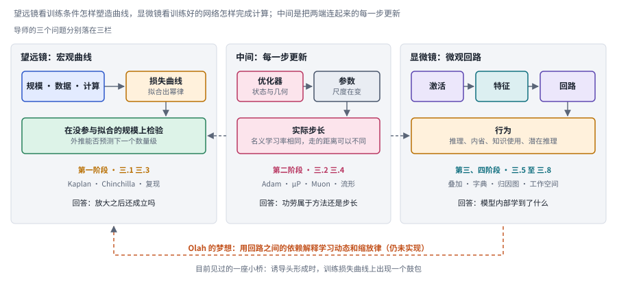
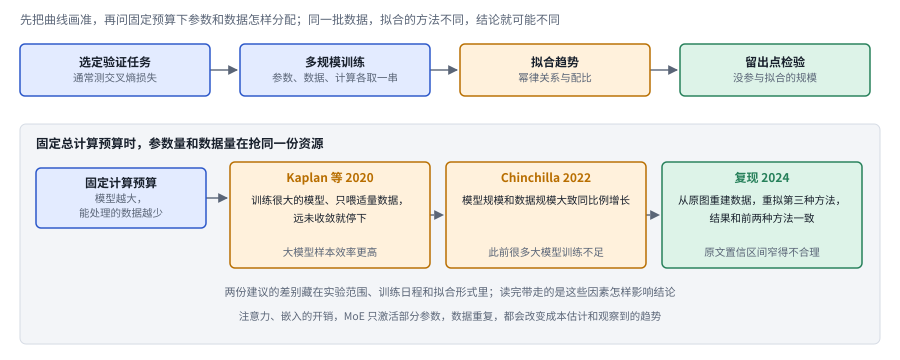

# 14｜模型科学：怎样知道模型为什么有效？

[首页](../README.md) · [专题索引](../README.md#topics) · [文献目录](../catalog/14_model_science.md)

## 方向背景：为什么需要研究模型本身的规律

设想组里一位同学在组会上展示了一张漂亮的曲线图。他把一个一亿参数小模型的优化器从 AdamW 换成了某种新方法，训练损失明显下降得更快。台下的导师看完，问了三个问题。第一个问题是：把模型放大十倍、数据放大十倍，这条曲线还会领先吗？第二个问题是：你换优化器的同时，每一步参数实际被改动的幅度也变了，那么功劳究竟属于新方法，还是只是步长恰好落进了更好的区间？第三个问题最难：模型学得更快了，它内部学到的东西和原来一样吗，我们有没有办法看一眼？

这三个问题几乎概括了模型科学这个方向。大模型的进步主要靠工程堆出来，性能一路上涨，可上涨本身并不会顺带告诉我们能力是怎样产生的，也无法保证在一个规模上摸索出来的经验能搬到另一个规模。训练一个前沿模型的成本太高，没有人能对每个设计选择都在最大规模上做对照实验，于是大家只能在小规模上试，再靠某种规律外推。规律靠不靠得住、为什么靠得住，就成了一个实实在在关系到算力分配的问题。

更麻烦的是，很多看起来像解释的东西其实只是相关性。某个内部特征能够预测模型的行为，模型的决策未必真的依赖它；换了优化器之后效果变好，收益也可能来自学习率和数据条件的连带变化。模型科学想做的，是把模型的表示、优化过程和行为机制当作研究对象本身，建立那种可以被检验、可以被干预、也可以被外推的解释。这些解释最终会回到很具体的地方：训练资源怎么分配，结构怎么设计，出了错怎么诊断，持续学习时怎样保住已经学会的东西。

这一章沿着导师那三个问题展开，依次讨论缩放律、超参数迁移、数据与路由、优化几何、可解释特征、探针与干预、知识使用和潜在推理。读的时候请始终记住一件事：每一项结论都带着它的研究对象、训练条件和证据层级，局部实验里看到的规律，要经过检验才能推广成所有模型共有的机制。循环结构的计算成本与部署效率放在[效率章](13_efficiency.md)里讨论。

## 先读这几篇

这一章的主线借自几篇写得很好的长文。模型科学横跨两个很少互相对话的圈子，一边做训练和缩放，一边做可解释性，很多论文只在自己那一边讲故事。下面几篇文章的作者各自站在一边，却都在认真思考"这些现象背后有没有可检验的规律"，把它们放在一起读，两条线就能接上。建议按顺序读，读完再回来看各分支的新论文。最后两篇来自 2026 年，一篇把回路研究推进到“模型能说出口的那部分表示”，一篇把几年来的 SAE 研究放在一起做批判性的清点。

| 顺序 | 文章 | 为什么读 |
|---|---|---|
| 1 | Chris Olah，[Interpretability Dreams](https://www.transformer-circuits.pub/2023/interpretability-dreams/index.html)（Transformer Circuits Thread，2023-05） | 本章主线的骨架。这是一篇明确标注为非正式的随笔，Olah 在里面讲了机制可解释性想走的整条路：先从特征和参数这些最小的单位打下"认识论地基"，当前最大的障碍是叠加（superposition），解决叠加之后才能去找回路和反复出现的模式，再往上去找类似器官和脑区的更大结构。文中最打动人的一段讲诱导头（induction head）：一个微观机制居然能在宏观的损失曲线上留下一个鼓包。他由此推测，回路之间的依赖关系也许有一天能同时解释学习动态和缩放律。本章把"微观的回路"和"宏观的曲线"放在同一条主线上，就是从这里来的。他也坦率地说，这些设想很可能做不成。 |
| 2 | Cameron R. Wolfe，[Scaling Laws for LLMs: From GPT-3 to o3](https://cameronrwolfe.substack.com/p/llm-scaling-laws)（Deep (Learning) Focus，2025-01） | 宏观那一端最好的入门长文。作者从幂律讲起，依次经过 Kaplan 的缩放律、GPT 系列的"预训练时代"、Chinchilla 对模型和数据配比的修正，再到 2024 年底"缩放是不是到头了"的争论，最后落在推理时计算这条新的缩放轴上。他的判断很清醒：曲线变缓本来就是幂律的自然性质，所谓放缓更多来自期望错位，缩放在技术层面仍然有效，真正的问题是下一步缩放什么。读完能带走一张缩放律的完整谱系。 |
| 3 | Jeremy Bernstein，[Modular Manifolds](https://thinkingmachines.ai/blog/modular-manifolds/)（Thinking Machines，2025-09） | 训练动力学这一段的骨架。Bernstein 从一个朴素的要求出发：网络里的权重、激活和梯度都不应该变得太大或太小。激活早就有了各种归一化，Muon 可以看作是对更新做谱归一化，权重本身却很少被约束。他把权重约束在流形上，让学习率直接对应真实的步长，推出了一个把权重限制在 Stiefel 流形上的 manifold Muon，并进一步提出模块化流形，用来在各层之间分配学习率预算。读完会明白，为什么本章反复强调名义学习率和实际更新是两回事。 |
| 4 | Jack Lindsey 等（Anthropic），[On the Biology of a Large Language Model](https://transformer-circuits.pub/2025/attribution-graphs/biology.html)（2025-03） | 微观那一端走到今天的代表作。作者把研究语言模型比作研究生物：先要有显微镜，特征就是显微镜下的"细胞"，归因图（attribution graph）则用来追踪这些特征怎样一步步相互作用得出答案。他们在 Claude 3.5 Haiku 上做了多步推理、写诗时提前规划、算术、幻觉、拒答、思维链是否忠实等一系列案例。这篇文章同样坦率地报告了边界：归因图大约只在四分之一的提示上能给出令人满意的解释，案例只是存在性证明，还有相当一部分计算落在无法解释的误差节点里。 |
| 5 | Google DeepMind 机制可解释性团队，[Negative Results for SAEs On Downstream Tasks and Deprioritising SAE Research](https://www.greaterwrong.com/posts/4uXCAJNuPKtKBsi28/)（LessWrong，2025-03） | 一篇难得的负面结果报告。团队拿稀疏自编码器（SAE）去做一件实际任务：检测有害意图，并且要在分布外也成立。结果直接在残差流上训练的稠密线性探针几乎完美，基于 SAE 特征的探针在分布外明显更差，在 SAE 重构上训练的探针也不如原始残差流，说明 SAE 丢掉了任务相关的信息。团队因此决定暂时降低基础 SAE 研究的优先级，并直言整个领域可能在 SAE 上投入过多。适合在读完前几篇的乐观叙事之后用来校准预期。 |
| 6 | Wes Gurnee、Jack Lindsey 等（Anthropic），[Verbalizable Representations Form a Global Workspace in Language Models](https://transformer-circuits.pub/2026/workspace/)（Transformer Circuits Thread，2026-07） | 这是第四阶段走到 2026 年的一篇代表作，可以接在 Biology 和内省研究后面读。作者借用神经科学里“全局工作空间”的说法，指一个让信息变得可以被报告、被有意调控、被拿来推理并广播给许多过程的共享空间，并为它列出五条可检验的功能性质：能口头报告、能被定向调控、能参与内部推理、能灵活泛化、具有选择性。为了找到这样的表示，他们提出了 Jacobian lens，在大约一千个提示上平均一个激活对输出词元概率的线性化影响，可以看作对 logit lens 的改进，并把它找到的这一小块空间称为 J-space。主要在 Claude Sonnet 4.5 上，他们发现替换 J-space 里的方向会改变模型说出的内容，模型能按指令把一个概念“记在心里”，多跳推理中没说出口的中间结果也落在这里；消融 J-space 之后，解析、续写这类自动化任务大体不受影响，多步推理和一些需要灵活性的任务却明显变差；它主要活跃在中间偏后的一段层里，只占激活方差的一小部分。作者同样把边界写得很清楚：这个透镜并不完美，只能近似、不完整地抓住工作空间，只能识别对应单个词元的概念，模型也没有重现全局工作空间理论描述的完整结构，文章更不讨论这些性质是否意味着主观体验。 |
| 7 | Salima Lamsiyah、Adelaide Danilov、Oleksandr Marchenko Breneur、Aria Nourbakhsh，[Sparse Autoencoders for Mechanistic Interpretability in NLP: A Critical Survey of Recoverability, Interpretability, and Utility](https://arxiv.org/abs/2610.20139)（arXiv，2026-10） | 读完前面几篇，再用这篇 2026 年 10 月的批判性综述把 SAE 这条线的现状一次看清。作者梳理了 138 项研究，认为不同论文的设计假设、评测目标和实验设置差别太大，结论很难直接比较，于是把 SAE 的成果拆成四个彼此独立的终点：特征能否被恢复、语义上是否可解释、机制上是否忠实、行为上是否有用，并强调在其中一个终点上的证据推不出另一个。恢复这一面，他们指出表示的几何、稀疏容量的分配、训练数据的覆盖和推断方式各自都可能成为瓶颈；忠实这一面，他们提醒特征在分类器或控制器里好用，并不说明原模型真的用它来计算。和简单基线的比较也很说明问题：在一个转向评测里，直接在残差空间里取均值差的方向得分明显高于基于 SAE 特征的同类方法（作者也提醒两者选的层不同，差距不能全部归到 SAE 头上），稠密探针一旦构造得当，SAE 探针的优势也会缩小。最后他们给出一套更严格的评测建议，包括匹配稀疏度和数据、为干预加上对照、和稠密探针及直接方向一起比较，并建议先试探针和直接方向，只有当可复用的细粒度特征词表真正带来好处时才选 SAE。它和第 5 篇 DeepMind 的负面结果正好前后呼应，也是本章三.5、三.6 两个分支最好的地图。 |

如果还想多读一点，Thinking Machines 的 [Defeating Nondeterminism in LLM Inference](https://thinkingmachines.ai/blog/defeating-nondeterminism-in-llm-inference/)（Horace He 等，2025-09）把"同样的输入为什么得到不同输出"一路追到核函数在批大小变化时会改变归约顺序，开篇第一句就是"可复现性是科学进步的基石"，很适合作为所有模型实验的前置课。Cerebras 的 [The Practitioner's Guide to the Maximal Update Parameterization](https://cerebras.ai/blog/the-practitioners-guide-to-the-maximal-update-parameterization)（2024-09）用一张坐标检查图讲清了标准参数化下超参数为什么会随宽度漂移。中文读者可以读苏剑林在科学空间写的 [Muon优化器赏析](https://kexue.fm/archives/10592)（2024-12），它从"向量和矩阵的地位不对等"这个角度解释 Muon，推导干净。Anthropic 的 [Emergent Introspective Awareness in Large Language Models](https://transformer-circuits.pub/2025/introspection/index.html)（Jack Lindsey，2025-10）则和本章三.7 的内省论文正好对照着读。

## 一、先看全景：两种尺度、四层证据、一条时间线

> **本节要点：** 模型科学在两种尺度之间往返：望远镜看规模、数据和计算怎样换成损失曲线，显微镜看训练好的网络内部怎样完成计算，中间夹着每一步更新实际走了多远。先把全景图、四层证据和主线时间线这三张总图看熟，再去分辨几组容易混淆的词，读任何一篇论文都能很快找到它的位置。

这一节先放三张贯穿全章的总图，再把几组容易混淆的概念摆开说清楚。三张图各回答一个问题：这个方向在研究什么，论文拿出的证据有多强，以及各条路线是按什么顺序登场的。

先看全景。开头那位导师问的三个问题，恰好落在下图的三栏里。左栏是望远镜：研究者拿出一串不同的规模、数据量和计算量，各训练一个模型，记录损失，再拟合出一条曲线；这条曲线有没有用，要看它能不能在没参与拟合的规模上预测对，所以第一个问题“放大十倍还领先吗”，问的正是左栏下方那个绿色的框。右栏是显微镜：从某一层的激活出发，先拆出可以命名的特征，再看特征怎样连成回路，最后落到推理、内省、知识使用这些具体行为上，导师的第三个问题“模型内部学到了什么”属于这一栏。中间一栏夹在两者之间，讲的是每一步更新：优化器带着自己的状态和几何假设，作用在尺度不断变化的参数上，最后得到一个实际的步长，第二个问题“功劳属于方法还是步长”就发生在这里。

*图：模型科学的两种尺度。左栏对应主线第一阶段和分支三.1、三.3，中栏对应第二阶段和三.2、三.4，右栏对应第三、四阶段和三.5 至三.8；两侧的虚线表示每一步更新既决定曲线的形状，也塑造网络里的表示。*

图底部那条橙色的虚线弧值得多停一下。Olah 在《Interpretability Dreams》里设想过，回路之间的依赖关系也许有一天能同时解释学习动态和缩放律，也就是从右栏一路走回左栏。这个设想至今没有实现，目前见过的一座小桥，是诱导头形成的时刻正好对应训练损失曲线上的一个鼓包，第二节的起点会细讲它。整章的主线，其实就是沿着这张图从左往右走一遍，再回头看看两端能不能接上。

再看证据。同一张全景图上的工作，拿出来的证据强弱差别很大。下图把本章用到的证据分成四层：最底层是统计关联，比如某个方向在说“巴黎”时总是很亮、探针读得出标签、曲线拟合得上；往上一层是可控干预，主动改变激活、参数或训练条件，看输出是否按预测的方向移动；再往上是条件性的数学分析，在写明的光滑性、噪声和步长假设下给出保证；最上面是跨任务或跨规模的验证，结论在没参与拟合、没参与设计的条件下依然成立。

*图：四层证据大致按获取难度从下往上排，右侧的橙色虚线是最常见的越界，从最底层直接跳到最上层；底部三个标签是结论的三种用途。*

这张图要和本节末尾那段讲证据层次的话对照着读。四层之间的关系比一条严格的阶梯松散，条件性的证明和跨规模的验证各管一件事，一篇论文也很少能把四层都做全，最可靠的研究往往让其中几层互相约束。真正危险的是右边那条橙色箭头：拟合得好就宣称外推可靠，探针读得出就宣称模型在用，玩具模型上的证明就说成大模型的定律，这三种跳跃在后面的八个分支里会一再出现。图底部的三个标签则是第四节的伏笔：拟合曲线主要用来预测，特征和探针主要用来定位，只有在排除了替代解释之后，干预才能说明某种机制真的在起作用。

最后是时间线。下图每一行对应第二节的一个阶段，点的位置按 arXiv 编号或发布时间，精确到月；2014 到 2018 年的三个优化器压在“更早”一栏。把它和全景图对照着看，会发现两条线的节奏很不一样：训练这一侧的 Adam、AdamW、Shampoo 早在大模型时代之前就有了，缩放律在 2020 年才把宏观曲线讲清楚；显微镜这一侧从 2021 年的 Transformer Circuits 框架起步，2022 到 2024 年一路走过叠加和字典学习，2025 年之后，回路与行为这一行和边界那一行几乎同时密集起来。

*图：主线上的代表工作按阶段分行排开。Muon 按 2024 年底在社区走红的时间计；边界一行收的是专门检验测量工具本身的工作，Chinchilla 复现画在第一阶段。*

时间线上还有一个细节：Chinchilla 复现、SAE 的负面结果和那篇 SAE 批判性综述，都出现在各自路线最热闹的时候之后不久。这几乎是这个领域的一种节律，一种工具或一条规律刚被大量使用，就会有人回过头去检查它的地基，第二节的“边界”会把这些工作放在一起讲。

### 几个容易混在一起的概念

读这个方向的论文，最容易被几组相近的词绕晕。这里先把它们摆开说清楚。如果还没有建立 token、Transformer、损失函数、训练与推理这些概念，可以先读 [LLM 前置知识](../docs/llm_primer.md)。本章始终用自然语言解释缩放律、优化动态与因果干预，重点放在研究改变了什么、怎样比较，以及结论依赖哪些实验条件。

第一组是**观察、探针和干预**。观察就是记录变量之间的关系，比如某一层的某个方向在模型说"巴黎"时总是很亮。探针更进一步，它是一个从隐藏状态预测标签的辅助模型：研究者读取原模型某一层的内部表示，训练一个简单分类器，看能否预测目标标签，原模型本身保持不动。探针在未见样本上预测得准，说明有关信息可以从表示里读出来，可原模型是否也沿同一条路径使用这些信息，探针回答不了。要回答这个问题就得做干预：主动改变激活、参数或训练条件，看输出是否按解释所预测的方向变化。例如沿一个待检验方向施加扰动，逐渐加大强度，观察答案怎样移动。干预比相关性有力得多，但它也需要对照。固定输入、层和位置，加入无干预和同等强度的随机扰动作为基线，再检查其他任务有没有被顺带破坏。如果很多无关方向都能造成相似的变化，效果多半来自一般性损伤；如果仅仅换一下答案格式结果就反转，那么起作用的可能是输出偏好。一次方向修改很难单独证明某种内部机制，要靠多种对照一起把替代解释排除掉。

下图把第一组的三种做法画成了三栏，用同一套框和箭头。左栏的观察只记录“说巴黎时这个方向总是很亮”，拿到的是统计关联；中栏的探针在冻结的原模型上读取隐藏状态，训练一个简单分类器去预测标签，再到未见样本上检验，它能说明信息可以从表示里读出来，却说明不了模型自己也沿这条路在用它；右栏的干预主动沿方向加扰动，观察答案怎样移动，并且配上三种对照：无干预的基线、同等强度的随机方向，以及其他任务有没有被顺带破坏。

*图：观察、探针和干预问的是三个不同的问题。右栏的三条对照缺了任何一条，干预的结论都可能来自一般性损伤或输出偏好。*

第二组是**机制解释、经验规律和外推**。机制解释试图描述模型内部的计算过程；经验规律概括的是变量在实验范围内怎样共同变化。缩放律属于后者，它通常对损失、参数量、数据量和计算量建模，测的是交叉熵，和"智慧"之间还隔着好几层。外推指预测尚未测过的范围，它必须有独立的验证点：拿参与拟合的数据去证明拟合得好，说明不了它能预测下一个数量级。优化器理论里的收敛结论也一样，总是依赖目标函数、噪声和步长等假设。

缩放律这个例子值得多说几句。它研究模型规模、训练数据与计算投入改变时表现怎样变化，常见做法是选定一个验证任务，在不同规模和数据量上训练，观察损失，再拟合趋势。增加参数和增加数据单独看都可能有用，可一旦固定总计算预算，两者就在抢同一份资源：对训练方式相近的密集模型，模型越大，处理同样多数据的代价越高，能负担的训练量就越少。所以真正的问题是在相同预算下比较不同的分配方案，[Chinchilla](https://arxiv.org/abs/2203.15556) 就是理解这种取舍的经典入口。这种比较又依赖对计算成本的估计：注意力、嵌入等模块的开销会影响预算，MoE 每一步只激活部分参数，也没法直接套用密集模型的总参数成本；数据重复、训练日程以及模型和数据之间的相互作用，都可能改变观察到的趋势。拟合关系因此要和实验约束一起写出来，再到没参与拟合的设置里检验预测。

第三组是**名义学习率和实际更新**。学习率控制更新的整体尺度，优化器则会利用过去的梯度信息决定具体怎样更新。[Adam](https://arxiv.org/abs/1412.6980) 持续记录两类历史：梯度通常指向哪个方向，以及各个参数上的梯度幅度通常有多大，再据此给不同参数分配不同幅度的更新。历史信息保留多久、训练初期怎样校正尚未积累充分的估计、怎样避免数值不稳定，都会影响实际行为；AdamW 又把权重衰减单独处理。于是两个优化器即使写着同一个学习率，实际经历的训练条件也可能相差很远。一个更贴近实际的观察量是每次更新相对于原有参数尺度有多大。这个量能帮我们识别那些表面设置相同、实际变化却不同的实验，可幅度接近时，更新的方向、历史依赖和训练动态仍然可能各不相同。近期的有效学习率（ELR）研究正是在考察学习率相对于参数尺度的关系，比较时要说明统计了哪些参数、怎样归一化、优化器处于什么状态，单个数值撑不起完整的解释。

下图用一个示意把这件事画了出来。两次实验写着同一个名义学习率，于是得到同样长的一步更新；可左边的参数范数小，同样长的一步让参数方向转过了一个较大的角度，右边的参数范数大，转过的角度就小得多。真正影响训练的，往往是这种相对改动的大小。右边绿色的框列出了比较有效学习率时要写清的三件事，框底的提醒同样重要：幅度对齐以后，更新的方向、历史依赖和训练动态仍然可能不同。

*图：示意，同一个名义学习率在大小不同的参数上造成不同的相对改动。三.2 的有效学习率研究，用的正是学习率和参数范数之比这个坐标。*

第四组是**操作性概念和人格化语言**。"内省"在论文里可以指模型能定位人为注入的扰动，"元认知"可以指对答案正确率的校准或对下一步的监控。这些都是定义清楚的实验任务，离人类式的自我意识还很远。"概念方向""技能""符号结构"也一样需要清楚的实验定义。刚进入这个方向的同学大可以先把宏大的解释放一放，先问作者怎样测量，以及什么样的结果会推翻他的假设。

最后，本章把证据分成四个层次来记录：统计关联、可控干预、条件性的数学分析、跨任务或跨规模的验证。最可靠的研究往往让几种证据互相约束，当然一篇论文很少能把四层都做全。真正要警惕的是从一层直接跳到另一层，比如把玩具模型上的证明说成大模型的普遍定律，或者把榜单分数提高说成已经找到了内部机制。

## 二、发展主线：从宏观曲线走到微观回路，再试着把两端接起来

这条主线以 Chris Olah 的《Interpretability Dreams》为骨架，再用 Wolfe 和 Bernstein 的两篇长文补上训练那一侧。Olah 在文中有一个很好用的比喻：机制可解释性是对神经网络极其"微观"的分析，而损失曲线、缩放律这些现象是"宏观"的。过去十年，模型科学大致就是在这两个尺度之间往返：先在宏观上把曲线画准，再弄清每一步训练到底走了多远，然后打开模型看表示，最后试图从表示走到回路和行为。每往微观走一步，能回答的问题更具体，能覆盖的模型行为也更少；而 Olah 寄予厚望的那件事，用微观机制去解释宏观曲线，到今天仍然是一个开放的梦想。

> **本节要点：** 四个阶段依次从宏观曲线走到训练动力学，再走到表示和回路。每个阶段先用一张解说图讲清代表方法怎样运转，再用一排同一画法的结构卡把同族方法并排，最后一张对照表写明每种做法补上了什么、又留下了什么代价；边界一节讲测量工具本身的检验，末尾的总对照把四族方法放在同一组坐标上。

| 阶段 | 内容 | 代表工作 | 本章对应分支 | 速查卡 |
|---|---|---|---|---|
| 起点 | 两种尺度：望远镜看曲线，显微镜看回路 | Interpretability Dreams、Induction Heads | （基础概念，见第一节） | |
| 第一阶段 | 宏观曲线：规模、数据和计算怎样换成损失 | Kaplan 缩放律、Chinchilla、Chinchilla 复现 | 三.1、三.3 | S1 至 S3 |
| 第二阶段 | 训练动力学：每一步实际走多远、往哪走 | Adam、AdamW、Shampoo、μP、Muon、Modular Manifolds | 三.2、三.4 | O1 至 O6 |
| 第三阶段 | 表示：叠加与字典学习 | Transformer Circuits 框架、Toy Models of Superposition、Towards Monosemanticity、Scaling Monosemanticity | 三.5、三.6 | F1 至 F4 |
| 第四阶段 | 回路与行为：从特征走到推理、内省和知识使用 | On the Biology of a Large Language Model、内省研究、全局工作空间 | 三.7、三.8 | C1 至 C3 |
| 边界 | 测量本身也要经得起检验 | SAE 负面结果、SAE 批判性综述、Chinchilla 复现、推理非确定性 | 三.6、第五节 | |

### 起点：望远镜和显微镜

> **要点：** 模型科学有两个互补的目标，一个理解训练条件怎样塑造能力，一个理解训练好的网络怎样实现能力。诱导头是两者第一次清楚相遇的地方。

模型科学有两个互补的目标：一是理解训练条件怎样塑造能力，二是理解训练完成的网络怎样实现这些能力。前一个目标关注优化规则、规模、数据和计算，后一个目标关注表示、特征和内部计算。用 Olah 的话说，前者像是用望远镜看整片星空的规律，后者像是用显微镜看一个个细胞。

这两种视角在 2022 年有过一次让人印象深刻的相遇。Anthropic 的 [In-context Learning and Induction Heads](https://arxiv.org/abs/2209.11895) 发现，一种叫诱导头的注意力回路，会在训练中某个时刻突然形成，它出现的时刻正好对应模型上下文学习能力的一次跃升，在训练损失曲线上表现为一个小小的鼓包。作者据此提出，诱导头可能是上下文学习背后的主要机制。Olah 在第二年的《Interpretability Dreams》里反复回到这个例子：一个微观回路在宏观曲线上留下了指纹。他由此推测，也许有一天，回路之间的依赖关系可以同时解释学习动态和缩放律。

下图左边画的是那个鼓包的样子。曲线只是示意，不对应具体数值：训练损失本来平稳地往下走，到某个时刻先停一停，再明显下一个台阶，图中浅青色的竖带就是诱导头形成的那段时间，上下文学习能力也在这里出现一次跃升。右边是诱导头本身在做的事：序列里先出现过“A B”，后来又遇到 A，它就回头找到上一次 A 出现的位置，看看后面跟着什么，再把 B 复制过来作为预测。Transformer Circuits 框架的分析表明，这种机制要靠两层注意力组合才能形成，只有一层注意力的模型做不出来。

*图：示意，诱导头形成与损失曲线上的鼓包同时出现。论文的证据在小的纯注意力模型上是因果性的，在带 MLP 的大模型上是相关性的。*

这个梦想至今没有实现，但它给本章提供了一个很好的阅读框架。下面四个阶段，前两个站在望远镜这边，后两个站在显微镜这边。两边最后汇入同一种研究习惯：控制变量、设计竞争解释、保留未见条件，并公开失败的范围。

### 第一阶段：先把曲线画准

> **要点：** 宏观这条线先把损失、规模、数据和计算之间的幂律画出来，再追问固定预算下怎样分配；Chinchilla 改写了 Kaplan 的配比建议，它自己的拟合后来又被复现修正。

这一阶段的工作都遵循同一套做法，下图上排把它拆成四步：先选定一个验证任务，通常测的是交叉熵损失；再在一串不同的参数量、数据量和计算量上各训练一批模型；然后拟合出幂律关系和配比建议；最后拿没参与拟合的规模去检验预测，这一步决定了拟合出来的东西能不能用来押注大模型。下排是固定总预算时的分配问题，参数量和数据量在抢同一份资源，三个琥珀色和绿色的框按时间顺序排开，对应下面三段故事。

*图：缩放研究的四步与固定预算下的三份结论。Kaplan 和 Chinchilla 给出了不同的配比，2024 年的复现说明拟合方法本身就能改变结论。*

宏观这条线的起点是 2020 年 OpenAI 的 [Scaling Laws for Neural Language Models](https://arxiv.org/abs/2001.08361)。Kaplan 等人发现，交叉熵损失与模型规模、数据量和训练计算之间都呈幂律关系，这种趋势跨越了七个以上的数量级；而在很宽的范围内，宽度和深度这类结构选择的影响很小。论文还给出了一个影响深远的建议：大模型样本效率更高，因此在固定计算预算下，最省算力的做法是训练很大的模型、只喂适量数据，并在远未收敛时就停下来。

Wolfe 在长文里把这一段称作"预训练时代"的开端。缩放律让 GPT 系列的放大有了依据，GPT-4 的最终表现甚至可以用小得多的训练提前预测。可两年之后，DeepMind 的 [Training Compute-Optimal Large Language Models](https://arxiv.org/abs/2203.15556)，也就是 Chinchilla，重新考察了固定预算下的分配，得出模型规模和数据规模应当大致同比例增长的结论，这意味着此前很多大模型其实训练不足。两篇论文给出了不同的配比建议，原因藏在实验范围、训练日程和拟合形式的差异里。把它们放在一起读，带走的应该是这些因素怎样影响建议，那个具体的比例反而是次要的。

故事到这里还没有结束。2024 年 Epoch AI 的 [Chinchilla Scaling: A replication attempt](https://arxiv.org/abs/2404.10102) 从 Chinchilla 论文的图里重建数据，重新拟合它的第三种估计方法，发现原文的参数估计和前两种方法相互矛盾，报告的置信区间窄得不合理；重新拟合之后，结果反而和前两种方法一致了。连最经典的缩放律都需要复现，这件事本身就说明，拟合的形式和细节会直接改变结论。

Wolfe 对 2024 年底"缩放失灵"讨论的判断也值得记下来。他认为幂律曲线越往后越平缓本来就是它的数学性质，所谓放缓更多来自期望和曲线之间的错位，缩放在技术层面仍然有效，真正的问题是接下来缩放什么，比如强化学习和推理时计算。本章三.1 和三.3 的新论文延续的正是这一段的追问：小规模实验怎样才能可信地外推，拟合公式漏掉了哪些交互，数据重复和稀疏路由又怎样改写曲线的形状。

**速查：第一阶段的三项工作。** 下面三张结构卡用同一种画法，从左往右是一项工作的流程。并排看会发现，三者用的原料几乎一样，都是不同规模下的损失，差别落在最后一个框：Kaplan 停在拟合，Chinchilla 按新配比真的训练了一个模型去检验，复现则回到原图重新拟合，再用另外两种方法来对照。

 

*图：第一阶段三项工作的结构卡，每张卡对应下表的一行。*

| code | 名称 | 年份 | 代表 | 怎么做 | 解决了什么 | 代价 |
|---|---|---|---|---|---|---|
| S1 | 缩放律 | 2020 | [Scaling Laws for Neural Language Models](https://arxiv.org/abs/2001.08361) | 在跨越七个以上数量级的规模、数据和计算上训练模型，把交叉熵损失拟合成幂律 | 让放大模型有了可以预先估算的依据；宽度和深度这类结构选择在很宽的范围内影响很小，研究者可以把注意力集中在规模、数据和计算上 | 固定预算下“大模型、适量数据、早停”的配比建议，后来被 Chinchilla 修正；拟合测的是交叉熵，和下游能力之间还隔着几层 |
| S2 | 计算最优配比 | 2022 | [Chinchilla](https://arxiv.org/abs/2203.15556) | 用三种估计方法比较固定预算下的分配，再按得出的配比训练一个 700 亿参数的模型去检验 | 指出此前很多大模型训练不足，模型和数据应当大致同比例增长；按这个配比训练的 Chinchilla，在同样的计算预算下胜过了参数多得多的 Gopher | 结论依赖实验范围、训练日程和拟合形式；第三种方法的参数估计后来被复现指出与另两种方法矛盾 |
| S3 | 缩放律复现 | 2024 | [Chinchilla Scaling: A replication attempt](https://arxiv.org/abs/2404.10102) | 从 Chinchilla 论文的图中重建数据，重新拟合第三种估计方法，再和前两种方法对照 | 重新拟合后三种方法的结果一致了，说明原文的不一致来自拟合细节，并指出原文的置信区间窄得不合理 | 只能使用从图里重建的数据点，结论的精度受重建质量限制；它检验的是拟合过程，没有新增训练实验 |

### 第二阶段：看清每一步走了多远

> **要点：** 曲线的形状最终取决于每一步更新。从 Adam 到 μP、Muon 和模块化流形，这条线索一直在追问同一件事：名义上的学习率，究竟让参数实际走了多远。

下图上排把一步更新拆成四个环节：这一批数据给出梯度；优化器把梯度和自己记住的历史状态，比如动量和梯度幅度，合成一步更新；这步更新相对于参数原有的尺度有多大，才是这一步实际走出的距离。下排是这一阶段三种看待参数的方式，从左到右，优化器对参数结构的假设越来越强：Adam 一族把所有参数当成一根长向量，逐个元素缩放；Muon 把权重当成矩阵，把动量矩阵的奇异值都拉到 1；manifold Muon 更进一步，连权重本身也约束在流形上，让学习率直接对应真实的步长。

*图：一步更新的四个环节，以及逐元素、谱范数、流形三种几何。下排三栏分别对应下面讲到的 Adam、苏剑林对 Muon 的解读和 Bernstein 的《Modular Manifolds》。*

曲线描述的是训练的终点，可曲线的形状最终取决于每一步更新。训练这一侧的基础入口是 2014 年的 [Adam](https://arxiv.org/abs/1412.6980)，它用梯度的一阶矩和二阶矩调节更新。随后 [AdamW](https://arxiv.org/abs/1711.05101) 把权重衰减和梯度更新分开，帮助人们区分正则化、参数范数和学习率各自的作用；[Shampoo](https://arxiv.org/abs/1802.09568) 则探索了矩阵形式的预条件。这些工作让"优化器"从一个配置文件里的名字，变成了一组带着状态、尺度和几何假设的更新规则。

接下来冒出来的问题很实际：在小模型上调好的学习率，为什么放到大模型上就不对了？2022 年的 [Tensor Programs V](https://arxiv.org/abs/2203.03466) 给出了一个答案。在标准参数化下，激活的大小会随模型宽度增长，最优超参数也就跟着漂移；作者提出的最大更新参数化（μP）调整了初始化方差、学习率和输出缩放，让最优超参数在宽度变化时保持稳定。他们用一个 4000 万参数的代理模型调参，再把超参数直接迁移过去，就超过了已发表的 GPT-3 67 亿参数版本的结果，调参成本只占总预训练成本的大约 7%。Cerebras 后来写的实践指南也提醒，μP 主要处理宽度方向的迁移，深度、批大小和训练日程变化时，仍然需要另行检验。

下图用示意画出了 μP 改变的那件事。左边是标准参数化：每条曲线是一个宽度的模型在不同学习率下的损失，颜色越深宽度越大，最低点随着宽度一路往左移，小模型上调好的学习率放到大模型上就不再是最优；右边是 μP，三条曲线的最低点几乎落在同一个学习率上。右侧的两个框是论文里的实际做法：在 4000 万参数的代理模型上调参，再把超参数原样搬到 67 亿参数的模型上。

*图：示意，标准参数化下最优学习率随宽度漂移，μP 下保持稳定。最下面的橙色提醒来自 Cerebras 的实践指南。*

2024 年底，Muon 优化器在社区里迅速走红，又把问题往前推了一步。苏剑林在《Muon优化器赏析》里讲得很透：Muon 对动量矩阵做"矩阵符号函数"，把所有奇异值都拉到 1，可以看作谱范数下的最速下降；当矩阵退化成对角阵时，它就回到了逐元素取符号的 SignSGD 一族；而 Shampoo 在累积因子取零时，更新和 Muon 在数学上等价。他的核心判断是，逐元素的优化器把所有参数当成一根长向量，矩阵的对角元和非对角元地位其实并不对等，Muon 正是因为尊重了这种不对等才效果更好。

Bernstein 的《Modular Manifolds》把这条线索整理成一个更一般的框架。他的出发点是：权重、激活和梯度都不应该变得太大或太小，因为尺度一旦失控，更新的相对大小就很难设定，而相对更新大小直接决定学习速度。激活早已有归一化，Muon 可以理解为在给更新做谱归一化，那么权重本身也可以被约束在流形上。约束之后，学习率就直接对应真实的步长。他在一个小规模 CIFAR-10 多层感知机上比较了 manifold Muon 和 AdamW，前者训练和测试准确率更高，奇异值也一直保持在 1 附近，代价是每一步多出一些时间开销。文章最后提出模块化流形，用来在网络各层之间分配学习率预算。

把这一段读下来，最重要的收获是：名义学习率相同，实际更新可以完全不同。这正是本章三.2 和三.4 反复讨论的问题。新优化器宣称更快更稳之前，要先排除它只是让有效步长落进了更好区间的可能；理论保证和实测速度也可能给出相反的排序。

**速查：第二阶段的六种做法。** 六张结构卡排在一起，可以看出这条线索的推进方向：前三张在改“更新怎样由梯度算出来”，μP 改的是参数化，让超参数能跨宽度搬家，最后两张又回到更新本身，把矩阵和流形的几何放了进去。

 

 

 

*图：第二阶段六种做法的结构卡，每张卡对应下表的一行。*

| code | 名称 | 年份 | 代表 | 怎么做 | 解决了什么 | 代价 |
|---|---|---|---|---|---|---|
| O1 | 自适应矩估计 | 2014 | [Adam](https://arxiv.org/abs/1412.6980) | 持续记录梯度的一阶矩和二阶矩，也就是梯度通常朝哪走、通常有多大，再据此给每个参数分配不同幅度的更新 | 不必为每个参数手工设定步长，在大模型训练里成了默认的起点 | 每个参数要多存两份历史状态；名义学习率相同时，实际经历的训练条件可能相差很远 |
| O2 | 解耦权重衰减 | 2017 | [AdamW](https://arxiv.org/abs/1711.05101) | 把权重衰减从梯度更新里分出来，直接作用在参数上 | 让正则化、参数范数和学习率各自的作用可以分开讨论 | 权重衰减会改变参数范数，进而改变有效步长；三.2 的研究发现它主要通过有效学习率的日程起作用 |
| O3 | 矩阵预条件 | 2018 | [Shampoo](https://arxiv.org/abs/1802.09568) | 对矩阵形状的参数，用左右两个积累统计量的预条件矩阵来调整梯度 | 把参数当成矩阵来处理，开启了矩阵形式预条件这条路 | 预条件矩阵的计算开销和数值稳定性在大规模训练里都是负担，三.4 的 SOAP 一文专门处理大批量下的不稳定 |
| O4 | 最大更新参数化 | 2022 | [Tensor Programs V（μP）](https://arxiv.org/abs/2203.03466) | 调整初始化方差、学习率和输出缩放，让激活大小不随宽度增长；在小代理模型上调参后直接迁移 | 最优超参数在宽度变化时保持稳定，调参成本只占总预训练成本的大约 7% | 主要处理宽度方向，深度、批大小和训练日程变化时仍需另行检验 |
| O5 | 矩阵符号更新 | 2024 | [Muon（苏剑林的解读）](https://kexue.fm/archives/10592) | 对动量矩阵做矩阵符号函数，把所有奇异值拉到 1，相当于谱范数下的最速下降；实际用几步 Newton-Schulz 迭代来近似 | 尊重了矩阵里对角元和非对角元地位的不对等，苏剑林认为它因此效果更好；三.4 的数十亿参数实验里它也持续优于 AdamW | 收益随调参、饱和程度和步长匹配而变化；压缩通信和收敛保证都要另行处理（三.4） |
| O6 | 模块化流形 | 2025 | [Modular Manifolds](https://thinkingmachines.ai/blog/modular-manifolds/) | 把权重约束在 Stiefel 流形上，在切空间里取步再拉回流形；再用模块化流形在各层之间分配学习率预算 | 学习率直接对应真实的步长，奇异值一直保持在 1 附近；小规模实验里训练和测试准确率都高于 AdamW | 文中的实验是一个小规模 CIFAR-10 多层感知机；每一步多出一些时间开销 |

### 第三阶段：打开表示，先解决叠加

> **要点：** 显微镜这一侧先给 Transformer 的计算找到一套语言，随即撞上叠加这堵墙；字典学习给出了第一个可行的拆法，也把“特征究竟怎么定义”变成了绕不开的问题。

显微镜这一侧的起点是 2021 年的 [A Mathematical Framework for Transformer Circuits](https://transformer-circuits.pub/2021/framework/index.html)。作者把 Transformer 的计算拆成残差流上的一系列读写操作，让"注意力头在做什么"第一次有了可以精确讨论的语言。表示路线由此从"信息存在哪里"走向"计算怎样完成"。

可是研究者很快撞上了一堵墙：单个神经元往往同时对好几种毫不相干的东西有反应。2022 年的 [Toy Models of Superposition](https://transformer-circuits.pub/2022/toy_model/index.html) 在玩具模型里研究了这个现象，说明当特征比维度多、而特征又足够稀疏时，网络会把多个特征叠加在同一组维度里。Olah 在《Interpretability Dreams》里明确说，当时团队的工作重心就是解决叠加这个难题，因为它把语言模型里本来存在的结构遮住了。

2023 年的 [Towards Monosemanticity](https://transformer-circuits.pub/2023/monosemantic-features/index.html) 给出了第一个可行的办法：用字典学习，也就是稀疏自编码器，把激活分解成更多、更稀疏、也更容易解释的特征。2024 年的 [Scaling Monosemanticity](https://transformer-circuits.pub/2024/scaling-monosemanticity/) 把这件事推到了 Claude 3 Sonnet 上，最大的字典有大约 3400 万个特征。其中最出名的是"金门大桥"特征：把它钳制到最大激活的 10 倍，模型就会自称是金门大桥。作者也找到了与不安全代码、偏见、谄媚、欺骗等相关的特征，并且通过操控其中一些特征改变了模型行为。

下图把这两步放在一起。左边是叠加的示意：一个只有两个维度的空间里塞进了五个特征方向，只要这些特征很少同时出现，网络就能靠方向之间的错开把它们分辨出来，代价是任何一个坐标轴，也就是单个神经元，都会同时对好几个特征有反应。右边是字典学习的流程：把某层的模型激活送进编码器，得到数量比维度多得多、每次只亮少数几个的稀疏特征，再用解码器重构回原来的激活；训练目标同时要求重构得准和激活尽量稀疏，训练完以后，研究者看每个特征在哪些文本上亮起，再给它命名。

*图：左为叠加示意，右为稀疏自编码器的流程。底部两行注明两篇代表作的规模：Towards Monosemanticity 用的是单层模型，Scaling Monosemanticity 把字典推到了 Claude 3 Sonnet 上。*

这一段的成果振奋人心，作者的措辞却很克制。Scaling Monosemanticity 报告，3400 万特征的字典里约有 65% 的特征几乎从不激活，覆盖也不完整，并提醒读者不要对"某个特征存在"这件事解读过度。这些工作没有证明每个维度都能对应一个人类概念，它们真正的贡献，是让表示重叠、上下文依赖和"特征究竟怎么定义"变成了绕不开的问题。本章三.5 和三.6 的新论文，正是在追问可读的特征能不能稳定操控，探针读出的概念是不是模型真正在用的概念。

**速查：第三阶段的四项工作。** 四张卡讲的是同一个故事：第一张在残差流上给注意力头的读和写找到语言，第二张解释了为什么单个神经元读不懂，后两张用字典把特征重新拆出来，并把规模从单层模型推到了生产级模型。

 

 

*图：第三阶段四项工作的结构卡，每张卡对应下表的一行。*

| code | 名称 | 年份 | 代表 | 怎么做 | 解决了什么 | 代价 |
|---|---|---|---|---|---|---|
| F1 | 电路框架 | 2021 | [A Mathematical Framework for Transformer Circuits](https://transformer-circuits.pub/2021/framework/index.html) | 把计算拆成残差流上的读写，每个注意力头分成决定看哪里的 QK 部分和决定搬运什么的 OV 部分 | “注意力头在做什么”第一次有了可以精确讨论的语言，诱导头就是在这个框架里被认出来的 | 分析对象是只含注意力层、两层以内的小模型，MLP 层没有纳入 |
| F2 | 叠加的玩具模型 | 2022 | [Toy Models of Superposition](https://transformer-circuits.pub/2022/toy_model/index.html) | 在玩具模型里改变特征数量和稀疏程度，观察网络怎样把多个特征放进同一组维度 | 解释了单个神经元为什么同时对几种不相干的东西有反应，并把叠加确立为需要解决的核心障碍 | 结论来自玩具模型，搬到真实语言模型上需要另外的证据 |
| F3 | 稀疏字典 | 2023 | [Towards Monosemanticity](https://transformer-circuits.pub/2023/monosemantic-features/index.html) | 在单层模型 512 个神经元的 MLP 激活上训练稀疏自编码器，字典从 512 个特征一直放大到约 13 万个 | 给出第一个可行的拆解叠加的办法，拆出的特征比单个神经元更容易解释 | 只在单层小模型上做；重构并不完整，作者也提醒低激活处可能还留着多义性 |
| F4 | 字典的规模化 | 2024 | [Scaling Monosemanticity](https://transformer-circuits.pub/2024/scaling-monosemanticity/) | 把稀疏自编码器推到 Claude 3 Sonnet 上，最大字典约 3400 万个特征，并通过钳制特征检验它们的作用 | 在生产级模型里找到与不安全代码、偏见、谄媚、欺骗等相关的特征，操控其中一些特征改变了模型行为 | 约 65% 的特征几乎从不激活，覆盖也不完整；作者提醒不要对“某个特征存在”解读过度 |

### 第四阶段：从特征走到回路和行为

> **要点：** 有了特征，下一步是看特征怎样连成回路、回路怎样变成行为。归因图、内省注入和全局工作空间三项工作，让显微镜看的对象从零件慢慢变成功能。

有了特征，下一步自然是看特征之间怎样连成回路。2025 年 3 月的 [On the Biology of a Large Language Model](https://transformer-circuits.pub/2025/attribution-graphs/biology.html) 是这一步的代表。作者把研究语言模型比作研究生物，特征是显微镜下的细胞，归因图则把特征之间的相互作用画出来，追踪模型从输入到答案经过了哪些中间步骤。在 Claude 3.5 Haiku 上，他们看到模型回答"达拉斯所在州的首府"时，内部确实先激活了"得克萨斯"，再走到"奥斯汀"；写押韵诗时，模型会在下一行开始之前就先想好要押的那个词；他们还分析了算术、幻觉与实体识别、拒答和越狱，以及思维链是否忠实于内部计算。

下图上半部分是归因图里那个最常被引用的例子，节点名称为示意。提示里的“达拉斯”先激活一个和得克萨斯有关的特征，提示里的“首府”激活一个要说出首府的特征，两路信息汇合之后，模型才输出“奥斯汀”。这说明答案经过了一个中间步骤，模型没有一步就从记忆里直接取出“奥斯汀”。图中橙色的误差节点代表替代模型解释不了的那部分计算，它直接连到输出前的节点上，提醒我们这张图永远是不完整的。下半部分三行按时间排列，正好是这一阶段的三项代表工作，下面三段依次展开。

*图：上半部分是归因图的达拉斯例子（节点名称为示意），右侧三行是作者自己写明的边界；下半部分三项工作对应下面三段。*

这篇文章同样诚实地写出了边界。归因图大约只在四分之一的提示上能给出令人满意的洞见；方法还没扩展到大约一百个 token 以上的提示；注意力模式是怎样计算出来的，方法解释不了；相当一部分计算落在"误差节点"里，即使是文中精心挑选的案例，误差节点的贡献也不小。

同年 10 月，Jack Lindsey 的 [Emergent Introspective Awareness in Large Language Models](https://transformer-circuits.pub/2025/introspection/index.html) 把显微镜对准了一个更敏感的问题：模型能否觉察到自己内部的状态。研究者往模型的激活里注入与某个概念相关的模式，再看模型的自我报告是否反映了这一注入。表现最好的 Claude Opus 4.1 和 4，在合适的层和注入强度下，大约有 20% 的时候能察觉到被注入的概念。作者反复强调这种能力高度不可靠，失败才是常态，也明确表示不讨论模型是否具有类似人类的自我意识。

到了 2026 年 7 月，Anthropic 的 Wes Gurnee、Jack Lindsey 等人在 [Verbalizable Representations Form a Global Workspace in Language Models](https://transformer-circuits.pub/2026/workspace/) 里把这个问题又往前推了一步。他们用一种叫 Jacobian lens 的工具，在 Claude Sonnet 4.5 里找出一小块“可以被说出口”的表示，称为 J-space，并检验它是否具备全局工作空间的几条功能性质：替换其中的方向会改变模型说出的内容，多跳推理里没写出来的中间结果落在这里，消融它之后自动化的解析和续写大体完好，多步推理却明显受损。作者也说明这个透镜只能近似地抓住工作空间，只认得对应单个词元的概念。从特征到回路，再到“哪些表示能被报告和调用”，显微镜看的对象正在从零件变成功能。

**速查：第四阶段的三项工作。** 三张卡的最后一格，正好说明可检验的东西一路在变：归因图检验的是中间步骤存不存在，内省研究检验的是自我报告是否反映了注入，全局工作空间检验的是一小块表示有没有五条功能性质。

 

*图：第四阶段三项工作的结构卡，每张卡对应下表的一行。*

| code | 名称 | 年份 | 代表 | 怎么做 | 解决了什么 | 代价 |
|---|---|---|---|---|---|---|
| C1 | 归因图 | 2025 | [On the Biology of a Large Language Model](https://transformer-circuits.pub/2025/attribution-graphs/biology.html) | 以特征为节点、以特征之间的相互作用为边，画出模型从输入到答案的中间步骤，解释不了的部分记为误差节点 | 在 Claude 3.5 Haiku 上看到多步推理的中间结果、写诗时提前规划押韵词，并分析了算术、幻觉、拒答和思维链忠实性 | 大约只在四分之一的提示上给出满意解释；没扩展到约一百个 token 以上的提示；注意力模式怎样算出来解释不了 |
| C2 | 概念注入的内省 | 2025 | [Emergent Introspective Awareness](https://transformer-circuits.pub/2025/introspection/index.html) | 往激活里注入与某个概念相关的模式，再看模型的自我报告是否反映了这次注入 | 给“模型能否觉察自己的内部状态”这个敏感问题设计了可检验的实验；Claude Opus 4.1 和 4 在合适条件下约 20% 的时候能察觉 | 能力高度不可靠，失败才是常态；只测人为注入，也不讨论类似人类的自我意识 |
| C3 | 全局工作空间 | 2026 | [Verbalizable Representations Form a Global Workspace](https://transformer-circuits.pub/2026/workspace/) | 用 Jacobian lens 在约一千个提示上平均激活对输出概率的线性化影响，找出 J-space，再用替换和消融逐条检验五条功能性质 | 在 Claude Sonnet 4.5 上找到一小块能被说出口、能被定向调控、承载多跳推理中间结果的表示；消融后多步推理明显受损 | 透镜只能近似、不完整地抓住工作空间，只认得对应单个词元的概念；文章不讨论这些性质和主观体验的关系 |

本章三.7 和三.8 的新论文接的就是这一段：内省怎样被拆成可检验的门控与路由，知识存进参数之后为什么还用不出来，以及不写出来的"潜在推理"内部究竟发生了什么。

### 边界：测量本身也要经得起检验

> **要点：** 工具越精细，越要回头检查工具本身：SAE 在实际任务上输给了线性探针，经典缩放律的拟合需要复现，连“同一个模型的输出”都要先被定义清楚。

显微镜越做越精细，有人开始问一个更朴素的问题：这些工具在实际任务上到底有没有用？2025 年 3 月，Google DeepMind 机制可解释性团队发表了一篇罕见的负面结果报告。他们用 SAE 特征训练有害意图检测器，结果在分布外，直接在残差流上训练的线性探针几乎完美，SAE 探针明显更差；即使在对话数据上微调 SAE，也只缩小了一半左右的差距。团队据此暂停了基础 SAE 研究，并认为这个领域可能在 SAE 上投入过多。他们也指出了一个亮点：SAE 特征帮他们发现并清理了数据集里的虚假相关。一年半之后，2026 年 10 月的一篇[批判性综述](https://arxiv.org/abs/2610.20139)梳理了 138 项 SAE 研究，给这场争论做了一次清点：作者把特征能否恢复、是否可解释、机制上是否忠实、行为上是否有用分成四个独立的终点，认为文献里的许多分歧来自目标、基线、提示和干预流程的差别，并建议先试探针和直接方向，只有当可复用的细粒度特征词表真正带来好处时才选 SAE。

宏观那一侧也有类似的提醒。前面的 Chinchilla 复现已经说明，拟合细节能改变配比结论。Thinking Machines 的 Horace He 等人则追问了一个更底层的问题：为什么温度设为 0，同样的输入还是会得到不同输出？常见的解释是并行计算加浮点误差，他们发现真正的原因是核函数在批大小变化时会改变归约顺序，而服务器上的批大小取决于同时有多少人在用。他们在 Qwen3-235B 上用温度 0 生成 1000 次，得到 80 种不同的结果；换上批不变的核函数之后，1000 次结果完全一致。对于做模型科学的人，这意味着连"同一个模型的输出"都需要先被定义清楚。

下图把这三处提醒并排画了出来。左栏是 GDM 团队的比较，条形长度只是示意：在分布外，直接在残差流上训练的线性探针几乎完美，SAE 特征探针明显更差，在对话数据上微调 SAE 也只把差距缩小了一半左右；底部那行绿色的字是他们同样报告的亮点。中栏是 Chinchilla 复现的三步，从原文第三种方法的矛盾出发，经过重建数据和重新拟合，回到和前两种方法一致的结果。右栏是推理非确定性的因果链：同时在用的人数决定了服务器上的批大小，批大小改变了核函数的归约顺序，归约顺序又改变了浮点结果，所以温度设为 0 也会得到不同的输出。

*图：测量本身也要经得起检验。左栏条形长度为示意；右栏数字来自 Thinking Machines 在 Qwen3-235B 上的实验。*

这些边界把整条主线收束到一个共同的研究习惯上：损失拟合图和激活可视化都很有说服力，可图像本身不是因果证据；理论证明也替代不了真实训练设置里的测量。负面结果应该和成功一样显眼。下一节的八个分支，就是在不同尺度上追问同一个问题：这个解释到底能走多远。

### 总对照：四族方法放在同一组坐标上

> **要点：** 把第二节的四族速查卡放进一张表，按同样几个维度比较；再把它们放到“研究尺度”和“主要证据”两条坐标轴上，就能看清哪里证据密集、哪里还是空白。

最后把这一节的四族方法放进一张表，按同样几个维度比较。想快速判断一篇新论文属于哪一族，先问它研究的是哪个尺度、主要的观测量是什么、靠哪一层证据；表格只放结论，每一格背后的原因写在前面同编号的速查卡和对照表里。

| 家族 | 研究尺度 | 主要观测量 | 主要证据 | 主要优点 | 主要代价 | 本章分支 |
|---|---|---|---|---|---|---|
| S 缩放 | 宏观曲线 | 不同规模、数据和计算下的损失 | 拟合，加上按新配比训练去检验 | 能在押注大模型之前估算收益和配比 | 拟合形式和实验范围会改变结论，外推需要独立的验证点 | 三.1、三.3 |
| O 优化 | 训练动力学 | 每一步更新的方向、幅度和相对步长 | 条件性证明、受控训练对比、跨宽度迁移 | 直接决定训练能否稳定、超参数能否搬家 | 名义设置相同时实际步长可能不同；理论保证和实测速度可能排序相反 | 三.2、三.4 |
| F 表示 | 表示 | 激活、神经元和字典特征 | 玩具模型分析、特征命名、钳制干预 | 让模型内部第一次有了可以命名的单位 | 特征的定义依赖字典，覆盖不完整；读得出的特征未必是模型在用的特征 | 三.5、三.6 |
| C 回路与行为 | 回路与行为 | 特征之间的相互作用、自我报告、可被调用的表示 | 归因、注入、替换与消融 | 把内部计算和具体行为连了起来 | 只能解释一部分提示和计算，误差节点不小；透镜和任务都是近似 | 三.7、三.8 |

下图换一个角度，把四族代表工作放到两条共享的坐标轴上。横轴是研究的尺度，从宏观曲线一直到回路与行为；纵轴是论文主要依靠的证据，从统计关联与拟合一直到跨规模或跨任务的验证。格子的位置按每项工作最主要的那层证据来放，作者往往也做了别的检验。最下面一行标出第三节八个分支各自落在哪一列。

*图：主线代表工作在尺度与证据两条轴上的位置，代号对应第二节的速查卡；最下一行是第三节的八个前沿分支。*

这张图最醒目的是右上角的空白。宏观一侧已经有 Chinchilla 和 μP 这样在新规模上检验过预测的工作，显微镜一侧的代表作大多停在受控干预这一层，回路与行为这一列还没有哪项工作做到跨规模、跨任务的系统验证。这和第一节那张全景图底部的橙色虚线弧说的是同一件事：两端还没有真正接上。第三节的八个分支，很大一部分工作就是在往这片空白里填东西。

## 三、前沿研究方向

下面八个分支收录的都是 2026 年的新论文。它们延续了主线上训练规律和内部机制这两条线，同时越来越关心这些解释能不能反过来指导新的设计。前四个分支站在望远镜这一侧，讨论缩放、步长、数据路由和优化几何；后四个分支站在显微镜这一侧，讨论特征、探针、知识使用和潜在推理。每个分支开头先交代它要回答的问题，第一段之后标出它在主线上的位置。不同分支的证据强度差别很大：拟合规律可以帮助预测，内部特征可以帮助定位，可要说某种机制导致了能力变化，还得把其他解释一一排除。读的时候建议始终带着两个问题：这篇论文提出了什么问题，它又用什么办法检验。

> **本节要点：** 八个分支收录的都是 2026 年的新论文。每个分支开头先讲问题怎么来的，接着用一行“主线位置”把它挂回第二节的四个阶段，再用一张图把本分支几篇论文的做法摆在一起。第二节末尾那张坐标图可以当作本节的目录：前四个分支落在左边两列，后四个分支落在右边两列。

### 1. 小尺度与缩放律：便宜实验怎样才不误导？

几乎每个实验室都在做同一件事：用一批小模型试出趋势，再押注大模型。这样做省钱，可它有一个前提，就是数据、优化和结构条件在放大之后仍然可以比较。缩放关系是一种受条件约束的经验规律，它的地位和物理定律差得很远，Chinchilla 复现的故事已经说明，连拟合细节都能改变结论。所以一篇好的缩放研究，应当先报告拟合范围、不确定性和失效条件，然后才讨论预算预测。

> 主线位置：第一阶段，宏观曲线。接 Kaplan 缩放律、Chinchilla 及其复现，对应 Wolfe 长文中"缩放律如何被修正"的那条线。

> **要点：** 小实验能不能可信地外推，要先分清拟合失败的两种来源，再分清局部动态和最终损失这两种尺度的预测。

*图：左边两行是拟合失败的两个来源及各自的补救，底部橙色框是两者混在一起时的风险；右边是两种尺度的预测，各有各的假设和边界。*

下图左边把拟合失败的两个来源画成了两行。第一行来自 Small-Scale Experiments：小模型对超参数非常敏感，调参不足会把本来存在的缩放关系遮住，只有在调好的前沿上看，趋势才会重新出现，而为了找到这条前沿所做的搜索本身也要计入成本。第二行来自 Skaling：标准公式假设参数和数据各自独立地起作用，在数据稀缺和过度训练的两端就会出现系统误差，加上一个交互项、再配合稀疏的实验网格，作者报告平均误差降到原来的三分之一到三分之二，所需算力约为均匀扫描的十分之一。右边是两种尺度的预测：局部二次模型在中间检查点附近展开，预测接下来一段优化轨迹，作者在 1.5 亿参数、30 亿训练 token 的模型上看到这个窗口最长可达训练的十分之一；缩放律则从预算预测最终损失。下面三段依次细说。

先看小实验本身靠不靠得住。**Small-Scale Experiments: Are We There Yet?（`2608.11859`）**认为，小模型对超参数非常敏感，调参不足会把本来存在的缩放关系遮住。[论文](https://arxiv.org/abs/2608.11859)以归一化位置问题为例，展示了怎样从小实验恢复较大尺度上的趋势，同时也承认统计外推有它的限制。读这篇时要记住，它给出的是一套方法，并没有发放"随便训几个小模型就能替代大实验"的许可：为了在小尺度上找到最优前沿而做的大量搜索，本身也要算进成本。比较方法时，搜索预算和最终训练预算应当一起公开。

另一组工作从公式这一侧下手。**Skaling（`2608.07222`）**认为，把模型容量和训练数据的作用完全拆开来建模，会在数据稀缺和过度训练的区域产生系统误差。[论文](https://arxiv.org/abs/2608.07222)因此引入了交互项，并配合稀疏的实验网格来拟合。把这两篇放在一起看会发现，拟合失败可能有两种完全不同的来源：一种是实验没有调好，另一种是函数形式本身不合适。下一步的研究应当把这两种原因分开检验；如果只是换一个更灵活的公式，原来没控制好的训练差异也会被一并吸收进去，问题就被藏起来了。

还有一篇论文给出了另一种尺度上的预测。**A Defense of the Quadratic Model（[`2607.21716`](https://arxiv.org/abs/2607.21716)）**提出，在训练的中间检查点附近，可以用局部二次近似来解释接下来一段优化轨迹。这个近似针对的是所测模型在一个局部时间窗口内的变化，并不打算描述完整的训练过程。它和缩放律关注的尺度很不一样：前者预测局部动态，后者预测预算和最终损失。如果把两者混成一种笼统的"训练定律"，各自的假设和可以检验的边界都会被掩盖。

### 2. 有效学习率与超参数迁移：更新幅度到底由谁决定？

主线第二阶段讲过，同一个名义学习率，在不同的参数尺度、优化器和归一化方式下，会产生截然不同的实际更新。这件事在跨模型迁移超参数时最容易出问题：直接复用配置文件，看起来公平，其实可能已经让两个模型走上了不同的步长。研究者因此开始观察梯度和参数变化的相对量，用它来区分优化不匹配和架构本身的限制，也避免把一次偶然的训练失败误读成缩放的边界。

> 主线位置：第二阶段，训练动力学。接 AdamW、μP（Tensor Programs V）和 Bernstein 的模块化流形，后者正是在讨论怎样把学习率变成可预算的真实步长。

> **要点：** 只固定名义学习率，并没有固定实际的更新强度。把有效学习率当作坐标，很多看似不同的优化器差别会缩小；模型放大时，宽度、训练时长和稀疏度要分开迁移。

*图：左栏为示意，三条比值相同的曲线几乎重合；中栏两篇论文合起来检验“新几何还是新步长”；右栏三个框对应本节后两篇论文。*

下图左栏是 Effective Learning Rate 一文的核心现象，曲线为示意：三次训练的学习率和参数范数各不相同，只要两者之比，也就是有效学习率相同，损失曲线就几乎重合，作者报告在一个代表性配置里，这种重合的误差比不同随机种子之间的波动还小；比值不同的那一次，则走出了另一条曲线。中栏是关于 Hyperball 的两篇论文：基础优化器同时改变参数的范数和方向，Hyperball 固定范数、只改方向，HyperTransfer 说明两者在尺度不变网络里动态等价，Hyperball May Not Be a Free Lunch 则发现它们的主要差别来自有效步长怎样随训练演化。右栏是放大时的迁移路线：先沿宽度用为 MoE 适配的 μP 迁移学习率，再用小代理模型上的最优值回归外推到很长的训练时长，稀疏度则是另一个独立的维度，激活比例会改变最优学习率和批大小。

最直接的一篇是 **Effective Learning Rate Governs Loss Dynamics（`2608.24814`）**。它把学习率和参数范数之比当作比较坐标，通过受控改变来研究不同的训练曲线在什么时候会彼此靠拢。[论文](https://arxiv.org/abs/2608.24814)把权重衰减和范数控制的一部分影响，归结到有效学习率的日程上。它的要点在于提醒我们：只固定名义学习率，很可能并没有固定实际的更新强度。它并没有宣布所有优化器都一样。照这个思路，任何声称新方法更稳定的工作，都应该先检查它是否只是让步长落进了更好的区域。

沿着同样的问题，另外两篇论文讨论了一种新的参数几何。**HyperTransfer（`2609.07017`）**在尺度不变网络的条件下，讨论基础优化器和 Hyperball 之间的动态等价，并构造出迁移映射。[论文](https://arxiv.org/abs/2609.07017)的结论带着明确的前提，推广到任意网络、任意归一化之前要先重新检验。**Hyperball May Not Be a Free Lunch（[`2607.22444`](https://arxiv.org/abs/2607.22444)）**则从角位移出发分析有效学习率。两篇合起来，正好可以用来检验一个竞争解释：看似全新的参数几何，是不是主要改变了已有优化器的步长和状态演化？这和 Bernstein 把权重约束在流形上、让学习率对应真实步长的思路一脉相承。

超参数迁移的另一个难点是，模型放大从来不只沿一个方向。**Let's Scale Step by Step（[`2608.20061`](https://arxiv.org/abs/2608.20061)）**把超参数迁移拆成了两件事：沿模型宽度的迁移，以及沿训练时长的外推。这恰好补上了 μP 实践指南里说没有覆盖的那部分。**Hyperparameter Scaling Laws Across MoE Sparsity（`2609.08690`）**进一步指出，激活比例也会改变最优的学习率和批量大小，[论文](https://arxiv.org/abs/2609.08690)的结果说明，仅用总参数或激活参数都解释不了全部变化。由此可以得到一条可复用的研究路线：固定数据、预算和路由，逐项改变稀疏性。密集模型的调参公式，在搬到极稀疏模型上之前，必须先经过这样的检查。

### 3. 数据与路由：容量收益为什么会被重复数据吃掉？

Kaplan 和 Chinchilla 讨论的都是"新数据充足"的世界，可今天很多训练都在重复使用数据，模型也越来越多地采用 MoE 这种稀疏结构。更多的参数，只有在数据和路由提供了有效分工时，才可能转化为能力。重复数据会减少新的监督信号，错误的路由则可能让一些专家闲置、另一些专家过载。比较时应当分别控制数据重复率、覆盖范围和激活计算，再看模型改善的究竟是对已见样本的记忆，还是处理新组合的能力。单凭总参数量，很难判断学习资源到底增加了多少。

> 主线位置：第一阶段的延伸。接 Chinchilla 的数据配比问题，以及 Wolfe 文中提到的预训练数据即将不够用的担忧。

> **要点：** 参数要变成能力，数据要提供新信号，路由要提供有效分工；重复数据和路由失衡是两个瓶颈，需要分开测量。

*图：左栏是数据重复的两个阈值和正则化的补救，数字来自 Data Scarcity and Model Sparsity；右栏是 ID Balancing 的控制论视角。*

下图左右两栏各画一个瓶颈。左栏是重复数据，横轴是同一份数据重复的次数：作者报告 8000 万参数的密集模型重复 8 次以上退化仍然很小，MoE 从 4 次开始受损，超过 32 次以后反而不如密集模型；加上强的掩码正则之后，即使重复超过 64 次，MoE 仍能胜过密集模型，可没有哪种方法追得上全部使用新数据的效果。右栏是路由负载，ID Balancing 把已有的两种无辅助损失方法放进控制论的框架里看：DeepSeek 的方法相当于固定步长的积分控制，Kimi K3 的分位数均衡相当于一种推广的比例控制，它自己则用积分加微分，并且只在失衡变坏时启用微分项。右栏底部的灰字是本节反复要说的提醒：路由均匀了，重复数据带来的记忆问题依然存在。

**Data Scarcity and Model Sparsity（`2609.11917`）**同时改变数据重复率和 MoE 设置，观察到稀疏模型会更早地受到重复数据的影响，并尝试了掩码等正则化手段。[论文](https://arxiv.org/abs/2609.11917)把专家的专门化和过拟合联系了起来。这是一条有待继续检验的机制线索，作者并没有得出所有 MoE 都必然比密集模型差的结论。真正有信息量的比较，是新数据充足和重复数据两种条件下的相对结果；只看某一次训练的平均损失，看不出这种差别。

路由本身的问题则要换一个角度。**ID Balancing（[`2609.39137`](https://arxiv.org/abs/2609.39137)）**把极稀疏模型的负载均衡看成一个反馈控制问题，提出了积分加微分形式的调整。它针对的是专家过载和闲置，并不直接处理数据重复带来的记忆问题。如果把两个瓶颈混在一起，很容易误以为路由均匀了，泛化也就改善了。所以这类工作应当分别报告专家使用分布、任务损失和重复数据上的退化，辅助控制量稳定下来只是第一步。

数据问题也不只关乎数量，还关乎任务形式和语言覆盖。**Building Multilingual Bridges（[`2609.10445`](https://arxiv.org/abs/2609.10445)）**从多语言推理数据的混合方式和训练日程入手，研究模型输出推理时所用的语言和输入语言之间的关系；**Skill Issue（[`2608.25832`](https://arxiv.org/abs/2608.25832)）**则让同一个模型通过不同语言的界面进行对战，观察技能上的差异。两篇合在一起提醒我们，某种语言上的问答成绩提高了，交互技能、规划和风险判断未必会获得同样的迁移。

### 4. 优化器稳定性与几何：理论保证和速度可能排序相反

Muon 走红之后，优化器研究忽然热闹起来，各种新方法都带着理论分析登场。可理论分析通常在特定的光滑性、噪声和问题结构下成立，工程训练里还有混合精度、并行通信和非平稳数据。稳定的更新不一定最快，训练损失降得快也未必泛化最好。读这一组论文，最好先把每项保证依赖的假设列出来，再看实验条件离这些假设有多近，避免把理论排序和实测速度当成同一件事。

> 主线位置：第二阶段，训练动力学的几何一侧。接 Shampoo、Muon，以及苏剑林和 Bernstein 对谱范数最速下降的解释。

> **要点：** 理论保证和实测速度可能给出相反的排序；读优化器论文，先把每项保证依赖的假设列出来，再看实验离这些假设有多近。

*图：左边是 SignMuon 一文的理论与实测对照；右边为示意，只画出边界近似为直线这一结论，两侧区域的具体位置以原文为准。*

下图左边是本节那个必须如实写出来的反例。给 Muon 的更新取符号来压缩通信，符号可以放在正交化这一步之前、之后，或者前后都放；作者构造了具体的例子，说明这三种放法在一般情况下都可能不降反升，只有在梯度端加入 EF21 式的误差反馈，才能得到标准的收敛速率。可到了 CIFAR-10、联邦学习和 nanoGPT speedrun 的实验里，表现最强的恰恰是被证明可能发散的“正交化之后取符号”，有保证的变体反而落后。右边是 Adam 的稳定性相图示意：作者在两个动量系数构成的平面上扫描，发现一条近似直线的边界把有损失尖峰和平稳的区域分开，一维二次损失给不出这样的边界，交叉熵在置信度高时形成的“窄核加陡墙”形状才能解释它。

先看稳定性。**Beyond Quadratic Loss: The Stability Phase Diagram of Adam（`2609.18314`）**同时考察 Adam 的两个动量时间尺度，并把损失尖峰和更新尺度上的非二次几何联系起来。[论文](https://arxiv.org/abs/2609.18314)和分支一里的局部二次模型并不简单地互相排斥：一个近似完全可以在局部短窗口内有效，到了较大步长或尖峰附近才失效。更有价值的实验，是标出近似从什么时候开始偏离，以及哪种控制手段能把预测能力找回来；简单宣布二次模型"被推翻"，信息量反而少。

接下来是一个必须如实写出来的反例。**Sign compression for Muon（`2607.29674`）**研究怎样用取符号的办法压缩 Muon 的通信。[论文](https://arxiv.org/abs/2607.29674)表明，单纯调整取符号的位置，并不能保证下降；在梯度端加入特定的误差反馈之后，才能在相应条件下建立收敛结论。而某些没有保证的压缩变体，在测试中反而跑得更快。这就意味着，"梯度先取符号"并不会自动带来标准的收敛保证，有限实验里跑得最好的变体也推不出一般意义上的收敛。这篇论文把理论假设、通信压缩和实测收益之间的张力摆在了明面上。

另一组论文深入 Muon 和低秩更新的几何细节。**Muon with Finite Newton-Schulz（[`2608.26288`](https://arxiv.org/abs/2608.26288)）**指出，用有限步 Newton-Schulz 迭代近似矩阵符号函数，它带来的平滑作用可能正是收敛所需要的，这一步近似的价值超出了省算力。**LoRA-TSD（[`2609.02734`](https://arxiv.org/abs/2609.02734)）**把低秩更新放到固定秩流形的切空间里研究，和 Bernstein 在流形上取步长的做法属于同一种思路。**SOAP, Muon, and Beyond（[`2607.20548`](https://arxiv.org/abs/2607.20548)）**关注大批量预训练中的损失尖峰和工程上的修正；**When Does Muon Help Agentic RL?（[`2607.16169`](https://arxiv.org/abs/2607.16169)）**则报告，Muon 的收益会随调参、饱和程度和步长匹配而改变。四篇合起来，共同反对"某个优化器普遍取代另一个"这种简单结论。

最后一组论文追问的是更基础的几何问题。**The Loss Does Not See the Basis, but Adam Does（[`2608.05136`](https://arxiv.org/abs/2608.05136)）**研究因子化模型中损失不变、坐标更新却不同的现象，说明两组在损失意义上等价的参数表示，未必会走出相同的训练轨迹。这和苏剑林说的"逐元素优化器把矩阵当成长向量"是同一类问题。**Spectral Allocation（[`2608.25990`](https://arxiv.org/abs/2608.25990)）**在留出数据上测量不同奇异方向适合多大的步长；**On the Principles Behind Neural Network Optimizers（[`2608.16760`](https://arxiv.org/abs/2608.16760)）**讨论超参数和曲率结构之间的关系。这些工作提供的是具体的几何机制，"矩阵方法天然更聪明"之类的隐喻在这里帮不上忙。**Training nGPT（[`2608.01284`](https://arxiv.org/abs/2608.01284)）**则把归一化训练放回混合架构里的实际配方中，提醒我们理论原则最终仍要落到能跑起来的实验上。

### 5. 叠加、字典特征与符号：可解释之后，还要能稳定操控

主线第三阶段讲到，字典学习让我们第一次能从模型里读出成千上万个可命名的特征，"金门大桥"特征甚至能被拿来操控模型。可找到一个可读的特征，只说明存在某种表示，它能不能被单独修改而不影响其他能力，是另一个问题。特征可能互相叠加，也可能随输入和层而变化。所以干预实验要同时检查目标行为、非目标能力的退化和跨任务的稳定性，并且和随机方向或对照方向比较，才能从"能命名"走到"能可靠控制"。

> 主线位置：第三阶段，表示。接 Toy Models of Superposition、Towards Monosemanticity 和 Scaling Monosemanticity，也呼应 GDM 团队关于 SAE 在下游任务上表现不佳的负面结果。

> **要点：** 能命名一个特征，只说明存在某种表示；它能不能被单独修改、稳定地操控行为，是另一个问题。

*图：左边的两团点为示意，表现值类与指针类特征效应的形状差别；右边是两段文本流的线性叠加实验。*

下图左边是 Sparse Autoencoders Encode Both Concepts and Functions 的做法：在许多语境里移除同一个 SAE 特征，把每次造成的输出 logit 变化画成一团点云，再看这团点云的形状。作者发现，一致的一维效应很少见，能当作可复用方向的特征不多；和事实属性这类静态信息相关的值类特征，效应更有结构，常常跨几个方向，和随语境变化的操作相关的指针类特征，效应则很弥散。右边是 Your Transformer Can Hold Two Thoughts at Once 的实验：把两段文本流混在一起输入，一次前向计算得到的输出分布，大约等于两段分别输入时的平均。图下的文字提醒，这里的叠加是一个输入输出实验，和玩具模型里的特征叠加是两个概念。

第一篇论文从一个很实际的场景出发。**[Steering Robustness into World Action Models](https://arxiv.org/abs/2607.14943)**比较成功轨迹和失败轨迹的激活，发现某些架构里存在可以利用的低维分离结构，并用局部线性控制进行反馈引导。它的价值在于同时讨论了不同架构可控性的差异，没有假定所有模型都存在同样的方向。机制主张因此要和干预结果一起读，只看投影图就认定控制成功是不够的。

第二篇论文给"叠加"这个词提供了一个全新的实验含义。**Your Transformer Can Hold Two Thoughts at Once（`2609.29845`）**把两段不同的文本流混在一起输入，观察下一个 token 的分布是否近似于两者的线性叠加，再研究微调和解码怎样把它们分开。[论文](https://arxiv.org/abs/2609.29845)里的叠加是一个明确的输入输出实验，和玩具模型里"特征超完备表示"的叠加是两个概念，也证明不了模型拥有两个独立的心智。它甚至报告，这种线性会随着预训练的进行而减弱，这说明某种结构属性未必就是一条"训练越多越强"的能力规律。

第三篇论文直面 GDM 团队提出的那个问题：SAE 特征到底有没有因果作用。**Sparse Autoencoders Encode Both Concepts and Functions（`2607.24645`）**没有停在给稀疏特征命名，它移除同一个特征，观察这个特征在不同上下文里造成的输出变化。[论文](https://arxiv.org/abs/2607.24645)强调，特征可以既有解释性又有因果作用，但未必提供稳定的干预方向。换句话说，"看得懂这个特征"和"朝这个方向推就能可靠地改变行为"是两回事，特征的下游作用可能随语境旋转或分化。

最后两篇把问题推到了更抽象的层面。**The Emergent Symbolic Structure of Artificial Neural Networks（[`2608.29530`](https://arxiv.org/abs/2608.29530)）**尝试用符号结构来近似表示，并通过干预检验行为是否依赖这些结构；**Xeno-Interpretability（[`2609.20408`](https://arxiv.org/abs/2609.20408)）**则提醒研究者，模型内部可能存在很难对应到人类概念的结构。两篇并读时，没有必要先在"全是人类符号"和"完全不可理解"之间选边。更有用的研究任务，是讲清楚一个近似保存了哪些功能、遗漏了哪些差异，并公开它在哪些输入上失效。

### 6. 探针与层间修正：读出的概念可能不是模型使用的概念

第一节讲过，探针成功只说明信息能被读出来。高探针准确率可能来自冗余信息，也可能来自旁路的相关性。GDM 团队的负面结果更说明，连 SAE 这样精心设计的读出工具，在分布外都可能不如一个朴素的线性探针。更强的证据，需要检查移除、替换或改变这些表示之后行为是否受影响，同时控制干预本身引入的分布偏移，避免把随意破坏模型造成的下降当成概念的因果作用。

> 主线位置：第三阶段到第四阶段之间。接 Transformer Circuits 框架对残差流的分解，以及归因图里"误差节点"所暴露的解释缺口。

> **要点：** 探针读得出的概念，未必是模型真正在用的概念；单层看到的表示，也可能只是下一层准备修正的候选。

*图：左边的盆地质量为示意数值；右边是相邻层的提议与否决机制。*

下图左边是答案盆地假说。同一个问题可以有许多续写，把通往同一个答案的续写归成一组，就得到一个盆地，这组续写的总概率是这个盆地的质量。作者假设，探针和方向干预找到的那些线性方向，主要由答案上的这种概率分布组织，在不同问题之间共享，并不直接由研究者给的概念标签决定，所以检验的办法是控制答案形式和概念标签，看方向究竟跟着谁变。右边是 LLM Layers Immediately Correct Each Other 报告的机制：第 L 层写入候选特征，第 L+1 层看了以后，削弱一部分子空间，同时增强另一部分，作者称之为提议与否决，在 7 个主要的开源模型家族中有 5 个观察到这种现象。

**The Answer-Basin Representation Hypothesis（`2609.24821`）**提出了一个很有意思的竞争解释。设想所有通往同一个答案的续写被归成一组，这一组续写就叫一个 answer basin，它们的总概率就是模型分配给这个答案的概率质量。作者假设，某些线性结构主要是被这些答案概率组织起来的，并不直接由研究者给的概念标签决定。[论文](https://arxiv.org/abs/2609.24821)还报告了跨模型、跨任务的实验：探针和方向干预中那些符合概念预期的效果，以及效果的反转，都和概念标签与答案概率分布之间的对齐关系有关。所以它已经有实验支撑，算不上纯粹的猜想；当然，它也没有证明所有探针研究都无效。和上一个分支里稀疏自编码器的特征研究相比，两者解释的层次不同：特征研究测量的是同一个特征的干预效果怎样随语境变化，Answer-Basin 则从答案分布出发给出解释。进一步的比较应当控制答案形式和概念标签，检验观察到的方向究竟跟着哪一种变化走。

层与层之间的关系也会误导单层的解释。**LLM Layers Immediately Correct Each Other（[`2609.07876`](https://arxiv.org/abs/2609.07876)）**报告，相邻的层会抵消前一层的部分贡献，并用雅可比分析区分了被削弱和被增强的子空间。如果某一层的表示只是下一层准备修正的中间候选，那么只看单层的可视化，就很难宣称已经找到了最终的决策机制。**A Mesoscopic View of Transformer Weights（[`2609.35852`](https://arxiv.org/abs/2609.35852)）**换了一个尺度，研究权重矩阵行列尺度构成的场，提供了一种介于单个参数和整体行为之间的统计视角。它描述的是结构，每一种尺度模式是否有特定的语义，还需要另外检验。

最后两篇提醒我们，共同坐标和异常激活都可能藏着陷阱。**Understanding On-Policy Distillation via Sparse Crosscoders（[`2609.35210`](https://arxiv.org/abs/2609.35210)）**把教师和学生在训练前后的表示放进同一本字典里，用来研究特征的使用怎样变化。共同的坐标方便比较，却也可能掩盖不同模型对同一个特征的不同用法，作者因此专门指出了标准跨编码分析的不足。**Massive Activations in Hybrid Linear Attention（[`2608.12149`](https://arxiv.org/abs/2608.12149)）**说明，激活异常还会受到架构位置的影响。机制研究不能把所有大激活、相似方向或共享特征，都解释成同一种计算功能。

### 7. 内省、知识使用与持续学习：知道和会用之间隔着一段距离

模型能答对一道知识测试题，未必会在该用这条知识的时候用上它；一群模型在讨论中达成一致，也未必是因为得到了更多真实证据。这一类问题让模型科学从"内部有什么"走向"内部的东西怎样变成行为"。研究时需要把可访问的知识、行为策略和交互动力学分开，尤其要检查反思和协作究竟提高了准确率，还是只是强化了原有的信念。

> 主线位置：第四阶段，回路与行为。接 Anthropic 的内省研究和《On the Biology of a Large Language Model》中关于思维链忠实性与幻觉的案例。

> **要点：** 把“能察觉”拆成可检验的部件，把“记住了”和“用得上”分开测；两件事都提醒我们，可访问的知识和实际行为之间隔着一段距离。

*图：左边是内省检测任务与两类注意力头，绿色一行是好的后续实验应当补测的东西；右边是知道和会用之间的差距及其补救。*

下图左边是 A mechanistic study of language model introspection 的受控任务：输入文字固定，在十个位置中的一个注入概念向量，或者干脆不注入，再让模型报告被扰动的位置，或者回答没有干预。作者在三个模型家族里都找到两小组注意力头：中间层的门控头决定报不报告“有变化”，较后层的路由头负责选出要报告的位置；干预门控头时，即使路由头已经带来位置信息，报告也会被压住。右边是 Knowing-Using Gap：微调进去的新知识已经被记住，表示却停在较晚的层里，没被路由到真正做计算的中间层，多跳推理于是用不上；作者提出的逐层表示自蒸馏，把晚层的表示对齐到中间层，在 Qwen 上让多跳串联的准确率接近翻倍，记忆保持不变。

先看两篇视角很大的论文。**[Physics of Agents](https://arxiv.org/abs/2608.16578)** 用统计物理的视角，描述模拟 Agent 群体在反复交流中的意见演化，并比较了客观问题和主观陈述两种情形。它的模型要放在所测的交互规则和群体设置里理解，直接推广到真实社会还为时尚早。**[Intelligence from Learnable Novelty](https://arxiv.org/abs/2607.18433)** 区分了可以转化为学习的惊奇和不可学习的噪声，提出了相应的估计量并做了实验。它为研究驱动信号提供了一个视角，不过一个估计量的名字再宏大，也还不能当作通用智能的既定定义。

内省这条线和主线里 Lindsey 的研究正好对照着读。**A mechanistic study of language model introspection（`2609.35108`）**固定输入文字，在特定 token 位置注入概念向量或者不做干预，再让模型判断注入发生在哪个位置。[论文](https://arxiv.org/abs/2609.35108)区分出两类注意力头：影响"是否报告"的门控头，和影响定位的路由头。这是一个受控的检测任务，它证明不了一般意义上的自我意识，更说明不了模型能识别所有自然发生的错误。Lindsey 的研究报告最好的模型大约只有 20% 的时候能察觉注入，这篇论文的价值在于把这种不可靠的能力拆成了可以检验的部件。好的后续实验应当检查无干预时的误报、未见过的概念和不同的扰动幅度，只展示检测成功的例子是不够的。

知识的存储和使用是另一对需要拆开的概念。**Knowing-Using Gap（[`2607.08393`](https://arxiv.org/abs/2607.08393)）**研究这样一种情况：微调进去的知识已经能被记住，却还不能在任务中用上。作者沿着层间检查知识怎样传播，并用表示自蒸馏尝试把存储和使用接起来。**Continual Learning via Self-Probe Gradients（[`2609.32771`](https://arxiv.org/abs/2609.32771)）**则让冻结的模型从保留样本生成探查输入，用梯度约束减少新训练和旧行为之间的冲突。前者问的是知识在哪里，后者问的是更新时怎样保护旧功能；两者都提醒我们，知识问答上的记忆率说明不了实际技能是否保住了。

最后是关于测量本身的两篇。**Metacognition in LLMs（[`2607.11881`](https://arxiv.org/abs/2607.11881)）**是一篇综述，帮助我们定义监控、校准和控制这几件事各自该怎么测；**Your LLM, Your Style（[`2608.10703`](https://arxiv.org/abs/2608.10703)）**构造对比性的行为情境，研究模型的行为轴。它们共同的提示是，用可观察的行为去描述能力，测到的输出风格离稳定的人格还很远。模型在受控情境里报告的自信，和它在真实长期任务里何时求助、何时停下，需要用不同的评测来检验。

### 8. 潜在推理与操作结构：少写思维文本，计算照样在发生

思维链让模型把推理过程写成文字，也让我们有机会检查它；可文字很长，代价很高。潜在推理把一部分中间状态留在连续空间里，不再写出来。问题在于，优化和传递这些状态同样要消耗计算。评价这类方法时应当分清三件事：可见 token 是否减少，实际延迟是否减少，以及收益是否来自额外的测试时优化。还要说明这些潜在状态是从哪里获得学习信号的，不可读的中间表示并不会自动对应更深或更可靠的思考。

> 主线位置：第四阶段，回路与行为。接归因图对思维链忠实性的检验：写出来的推理和内部实际发生的计算，本来就可能不一致。

> **要点：** 潜在推理把一部分中间状态留在连续空间里，可优化和传递这些状态同样要花计算；评价时要把可见长度、延迟和额外优化分开记账。

*图：上半部分是 GradCuit 的信用分配路径，虚线是奖励加权的梯度；下半部分是评价潜在推理时要分开记录的四个量。*

下图上半部分是 GradCuit 的结构。它在选定的 Transformer 层里，在提示的隐藏状态和生成的续写之间插入一组可以优化的潜在状态；因果自注意力让每个续写词元的对数概率都能沿可微路径回到前面的潜在状态，于是整段续写得到的结果奖励，能以加权梯度的形式直接分配给它们，模型权重全程冻结。以往的方法只能经由解码出来的文本间接联系潜在状态，这正是它想改进的地方。下半部分四个框是本节反复强调的记账方式，任何一种潜在推理方法都应当把这四样分开报告。

第一篇工作从信用分配入手。**[GradCuit](https://arxiv.org/abs/2608.02585)**在选定的 Transformer 层里插入可以优化的潜在状态，让后续生成所得奖励加权后的梯度沿可微路径回传，模型权重全程冻结。以往的方法只能通过解码出的文本间接联系潜在状态，它则强调整段续写对潜在更新的信用分配。要注意，模型冻结并不代表测试时没有优化成本，比较时必须把梯度计算及其对任务预算的影响算进去。

第二篇工作关心训练信号。**Learn Your Own Thoughts: Abstract Token Curriculum（[`2609.19717`](https://arxiv.org/abs/2609.19717)）**用课程学习，在没有中间步骤标注的情况下训练连续的中间表示，并在图可达性和算术任务上评估。它的价值在于提供了一个可控的环境，用来研究模型需要什么样的训练信号，离解决通用推理还有很长的路。隐藏状态是否参与了计算，和自然语言解释是否忠实，是两个应当分开研究的问题。

第三篇工作把显微镜对准了推理操作本身。**Beneath the Surface of Chains-of-Thought（[`2609.04753`](https://arxiv.org/abs/2609.04753)）**检验不同的推理操作在表示空间里是否可以分开，并控制了词汇和位置的混杂。表示可分支持某种对应关系，可要说明这种几何结构负责完成操作，仍然需要干预实验。把它和前面的知识使用差距、跨语言技能差异放在一起读，就能设计出更严格的迁移问题：同一个内部操作，在不同的表述、语言和任务里是否保持同样的功能，还是只保留了一个容易被分类的标签。

这条路线和循环架构有交叉，本章关注的是证据，循环的具体配方放在效率章。研究者应当分别记录内部计算量、外显文本长度、任务正确率和解释的忠实度。短答案可能来自更有效的表示，也可能只是少报告了几步；更长的隐藏计算，也可能没有带来任何新的推理操作。这里的开放问题是，怎样构造一种测量，让"看不见"和"更深"不再被默认画上等号。

## 四、跨路线对照：证据与解释边界

读完八个分支，很容易被几十篇论文的名字淹没。其实模型科学里的结论只有三种用途：预测、定位和干预，而三种用途需要的证据并不相同。拟合曲线可以帮我们预测，特征和探针可以帮我们定位，只有在控制了替代解释之后，干预才能说明某种机制真的在起作用。下面这张表按研究对象梳理了现有证据能支持什么、最常见的越界是什么，以及想要更进一步时最需要排除的替代解释。

> **本节要点：** 模型科学的结论有预测、定位和干预三种用途，各自需要的证据不同。下表按研究路线列出现有证据能支持什么、最常见的越界是什么；它和第二节末尾的总对照互为补充，那边按方法家族和两条坐标轴比较，这边按研究对象比较，第一节四层证据图里那条橙色的越界箭头，在这里一行一行地落了地。

| 研究路线 | 主要证据 | 最常见的越界 | 更强的下一步 |
|---|---|---|---|
| 缩放与小模型 | 多规模、多预算训练及拟合 | 插值好就宣称大尺度外推可靠 | 独立规模、完整调参成本与误差区间 |
| 超参数迁移 | 范数、步长与状态的受控变化 | 名义学习率相同就称公平 | 匹配有效步长和数据条件 |
| 优化器理论 | 条件性证明、反例、训练轨迹 | 有保证就一定更快，实测快就普遍收敛 | 分别报告假设范围与系统开销 |
| 探针与字典 | 标签读出、特征分解、干预 | 可读出就称模型在依赖它 | 随机对照、答案分布控制和跨语境测试 |
| 内省与元认知 | 检测、校准、定位行为 | 人工扰动检测就称自我意识 | 无干预误报、自然错误与任务外验证 |
| 潜在推理 | 合成任务、内部状态与操作对应 | 不输出思维文本就称更可靠 | 内部预算、因果干预和任务迁移 |

这张表最想传达的一点是，负面结果应该和成功一样显眼。小模型调参不足会遮住本来存在的规律；更稀疏的容量可能放大数据重复的问题；Muon 某些没有保证的压缩变体可能比有保证的跑得更快；可解释的特征未必能被稳定操控；相邻的层会修正前一层的表示；能检测人为注入的扰动，离能识别自然发生的错误还差得远。主线上的经典工作也是这样：Chinchilla 需要复现，SAE 在分布外输给了线性探针，归因图只在四分之一的提示上给出满意的解释。把这些放在一起看，这个领域真正产出的是一张标明了适用条件的地图，至今还没有哪一种解释能无条件地好用。

## 五、开放问题与研究机会

回到本章开头那次组会。导师问的三个问题，放大之后还成立吗，功劳属于方法还是步长，模型内部学到了什么，恰好对应着模型科学目前最大的三个缺口。这个领域需要的解释，既要经得起干预的检验，又要能在没见过的条件下做出预测、指导设计，避免让局部的观察停留在事后描述。Olah 在《Interpretability Dreams》里那个用微观回路解释宏观曲线的梦想，也正是在这三个缺口的交汇处。

> **本节要点：** 三个开放问题依次回扣开头导师的三个问题，分别落在全景图的右栏、左栏和中栏；Olah 那条连接两端的虚线弧，就画在它们的交汇处。

**1. 如何把可读出的表示转化为可检验的行为机制解释？**

这是导师的第三个问题。探针能够预测某种属性，说明不了模型实际依赖这条信息做决定；GDM 团队的负面结果和归因图里的误差节点都告诉我们，读出来的东西和模型真正在用的东西之间还有不小的缺口。这里的研究机会，是把自然行为变化、匹配幅度的干预和跨任务验证结合起来，找出那些稳定影响输出的内部结构。好的工作应当给出解释失效的条件，并把干预造成的分布外破坏，和对原有计算机制的真正揭示区分开。

**2. 如何从可承受的小规模实验可靠推断大模型行为？**

这是导师的第一个问题。缩放关系受数据、优化和超参数选择的影响，小模型上的趋势可能在条件变化后失效，连 Chinchilla 的拟合都经历过复现的修正。可以研究的方向包括：怎样设计能保留关键训练动力学的小规模实验，以及怎样构造能表达不确定性的外推方法。评价时应使用没有参与拟合的规模和数据条件来检验预测能力，在已有数据点上拟合得更好，说明不了外推的可靠性。

**3. 如何建立连接训练更新、知识使用与推理计算的统一分析？**

这是导师的第二个问题往深处走的结果。参数里存着信息、推理时能读到信息、在实际行动中正确使用信息，是三种不同的现象；有效学习率又决定了每一步训练在多大程度上改写了这些信息。研究机会在于追踪数据和更新怎样形成可以调用的结构，并分析潜在推理、持续学习和控制接口怎样改变它们的使用条件。受控实验应当能够区分知识缺失、访问失败和决策错误，从而说清楚能力的增长或退化究竟发生在哪一层。诱导头在损失曲线上留下鼓包的故事告诉我们，这种统一分析在原则上是可能的。

## 六、可靠资源

训练方向建议先读 Adam、AdamW、Shampoo 与两篇经典缩放工作，再读 Wolfe 的缩放律长文和 Bernstein 的《Modular Manifolds》；解释方向建议先读 Transformer Circuits 的框架、玩具模型和字典学习材料，再读《On the Biology of a Large Language Model》，然后查看 [TransformerLens 官方仓库](https://github.com/TransformerLensOrg/TransformerLens)动手。这个工具可以缓存激活、实施干预，但解释是否成立，仍然要靠实验设计来回答。做任何对比实验之前，也值得先读一遍 Horace He 那篇关于推理非确定性的文章，确认自己的"同一个输出"真的是同一个。相关章节：[效率与架构](13_efficiency.md)、[科研智能体](12_science.md)、[技术报告](15_frontier_reports.md)。
