# 14｜模型科学：怎样知道模型为什么有效？

[首页](../README.md) · [专题索引](../README.md#topics) · [文献目录](../catalog/14_model_science.md)

## 方向背景：为什么需要研究模型本身的规律

一条训练损失下降得更快的曲线，要先回答三个问题才算数。设想组里一位同学在组会上展示了一张漂亮的曲线图。他把一个一亿参数小模型的优化器从 AdamW 换成了某种新方法，训练损失明显下降得更快。台下的导师看完，问了三个问题。第一个问题是：把模型放大十倍、数据放大十倍，这条曲线还会领先吗？第二个问题是：你换优化器的同时，每一步参数实际被改动的幅度也变了，那么功劳究竟属于新方法，还是只是步长恰好落进了更好的区间？第三个问题最难：模型学得更快了，它内部学到的东西和原来一样吗，我们有没有办法看一眼？

这三个问题几乎概括了模型科学这个方向。大模型的进步主要靠工程堆出来，性能一路上涨，可上涨本身不会顺带告诉我们能力是怎样产生的，也保证不了在一个规模上摸索出来的经验能搬到另一个规模。训练一个前沿模型的成本太高，没有人能对每个设计选择都在最大规模上做对照实验，于是大家只能在小规模上试，再靠某种规律外推。规律靠不靠得住、为什么靠得住，就成了一个实实在在关系到算力分配的问题。

更麻烦的是，很多看起来像解释的东西其实只是相关性。某个内部特征能够预测模型的行为，模型的决策未必真的依赖它；换了优化器之后效果变好，收益也可能来自学习率和数据条件的连带变化。模型科学想做的，是把模型的表示、优化过程和行为机制当作研究对象本身，建立那种可以被检验、可以被干预、也可以被外推的解释。这些解释最终会回到很具体的地方：训练资源怎么分配，结构怎么设计，出了错怎么诊断，持续学习时怎样保住已经学会的东西。

所以读这个方向的每一项结论，都要连同它的研究对象、训练条件和证据强弱一起记下来：在一个模型、一种设置里看到的规律，要经过检验才能推广成所有模型共有的机制。循环结构的计算成本与部署效率放在[效率章](13_efficiency.md)里讨论。

## 先读这几篇

这一章的主线借自几篇写得很好的长文。模型科学横跨两个很少互相对话的圈子，一边做训练和缩放，一边做可解释性，很多论文只在自己那一边讲故事。下面几篇文章的作者各自站在一边，却都在认真思考"这些现象背后有没有可检验的规律"，把它们放在一起读，两条线就能接上。建议按顺序读，读完再回来看各分支的新论文。最后两篇来自 2026 年，一篇研究模型里能被说出口的那部分表示，一篇把几年来的稀疏自编码器研究放在一起做批判性的清点。

| 顺序 | 文章 | 为什么读 |
|---|---|---|
| 1 | Chris Olah，[Interpretability Dreams](https://www.transformer-circuits.pub/2023/interpretability-dreams/index.html)（Transformer Circuits Thread，2023-05） | 本章主线的骨架。这是一篇明确标注为非正式的随笔，Olah 在里面讲了机制可解释性想走的整条路：先从特征和参数这些最小的单位打下"认识论地基"，当前最大的障碍是叠加（superposition），也就是一个神经元同时承载好几种不相干的东西；解决叠加之后才能去找回路和反复出现的模式，再往上去找类似器官和脑区的更大结构。文中最打动人的一段讲诱导头（induction head）：一个微观机制居然能在宏观的损失曲线上留下一个鼓包。他由此推测，回路之间的依赖关系也许有一天能同时解释学习动态和缩放律。本章把"微观的回路"和"宏观的曲线"放在同一条主线上，就是从这里来的。他也坦率地说，这些设想很可能做不成。 |
| 2 | Cameron R. Wolfe，[Scaling Laws for LLMs: From GPT-3 to o3](https://cameronrwolfe.substack.com/p/llm-scaling-laws)（Deep (Learning) Focus，2025-01） | 宏观那一端最好的入门长文。作者从幂律讲起，依次经过 Kaplan 的缩放律、GPT 系列的"预训练时代"、Chinchilla 对模型和数据配比的修正，再到 2024 年底"缩放是不是到头了"的争论，最后落在推理时计算这条新的缩放轴上。他的判断很清醒：曲线变缓本来就是幂律的自然性质，所谓放缓更多来自期望错位，缩放在技术层面仍然有效，真正的问题是下一步缩放什么。读完能带走一张缩放律的完整谱系。 |
| 3 | Jeremy Bernstein，[Modular Manifolds](https://thinkingmachines.ai/blog/modular-manifolds/)（Thinking Machines，2025-09） | 训练动力学这一段的骨架。Bernstein 从一个朴素的要求出发：网络里的权重、激活和梯度都不应该变得太大或太小。激活早就有了各种归一化，Muon 可以看作是对更新做谱归一化，权重本身却很少被约束。他把权重约束在流形上，让学习率直接对应真实的步长，推出了一个把权重限制在 Stiefel 流形上的 manifold Muon，并进一步提出模块化流形，用来在各层之间分配学习率预算。读完会明白，为什么本章反复强调名义学习率和实际更新是两回事。 |
| 4 | Jack Lindsey 等（Anthropic），[On the Biology of a Large Language Model](https://transformer-circuits.pub/2025/attribution-graphs/biology.html)（2025-03） | 微观那一端走到今天的代表作。作者把研究语言模型比作研究生物：先要有显微镜，特征就是显微镜下的"细胞"，归因图（attribution graph）则用来追踪这些特征怎样一步步相互作用得出答案。他们在 Claude 3.5 Haiku 上做了多步推理、写诗时提前规划、算术、幻觉、拒答、思维链是否忠实等一系列案例。这篇文章同样坦率地报告了边界：归因图大约只在四分之一的提示上能给出令人满意的解释，案例只是存在性证明，还有相当一部分计算落在无法解释的误差节点里。 |
| 5 | Google DeepMind 机制可解释性团队，[Negative Results for SAEs On Downstream Tasks and Deprioritising SAE Research](https://www.greaterwrong.com/posts/4uXCAJNuPKtKBsi28/)（LessWrong，2025-03） | 一篇难得的负面结果报告。团队拿稀疏自编码器（SAE）去做一件实际任务：检测有害意图，并且要在分布外也成立。结果直接在残差流上训练的稠密线性探针几乎完美，基于 SAE 特征的探针在分布外明显更差，在 SAE 重构上训练的探针也不如原始残差流，说明 SAE 丢掉了任务相关的信息。团队因此决定暂时降低基础 SAE 研究的优先级，并直言整个领域可能在 SAE 上投入过多。适合在读完前几篇的乐观叙事之后用来校准预期。 |
| 6 | Wes Gurnee、Jack Lindsey 等（Anthropic），[Verbalizable Representations Form a Global Workspace in Language Models](https://transformer-circuits.pub/2026/workspace/)（Transformer Circuits Thread，2026-07） | 这是第四阶段走到 2026 年的一篇代表作，可以接在 Biology 和内省研究后面读。作者借用神经科学里“全局工作空间”的说法，指一个让信息变得可以被报告、被有意调控、被拿来推理并广播给许多过程的共享空间，并为它列出五条可检验的功能性质：能口头报告、能被定向调控、能参与内部推理、能灵活泛化、具有选择性。为了找到这样的表示，他们提出了 Jacobian lens，在大约一千个提示上平均一个激活对输出词元概率的线性化影响，可以看作对 logit lens 的改进，并把它找到的这一小块空间称为 J-space。主要在 Claude Sonnet 4.5 上，他们发现替换 J-space 里的方向会改变模型说出的内容，模型能按指令把一个概念“记在心里”，多跳推理中没说出口的中间结果也落在这里；消融 J-space 之后，解析、续写这类自动化任务大体不受影响，多步推理和一些需要灵活性的任务却明显变差；它主要活跃在中间偏后的一段层里，只占激活方差的一小部分。作者同样把边界写得很清楚：这个透镜并不完美，只能近似、不完整地抓住工作空间，只能识别对应单个词元的概念，模型也没有重现全局工作空间理论描述的完整结构，文章更不讨论这些性质和主观体验有什么关系。 |
| 7 | Salima Lamsiyah、Adelaide Danilov、Oleksandr Marchenko Breneur、Aria Nourbakhsh，[Sparse Autoencoders for Mechanistic Interpretability in NLP: A Critical Survey of Recoverability, Interpretability, and Utility](https://arxiv.org/abs/2610.20139)（arXiv，2026-10） | 读完前面几篇，再用这篇 2026 年 10 月的批判性综述把 SAE 这条线的现状一次看清。作者梳理了 138 项研究，认为不同论文的设计假设、评测目标和实验设置差别太大，结论很难直接比较，于是把 SAE 的成果拆成四个彼此独立的终点：特征能否被恢复、语义上是否可解释、机制上是否忠实、行为上是否有用，并强调在其中一个终点上的证据推不出另一个。恢复这一面，他们指出表示的几何、稀疏容量的分配、训练数据的覆盖和推断方式各自都可能成为瓶颈；忠实这一面，他们提醒特征在分类器或控制器里好用，说明不了原模型真的用它来计算。和简单基线的比较也很说明问题：在一个转向评测里，直接在残差空间里取均值差的方向得分明显高于基于 SAE 特征的同类方法（作者也提醒两者选的层不同，差距不能全部归到 SAE 头上），稠密探针一旦构造得当，SAE 探针的优势也会缩小。最后他们给出一套更严格的评测建议，包括匹配稀疏度和数据、为干预加上对照、和稠密探针及直接方向一起比较，并建议先试探针和直接方向，只有当可复用的细粒度特征词表真正带来好处时才选 SAE。它和第 5 篇 DeepMind 的负面结果正好前后呼应，也是本章三.5、三.6 两个分支最好的地图。 |

如果还想多读一点，Thinking Machines 的 [Defeating Nondeterminism in LLM Inference](https://thinkingmachines.ai/blog/defeating-nondeterminism-in-llm-inference/)（Horace He 等，2025-09）把"同样的输入为什么得到不同输出"一路追到核函数在批大小变化时会改变归约顺序，开篇第一句就是"可复现性是科学进步的基石"，很适合作为所有模型实验的前置课。Cerebras 的 [The Practitioner's Guide to the Maximal Update Parameterization](https://cerebras.ai/blog/the-practitioners-guide-to-the-maximal-update-parameterization)（2024-09）用一张坐标检查图讲清了标准参数化下超参数为什么会随宽度漂移。中文读者可以读苏剑林在科学空间写的 [Muon优化器赏析](https://kexue.fm/archives/10592)（2024-12），它从"向量和矩阵的地位不对等"这个角度解释 Muon，推导干净。Anthropic 的 [Emergent Introspective Awareness in Large Language Models](https://transformer-circuits.pub/2025/introspection/index.html)（Jack Lindsey，2025-10）则讨论模型能否觉察自己内部的状态。

## 一、基本概念：望远镜、显微镜，以及证据的强弱

> **要点：** 想知道模型为什么有效，可以从哪里看？一种看法是把一大批模型放在一起，看规模、数据和计算怎样换成损失曲线；另一种是打开一个训练好的模型，看它内部怎样完成计算；两者之间夹着训练本身，也就是每一步更新实际走了多远。无论怎么看，结论都有强弱之分：看到两件事一起变化最弱，主动改动一处、看结果跟着变化更强，在没参与设计的新条件下仍然成立最强。

模型科学用两种眼光看模型：望远镜看一大批模型的损失怎样随规模变化，显微镜看一个训练好的模型内部怎样计算，训练本身夹在两者之间。可以把一个大模型想成一片陌生的星空，再加上星空里的每一个细胞。用望远镜看，研究者不管单个模型里面发生了什么，只把一大批不同大小、喂了不同数据的模型放在一起，看损失怎样随规模变化，找出整片星空的规律。用显微镜看，研究者盯住一个训练好的模型，打开它某一层的激活，看里面有哪些可以命名的零件、零件怎样连成回路、回路怎样产生具体的行为。两种眼光之间夹着训练本身：每一步更新把参数推动多远、往哪推，既决定了望远镜看到的曲线形状，也塑造了显微镜看到的内部结构。

开头导师的三个问题，恰好落在下图的三栏里，图里用同一族示意的小语言模型把三栏各演了一遍。“放大十倍还领先吗”属于左栏的望远镜：四个规模的损失从 2.87 降到 2.26，拟合出的曲线预测 10 亿参数时约 2.14，真训出来是 2.16，预测站住了。“功劳属于方法还是步长”属于中栏：两个模型的学习率都写成 0.001，这一步的更新量都是 0.01，可一个的权重大小是 1、一个是 10，真正走的相对距离差了十倍。“模型内部学到了什么”属于右栏的显微镜：输入“达拉斯所在州的首府是”，某一层的激活里亮起“得克萨斯”和“说出首府”两个可以命名的零件，后文叫它们特征，两路汇合后输出“奥斯汀”。更多基础概念可以先读 [LLM 前置知识](../docs/llm_primer.md)。

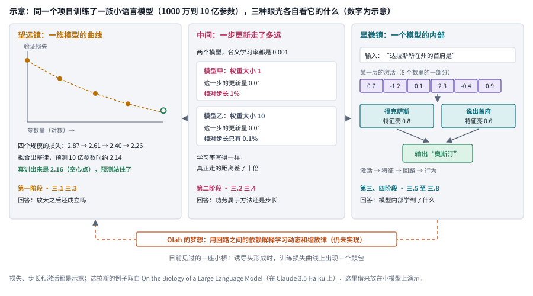

*图：模型科学的两种尺度，用同一族小模型演示。左栏对应主线第一阶段和分支三.1、三.3，中栏对应第二阶段和三.2、三.4，右栏对应第三、四阶段和三.5 至三.8；两侧的虚线表示每一步更新既决定曲线的形状，也塑造网络里的表示。损失、步长和激活为示意，达拉斯的例子取自 On the Biology of a Large Language Model。*

望远镜和显微镜两端至今还没有真正接上，图底部那条橙色的虚线弧画的是 Olah 在《Interpretability Dreams》里的设想：也许有一天，回路之间的依赖关系能同时解释学习动态和缩放律，从右栏一路走回左栏。这个设想至今没有实现，目前见过的一座小桥，是一种叫诱导头的回路形成的时刻，正好对应训练损失曲线上的一个鼓包。

### 证据有强有弱：观察、探针与干预

显微镜下最常见的两种证据，观察和探针，都回答不了“模型是否在用”。比如研究者发现，模型说出“巴黎”时，某一层的某个方向总是很亮。这能说明模型用这个方向来想“巴黎”吗？还不能。这只是观察，记录的是两件事一起变化，也就是统计关联。再进一步，研究者可以训练一个探针：读出原模型这一层的内部表示，训练一个简单的分类器去预测“答案是不是巴黎”，标签来自这些输入已知的正确答案，原模型本身保持不动。探针在没见过的样本上预测得准，说明有关信息可以从表示里读出来；可原模型自己是否也沿这条路使用这些信息，探针回答不了，因为信息可能只是冗余地存在那里，模型做决定时用的是另一条路。

要回答“模型是否在用”，就得做干预：主动改变这个方向，比如沿它加一个扰动并逐渐加大强度，看答案是否按解释所预测的方向移动。干预也需要对照。如果换成同样强度的随机方向，答案也会乱掉，那么效果多半来自一般性的损伤；如果其他无关任务也被顺带破坏，同样说明改动太粗暴。所以一次干预要固定输入、层和位置，同时配上无干预的基线、同强度的随机方向和对其他任务的检查。下图把观察、探针和干预画成三栏，用的是同一个“巴黎”例子。

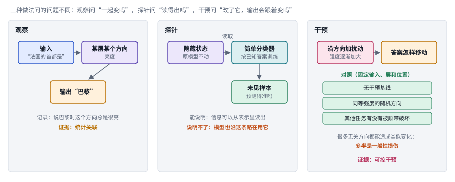

*图：观察、探针和干预问的是三个不同的问题。右栏的三条对照缺了任何一条，干预的结论都可能来自一般性损伤或输出偏好。*

把观察和干预放进更大的框架里，本章把证据分成四层。最底层是统计关联，方向亮了、探针读得出、曲线拟合得上都属于这一层；往上是可控干预，改动激活、参数或训练条件，看输出是否按预测移动；再往上是条件性的数学分析，在写明的光滑性、噪声和步长假设下给出保证；最上面是跨任务或跨规模的验证，结论在没参与拟合、没参与设计的条件下依然成立。四层之间的关系比一条严格的阶梯松散，数学证明和跨规模验证各管一件事，一篇论文也很少能把四层都做全，最可靠的研究往往让其中几层互相约束。

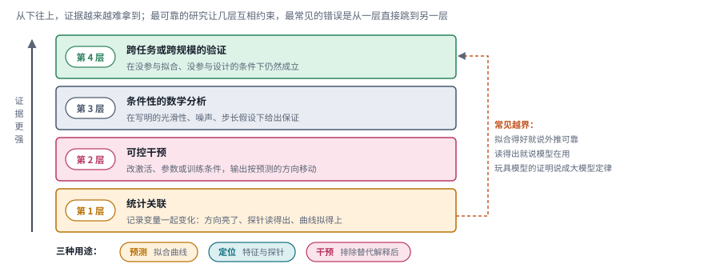

*图：四层证据大致按获取难度从下往上排，右侧的橙色虚线是最常见的越界，从最底层直接跳到最上层；底部三个标签是结论的三种用途。*

真正危险的是右边那条橙色箭头，也就是从最底层直接跳到最上层：拟合得好就宣称外推可靠，探针读得出就宣称模型在用，玩具模型上的证明就说成大模型的定律。图底部的三个标签说的是结论的三种用途：拟合曲线主要用来预测，特征和探针主要用来定位，只有在排除了替代解释之后，干预才能说明某种机制真的在起作用。

## 二、发展主线：从宏观曲线走到微观回路，再试着把两端接起来

过去十年，模型科学大致在宏观和微观两个尺度之间往返：先在宏观上把曲线画准，再弄清每一步训练到底走了多远，然后打开模型看表示，最后试图从表示走到回路和行为。这条主线以 Chris Olah 的《Interpretability Dreams》为骨架，再用 Wolfe 和 Bernstein 的两篇长文补上训练那一侧；宏观和微观的说法也来自 Olah，他说机制可解释性是对神经网络极其"微观"的分析，而损失曲线、缩放律这些现象是"宏观"的。每往微观走一步，能回答的问题更具体，能覆盖的模型行为也更少；而 Olah 寄予厚望的那件事，用微观机制去解释宏观曲线，到今天仍然是一个开放的梦想。

> **本节要点：** 这十年的研究怎样一步步逼近“模型为什么有效”？四个阶段看得越来越细：先看损失怎样随规模变化，再看每一步更新走了多远，然后打开某一层的激活、把挤在一起的多个特征拆开，最后追踪特征怎样连起来、产生行为。看得越细，问题越具体，能覆盖的行为越少；工具越精细，越要回头检验工具本身。

| 阶段 | 内容 | 代表工作 | 本章对应分支 | 速查卡 |
|---|---|---|---|---|
| 起点 | 两种尺度：望远镜看曲线，显微镜看回路 | Interpretability Dreams、Induction Heads | （基础概念，见第一节） | |
| 第一阶段 | 宏观曲线：规模、数据和计算怎样换成损失 | Kaplan 缩放律、Chinchilla、Chinchilla 复现 | 三.1、三.3 | S1 至 S3 |
| 第二阶段 | 训练动力学：每一步实际走多远、往哪走 | Adam、AdamW、Shampoo、μP、Muon、Modular Manifolds | 三.2、三.4 | O1 至 O6 |
| 第三阶段 | 表示：叠加与字典学习 | Transformer Circuits 框架、Toy Models of Superposition、Towards Monosemanticity、Scaling Monosemanticity | 三.5、三.6 | F1 至 F4 |
| 第四阶段 | 回路与行为：从特征走到推理、内省和知识使用 | On the Biology of a Large Language Model、内省研究、全局工作空间 | 三.7、三.8 | C1 至 C3 |
| 边界 | 测量本身也要经得起检验 | SAE 负面结果、SAE 批判性综述、Chinchilla 复现、推理非确定性 | 三.6、第五节 | |

两条线的节奏很不一样。下图每一行对应一个阶段，点的位置按 arXiv 编号或发布时间排开：训练这一侧的 Adam、AdamW、Shampoo 早在大模型时代之前就有了，缩放律在 2020 年才把宏观曲线讲清楚；显微镜这一侧从 2021 年的 Transformer Circuits 框架起步，2022 到 2024 年一路走过叠加和字典学习，2025 年之后，回路与行为这一行和边界那一行几乎同时密集起来。Chinchilla 复现、SAE 的负面结果和那篇 SAE 批判性综述，都出现在各自路线最热闹的时候之后不久：一种工具或一条规律刚被大量使用，就会有人回过头去检查它的地基。

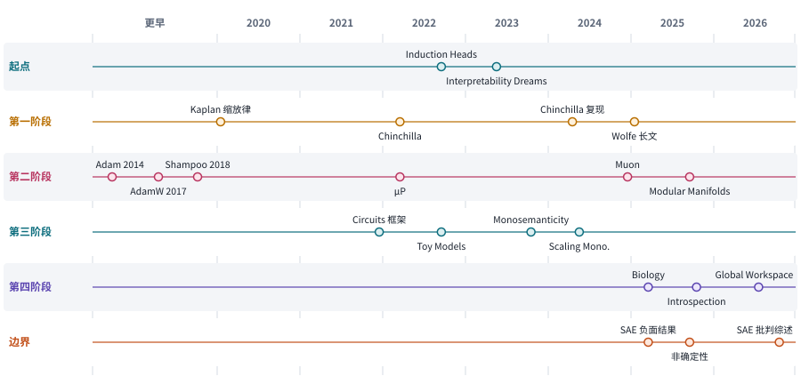

*图：主线上的代表工作按阶段分行排开。Muon 按 2024 年底在社区走红的时间计；边界一行收的是专门检验测量工具本身的工作，Chinchilla 复现画在第一阶段。*

### 起点：望远镜和显微镜

> **要点：** 看曲线和看内部这两种眼光，什么时候第一次对上了？在诱导头这种回路上：它在训练中形成的那一刻，正好在损失曲线上留下一个鼓包。

望远镜关注优化规则、规模、数据和计算，想知道训练条件怎样塑造能力；显微镜关注表示、特征和内部计算，想知道训练好的网络怎样实现能力。两者长期各说各话，直到 2022 年有过一次让人印象深刻的相遇。

两者第一次清楚相遇，是在诱导头的形成上：这个支撑上下文学习的回路突然形成的那一刻，训练损失曲线上正好留下一个鼓包。上下文学习是大模型最让人惊讶的能力之一：提示里给几个例子，模型不更新参数就能照着做。Anthropic 的 [In-context Learning and Induction Heads](https://arxiv.org/abs/2209.11895) 找到了一种可能的内部机制，叫诱导头。它做的事情很简单：序列里先出现过“A B”，后来又遇到 A，它就回头找到上一次 A 出现的位置，看看后面跟着什么，再把 B 复制过来作为预测。这种机制要靠两层注意力配合才能形成，只有一层注意力的模型做不出来。下图把这两层的分工画在一串真实的 token 上：前一层的头在每个位置记下它前面是哪个 token，诱导头再拿当前的 token 去找“前面是它”的那个位置，把那里的 token 抄过来。

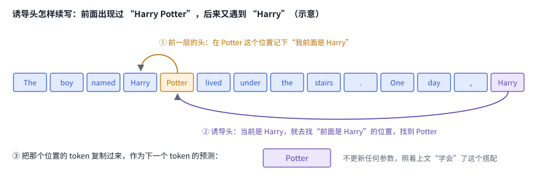

*图：诱导头续写 “Harry” 的三步。橙色箭头是前一层的头记下“前一个 token”，紫色箭头是诱导头按这个记号找到 Potter；句子为示意。*

这个机制的形成时刻在损失曲线上看得见。作者发现，诱导头会在训练中某个时刻突然形成，那一刻模型的上下文学习能力出现一次跃升，训练损失曲线上也留下一个小小的鼓包：损失本来平稳地往下走，到这里先停一停，再明显下一个台阶。

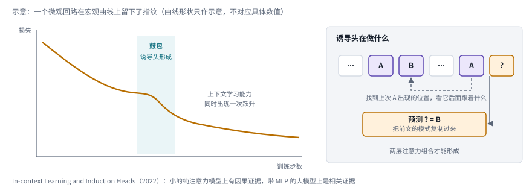

*图：示意，诱导头形成与损失曲线上的鼓包同时出现。论文的证据在小的纯注意力模型上是因果性的，在带 MLP 的大模型上是相关性的。*

这是一个微观回路在宏观曲线上留下的指纹。Olah 在第二年的《Interpretability Dreams》里反复回到这个例子，由此推测回路之间的依赖关系也许能同时解释学习动态和缩放律。这个梦想至今没有实现，可它给本章提供了一个阅读框架：下面四个阶段，前两个站在望远镜这边，后两个站在显微镜这边，最后都汇入同一种研究习惯：控制变量、设计竞争解释、保留未见条件，并公开失败的范围。

### 第一阶段：先把曲线画准

> **要点：** 没法在最大规模上试遍每种设计，怎样先在小规模上推算大规模？先把损失和规模、数据、计算之间的关系拟合成一条曲线，再追问固定预算下模型和数据怎样分配；后来的工作改写了最初的配比建议，它自己的拟合又被复现修正。

训练一个前沿模型太贵，没人能在最大规模上试遍每一种设计，于是需要一条规律：先在小规模上训练，再推算大规模会怎样。这类规律叫缩放律。它通常测的是交叉熵损失，衡量模型给正确的下一个 token 分配的概率有多低，越低越好；研究者在一串不同的参数量、数据量和计算量上各训练一批模型，记下损失，拟合出它们之间的关系。缩放律是一种经验规律，概括的是变量在实验范围内怎样一起变化，它没有说明模型内部为什么会这样；用它去预测没测过的规模，必须拿没参与拟合的规模来检验，拟合得好本身说明不了能预测下一个数量级。下图用示意数字演示这一点：两种公式在四个小规模的点上拟合得一样好，到大规模却给出不同的预测，能分出高下的只有一个没参与拟合的点。

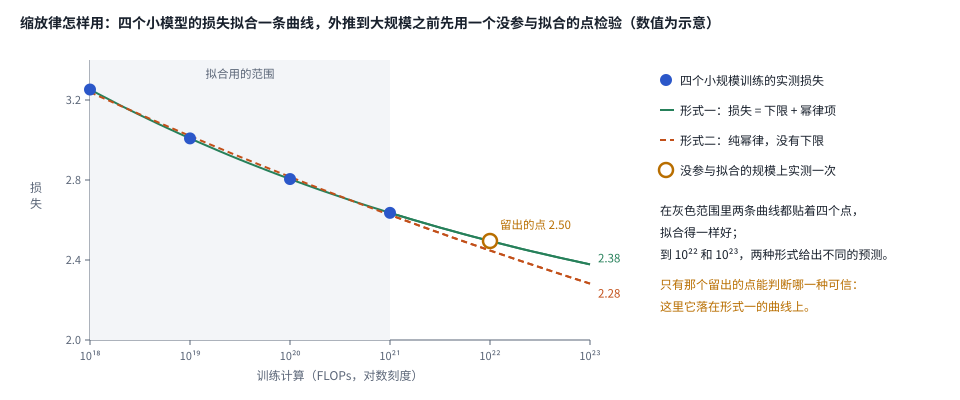

*图：四个小规模训练点上的两种拟合形式，以及一个留出的检验点。数值为示意，两种形式分别是“下限加幂律项”和“纯幂律”。*

宏观这条线的起点是 2020 年 OpenAI 的 [Scaling Laws for Neural Language Models](https://arxiv.org/abs/2001.08361)。Kaplan 等人发现，损失与模型规模、数据量和训练计算之间都呈幂律关系，也就是每把其中一项放大固定的倍数，损失就按固定的比例下降，这种趋势跨越了七个以上的数量级；而在很宽的范围内，宽度和深度这类结构选择的影响很小。Wolfe 在长文里把这称作"预训练时代"的开端：缩放律让 GPT 系列的放大有了依据，GPT-4 的最终表现甚至可以用小得多的训练提前预测。

有了规律，下一个问题是固定预算下怎样分配。总计算量一定时，参数和数据在抢同一份资源：计算量约等于 6 乘参数量再乘训练 token 数，模型越大，能负担的数据就越少，下图把同一份预算的两种分法画成面积差不多的两个矩形。Kaplan 的建议偏向左边那种：大模型样本效率更高，最省算力的做法是训练很大的模型、只喂适量数据，并在远未收敛时就停下来；图里的 Gopher 是 2800 亿参数、训练 3000 亿 token。两年之后，DeepMind 的 [Training Compute-Optimal Large Language Models](https://arxiv.org/abs/2203.15556)，也就是 Chinchilla，重新考察了这个分配，得出模型规模和数据规模应当大致同比例增长的结论，这意味着此前很多大模型其实训练不足；按这个配比训练的 700 亿参数的 Chinchilla 训练了 1.4 万亿 token，在同样的计算预算下胜过了参数多得多的 Gopher。两篇论文的配比建议不同，原因藏在实验范围、训练日程和拟合形式的差异里。

*图：矩形的宽是参数量，高是训练 token 数，面积约等于计算量。Gopher 和 Chinchilla 花的计算差不多，分法相反。计算量按 6 × 参数 × token 估算。*

把缩放研究的做法串起来是四步，下图上半部分跟着一族示意的小模型走了一遍。第一步选定验证任务，在一份没参与训练的文本上测交叉熵损失，比如模型给“今天天气很”后面的“好”分到 0.4 的概率，这个位置的损失就是 0.92；第二步在 1000 万到 3 亿参数的四个规模上各训一个模型，记下损失；第三步用这四个点拟合出一条幂律；第四步训一个 10 亿参数的模型，看预测的 2.14 和实际的 2.16 对不对得上。损失由模型自己给出的概率算出，拟合只是把曲线对上这几个点，这两步都不训练新东西。下半部分是固定预算下的三份配比结论。

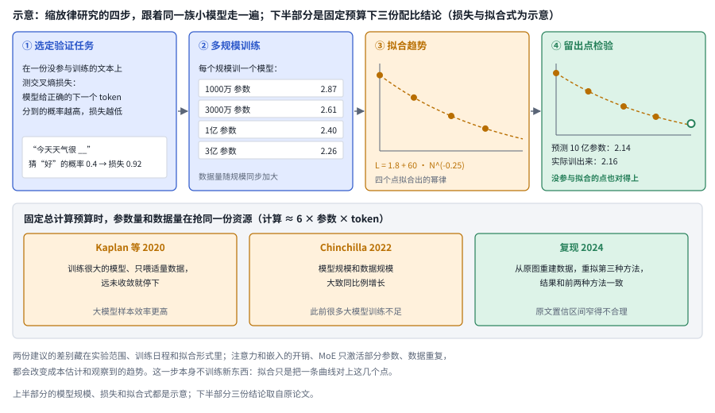

*图：缩放研究的四步（上，模型规模、损失和拟合式为示意）与固定预算下的三份结论（下）。Kaplan 和 Chinchilla 给出了不同的配比，2024 年的复现说明拟合方法本身就能改变结论。*

拟合形式有多重要，Chinchilla 自己后来也经历了一回。2024 年 Epoch AI 的 [Chinchilla Scaling: A replication attempt](https://arxiv.org/abs/2404.10102) 从 Chinchilla 论文的图里重建数据，重新拟合它的第三种估计方法，发现原文的参数估计和前两种方法相互矛盾，报告的置信区间窄得不合理；重新拟合之后，结果反而和前两种方法一致了。连最经典的缩放律都需要复现，这件事本身就说明，拟合的形式和细节会直接改变结论。

曲线越往后越平缓，说明不了缩放失灵，这是 Wolfe 对 2024 年底那场"缩放失灵"讨论的判断。他认为幂律曲线越往后越平缓本来就是它的数学性质，所谓放缓更多来自期望和曲线之间的错位，缩放在技术层面仍然有效，真正的问题是接下来缩放什么，比如强化学习和推理时计算。这一段留下了两个追问：既然拟合形式能改变 Chinchilla 的结论，小规模实验怎样才能可信地外推，拟合公式本身还漏了什么；既然 Chinchilla 要求数据随模型同比例增长，新数据不够、只能重复使用时，曲线又会怎样变。

**速查：第一阶段的三项工作。** 三张卡用的原料几乎一样，都是不同规模下的损失，差别落在最后一个框：Kaplan 停在拟合，Chinchilla 按新配比真的训练了一个模型去检验，复现则回到原图重新拟合，再用另外两种方法来对照。

 

*图：第一阶段三项工作的结构卡，每张卡对应下表的一行。*

| code | 名称 | 年份 | 代表 | 怎么做 | 解决了什么 | 代价 |
|---|---|---|---|---|---|---|
| S1 | 缩放律 | 2020 | [Scaling Laws for Neural Language Models](https://arxiv.org/abs/2001.08361) | 在跨越七个以上数量级的规模、数据和计算上训练模型，把交叉熵损失拟合成幂律 | 让放大模型有了可以预先估算的依据；宽度和深度这类结构选择在很宽的范围内影响很小，研究者可以把注意力集中在规模、数据和计算上 | 固定预算下“大模型、适量数据、早停”的配比建议，后来被 Chinchilla 修正；拟合测的是交叉熵，和下游能力之间还隔着几层 |
| S2 | 计算最优配比 | 2022 | [Chinchilla](https://arxiv.org/abs/2203.15556) | 用三种估计方法比较固定预算下的分配，再按得出的配比训练一个 700 亿参数的模型去检验 | 指出此前很多大模型训练不足，模型和数据应当大致同比例增长；按这个配比训练的 Chinchilla，在同样的计算预算下胜过了参数多得多的 Gopher | 结论依赖实验范围、训练日程和拟合形式；第三种方法的参数估计后来被复现指出与另两种方法矛盾 |
| S3 | 缩放律复现 | 2024 | [Chinchilla Scaling: A replication attempt](https://arxiv.org/abs/2404.10102) | 从 Chinchilla 论文的图中重建数据，重新拟合第三种估计方法，再和前两种方法对照 | 重新拟合后三种方法的结果一致了，说明原文的不一致来自拟合细节，并指出原文的置信区间窄得不合理 | 只能使用从图里重建的数据点，结论的精度受重建质量限制；它检验的是拟合过程，没有新增训练实验 |

### 第二阶段：看清每一步走了多远

> **要点：** 两次训练写着同一个学习率，参数实际走的距离一样吗？未必。一步更新由这一批数据的梯度、优化器记住的历史和学习率共同决定，这一阶段的优化器研究一直在追问：名义上的学习率，究竟让参数实际走了多远。

曲线描述的是训练的终点，可曲线的形状最终取决于每一步更新。一步更新由三样东西决定：这一批数据给出的梯度，优化器记住的历史状态，以及配置里写的学习率。训练这一侧的基础入口是 2014 年的 [Adam](https://arxiv.org/abs/1412.6980)，它持续记录两类历史：梯度通常朝哪个方向，以及各个参数上的梯度通常有多大，再据此给不同参数分配不同幅度的更新。随后 [AdamW](https://arxiv.org/abs/1711.05101) 把权重衰减从梯度更新里分出来，直接作用在参数上，让正则化、参数范数和学习率各自的作用可以分开讨论；[Shampoo](https://arxiv.org/abs/1802.09568) 则对矩阵形状的参数用左右两个预条件矩阵调整梯度，开启了矩阵形式预条件这条路。

这些优化器带着各自的状态和尺度假设，于是两次实验即使写着同一个学习率，参数实际走的距离也可能相差很远。下图是一个示意：同样长的一步更新，落在范数小的参数上，参数方向转过一个较大的角度；落在范数大的参数上，转过的角度就小得多。真正影响训练的，往往是这种相对改动的大小，近年的研究把学习率和参数范数之比叫作有效学习率（ELR）。比较有效学习率时要写清统计了哪些参数、怎样归一化、优化器处于什么状态；即使幅度对齐了，更新的方向、历史依赖和训练动态仍然可能不同。

*图：示意，同一个名义学习率在大小不同的参数上造成不同的相对改动。*

这个问题在模型放大时最实际：在小模型上调好的学习率，为什么放到大模型上就不对了？2022 年的 [Tensor Programs V](https://arxiv.org/abs/2203.03466) 给出了一个答案。在常用的标准参数化下，激活的大小会随模型宽度增长，最优超参数也就跟着漂移；作者提出的最大更新参数化（μP）调整了初始化方差、学习率和输出缩放，让最优超参数在宽度变化时保持稳定。下图左边是标准参数化：每条曲线是一个宽度的模型在不同学习率下的损失，最低点随宽度一路往左移；右边是 μP，几条曲线的最低点几乎落在同一个学习率上。作者用一个 4000 万参数的代理模型调参，再把超参数直接搬到 67 亿参数的模型上，就超过了已发表的 GPT-3 同等规模版本的结果，调参成本只占总预训练成本的大约 7%。Cerebras 后来写的实践指南也提醒，μP 主要处理宽度方向的迁移，深度、批大小和训练日程变化时，仍然需要另行检验。

*图：示意，标准参数化下最优学习率随宽度漂移，μP 下保持稳定。最下面的橙色提醒来自 Cerebras 的实践指南。*

2024 年底，Muon 优化器在社区里迅速走红，又把问题往前推了一步：优化器该怎样看待参数的形状？Adam 一族把所有参数当成一根长向量，逐个元素缩放。苏剑林在《Muon优化器赏析》里指出，矩阵的对角元和非对角元地位其实并不对等，这样做丢掉了矩阵结构。Muon 对动量矩阵做“矩阵符号函数”，把它所有的奇异值都拉到 1，可以看作在谱范数下走最陡的一步；当矩阵退化成对角阵时，它就回到了逐元素取符号的 SignSGD 一族，而 Shampoo 在累积因子取零时，更新和 Muon 在数学上等价。苏剑林认为，Muon 正是因为尊重了矩阵结构才效果更好。

Bernstein 的《Modular Manifolds》再往前一步，连权重本身也约束起来。他的出发点是，权重、激活和梯度都不应该变得太大或太小，因为尺度一旦失控，更新的相对大小就很难设定。激活早已有归一化，Muon 可以理解为在给更新做谱归一化，那么权重也可以被约束在一个流形上，比如让权重矩阵的奇异值始终为 1；约束之后，学习率就直接对应真实的步长。他在一个小规模 CIFAR-10 多层感知机上比较了这种 manifold Muon 和 AdamW，前者训练和测试准确率更高，奇异值也一直保持在 1 附近，代价是每一步多出一些时间开销。下图下排把逐元素、谱范数、流形这三种看待参数的方式并排画出。

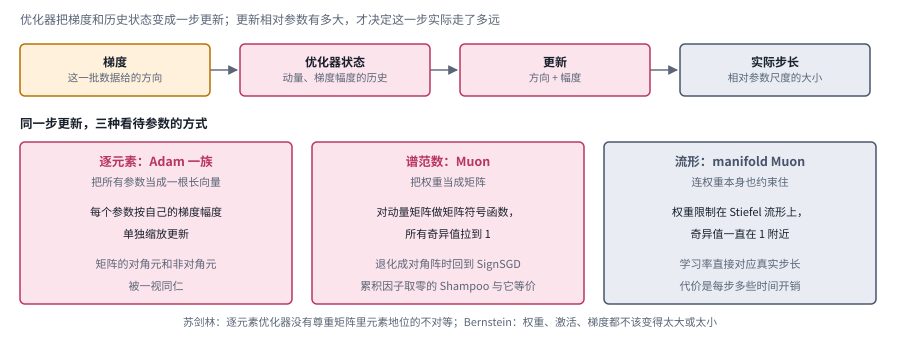

*图：一步更新的四个环节，以及逐元素、谱范数、流形三种几何。下排三栏分别对应下面讲到的 Adam、苏剑林对 Muon 的解读和 Bernstein 的《Modular Manifolds》。*

*图：第二阶段四种做法的对比。每一列是一种做法，四行依次是每一步决定什么、训练信号从哪来、怎么用和代价。*

四种做法拿到的训练信号是同一个，都是这一批数据上算出的梯度，差别全在怎样把梯度变成一步。Adam 一族逐个参数定步长；μP 改的是参数化，让 4000 万参数代理模型上调出的超参数能原样搬到 67 亿参数的模型；Shampoo 和 Muon 按矩阵的行列结构调整梯度；流形方法连权重本身也约束住，沿切向走一步再拉回。信号既然相同，效果的差别就只能来自这一步朝哪里走、走多远。

这一阶段最重要的收获是：名义学习率相同，实际更新可以完全不同。新优化器宣称更快更稳之前，要先排除它只是让有效步长落进了更好区间的可能；更稳的几何也可能更慢，manifold Muon 每一步就多出一些时间开销。

**速查：第二阶段的六种做法。** 六张卡都在决定一步更新怎样算出来，差别在对参数结构的假设有多强：Adam、AdamW 逐个元素处理，Shampoo 和 Muon 把权重当成矩阵，模块化流形连权重本身也约束住；μP 换了个角度，改的是参数化，让超参数能跨宽度搬家。

 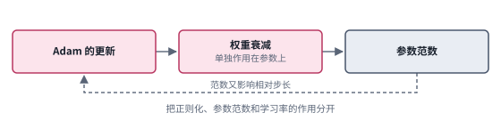

 

 

*图：第二阶段六种做法的结构卡，每张卡对应下表的一行。*

| code | 名称 | 年份 | 代表 | 怎么做 | 解决了什么 | 代价 |
|---|---|---|---|---|---|---|
| O1 | 自适应矩估计 | 2014 | [Adam](https://arxiv.org/abs/1412.6980) | 持续记录梯度的一阶矩和二阶矩，也就是梯度通常朝哪走、通常有多大，再据此给每个参数分配不同幅度的更新 | 不必为每个参数手工设定步长，在大模型训练里成了默认的起点 | 每个参数要多存两份历史状态；名义学习率相同时，实际经历的训练条件可能相差很远 |
| O2 | 解耦权重衰减 | 2017 | [AdamW](https://arxiv.org/abs/1711.05101) | 把权重衰减从梯度更新里分出来，直接作用在参数上 | 让正则化、参数范数和学习率各自的作用可以分开讨论 | 权重衰减会改变参数范数，进而改变有效步长；三.2 的研究发现它主要通过有效学习率的日程起作用 |
| O3 | 矩阵预条件 | 2018 | [Shampoo](https://arxiv.org/abs/1802.09568) | 对矩阵形状的参数，用左右两个积累统计量的预条件矩阵来调整梯度 | 把参数当成矩阵来处理，开启了矩阵形式预条件这条路 | 预条件矩阵的计算开销和数值稳定性在大规模训练里都是负担，三.4 的 SOAP 一文专门处理大批量下的不稳定 |
| O4 | 最大更新参数化 | 2022 | [Tensor Programs V（μP）](https://arxiv.org/abs/2203.03466) | 调整初始化方差、学习率和输出缩放，让激活大小不随宽度增长；在小代理模型上调参后直接迁移 | 最优超参数在宽度变化时保持稳定，调参成本只占总预训练成本的大约 7% | 主要处理宽度方向，深度、批大小和训练日程变化时仍需另行检验 |
| O5 | 矩阵符号更新 | 2024 | [Muon（苏剑林的解读）](https://kexue.fm/archives/10592) | 对动量矩阵做矩阵符号函数，把所有奇异值拉到 1，相当于谱范数下的最速下降；实际用几步 Newton-Schulz 迭代来近似 | 尊重了矩阵里对角元和非对角元地位的不对等，苏剑林认为它因此效果更好；三.4 的数十亿参数实验里它也持续优于 AdamW | 收益随调参、饱和程度和步长匹配而变化；压缩通信和收敛保证都要另行处理（三.4） |
| O6 | 模块化流形 | 2025 | [Modular Manifolds](https://thinkingmachines.ai/blog/modular-manifolds/) | 把权重约束在 Stiefel 流形上，在切空间里取步再拉回流形；再用模块化流形在各层之间分配学习率预算 | 学习率直接对应真实的步长，奇异值一直保持在 1 附近；小规模实验里训练和测试准确率都高于 AdamW | 文中的实验是一个小规模 CIFAR-10 多层感知机；每一步多出一些时间开销 |

### 第三阶段：打开表示，先解决叠加

> **要点：** 打开模型的某一层，能直接读懂里面的东西吗？先要有一套描述内部计算的语言；可单个神经元往往同时对好几种不相干的东西有反应，没法命名。这一阶段找到了一个可行的拆法，把挤在一起的特征重新拆开，也让“特征究竟怎么定义”变成了绕不开的问题。

要打开模型看，先得有一套描述它内部计算的语言。2021 年的 [A Mathematical Framework for Transformer Circuits](https://transformer-circuits.pub/2021/framework/index.html) 把 Transformer 的计算看成在一条贯穿各层的残差流上读写：每个注意力头从残差流里读出信息，决定看哪里、搬运什么，再把结果写回去。"注意力头在做什么"第一次有了可以精确讨论的语言，诱导头就是在这个框架里被认出来的。

可是研究者很快撞上了一堵墙：单个神经元往往同时对好几种毫不相干的东西有反应，比如同一个神经元既对猫的图片亮、又对某种字体亮，没法给它起一个名字。2022 年的 [Toy Models of Superposition](https://transformer-circuits.pub/2022/toy_model/index.html) 在玩具模型里研究了这个现象。当模型要表示的特征比它拥有的维度多，而这些特征又很少同时出现时，网络会把多个特征叠加在同一组维度里，靠方向之间的错开把它们分辨出来，代价就是任何一个神经元都会同时对好几个特征有反应。这就是叠加。Olah 在《Interpretability Dreams》里明确说，当时团队的工作重心就是解决叠加，因为它把语言模型里本来存在的结构遮住了。下图是玩具模型里最典型的一种排法：5 个特征挤进 2 个神经元，排成一个五边形，所以每个神经元都对好几个特征有反应。

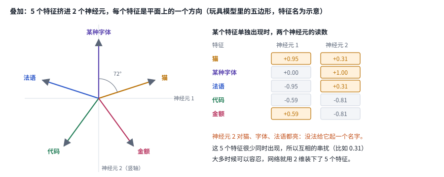

*图：叠加的五边形。左边每个箭头是一个特征在两个神经元上的方向，右表是每个特征单独出现时两个神经元的读数。五边形的排法取自 Toy Models of Superposition，特征名为示意。*

2023 年的 [Towards Monosemanticity](https://transformer-circuits.pub/2023/monosemantic-features/index.html) 给出了一个可行的拆法：字典学习。它先把大量文本送进模型、收集某一层的激活，再训练一个稀疏自编码器（SAE），把激活翻译成一份数量比维度多得多、每次只亮少数几个的特征清单，再从清单重构回原来的激活；训练时原来的激活就是答案，目标同时要求重构得准和亮的特征尽量少。训练完以后，研究者看每个特征在哪些文本上亮起，再给它命名。用稀疏自编码器拆语言模型激活的还有别人：在它发布前几周，Cunningham 等人的 [Sparse Autoencoders Find Highly Interpretable Features in Language Models](https://arxiv.org/abs/2309.08600) 也这样做，自动评估显示拆出的特征比其他拆法更好解释。Towards Monosemanticity 的不同在于，它在一个单层模型上把字典从 512 个特征一路放大到约 13 万个，再对拆出的特征逐个细看。2024 年的 [Scaling Monosemanticity](https://transformer-circuits.pub/2024/scaling-monosemanticity/) 把这件事推到了 Claude 3 Sonnet 上，最大的字典有大约 3400 万个特征。其中最出名的是"金门大桥"特征：把它钳制到最大激活的 10 倍，模型就会自称是金门大桥。作者也找到了与不安全代码、偏见、谄媚、欺骗等相关的特征，并且通过操控其中一些特征改变了模型行为。下图用几个数演示稀疏自编码器对一组激活做了什么：8 个激活数被翻成一份 24 格的清单，其中只有 3 格不为 0，再从这 3 格几乎原样拼回那 8 个数。

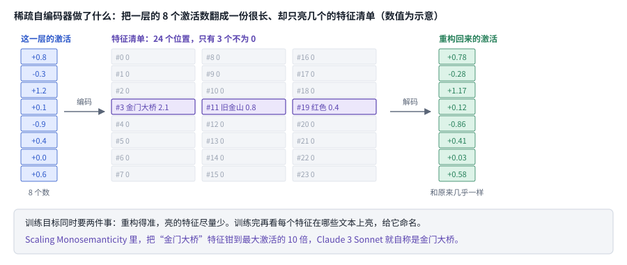

*图：稀疏自编码器的一次编码与解码。特征名和数值为示意；钳制“金门大桥”特征的结果取自 Scaling Monosemanticity。*

*图：左为叠加示意，右为稀疏自编码器的流程。底部两行注明两篇代表作的规模：Towards Monosemanticity 用的是单层模型，Scaling Monosemanticity 把字典推到了 Claude 3 Sonnet 上。*

这一段的成果振奋人心，作者的措辞却很克制。Scaling Monosemanticity 报告，3400 万特征的字典里约有 65% 的特征几乎从不激活，覆盖也不完整，并提醒读者不要对"某个特征存在"这件事解读过度。这些工作没有证明每个维度都能对应一个人类概念，它们真正的贡献，是让表示重叠、上下文依赖和"特征究竟怎么定义"变成了绕不开的问题。接下来要问的是：可读的特征能不能稳定操控，探针读出的概念是不是模型真正在用的概念。

**速查：第三阶段的四项工作。** 四张卡讲的是同一个故事的四步：第一张给残差流上的读写找到语言，第二张解释为什么单个神经元读不懂，后两张用字典把特征重新拆出来，并把规模从单层模型推到了生产级模型。

 

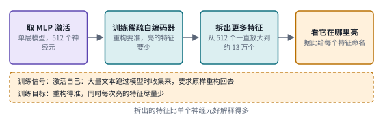 

*图：第三阶段四项工作的结构卡，每张卡对应下表的一行。*

| code | 名称 | 年份 | 代表 | 怎么做 | 解决了什么 | 代价 |
|---|---|---|---|---|---|---|
| F1 | 电路框架 | 2021 | [A Mathematical Framework for Transformer Circuits](https://transformer-circuits.pub/2021/framework/index.html) | 把计算拆成残差流上的读写，每个注意力头分成决定看哪里的 QK 部分和决定搬运什么的 OV 部分 | “注意力头在做什么”第一次有了可以精确讨论的语言，诱导头就是在这个框架里被认出来的 | 分析对象是只含注意力层、两层以内的小模型，MLP 层没有纳入 |
| F2 | 叠加的玩具模型 | 2022 | [Toy Models of Superposition](https://transformer-circuits.pub/2022/toy_model/index.html) | 在玩具模型里改变特征数量和稀疏程度，观察网络怎样把多个特征放进同一组维度 | 解释了单个神经元为什么同时对几种不相干的东西有反应，并把叠加确立为需要解决的核心障碍 | 结论来自玩具模型，搬到真实语言模型上需要另外的证据 |
| F3 | 稀疏字典 | 2023 | [Towards Monosemanticity](https://transformer-circuits.pub/2023/monosemantic-features/index.html) | 在单层模型 512 个神经元的 MLP 激活上训练稀疏自编码器，字典从 512 个特征一直放大到约 13 万个 | 给出一个可行的拆解叠加的办法，拆出的特征比单个神经元更容易解释 | 只在单层小模型上做；重构并不完整，作者也提醒低激活处可能还留着多义性 |
| F4 | 字典的规模化 | 2024 | [Scaling Monosemanticity](https://transformer-circuits.pub/2024/scaling-monosemanticity/) | 把稀疏自编码器推到 Claude 3 Sonnet 上，最大字典约 3400 万个特征，并通过钳制特征检验它们的作用 | 在生产级模型里找到与不安全代码、偏见、谄媚、欺骗等相关的特征，操控其中一些特征改变了模型行为 | 约 65% 的特征几乎从不激活，覆盖也不完整；作者提醒不要对“某个特征存在”解读过度 |

### 第四阶段：从特征走到回路和行为

> **要点：** 有了能命名的特征，能不能看清它们怎样一步步算出答案？三项代表工作各检验一种内部过程：答案经过了哪些中间步骤，模型能否报告人为改动过的内部状态，哪一小块表示能被说出口、被调用。

有了特征，下一步自然是看特征之间怎样连成回路。2025 年 3 月的 [On the Biology of a Large Language Model](https://transformer-circuits.pub/2025/attribution-graphs/biology.html) 是这一步的代表。作者先训练一个更容易分析的替代模型，让它用稀疏的特征去重现原模型每一层的计算；重现得足够接近，它才能代替原模型来分析，重现不了的那部分计算记为误差节点。在替代模型上，以特征为节点、以特征之间的作用为边，就能画出模型从输入到答案的一张归因图。在 Claude 3.5 Haiku 上，他们看到模型回答"达拉斯所在州的首府"时，提示里的“达拉斯”先激活一个和得克萨斯有关的特征，“首府”激活一个要说出首府的特征，两路信息汇合之后，模型才输出“奥斯汀”。答案经过了一个中间步骤，模型没有一步就从记忆里直接取出“奥斯汀”。他们还看到写押韵诗时，模型会在下一行开始之前就先想好要押的那个词，并分析了算术、幻觉与实体识别、拒答和越狱，以及思维链是否忠实于内部计算。

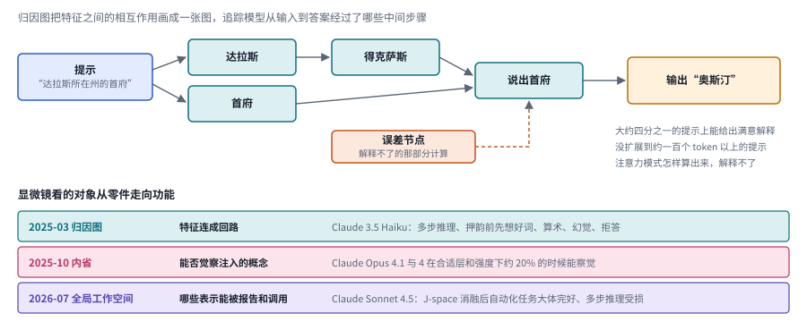

*图：上半部分是归因图的达拉斯例子（节点名称为示意），右侧三行是作者自己写明的边界；下半部分三项工作对应下面三段。*

归因图只解释得了一部分计算，作者自己把边界写得很诚实。归因图大约只在四分之一的提示上能给出令人满意的洞见；方法还没扩展到大约一百个 token 以上的提示；注意力模式是怎样计算出来的，方法解释不了；相当一部分计算落在误差节点里，即使是文中精心挑选的案例，误差节点的贡献也不小。

同年 10 月，Jack Lindsey 的 [Emergent Introspective Awareness in Large Language Models](https://transformer-circuits.pub/2025/introspection/index.html) 把显微镜对准了一个更敏感的问题：模型能否觉察到自己内部的状态。研究者往模型的激活里注入与某个概念相关的模式，再看模型的自我报告是否反映了这一注入。表现最好的 Claude Opus 4.1 和 4，在合适的层和注入强度下，大约有 20% 的时候能察觉到被注入的概念。作者反复强调这种能力高度不可靠，失败才是常态，也明确表示不讨论模型是否具有类似人类的自我意识。这类研究里的“内省”“元认知”都是操作性的定义：内省指模型能定位人为注入的扰动，元认知可以指对答案正确率的校准或对下一步的监控，它们是定义清楚的实验任务，离人类式的自我意识还很远。读这类论文，先问作者怎样测量，以及什么样的结果会推翻他的假设。

到了 2026 年 7 月，Anthropic 的 Wes Gurnee、Jack Lindsey 等人在 [Verbalizable Representations Form a Global Workspace in Language Models](https://transformer-circuits.pub/2026/workspace/) 里把这个问题又往前推了一步：模型内部哪些表示能被说出口、被调用？他们用一种叫 Jacobian lens 的工具，在约一千个提示上平均一个激活对输出词概率的线性化影响：一块激活能把哪些词的概率推高，就说明它装着能被说出口的内容。靠这个工具，他们在 Claude Sonnet 4.5 里找出一小块这样的表示，称为 J-space，并检验它是否具备全局工作空间的几条功能性质：替换其中的方向会改变模型说出的内容，多跳推理里没写出来的中间结果落在这里，消融它之后自动化的解析和续写大体完好，多步推理却明显受损。作者也说明这个透镜只能近似地抓住工作空间，只认得对应单个词元的概念。从特征到回路，再到“哪些表示能被报告和调用”，显微镜看的对象正在从零件变成功能。

**速查：第四阶段的三项工作。** 三张卡的最后一格，正好说明可检验的东西一路在变：归因图检验的是中间步骤存不存在，内省研究检验的是自我报告是否反映了注入，全局工作空间检验的是一小块表示有没有五条功能性质。

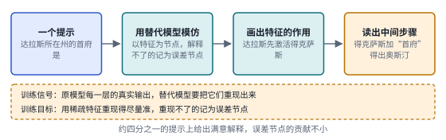 

*图：第四阶段三项工作的结构卡，每张卡对应下表的一行。*

| code | 名称 | 年份 | 代表 | 怎么做 | 解决了什么 | 代价 |
|---|---|---|---|---|---|---|
| C1 | 归因图 | 2025 | [On the Biology of a Large Language Model](https://transformer-circuits.pub/2025/attribution-graphs/biology.html) | 以特征为节点、以特征之间的相互作用为边，画出模型从输入到答案的中间步骤，解释不了的部分记为误差节点 | 在 Claude 3.5 Haiku 上看到多步推理的中间结果、写诗时提前规划押韵词，并分析了算术、幻觉、拒答和思维链忠实性 | 大约只在四分之一的提示上给出满意解释；没扩展到约一百个 token 以上的提示；注意力模式怎样算出来解释不了 |
| C2 | 概念注入的内省 | 2025 | [Emergent Introspective Awareness](https://transformer-circuits.pub/2025/introspection/index.html) | 往激活里注入与某个概念相关的模式，再看模型的自我报告是否反映了这次注入 | 给“模型能否觉察自己的内部状态”这个敏感问题设计了可检验的实验；Claude Opus 4.1 和 4 在合适条件下约 20% 的时候能察觉 | 能力高度不可靠，失败才是常态；只测人为注入，也不讨论类似人类的自我意识 |
| C3 | 全局工作空间 | 2026 | [Verbalizable Representations Form a Global Workspace](https://transformer-circuits.pub/2026/workspace/) | 用 Jacobian lens 在约一千个提示上平均激活对输出概率的线性化影响，找出 J-space，再用替换和消融逐条检验五条功能性质 | 在 Claude Sonnet 4.5 上找到一小块能被说出口、能被定向调控、承载多跳推理中间结果的表示；消融后多步推理明显受损 | 透镜只能近似、不完整地抓住工作空间，只认得对应单个词元的概念；文章不讨论这些性质和主观体验的关系 |

这一段留下了三个问题：内省研究里约 20% 的成功率说明这种能力很不可靠，它怎样被拆成可检验的部件；达拉斯例子里模型要先调出“得克萨斯”这条知识才能答对，存进参数的知识为什么有时调不出来；J-space 里装着多跳推理中没说出口的中间结果，不写出来的"潜在推理"内部究竟发生了什么。

### 边界：测量本身也要经得起检验

> **要点：** 看曲线和看内部用的这些工具，本身靠得住吗？工具越精细，越要回头检查工具本身：SAE 在实际任务上输给了线性探针，经典缩放律的拟合需要复现，连“同一个模型的输出”都要先被定义清楚。

显微镜越做越精细，它在实际任务上的表现却令人失望：SAE 在有害意图检测上输给了朴素的线性探针。2025 年 3 月，Google DeepMind 机制可解释性团队发表了一篇罕见的负面结果报告。他们用 SAE 特征训练有害意图检测器，结果在分布外，直接在残差流上训练的线性探针几乎完美，SAE 探针明显更差；即使在对话数据上微调 SAE，也只缩小了一半左右的差距。团队据此暂停了基础 SAE 研究，并认为这个领域可能在 SAE 上投入过多。他们也指出了一个亮点：SAE 特征帮他们发现并清理了数据集里的虚假相关。一年半之后，2026 年 10 月的一篇[批判性综述](https://arxiv.org/abs/2610.20139)梳理了 138 项 SAE 研究，给这场争论做了一次清点：作者把特征能否恢复、是否可解释、机制上是否忠实、行为上是否有用分成四个独立的终点，认为文献里的许多分歧来自目标、基线、提示和干预流程的差别，并建议先试探针和直接方向，只有当可复用的细粒度特征词表真正带来好处时才选 SAE。

宏观和实验那一侧也有类似的提醒，最底层的一条是，连"同一个模型的输出"都要先被定义清楚。拟合细节能改变 Chinchilla 的配比结论，这已经由复现说明。Thinking Machines 的 Horace He 等人则追问了一个更底层的问题：为什么温度设为 0，同样的输入还是会得到不同输出？常见的解释是并行计算加浮点误差，他们发现真正的原因是核函数在批大小变化时会改变求和的顺序，而服务器上的批大小取决于同时有多少人在用。他们在 Qwen3-235B 上用温度 0 生成 1000 次，得到 80 种不同的结果；换上不随批大小变化的核函数之后，1000 次结果完全一致。对于做模型科学的人，这是所有对比实验的前提。下图把这条因果链拆成三步：浮点加法换个顺序就可能得到不同的和，核函数的求和顺序随批大小变化，而两个候选 token 几乎打平时，最后一位的差别就足以换掉输出。

*图：推理非确定性的来源。第一格的浮点算式可以在任何电脑上验证，第三格的分数为示意，最下面的数字来自 Thinking Machines 在 Qwen3-235B 上的实验。*

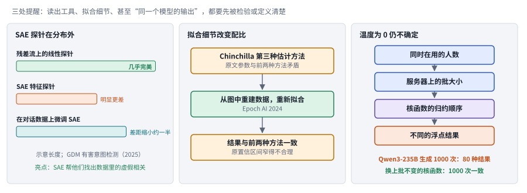

*图：测量本身也要经得起检验。左栏条形长度为示意；右栏数字来自 Thinking Machines 在 Qwen3-235B 上的实验。*

这些边界把整条主线收束到一个共同的研究习惯上：损失拟合图和激活可视化都很有说服力，可图像本身不是因果证据；理论证明也替代不了真实训练设置里的测量。负面结果应该和成功一样显眼。

### 总对照：四族方法放在同一组坐标上

> **要点：** 拿到一篇新论文，怎样很快看清它？先问它研究的是哪个尺度、主要观测量是什么、靠哪一层证据。按这三问可以把前面的方法排进一张表，再放到“研究尺度”和“主要证据”两条轴上，就能看清哪里证据密集、哪里还是空白。

| 家族 | 研究尺度 | 主要观测量 | 主要证据 | 主要优点 | 主要代价 | 本章分支 |
|---|---|---|---|---|---|---|
| S 缩放 | 宏观曲线 | 不同规模、数据和计算下的损失 | 拟合，加上按新配比训练去检验 | 能在押注大模型之前估算收益和配比 | 拟合形式和实验范围会改变结论，外推需要独立的验证点 | 三.1、三.3 |
| O 优化 | 训练动力学 | 每一步更新的方向、幅度和相对步长 | 条件性证明、受控训练对比、跨宽度迁移 | 直接决定训练能否稳定、超参数能否搬家 | 名义设置相同时实际步长可能不同；理论保证和实测速度可能排序相反 | 三.2、三.4 |
| F 表示 | 表示 | 激活、神经元和字典特征 | 玩具模型分析、特征命名、钳制干预 | 让模型内部第一次有了可以命名的单位 | 特征的定义依赖字典，覆盖不完整；读得出的特征未必是模型在用的特征 | 三.5、三.6 |
| C 回路与行为 | 回路与行为 | 特征之间的相互作用、自我报告、可被调用的表示 | 归因、注入、替换与消融 | 把内部计算和具体行为连了起来 | 只能解释一部分提示和计算，误差节点不小；透镜和任务都是近似 | 三.7、三.8 |

把四族方法放上尺度和证据两条轴，能看出哪里证据密集、哪里还是空白。下图横轴是研究的尺度，从宏观曲线一直到回路与行为；纵轴是论文主要依靠的证据，从统计关联与拟合一直到跨规模或跨任务的验证。格子的位置按每项工作最主要的那层证据来放，作者往往也做了别的检验；最下面一行标出第三节八个分支各自落在哪一列。

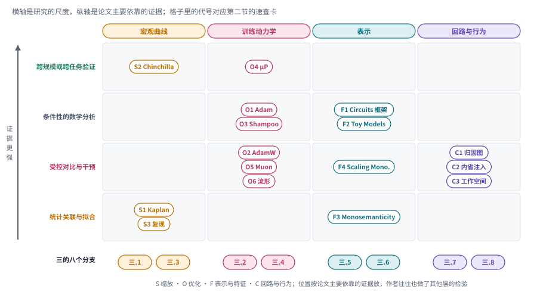

*图：主线代表工作在尺度与证据两条轴上的位置，代号对应第二节的速查卡；最下一行是第三节的八个前沿分支。*

这张图最醒目的是右上角的空白。宏观一侧已经有 Chinchilla 和 μP 这样在新规模上检验过预测的工作，显微镜一侧的代表作大多停在受控干预这一层，回路与行为这一列还没有哪项工作做到跨规模、跨任务的系统验证。Olah 设想用回路之间的依赖关系去同时解释学习动态和缩放律，这片空白说明宏观曲线和微观回路两端至今还没有真正接上。

## 三、前沿研究方向

下面八个分支收录的都是 2026 年的新论文。它们延续了主线上训练规律和内部机制这两条线，同时越来越关心这些解释能不能反过来指导新的设计。前四个分支站在望远镜这一侧，讨论缩放、步长、数据路由和优化几何；后四个分支站在显微镜这一侧，讨论特征、探针、知识使用和潜在推理。不同分支的证据强度差别很大：拟合规律可以帮助预测，内部特征可以帮助定位，可要说某种机制导致了能力变化，还得把其他解释一一排除。

> **本节要点：** 2026 年的新论文把这些解释推到了哪里？前四个分支解释训练条件怎样塑造曲线，依次是小实验的外推、步长、数据、优化器怎样看待参数的形状；后四个分支解释网络内部怎样完成计算，依次是特征、探针、知识的使用和不写出来的推理。

### 1. 小尺度与缩放律：便宜实验怎样才不误导？

用一批小模型试出趋势、再押注大模型，前提是数据、优化和结构条件在放大之后仍然可以比较，几乎每个实验室都在赌这个前提。缩放关系是一种受条件约束的经验规律，它的地位和物理定律差得很远；Chinchilla 的拟合后来被复现指出参数估计自相矛盾，说明连拟合细节都能改变结论。所以一篇好的缩放研究，应当先报告拟合范围、不确定性和失效条件，然后才讨论预算预测。

> 主线位置：第一阶段，宏观曲线。接 Kaplan 缩放律、Chinchilla 及其复现，对应 Wolfe 长文中"缩放律如何被修正"的那条线。

> **要点：** 用一批小模型推算大模型，什么时候会出错？三篇工作找到的错处和预测的尺度不同：一篇认为错在小实验没调好参，一篇认为错在公式漏了参数和数据之间的交互，一篇换了尺度，只预测接下来一小段训练。前两种错因要分开检验，两种尺度的预测也不能混成一条“训练定律”。

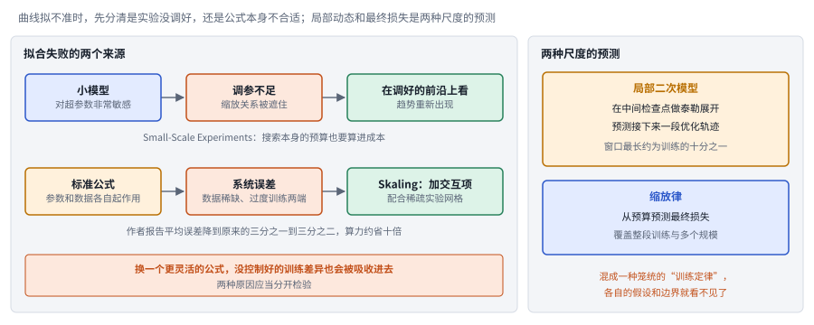

*图：左边两行是拟合失败的两个来源及各自的补救，底部橙色框是两者混在一起时的风险；右边是两种尺度的预测，各有各的假设和边界。*

拟合失败的第一个可能来源是小实验本身没做好，**Small-Scale Experiments: Are We There Yet?（`2608.11859`）** 认为，小模型对超参数非常敏感，调参不足会把本来存在的缩放关系遮住，只有在调好的前沿上看，趋势才会重新出现。[论文](https://arxiv.org/abs/2608.11859)以归一化位置问题为例，展示了怎样从小实验恢复较大尺度上的趋势，同时也承认统计外推有它的限制。它给出的是一套方法，并没有发放"随便训几个小模型就能替代大实验"的许可：为了在小尺度上找到最优前沿而做的大量搜索，本身也要算进成本，搜索预算和最终训练预算应当一起公开。

另一篇从公式这一侧下手。标准的缩放公式假设参数和数据各自独立地起作用，**Skaling（`2608.07222`）** 认为这在数据稀缺和过度训练的两端会产生系统误差，于是加入一个交互项，并配合稀疏的实验网格来拟合；[论文](https://arxiv.org/abs/2608.07222)报告平均误差降到原来的三分之一到三分之二，所需算力约为均匀扫描的十分之一。把这两篇放在一起看，拟合失败可能有两种完全不同的来源：一种是实验没有调好，另一种是函数形式本身不合适。如果只是换一个更灵活的公式，原来没控制好的训练差异也会被一并吸收进去，问题就被藏起来了，所以两种原因应当分开检验。

**A Defense of the Quadratic Model（[`2607.21716`](https://arxiv.org/abs/2607.21716)）** 给出了另一种尺度上的预测：在训练的中间检查点附近，把损失近似成参数的二次函数，可以预测接下来一段优化轨迹，作者在 1.5 亿参数、30 亿训练 token 的模型上看到这个窗口最长可达训练的十分之一。它描述的是一个局部时间窗口内的变化，不打算描述完整的训练过程。缩放律预测的是预算和最终损失，二次模型预测的是局部动态；如果把两者混成一种笼统的"训练定律"，各自的假设和可以检验的边界都会被掩盖。

### 2. 有效学习率与超参数迁移：更新幅度到底由谁决定？

同一个名义学习率，在不同的参数尺度、优化器和归一化方式下，会产生截然不同的实际更新，这就是第二阶段说的名义学习率和有效学习率（学习率与参数范数之比）的区别。这件事在跨模型迁移超参数时最容易出问题：直接复用配置文件，看起来公平，其实可能已经让两个模型走上了不同的步长。研究者因此开始观察梯度和参数变化的相对量，用它来区分优化不匹配和架构本身的限制，也避免把一次偶然的训练失败误读成缩放的边界。

> 主线位置：第二阶段，训练动力学。接 AdamW、μP（Tensor Programs V）和 Bernstein 的模块化流形，后者正是在讨论怎样把学习率变成可预算的真实步长。

> **要点：** 名义学习率靠不住，那么拿有效学习率来比较，能解释什么？这组论文拿它解释三件事：不同训练曲线为什么重合，一种看似全新的参数几何是否只是换了步长，模型放大时超参数怎样迁移。

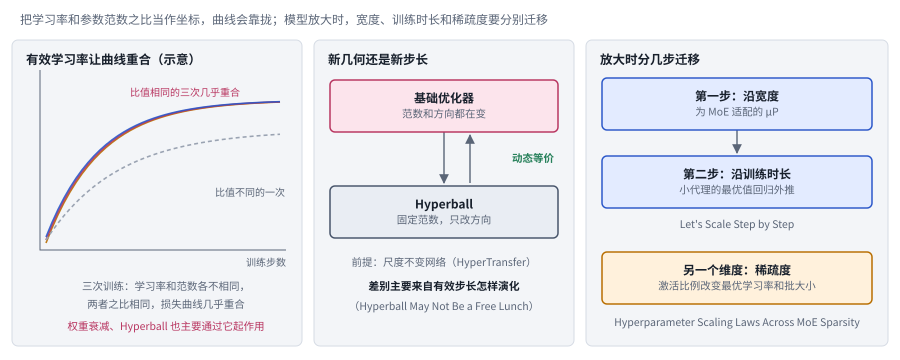

*图：左栏为示意，三条比值相同的曲线几乎重合；中栏两篇论文合起来检验“新几何还是新步长”；右栏三个框对应本节后两篇论文。*

有效学习率相同，损失曲线就几乎重合，这是 **Effective Learning Rate Governs Loss Dynamics（`2608.24814`）** 最直接的发现。三次训练的学习率和参数范数各不相同，只要两者之比相同，损失曲线就几乎重合；作者报告在一个代表性配置里，这种重合的误差比不同随机种子之间的波动还小。[论文](https://arxiv.org/abs/2608.24814)由此把权重衰减和范数控制的一部分影响，归结到有效学习率随训练变化的日程上。它的要点是：只固定名义学习率，很可能并没有固定实际的更新强度。它没有宣布所有优化器都一样，可照这个思路，任何声称新方法更稳定的工作，都应该先检查它是否只是让步长落进了更好的区域。

一种看似全新的参数几何，可能主要改变的只是步长，两篇 Hyperball 论文检验的就是这个竞争解释。Hyperball 把参数的范数固定住，更新时只改方向。**HyperTransfer（`2609.07017`）** 证明，在尺度不变的网络里，也就是参数整体放大缩小不影响输出的网络里，普通优化器和 Hyperball 的训练动态是等价的，并构造出两者之间的迁移映射；[论文](https://arxiv.org/abs/2609.07017)的结论带着这个明确的前提，推广到任意网络、任意归一化之前要先重新检验。**Hyperball May Not Be a Free Lunch（[`2607.22444`](https://arxiv.org/abs/2607.22444)）** 从参数方向每一步转过的角度出发分析有效学习率，发现两者的主要差别来自有效步长怎样随训练演化。

超参数迁移的另一个难点是，模型放大从来不只沿一个方向。μP 主要处理宽度方向，它的实践指南提醒过，深度、批大小和训练日程变化时都要另行检验。**Let's Scale Step by Step（[`2608.20061`](https://arxiv.org/abs/2608.20061)）** 补上了训练时长这一块：先沿宽度用为 MoE 适配的 μP 迁移学习率，再用小代理模型上的最优值回归外推到很长的训练时长。**Hyperparameter Scaling Laws Across MoE Sparsity（`2609.08690`）** 指出稀疏度是另一个独立的维度：MoE 每个 token 只激活一部分专家，激活比例变了，最优的学习率和批量大小也会变，[论文](https://arxiv.org/abs/2609.08690)的结果说明，仅用总参数或激活参数都解释不了全部变化。由此可以得到一条可复用的研究路线：固定数据、预算和路由，逐项改变稀疏性；密集模型的调参公式搬到极稀疏模型上之前，必须先经过这样的检查。

### 3. 数据与路由：容量收益为什么会被重复数据吃掉？

更多的参数，只有在数据和路由提供了有效分工时，才可能转化为能力，而今天的训练在这两处都不再宽裕。Kaplan 和 Chinchilla 讨论的都是"新数据充足"的世界，可今天很多训练都在重复使用数据，模型也越来越多地采用 MoE 这种稀疏结构：一层里有很多个专家网络，由路由器为每个 token 挑选其中几个。重复数据会减少新的监督信号，错误的路由则可能让一些专家闲置、另一些专家过载。比较时应当分别控制数据重复率、覆盖范围和激活计算，再看模型改善的究竟是对已见样本的记忆，还是处理新组合的能力。

> 主线位置：第一阶段的延伸。接 Chinchilla 的数据配比问题，以及 Wolfe 文中提到的预训练数据即将不够用的担忧。

> **要点：** 参数多了，能力为什么不一定跟着涨？参数要变成能力，数据得提供新的信号，模型内部的分工也得有效。这组论文各盯一个环节：数据被重复使用，分工不均，以及多语言的覆盖。重复数据和分工失衡是两个问题，需要分开测量。

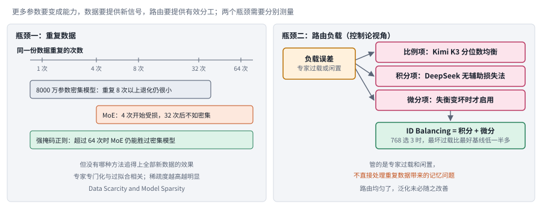

*图：左栏是数据重复的两个阈值和正则化的补救，数字来自 Data Scarcity and Model Sparsity；右栏是 ID Balancing 的控制论视角。*

重复数据这一环上，稀疏模型比密集模型更早受伤，**Data Scarcity and Model Sparsity（`2609.11917`）** 同时改变数据重复次数和 MoE 设置，得出了这个结论：8000 万参数的密集模型重复 8 次以上退化仍然很小，MoE 从 4 次开始受损，超过 32 次以后反而不如密集模型。加上强的掩码正则之后，即使重复超过 64 次，MoE 仍能胜过密集模型，可没有哪种方法追得上全部使用新数据的效果。[论文](https://arxiv.org/abs/2609.11917)还发现，专家分工越专门化，对重复数据的过拟合越严重。这是一条有待继续检验的机制线索，作者并没有得出所有 MoE 都必然比密集模型差的结论；真正有信息量的是新数据充足和重复数据两种条件下的相对结果。

专家负载不均是另一个要单独看的问题，**ID Balancing（[`2609.39137`](https://arxiv.org/abs/2609.39137)）** 把它看成一个反馈控制问题。路由器常把太多 token 派给少数专家，常见的补救是加一个鼓励均衡的辅助损失，可它会干扰主任务的训练。下图是不用辅助损失的做法：每个专家的路由分数上加一个偏置，偏置不靠梯度学，每一步数一数各专家实际分到多少 token，分多了减一个固定值、分少了加一个，几百步之后负载就从一边倒拉到接近平均（示意）。从控制的角度看，DeepSeek 的这种做法相当于固定步长的积分控制，Kimi K3 的分位数均衡相当于一种推广的比例控制，它自己用积分加微分，并且只在失衡变坏时启用微分项。它针对的是专家过载和闲置，不直接处理数据重复带来的记忆问题；如果把两个问题混在一起，很容易误以为路由均匀了，泛化也就改善了。所以这类工作应当分别报告专家使用分布、任务损失和重复数据上的退化。

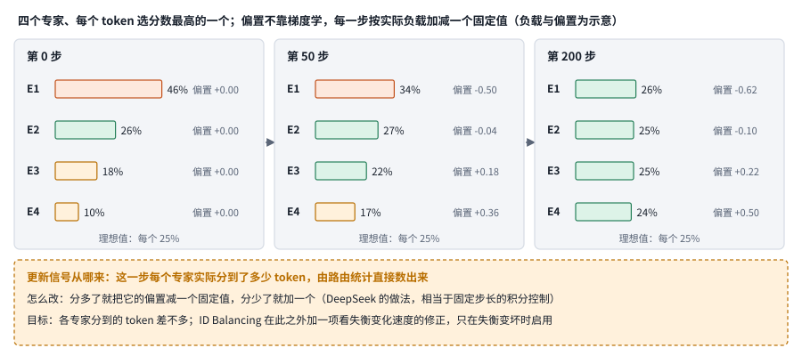

*图：四个专家在第 0、50、200 步的负载和偏置。偏置的更新信号是每一步数出来的实际负载，目标是各专家分到的 token 差不多。负载与偏置为示意。*

数据问题也不只关乎数量，还关乎语言覆盖。**Building Multilingual Bridges（[`2609.10445`](https://arxiv.org/abs/2609.10445)）** 从多语言推理数据的混合方式和训练日程入手，研究模型推理时用的语言和输入语言之间的关系；**Skill Issue（[`2608.25832`](https://arxiv.org/abs/2608.25832)）** 让同一个模型通过不同语言的界面进行对战，观察技能上的差异。两篇合在一起提醒我们，某种语言上的问答成绩提高了，交互技能、规划和风险判断未必会获得同样的迁移。

### 4. 优化器稳定性与几何：理论保证和速度可能排序相反

优化器的理论排序和实测速度是两件事，因为理论分析通常在特定的光滑性、噪声和问题结构下成立，工程训练里还有混合精度、并行通信和非平稳数据。Muon 走红之后，优化器研究忽然热闹起来，各种新方法都带着理论分析登场。稳定的更新不一定最快，训练损失降得快也未必泛化最好。读这一组论文，最好先把每项保证依赖的假设列出来，再看实验条件离这些假设有多近。

> 主线位置：第二阶段，训练动力学的几何一侧。接 Shampoo、Muon，以及苏剑林和 Bernstein 对谱范数最速下降的解释。

> **要点：** 优化器为什么有时稳、有时炸，有时快、有时慢？这组论文各看一处：损失的形状，压缩通信时在哪里取正负号，以及 Muon 的近似、低秩更新和换一组坐标表示参数的影响。最值得记住的是一个反例：有收敛保证的变体，实测可能跑得更慢。

*图：左边是 SignMuon 一文的理论与实测对照；右边为示意，只画出边界近似为直线这一结论，两侧区域的具体位置以原文为准。*

稳定性这一面，Adam 的两个动量系数构成的平面上，有一条近似直线的边界把出现损失尖峰和平稳训练的区域分开。这两个系数分别控制 Adam 记住梯度方向和梯度大小的时间长短，**Beyond Quadratic Loss: The Stability Phase Diagram of Adam（`2609.18314`）** 在这个平面上扫描，找到了这条边界。用二次函数近似损失给不出这样的边界，交叉熵在模型很有把握时形成的“窄谷加陡墙”形状才能解释它。三.1 的 A Defense of the Quadratic Model 用二次近似预测中间检查点附近的一小段训练，[这篇论文](https://arxiv.org/abs/2609.18314)和它可以同时成立：二次近似在局部短窗口内有效，到了较大步长或尖峰附近才失效。更有价值的实验，是标出近似从什么时候开始偏离，以及哪种控制手段能把预测能力找回来。

速度这一面有一个必须如实写出来的反例：被证明可能发散的变体跑得最快，有收敛保证的变体反而落后。多机训练时要在机器之间传梯度，只传每个数的正负号能大幅压缩通信。**Sign compression for Muon（`2607.29674`）** 研究怎样给 Muon 的更新取符号：符号可以放在正交化这一步之前、之后，或者前后都放。[论文](https://arxiv.org/abs/2607.29674)构造了具体的例子，说明这三种放法在一般情况下都可能不降反升，只有在梯度端加入特定的误差反馈之后，才能得到标准的收敛速率。可到了 CIFAR-10、联邦学习和 nanoGPT 训练的实验里，表现最强的恰恰是被证明可能发散的“正交化之后取符号”，有保证的变体反而落后。所以有限实验里跑得最好的变体推不出一般意义上的收敛，有收敛保证的变体也未必最快。

Muon 没有普遍胜过别的优化器，另一组深入 Muon 和低秩更新几何细节的论文合起来说明了这一点，它们共同反对"某个优化器普遍取代另一个"这种简单结论。**Muon with Finite Newton-Schulz（[`2608.26288`](https://arxiv.org/abs/2608.26288)）** 指出，Muon 实际用几步 Newton-Schulz 迭代近似矩阵符号函数，这一步近似带来的平滑作用可能正是收敛所需要的，它的价值超出了省算力。**LoRA-TSD（[`2609.02734`](https://arxiv.org/abs/2609.02734)）** 把低秩更新放到固定秩流形的切空间里研究，和 Bernstein 在流形上取步长的做法属于同一种思路。**SOAP, Muon, and Beyond（[`2607.20548`](https://arxiv.org/abs/2607.20548)）** 关注大批量预训练中的损失尖峰和工程上的修正；**When Does Muon Help Agentic RL?（[`2607.16169`](https://arxiv.org/abs/2607.16169)）** 则报告，Muon 的收益会随调参、饱和程度和步长匹配而改变。

最后一组论文追问更基础的几何问题。**The Loss Does Not See the Basis, but Adam Does（[`2608.05136`](https://arxiv.org/abs/2608.05136)）** 研究一种现象：把参数换一组坐标表示，损失完全不变，Adam 的逐坐标更新却不同，两组在损失意义上等价的参数会走出不同的训练轨迹。这和苏剑林说的"逐元素优化器把矩阵当成长向量"是同一类问题。**Spectral Allocation（[`2608.25990`](https://arxiv.org/abs/2608.25990)）** 在留出数据上测量不同奇异方向适合多大的步长；**On the Principles Behind Neural Network Optimizers（[`2608.16760`](https://arxiv.org/abs/2608.16760)）** 讨论超参数和损失曲率之间的关系。**Training nGPT（[`2608.01284`](https://arxiv.org/abs/2608.01284)）** 则把归一化训练放回混合架构里的实际配方中，提醒我们理论原则最终仍要落到能跑起来的实验上。

### 5. 叠加、字典特征与符号：可解释之后，还要能稳定操控

找到一个可读的特征，只说明存在某种表示，它能不能被单独修改而不影响其他能力，是另一个问题。字典学习让我们第一次能从模型里读出成千上万个可命名的特征，"金门大桥"特征甚至能被拿来操控模型，可这只是一个特征在一种设置下的结果。特征可能互相叠加，也可能随输入和层而变化。所以干预实验要同时检查目标行为、其他能力的退化和跨任务的稳定性，并且和随机方向或对照方向比较，才能从"能命名"走到"能可靠控制"。

> 主线位置：第三阶段，表示。接 Toy Models of Superposition、Towards Monosemanticity 和 Scaling Monosemanticity，也呼应 GDM 团队关于 SAE 在下游任务上表现不佳的负面结果。

> **要点：** 能读懂的内部表示，能不能拿来稳定地操控行为？这组论文各找一种结构：成功和失败轨迹之间的低维分离，SAE 特征被移除后效果的形状，两段输入能否线性叠加，以及符号结构和难以对应人类概念的结构。能命名一个特征，离能稳定地操控行为还有距离。

在机器人策略模型里，某些架构确实存在能把模型往成功那边推的低维结构，**[Steering Robustness into World Action Models](https://arxiv.org/abs/2607.14943)** 找到了它。它的出发点很实际：机器人策略模型有时成功、有时失败，能不能在内部找到区分两者的方向，再把模型往成功那边推？它比较成功轨迹和失败轨迹的激活，发现某些架构里存在可以利用的低维分离结构，并用局部线性控制做反馈引导。它的价值在于同时讨论了不同架构可控性的差异，没有假定所有模型都存在同样的方向。机制主张因此要和干预结果一起读，只看投影图就认定控制成功是不够的。

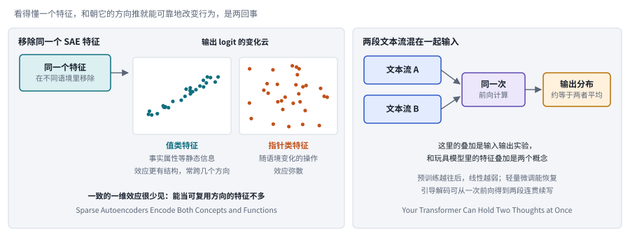

*图：左边的两团点为示意，表现值类与指针类特征效应的形状差别；右边是两段文本流的线性叠加实验。*

SAE 特征有因果作用，却很少提供稳定的干预方向，这是 **Sparse Autoencoders Encode Both Concepts and Functions（`2607.24645`）** 回答 GDM 团队负面结果留下的问题时得到的结论；那份负面结果发现 SAE 特征探针在分布外输给了线性探针，人们由此怀疑 SAE 特征到底有没有因果作用。这篇论文在许多语境里移除同一个 SAE 特征，把每次造成的输出变化画成一团点云，再看点云的形状。如果一个特征是可复用的操控方向，它在不同语境里造成的变化应当大致朝同一个方向，点云会是一条线。[论文](https://arxiv.org/abs/2607.24645)发现这样的一维效应很少见：和事实属性这类静态信息相关的特征，效应还算有结构，常常跨几个方向；和随语境变化的操作相关的特征，效应则很弥散。所以特征可以既有解释性又有因果作用，却未必提供稳定的干预方向，“看得懂这个特征”和“朝这个方向推就能可靠地改变行为”是两回事。

**Your Transformer Can Hold Two Thoughts at Once（`2609.29845`）** 给"叠加"这个词提供了另一种实验含义：把两段不同的文本流混在一起输入，一次前向计算得到的下一个 token 分布，大约等于两段分别输入时的平均，作者再研究微调和解码怎样把两者分开。[论文](https://arxiv.org/abs/2609.29845)里的叠加是一个输入输出实验，和玩具模型里多个特征共用一组维度的叠加是两个概念，也证明不了模型拥有两个独立的心智。它还报告，这种线性会随着预训练的进行而减弱，所以这种结构属性未必是一条"训练越多越强"的能力规律。

最后两篇把问题推到了更抽象的层面。**The Emergent Symbolic Structure of Artificial Neural Networks（[`2608.29530`](https://arxiv.org/abs/2608.29530)）** 尝试用符号结构来近似表示，并通过干预检验行为是否依赖这些结构；**Xeno-Interpretability（[`2609.20408`](https://arxiv.org/abs/2609.20408)）** 则提醒研究者，模型内部可能存在很难对应到人类概念的结构。两篇并读时，没有必要先在"全是人类符号"和"完全不可理解"之间选边，更有用的研究任务是讲清楚一个近似保存了哪些功能、遗漏了哪些差异，并公开它在哪些输入上失效。

### 6. 探针与层间修正：读出的概念可能不是模型使用的概念

探针成功只说明信息能被读出来。高探针准确率可能来自冗余信息，也可能来自旁路的相关性；GDM 团队的负面结果更说明，连 SAE 这样精心设计的读出工具，在分布外都可能不如一个朴素的线性探针。更强的证据，需要检查移除、替换或改变这些表示之后行为是否受影响，同时控制干预本身引入的分布偏移，避免把随意破坏模型造成的下降当成概念的因果作用。

> 主线位置：第三阶段到第四阶段之间。接 Transformer Circuits 框架对残差流的分解，以及归因图里"误差节点"所暴露的解释缺口。

> **要点：** 探针读出来的概念，就是模型在用的概念吗？这组论文给出了几种替代解释：读出的方向可能跟着答案的概率走，单层的表示可能马上被下一层改写，共享的坐标和异常大的激活也会误导解释。

探针找到的线性方向，可能主要跟着答案概率走，这是 **The Answer-Basin Representation Hypothesis（`2609.24821`）** 提出的竞争解释。同一个问题可以有许多种续写，把通往同一个答案的续写归成一组，叫作一个答案盆地，这组续写的总概率就是模型分配给这个答案的概率。作者假设，探针和方向干预找到的那些线性方向，主要由答案上的这种概率分布组织起来，并不直接由研究者给的概念标签决定。[论文](https://arxiv.org/abs/2609.24821)报告了跨模型、跨任务的实验：探针和方向干预中那些符合概念预期的效果，以及效果的反转，都和概念标签与答案概率之间的对齐关系有关。所以它已经有实验支撑，算不上纯粹的猜想；当然，它也没有证明所有探针研究都无效。检验的办法是控制答案形式和概念标签，看观察到的方向究竟跟着哪一个变。

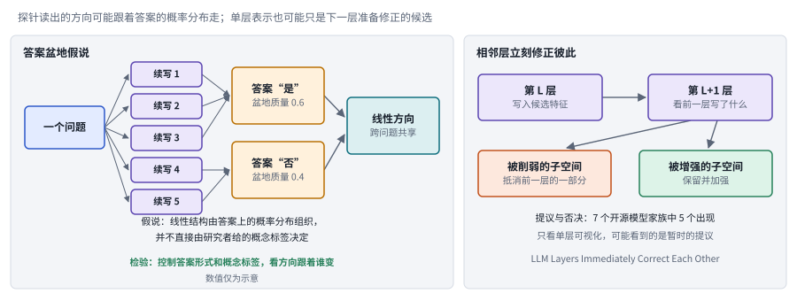

*图：左边的盆地质量为示意数值；右边是相邻层的提议与否决机制。*

层与层之间的关系也会误导单层的解释。**LLM Layers Immediately Correct Each Other（[`2609.07876`](https://arxiv.org/abs/2609.07876)）** 报告，第 L 层写入一批候选特征，第 L+1 层看了以后，削弱其中一部分、增强另一部分，作者称之为提议与否决，在 7 个主要的开源模型家族中有 5 个观察到这种现象。如果某一层的表示只是下一层准备修正的候选，那么只看单层的可视化，就很难宣称已经找到了最终的决策机制。**A Mesoscopic View of Transformer Weights（[`2609.35852`](https://arxiv.org/abs/2609.35852)）** 换了一个尺度，研究权重矩阵各行各列的大小构成的整体模式，提供了一种介于单个参数和整体行为之间的统计视角；它描述的是结构，每一种模式是否有特定的语义，还需要另外检验。

最后两篇提醒我们，共同坐标和异常激活都可能藏着陷阱。**Understanding On-Policy Distillation via Sparse Crosscoders（[`2609.35210`](https://arxiv.org/abs/2609.35210)）** 用教师和蒸馏前后的学生三份激活一起训练同一本字典，研究特征的使用怎样变化。共同的坐标方便比较，却也可能掩盖不同模型对同一个特征的不同用法，作者因此专门指出了标准做法的不足。**Massive Activations in Hybrid Linear Attention（[`2608.12149`](https://arxiv.org/abs/2608.12149)）** 说明，某些位置上数值异常大的激活会受到架构位置的影响。所以不能把所有大激活、相似方向或共享特征，都解释成同一种计算功能。

### 7. 内省、知识使用与持续学习：知道和会用之间隔着一段距离

模型能答对一道知识测试题，未必会在该用这条知识的时候用上它；一群模型在讨论中达成一致，也未必是因为得到了更多真实证据。这一类问题让模型科学从"内部有什么"走向"内部的东西怎样变成行为"。研究时需要把可访问的知识、行为策略和交互动力学分开，尤其要检查反思和协作究竟提高了准确率，还是只是强化了原有的信念。

> 主线位置：第四阶段，回路与行为。接 Anthropic 的内省研究和《On the Biology of a Large Language Model》中关于思维链忠实性与幻觉的案例。

> **要点：** 内部有的东西，会不会变成实际的行为？这组论文测的是两者之间的距离：模型能否报告自己被改动了，记住的知识能否用上、学新东西时能否保住旧的，这些能力该怎样测，以及从群体和学习信号的角度看行为从哪里来。

内省这种不可靠的能力，在内部可以拆成两小组注意力头，**A mechanistic study of language model introspection（`2609.35108`）** 弄清了这一点。Lindsey 的内省研究里，最好的模型大约只有 20% 的时候能察觉人为注入的概念；这篇论文设计了一个受控任务：输入文字固定，在十个位置中的一个注入概念向量，或者干脆不注入，再让模型报告被扰动的位置，或者回答没有干预。作者在三个模型家族里都找到两小组注意力头：中间层的门控头决定报不报告“有变化”，较后层的路由头负责选出要报告的位置；干预门控头时，即使路由头已经带来位置信息，报告也会被压住。[论文](https://arxiv.org/abs/2609.35108)的价值在于把这种能力拆成了可以检验的部件；它是一个受控的检测任务，证明不了一般意义上的自我意识，更说明不了模型能识别所有自然发生的错误。好的后续实验应当检查无干预时的误报、没见过的概念和不同的扰动幅度。

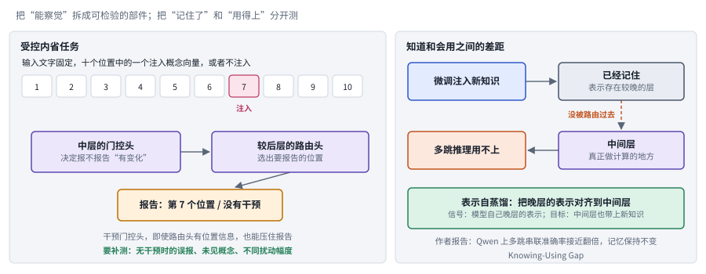

*图：左边是内省检测任务与两类注意力头，绿色一行是好的后续实验应当补测的东西；右边是知道和会用之间的差距及其补救。*

知识的存储和使用是另一对需要拆开的概念。**Knowing-Using Gap（[`2607.08393`](https://arxiv.org/abs/2607.08393)）** 研究这样一种情况：微调进去的新知识已经被记住，多跳推理里却用不上。作者沿着层间追踪，发现新知识的表示停在较晚的层里，没有被送到真正做计算的中间层；他们提出的逐层表示自蒸馏把晚层的表示对齐到中间层，在 Qwen 上让多跳串联的准确率接近翻倍，记忆保持不变。**Continual Learning via Self-Probe Gradients（[`2609.32771`](https://arxiv.org/abs/2609.32771)）** 处理的是反方向的问题：学新东西时怎样保住旧的。它让冻结的模型从保留样本出发生成新的探查输入，并记下自己在这些输入上的预测；学新数据时，用这些预测和保留样本算出的梯度，压低那些和旧行为冲突的更新。两者都提醒我们，知识问答上的记忆率说明不了实际技能是否保住了。

能力怎样测本身也是问题。**Metacognition in LLMs（[`2607.11881`](https://arxiv.org/abs/2607.11881)）** 是一篇综述，帮助我们定义监控、校准和控制这几件事各自该怎么测；**Your LLM, Your Style（[`2608.10703`](https://arxiv.org/abs/2608.10703)）** 构造对比性的行为情境，研究模型行为上稳定的倾向。它们共同的提示是，用可观察的行为去描述能力，测到的输出风格离稳定的人格还很远；模型在受控情境里报告的自信，和它在真实长期任务里何时求助、何时停下，需要用不同的评测来检验。

最后两篇从更大的视角看行为从哪里来。**[Physics of Agents](https://arxiv.org/abs/2608.16578)** 用统计物理的视角，描述模拟 Agent 群体在反复交流中的意见演化，并比较了客观问题和主观陈述两种情形，对应开头说的“一群模型达成一致未必是因为证据更多”；它的模型要放在所测的交互规则和群体设置里理解，直接推广到真实社会还为时尚早。**[Intelligence from Learnable Novelty](https://arxiv.org/abs/2607.18433)** 区分了可以转化为学习的惊奇和学不到东西的噪声，提出了相应的估计量并做了实验。它为研究驱动学习的信号提供了一个视角，不过一个估计量的名字再宏大，也还不能当作通用智能的既定定义。

### 8. 潜在推理与操作结构：少写思维文本，计算照样在发生

评价潜在推理，要分清可见 token 是否减少、实际延迟是否减少、收益是否来自额外的测试时优化，因为优化和传递潜在状态同样要消耗计算。思维链让模型把推理过程写成文字，也让我们有机会检查它；可文字很长，代价很高。潜在推理把一部分中间状态留在连续的内部表示里，不再写出来。还要说明这些潜在状态是从哪里获得学习信号的，不可读的中间表示不会自动对应更深或更可靠的思考。

> 主线位置：第四阶段，回路与行为。接归因图对思维链忠实性的检验：写出来的推理和内部实际发生的计算，本来就可能不一致。

> **要点：** 不把推理写成文字，计算是不是照样在发生？三篇工作各问一环：留在内部的中间状态从哪里得到学习信号，没有中间步骤的标注时怎样训练它们，不同的推理操作在内部能否分开。评价时要把可见长度、延迟和额外优化分开记账。

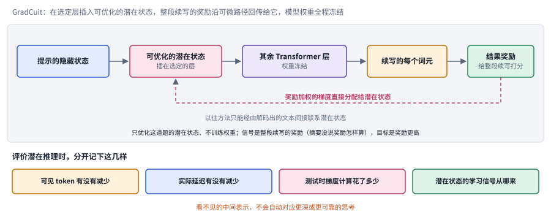

*图：上半部分是 GradCuit 的信用分配路径，虚线是奖励加权的梯度；下半部分是评价潜在推理时要分开记录的四个量。*

**[GradCuit](https://arxiv.org/abs/2608.02585)** 把整段续写的奖励以梯度的形式直接分配给潜在状态，因为潜在状态不写成文字，就没法像文字推理那样直接检查对错，它该往哪里改，只能看最后的结果好不好。它在选定的 Transformer 层里，在提示和生成的续写之间插入一组可以优化的潜在状态，模型权重全程冻结。因为每个续写 token 都能通过注意力回看到前面的潜在状态，整段续写得到的奖励（摘要没有说明奖励怎样计算）可以沿这条可微的路径，以梯度的形式直接分配给这些状态。以往的方法只能经由解码出来的文字间接联系潜在状态，这正是它想改进的地方。要注意，模型冻结不代表测试时没有优化成本，比较时必须把梯度计算及其对任务预算的影响算进去。

GradCuit 在测试时优化，**Learn Your Own Thoughts: Abstract Token Curriculum（[`2609.19717`](https://arxiv.org/abs/2609.19717)）** 则在训练阶段回答训练信号从哪里来：在没有中间步骤标注的情况下，用由易到难的课程训练连续的中间表示：监督只落在要预测的 token 上，中间表示没有答案可对，靠题目一步步变难逼它自己长出来，并在图可达性和算术任务上评估。它的价值在于提供了一个可控的环境，用来研究模型需要什么样的训练信号，离解决通用推理还有很长的路。隐藏状态是否参与了计算，和自然语言解释是否忠实，是两个应当分开研究的问题。

**Beneath the Surface of Chains-of-Thought（[`2609.04753`](https://arxiv.org/abs/2609.04753)）** 把显微镜对准推理操作本身：检验比较、相加、回溯这类不同的推理操作在表示空间里是否可以分开，并控制了词汇和位置的混杂。表示可分支持某种对应关系，可要说明这种几何结构负责完成操作，仍然需要干预实验。它可以和三.7 的 Knowing-Using Gap（微调进去的知识记住了却用不上）、三.3 的 Skill Issue（同一个模型换一种语言界面，技能表现就不一样）一起设计更严格的迁移问题：同一个内部操作，在不同的表述、语言和任务里是否保持同样的功能，还是只保留了一个容易被分类的标签。

研究潜在推理，应当分别记录内部计算量、外显文本长度、任务正确率和解释的忠实度。这条路线和循环架构有交叉，本章关注的是证据，循环的具体配方放在效率章。短答案可能来自更有效的表示，也可能只是少报告了几步；更长的隐藏计算，也可能没有带来任何新的推理操作。这里的开放问题是，怎样构造一种测量，让"看不见"和"更深"不再被默认画上等号。

## 四、跨路线对照：证据与解释边界

模型科学里的结论有三种用途：预测、定位和干预，三种用途需要的证据并不相同。拟合曲线可以帮我们预测，特征和探针可以帮我们定位，只有在控制了替代解释之后，干预才能说明某种机制真的在起作用。下面这张表按研究对象梳理了现有证据能支持什么、最常见的越界是什么，以及想要更进一步时最需要排除的替代解释。

> **本节要点：** 不同路线的证据能支持什么？可以用同三个问题比较：现有证据是哪一层，最常见的越界是从哪一层跳到哪一层，往上走一层需要补什么检验。

| 研究路线 | 主要证据 | 最常见的越界 | 更强的下一步 |
|---|---|---|---|
| 缩放与小模型 | 多规模、多预算训练及拟合 | 插值好就宣称大尺度外推可靠 | 独立规模、完整调参成本与误差区间 |
| 超参数迁移 | 范数、步长与状态的受控变化 | 名义学习率相同就称公平 | 匹配有效步长和数据条件 |
| 优化器理论 | 条件性证明、反例、训练轨迹 | 有保证就一定更快，实测快就普遍收敛 | 分别报告假设范围与系统开销 |
| 探针与字典 | 标签读出、特征分解、干预 | 可读出就称模型在依赖它 | 随机对照、答案分布控制和跨语境测试 |
| 内省与元认知 | 检测、校准、定位行为 | 人工扰动检测就称自我意识 | 无干预误报、自然错误与任务外验证 |
| 潜在推理 | 合成任务、内部状态与操作对应 | 不输出思维文本就称更可靠 | 内部预算、因果干预和任务迁移 |

这张表最想传达的一点是，负面结果应该和成功一样显眼。小模型调参不足会遮住本来存在的规律；更稀疏的容量可能放大数据重复的问题；Muon 某些没有保证的压缩变体可能比有保证的跑得更快；可解释的特征未必能被稳定操控；相邻的层会修正前一层的表示；能检测人为注入的扰动，离能识别自然发生的错误还差得远。主线上的经典工作也是这样：Chinchilla 需要复现，SAE 在分布外输给了线性探针，归因图只在四分之一的提示上给出满意的解释。这个领域真正产出的是一张标明了适用条件的地图，至今还没有哪一种解释能无条件地好用。

## 五、开放问题与研究机会

模型科学目前最大的三个缺口，恰好对应本章开头组会上导师问的三个问题：放大之后还成立吗，功劳属于方法还是步长，模型内部学到了什么。这个领域需要的解释，既要经得起干预的检验，又要能在没见过的条件下做出预测、指导设计，避免让局部的观察停留在事后描述。

> **本节要点：** 回到开头导师的三个问题，哪些还没有答案？三个开放问题依次回扣：怎样把读得出的表示变成经得起干预的机制解释，怎样从小实验可靠地推断大模型，怎样把训练更新、知识使用和推理计算放进同一套分析。第三个问题的远景，就是 Olah 用微观回路解释宏观曲线的设想。

**1. 如何把可读出的表示转化为可检验的行为机制解释？**

这是导师的第三个问题，缺口在于读出来的东西和模型真正在用的东西之间还隔着不小的距离。探针能够预测某种属性，说明不了模型实际依赖这条信息做决定；GDM 团队发现 SAE 特征探针在分布外输给了直接在残差流上训练的线性探针，归因图里又有相当一部分计算落在替代模型解释不了的误差节点里，这两件事都说明了这段距离。这里的研究机会，是把自然行为变化、匹配幅度的干预和跨任务验证结合起来，找出那些稳定影响输出的内部结构。好的工作应当给出解释失效的条件，并把干预造成的分布外破坏，和对原有计算机制的真正揭示区分开。

**2. 如何从可承受的小规模实验可靠推断大模型行为？**

这是导师的第一个问题，难处在于小模型上的趋势可能在条件变化后失效。缩放关系受数据、优化和超参数选择的影响，连 Chinchilla 的拟合都经历过复现的修正。可以研究的方向包括：怎样设计能保留关键训练动力学的小规模实验，以及怎样构造能表达不确定性的外推方法。评价时应使用没有参与拟合的规模和数据条件来检验预测能力，在已有数据点上拟合得更好，说明不了外推的可靠性。

**3. 如何建立连接训练更新、知识使用与推理计算的统一分析？**

这是导师的第二个问题往深处走的结果：训练更新、知识使用和推理计算需要一套统一的分析。参数里存着信息、推理时能读到信息、在实际行动中正确使用信息，是三种不同的现象；有效学习率又决定了每一步训练在多大程度上改写了这些信息。研究机会在于追踪数据和更新怎样形成可以调用的结构，并分析潜在推理、持续学习和控制接口怎样改变它们的使用条件。受控实验应当能够区分知识缺失、访问失败和决策错误，从而说清楚能力的增长或退化究竟发生在哪一层。诱导头的故事告诉我们，这种统一分析在原则上是可能的：这种注意力回路在训练中形成的时刻，正好对应上下文学习能力的一次跃升，在损失曲线上留下了一个鼓包。

## 六、可靠资源

训练方向建议先读 Adam、AdamW、Shampoo 与两篇经典缩放工作，再读 Wolfe 的缩放律长文和 Bernstein 的《Modular Manifolds》；解释方向建议先读 Transformer Circuits 的框架、玩具模型和字典学习材料，再读《On the Biology of a Large Language Model》，然后查看 [TransformerLens 官方仓库](https://github.com/TransformerLensOrg/TransformerLens)动手。这个工具可以缓存激活、实施干预，但解释是否成立，仍然要靠实验设计来回答。做任何对比实验之前，也值得先读一遍 Horace He 那篇关于推理非确定性的文章，确认自己的"同一个输出"真的是同一个。相关章节：[效率与架构](13_efficiency.md)、[科研智能体](12_science.md)、[技术报告](15_frontier_reports.md)。
