# 16｜多模态生成：表示、采样、可控性与 agent 工作流

[首页](../README.md) · [专题索引](../README.md#topics) · [文献目录](../catalog/16_generation.md)

## 方向背景：为什么多模态生成需要表示、控制与工作流

用今天的生成模型做一段一分钟的短片，看上去离成功很近，真做起来麻烦会一个接一个地冒出来。设想组里要为开放日做一段一分钟的短片。脚本很简单：一只橘猫趴在桌边，用爪子把一只玻璃杯慢慢推下去；镜头切到地面，杯子落地的那一刻，钢琴声进来；最后画面定格，变成一张海报，角落里印着实验室的名字。今天的生成模型看上去离这件事已经很近了，输入一句提示词，几十秒后就能拿到一段光影漂亮的视频。可真要把这一分钟做出来：第二个镜头里的猫换了花色；杯子没有摔碎，反倒穿过了桌面；钢琴在杯子落地之前就响了；海报上的小字糊成一团；导师看完说"把猫换成白猫，其他都别动"，结果整段视频只能推倒重来，之前满意的构图也跟着丢了。

这些毛病各自指向一个不同的研究问题。小字糊掉，往往是因为生成发生在一个压缩过的空间里，解码器没能把细节还原回来；猫换花色、杯子穿桌，说明视频模型既要跨镜头记住身份，又要在每一帧里遵守物体之间的空间和因果关系；钢琴进早了，说明一段音频好听和它在正确的时刻出现是两回事；“只改猫”做不到，说明模型交出来的是一张扁平的结果，缺少可以局部修改的结构。把图像、视频、声音接进同一个模型接口，确实让组合任务方便了许多，可每种模态自己的结构约束并不会因此自动统一，所以评价时要把感知质量、指令遵循和结构正确性分开来看。

所以这个方向近几年的重心，已经从"能不能产生一张看似合理的样本"慢慢移到了"能不能交付一个满足语义条件、保持时空一致、支持局部修改、可以继续编辑的产物"。前一个问题主要靠表示学习和采样算法来回答，后一个问题还要加上系统层面的控制：理解需求，选择工具，管理中间版本，最后验收。

多模态这一大块在本仓库里分成三章来读。"看懂"图像、视频和声音，也就是视觉编码器、连接器和视频理解，放在第 09 章多模态理解；本章只管"写出来"；拿着这些能力去操作软件、调用工具、在环境里行动，则是第 19 章多模态 agent 的主题。本章最后一个分支讨论的 Agent 编排与可编辑交付，是生成这一侧的系统问题，仍然留在这里。

## 先读这几篇

这一章的主线借自几篇写得很好的长文。它们的作者有的提出过这个领域的核心方法，有的长期在一线训练大规模生成模型，文章里有清楚的取舍和判断。建议按下面的顺序读：前四篇讲清"怎么写"，第五篇是全章的骨架，第六到第十篇分别撑起采样、视频、统一和语音几段，最后一篇是 2026 年的视频生成综述，读完前面几篇再用它把视野拉到 2026 年。读完再回来看各分支的新论文，会发现很多论文其实是在回答这些文章早已提出的问题。

| 顺序 | 文章 | 为什么读 |
|---|---|---|
| 1 | Lilian Weng，[From GAN to WGAN](https://lilianweng.github.io/posts/2017-08-20-gan/)（2017-08） | GAN 时代最好读的一篇长文。她从 KL 散度和 JS 散度讲起，说明原始 GAN 的目标其实在最小化 JS 散度；而真实数据和生成数据往往落在两块几乎不重叠的低维流形上，这时 JS 散度变成一块平地，判别器一旦太强，生成器就拿不到有用的梯度。文中把 GAN 难训归成三件事：两个网络各自更新，训练来回振荡，迟迟不收敛；判别器太完美时梯度消失；生成器只画少数几种样子，也就是模式坍缩。WGAN 改用 Wasserstein 距离，即使两个分布不重叠它也平滑可用，代价是要让评判网络满足 Lipschitz 条件，原论文用权重截断来做，连作者自己都说这是个糟糕的办法。读完你会明白，后来的扩散模型为什么被看成"一种更稳的训练方式"：它把对抗博弈换成了一道道有标准答案的回归题。 |
| 2 | Yang Song，[Generative Modeling by Estimating Gradients of the Data Distribution](https://yang-song.net/blog/2021/score/)（2021-05） | 扩散模型另一半来历的第一手讲述。作者是分数模型的提出者之一，他从似然模型和 GAN 各自的困境讲起：前者要么为了让归一化常数可算而限制网络结构，要么依赖近似；后者要靠不稳定的对抗训练，还容易模式坍缩。于是他转而学习数据对数密度的梯度，也就是分数，再用朗之万动力学采样。文章接着讲清楚了低密度区域分数估不准这个坑、怎样用多尺度噪声把它填上，以及噪声尺度取到无穷时如何统一成随机微分方程，并引出确定性的概率流 ODE。读完你会明白，"一步步去噪"和"沿着分数往高密度处走"是同一件事的两种说法，后来的流匹配和蒸馏都长在这个框架上。作者在文末把采样慢和难以处理离散数据列为两大挑战，前一个恰好是本章视频加速分支还在啃的骨头。 |
| 3 | Lilian Weng，[What are Diffusion Models?](https://lilianweng.github.io/posts/2021-07-11-diffusion-models/)（2021-07 首发，2024-04 最近一次更新） | 推导最完整的扩散入门长文，也是本章第一节的数学底稿。她先讲前向过程怎样在很多小步里往数据上加高斯噪声，直到它变成各向同性的噪声，再讲网络怎样学习反向的每一步；接着说明预测噪声的网络其实就是在估计各个噪声水平下的分数，把扩散和 Yang Song 的分数网络接到了一起。后半篇依次讲条件生成和无分类器引导、减少步数的 DDIM 与渐进蒸馏、一致性模型、在潜空间里做扩散，以及从 U-Net 到 ControlNet、DiT 的结构演变。这篇文章几经更新，几乎每一次更新都对应着领域的一个新阶段，按更新顺序读下来，本身就是一条小型发展史。 |
| 4 | Tor Fjelde、Emile Mathieu、Vincent Dutordoir（剑桥 MLG），[An introduction to Flow Matching](https://mlg.eng.cam.ac.uk/blog/2024/01/20/flow-matching.html)（2024-01） | 流匹配最清楚的一篇入门。作者从连续归一化流讲起：这类模型用一个常微分方程把噪声搬运成数据，原本用最大似然训练时每一步都要把方程积分一遍，贵得难以承受。流匹配的办法是直接回归一个向量场，训练时完全不用模拟方程；直接回归边缘向量场又算不出来，于是改为以单个数据样本为条件，构造简单的条件路径，作者证明这样得到的损失和原损失梯度相同。文章还讲到一个后来非常要紧的细节：不同样本的条件路径会交叉，交叉让整体路径变弯，采样变慢、训练损失的方差也变大，用小批量上的最优传输配对可以减少交叉。读完再看第一节那张"扩散对流匹配"的逐步对照表，会觉得每一行都有了来历。 |
| 5 | Sander Dieleman，[Generative modelling in latent space](https://sander.ai/2025/04/15/latents.html)（2025-04） | 本章发展主线的骨架。作者是 Google DeepMind 的研究科学家，这篇近一小时阅读量的长文梳理了今天图像、音频、视频生成几乎都在用的两阶段配方：先训练自编码器得到紧凑的潜表示，再在潜表示上训练自回归或扩散模型。他从 PixelCNN、WaveNet 这些像素级模型讲起，指出感知信号大部分由人察觉不到的噪声构成，直接在原始信号上建模会浪费容量；再讲 VQ-VAE、VQGAN 怎样打开潜空间自回归，LDM 怎样把它换成扩散。全文最有用的是"码率、失真与可建模性"的三方权衡，以及"表示学习和重建是两件不同的任务"这个判断。他建议把图像潜表示看成"高级像素"，还调侃 VAE 里的 V 已经只剩象征意义。最后一节追问端到端会不会最终胜出，他的回答是"现在还太早"，同时预计硬件进步终会让输入空间模型在经济上更划算。三.1、三.2 两个分支的论文，几乎都在回应这篇文章提出的问题。 |
| 6 | Sander Dieleman，[Learning the integral of a diffusion model](https://sander.ai/2026/05/06/flow-maps.html)（2026-05） | 讲清楚"采样为什么慢、少步生成怎么做"的最新长文。扩散模型只预测路径上每一点的局部方向，采样时要一步一步积分，作者把这比作航海里的推算定位；flow map 则直接学习从路径上任意一点跳到另一点，相当于把积分本身学下来，更像一张海图。他用这个视角把一致性模型（只瞄准终点的部分 flow map）、shortcut 模型和渐进蒸馏（靠步长加倍组合）、MeanFlow（参数化平均速度）等工作放进同一张表里，并说明三种"一致性"规则怎样变成损失函数。他的判断很清醒：flow map 严格推广了扩散模型，训练却明显更复杂，通常还要依赖一个预训练的扩散模型，采样便宜的代价被挪到了训练上；引导和蒸馏也很难结合。三.4 的视频蒸馏论文都可以放进这个框架里理解。 |
| 7 | Lilian Weng，[Diffusion Models for Video Generation](https://lilianweng.github.io/posts/2024-04-12-diffusion-video/)（2024-04） | 把扩散从图像推到视频的一张地图。她开篇就说，视频生成是图像生成的超集，多出两重困难：帧与帧之间要保持时间一致，这需要更多关于世界的知识；高质量视频和视频-文本配对数据又更难收集。全文沿两条路展开，一条是从零训练视频模型，例如把二维 U-Net 扩成时空分解三维结构的 VDM、级联七个扩散模型的 Imagen Video、在时空 patch 上使用扩散 Transformer 的 Sora；另一条是给预训练图像模型插入时间层，再在视频上微调，或者干脆免训练地适配。文中引用 Stable Video Diffusion 的发现：过滤后的高质量数据集即使小得多，也能训出更好的模型。读它能看清今天视频模型的骨架从哪里来，也能理解为什么时间一致性一直是最难啃的部分。 |
| 8 | Erwann Millon（Krea），[Krea Realtime 14B: Real-Time, Long-Form AI Video Generation](https://www.krea.ai/blog/krea-realtime-14b)（2025-10） | 一篇工程味很足的技术博客，把"双向视频模型改成实时流式生成"这件事里的坑一个个摊开。团队从 Wan 2.1 14B 文生视频模型出发，用 Self Forcing 蒸馏出一个自回归模型，报告在单张 B200 上用 4 步采样达到约 11 fps，首帧延迟约 1 秒。文章把核心问题讲得很直白：以往训练时模型看的是真实上下文，推理时却要接着自己生成的不完美画面往下写，一帧里的小瑕疵会作为输入喂给下一帧，误差就这样累积起来；Self Forcing 让训练时也按推理的方式自回归展开。文末还坦白了局限，反向 KL 目标带来的模式坍缩会降低输出多样性。这几段几乎就是三.4 里 Context-Matched Distillation 和 Uncertainty DMD 两篇论文的问题背景。 |
| 9 | Jiuhai Chen、Le Xue、Ran Xu、Caiming Xiong（Salesforce），[Introducing BLIP3-o: A Family of Fully Open Unified Multimodal Models](https://www.salesforce.com/blog/blip3/)（2025-05） | 理解与生成合流这一段最好读的一手设计笔记。作者坦言他们猜测 GPT-4o 的做法是自回归模型后面接一个扩散模型，并按这个猜测设计了自己的系统，文中明确把它当作假设来写。他们比较了三种生成目标：在 CLIP 特征上做均方误差回归，在 CLIP 特征上做流匹配，在 VAE 潜变量上做流匹配，结果第二种最好；理由是自回归骨干更容易学会语义化的 CLIP 特征，流匹配又带来更好的多样性和画质。训练顺序上，他们选择先冻结理解骨干，再单独训练生成模块，以此保住理解能力。读它能具体感受到第 6 阶段讲的那几种理解与生成的折中做法，比如读写各用一套表示、语言模型出意图再外挂扩散解码，在工程上是怎样被一项项权衡出来的。 |
| 10 | Brendan Iribe、Ankit Kumar 与 Sesame 团队，[Crossing the uncanny valley of conversational voice](https://sesame.com/research)（2025-02） | 语音生成这条线上难得的一篇把"为什么还不像人"讲透的文章。作者提出"声音临场感"这个目标，并介绍了他们的对话语音模型 CSM：音频先被残差向量量化成多层离散 token，一个较大的主干网络读交错排列的文字和音频、预测第一层码本，一个较小的补层网络补齐其余各层的编号，以此压低延迟。文中区分了语义 token 和声学 token，前者紧凑、与说话人无关，后者保留音色和身份。最值得记住的是他们的评测结果：字错率和说话人相似度已经接近人类，不给上下文时听者分不出模型和真人；一旦给出对话上下文，听者就稳定地偏好真人录音。作者自己也承认，模型还不会处理轮次交替这类对话结构，下一步要做全双工。 |
| 11 | Teng Hu、Jiangning Zhang、Ming-Hsuan Yang、Dacheng Tao 等，[Evolution of Video Generative Foundations](https://arxiv.org/abs/2604.06339)（2026-04） | 读完前面十篇，再用这篇综述把视野拉到 2026 年。作者认为以往的综述大多只盯着 GAN、扩散这样的单一范式，或者视频编辑这样的单一任务，常常漏掉自回归模型和多模态信息的融合，于是把视频生成从早期的 GAN 一路讲到扩散，再讲到自回归和多模态做法，逐一分析每种范式的原理、关键进展和长短。它的判断和本章主线几乎一一对得上：GAN 一步出图、推理高效，可对抗博弈出了名地不稳定、容易模式坍缩，在开放域文生视频上碰到了扩展的天花板；扩散把训练变成稳定的回归，已经坐稳视频生成的主导框架，视频模型往往直接继承图像模型的结构，DiT 带来了画质上的一大步，代价是迭代采样又慢又占显存，作者把画质和推理效率之间的平衡称为核心挑战；自回归有可算的似然，和大语言模型的扩展方式合拍，也有望通向统一的多模态模型，可流式生成缺少未来的上下文，会带来暴露偏差和误差累积。文中还统计了 2018 到 2025 年三大视觉会议上的论文数：扩散论文在 2023 年超过 GAN，研究重心则从运动和时间一致性，转到文生视频和可控性，再转到世界模型、物理和长视频。第 1、3、4、6 阶段讲的几段故事，都能在这篇综述里找到一张更宽的地图。 |

如果还想多读一点，Dieleman 早年的 [Perspectives on diffusion](https://sander.ai/2023/07/20/perspectives.html)（2023-07）把扩散模型依次看成自编码器、深层潜变量模型、分数估计器、反向 SDE 求解器、流模型、循环网络和频域上的自回归模型，结论是这些视角互为补充，底层模型始终是同一个；其中最后一个视角，他在 [Diffusion is spectral autoregression](https://sander.ai/2024/09/02/spectral-autoregression.html)（2024-09）里专门展开过，用图像的功率谱说明加噪就是一道逐渐升高的低通滤波。音频方向可以读他的 [Generating music in the waveform domain](https://sander.ai/2020/03/24/audio-generation.html)（2020-03），它把波形生成的难处、似然模型和对抗模型各自的倾向讲得很透。想看今天一个开源图像模型的完整配方，Hugging Face 的 [Welcome FLUX.3 Image Klein in Diffusers](https://huggingface.co/blog/flux-3)（2026-10）把 VAE、文本编码器、Transformer 和蒸馏方式都摊开写了，是今天标准配方的一个现成实例。

## 一、必要前置：生成一张图在做什么，以及扩散与流

> **本节要点：** 生成一张图，就是从“像真照片”的那一小块取值里挑出一组数。所有做法都在回答两个问题：在哪里写，直接写像素还是先压成更少的数；怎么写，今天的主流是从噪声出发一步步修出图的扩散，以及把修图路线拉直的流匹配。

生成一张图，说朴素一些，就是从所有可能取值里那一小块“像真照片”的区域中挑出一组数。对计算机来说，一张图就是一大堆数字。一张 512×512 的彩色照片，每个像素有红、绿、蓝三个数，一共大约 78.6 万个数。所谓"生成一张图"，就是让模型一口气写出这 78.6 万个数，而且写出来要像一张真照片：天空在上面，草地在下面，猫有两只耳朵。难点在于，随便填这么多数，得到的几乎一定是一片雪花点，真实照片只占所有可能取值里极小的一块。生成模型要学的，就是这块"像真照片"的区域长什么样，再从里面挑出一张来；加上文字条件，就是从"符合这句话的真照片"那一小块里挑。

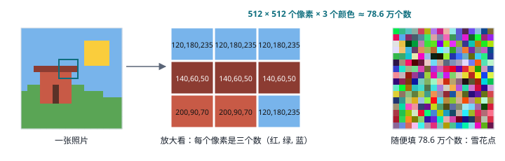

*一张 512×512 的彩色照片约有 78.6 万个数；随便填写，几乎只会得到一片雪花点。*

怎样挑出这组数，要回答两个问题。第一个是在哪里写：直接写像素，还是先压缩成更少的数再写。第二个是怎么写：一笔画完，一个一个地写，还是从一片噪声开始一点点修出来。

第一个问题的主流回答是先压缩再写，好处是省计算，代价是可能丢细节。在一条典型的图像生成流水线里，编码器先把像素压成一小组数，生成器在这组数里构造新样本，解码器再把它恢复成像素。压缩后的这组数叫潜表示（latent，也常叫潜变量），它所在的空间叫潜空间，潜表示的各个坐标不一定有直接可解释的含义。压缩的好处是计算量大幅下降，代价是小字、精确几何这类细节可能在压缩时就丢掉了。这里还有一个容易混淆的地方：重建是恢复一个已知的输入，生成则要产生新的、合理的组合，所以一个重建得很好的潜空间，未必是一个容易在里面生成的空间。

第二个问题，今天最主流的回答是**扩散模型（diffusion）**。它的核心想法可以用"出题"和"答题"来理解。训练时出题：拿一张真照片，往上面撒一点随机噪声，再撒一点，一直撒到它变成一片纯雪花点，DDPM 把这个过程分成 1000 小步。每一步都留下一道题："这是撒过噪声的图，请告诉我刚才撒进去的噪声长什么样。"因为噪声是我们自己撒的，标准答案是现成的，网络照着答案学就行。生成时答题：从一片纯雪花点出发，让网络猜"这里面哪些是噪声"，减掉一点，得到一张稍微清楚的图，再猜、再减，几十次以后雪花点就被修成了一张照片。文字条件在每一步都参与进来，告诉网络往"一只猫"的方向修。这种做法训练很稳，因为每一步都是一道有标准答案的题，也不容易坍缩到少数几种样子上；代价是慢，要一步步走很多次。网络具体预测什么可以有不同选择：预测加进去的噪声，预测干净样本，或者预测某种"速度"。

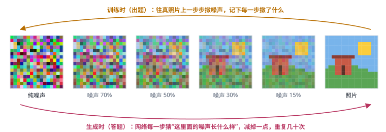

*扩散的出题与答题：训练时往真照片上逐步撒噪声并记下答案，生成时从纯噪声出发逐步减去猜出的噪声。*

**流匹配（flow matching）**和 rectified flow 换了一种出题方式，把从噪声到图的那条路拉直，于是可以迈大步。起点和终点都没变，仍然是从一片噪声走到一张图；改的是中间那条路怎么走，以及网络每一步回答什么问题。把每一张可能的图想成一个点，所有纯噪声聚在一片区域，所有真照片聚在另一片区域，生成就是把一个噪声点搬到照片区域里去。扩散的加噪方式让这条路是弯的，每一步该往哪走都在变，所以只能迈小步，迈大了就会冲出弯道，走到既不像噪声也不像照片的地方。流匹配训练时随机配对一个噪声点和一张真照片，在两者之间画一条直线，在线上随便取一个中间点，比如三成照片加七成噪声，再问网络："从这个点出发，往哪个方向、以多快的速度走，才能到达那张照片？"沿着直线走，这个速度处处一样，恰好等于照片减去噪声，标准答案同样是现成的。这里的"速度"和图片一样大，给每个像素一个数，说明它每走一单位时间该变亮还是变暗、变多少。生成时从纯噪声出发，每一步问网络要一次速度，往前挪一点，走完就得到图；路线越直，几步大跨步也不会走偏。

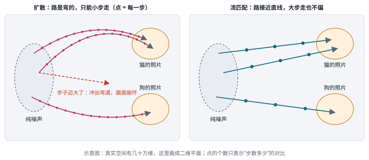

*示意图：扩散的搬运路线弯曲，只能小步走；流匹配的路线接近直线，可以迈大步。*

流匹配的路只是比扩散直得多，还谈不上完全笔直，后来的改进都在想办法把它再拉直。剑桥 MLG 的流匹配入门文章提醒过一个细节：每一对噪声和照片之间是直线，网络学到的却是许多对的平均方向，不同样本的路线会交叉，所以整体的路只是"比扩散直得多"，还谈不上完全笔直。rectified flow 有一招叫 reflow，用训练好的模型重新生成一批"噪声到图"的配对再拿来训练，路会被拉得更直；剑桥那篇文章则建议在小批量里做最优传输配对，减少交叉。Stable Diffusion 3 的论文专门比较过这些训练目标，发现 rectified flow 在步数少的时候优势最明显，SD3 和之后的 FLUX 系列都采用了它。同一个方法也被搬到了机器人上：[具身智能](11_embodied.md)一章讲到的机器人基础模型 π0，负责输出动作的那部分网络（论文叫动作专家）用的正是流匹配，只是走到的终点从一张图换成了一段机器人动作。

拆到一条训练样本的层面，两种方法的训练流程几乎一样，差别只在第二到第六步。下面这张表借自多模态范式图谱，逐步列出材料从哪来、输入怎么拼、网络要猜什么、标签是什么。

| 步骤 | 扩散（DDPM 一类） | 流匹配 / rectified flow |
|---|---|---|
| 起点和终点 | 纯噪声 → 图 | 纯噪声 → 图（相同） |
| ① 准备材料 | 从训练集取一张照片，记作 x（Stable Diffusion 这类模型里，x 是照片经 VAE 压缩后的潜变量）；再抽一张和 x 一样大的高斯噪声，记作 ε。两者都不需要人工标注 | 同左 |
| ② 随机抽一个时间 | 整数 t，取 1 到 1000 之间，t 越大噪声越多 | 实数 t，取 0 到 1 之间，t=0 是纯噪声，t=1 是照片 |
| ③ 构造网络的输入 | 按事先定好的"噪声表"把 x 和 ε 按比例混合：t 小时几乎全是照片，t=1000 时几乎全是噪声 | 照片和噪声的直接混合，t 份照片加 1−t 份噪声；t=0.3 时就是三成照片加七成噪声 |
| ④ 网络看到什么 | 混合后的输入、时间 t，以及文字提示等条件 | 同左 |
| ⑤ 网络输出什么 | 它猜的噪声，和图一样大 | 它猜的速度，和图一样大 |
| ⑥ 标签 | 第①步抽的那份噪声 ε 本身 | x − ε，也就是照片减噪声，在这条直线上处处相同 |
| ⑦ 损失 | 猜的噪声与 ε 的均方误差 | 猜的速度与 x − ε 的均方误差 |
| 生成时怎么用 | 从纯噪声出发，每步用猜出的噪声算出稍干净一点的图，按噪声表一步步往回退 | 从纯噪声出发，每步按"当前图加上速度乘以步长"往前挪，走到 t=1 |
| 路径形状 | 弯的，方向一路在变 | 接近直线 |
| 生成要走几步 | 步子只能小，通常几十步 | 步子可以大，同样步数下质量更好，步数少时优势最明显 |
| 代表 | DDPM、DALL-E 2、Imagen、Stable Diffusion 1/2/XL | SD3、FLUX、多数新视频模型、π0 的动作专家 |

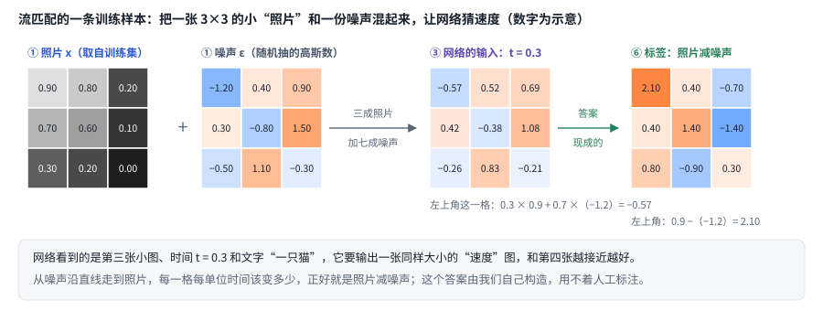

*流匹配那一栏的一条训练样本：3×3 的小“照片”和一份噪声按三成对七成混合成网络的输入，标签是照片减噪声（数字为示意）。*

把表里流匹配那一栏落到具体的数上，就是这张图。左上角那一格，照片是 0.90，噪声是 −1.20，三成照片加七成噪声得到网络看到的 −0.57；标签是 0.90 减去 −1.20，也就是 2.10。九格都这样算一遍，就得到一条完整的训练样本，网络要学的只是从第三张图猜出第四张。

两者关系很近，Dieleman 在《Perspectives on diffusion》里就把流模型列为理解扩散的视角之一；可训练目标、噪声安排和数值采样器的差别会实实在在地影响结果，读论文时最好把这些细节看清楚，别笼统地都叫作"去噪"。必要的 Transformer 与表示学习前置可查[大模型入门](../docs/llm_primer.md)。

最后一个概念关乎评价：除了单张样本的质量，还要看模型给出的一批样本够不够多样。输入的文字、参考图、姿态或深度都叫作条件。同一个条件往往对应许多合理的样本，比如"一只猫推杯子"可以有无数种画法，所以要评价一批样本有没有覆盖各种合理的画法。一个模型若是对同一句话总画出几乎一样的图，单张再好看，也说明它只学会了这块分布里很小的一角。

把这一节讲过的零件拼成一张全景图，读任何一篇新论文时，就可以先问它改的是图里的哪一个框。上面一行是一次采样：训练数据先经过编码器压进潜空间，生成器读着条件，在潜空间里从噪声出发一步步迭代，最后由解码器还原成一个样本。中间一行色块把流水线分成几层：编码器、潜空间和解码器属于表示，生成器的骨干和训练目标是另一层，迭代的步数又是一层。再往下，同一套流水线被搬到视频、声音和三维上，或者让生成器同时学会读。最外面的虚线框，是开头那段短片（橘猫推杯、钢琴随落地声进来、最后定格成海报）真正需要的部分：理解需求、选工具生成、检查、局部修改、保存图层和版本，最后交出一个能继续编辑的产物。

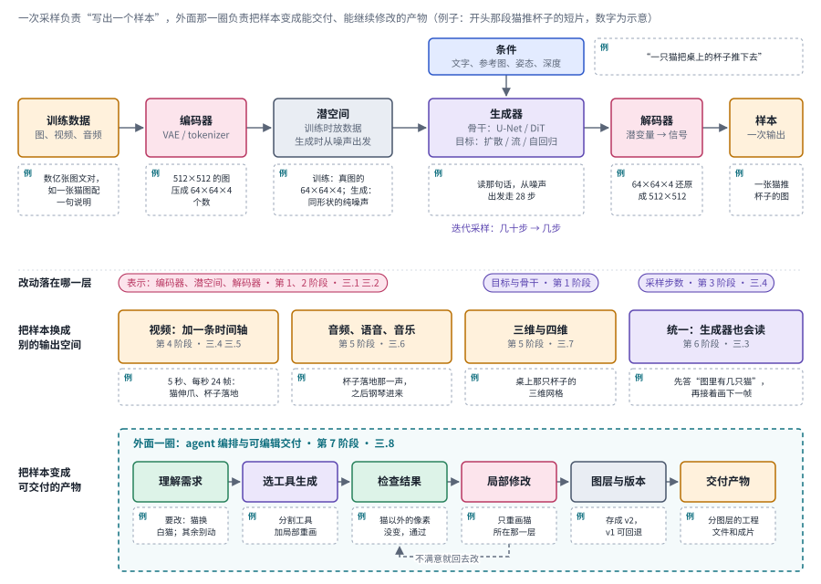

*示意：一次采样（上）、改动所在的层（中）、更多输出空间与外面那一圈交付流程（下）；每个框下方标“例”的虚线框，是开头那段猫推杯子的短片流过这一步的具体内容（数字为示意）。标签里的阶段和分支编号对应第二、三节。*

跟着例子从左往右读一遍。生成器读着“一只猫把桌上的杯子推下去”这句话，在 64×64×4 的潜空间里从纯噪声出发走 28 步，解码器再把结果还原成 512×512 的图；训练时同一个潜空间里放的是真图压出来的数。换成视频，就是 5 秒、每秒 24 帧的猫伸爪和杯子落地；换成声音，是杯子落地那一声和随后进来的钢琴。最外面一圈处理“把猫换成白猫，其他都别动”：先分割、再只重画猫那一层，检查猫以外的像素没变，存成 v2，v1 仍可回退。

## 二、发展主线：从像素到潜空间，再从样本走向产物

生成模型要同时回答三个问题：用什么表示描述样本，按什么目标学习数据分布，用什么结构执行生成。这三条线可以分别改动，所以 VAE、扩散、Transformer 和流匹配分属不同的层次，彼此并不直接竞争：VAE 管表示，扩散和流匹配管训练目标，Transformer 管网络结构。这条主线的骨架借自 Dieleman 的《Generative modelling in latent space》，先读表里的其余几篇分别补上起点、采样、视频、统一模型和语音这几段。把这十几年的历史叠起来看，大致可以读成下面几个阶段，每一阶段都由上一阶段留下的麻烦催生出来。

> **本节要点：** 每一阶段都在补上一阶段留下的缺口：GAN 训练不稳、像素扩散每一步都要在整张大图上跑一遍网络，于是把生成搬进潜空间；潜空间会丢细节，于是重新设计潜空间或回到像素；扩散步数太多，于是学着少走几步；同一套配方再扩展到视频、声音和三维，和理解合进同一个模型，最后从一次采样走向可交付的产物。

| 阶段 | 内容 | 代表工作 | 本章对应分支 |
|---|---|---|---|
| 起点 | 在像素上学习分布：对抗、似然、分数与去噪 | GAN、WGAN、StyleGAN、VAE、NCSN、DDPM、Score SDE | （基础概念，见第一节） |
| 第 1 阶段 | 两阶段配方：先压成潜表示，再在潜空间生成；写法、骨干与目标各自换代 | VQ-VAE、VQGAN、DALL-E、MaskGIT、VAR、潜扩散、DiT、Flow Matching、SD3 | 三.1 |
| 第 2 阶段 | 回头审视潜空间：可建模性、语义表示与重回像素 | REPA、RAE、像素空间扩散 | 三.1、三.2 |
| 第 3 阶段 | 让采样变快：从一步步积分到学会积分 | 无分类器引导、一致性模型、DMD、MeanFlow、flow map | 三.4 |
| 第 4 阶段 | 加上时间轴：视频从整段去噪走向因果流式生成 | Video Diffusion Models、Stable Video Diffusion、HunyuanVideo、Wan、Self Forcing | 三.4、三.5 |
| 第 5 阶段 | 更多输出空间：音频、语音、音乐与三维 | AudioLDM、MusicGen、Moshi、Qwen2.5-Omni、DreamFusion | 三.6、三.7 |
| 第 6 阶段 | 理解与生成合流：一个模型既读又写 | Chameleon、Emu3、Transfusion、Janus、MetaQuery、BLIP3-o、BAGEL | 三.3 |
| 第 7 阶段 | 从一次采样到可交付、可编辑的产物 | 会调用工具的生成 agent、图层原生设计 | 三.8 |
| 边界 | 压缩、少步、统一和编排各自留下的未解问题 | 见本节末 | 四、五 |

按年月摆开，几个阶段在时间上常常彼此重叠，阶段的编号表示的是问题被提出的逻辑顺序。下面的时间轴把表里的代表工作按年月放好，几条线并没有一条接一条地出现：扩散的种子 2015 年就埋下了，离散潜空间 2017 年已经起步，2022 年前后表示、目标、骨干、采样和视频几条线几乎同时换代；统一模型集中在 2024 到 2025 年，交付产物这一行则全部是 2026 年的新工作。

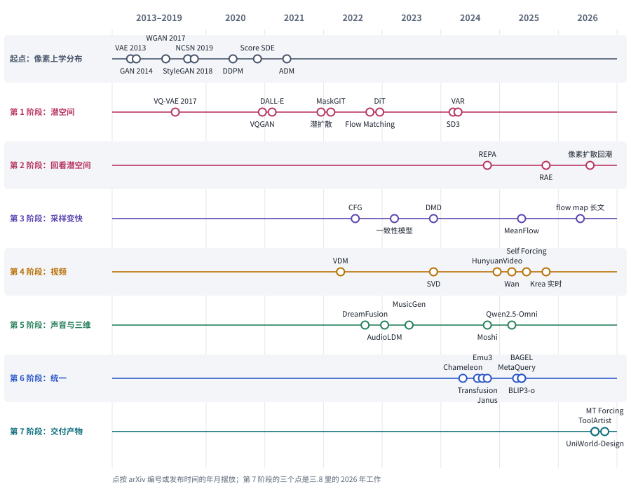

*主线时间轴：每一行是一个阶段，点按 arXiv 编号或发布时间的年月摆放；2013–2019 年压在第一栏里。*

### 起点：在像素上学习分布

> **要点：** 怎样让模型画出像真照片的图？最早有三条路：让两个网络对着练，一个画、一个挑错；先把图压小再还原；先把图破坏成噪声，再学着一步步走回来。前两条各有一个绕不过去的毛病，第三条训练稳，生成一张图却要把大网络在完整像素上跑几十上百遍。

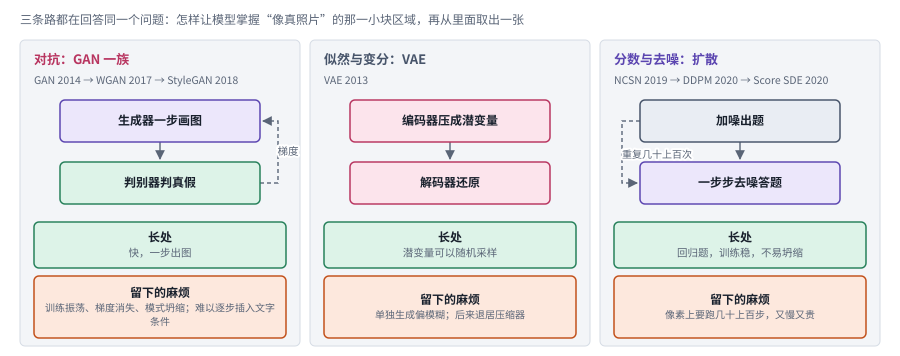

*起点的三条路：每栏上方是方法的骨架，下方绿框是长处、橙框是留下的麻烦。*

图把三条路并排摆在一起，每栏上方是方法的骨架，绿框是长处，橙框是留下的麻烦。

*图：起点三条路的范式对比。每一列是一条路，四行分别是网络输出什么、训练信号从哪来、生成时怎么用和代价。*

三条路的根本差别，在于训练信号从哪来。GAN 的信号是判别器的判断，判别器自己也在跟着学，两个网络此消彼长，训练就容易不稳；VAE 的信号是原图本身，还原得越像越好，可这个目标会把各种可能的细节平均掉；扩散的信号最朴素，训练时自己往照片上撒噪声，撒进去的那份噪声就是标准答案，所以训练稳，代价落在生成时要跑很多步。

第一条路是 2014 年的 [GAN](https://arxiv.org/abs/1406.2661)（生成对抗网络），它让两个网络互相较劲，是深度学习时代最早让人眼前一亮的生成模型。生成和分类很不一样：模型要学会产生符合数据规律的新样本，这就要求它以某种方式掌握整个数据分布。GAN 有两个网络：生成器拿一串随机数，一步直接画出一张图；判别器看一张图，判断它来自图库还是来自生成器。两者互相较劲，判别器越来越会挑毛病，生成器也就越来越会骗过它。这里的真照片只是一堆没有任何标注的图片，训练时唯一的"答案"是这张图从哪里来，程序自己就知道，用不着人去标。

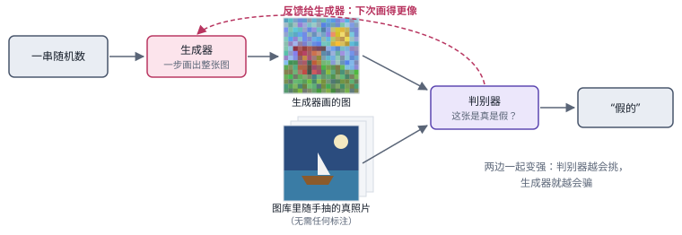

*GAN 的对抗训练：判别器越会挑，生成器就越会骗。*

GAN 快，却训练不稳、难以控制。它一步出图，后来的 [StyleGAN](https://arxiv.org/abs/1812.04948) 已经能画出以假乱真的高清人脸；麻烦在于训练很不稳定，Lilian Weng 在《From GAN to WGAN》里把原因讲得很透：原始目标相当于最小化 JS 散度，而真实数据和生成数据通常落在两块几乎不相交的低维流形上，这时 JS 散度几乎处处是平的，判别器一旦太强，生成器就拿不到梯度；两个网络各自更新，还会此消彼长地来回振荡；生成器又常常偷懒，发现某几种样子最容易骗过判别器，就只画这几种，这就是模式坍缩。[Wasserstein GAN](https://arxiv.org/abs/1701.07875) 换用推土机距离来衡量两个分布的差距，即使它们不重叠，这个距离也平滑可用，训练因此稳了不少；可它要求评判网络满足 Lipschitz 条件，原论文靠截断权重来实现，Weng 引用了作者自己的话，说这是一种"显然很糟糕"的做法。更根本的是，整张图一步画完，中间没有可以插入文字条件逐步修正的机会，用一句话精确控制它画什么一直很难。

第二条路是 [VAE](https://arxiv.org/abs/1312.6114)（变分自编码器），它单独生成时画得模糊，后来真正的用处是当压缩器。它由两半组成：编码器把图压成一个小得多的数字网格，解码器再把这个小网格还原成图，中间那个小网格就是潜变量。VAE 额外要求潜变量服从一个可以随机采样的分布，这样随便采一个潜变量也能解码出一张图。画出的图偏模糊，是因为它的训练目标会把各种可能的细节平均掉。Yang Song 在他的长文里把前两条路的困境说得很清楚：似然模型（VAE 属于这一类）为了让归一化常数可算，常常要限制网络结构或依赖近似；GAN 绕开了似然，却要付出训练不稳、模式坍缩的代价。

第三条路是分数与去噪，先把数据破坏成噪声，再学着一步步走回来，它的种子很早就埋下了。2015 年 Sohl-Dickstein 等人的 [Deep Unsupervised Learning using Nonequilibrium Thermodynamics](https://arxiv.org/abs/1503.03585) 借用统计物理的想法，先用一个缓慢的前向过程把数据逐步破坏成噪声，再学习它的逆过程。几年后 Yang Song 和 Stefano Ermon 从另一个方向走到了相近的地方：[Generative Modeling by Estimating Gradients of the Data Distribution](https://arxiv.org/abs/1907.05600) 不再直接建模密度，转而学习密度对数的梯度，也就是分数，再用朗之万动力学沿着分数从噪声"爬"向数据。他们很快撞上一个坑：数据稀少的低密度区域里，分数根本估不准，偏偏采样就是从那里出发的。办法是用多个尺度的噪声扰动数据，把空白区域填满，再从大噪声到小噪声逐级退火采样。

到 2021 年，逐步去噪已经成了好训、画质又超过 GAN 的配方，可生成一张图要把大网络在完整的像素图上跑几十上百遍。2020 年的 [DDPM](https://arxiv.org/abs/2006.11239) 把逐步去噪做成了一个简单好训的配方，也就是第一节讲的出题答题：训练时往照片上一步步撒噪声，让网络猜撒进去的噪声，生成时从纯噪声出发一步步减掉猜出的噪声；随后的 [Score-Based Generative Modeling through Stochastic Differential Equations](https://arxiv.org/abs/2011.13456) 把噪声尺度取到无穷，用随机微分方程统一了分数模型和扩散模型，还给出一条确定性的概率流 ODE，可以精确计算似然。2021 年的 [Diffusion Models Beat GANs on Image Synthesis](https://arxiv.org/abs/2105.05233) 用题目宣告了一次交接：扩散在图像质量上第一次超过了 GAN。可代价同样明显，每一步都要在完整的像素图上跑一次大网络，生成一张图要跑几十上百次，像素越多越贵，Imagen 这类模型只能先生成小图再一级级放大。Yang Song 在博客结尾留下两个挑战，采样要跑太多步，离散数据又难以处理；一张 512×512 的彩色图有 78.6 万个数，每一步都要在这么多数上跑一次大网络，跑几十步，算力就乘上几十。

### 第 1 阶段：两阶段配方，把生成搬进潜空间

> **要点：** 生成一张图要在几十万个像素数上把大网络跑几十遍，能不能少算一点？办法是先训练一个压缩器，把图压成少得多的数，再让生成模型只在这些数上工作。压缩的方式、写的顺序、网络骨干和训练目标几条线在这一阶段各自换代，最后汇成今天文生图的标准做法。

为了躲开像素上的高昂代价，第 1 阶段把生成搬进一个压缩过的空间。Dieleman 的长文从一个观察出发：感知信号里绝大部分是人察觉不到的噪声，比如一片草地里每根草的具体位置。像素级模型（图像上的 PixelCNN，音频上的 WaveNet）老老实实地建模每一个采样点，大量容量花在了这些无关紧要的细节上。于是一个朴素的想法浮出水面：先训练一个自编码器，把信号压成一个保留结构、丢掉不可感知细节的紧凑表示，再让生成模型只在这个表示上工作。起点里那个"单独用来生成会模糊"的 VAE，在这里找到了真正的位置：它不必亲自生成，只要当好压缩器。以 Stable Diffusion 为例，512×512×3 的图被压成 64×64×4 的潜变量，只剩约 1.6 万个数，少了将近 50 倍。

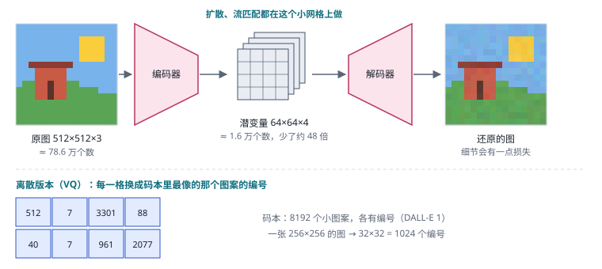

*VAE 与 VQ：连续潜变量把 78.6 万个数压到约 1.6 万个；离散版本把图变成一串码本编号。*

最早把这条路走通的是离散潜表示。[VQ-VAE](https://arxiv.org/abs/1711.00937)（Neural Discrete Representation Learning）用向量量化把连续特征变成码本里的离散 token：它准备一本"码本"，里面是几千个固定的小图案，每个都有编号，编码器把图切成一格一格，每一格换成码本里最像它的那个编号。这样一张图就成了一串"词"，可以交给语言模型去写。最早的 [DALL-E](https://arxiv.org/abs/2102.12092)（Zero-Shot Text-to-Image Generation）就把 256×256 的图变成 32×32 共 1024 个编号，码本里有 8192 个图案，再让 Transformer 接在文字后面一个编号一个编号地往下写。这条路能直接沿用语言模型的整套训练技术，缺点是慢，上千个编号要生成上千次。

于是"按什么顺序写编号"本身成了一个研究问题。[MaskGIT](https://arxiv.org/abs/2202.04200) 先把所有格子都遮住，每一轮让模型同时猜出所有位置，只保留最有把握的一批，大约十来轮就填满整张图；图像不像句子那样有天然的先后顺序，每个位置本来就可以同时考虑整张图。[VAR](https://arxiv.org/abs/2404.02905)（Visual Autoregressive Modeling）换了一种顺序，先写一张 1×1 的极粗草图，再写 2×2、4×4，一层比一层细，每层内部所有格子同时写，很像画家先铺大色块再抠细节；它第一次让自回归生图在 ImageNet 上超过了扩散，后来获得了 NeurIPS 2024 最佳论文。

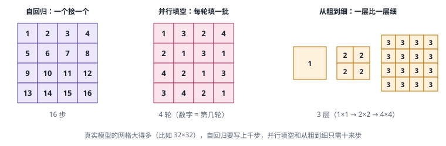

*用一张 4×4 的小图对比三种写法，格子里的数字表示它在第几步被写出来。*

真正的转折点是 [VQGAN](https://arxiv.org/abs/2012.09841)（Taming Transformers for High-Resolution Image Synthesis），它给自编码器加上对抗训练，把空间下采样倍数从 4 倍提到 16 倍，让 Transformer 在高分辨率图像上变得可行。Dieleman 对它评价极高，认为正是 VQGAN 奠定了后来的路，甚至说 GAN 之所以配得上 NeurIPS 时间检验奖，最主要的原因可能就是它在 VQGAN 里的这份贡献。GAN 没有消失，它退到了压缩器的训练目标里，继续发挥"逼着细节变清楚"的那份本事。

2021 年前后，几篇同期工作把潜空间里的自回归模型换成了扩散模型，其中影响最大的是[潜扩散](https://arxiv.org/abs/2112.10752)，它后来成为 Stable Diffusion 的基础。潜扩散把主要生成过程移到压缩空间，去噪网络每一步的计算量随之下降几十倍，一张消费级显卡就能跑，模型开源以后，社区围绕它做了大量微调、插件和工具。代价是输出质量的上限被编码器和解码器保留了多少信息锁住了，早期 SD 画的字和手经常出错，原因就在这里。

这份代价引出了 Dieleman 贯穿全文的那个三方权衡：潜表示越小，生成越省，重建越差；同时，压缩得太狠还会抹掉生成模型赖以学习的结构，让分布变得难以建模。他把后者叫作"可建模性"，并提醒说，最适合重建的空间和最适合学习生成分布的空间未必是同一个。

把三方权衡画出来，就能看到短片里海报小字糊掉的原因落在哪里。左边三角形的三个顶点分别是码率、失真和可建模性：码率说的是潜表示有多大，失真说的是重建丢了多少，可建模性说的是生成器在这个空间里好不好学。右边把潜表示从小到大排成一条线：最左端是一个什么也不编码的空表示，按 Dieleman 的说法它最好建模，却什么也还原不出来；最右端是原始像素，细节全在，容量却大量花在人察觉不到的噪声上；Stable Diffusion 这类模型落在中间，把数据压到约五十分之一。下方两个框分别是 Dieleman 的判断和代价落在哪里，后者正好解释了开头那段短片里的一个毛病：最后定格的海报上，角落里实验室名字的小字糊成了一团。

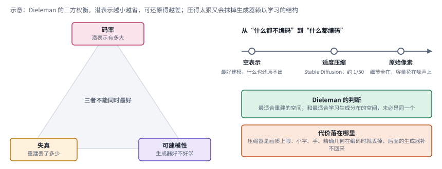

*示意：码率、失真与可建模性的三方权衡，以及潜表示从“什么都不编码”到“什么都编码”的光谱。*

表示这条线之外，网络骨干和训练目标两条线也在各自换代，三条线彼此正交。早期扩散模型的网络是 U-Net，一种先把图逐层缩小、提取整体结构，再逐层放大、补回细节的卷积网络；它在图像上很好用，可往大了堆参数时，收益不如 Transformer 那样稳定。[DiT](https://arxiv.org/abs/2212.09748) 把骨干换成 Transformer，做法和 ViT 读图一样，把潜变量网格切成小块，每块当成一个 token。拿 Transformer 生成图像并不新鲜，2021 年的 DALL-E 就是用 Transformer 接在文字后面一个编号一个编号地写；DiT 的不同在于把它用作扩散模型的去噪网络，扩散模型从此也能像语言模型一样，靠加大模型和数据稳定地变强。[Flow Matching](https://arxiv.org/abs/2210.02747) 和 [rectified flow](https://arxiv.org/abs/2209.03003)（Flow Straight and Fast）则给连续生成提供了另一种训练表述，也就是第一节对照表里流匹配那一栏：在噪声和照片之间连一条直线，让网络预测沿直线走的速度。两条线在 [Scaling Rectified Flow Transformers for High-Resolution Image Synthesis](https://arxiv.org/abs/2403.03206)（Stable Diffusion 3）里汇合：它的 MMDiT 让文字 token 和图像块 token 在同一个注意力里互相看，训练目标换成了 rectified flow。它们分别改变的是结构和学习目标，和潜空间设计是彼此正交的三件事。理解这种分层，才能在读近期论文时看清：它究竟在减少表示损失，在改善优化，还是在增加模型容量。

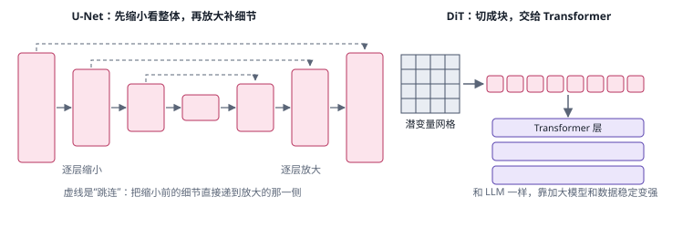

*骨干网络的换代：从 U-Net 的"先缩小看整体，再放大补细节"，到 DiT 的切块加 Transformer。*

把这三条线叠起来，就得到今天主流文生图和文生视频的一句话概括：先用 VAE 压到潜空间，再用 Transformer 当网络、用流匹配当训练目标，从噪声沿接近直线的路走几十步，最后解码成图或视频。2026 年 10 月 Black Forest Labs 开源的 FLUX.3 Image Klein 就是一个现成的例子。按 Hugging Face 博客的介绍，它是一个潜空间流模型，VAE 把图像压缩 8 倍、编成 32 个通道，再把每个 2×2 的潜变量块打包成一个 token；文本编码器换成了视觉语言模型 Qwen3-VL，取其中八层的隐藏状态；Transformer 先用几层双流块分别处理文字和图像，再用二十多层共享权重的联合块。教科书式的三条线，在这里一条不少。

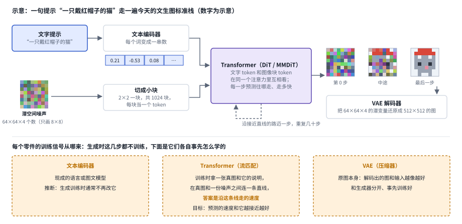

*示意：一句提示“一只戴红帽子的猫”走一遍今天的文生图标准栈。文字和潜空间噪声一起进入 DiT，每一步沿接近直线的路迈一步，最后由 VAE 解码；下排虚线框是三个零件各自的训练信号。*

图里从左往右走一遍。提示先被文本编码器变成一串串数，潜空间里一张 64×64×4 的噪声被切成小块当作 token，两者一起进入 DiT；DiT 每一步预测往哪走、走多快，几十步后噪声变成了猫，VAE 解码器再把它还原成 512×512 的图。生成时这几步都不训练，下排写的是三个零件事先怎么学的：DiT 的答案是真图和噪声之间那条直线上的速度，VAE 学的是把原图还原得越像越好，文本编码器拿现成的模型来用。

**速查：起点和第 1 阶段的八种写法。** 从 W1 到 W8，变化集中在两处：生成发生在像素上还是潜空间里，以及中间那个网络是一步画完、逐个写编号，还是一步步去噪。下面八张结构卡借自多模态范式图谱，用同一种画法把每种做法的骨架画成一行流程，卡片编号和速查表的代号一一对应。

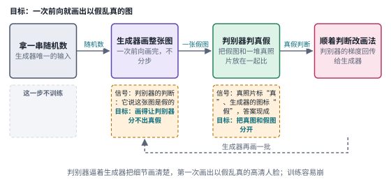 

 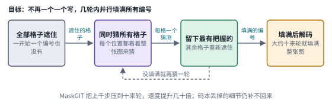

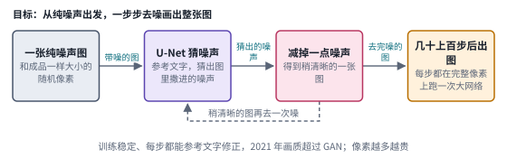 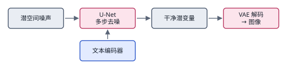

 

*起点与第 1 阶段八种写法的结构卡，每张卡对应下表的一行。*

| 代号 | 名称 | 年份 | 代表 | 怎么做 | 解决了什么 | 代价 |
|---|---|---|---|---|---|---|
| W1 | 对抗生成（GAN） | 2014–2019 | GAN、DCGAN、pix2pix、CycleGAN、BigGAN、StyleGAN | 生成器拿随机数一步画出整张图，判别器判断真假，两者对抗训练，只需要一堆无标注的真照片 | 早期 VAE 画得模糊，判别器逼着生成器把细节画清楚，第一次画出以假乱真的高清人脸，一次前向就出图 | 训练容易崩，常模式坍缩；一步画完，没有逐步插入文字条件的机会，难以精确控制 |
| W2 | 变分自编码器（VAE） | 2013 起 | VAE、VQ-VAE、VQGAN，以及所有潜扩散模型的压缩器 | 编码器把图压成小得多的潜变量，解码器还原；VQ 版本把潜变量换成码本编号 | 把"压缩"和"生成"拆开，后面的生成模型只需在小得多的空间里工作，今天几乎每个图像视频模型开头都有它 | 单独生成偏模糊；压缩器本身是上限，没还原好的小字和人脸细节后面补不回来 |
| W3 | 离散自回归 | 2021–2022 | DALL-E、CogView、Parti | 用码本把图变成一串编号，Transformer 接在文字后面逐个预测，再解码成图 | 把画图变成和语言模型一样的任务，能用文字前缀控制内容，复用语言模型的训练经验 | 上千个编号要逐个生成，很慢；码本只有几千个向量，细节损失补不回来 |
| W4 | 掩码并行生成 | 2022–2023 | MaskGIT、Muse | 一开始全部遮住，每轮同时猜所有位置、保留最有把握的一批，十来轮填满 | 上千步压到十几步，速度提升几十倍 | 码本丢掉的细节照样补不回来；纯生图上被扩散超过，思路后来被 Show-o 等统一模型继承 |
| W5 | 像素空间扩散 | 2020–2022 | DDPM、ADM、DALL-E 2、Imagen | 在像素上加噪、让 U-Net 猜噪声，生成时从纯噪声出发逐步去噪 | 普通回归问题，训练稳定，不易坍缩；每一步都能参考文字修正，2021 年画质超过 GAN | 每一步都在完整像素上跑大网络，算力很贵，分辨率难做高 |
| W6 | 潜空间扩散 | 2022 | Latent Diffusion、Stable Diffusion 1/2/XL | 先用 VAE 把图压成潜变量，加噪和去噪全在潜空间里做，最后解码 | 计算量下降几十倍，消费级显卡能跑，开源后带动整个社区 | 画质受 VAE 还原能力限制，早期常把字和手画错 |
| W7 | Transformer 去噪 + 流匹配 | 2022.12 至今 | DiT、SD3（MMDiT）、FLUX.1、Sora、Veo、Wan | 在潜空间里把 U-Net 换成 Transformer，训练目标换成沿直线路径预测速度 | 可以像语言模型一样靠规模稳定变强；直线路径让步子迈得更大；时空切块天然适用于视频 | 训练和推理算力需求都很高；它仍是专门的生成模型，看不懂对话上下文 |
| W8 | 下一尺度预测 | 2024 | VAR、Infinity | 把图编码成从 1×1 到 16×16 的多层 token 地图，一层层由粗到细生成，层内并行 | 从粗到细更符合图像结构，又能并行，第一次让自回归生图在 ImageNet 上超过扩散 | 需要专门训练多尺度码本；大规模文生图上仍在追赶扩散和流匹配 |

### 第 2 阶段：回头审视潜空间，可建模性与重回像素

> **要点：** 先压缩、再生成成了标准做法以后，压缩出的那组数该长什么样？一路请来擅长看懂图的模型，让这组数带上“这是什么”的信息；另一路干脆不压缩，回到像素上直接生成。

两阶段配方成了标准做法之后，人们开始回头追问潜空间本身该长什么样。Dieleman 的回答是，表示学习和重建是两件不同的任务：重建要求保留尽可能多的细节，好的生成表示却要求结构清楚、容易建模。他还写了一句很妙的话：单从好建模的角度看，什么信息都不编码的潜表示最容易建模，可那样就什么也重建不出来了。真正的设计空间就在这两极之间。

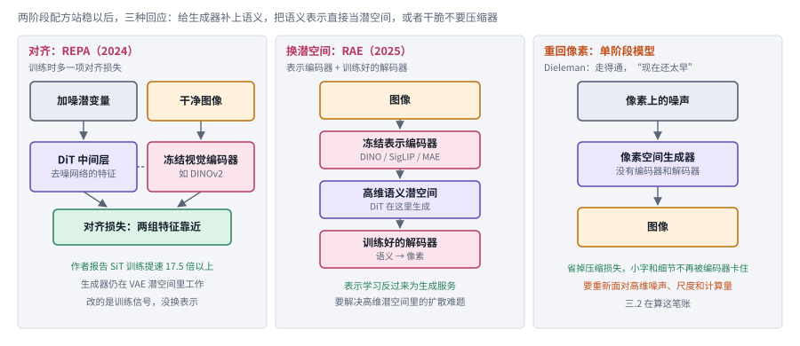

*第 2 阶段的三种做法：给生成器补语义信号、把语义表示当潜空间、去掉压缩器。*

图里并排画着这一阶段的三种回应，从左到右，压缩器的分量越来越轻。左栏是 [REPA](https://arxiv.org/abs/2410.06940)（Representation Alignment for Generation）：生成器仍然在 VAE 潜空间里工作，训练时多了一项对齐损失，要求去噪网络的中间层特征去靠近一个语义编码器从干净图像里读出的特征。语义编码器指现成的、为看懂图像训练好的视觉模型，在这里参数冻结，只负责读出语义，这个编码器可以是 DINOv2，一个用自监督方法训练、很擅长表达图像语义的模型；作者报告这让 SiT 的训练提速 17.5 倍以上，论文题目里就写着"训练扩散 Transformer 比你想的容易"。它改的是训练信号，表示本身没有换。中栏是 [RAE](https://arxiv.org/abs/2510.11690)（Diffusion Transformers with Representation Autoencoders），它更进一步，直接用冻结的语义编码器把图像变成高维语义潜空间，DiT 在这里生成，再由一个训练好的解码器还原成像素；作者报告这样不加额外的对齐损失也能收敛得更快，也说明要专门处理在高维潜空间里做扩散的难处。右栏是单阶段的像素模型，编码器和解码器都不要了。

*图：第 2 阶段三种做法的范式对比。每一列是一种做法，四行分别是生成发生在哪里、训练信号从哪来、得到了什么和代价。*

三种做法的差别，在于语义信息以什么身份进入生成。REPA 把它当成额外的训练信号，生成器仍在 VAE 潜空间里，只是中间层多了一个要靠近的目标；RAE 把它当成生成发生的空间本身，解码器另外学着把语义还原成像素；像素路线两样都不要，直接用像素上的生成目标训练，换来了细节，也换来了更大的计算账。

在 Dieleman 看来，这股潮流是一次角色翻转：过去常听人说用生成模型去服务表示学习，现在反了过来，表示学习在为生成服务。他在文中还介绍了 VA-VAE 等方法，它们鼓励潜表示去预测 DINOv2 这类已有的高质量视觉特征。RAE 直接拿冻结的语义编码器当潜空间，也就留下了几个具体问题：既然编码器是现成的，它的哪几层最适合拿来生成，预测目标要不要随之改变，能不能干脆为生成专门训练一个表示；再往视频走，还要给它加上时间维度。

另一批人选择往回走。既然固定的压缩器会丢细节，何不干脆在像素上直接生成？Dieleman 在文末专门讨论过"端到端会不会最终胜出"，他列举了几种单阶段模型，承认它们证明了这条路走得通，但判断目前在成本上还不划算，"现在还太早"；他同时预计硬件进步终将让输入空间模型在经济上更合算，只是不肯给出时间表。要检验这个判断，就得算清去掉 VAE 之后高维噪声、尺度和计算量这几笔账能不能算平。另一个问题也从这里冒出来：如果潜空间本来就来自一个理解模型，那生成模型的内部表示能不能反过来服务于理解？

**速查：回看潜空间的三种做法。** 三张卡对应本阶段开头那张图的三栏，也就是 REPA 的表示对齐、RAE 的语义潜空间和去掉压缩器的像素模型，下表把它们放进同一组栏目里比较。

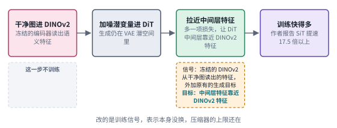 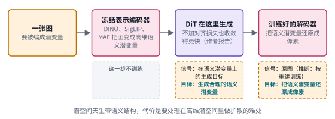

*第 2 阶段三种做法的结构卡，每张卡对应下表的一行。*

| 代号 | 名称 | 年份 | 代表 | 怎么做 | 解决了什么 | 代价 |
|---|---|---|---|---|---|---|
| P1 | 表示对齐 | 2024 | [REPA](https://arxiv.org/abs/2410.06940) | 训练扩散 Transformer 时，把它的中间层特征对齐到冻结的语义编码器特征上 | 扩散 Transformer 自己学表示很慢，对齐之后训练明显加快，作者报告 SiT 上提速 17.5 倍以上 | 要依赖一个现成的语义编码器；生成仍在 VAE 潜空间里，压缩器的上限还在 |
| P2 | 表示自编码器 | 2025 | [RAE](https://arxiv.org/abs/2510.11690)、V-RAE（三.1） | 用 DINO、SigLIP、MAE 这类冻结的语义编码器加一个训练好的解码器，代替 VAE 作为潜空间 | 潜空间天生带着语义结构，作者报告不加额外的对齐损失也收敛得更快 | 要处理在高维潜空间里做扩散的难处；语义编码器关心“这是什么”，可能忽略细节（三.1） |
| P3 | 像素空间扩散与流 | 2026 前后回潮 | Pixel-Space DiT、PixWorld（三.2、三.7） | 去掉编码器和解码器，直接在像素上做扩散或流匹配 | 绕开固定压缩器丢细节的问题，小字和精确几何不再被编码器卡住 | 高维噪声、尺度和计算量都要重新算账；Dieleman 判断目前在成本上还“太早” |

### 第 3 阶段：让采样变快，从一步步积分到学会积分

> **要点：** 生成一张图要把网络跑几十上百遍，能不能少跑几遍？这一阶段有两条路：让每一步更有效，或者训练模型一次跨过一大段路，让步数变少；后一条路上的几种做法，都可以看成在学“从路上任意一点直接跳到另一点”。

扩散模型生成一张图要把网络跑几十上百遍，这在图像上还能忍，到了视频和实时交互就成了硬伤。加速的思路大致有两种：一种是让每一步更有效，另一种是让步数变少。

让每一步更有效的代表是无分类器引导，它看似和速度无关，却深刻影响了后来的蒸馏。[Classifier-Free Diffusion Guidance](https://arxiv.org/abs/2207.12598) 让同一个模型同时学有条件和无条件两种预测，采样时把两者的差别放大，用一个系数换取更强的条件遵循。它成了文生图模型的标配旋钮，代价是每一步都要多跑一次网络。Dieleman 在 flow map 长文里专门提到，引导和蒸馏很难结合，常见的折中是在教师那一侧做引导，或者让学生以引导系数为条件。

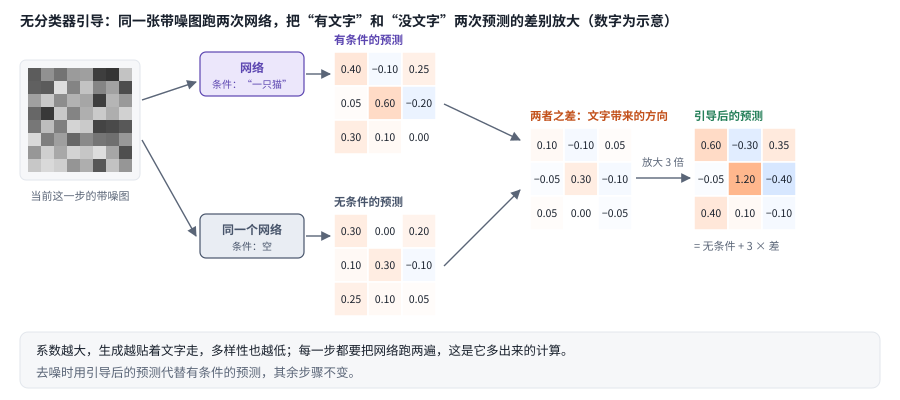

*无分类器引导：同一张带噪图分别在“一只猫”和空条件下各跑一次网络，把两次预测之差放大 3 倍再加回无条件的预测（数字为示意）。*

图里的一格就能说明引导在做什么。中间那一格，有条件的预测是 0.60，无条件的是 0.30，差 0.30 就是“一只猫”这几个字带来的方向；乘上系数 3 再加回 0.30，得到 1.20，这一格被推着更明显地往“猫”的方向修。每一步都要先跑这两次网络，所以计算翻倍。

少走几步会掉质量，是因为去噪大致在频域上从低频往高频逐层补细节，Dieleman 的《Diffusion is spectral autoregression》给了这个直观的解释。自然图像的功率谱大致是一条幂律直线，低频能量多，高频能量少；高斯噪声的功率谱却是平的。往图上加噪，就像一道逐渐上涨的潮水，先淹没高频细节，再淹没低频结构，噪声水平因此对应着一个截止频率。反过来，去噪的过程近似于在频域上做自回归：先定下大轮廓，再一层层补上更细的纹理。每一步负责一段频带，一下跨过太多步，相当于要求模型一口气补齐好几层细节。他也提醒，这种对应只在许多图像的平均意义上成立，单张图的频谱并不那么整齐；对音频波形，这个解释基本失效，换到梅尔频谱上才又近似成立。

下图画的就是这个解释。左边两条轴都取对数，横轴是空间频率，越往右越是细碎的纹理，纵轴是能量；三条灰色虚线是大、中、小三档噪声，虚线和图像功率谱那条斜线相交的红点就是各自的截止频率，比它更高的频率已经被噪声淹没。右边按去噪顺序排出每一档噪声下能定下的结构。

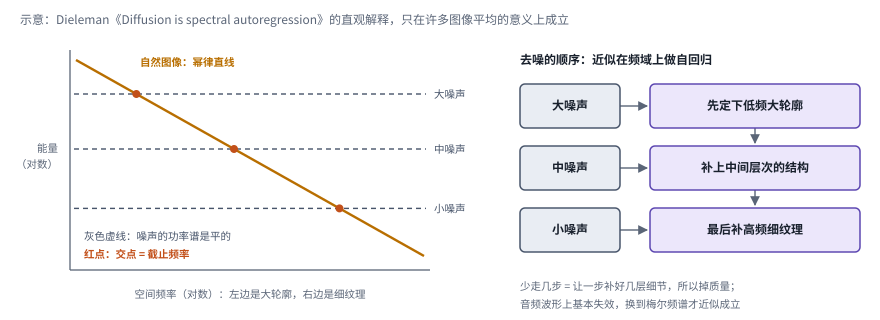

*示意：自然图像的幂律功率谱与平坦的噪声谱，交点就是当前噪声水平对应的截止频率；去噪大致从低频往高频推进。*

减少步数的方法都想让模型一次跨过路径上的一大段，差别在学的是哪一种跨法。[一致性模型](https://arxiv.org/abs/2303.01469)（Consistency Models）要求同一条轨迹上任意一点都映射到同一个终点，于是可以一步或几步直接跳到终点。分布匹配不管路径，只管结果：[DMD](https://arxiv.org/abs/2311.18828)（One-step Diffusion with Distribution Matching Distillation）让一步生成器的输出分布去匹配教师扩散模型的分布。它的梯度来自两个分数模型之差，两个都是扩散模型，分开训练：一个代表真实图片的分布，由教师来当；另一个在生成器自己画出的图上训练，代表生成器当前的分布。2025 年的 [MeanFlow](https://arxiv.org/abs/2505.13447)（Mean Flows for One-step Generative Modeling）学的是一段时间上的平均速度，有了它就能一步跨过整段，而且可以从零训练。

Dieleman 2026 年的长文把这些方法收进了同一个概念：flow map。扩散模型只知道路径上每一点该往哪个方向走，flow map 则直接学会从任意一点跳到任意另一点，相当于学会了扩散模型的积分。一致性模型是只瞄准终点的部分 flow map，渐进蒸馏和 shortcut 模型靠步长加倍拼出长跳，MeanFlow 则参数化平均速度。这个概念很快就落到了产品上：FLUX.3 Image Klein 的蒸馏版，Hugging Face 博客直接写明"是一个 flow map"，每一步都被告知要跳到哪个时间点，默认 16 步、不用无分类器引导，据报告在 H100 上约 2 秒出一张 1024×1024 的图；未蒸馏的基础版则要走 50 步并开着引导，更适合拿来微调。Dieleman 给出的判断很实在：flow map 的采样确实便宜，可训练明显更复杂，通常还依赖一个现成的扩散模型，天下没有免费的午餐。这个判断在视频上体现得尤为明显，因为少步生成一旦和自回归结合，学生自己的误差就会被反复喂回去。

这张图说明，几种少步方法学的都是 flow map 的一部分。图用同一条从噪声走到数据的弯曲路径，把这几种方法学的东西画在一起：普通的扩散或流模型只学每一点的方向，沿一串小箭头慢慢挪，Dieleman 把它比作航海里的推算定位；底部的绿框是 flow map 本身，从任意一点跳到任意另一点，其余几栏都能放进它里面。

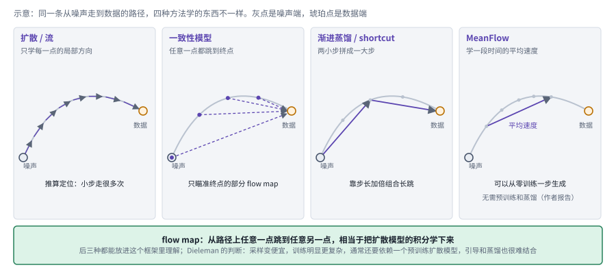

*示意：同一条路径上，扩散学局部方向，一致性模型直接跳终点，渐进蒸馏把小步拼成大步，MeanFlow 学平均速度；flow map 学的是任意两点之间的跳跃。*

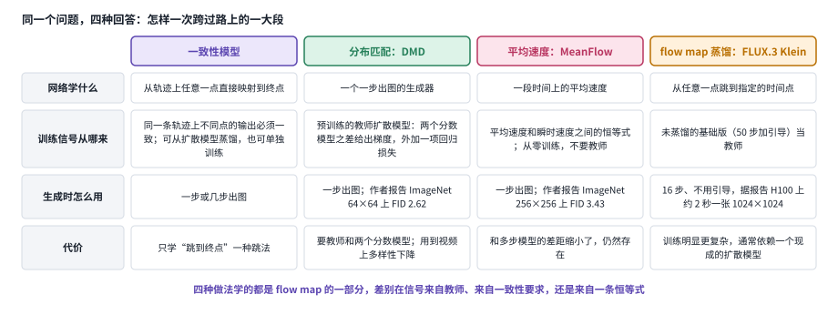

*图：四种少步方法的范式对比。每一列是一种做法，四行分别是网络学什么、训练信号从哪来、生成时怎么用和代价。*

四种少步方法的差别，集中在训练信号的来源上。一致性模型靠“同一条轨迹上的点必须给出同一个终点”这条要求约束自己；DMD 和 FLUX.3 Klein 的蒸馏版都要一个现成的多步模型当教师，学生的分数或落点拿去和教师对照；MeanFlow 只靠平均速度和瞬时速度之间的一条恒等式，从零训练，不需要任何教师。

**速查：让采样变快的五种做法。** 第一张卡是让每一步更有效的引导，中间三张是让步数变少的几种训练方式，最后一张是 flow map 落到开源模型上的样子。

 

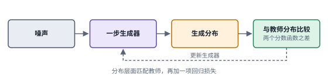 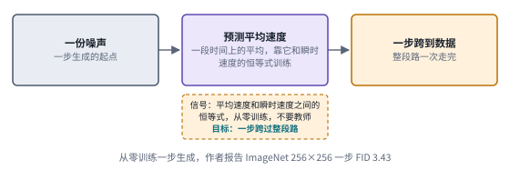

*第 3 阶段五种做法的结构卡，每张卡对应下表的一行。*

| 代号 | 名称 | 年份 | 代表 | 怎么做 | 解决了什么 | 代价 |
|---|---|---|---|---|---|---|
| S1 | 无分类器引导 | 2022 | [Classifier-Free Diffusion Guidance](https://arxiv.org/abs/2207.12598) | 同一个模型同时学有条件和无条件两种预测，采样时把两者的差别放大 | 不必另训一个分类器，用一个系数就能换取更强的条件遵循，成了文生图的标配旋钮 | 每一步多跑一次网络；系数调高会牺牲多样性；和蒸馏很难结合 |
| S2 | 一致性模型 | 2023 | [Consistency Models](https://arxiv.org/abs/2303.01469) | 要求同一条轨迹上任意一点都映射到同一个终点 | 一步或几步就能生成，既可以从扩散模型蒸馏，也可以单独训练 | 只学“跳到终点”这一种跳法，在 Dieleman 的框架里是只瞄准终点的部分 flow map |
| S3 | 分布匹配蒸馏 | 2023 | [DMD](https://arxiv.org/abs/2311.18828) | 让一步生成器的输出分布去匹配教师扩散模型的分布，梯度来自两个分数模型之差，再加一项回归损失 | 一步生成，作者报告 ImageNet 64×64 上 FID 2.62，每秒能生成 20 张图 | 要一个预训练教师，外加两个分别训练的分数模型；用到自回归视频上，多样性下降成了显著问题（Krea、三.4） |
| S4 | 平均速度 | 2025 | [MeanFlow](https://arxiv.org/abs/2505.13447) | 直接参数化一段时间上的平均速度，用平均速度和瞬时速度之间的恒等式来训练 | 从零训练一步生成，不需要预训练、蒸馏或课程，作者报告 ImageNet 256×256 一步 FID 3.43 | 作者的说法是大幅缩小了一步和多步模型之间的差距，差距本身还在 |
| S5 | flow map 蒸馏 | 2026 | FLUX.3 Image Klein 蒸馏版，概念见 [Dieleman 的 flow map 长文](https://sander.ai/2026/05/06/flow-maps.html) | 从基础版蒸馏出 flow map，每一步都被告知要跳到哪个时间点 | 默认 16 步、不用引导，据报告在 H100 上约 2 秒出一张 1024×1024 的图 | 训练明显更复杂，通常依赖一个现成的扩散模型；需要微调时还得回到 50 步加引导的基础版 |

### 第 4 阶段：加上时间轴，视频从整段去噪走向因果流式

> **要点：** 把画图的办法搬到视频上，多出了什么难处？前后帧要连贯，视频数据又少。主流做法把整段视频切成小立方块一起去噪；为了能边生成边交互，又改成一块接一块往下写，可训练时看的是真实前文，生成时接着的却是自己写的带瑕疵的前文，误差会越滚越大。

图像配方搬到视频上，多出了两重困难，早期研究由此分出三种做法。Lilian Weng 在视频长文开头说，视频生成是图像生成的超集，多出来的两重困难是时间一致性和数据稀缺。早期的 [Video Diffusion Models](https://arxiv.org/abs/2204.03458) 把二维 U-Net 扩成在空间和时间上分解的三维结构，让整段视频一起去噪；[Stable Video Diffusion](https://arxiv.org/abs/2311.15127) 则代表了另一条路：从预训练的潜空间图像模型出发，插入时间层，在精心筛选的视频数据上继续训练。Weng 特别引用了它的发现，经过过滤的高质量数据集即使小得多，也能训出更好的模型。她文中提到的 Sora 代表了第三种做法：用扩散 Transformer 在时空 patch 上建模，把整段视频当成一个大张量来生成。

第三种做法后来成了主流。逐帧生成图片再拼起来，前后帧很难保持一致；视频 VAE 改为把视频在时间和空间上一起压缩，比如 [HunyuanVideo](https://arxiv.org/abs/2412.03603) 和 [Wan](https://arxiv.org/abs/2503.20314) 在时间上压 4 倍、在长和宽上各压 8 倍，压缩后的结果像一块立方体，再切成一个个小立方块，每块是一个 token，交给 DiT 用流匹配从噪声里生成。这套做法几乎原封不动地继承了第一阶段末尾那套标准栈，也就是先用 VAE 压进潜空间、再用 DiT 当网络、用流匹配当训练目标，只是多压缩了一个时间维度。按多模态范式图谱的整理，Veo 3 还能同时生成声音；闭源模型的具体细节并未全部公开，外界对它们结构的描述多半带着推测。

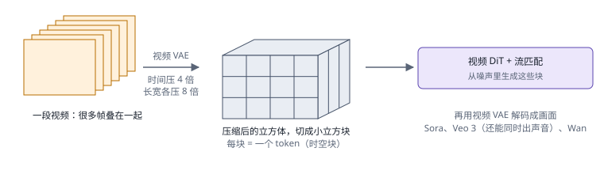

*视频生成的时空块做法：时间压 4 倍、长宽各压 8 倍，切成小立方块后交给视频 DiT。*

| 代号 | 名称 | 年份 | 代表 | 怎么做 | 解决了什么 | 代价 |
|---|---|---|---|---|---|---|
| A4 | 视频生成（时空块 + DiT） | 2024 至今 | Sora、可灵、Veo 2/3、HunyuanVideo、Wan、Seedance | 视频 VAE 在时间和空间上同时压缩，切成时空块 token，DiT 用扩散或流匹配从噪声生成，再解码成视频 | 一次看到一段时间内的整体，动作和物体在帧间保持连贯；继承 W7 的可扩展性，能生成长达一分钟、物理上大致合理的视频 | 单段通常只有几秒到十几秒，再长就会人物变样、物体消失；做完整影片要靠外部的 agent 和工具把镜头串起来 |

整段双向生成的模型画质很好，却天然不适合交互：你得等整段视频生成完才能看到第一帧，也没办法在中途根据新的控制信号改变后面的内容。于是研究者开始把双向模型改造成因果的、一块接一块往下写的自回归模型。问题随之而来，Krea 的博客把它叫作暴露偏差：训练时模型看的是真实的历史帧，推理时却要接着自己生成的、带瑕疵的帧往下写，一帧里的小错误会被当成下一帧的输入，越滚越大。[Self Forcing](https://arxiv.org/abs/2506.08009)（Bridging the Train-Test Gap in Autoregressive Video Diffusion）的办法是让训练时也按推理的方式自回归展开，模型看到的始终是自己的输出，再用视频级的损失来监督。Krea 正是用这套方法，从 Wan 2.1 14B 蒸馏出了他们的实时模型；两者都用到了第 3 阶段 DMD 那种分布匹配的思路。

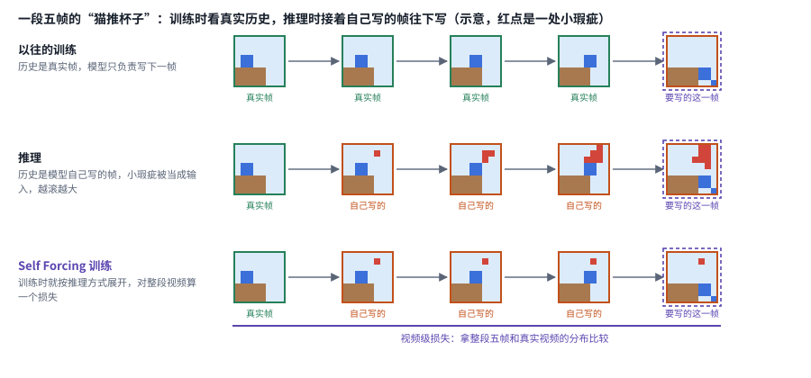

*暴露偏差：以往训练时历史是真实帧，推理时历史是模型自己写的帧，一处小瑕疵会被当成输入一路放大；Self Forcing 在训练时就按推理方式展开（示意）。*

用一段五帧的“猫推杯子”能把暴露偏差看得很具体。第一行是以往的训练，模型每次拿四张真实帧去写第五张，从来没见过带瑕疵的历史；第二行是推理，第二帧里出现一个红色小点，第三帧把它当成真实内容接着画，到第五帧已经长成一大块。第三行是 Self Forcing：训练时历史帧也由模型自己写出，它在训练里就见过自己的瑕疵，再用整段五帧的视频级损失去管住它。

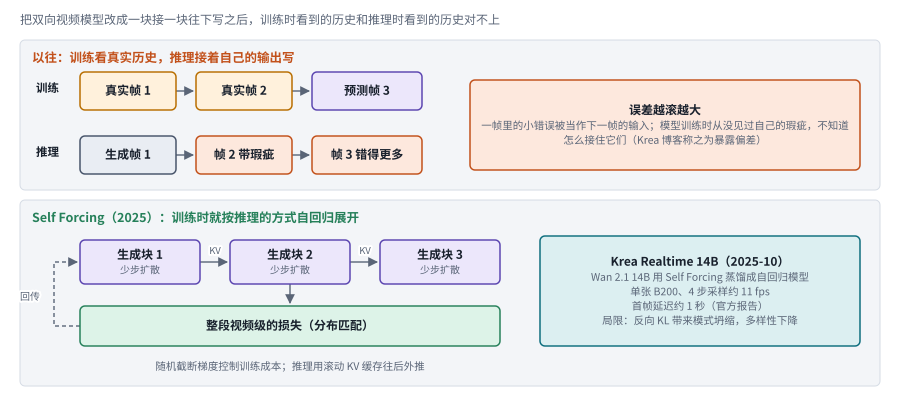

*暴露偏差与 Self Forcing：上半部分训练和推理看到的历史不一致，下半部分训练时就按推理方式展开，用视频级损失监督整段结果。*

图的上半部分是以往的做法：训练时看真实帧，推理时接着自己带瑕疵的帧往下写，误差越滚越大。下半部分是 Self Forcing：训练时就一块接一块地展开，前面写好的块存成 KV 缓存，也就是模型为已经生成的内容存下的中间结果，下一块直接读取、不必重算；再对整段视频算一个视频级的损失。作者用少步扩散模型和随机截断梯度把训练成本压下来，推理时让 KV 缓存滚动向前，外推出更长的视频，报告在单张 GPU 上做到亚秒级延迟的实时流式生成。右下角是 Krea 拿这套方法做出来的实时模型，以及它坦白的局限。

**速查：视频生成的三种骨架。** A4 那张表讲的是今天的主流做法；下面三张卡补上它前后的几步：最早的整段三维去噪、从图像模型插入时间层的做法，以及把双向模型改成因果流式的 Self Forcing。

 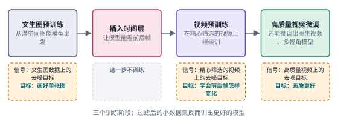

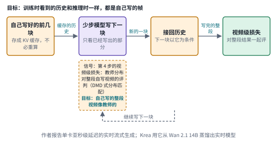

*视频三种骨架的结构卡，每张卡对应下表的一行。*

| 代号 | 名称 | 年份 | 代表 | 怎么做 | 解决了什么 | 代价 |
|---|---|---|---|---|---|---|
| V1 | 整段三维去噪 | 2022 | [Video Diffusion Models](https://arxiv.org/abs/2204.03458) | 把二维 U-Net 扩成在空间和时间上分解的三维结构，整段视频一起去噪，图像和视频数据联合训练 | 帧与帧在同一个网络里同时生成，时间上更连贯；作者给出了大规模文生视频的最早一批结果 | 要等整段生成完才能看到第一帧，不适合交互；视频和视频-文本配对数据都难收集 |
| V2 | 图像模型插时间层 | 2023 | [Stable Video Diffusion](https://arxiv.org/abs/2311.15127) | 从潜空间图像模型出发插入时间层，依次经过文生图预训练、视频预训练和高质量视频微调三个阶段 | 复用图像模型的能力；精心筛选的数据集即使小得多也训得更好，还能微调出图生视频和多视角模型 | 效果很依赖数据的标注和过滤流程；仍是整段生成，和 V1 一样不适合流式交互 |
| V3 | 因果自回归与自展开训练 | 2025 | [Self Forcing](https://arxiv.org/abs/2506.08009)、Krea Realtime 14B | 训练时按推理方式自回归展开，以自己生成的帧为条件，用视频级损失监督；推理时用滚动 KV 缓存 | 弥合训练和推理之间的暴露偏差，作者报告单卡实时流式生成、延迟在一秒以内 | 少步蒸馏带来模式坍缩、多样性下降；长视频的记忆和误差累积仍未解决（三.4、三.5） |

这一阶段把前面所有的麻烦都叠在了一起：少步蒸馏的多样性损失、自回归的误差传播、长序列的计算和记忆，以及把双向模型蒸馏成因果模型时，教师能看到整段视频、学生只能看到已经写出的部分这种信息错位。Krea 在局限里坦白说，反向 KL 带来的模式坍缩降低了输出多样性。视频这条线再往前走，就是"可以交互、能对动作做出反应的视频"，那已经进入[世界模型](10_world_models.md)一章的范围。

想把这一阶段放回更长的时间线上看，2026 年 4 月的综述 [Evolution of Video Generative Foundations](https://arxiv.org/abs/2604.06339) 是一张现成的地图。它把视频生成从 GAN 讲到扩散，再讲到自回归和多模态做法，判断扩散已经坐稳视频生成的主导框架，画质和推理效率之间的平衡仍是核心挑战；讲到流式的自回归生成时，它把缺少未来上下文带来的暴露偏差和误差累积列为这条路的主要代价，和 Krea 博客里说的是同一个问题。它统计的会议论文数也印证了这一阶段的走向：研究重心先是运动和时间一致性，然后是文生视频和可控性，最近转向了世界模型、物理和长视频。

### 第 5 阶段：更多输出空间，音频、语音与三维

> **要点：** 同一套两阶段配方被搬到音频、语音、音乐和三维上，每种输出空间都多出自己的约束：音频要长程结构，语音要接住对话，三维要跨视角几何一致。

两阶段配方搬到更多模态上时，各模态的成熟度并不一样，Dieleman 在长文里专门比较过不同模态的潜表示：音频较早采用了两阶段配方，但在具体改进上共识更少；视频如果逐帧使用图像潜表示，容易闪烁，也浪费了时间上的冗余，他认为时空压缩的工具还远不成熟，视频编码器里的运动估计是一条尚未被好好利用的线索。

音频的难处在于序列极长，局部音色和长程结构很难兼顾。Dieleman 2020 年那篇波形音乐长文讲过，音频每秒要的比特数比符号化的乐谱多得多，十几千赫的采样率意味着极长的序列，WaveNet 这类模型能把局部音色做好，却很难把握长程的乐曲结构；他还观察到，条件给得越稀疏，留给模型的不确定性越多，越需要多样性，条件给得越稠密，比如声码器拿着完整的频谱去还原波形，就越看重逼真。这两条观察到今天仍然成立。后来的 [AudioLDM](https://arxiv.org/abs/2301.12503) 把潜扩散搬到了音频上，[MusicGen](https://arxiv.org/abs/2306.05284) 则在离散音频 token 上做自回归音乐生成，两者都是第一阶段那套两阶段配方在声音上的翻版：先把声音压成紧凑的潜表示或离散 token，再在上面训练生成模型。

语音的演进把"生成"和"对话"绑在了一起。早期的语音助手是三个模型接力：语音识别先把你的话转成文字，语言模型读文字、写回答，语音合成再把回答念出来。每一段都很成熟，问题出在接力棒上：交给语言模型的只有文字，语气、情绪、迟疑和背景里的笑声在第一棒就丢了；三段的延迟要相加，往往好几秒，你也没法中途打断它。端到端语音模型把三段合成一个，音频被编成 token 直接送进模型，模型也直接输出音频 token。OpenAI 发布 GPT-4o 时给出的语音回应延迟平均约 320 毫秒，接近人在对话里的反应时间（官方数字）；[Qwen2.5-Omni](https://arxiv.org/abs/2503.20215) 把模型分成负责想内容的 Thinker 和负责把内容说出来的 Talker。再进一步是全双工：人在对话里会边听边说，会插话，会在对方说到一半时"嗯"一声，[Moshi](https://arxiv.org/abs/2410.00037) 让模型同时处理对方和自己两路音频流，每一刻都在同时听和说，所以能随时被打断，也能主动接话。

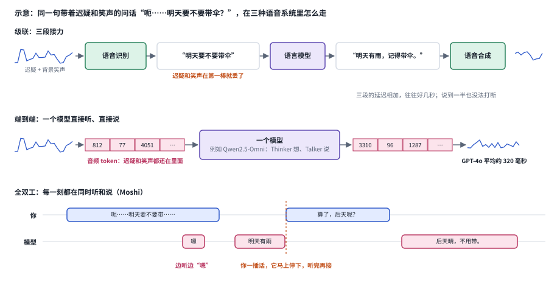

*示意：同一句带着迟疑和笑声的问话，在级联、端到端和全双工三种语音系统里怎么走。*

图的三行跟着同一句问话走。级联那一行，语音识别交出的只是一行字，迟疑和笑声在第一棒就丢了；端到端那一行，音频被编成 token 直接进出同一个模型，这些信息都还留在 token 里；全双工那一行，模型边听边“嗯”，你一插话它就停下，听完再接。

端到端语音在单句上已经接近真人，放进对话里却还差在韵律上，这是 Sesame 的博客从生成的角度补上的判断。他们的模型在字错率和说话人相似度上已经接近人类，不给上下文时听者分不出模型和真人；一旦把前面的对话也放给听者，大家就稳定地偏好真人。差距落在韵律上：一句话该用什么语气、在哪里停顿，取决于前面聊了什么。这类模型目前共同的短板是语音数据和评测都远少于文字，说话时的推理能力通常比同一个模型打字时弱。

Sesame 的模型 CSM 用一个大主干加一个小的补层网络来压低延迟，结构画在下图里。对话音频先经过残差向量量化：用一个码本给每一帧找最接近的编号，再用第二个码本给剩下的误差找编号，一层层逼近，于是每一帧变成多层码本 token。文字和音频 token 交错排成一条序列，交给一个较大的主干网络，它只负责预测第 1 层码本；剩下的各层由一个较小的补层网络补齐，这样能把延迟压低。这个补层网络是和主干一起训练的小 Transformer，Sesame 原文叫它 audio decoder，可它输出的仍是码本编号，把编号还原成波形是另一个网络的事，本章前面说的“解码器”指的是后者。

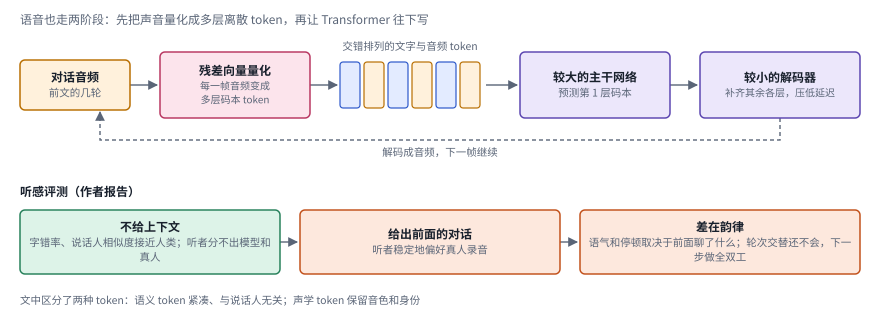

*Sesame CSM：多层码本 token、大主干预测第 1 层、补层网络补其余层；下排是不给上下文和给出上下文两种听感评测。*

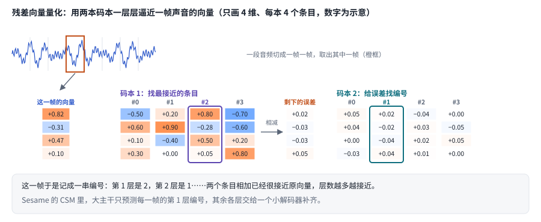

*残差向量量化：一帧声音的向量先在码本 1 里找最接近的条目，剩下的误差再到码本 2 里找，这一帧就记成一串编号（只画 4 维、每本 4 个条目，数字为示意）。*

把残差向量量化单独放大，就能看到“多层码本 token”具体是什么。图里这一帧的向量先在码本 1 的四个条目里找最接近的 2 号，相减后剩下一点误差；误差再到码本 2 里找到 1 号。于是这一帧被记成编号 2、1，两个条目加起来已经很接近原向量。CSM 的大主干只负责预测每一帧的第一个编号，后面那些修补误差的编号交给补层网络，这就是它压低延迟的地方。

| 代号 | 名称 | 年份 | 代表 | 怎么做 | 解决了什么 | 代价 |
|---|---|---|---|---|---|---|
| A1 | 级联语音 | 2023 以前的常态 | 语音识别 → 语言模型 → 语音合成（早期 ChatGPT 语音模式） | 三个独立模型串成流水线：识别把话转成文字，语言模型写回答，合成再读出来 | 三个模块都已成熟，直接拼起来就能做出能听能说的助手 | 语气、情绪和背景声在第一步就丢了；三段延迟相加，往往好几秒；必须等你说完才处理，没法打断 |
| A2 | 端到端语音（含全双工） | 2024–2025 | GPT-4o 语音、Moshi、Qwen2.5-Omni / Qwen3-Omni | 音频编成 token 直接进模型，模型直接输出音频 token；全双工模型同时处理"在听"和"在说"两路流 | 直接听原始声音，听得出语气；省掉三段串行，延迟接近人与人对话；全双工能插话和被打断 | 语音对话数据和评测远少于文字；说话模式下要兼顾实时性，推理能力通常弱于打字时 |

向三维扩展时，又多了一重跨视角几何一致的约束。[DreamFusion](https://arxiv.org/abs/2209.14988) 用二维生成先验去优化一个三维表示，必须处理"不同视角如何对应同一个物体"这个问题。视频同样要跨帧保持内容和变化的一致性，三维则要跨视角保持几何一致，把每一帧、每一个视角单独画好，离一个连贯的作品还很远。

DreamFusion 的具体做法值得多看一眼，因为它给“用二维生成先验做三维”定了型。按论文摘要的描述，它从一个随机初始化的三维场景表示（神经辐射场，也就是 NeRF）出发，每次随机选一个视角把它渲染成一张二维图，再交给一个冻结的文生图扩散模型，用一个基于概率密度蒸馏的损失衡量这张渲染图在扩散模型看来有多合理，梯度只回传到三维表示上。换很多个视角反复这样做，三维物体就慢慢被二维先验塑造出来。整个过程不需要任何三维训练数据，也不改动图像扩散模型本身；它要面对的，正是上一段说的“不同视角如何对应同一个物体”。

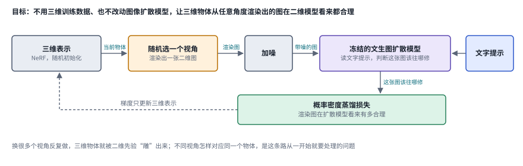

*DreamFusion：随机视角渲染、加噪后交给冻结的文生图扩散模型评判，梯度只更新三维表示。*

### 第 6 阶段：理解与生成合流，一个模型既读又写

> **要点：** 一个模型能不能既看懂图、又会画图？难处在于读图只要知道“这是一只猫”，画图却要能还原每个像素。几种统一做法都在这对矛盾里找平衡点：把图也变成词，在一个模型里混用两种学法，读和写各用一套表示，语言模型出主意、另挂画图模型，读写分给两组参数，以及结构未公开的闭源原生生图。

读图和画图两套做法各自长大，要把它们统一，难点在于两边想要的表示不一样。在 2024 年以前，一个"能看图又能画图"的产品，背后通常是两个模型：一个 LLaVA 式的理解模型负责看懂图和对话，一个 Stable Diffusion 式的生成模型负责画，两者之间只靠一段文字传话。回到开头的短片，你说"把猫换成白猫，其他别动"，理解模型看懂了，可它只能把这句话转述给画图模型，画图模型并没有真正"看过"原图，结果往往整张图都变了样。读图想要偏语义的表示，知道"这是一只猫"就够了；画图想要能还原每个像素的表示，要记住每一根毛。下面几种做法，都是在这对矛盾里找平衡点。

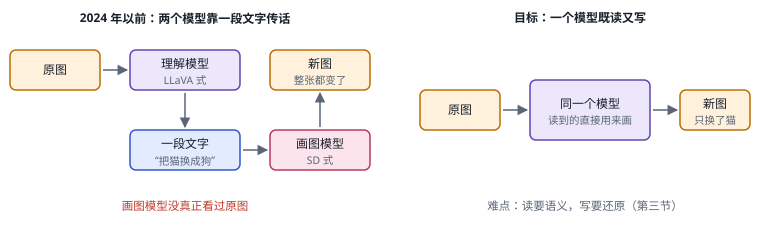

*两个模型靠一段文字传话时，画图模型没真正看过原图；统一模型的目标是读到的直接用来画。*

最彻底的办法，是把图像也变成词。Meta 的 [Chameleon](https://arxiv.org/abs/2405.09818) 和智源的 [Emu3](https://arxiv.org/abs/2409.18869)（Next-Token Prediction is All You Need）先用 VQ 码本把每张图变成一串编号，再把这些编号直接加进词表，于是一段图文混排的内容就成了一条长长的 token 序列，整个模型只做一件事：预测下一个 token。下一个是字，它就写字；下一个是图块编号，它就在画图。这样读和写走同一条路，结构最干净；让步的地方在码本，一本码本既要让模型看懂内容，又要能还原细节，两头都要，两头都打了折扣。

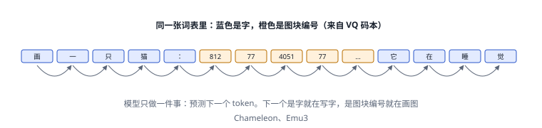

*全离散早融合：蓝色是字，橙色是来自 VQ 码本的图块编号，模型只预测下一个 token。*

[Transfusion](https://arxiv.org/abs/2408.11039) 换了个思路：图像就别硬塞进码本了，仍然用连续的 VAE 潜变量，切成块放进序列，同一个 Transformer 对文字和图像块各学一种目标。

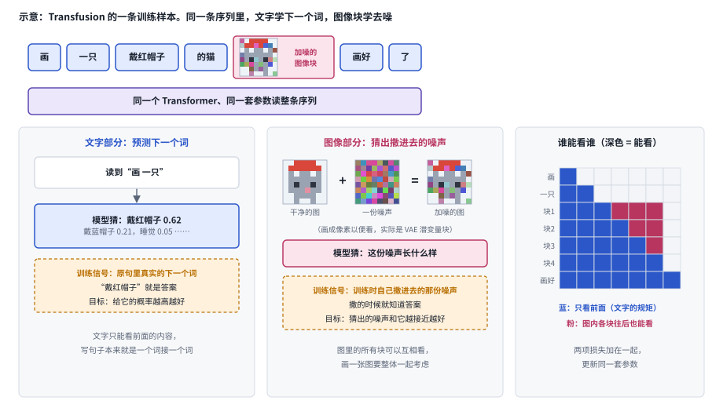

*示意：Transfusion 的一条训练样本。左栏是文字部分，中栏是图像块，右栏是谁能看谁；琥珀色虚线框标出两种训练信号各从哪来。*

图里同一条序列被两种学法分着用。左栏的文字部分照旧预测下一个词，答案就是原句里真实的下一个词；中栏的图像块学扩散去噪，训练时自己往干净的潜变量上撒一份噪声，模型要猜出这份噪声，答案在撒的时候就已经知道。两种目标同时训练，两项损失加在一起，共用一套参数。右栏是注意力上的讲究：文字只能看前面的内容，这是写句子的规矩；一张图里的所有块却可以互相看，因为画一张图时左上角和右下角本来就要一起考虑。图像留在连续空间里，没有取整损失，画质比全离散好；让步的地方在于两种目标在同一组参数里互相拉扯，数据配比很难调。

另一类做法承认读和写确实需要不同的表示，在结构上把两者分开一部分，再想办法共享尽量多的东西；差别在分开的位置，Janus 分在编码器，MetaQuery 和 BLIP3-o 分在语言模型和画图模型之间，BAGEL 分在同一个模型内部的两组参数。

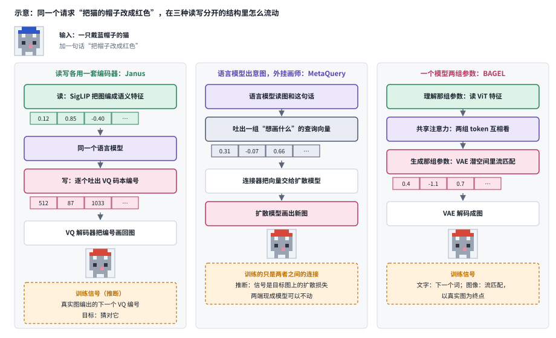

*示意：同一个改图请求“把猫的帽子改成红色”在三种结构里怎么流动。每栏的数字是流过那一步的东西（数值为示意），琥珀色虚线框是那一栏训练时的信号。*

左栏是 DeepSeek 的 [Janus](https://arxiv.org/abs/2410.13848) 读图时用偏语义的 SigLIP，画图时用偏还原的 VQ 码本，两套表示接在同一个语言模型上，两个相反的要求分别落在两套表示上，也就不再互相牵制；写的那一侧逐个吐出 VQ 编号，按自回归的常见做法，答案是真实图编出的下一个编号，这一点是推断。代价是模型"读到的图"和"画出的图"不在同一个空间，改图这类既要读又要写的任务需要额外设计。中栏是 [MetaQuery](https://arxiv.org/abs/2504.06256) 和 [BLIP3-o](https://arxiv.org/abs/2505.09568) 让语言模型只负责理解和构思，输出一组代表"我想画什么"的向量，交给一个独立的扩散模型去画，最强的现成理解模型和最强的现成生成模型都能直接拿来用，只需训练两者之间的连接，信号推断为目标图上的扩散或流匹配损失；代价是两者之间只隔着这组向量，像素级的精确控制有限。BLIP3-o 的博客把其中的权衡写得很具体：在 CLIP 语义特征上做流匹配，比在 VAE 潜变量上做更好，先冻结理解骨干再训练生成模块，则保住了理解能力。右栏是字节的 BAGEL（[Emerging Properties in Unified Multimodal Pretraining](https://arxiv.org/abs/2505.14683)）在一个模型里放两组参数，一组处理理解用的 token，一组处理生成用的 token，两组在注意力那一步互相看；理解端读 ViT 特征，生成端在 VAE 潜空间里用流匹配画图。作者报告，在上万亿 token 的图文视频交错数据上训练之后，出现了自由改图、换视角这类能力；代价是参数量接近翻倍，训练门槛很高。

闭源模型在体验上一度明显领先。2025 年 3 月的 GPT-4o 生图和随后的 Gemini 原生生图，能照着复杂指令画、能在图里写对字、能一轮轮对话式地改图。它们的结构没有公开，外界普遍推测是同一个多模态模型直接参与生成图像，再配一个解码器把结果还原成像素，所以画的时候能完整理解整段对话；BLIP3-o 的作者就把"自回归加扩散"当作对 GPT-4o 的猜测写进了设计动机。这些说法都只是推测，开放研究的 BAGEL、Janus-Pro 等仍在朝这个体验追赶。

**速查：理解与生成合流的六种做法。** 六种做法的差别集中在中间那个框：是一个 Transformer 包办读写，是读写各用一套表示接在同一个语言模型上，还是在语言模型后面再挂一个独立的扩散模型去画。下面六张结构卡同样借自多模态范式图谱，前五张对应上面讲过的五种开放做法，第六张是闭源模型，它中间那一格写着“结构未公开”，表里的原理也只是外界的推测。

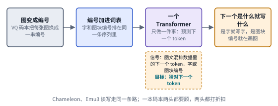 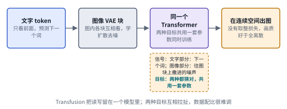

 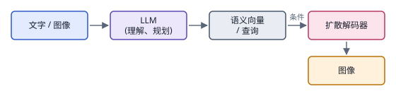

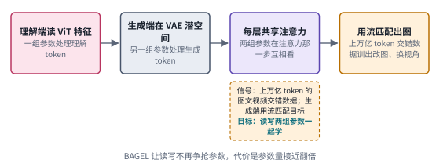 

*第 6 阶段六种做法的结构卡，每张卡对应下表的一行。*

| 代号 | 名称 | 年份 | 代表 | 怎么做 | 解决了什么 | 代价 |
|---|---|---|---|---|---|---|
| U1 | 全离散早融合 | 2024 | Chameleon、Emu3 | 图像用码本变成编号，和文字放进同一张词表、同一条序列，只用"预测下一个 token"一个目标 | 读和写共用同一套表示、模型和损失，图文可以任意交错输入输出 | 一本码本两头都要顾，两头都打折扣；理解弱于后融合模型，画质不如连续潜空间扩散 |
| U2 | 同一模型混用两种损失 | 2024 | Transfusion、Show-o、JanusFlow | 文字预测下一个词，图像用连续 VAE 块做扩散去噪；图内双向注意力，文字单向 | 图像留在连续空间，没有取整损失，画质明显好于全离散；读写仍在一个模型里 | 分类和回归两种梯度互相拉扯，数据配比和损失权重很难调 |
| U3 | 读写解耦编码器 | 2024.10–2025 | Janus、Janus-Pro | 理解时用 SigLIP 编码进语言模型，生成时语言模型输出码本编号再解码 | 读用最适合读的表示，写用最适合写的表示；放大后的 Janus-Pro 理解和生图都达到同期专门模型水平（官方报告） | 读到的图和写出的图不在同一空间，改图任务要额外对齐 |
| U4 | 语言模型出意图，外挂扩散解码 | 2023–2025 | Emu2、DreamLLM、MetaQuery、BLIP3-o | 语言模型输出一组语义向量或查询，交给独立训练的扩散模型去画，语言模型可以冻结 | 只训练两者之间的连接，成本低，理解能力不受损；传过去的向量比一段文字信息更丰富 | 扩散模型看不到原图的像素细节，"只把猫换成狗"这类精确改图做不好 |
| U5 | 读写分专家 | 2025.5 | BAGEL | 两组 Transformer 参数分别处理理解和生成 token，每层共享同一个注意力；生成端用流匹配 | 两类任务不再争抢参数，生成时又能看到理解端读到的全部内容；大规模交错数据上出现改图、换视角能力 | 参数量接近翻倍，需要极大规模的数据和算力，一般团队很难复现 |
| U6 | 闭源原生生图 | 2025.3 起 | GPT-4o 生图、Gemini 原生生图 | 结构未公开；外界推测是同一个多模态模型直接生成图像 token 再接解码器 | 画图的就是对话的那个模型，复杂指令、图中文字、多轮改图的体验明显更好 | 结构和训练方法不透明，以上原理只是推测，开源复现路线尚无定论 |

这种统一到底带来了协同，还是只是把两套能力装进了同一个壳子，要从表示、任务和系统几个层面分别检验。

### 第 7 阶段：从一次采样到可交付的产物

> **要点：** 单张图已经画得足够好时，理解需求、选工具、检查、局部修改和版本管理这些环节露了出来；交付一个能继续编辑的产物，靠的是外面那一圈流程。

当单张图已经画得足够好，真实创作中的其他环节就显露出来了：理解需求，检索参考，选择合适的生成工具，检查结果，按反馈局部修改，最后交出一个能继续编辑的文件。回到开头的短片，"把猫换成白猫，其他都别动"这句话，对一个只会一次性出图的模型几乎无解；对一个能调用分割、局部编辑和图层工具、并保留版本关系的 agent 来说，却是一件可以拆解的事。视频这边也一样，单段视频只有几秒到十几秒，要做成完整的短片，就得有人把一个个镜头规划好、生成出来、再接起来。这一阶段的工作，有的让模型自己学会何时调用工具，有的把交付物从扁平图片改成透明图层。它们和前面几个阶段的关系，好比后期剪辑之于摄影：摄影水平决定了素材的上限，剪辑流程决定了最终作品能不能按要求交付。更一般的"多模态 agent 怎样感知、规划和行动"，留给第 19 章多模态 agent。

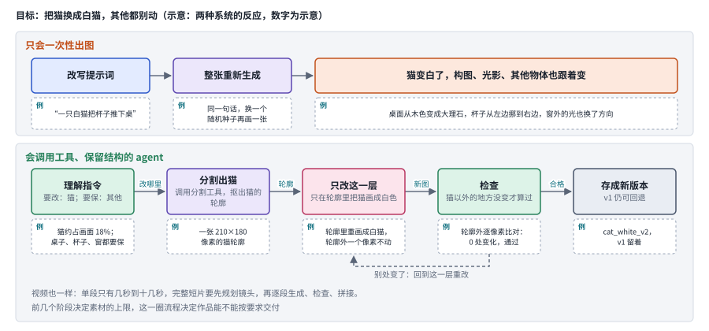

*示意：同一句修改意见，一次性出图的系统只能整张重来，会调用工具的 agent 可以拆成分割、局部编辑、检查和版本保存几步。每个框下方的虚线框是这一步的具体内容，数字为示意。*

图里两种系统面对同一句修改意见，差别在于是否只改了该改的地方。只会一次性出图的系统只能改写提示词、整张重新生成，猫是变白了，构图、光影和其他物体也跟着变了。会调用工具、保留结构的 agent 则先弄清哪些要改、哪些要保，用分割工具把猫单独取出来，只在这一层上做局部编辑，再检查其余区域确实没变，最后存成一个新版本，旧版本仍然可以回退。按图里的例子：猫约占画面 18%，分割出一张 210×180 像素的轮廓，轮廓里重画成白猫，轮廓外逐像素比对没有变化才算通过，存成 cat_white_v2；一次性出图那一栏里，桌面从木色变成了大理石，杯子也换了位置。图中的步骤是示意，具体系统各有取舍。

### 边界：哪些问题还没解决

> **要点：** 每一阶段都在补上一阶段的缺口，也各自留下了新的缺口，最后都指向同一个问题：怎样知道真的变好了。

把这几个阶段串起来，每一步都留下了尚未解决的问题。压缩让生成变便宜，也让小字和精确几何变得脆弱，而 Dieleman 所说的可建模性至今缺少一个公认的度量；像素空间路线绕开了压缩器，却要重新面对高维噪声和巨大的计算量。少步蒸馏把采样成本降了下来，却常常以多样性为代价，Krea 坦白的模式坍缩就是一例。自回归视频解决了交互和延迟，却引入了误差累积和长程记忆的难题。语音生成在单句上已经接近真人，放进对话里却还差一截韵律。理解与生成的统一带来了共享知识，也带来了任务之间的竞争。agent 编排让复杂交付成为可能，可它的收益究竟来自更好的流程，还是来自更强的底层生成器，往往难以分清。

这些缺口最后都指向同一个问题：怎样知道真的变好了。图的下排橙框是各阶段留下的问题，最下面的小标签是对应的前沿分支，底部绿框就是这个共同的问题。重建分数、单张画质和挑过的短片都可能掩盖缺口，所以预算要按层记录，质量、多样性、一致性和可编辑性要分开验收。

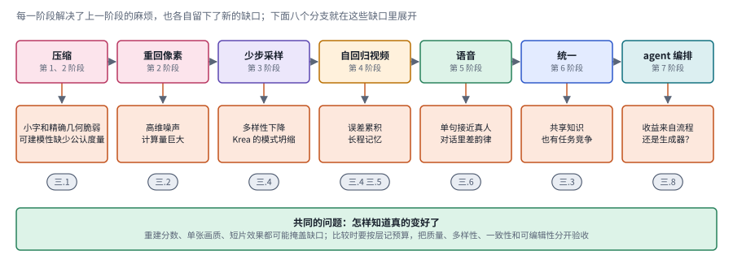

*主线每一阶段留下的未解问题（橙框）及其对应的前沿分支。*

### 总对照：几组速查卡放在同一组栏目里

> **要点：** 把这一节的速查卡家族放进一张表，按同样几个栏目比较；再把第三节的八个前沿分支放回主线的七个阶段，就能看清每个分支继承的是哪一族方法的遗产。

最后把这一节出现过的几组速查卡放进一张表。想快速判断一篇新论文属于哪一族，可以先问三件事：它改的是流水线的哪一层，在什么空间里生成，又付出了什么代价。表格只放结论，每一格背后的原因写在前面同编号的结构卡和速查表里。

| 家族 | 阶段 | 改的是哪一层 | 在什么空间里生成 | 代表 | 主要优点 | 主要代价 | 本章分支 |
|---|---|---|---|---|---|---|---|
| W1–W8 | 起点、第 1 阶段 | 表示、写法、骨干和训练目标 | 像素、码本编号或连续潜空间 | GAN、VAE、DALL-E、MaskGIT、潜扩散、DiT、VAR | 训练从不稳走到稳，生成从像素搬进潜空间，汇成今天的标准栈 | 压缩器是画质上限；训练和推理的算力需求都高 | 三.1、三.2 |
| P1–P3 | 第 2 阶段 | 表示与训练信号 | 语义潜空间或像素 | REPA、RAE、像素空间扩散 | 让潜空间带上语义、训练更快，或者绕开压缩器 | 依赖现成的语义编码器，可能丢细节；像素路线计算重 | 三.1、三.2、三.3 |
| S1–S5 | 第 3 阶段 | 采样过程 | 沿用原来的空间，改的是步数和每一步的做法 | CFG、一致性模型、DMD、MeanFlow、flow map | 步数从几十降到几步甚至一步 | 训练更复杂，常依赖教师；多样性下降 | 三.4 |
| A4、V1–V3 | 第 4 阶段 | 时间轴 | 时空压缩后的潜空间 | VDM、SVD、HunyuanVideo、Wan、Self Forcing | 帧间连贯，进一步做到实时流式生成 | 单段很短；误差累积、长程记忆和多样性 | 三.4、三.5 |
| A1–A2 | 第 5 阶段 | 输出空间（语音） | 文字或音频 token | 级联语音、GPT-4o 语音、Moshi、Qwen2.5-Omni | 端到端模型听得出语气，延迟接近人与人对话 | 语音数据和评测少；放进对话里还差韵律 | 三.6 |
| U1–U6 | 第 6 阶段 | 读和写之间的接口 | 码本编号、VAE 潜变量或语义向量 | Chameleon、Transfusion、Janus、MetaQuery、BLIP3-o、BAGEL | 读到的内容直接用来画，可以对话式地改图 | 两头打折、梯度冲突、参数翻倍，闭源路线结构不透明 | 三.3 |

把第三节的八个前沿分支放回主线，可以看到前沿论文最密集的地方仍是第 2 阶段对潜空间的重新审视。下图横轴是七个阶段，表头下方注明每个阶段对应哪一组速查卡；纵轴是八个分支，实色格子是每个分支开头“主线位置”一行标出的阶段，虚线格子是分支开头提到要承接的阶段。表示学习、像素路线和统一模型三个分支都从第 2 阶段出发；视频占了两个分支，横跨采样加速和因果视频两个阶段；第 7 阶段目前只有一个分支，它同时依赖第 6 阶段统一模型提供的接口。

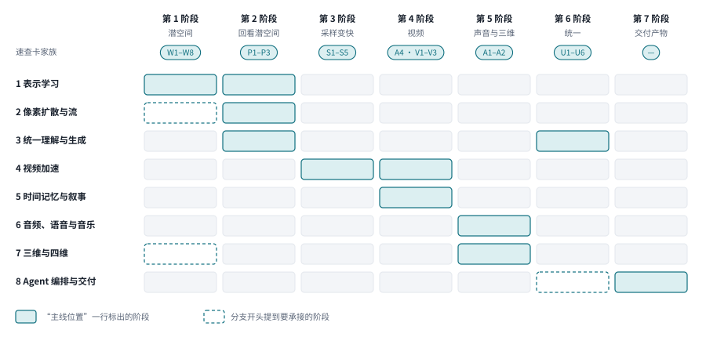

*八个前沿分支在发展主线上的位置：实色为“主线位置”标出的阶段，虚线为分支开头提到要承接的阶段。*

## 三、前沿研究方向

下面八个分支收录的都是 2026 年的新论文，大致从模型内部一路走到实际工作流：先讨论表示、像素空间目标和理解生成的统一，再进入视频的时间结构、音频和三维约束，最后连接可编辑交付与 Agent 编排。读这些论文时，建议始终带着两个问题：它改的是哪一层，是表示、目标、时间计算，还是交付流程？它的提升体现在重建、采样效率、条件遵循还是编辑能力上？视觉效果变好可能只对应其中一项，把它说成所有任务上的共同进步，往往就高估了一篇论文。

> **本节要点：** 八个分支从模型内部一路走到外部工作流：先是表示、像素目标和理解生成的统一，再是视频的时间结构、音频和三维的约束，最后是可编辑交付与 Agent 编排。每个分支都按“问题从哪来、几篇论文各改了哪一环、还剩什么”来讲。

### 1. 表示学习：压缩保真与生成难度

表示模型希望尽量保留输入信息，生成模型却还要在这个表示空间里学出一个可以采样的分布，这两个愿望之间天然有张力。细节保留得越充分，空间里的分布可能越复杂，越难学；压缩得过狠，又会限制最终能生成的内容。这正是 Dieleman 所说的码率、失真与可建模性的三方权衡。所以评价一种表示，至少要同时看三样东西：重建得怎么样，语义结构清不清楚，在上面生成难不难。单凭自编码器的重建分数高，推不出最终的生成器一定更强。

> 主线位置：第 1、2 阶段，潜空间该长什么样。接 VQGAN、潜扩散的两阶段配方，以及 REPA、RAE 把语义表示引入生成的思路。

> **要点：** 同一条两阶段流水线，这个分支的论文各动一处：编码器从哪里来、潜空间给多少 token、生成器预测什么、解码器怎么读回去。

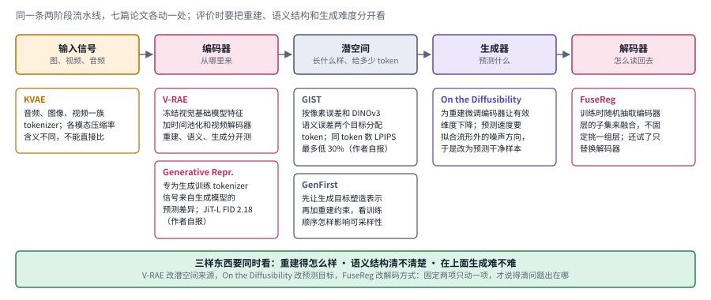

*表示学习分支的论文落在两阶段流水线的哪一环；底部绿框是评价一种表示时要同时看的三样东西。*

这个分支的论文各改两阶段流水线的一环，其中编码器这一环最热闹。图的上排是流水线的五个环节，下面每个白框是一篇论文，放在它动手的那一环下面。编码器这一环里，V-RAE 用冻结的视觉基础模型特征给视频造潜空间，Generative Representation Learning 则为生成专门训练一个编码器。潜空间这一环有两篇，GIST 决定每张图该在哪里多花 token，GenFirst 研究先照顾生成、再引入重建的训练顺序。生成器和解码器两环各有一篇，On the Diffusibility 换的是预测目标，FuseReg 换的是解码时怎样融合编码器各层的特征。最左边的 KVAE 横跨音频、图像和视频三种输入。

第一篇工作把语义表示的思路推到了视频上。[2608.13556 · V-RAE: Rethinking Video Latent Spaces for Generation](https://arxiv.org/abs/2608.13556) 以冻结的视觉基础模型特征为底，加上时间池化和一个视频解码器构造潜空间，再把重建、语义和生成分开测试。它把已有的视觉语义引进视频生成，让表示不再只为像素恢复服务。问题也很明显：语义编码器关心的是"这是什么"，可能会忽略细节；原文也承认，受控基准和中等规模生成器上的结果，还不能直接推广到开放域的长视频。读它的实验表格时，最好把重建指标和生成指标分开来看。

表示换了以后，训练目标也可能要跟着换，[2609.28473 · On the Diffusibility of High-Dimensional Latents](https://arxiv.org/abs/2609.28473) 正面分析了这个问题，结论是改用干净样本预测。它发现，为了重建而微调编码器会改变表示的几何形状，让有效维度下降；这时如果仍让网络预测速度，它就得去拟合大量落在信号流形之外的噪声方向，于是作者改用干净样本预测。这里的有效维度指数据真正发生变化的方向有多少，和向量本身有多长是两回事。打个比方，一张纸放在三维空间里，坐标有三个，真正能变化的方向只有两个。这个解释依赖于作者所测的编码器和训练条件，要推广到所有高维 latent 都改用同一种参数化，证据还不够。

沿着"语义编码器的哪一部分最有用"这条线，[2609.31620 · FuseReg: Regularizing Layer Fusion Mitigates the Reconstruction-Generation Gap in Representation Autoencoders](https://arxiv.org/abs/2609.31620) 研究编码器各层特征怎么组合。它没有去固定挑选一组最优层，而是在训练时随机抽取层的子集，让解码器不过分依赖某一种融合方式；作者还试了只替换解码器，以此单独检验"怎么读取表示"这一环的贡献。把这三篇放在一起看会很有收获：V-RAE 改的是潜空间的来源，On the Diffusibility 改的是预测目标，FuseReg 改的是解码方式。它们正好可以组成一组受控实验，固定其中两项，只动第三项，才能说清楚问题究竟出在哪里。

表示设计还牵涉到两个更大的问题：不同模态能不能共享结构，以及潜空间是按什么顺序形成的。把原始信号编成潜表示、又能解码回去的那对编码器和解码器，在这类论文里常叫 tokenizer。[KVAE: Family of Tokenizers for Multimodal Generative Models](https://arxiv.org/abs/2608.05798) 提供了一组覆盖音频、图像和视频的 tokenizer 家族，比较了压缩、重建和下游生成的表现。不同模态的压缩率含义各不相同，把它们直接当成同一把质量尺子来比，会得出误导性的结论。[GenFirst: Generation Before Reconstruction for Stable End-to-End Latent Generative Modeling](https://arxiv.org/abs/2608.29335) 则把训练顺序倒了过来，先让生成目标塑造表示，再引入重建约束，借此研究联合训练的先后顺序如何影响潜空间的可采样性。这和 Dieleman"表示学习与重建是两件事"的判断遥相呼应：如果可建模性真的比重建更要紧，那么先照顾生成也许是更自然的顺序。

2026 年 10 月又有两篇工作把"表示该为生成而训练"这件事往前推了一步。[2610.20533 · Generative Representation Learning for Scalable Latent Tokenization](https://arxiv.org/abs/2610.20533) 来自 Li Fei-Fei 和 Gordon Wetzstein 等人，它不再借用 DINO 这类现成的语义编码器，转而直接训练一个专门给生成模型当 tokenizer 的自监督表示：训练信号来自一个生成模型在不同条件下的预测差异，用来估计并分解数据中的逐点互信息。作者认为这样可以避开 DINO、LeJEPA 一类方法会出现的维度坍缩和特征压制，并报告表示的"可扩散性"随计算量可预测地提高；把 tokenizer 和生成器的计算量合在一起算，它比直接在像素上做扩散更划算，配合 JiT-L 的 ImageNet FID-50K 为 2.18，按作者外推，达到同样效果所需的计算比 DINOv2 少约 7 倍（均为作者自报）。这几乎就是在用实验回答 Dieleman 那个"码率、失真与可建模性"的权衡：如果可建模性可以被直接优化，表示学习和重建就不必再争同一份容量。

[2610.15515 · Semantically Steerable Image Tokenization](https://arxiv.org/abs/2610.15515) 则从"给多少 token"这个角度切入。它提出的 GIST 是一个自适应的图像 tokenizer，按两个误差目标分配 token：一个是像素误差，一个是在冻结的 DINOv3 特征空间里度量的语义误差。把语义误差的目标设为零、放宽像素误差，模型就会丢掉细碎的像素细节，却保住图里的主体内容。作者在 ImageNet-100 上报告，同样 token 数下它比只看像素的对照方法 LPIPS 最多低 30%、DreamSim 最多低 37%。开头那段短片最后定格的海报上，实验室名字的小字糊成了一团，GIST 给这类问题提供了一个可以调的旋钮：哪些内容值得多花 token，可以由语义来决定，压缩率也就不再是一个对整张图一视同仁的常数。

### 2. 像素扩散与流：细节保留与计算成本

如果说上一个分支在想办法把压缩器做好，这个分支则在认真考虑把压缩器整个拿掉。直接在像素空间建模，能避开压缩带来的某些损失，比如开头短片里海报上糊掉的小字；可它重新面对的是更高的维度、更贵的训练和更重的采样负担，不同的目标函数和噪声路径还会改变优化性质。比较这类方法时，要控制输出分辨率、训练预算和采样步数，把细节质量、语义遵循和运行开销分开观察。"没有编码器"本身算不上优势，要看端到端的总账。

> 主线位置：第 2 阶段，重回像素的那一支。接 Dieleman 对"端到端会不会胜出"的讨论，以及 DDPM、Flow Matching 的训练目标。

> **要点：** 去掉压缩器能保住细节，可高维噪声、尺度和计算量的账要重新算。这个分支的论文分别从频率、尺度、损失、训练匹配和模型复用几处下手。

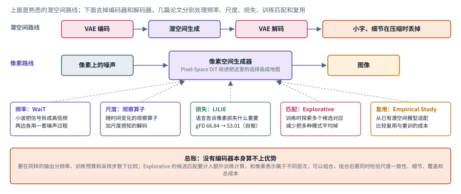

*像素扩散与流分支：上排潜空间路线，中排像素路线，下方是几篇论文各自处理的问题。*

图的上排是熟悉的潜空间路线，橙框标出它的老毛病：小字和细节在压缩时就丢掉了。中排把编码器和解码器拿掉，噪声直接在像素上被修成图像，中间那个生成器就是 Pixel-Space Diffusion Transformers 这份综述画成地图的地方。下面五个框是本分支几篇论文各自处理的问题：WaiT 把信号拆成高低频分别加噪，观察算子那篇处理尺度和时间的不匹配，LILIE 借语言告诉像素损失什么才重要，Explorative Modeling 在训练时探索多种候选匹配，Empirical Study 研究怎样复用已有的潜空间模型。最下面的橙框是整个分支的总账。

想进入这个方向，[2607.17585 · Pixel-Space Diffusion Transformers](https://arxiv.org/abs/2607.17585) 是一个好起点。这是一份像素空间扩散 Transformer 的综述性研究，整理了架构、连续生成机制和统一多模态接口。它的价值在于把噪声调度、损失权重、token 效率这些问题放进一张地图里，方便选择实验变量；它本身并没有提出一个可以直接拿来比较的单一新模型，综述里的多条路线也不能被汇总成某一种方法的性能承诺。

[2607.27372 · Explorative Modeling: Unlocking a Third Pretraining Axis and End-to-End Generation](https://arxiv.org/abs/2607.27372) 换了一个切入点，它把处理多模态分布的难题放到了训练时的匹配上。当一个条件对应许多合理样本时，训练容易把这些不同的模式平均到一起；这项工作在训练时探索多个"生成样本与数据"的候选对应，再训练较好的匹配，以减少这种平均化倾向。作者把扩大训练时的探索当成一个新的方向，同时也探索了端到端生成。代价同样清楚：候选探索要消耗额外计算，和基线比较时必须给对方同样的总预算；推理步数降下来了，也不能自动抵消更贵的训练，在一次性的小数据任务上尤其如此。

像素生成内部还有两个分歧，一是怎样复用已有模型，二是怎样组织不同尺度和频率上的学习。[An Empirical Study of Training Pixel-Space Text-to-Image Diffusion Models](https://arxiv.org/abs/2608.16887) 从已有的潜空间模型出发去适配像素生成，研究复用旧训练资产和重新端到端训练之间的成本差异，这对算力有限的实验室很有参考价值。[Pixel-Space Diffusion via Observation Operators](https://arxiv.org/abs/2608.21885) 则用随时间变化的观察算子和尺度感知的解码，处理像素生成中尺度与时间不匹配的问题。

频率这条线上，[WaiT for the Signal: Simple Frequency-Aware Flow-Matching](https://arxiv.org/abs/2607.28760) 用无损的小波分解把信号拆成高低频，为它们安排不同的噪声过程。这回应了一个直观的问题：粗的结构和细的纹理，本来就不适合按同一个节奏生成。Dieleman 在《Perspectives on diffusion》里有一个相关的视角，扩散采样会先定下低频结构、再补上高频细节，近似于频域上的自回归；WaiT 则把这种节奏变成了显式的设计。

像素建模和 Explorative Modeling 的候选匹配处在不同的层次上，可以组合，组合之后却要一起检验。像素建模决定的是表示空间，候选匹配改变的是训练时生成样本与数据怎样对应。可一旦组合，就要同时检验尺度一致性、细节质量、分布覆盖和总训练成本；仅凭"模型里没有压缩器"就宣称更直接或更优，说服力是不够的。

像素损失不知道哪些细节对语义要紧，这是像素路线的老问题，LILIE 想用语言补上这份信号。像素上的均方误差只在意每个点的数值。[2610.23653 · A Language-Informed Loss for Visual Generation](https://arxiv.org/abs/2610.23653) 的做法是：作者先训练一个叫 LILIE 的可逆图像变换，它是一个归一化流 Transformer，和一个视觉语言模型一起用下一个 token 预测训练，要求视觉语言模型能从加了噪的特征里读出图像描述；因为变换可逆，图像信息一点不丢。再用这个编码器导出一个简单的、带语言信息的损失去训练 JiT 这类像素空间文生图模型，作者报告在 GPIC 数据集上 gFD 从 66.84 降到 53.01（作者自报）。它和三.1 的 Generative Representation Learning 出自同一个研究群体，两者可以对照着读：一个想把表示训练得更好生成，一个干脆不压缩，只把"什么才算重要"的判断借给像素损失。

### 3. 统一理解与生成：共享表示与任务协同

一个模型既会看图又会画图，是否两样都更强，需要证据来回答。生成要构造符合条件的样本，理解要从输入中提取对任务有用的信息，它们可能共享同一套表征，彼此成全；也可能在训练目标上互相争抢，彼此拖累。直觉上两样都该更强，可要检验的是：在相同预算下，两类任务是否同时变好了？收益来自共享知识，还是只是模型和数据变大了？一个系统的输入和输出都支持图像，并不能说明它已经具备了统一的能力。

> 主线位置：第 2 阶段和第 6 阶段的交汇处。接 REPA、RAE 把理解表示用于生成的思路，以及 Chameleon、Transfusion、Janus、BLIP3-o、BAGEL 这几种统一方式（见第 6 阶段的 U1 到 U6 速查表）。

> **要点：** 统一模型里，读和写之间能不能互相帮忙？这个分支的论文从两个方向搭桥，也提醒了强行共用同一条计算路径的代价。

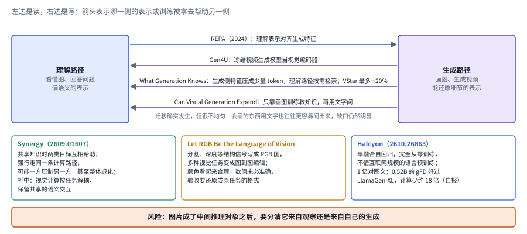

*统一理解与生成分支：箭头方向表示哪一侧的表示或训练被拿去帮助另一侧。*

和 REPA 用理解表示帮助生成相反，本分支的新工作大多反过来，让生成帮助理解。图的左右两个框分别是理解路径和生成路径，中间的箭头是几篇工作搭的桥。从左往右只有一条，就是第 2 阶段讲过的 REPA；反向的几座桥里，Gen4U 把冻结的视频生成模型当视觉编码器，What Generation Knows 把生成侧的特征压成少量 token 供理解路径检索，Can Visual Generation Expand 只用画图训练教给模型新知识，再用文字去问。下面三个框是另外三种切入：Synergy 那篇诊断共享与解耦的边界，Let RGB 把结构化的视觉信号统一写成图像，Halcyon 则从零训练早融合模型，不借语言预训练。底部的橙框是统一带来的新风险。

第一组工作从两个相反的方向搭桥。**[Gen4U](https://arxiv.org/abs/2607.06856)** 分析视频扩散模型在不同层和不同噪声水平上的表征，再把冻结的生成模型当作视觉编码器来用，看看生成表示能支持哪些理解任务；这恰好和 REPA 的方向相反，REPA 用理解表示帮助生成，Gen4U 则问生成表示能不能帮助理解。**[OpenCoF](https://arxiv.org/abs/2607.08763)** 则构造了多类推理视频监督，训练模型通过连续帧把推理过程表现出来，并探索视觉和文字两种推理 token。前者考察的是生成表示里有没有可以利用的信息，后者研究的是生成过程能不能学会推理任务，两者都连接了理解与生成，回答的却是不同的问题。

[2607.12450 · Let RGB Be the Language of Vision](https://arxiv.org/abs/2607.12450) 提出了一个很有想象力的统一方式：把分割、深度等结构化视觉信号统一表达为 RGB 图像，于是多种视觉任务都被改写成图像到图像的编辑问题，同一套编码解码接口既能处理输入条件，也能输出结构。统一的表示形式消除不了度量误差。一张深度图的颜色看起来合理，深度数值未必准确；验收时要把输出还原成原任务的格式，按原任务的标准来检查，光看生成的图片是否自然是不够的。

[2609.01607 · Uncovering Understanding-Generation Synergy in Native Unified Multimodal Models: From Representation, Task to System](https://arxiv.org/abs/2609.01607) 是这一分支里最系统的一篇诊断。它在受控的统一模型中，分别从表示、任务和系统三个层面研究协同，发现两类目标共享知识时确实能互相帮助，可如果强行让它们走同一条计算路径，就可能出现一方压制另一方、甚至整体退化的情况。作者给出的折中是让视觉计算按任务解耦，同时保留共享的语义交互。这个结论依赖具体的结构和任务搭配，推不出所有统一模型都优于模块化流水线；公平的对照应当匹配数据、预算和任务所需的知识。

统一还悄悄改变了 agent 的接口：图片可以成为中间推理的对象，不再只是最终作品。这带来一个新的风险，系统要能分清一张图来自观察还是来自自己的生成，否则就可能把自己画出来的细节当成外部证据。比如 agent 先画了一张"杯子在桌边"的草图来规划镜头，后面就不能把这张草图当成真实场景的照片来推理。原图、编辑版本和最终输出之间的来源关系，都应该被记录下来。

统一理解与生成还可以从输出接口、训练配比或表示诊断入手，每种切入的贡献需要分别识别。[Vision as Unified Multimodal Generation](https://arxiv.org/abs/2607.06560) 把结构理解、几何、分割和多视图任务统一成文本、图像或混合输出，研究一个共同的生成接口能覆盖多大范围。[Boogu-Image-0.1: Boosting Open Agentic Multimodal Generation via Understanding under a Minimal Budget](https://arxiv.org/abs/2607.13125) 通过加强理解路径来支持图像生成和文字渲染，适合用来检查训练配比的作用，比单纯比较模型总规模更有信息量。

[Studying Image Tokenizers as Visual Languages in Unified Multimodal Models](https://arxiv.org/abs/2609.09143) 则从诊断工具的角度切入，用图像到文字的验证损失来衡量一个 tokenizer 作为"视觉语言"的质量。这类指标有用，但它首先是相关性证据，要变成可操作的改进，还得进一步做因果层面的检验。

2026 年 10 月的两篇工作都说明，生成表示里确实藏着理解用得上的信息，只是要专门设计取用的接口。[2610.21459 · Can Visual Generation Expand What Unified Multimodal Models Know?](https://arxiv.org/abs/2610.21459) 来自清华与智谱，作者设计了一种知识迁移探针：只通过图像生成训练教给统一模型新的知识，再只用文字提问，看模型能不能答出来。结果是知识确实会从画图迁移到语言，可迁移得很不均匀，模型能在图里画对的东西，用文字也往往更容易问出来，但缺口仍然明显；作者再提出文本对齐和图文交错对齐两种办法，把生成和问答接起来。这有点像"会画不会说"，知识已经进了模型，取用却依赖模态。[2610.23987 · What Generation Knows: Unlocking Fine-Grained Understanding in Unified Multimodal Models](https://arxiv.org/abs/2610.23987) 则发现，统一模型生成那一侧的表示对局部属性和空间关系这类细微变化更敏感，能捕捉到理解那一侧漏掉的东西；作者据此提出 GAFU，把生成侧的视觉特征压成少量紧凑的 token，让理解路径按任务需要去检索，报告在 VStar-Bench 上相对提升最多 20%（作者自报）。两篇放在一起，正好是 Gen4U 那个“生成表示能不能帮助理解”问题的两种回答。

另外两篇改变的是统一的方式本身。[2610.26863 · Text-to-Image Generative Modeling Without Language Pretraining](https://arxiv.org/abs/2610.26863) 训练了一族叫 Halcyon 的早融合多模态自回归模型，也就是第 6 阶段 U1 那一类，完全从零开始，只用 1 亿对图文数据，不借任何互联网规模的语言预训练。作者报告 Halcyon-0.52B 的 gFD 好过 LlamaGen-XL，预训练计算少约 18 倍，受控实验里纯文本预训练也没有让文生图变好；把描述丢弃换成图生文的监督后，同一个模型还学会了看图说话（均为作者自报）。这对"统一模型一定要从一个大语言模型出发"的默认做法提出了疑问，至少在文生图这个任务上，语言能力可以和图像一起从头长出来。[2610.30926 · Making MLLM Latents Matter: Factor-Aware Predictive Learning for Cinematic Video Generation](https://arxiv.org/abs/2610.30926) 来自腾讯，它注意到一个和 U4 有关的隐患：把多模态大模型的表示接到视频 DiT 上做条件，DiT 很可能绕过这些表示，自己去看别的输入。作者分三阶段训练，先让生成器只依赖大模型的隐表示，再用成对视频教它只改目标因素（人物、场景、动作或镜头）而保留其余因素，最后把仅有文字和文字加完整视频两种观察对齐到同一个视频目标上；摘要只说在稀疏输入生成视频、按因素编辑和多镜头生成上优于基线，没有给出具体数字。

### 4. 视频加速：采样效率与时序质量

要让开头那段橘猫推杯子的短片能实时预览、边看边改，视频生成就必须快，而加速一旦用在自回归视频上，会碰到图像里没有的误差传播。加速视频生成有几种不同的手段：减少采样步数改变的是推理路径，分块自回归改变的是时间依赖，模型压缩改变的是容量。这几种手段一旦用在自回归视频上，就会碰到一个图像里没有的麻烦：学生模型生成的历史会继续成为它自己的条件，局部的误差可能沿着视频一路传播下去。所以比较加速方法时，要固定时长和质量目标，检查长序列的表现；只展示短片的话，少步带来的收益很可能掩盖了后半段的退化。

> 主线位置：第 3、4 阶段的交汇处，少步采样遇上因果视频。接一致性模型、DMD、MeanFlow 和 Self Forcing，问题背景见 Krea 实时视频博客与 Dieleman 的 flow map 长文。

> **要点：** 少步蒸馏一用到自回归视频上，就冒出两个图像里没有的隐患：教师看到了学生拿不到的未来，多样性在第一块就坍缩。几篇论文分别修补，另一些把加速成果挪去做别的事。

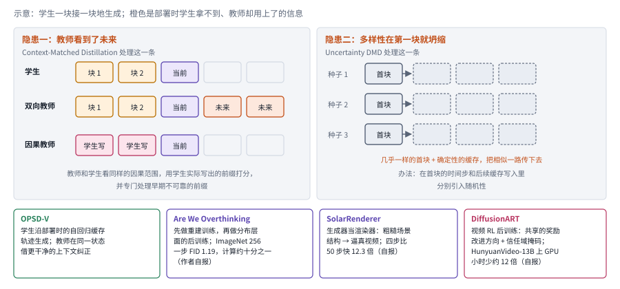

*示意：自回归视频蒸馏的两个隐患（上）与本分支其余几篇工作（下）。*

图的左栏是信息边界的隐患，学生生成当前块时只看得到前面的块，双向教师却看得到后面的“未来”块（橙色）；右栏是随机性的隐患，换了三个随机种子，第一块却几乎一样。下排四个框是本分支其余几篇工作。

MobileWan 和 OPSD-V 从两个迥异的方向加速，一个改模型怎样运行和存储，一个改长程误差传播。**[MobileWan](https://arxiv.org/abs/2607.06173)** 把较大的视频模型改造成分块递归的形式，结合线性注意力和结构压缩，说明移动端的内存约束未必只能靠极小的模型来解决。**[OPSD-V](https://arxiv.org/abs/2607.08766)** 则让学生沿着部署时的自回归缓存轨迹生成，教师在学生实际访问到的同一状态下，借助更干净的时间上下文给出纠正，同时保留原有的少步推理路径。这和 Self Forcing"训练时就按推理方式展开"的思路一脉相承。前者改变的是模型怎么运行和存储，后者改善的是长程误差传播，因此一个应当报告设备成本，另一个应当报告时间一致性。

少步蒸馏用到自回归视频上，藏着两个很隐蔽的问题。实时视频要降低去噪步数，自回归生成又要求当前片段只能依赖已经出现的历史和控制信号。第一个问题是：如果蒸馏时教师能看到完整的未来，学生却只能看过去，那么教师给出的监督本身就不符合部署时的信息条件。另一个隐蔽问题是，多个随机种子可能生成几乎一样的视频，而只看单个样本质量的指标根本发现不了这一点。Krea 博客里说的模式坍缩，指的就是后一种情况。

[2608.13391 · Context-Matched Distillation: Teacher Causality for Autoregressive Video Distillation](https://arxiv.org/abs/2608.13391) 针对的是前一个问题。它让教师和学生在相同的因果信息范围内评价目标，用学生实际生成的前缀来打分，并专门处理早期不可靠的前缀。它修复的是"教师看到了学生无法获得的未来"这一信息不对称，和单纯把教师变小是两回事。代价同样要算清楚：因果教师的训练成本、前缀的分布都要计入；和双向离线生成方法比较时，还要确认双方是否承担了同样的在线控制任务。

[2609.11265 · Uncertainty DMD: Restoring Diversity in Few-Step Autoregressive Video Distillation](https://arxiv.org/abs/2609.11265) 针对的是后一个问题。它分析了少步自回归蒸馏中的结构化不确定性坍缩：第一块画面变得彼此相似，确定性的缓存又把这种状态传到后面。方法上，它分别在首块的时间步和后续缓存写入中引入随机性。它关心的是分布覆盖和运动变化，每段视频单独的清晰度不是它的重点。额外的随机性也可能影响可复现的编辑和控制稳定性，所以评价时要把多样性、质量和条件遵循放在一起看。

视频加速还要分清三种不同的慢法：后一步必须等前一步算完的串行依赖，视频越长每一步算得越多的长序列计算，以及每换一个目标模型都要重新蒸馏一遍的训练开销。[The Seriality Gap in Video Diffusion Models](https://arxiv.org/abs/2607.13031) 用依赖事件链来分析串行计算是否充足，发现增加去噪步骤未必能解决更长的因果链，需要从架构和分块计算上找原因。这个发现很有启发：猫推杯子、杯子下落、杯子落地，这是一条三环的因果链，多去几次噪未必能让模型把这条链算对。[SANA-Video 2.0: Hybrid Linear Attention with Attention Residuals for Efficient Video Generation](https://arxiv.org/abs/2607.21553) 通过混合线性注意力和残差设计降低长视频的开销，关注的是质量和长度能否一起扩展，短片速度只是其中一个侧面。

[LongLive-Plug: Once-for-All Distillation for Video Generation](https://arxiv.org/abs/2609.38154) 研究的是蒸馏能力能否复用：一次蒸馏得到的能力，能不能在兼容的专用模型之间迁移，省去为每个目标模型重复训练的成本。它的适用范围受模型兼容条件的限制。

Context-Matched Distillation 和 Uncertainty DMD 两篇合起来，印证了 Dieleman 那句"没有免费的午餐"：采样省下的成本，会以信息不对称或多样性下降的形式回来。评测时可以固定提示词多次采样，既检查结果之间有没有差别，也检查这些不同的结果是否都还满足同一个任务；任意的变化未必都是有益的多样性。

少步生成本身也还有简化的余地。[2610.20331 · Are We Overthinking One-Step Generation?](https://arxiv.org/abs/2610.20331) 提出的 Priming Models 只有两个阶段：先用一个重建目标训练模型，比如在固定噪声水平上做像素空间去噪，再在特征空间里做分布层面的后训练。作者的核心发现是，单凭前面这一步重建，就足以消除"从零开始做分布训练"的大部分困难；他们报告在 ImageNet 256×256 上一步生成的 FID 为 1.19，训练计算约为可比方法的十分之一，还在文生图和世界建模上做了验证（作者自报）。这和 Dieleman 对 flow map"训练太复杂"的担忧形成了有意思的对照：也许一步生成并不需要那么多精巧的机关。

加速的成果也开始被拿去做别的事情。新加坡国立大学 Show Lab 的 [2610.28630 · SolarRenderer: Few-Step Generative Reference Rendering](https://arxiv.org/abs/2610.28630) 把视频生成器当成渲染器来用：游戏引擎或编程 agent 给出布局、运动和相机路径这类粗糙的场景结构，它负责把结构渲染成逼真的视频。做法是在冻结的 33B 视频骨干上加两个轻量 LoRA，把结构视频按对应的帧送进参考通路，同一个控制 LoRA 适用于多种结构格式；作者报告四步去噪比 50 步采样快 12.3 倍，块因果的变体可以实时渲染 768p 视频，还能泛化到训练时没见过的骨架、草图和点云等表示（作者自报）。这类用法让三.8 的 agent 编排多了一条路：agent 先写出场景结构，再交给少步渲染器出画面。

训练侧的成本同样要算。很多视频模型在预训练之后还要用奖励做强化学习后训练，让画面和运动更符合偏好，这一步本身也很贵。快手可灵团队参与的 [2610.12572 · DiffusionART: Efficient, Stable and Scalable Reinforcement of Diffusion Models](https://arxiv.org/abs/2610.12572) 指出，在反向去噪过程上做 RL 的方法（如 Flow-GRPO）信用分配差、效率低，在前向过程上做的方法（如 DiffusionNFT）效率高却依赖精细调好的滑动平均才稳定。奖励由哪个奖励模型打出，本章没有核实；它把每个提示的奖励汇成一个共享的"让奖励变好的方向"，再加一道信任域掩码的第二次更新，不再需要调滑动平均；在 HunyuanVideo-13B 上，作者报告达到对照方法后期奖励水平所需的 GPU 小时少约 12 倍（作者自报）。比较视频加速方法时，这部分后训练成本也应当一起记进预算。

### 5. 时间记忆与叙事控制：身份、状态与情节演进

长视频至少要记住四样东西：对象的身份、物体之间的空间关系、动作留下的后果，以及叙事进行到了哪一步。保持同一个人物的外观，只解决了其中一部分；反复生成相似的画面看起来也很"稳定"，却可能根本没有推进要求的事件。所以评测要把身份一致、物理连续和目标事件完成分开来看，还要检查后面生成的内容是否尊重前面已经发生的变化。

> 主线位置：第 4 阶段，因果视频的长程记忆。接 Video Diffusion Models 的时空建模、Self Forcing 的自回归展开，以及 Krea 博客中的缓存与上下文窗口问题。

> **要点：** 长视频要记住身份、空间关系、动作后果和情节进度；生成当前片段时怎样读取历史，是这个分支各篇论文的分歧所在。

*示意：五种读取历史的方式（上）与 Looking Ahead 的辅助训练目标（下）。*

图里每一行是一种读取历史的方式，最右边的紫块是正在生成的片段，左边涂色的块是它能读到的历史，颜色越深影响越大；最后一行是 Looking Ahead 的训练方式，模型要隔着几块空白直接预测更远处的片段。涂色深浅只是示意，具体的读取规则以各篇论文为准。

"记住什么、忘掉什么"成了长视频生成机制本身的一部分，因为把全部历史塞进每一次去噪，成本会随视频变长越来越高；用固定窗口只看最近几帧，又容易忘掉早期的约束。短片里杯子的颜色从头到尾不变，只是最基本的一致性；要做多个镜头，还要保持人物身份、场景关系、事件顺序，以及中途提出的修改意见。Krea 在把模型推向长视频时也碰到了同样的取舍，最后只保留了很短的上下文窗口。

[2608.04956 · ContextMaster: Interactive Multi-Shot Video Creation via Fixed-Budget Sparse Context Routing](https://arxiv.org/abs/2608.04956) 处理的正是多镜头历史不断增长的问题。它用角色感知的方式组织生成、参考条件和编辑上下文，复用干净的上下文，在固定的读取预算下做稀疏路由，让任务约束始终可见，再通过分阶段蒸馏逼近完整上下文下的行为。它的风险在于，路由必须正确保留那些后来仍然重要的细节；测试时要专门考察少见的身份线索和跨很远距离的编辑，只看相邻镜头是不够的。

另一篇工作把目光投向模型内部。[2609.23658 · Why Do Video Diffusion Models Violate Physics? Unveiling the Flaws in Attention Mechanisms](https://arxiv.org/abs/2609.23658) 分析视频扩散在早期运动规划阶段的注意力机制，指出当位置编码造成过强的空间衰减时，候选运动可能被过早锁定，于是提出随去噪阶段调整频率来改善。它把一部分物理错误追溯到了内部计算，没有一概归咎于数据不足，这是很有价值的一步。它的局限在于分析的模型和运动模式有限，而且物理常识评分提高了，离可用于机器人控制的因果模拟还有很长的距离。

这两条路线分别处理外部历史怎么访问、内部时空怎么计算，彼此无法替代。一个模型可能记得杯子是什么颜色，却仍然让杯子穿过桌面；也可能运动很自然，却忘了脚本要求先关灯再开门。身份、事件和物理关系应当分别验收。

时间控制还包含镜头规划、长期细节保留和当前运动更新三件事，保持历史和跟上变化之间要不断协调。[ShotPlan: Cinematic Video Generation with Learnable Planning Token](https://arxiv.org/abs/2607.17675) 用可学习的规划 token 显式组织镜头和转场的时刻，可以拿来比较"先规划镜头"和"逐段自由续写"哪种更可控。[Ring Forcing: Towards Precise Long-Term Memory for Autoregressive Video Diffusion](https://arxiv.org/abs/2608.26794) 为自回归视频保留可检索的长时细节，检验物体消失后再出现时身份能否恢复，比如猫走出画面再走回来，还是不是同一只猫。

[Recency Forcing: Bridging the Long-Horizon Gap in Autoregressive Video Generation](https://arxiv.org/abs/2609.19729) 则站在另一端，它随生成时间步调整远处历史的影响，避免过旧的上下文压制当前的运动。Ring Forcing 想多记住一些，Recency Forcing 想适当忘掉一些，两者之间的取舍和具体任务有关。

记忆之外，还有一个更根本的问题：模型到底学没学会"世界会怎样变化"。[2610.29989 · Looking Ahead: Modeling Future Evolution in Autoregressive Video Generation](https://arxiv.org/abs/2610.29989) 认为，在教师强制训练下，视频相邻帧太像了，模型可以靠复制局部的视觉连续性蒙混过关，并不需要真正建模变化。作者加了一个辅助目标，叫未来片段预测：在正常去噪训练之外，让模型预测时间上隔开一段距离的片段，而且看不到中间的帧。这个监督直接来自训练视频本身，不需要额外的视觉编码器，推理方式也完全不变；摘要报告物理合理性更好、总训练计算更低，但没有给出具体数字。回到开头的短片，杯子从桌边被推下去，中间几帧缺了，模型还得知道它最后会落在地上。

这个方向的评测也在跟上。[2610.28402 · StreamEval: Evaluating Interactive Streaming Video Generation Models](https://arxiv.org/abs/2610.28402) 为可交互的流式视频生成建了一个基准，覆盖数字人对话、数字人表演、世界生成、指令编辑和参考编辑五类任务，共 300 个脚本化测试，每个 15 到 300 秒，请求会在生成过程中陆续到来，并带有状态变化和内容保持的要求。作者评测了 37 个模型，发现画质好、身份保持好，并不能保证请求被准确执行、状态被持续保持；执行请求是最大的短板，例如文字条件下的世界生成里，"按要求执行"这一项的最高分只有 25.93（满分 100）。这正好印证了本分支开头的提醒：身份一致、事件完成和物理连续要分开验收。想把视频这条线放进更大的框架里看，可以读同月的综述 [2610.31668 · Reading, Writing, Sharing, and Interacting with the World through Video](https://arxiv.org/abs/2610.31668)，它把视频研究分成读、写、共享和交互四种操作，并特意区分了"视频序列看起来连贯"和"背后的世界状态保持一致"这两件事。

### 6. 音频、语音与音乐：声学质量、语义约束与时间结构

一段音频音质很高，并不保证它说对了内容、在正确的时间出现，或者符合指定的节奏。回到开头的短片，"杯子落地之后钢琴才进来"这个要求，靠任何一个整体音质分数都检查不出来。音频任务要同时照顾声学质量、语义控制和时间结构；比较不同的表示和生成流程时，要说明条件输入是什么、输出有多长、有没有用额外的校正手段，单一的听感偏好不足以评判可控生成能力。

> 主线位置：第 5 阶段，音频与语音这条输出空间。接 AudioLDM 的音频潜生成、MusicGen 的音乐生成、Moshi 与 Qwen2.5-Omni 的端到端语音，以及 Dieleman 对音频潜表示的讨论和 Sesame 关于对话韵律差距的观察。

> **要点：** 音频的可控性要靠可以检查或编辑的中间结构：一份声音事件的清单、一张乐谱，或者语音 agent 边听边推进的推理记录。

*音频分支的三种中间结构：事件裁判、乐谱，以及边听边推理的时间线（下半部分为示意）。*

图的三块是本分支的三种中间结构：左上是给生成的音频逐项打分的事件裁判，右上是 YuE2 的乐谱，下半部分是 Heartbeat Thinking 边听边推理的时间线（示意）。

音频生成需要属于自己的时间和语义验收方式，几个具体的指令就能说明。"钟声之后进入钢琴"包含声源是否存在和事件的先后顺序；"两个人交替说话"包含说话人身份和轮次；"保留旋律只换配器"则是一次局部编辑。整体相似度或音质评分很难覆盖这些结构。

[2607.13408 · Improving Text-to-Audio Instruction Following via Fine-Grained Feedback from Audio-Aware Large Language Models](https://arxiv.org/abs/2607.13408) 就是从验收方式入手的。它让一个音频理解模型按声源是否存在、时间关系是否正确来细粒度地评判生成结果，先验证这个裁判靠不靠得住，再用它构造偏好对来优化生成模型，最后在多事件任务上评价指令遵循。这把音频反馈从"整体好不好听"推进到了"具体要求有没有做到"。问题在于裁判自己也可能漏听或误判时序，偏好训练会把这些错误一并继承下来，因此还需要人工核对，以及在训练中没出现过的事件组合上测试。

音乐这边，[2609.33757 · YuE2: Unifying Symbolic and Audio Music Generation at Frontier Quality](https://arxiv.org/abs/2609.33757) 选择先用可读的乐谱表达旋律与和声，再把它扩展成语义音乐 token 和完整音频，把符号层面的规划和声音层面的实现统一了起来。乐谱可以编辑，这意味着一个外部的语言 agent 能把修改意见直接变成乐谱上的结构修改，不必把整首歌重新生成一遍。它的局限包括转录监督带来的误差、风格覆盖和采样预算。如果报告的是多次采样中挑出的最佳结果，就必须和同样候选预算的方法比较，拿多次筛选的结果去对比别人的一次输出是不公平的。

这两条路线有一个共同点：都强调可以验证的中间结构，一个是音频事件清单，一个是乐谱。中间结构也会约束表达的自由度。事件清单适合检查顺序，乐谱适合编辑作曲，但两者都无法完全取代人的听感评价。实际应用中还要区分经过授权的参考声音和未经许可的身份模仿，并保存素材的来源。

音频相关的生成还在向多说话人、双工交互和音乐驱动的动作扩展，每种任务的时序约束各不相同。[SwanTale: Unified Multi-Speaker Speech and Audio Generation for Instruct and Zero-Shot Tasks](https://arxiv.org/abs/2608.02023) 统一了多说话人语音和声音生成，支持用文字设计声音，也支持以参考声音为条件，关注的是表达、身份和音频类型能否共用一个接口。[Alignment-Free Text-Audiobox for Voice Dubbing and Full-Duplex Dialogue Synthesis](https://arxiv.org/abs/2609.03992) 用压缩的音频潜表示和扩散框架处理配音和双工对话，研究减少对显式对齐的依赖之后，时序控制还能做到什么程度。

音乐驱动的动作已经跨出了纯音频的范围。[Wan-Dancer: A Hierarchical Framework for Minute-scale Coherent Music-to-Dance Generation](https://arxiv.org/abs/2607.09581) 分层生成由音乐驱动的长舞蹈视频，要同时把音乐节奏、身体动作和视觉一致性连起来，难度远高于把一段音频转成一张图片。

语音这一侧的新问题，是"说"和"做事"怎样同时进行。会调用工具的语音 agent 有一个恼人的延迟：用户明明在话说到一半时就给出了关键信息，系统却要等他说完才开始想、开始查。[2610.26233 · Heartbeat Thinking: Speculative Reasoning and Tool Execution While Listening in Realtime Voice Agents](https://arxiv.org/abs/2610.26233) 让负责思考的 Thinker 在输入变化时就启动新一轮推理，同时让之前已经发出的推理和工具调用继续跑完；周期性的调用会读取最新的部分转写，以及一份共享的"已完成推理和工具结果"记录，用来补齐缺失的参数、发起有依赖关系的后续调用。作者报告在 FDBench v3 上工具覆盖率提高 16 个百分点，最终回复的平均延迟降低 36.4%，但对最终任务质量的影响因基准而异（作者自报）。它把第 5 阶段那条"级联、端到端、全双工"的线又往前推了一步：全双工解决了边听边说，这项工作要的是边听边想、边听边做。

### 7. 三维与四维：跨视角几何与动态一致性

如果开头的短片要做成可以在网页上转动视角观看的三维场景，问题又多了一层：多视角生成的结果必须在几何、遮挡和材质上相互一致，动态场景还要让同一个实体随时间变化时保持为同一个实体。几张单独看都很漂亮的图片，未必能拼成一个可用的资产。研究这个方向时要先说清楚输出到底是用于视觉展示、可渲染的表示，还是可编辑的几何，再通过新视角渲染和下游使用来检查一致性，只挑最好看的渲染图来展示是不够的。

> 主线位置：第 5 阶段，三维与四维这条输出空间。接 DreamFusion 用二维生成先验优化三维表示的思路，以及第 1 阶段关于潜空间信息损失的讨论。

> **要点：** 三维和四维生成的一致性可以放在不同的地方处理：放进监督，放进接口，或者从一开始就放进表示。

*三维与四维分支：一致性分别被放进监督、接口和表示。*

图的上排是“先生成视频、再重建三维”的常见路线，误差会在两步之间累积；中间三个框是本分支三篇工作把一致性放进的三个位置，PixWorld 放进监督，Beyond Pixels 放进接口，GAE 放进表示；下面两个框是 4DAnyone 和 Block3D，最底部是交付资产时要逐项检查的几件事。

三维和四维生成的核心问题是表示接口和监督，因为两条常见路线各有毛病。三维生成要求不同视角共享同一份几何，四维再加上时间变化。一条常见的路线是先生成 RGB 视频，再从视频重建三维，误差容易在两步之间累积；另一条是直接预测几何，又可能和某个特定的生成器绑死。读这几篇论文时要问：它们约束的到底是画面、几何，还是两者之间的关系？

[2607.05373 · PixWorld: Unifying 3D Scene Generation and Reconstruction in Pixel Space](https://arxiv.org/abs/2607.05373) 选择回到像素空间，用统一的像素空间扩散同时处理三维重建和生成，把监督施加在渲染出来的视图上，并加上几何感知的特征约束。这样做减少了潜编码造成的信息损失，也让训练更贴近可见场景的保真度，和三.2 重回像素的思路遥相呼应。它的局限在于，渲染结果正确仍可能容纳不可见部分的几何歧义，而几何教师本身也带来了额外的先验；比较时要把视图数量、几何模型和训练数据条件都计入。

[2608.10744 · Beyond Pixels: From Video Priors to 4D Worlds](https://arxiv.org/abs/2608.10744) 走了几乎相反的一条路。它不再绕回 RGB，而是把视频模型最终的潜表示对齐到一个预训练四维解码器的 token 网格上，再用局部和全局的时空注意力细化。它把视频先验当成一个可以复用的接口，减少了"先生成再重建"带来的分布错配。关键的边界是，这种迁移发生在共享同一个 VAE 家族的模型之间，据此推断任意视频模型都能直接共用一个四维解码器，证据还不够。

三维一致性可以在观察恢复、生成组织或潜空间设计这几个不同的地方处理，读论文时要分清问题落在哪一处。[4DAnyone: Create Anyone in 4D from a Casual Monocular Video](https://arxiv.org/abs/2608.20335) 从随手拍的单目视频生成多视角一致的人体动态资产，研究不依赖多相机采集的四维恢复。[Block3D: Efficient Text-to-3D Generation via Block-Wise Diffusion](https://arxiv.org/abs/2608.19567) 用分块扩散构造三维内容，降低生成开销，同时也要接受块与块之间几何和结构一致性的检验。

[GAE: Learning a Geometry-Native Latent Space for 3D-Consistent World Generation](https://arxiv.org/abs/2609.24981) 则把一致性直接放进了表示设计。它用几何原生的潜空间连接受相机控制的视图和三维结构，让一致性从一开始就是表示的属性，省去事后修补。这可以看作 Dieleman"潜空间要为生成而设计"这一思路在三维上的延伸。

对于要交付的资产，还要检查网格或高斯表示能不能编辑、不同视角是否自洽、时间上的变化是否稳定；只挑最好看的相机角度来展示，这些问题都会被藏起来。

### 8. Agent 编排与可编辑交付：生成、检查与修改

真正的创作任务远不止一次生成：要理解需求，选择工具，检查结果，再根据反馈修改。一次生成成功只是局部的能力，可交付的产物还要求格式、结构和可编辑性都满足约束。导师看完开头那段短片说的"把猫换成白猫，其他都别动"，就是一个典型的交付问题：系统得只改猫的颜色，构图、光影和其他物体都要原样保留。比较 Agent 编排方法时，要记录每一轮检查和修改各自带来的收益与成本，避免把一个更强的生成器带来的效果，误记到复杂工作流的头上。

> 主线位置：第 7 阶段，从一次采样走向可交付的产物。接第 6 阶段统一模型的接口整合、A4 速查表里"单段视频太短、要靠 agent 串镜头"的判断，以及三.3 中图片作为中间推理对象的讨论。

> **要点：** 交付一个能改的产物，要同时有会决策的流程、有结构的交付物，以及多轮修改时不漂移的编辑能力。

*Agent 编排与可编辑交付分支：控制流程、交付物结构和多轮编辑三件事（上），以及另外四篇工作（下）。*

图的上排三栏对应这三件事：ToolArtist 管流程，UniWorld-Design 管交付物结构，MT Forcing 管多轮编辑；下排四个框是 GenRouter、MaskFlow、VideoGen-Agent 和 MOSS-Image，分别管路由、局部编辑、视频工具协调和文字渲染。

交付一份可编辑的内容要经过好几道工序，用固定流水线还是动态编排，取决于任务有多复杂。这些工序可能包括需求核对、参考检索、素材生成、排版和局部修改：任务简单时，固定流水线省心又便宜；任务复杂时，动态地选择步骤才能应付。动态编排要求明确的动作接口、反馈机制和版本管理，单靠把提示词写得更长是做不到的。

[2608.04436 · ToolArtist: Tool-Using Unified Multimodal Models for Agentic Image Generation](https://arxiv.org/abs/2608.04436) 把推理、外部工具和原生图像生成放进同一个策略里，先给一个教师 agent 配上搜索和生图工具，用它采集的工具调用轨迹做监督微调，再用意图奖励和质量奖励共同优化；摘要没写这两种奖励各由哪个模型打出。它把"哪一步需要检索、哪一步需要画图"变成了一个可以学习的决策。它的风险在于奖励模型可能偏爱容易打分的视觉风格，工具的来源也可能不可靠；所以要分别检查信息是否属实、生成质量如何、调用成本多高，以及失败后能否恢复。

[2608.03971 · UniWorld-Design: From Pixel Generation to Layer-Native Design](https://arxiv.org/abs/2608.03971) 改变的是交付物本身的结构。它把 RGBA 图层作为生成和编辑的基本单元，既能生成带透明背景的独立素材，也能把一张成图分解成完整的语义对象层。这里的 alpha 通道表示透明度；完整的对象层和只圈出当前可见像素的蒙版不同，图层被移开之后，原来被遮住的部分也要是可用的内容。这项工作回应的正是扁平图片难以修改的问题，开头海报上的猫如果是一个独立图层，换成白猫就容易多了。它的局限是图层分解本身有歧义，被遮挡的部分要靠模型补全，因此要检查移动、删除图层之后画面是否真实、版式是否完好。

完整的生成工作流可以分别优化任务路由、复合目标的协调和局部编辑，这些都难以用单一的生成指标来概括。[GenRouter: Unified Workflow Routing for Agentic Image Generation](https://arxiv.org/abs/2608.16721) 按提示的需求把任务路由到不同的生成工作流，在质量、延迟和成本之间做选择，免得所有任务都走同一条昂贵的流水线。[VideoGen-Agent: Reinforcing Video Generation Agents](https://arxiv.org/abs/2609.24997) 用多任务的 agent 强化学习来协调视频生成工具，覆盖身份、专业知识和事件顺序这类复合需求。

[MaskFlow: Precise, Consistent and Seamless Regional Image Editing](https://arxiv.org/abs/2608.06929) 专注于局部编辑这一环。它用区域约束和向量场边界修正来控制编辑范围，保护背景，减少接缝，很适合用来检验"只改指定区域"这个要求能不能真正做到。

"只改指定区域"做一次不难，难的是连着改好几轮。[2610.25404 · MT Forcing: Towards Stable and Consistent Multi-Turn Image Editing with Autoregressive Diffusion](https://arxiv.org/abs/2610.25404) 观察到，现有的多轮编辑方法往往几轮之后就开始漂移：伪影越积越多，细节越来越糊，本该保留的区域和前面几轮的修改也被悄悄改掉了。这和三.4、三.5 里自回归视频的误差累积是同一类病，作者给的药方也相似：一个教师在单轮里一次性应用所有累积的编辑，用分布匹配蒸馏来指导画质，避开逐轮递归的误差；再用参考轨迹上的教师强制来监督"依赖历史的转换"，保持跨轮的一致性。摘要只说多轮编辑的稳定性和一致性明显提高，没有给出具体数字。开头导师那句"把猫换成白猫，其他都别动"，如果后面还有第二句、第三句，考验的就是这种能力。

交付物里的文字同样是一道坎。MOSI.AI 团队（OpenMOSS）的 [2610.23374 · MOSS-Image Technical Report](https://arxiv.org/abs/2610.23374) 是一个从零预训练的 5B 单流 DiT 开源文生图系统，主攻密集文字和复杂版式，支持中英文长文本渲染和精确的版式控制；它前面还挂了一个"意图感知的 agent 式提示增强"模块，把用户各式各样的请求改写成详细的内容和版式规格。作者同时发布了长文本渲染和版式生成两个基准，报告在前者上平均文字覆盖率 96.3%（作者自报）。开头那段短片最后定格成海报，角落里要印上实验室的名字，这行小字正是这类系统要解决的问题；它也说明"先由 agent 把需求写清楚，再交给生成器"已经成了开源模型的常见配置。

ToolArtist 改变的是工具与生成之间的控制流程，UniWorld-Design 改变的是交付物的结构，两者缺一不可。一个 Agent 即使规划得完全正确，如果手里只有扁平图片，修改局部内容时仍可能破坏背景；反过来，拥有图层也解决不了事实选错的问题。至于把文件保存、导出、发送出去，这属于工具执行层的事，要用真实产出的文件来验收，生成模型对自己做了什么的描述不能作为证据。

## 四、方法比较：先确定需要优化哪一层

八个分支几十篇论文的改动其实都落在几个层次上，各层既可以组合，也可能互相掣肘，所以比较时先弄清楚质量损失和成本出在哪一层，再判断是该加一个模块，还是该简化一个接口。真实系统往往会同时用到下表的好几行。

> **本节要点：** 七条路线分别落在表示、学习目标、时间计算、任务接口、输出结构和外部流程六个层次上。先找到质量损失和成本出在哪一层，再决定是加模块还是简化接口。

下面这张图把表里的七条路线画到同一根轴上，从左边的模型内部一直排到右边的外部工作流。每个色块占据它改动的那一层，上行绿字是它能解决什么，下行橙字是主要边界。统一理解生成这一行比较特殊，它同时改了表示和任务接口，所以画成两块，中间用虚线连起来。

*七条路线各自改动的层次：上行是能解决什么，下行是主要边界，与下表逐行对应。*

| 路线 | 改动层面 | 能解决什么 | 主要边界 |
|---|---|---|---|
| VAE 或表示自编码器 | 压缩与解码接口 | 降计算、组织潜空间 | 细节损失、生成几何不匹配 |
| 像素空间生成 | 数据表示 | 减少固定 tokenizer 瓶颈 | 高维噪声、尺度与计算负担 |
| 扩散与流参数化 | 学习目标和采样路径 | 改善优化与采样效率 | 不同表示不保证同样最优目标 |
| 因果蒸馏和记忆 | 视频时间计算 | 低延迟、长时生成 | 教师信息泄漏、多样性坍缩 |
| 统一理解生成 | 共享表示和任务接口 | 中间视觉推理、任务协同 | 梯度冲突、证据与生成混淆 |
| 符号或图层生成 | 输出结构 | 音乐和视觉内容可编辑 | 结构歧义、转换误差 |
| Agent 工具编排 | 外部工作流 | 检索、规划、生成和验收 | 工具可靠性、成本与权限 |

预算也应该按层记录：语义编码器的预训练成本、生成器的训练、蒸馏、推理步数、候选数量、人工筛选和返工的时间，都要算进去。只报告最后一次调用的速度，会把复杂系统的大部分成本藏起来。同理，一次生成的质量和多次筛选后交付的质量，应当分开展示。

## 五、负面结果与未解问题

这一章的论文里有不少反直觉的发现，它们有一个共同点：每一项都是主线上某一步的代价，压缩、统一或加速在一处省下了什么，就在别处付出了什么。压缩的代价：V-RAE 一类方法用语义编码器当潜空间，这类编码器关心"这是什么"，可能保不住小字这样的细节；On the Diffusibility 发现，为了重建而微调编码器会让表示的有效维度下降，生成反而变难。统一的代价：Uncovering Understanding-Generation Synergy 那篇诊断发现，理解和生成被迫共用一条计算路径时，一方可能压制另一方。加速的代价：Uncertainty DMD 发现，少步蒸馏后的自回归视频换了随机种子，第一块画面却几乎一样，多样性从一开始就坍缩了，缓存又把这份相似传到后面；The Seriality Gap 发现，猫推杯子、杯子下落、杯子落地这样的因果链，多加几步去噪也未必能让模型算对。这些结果说明，生成质量的问题很难简单地归结为"模型或数据还不够大"。

> **本节要点：** 这些反直觉的发现各自对应主线某一阶段的代价；接下来值得检验的问题，也大多可以沿着主线排开。

接下来值得检验的问题，大多可以沿着主线排开。能不能建立一种同时兼顾重建、可采样性和可编辑性的表示？能不能在固定的计算预算下，把像素路线和潜空间路线放在一起公平比较，替 Dieleman 的判断找到更具体的证据？他认为直接在像素上端到端生成的模型虽然走得通，在成本上"现在还太早"。能不能让三.6 那类生成裁判可靠地识别数量和因果顺序（那个音频裁判自己也可能漏听或误判时序），并发现多轮编辑里未经要求的修改？能不能让跨模态的资产保持可以追溯的版本关系？对于物理视频，还要区分"画面符合常识"和"能对改变了的动作给出可靠的反事实"，后者属于[世界模型](10_world_models.md)的范畴，普通的画质评价覆盖不了。

## 六、研究机会

研究机会可以按开头那段开放日短片要跨过的三道坎来排。那段短片里，橘猫把玻璃杯推下桌，杯子落地时钢琴进来，最后定格成一张海报。把它真正做出来，要跨过三道坎：先要让每一个约束都被满足，并且在反复修改时不破坏已经满意的部分；再要让猫、杯子和钢琴在整段时间里既保持一致，又按脚本发生变化；最后要让理解、生成和工具编排真正配合起来，并且能说清楚每一份收益从哪里来。生成研究正在从单次样本的质量，扩展到可修改、可持续、可验证的产物，下面三个问题正是按这三道坎排列的，每一个都适合作为选题的起点。

> **本节要点：** 三个研究问题依次对应开头短片的三道坎：反复修改而不破坏已有结果，长时间里既一致又会变化，以及理解、生成和编排之间说得清来源的协同。

**1. 如何让生成系统满足可组合约束，并支持反复修改而不破坏已有结果？**

真实的产物要同时满足语义、空间、时间和格式上的要求，单次的感知质量概括不了它是否可用。"把猫换成白猫，其他都别动"就是一个最简单的例子：它要求系统知道哪些状态必须保持，哪些内容允许改变。研究机会在于把约束的表示、生成和局部编辑连成一体，让"保持什么、改变什么"成为系统可以显式操作的对象。评价时应覆盖连续多轮的修改和可编辑的交付，检查系统是否只能靠整体重新生成，才换来局部的正确。三.1 关于可建模表示的讨论、三.8 的图层和区域编辑，都可以从这里接上。

**2. 如何在长视频及跨模态内容中同时维持一致性与合理变化？**

长期记忆有助于保持身份，却可能压制新的动作和事件，Ring Forcing 想为远处的细节多记住一些，Recency Forcing 想让过旧的历史少压住当前的运动，两者之间的张力就是例子；跨模态同步又增加了新的时间依赖，钢琴必须在杯子落地之后进来。可以研究面向事件和状态的表示、规划和生成机制，让历史信息以合适的方式影响后面的内容。关键是构造这样一类任务：长期依赖和新的变化必须同时成立才算完成。只测外观是否重复、短片是否好看，检验不出这种能力。

**3. 如何让理解、生成与 Agent 编排形成可验证的协同收益？**

统一模型和多工具系统都有可能完成复合需求，可收益的来源可能是共享知识，可能是额外的计算，也可能只是更好的流程。研究机会在于建立可以拆分的模块和预算对照，学习什么时候该调用生成器、什么时候该调用验证器或编辑器。评价应当同时检查约束是否满足、错误能否被定位，以及端到端的成本，再判断这种协同是否真的优于一条简单的固定流程。

**实验资源：** [RINO 官方代码](https://github.com/yangtiming/RINO)。使用前核对任务、版本、数据与运行条件。
