# 18｜Harness 工程：模型权重与世界之间的一切

[首页](../README.md) · [专题索引](../README.md#topics) · [文献目录](../catalog/18_harness_engineering.md)

## 方向背景：同一套权重，为什么分数能差出三倍

先看一个数字。2026 年 8 月，Prime Intellect 等团队发布的开源 harness Prime Agent 报告说，在 ARC-AGI-3 这个交互式推理基准上，它把同一个模型的 RHAE Best@1 成绩从 30% 提到了 95.5%。模型的权重一个字节都没有动，变的只是包在模型外面的那一层东西：一个常驻的 IPython 解释器，一套可以递归调用自己的子 agent，再加上一个在多次运行之间保存历史、记忆、技能和提示词的机制。两个月后，另一篇论文 VISTA 给多模态模型配了一个能回看历史画面、放大细节的"视觉 harness"，在同一个基准上把一个前沿模型的相对人类动作效率从 40.68 提到了满分 100。

实验室里的同学大概也有类似的体会。同一个模型，直接调 API 让它改一个仓库里的 bug，十有八九会在第三步迷路；放进 Claude Code 或 Codex 这样的编码工具里，它会自己读目录、跑测试、看报错、再改，常常就把事情做成了。我们习惯把这种差别归功于"工具好用"，可如果差别大到三倍，它就值得被当成一个独立的研究对象来认真对待了。

DAIR.AI 在整理这个方向的论文合集时，给 harness 下了一个干脆的定义：模型权重与世界之间的一切。它包括驱动模型一步步行动的循环，每一步喂给模型的上下文怎样拼装，模型能调用哪些工具和技能，什么时候派生子 agent，代码在什么样的环境里执行，以及把这些东西粘在一起的那段 harness 代码本身。Harness 工程研究的就是这一整层：它应该长什么样，怎样让它自动变好，它和模型权重之间是什么关系，以及怎样才能知道一次改动真的有用。

这件事难在几个地方。第一，harness 的设计空间极大，提示词、上下文管理、工具接口、控制流、停止条件，任何一处都可能改变结果，而且它们彼此纠缠，很难单独归因。第二，harness 的收益高度依赖它所服务的模型，为强模型精心调好的 harness 换给弱模型可能就不灵了，反过来也一样。第三，评测本身就会骗人：在同一组题上反复调 harness，分数自然会涨，可那可能只是对这组题的过拟合。第四，harness 握着工具权限和执行环境，它的每一个设计选择也都是安全选择。本章就沿着这几条线索，把这两年涌现的大量 harness 论文放回一条清楚的发展主线上。

## 先读这几篇

这一章的主线借自几篇写得很好的长文。DAIR.AI 的合集负责搭骨架，其余几篇从工程一线补上血肉，它们的作者都亲手搭过、改过、在生产里跑过 harness，叙事里有真实的取舍。建议按下面的顺序读，读完再回来看各分支的新论文。

| 顺序 | 文章 | 为什么读 |
|---|---|---|
| 1 | DAIR.AI Academy，[Harness Engineering](https://academy.dair.ai/papers/collections/harness-engineering)（2026） | 一份 21 篇论文的精选合集，整理自 2026 年 8 月 26 日录制的 YC Paper Club 的 Harness 专场。它把 harness 定义为"模型权重与世界之间的一切"，然后分五段讲完了这个方向的来龙去脉：最早的 harness 只是一个采样循环加一段提示；接着循环本身不变，能做的动作越来越多；再往后，固定的部分一块块变成可以优化的对象；2026 年出现了把这些想法打包成型的开源系统；最后一段只放了一篇论文，回答"你怎么知道这一切真的有效"。每篇论文只配一句点评，却很有态度。全章的骨架就来自它，它的核心论断也贯穿全章：同一套权重在同一个基准上可以是 30%，也可以是 95%，差别全在 harness。 |
| 2 | Lilian Weng，[Harness Engineering for Self-Improvement](https://lilianweng.github.io/posts/2026-07-04-harness/)（2026-07） | 系统而克制的综述。她把 harness 定义为包在基础模型外面、编排执行过程的系统，并拿操作系统作比：复杂的逻辑被封装在简单的接口后面。文章总结了三种已经稳定下来的设计模式，即目标驱动的工作流循环、以文件系统为记忆、以及显式可查的子 agent 与后台任务；然后梳理了"优化什么"的一架梯子，从指令提示到结构化上下文、工作流、harness 代码，再到优化器代码。她的判断是：在近期，harness 比改写权重更现实，但收益始终被基础模型的能力卡着。harness 与权重联合优化前景可观，证据还不够扎实。这篇和第 03 章共用，本章更看重它对设计模式和优化目标的梳理。 |
| 3 | Anthropic，Justin Young，[Effective harnesses for long-running agents](https://www.anthropic.com/engineering/effective-harnesses-for-long-running-agents)（2025-11-26） | 一篇非常具体的工程复盘。作者让 Claude 在 Agent SDK 的循环里从一句话需求开始搭一个完整的网页应用，结果反复遇到三种失败：想一口气做完而在半途耗尽上下文，后来的会话看到已有进展就宣布完工，以及只跑了单元测试就把功能标成完成。他们的解法是同一套 harness 下的两个角色：第一次会话由"初始化 agent"写好启动脚本、进度日志、一份两百多条全部标为未通过的功能清单和第一个 git 提交；之后每次会话由"编码 agent"只做一个功能，提交 git，更新进度，再用浏览器自动化像真实用户一样端到端测试。读完能体会到，长程任务的 harness 本质上是在替模型管理跨会话的状态。 |
| 4 | OpenAI，Ryan Lopopolo，[Harness engineering: leveraging Codex in an agent-first world](https://openai.com/index/harness-engineering/)（2026-02-11） | "harness engineering"这个说法流行开来，这篇文章功不可没。一个从三人扩到七人的小组，用大约五个月、约一千五百个合并请求，在一行代码都不手写的前提下让 Codex 写出了约一百万行代码。文章最有价值的是那些具体教训：一份巨大的 AGENTS.md 会挤占上下文、迅速过时，改成一百行左右的目录加一个结构化的 docs 目录就好得多；仓库里 agent 看不到的知识就等于不存在；架构规则要写成带修复建议的 linter，让 agent 自己读报错去改；agent 会复制坏模式，所以要有后台 agent 持续"垃圾回收"。作者的结论是，工程师的工作正从写代码转向设计代码周围的脚手架、反馈回路和控制系统。 |
| 5 | Manus，季逸超（Peak Ji），[Context Engineering for AI Agents: Lessons from Building Manus](https://manus.im/blog/Context-Engineering-for-AI-Agents-Lessons-from-Building-Manus)（2025-07-18） | 从一个生产级 agent 产品里总结出的六条上下文经验，每一条都直接落在 harness 的设计上：围绕 KV cache 设计，保持提示前缀稳定、上下文只追加；需要限制可用工具时用 logit 屏蔽，避免在任务中途增删工具定义；把文件系统当作无限大的外部上下文，压缩时保留可以恢复的线索；让 agent 反复改写一份待办清单，把总目标"背诵"到上下文末尾；把失败的动作和报错留在上下文里，让模型有证据可学；在历史里加入一点受控的变化，防止模型陷入机械模仿。读完会发现，上下文工程是 harness 工程里最细致、也最影响成本的一块。 |

如果还想多读一点，可以看 Anthropic 2024 年底的 [Building effective agents](https://www.anthropic.com/engineering/building-effective-agents)。它区分了由预设代码路径编排的 workflow 和由模型自己决定流程的 agent，列出了提示链、路由、并行、编排者与工作者、评估者与优化者几种常见模式，并且反复强调先用最简单的方案，再按需增加复杂度。它对"agent 与计算机之间的接口"的讨论，例如要求工具使用绝对路径就消除了一类错误，今天读来仍然是 harness 设计最好的入门。

## 一、先看全景：harness 由哪些部分组成，几个概念怎样区分

> **要点**：harness 是包在模型权重外面、替模型组装输入并执行输出的那一整层。先用一张解剖图认清它有哪些部件，再分清四组容易混用的词，后面读论文时就能一眼看出每篇工作改的是哪一块。

读这个方向的论文，最容易被几组相近的词绕晕。这里先把它们摆开说清楚。Agent 的基本定义、控制循环和工具调用的入门知识见[基础与规划](01_basics.md)，本章默认读者已经熟悉 ReAct 式的"想一步、做一步"循环。

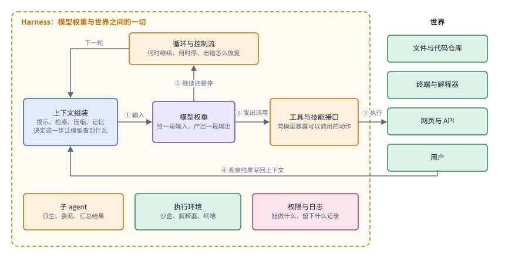

*图：一个 harness 的解剖。紫色是模型权重，蓝色是上下文，橙色是 harness 的各个部件，绿色是外部世界，粉色是权限与日志；带编号的箭头是一步循环的顺序。*

先把这张图从左往右读一遍。中间那个紫色方框是模型权重，它能做的事情只有一件：给它一段输入，它产出一段输出。围着它的那一圈橙色虚线框就是 harness。每一步开始时，左边的“上下文组装”决定这一步让模型看到什么，它从提示、检索结果、压缩过的历史和记忆里挑出内容，拼成一段输入交给模型，这是箭头①。模型读完以后，输出里往往包含一个调用，比如读某个文件、跑一条命令、打开一个网页，这是箭头②；可模型自己没有手，真正去执行这个调用的是右边的“工具与技能接口”，它把调用翻译成对外部世界的操作，这是箭头③。外部世界给出的结果，可能是文件内容、命令输出，也可能是一条报错，会被 harness 写回上下文，这是箭头④，于是下一步模型就能看到上一步的后果。最后，顶上的“循环与控制流”根据模型的输出判断任务是否完成、要不要继续、出错时怎样恢复，这是箭头⑤。

框底下的三个部件并不出现在每一步里，却决定了这个循环能走多远。子 agent 让主循环可以把一块工作派给另一个带着干净上下文的循环去做；执行环境决定代码在什么样的沙盒、解释器或终端里运行；权限与日志规定 harness 能碰哪些东西，并把发生过的一切记下来，供出错时回溯。DAIR.AI 说 harness 是“模型权重与世界之间的一切”，指的就是整个橙色框。本章后面的每一篇论文，都可以先问一句：它改的是这张图里的哪一个方框，模型那个紫色方框有没有跟着变。

第一组是 **harness 和模型**。模型是一组权重，给它一段输入，它产生一段输出；harness 决定这段输入从哪里来、输出被拿去做什么。具体地说，harness 负责组装每一步的上下文，向模型暴露工具，执行模型发出的调用，把结果写回上下文，判断什么时候停，并在出错时恢复。很多论文喜欢强调一句话：一个 agent 的能力由模型和 harness 共同决定。这句话在今天几乎是常识，可它带来的推论值得多想一步：当我们看到一个 agent 分数提高时，第一个问题应当是，提升来自换了模型，还是换了 harness？[The Harness Effect](https://arxiv.org/abs/2607.06906) 用一个很干净的对照把这件事量化了，后文会细讲。

第二组是 **harness、框架和工作流**。工作流通常指预先写死的步骤序列，模型只在其中几个节点被调用；框架是一套帮你搭 agent 的软件库；harness 则是某个具体 agent 运行时实际使用的那一整套外围系统。三者经常重叠，一个用框架搭起来的工作流当然也是一个 harness。区分它们的用处在于看清研究对象：有的论文研究"怎样组织步骤"，有的研究"怎样给模型一个足够表达力的执行环境"，后者往往会刻意减少预设的步骤，把策略留给模型。

第三组是 **提示工程、上下文工程和 harness 工程**。这三个词大致是一层套一层的关系。提示工程关心写给模型的那段话；上下文工程关心每一步究竟让模型看到什么，包括检索、压缩、记忆写入和删除；harness 工程把范围再扩大到工具接口、控制流、子 agent、执行环境、权限和日志。Manus 的那篇长文虽然叫"上下文工程"，讲的 KV cache、工具屏蔽和文件系统，其实已经是完整的 harness 设计问题。

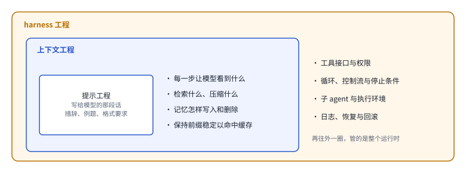

*图：三个词一层套一层。提示工程管最里面那段话，上下文工程管每一步让模型看到的全部内容，harness 工程再把工具接口、控制流、子 agent、执行环境和日志都包进来。*

把这三层画出来会更好记。最里面的白框是提示工程，它的研究对象是写给模型的那段话，例如措辞、例题和格式要求。往外一圈的蓝框是上下文工程，它关心的问题变成了“每一步究竟让模型看到什么”：检索哪些材料，把旧历史压缩成什么样，记忆什么时候写入、什么时候删掉，以及怎样保持提示前缀稳定，好让推理服务的 KV 缓存一直命中。最外面的橙框才是 harness 工程，它把整个运行时都纳入设计：工具的接口和权限，循环与停止条件，子 agent 与执行环境，日志和出错后的恢复。读一篇论文时先判断它落在哪一圈，就能大致估计它的结论能推广到多远。

第四组是 **静态 harness、会学习的 harness 和自我改进**。静态 harness 由人写好，部署后不变；会学习的 harness 把其中某些部分变成可以优化的对象，可以离线搜索，也可以在运行中更新；再往前一步，如果 agent 改写的是自己的 harness，并且连"怎样提出和筛选改动"的机制也一起改，就进入了递归自我改进的范畴。[第 03 章](03_skills_and_self_improvement.md)从"系统怎样改进自己"这个角度讲这件事，harness 代码在那里是梯子上的一级；本章则把 harness 本身放在中心，自我演化的 harness 只是它发展到最后的一个阶段。两章互相引用，读的时候可以对照。

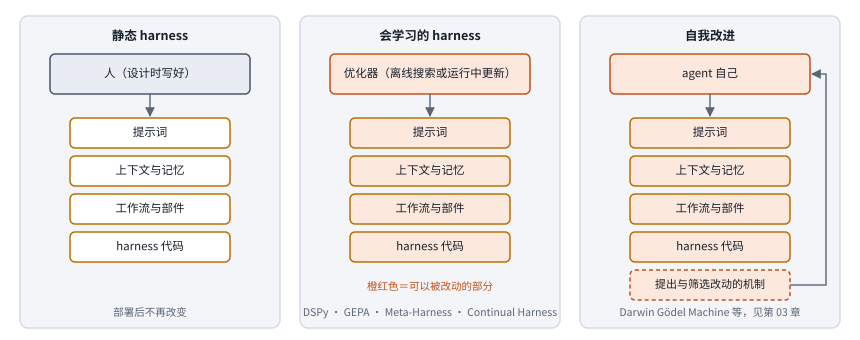

*图：同样四个部件，三种 harness 的差别在于由谁来改、改到哪一层。橙红色表示可以被改动的部分。*

这张图把第四组概念并排放在一起。三列里的四个部件是一样的：提示词、上下文与记忆、工作流与部件、harness 代码。左列的静态 harness 由人在设计时写好，部署之后每个方框都保持原样。中列会学习的 harness 多了一个优化器，它可能在部署前离线搜索，也可能在运行中边用边改；第二节的主线会讲到，这些部件是按先提示词、再脚手架和 harness 代码、最后在线适应的顺序一块块变成可改动的。右列的自我改进再多走一步：改动由 agent 自己提出，而且底下那个虚线框，也就是“怎样提出和筛选改动”的机制，本身也在可改的范围里，右侧那条回到顶部的箭头表示，这个机制改完以后，又会影响 agent 下一次怎样改自己。

## 二、发展主线：从一个采样循环到会改写自己的 harness

这条主线的骨架来自 DAIR.AI 的合集。它按时间和思想谱系把 harness 的历史分成五段，每一段都在回答同一个问题的不同版本：模型外面这一层，哪些部分是固定的，哪些部分可以变，又由谁来变。Lilian Weng 的优化梯子、Anthropic 和 OpenAI 的工程复盘，则分别补上了第三段和第四段的细节。把它们叠在一起看，可以把 harness 的演进读成固定部分一块块被松动、最后连 harness 代码本身也交给机器去改的过程。

> **要点**：五个阶段讲的是同一件事：模型外面这一层里固定的部分一块块松动，从人写的提示，到机器搜出来的 harness 代码，再到运行中边用边改；最后要用任务时长这把尺子来检验，并把权限和评测留在循环之外。

| 阶段 | 内容 | 代表工作 | 本章对应分支 |
|---|---|---|---|
| V0 | 一个采样循环加一段提示，上下文窗口第一次成为值得投入设计的地方 | GPT-2、GPT-3 的少样本提示、思维链 | （背景，见第一节） |
| 静态 harness | 循环代码不变，模型能做的动作越来越多：浏览、调用工具、执行代码、派生 agent、管理记忆 | WebGPT、Toolformer、ReAct、Self-Refine、Reflexion、InterCode、多 agent 协作、Voyager、MemGPT、RLM | 三.1、三.2 |
| 让 harness 学习 | 固定部分依次变成优化对象：先是提示词，再是脚手架和 harness 代码，最后是运行中的在线适应 | DSPy、GEPA、Darwin Gödel Machine、Meta-Harness、Continual Harness | 三.3、三.4、三.5 |
| 2026 年发布的 harness | 把上述想法打包成开源系统，各自回答"harness 的边界应该划在哪里" | Prime Agent、OpenJarvis | 三.1、三.2、三.5 |
| 怎样知道它有效 | harness 的进步只有在任务时长增长时才算数 | METR 的长任务时间跨度 | 三.7 |
| 边界 | harness 握着权限和环境，进步越快，安全和评测越要独立 | 本章收录的安全与评测论文 | 三.6、三.7 |

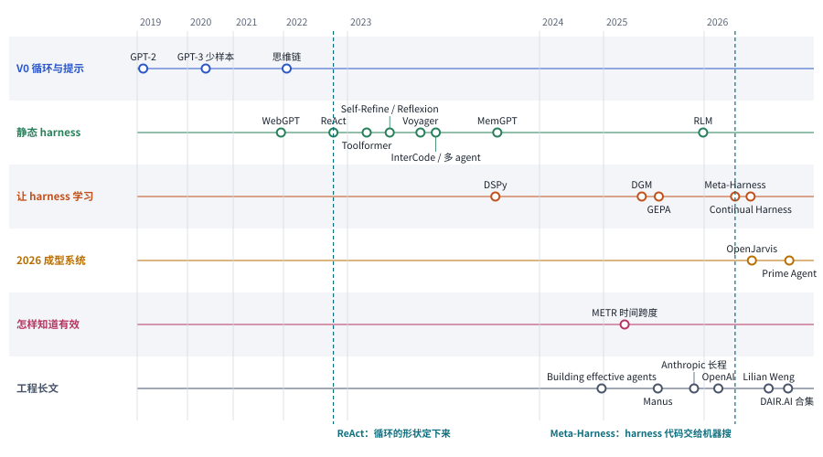

*图：Harness 工程的演进时间轴。前五行对应上表的五个阶段，最下面一行是本章主线借用的工程长文；两条青色虚线标出两个转折点。年份按 arXiv 或发布时间，精确到季度左右。*

先看全景。时间轴从上到下的前五行，正好是 DAIR.AI 合集的五段，第六行是本章借用的几篇工程长文。从左往右读，能看出三件事。第一，2023 年是动作空间爆发的一年，工具调用、反思、代码执行、技能库、记忆管理几乎同时出现，它们都长在 2022 年 ReAct 定下的那个循环形状上，所以第一条青色虚线画在 ReAct。第二，让 harness 学习的那一行，2023 年只有 DSPy 一个点，到 2025 和 2026 年才密集起来；第二条青色虚线标在 Meta-Harness，从这里开始，harness 代码本身成了机器搜索的对象。第三，工程长文那一行几乎全部落在 2025 年以后，说明“harness 工程”这个说法流行起来，是工程实践走在前面、论文很快跟上并与之汇合的结果。

### V0：一个采样循环和一段提示

> **要点**：最早的 harness 只是一个采样循环；GPT-3 的少样本提示和思维链让人第一次意识到，上下文窗口里放什么、允许模型花多少 token 去想，都是值得设计的东西。

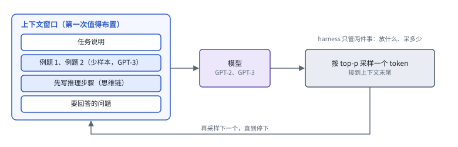

*图：V0 阶段的 harness。左边是上下文窗口，蓝色的两行是 GPT-3 和思维链带来的新内容；循环本身只有“采样一个 token、接到末尾”这一个动作。*

这张图就是 V0 阶段 harness 的全部。左边的大框是上下文窗口，里面原本只有任务说明和要回答的问题；模型读完整段上下文，按 top-p 采样出一个 token，harness 把它接到末尾，再把变长了的上下文交回模型，如此循环直到停下。图里两行蓝色是后来加进去的东西：GPT-3 证明了在窗口里放几道做好的例题，模型就会照着做；思维链让模型在给出答案之前先把推理步骤写出来。两者都没有改动循环的一行代码，改的只是窗口里放什么、允许模型写多长，可正是它们让人意识到，模型外面这一层是可以精心布置的。

在 harness 这个词被用到语言模型上之前，所谓 harness 就是一个最朴素的循环：给模型一段文字，按 top-p 采样一个词，接到末尾，再采样下一个，直到停下。2019 年的 GPT-2 论文 *Language Models are Unsupervised Multitask Learners* 就是这样被使用的，没有工具，没有记忆，也没有任何外部状态。DAIR.AI 把它放在合集的第一位，用意是给后来的一切立一个基线。

第一次让人意识到"模型外面这一层值得设计"的，是 2020 年的 [GPT-3](https://arxiv.org/abs/2005.14165)。论文标题叫 *Language Models are Few-Shot Learners*，它展示了一件今天看来理所当然的事：把几道做好的例题贴进上下文，模型答题就准得多。上下文窗口从此不再只是输入框，而成了一个可以精心布置的工作台。两年后的 [Chain-of-Thought Prompting](https://arxiv.org/abs/2201.11903) 又让模型在给出答案之前先写出推理步骤，相当于把更多计算摊到了更多 token 上。DAIR.AI 的点评很精准：从这时起，harness 要算计的单位从"调用了几次模型"变成了"花了多少 token"。今天各种 harness 论文都要报告 token 成本，源头就在这里。

### 静态 harness：循环不变，动作空间一路扩张

> **要点**：循环的形状被 ReAct 定下来以后，几年里变的只是模型能发出的动作：浏览、调用 API、反思、写代码、派生 agent、存取技能、管理记忆，最后连读取上下文本身都成了一个动作。

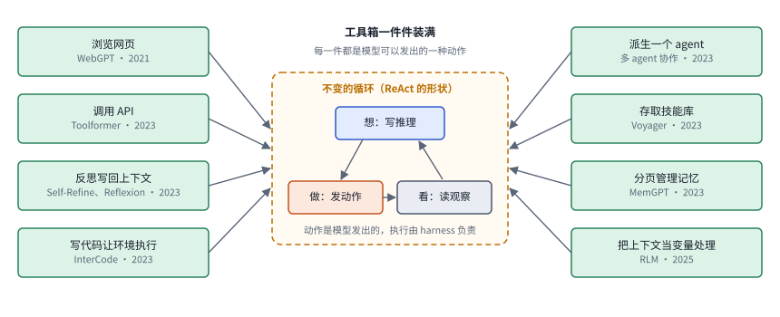

*图：静态 harness 阶段。中间的循环保持 ReAct 的“想、做、看”形状不变，两侧绿色方框是先后加进动作空间的能力，标注了代表工作和年份。*

图的中间是这一阶段始终没变的部分：ReAct 式的循环，模型先写一段推理，再发出一个动作，然后读回观察结果，带着它进入下一轮。变化全在两侧。每一个绿色方框代表一种新的动作，模型只要在输出里写出相应的调用，harness 就负责把它执行掉。左列从 2021 年 WebGPT 的浏览网页开始，接着是 Toolformer 的 API 调用、Self-Refine 和 Reflexion 的反思写回、InterCode 的代码执行；右列是派生 agent、Voyager 的技能库、MemGPT 的分页记忆，最后是 2025 年 RLM 把整个上下文变成可以用代码处理的变量。下面几段大致按这个顺序讲，每一种都对应本节末尾速查表里的一行。

接下来的几年，harness 的循环代码基本保持不变，变的是模型在循环里能做的事。DAIR.AI 把这一段叫作"扩张动作空间"，列了十篇论文，读下来就像在看一个工具箱被一件件装满。

2021 年 OpenAI 的 [WebGPT](https://arxiv.org/abs/2112.09332) 给模型配了一个文字版浏览器，模型可以自己决定搜什么、点开哪一页、摘录哪一段。检索从此成了模型主动选择的一个动作，不再是外部系统替它预先做好的步骤。2023 年 Meta 的 [Toolformer](https://arxiv.org/abs/2302.04761) 让模型自己学会在文本中插入 API 调用，由外部执行后把结果填回来。DAIR.AI 把它称作工具调用的起点：模型负责发出调用，harness 负责执行，这个分工后来成了所有 agent 系统的默认约定。2022 年的 [ReAct](https://arxiv.org/abs/2210.03629) 把"想"和"做"交替编排，先写一段推理，再执行一个动作，读到观察结果后再推理。今天绝大多数 agent 循环仍然是这个形状。

同一时期，人们发现 harness 还可以让模型和自己的输出对话。[Self-Refine](https://arxiv.org/abs/2303.17651) 让模型批评并修改自己的答案，既不训练，也不需要外部环境；[Reflexion](https://arxiv.org/abs/2303.11366) 则把环境给出的失败反馈写成一段文字反思，放回下一次尝试的上下文里，让失败也能留下教训。这两篇工作在第 03 章里是自我改进梯子的起点，在这里则提醒我们，"把什么写回上下文"本身就是 harness 的一个设计决定。

然后是执行环境。2023 年的 [InterCode](https://arxiv.org/abs/2306.14898) 把交互式编程做成了一个标准化的环境，模型写一段代码，环境执行并返回结果。代码从此成了动作空间本身：与其为每件事设计一个专用工具，不如让模型直接写程序。同一年的 [Multi-Agent Collaboration](https://arxiv.org/abs/2306.03314) 把派生一个 agent 也当作一次工具调用，每个 agent 有持久、可寻址的角色，这是今天子 agent 设计的雏形。[Voyager](https://arxiv.org/abs/2305.16291) 在 Minecraft 里把验证过的成功程序存进技能库，以后检索复用，技能从此成为 harness 的一个标准部件。[MemGPT](https://arxiv.org/abs/2310.08560) 借用操作系统的比喻，让模型对一部分上下文拥有增删改查的权限，像管理内存和磁盘一样管理自己的记忆。

这一段的终点是 2025 年底的 [Recursive Language Models](https://arxiv.org/abs/2512.24601)（RLM），作者是 Alex Zhang、Tim Kraska 和 Omar Khattab。它把超长的输入放进一个外部环境，也就是一个 Python 解释器，让模型在里面查看、切分这段输入，并对切出来的片段递归地调用自己。上下文从一个被动塞满的窗口，变成了一个可以编程处理的资源。DAIR.AI 把它放在这一段的最后，因为它几乎是"动作空间扩张"的极致：连读取上下文本身，都成了模型写代码完成的动作。后面会看到，2026 年的 Prime Agent 正是直接建在这个抽象上的。

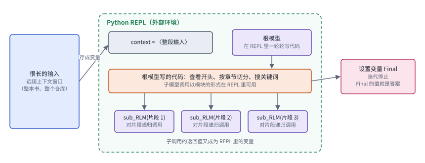

*图：Recursive Language Models 的工作方式。超长输入被存成 REPL 里的一个变量，根模型一轮轮写代码去查看和切分它，对片段递归调用 sub_RLM，最后把答案写进变量 Final。*

RLM 值得单独画一张图，因为后面的 Prime Agent 和 JAZ 都建立在它的抽象上。左边是一段远远超出上下文窗口的输入，比如一整本书或一个仓库。RLM 没有把它塞进窗口，而是在一个 Python REPL 里把它存成一个变量，论文的说法是初始提示被存成 REPL 中的一个变量。根模型在 REPL 里一轮一轮地写代码：先打印开头看看结构，再按章节切开，或者搜索关键词定位相关段落。REPL 里还以模块的形式提供了对子模型的调用，于是根模型可以对切出来的每个片段调用 sub_RLM，让另一个 RLM 去处理这一小段，返回值又成为 REPL 里的新变量。等根模型认为答案已经得到，就把它赋给一个叫 Final 的变量，迭代随即停止，Final 的值就是最终回答。整个过程里，“读上下文”这件事从被动地塞满窗口，变成了模型主动写程序完成的一系列动作。

Lilian Weng 在她的长文里对这一段的成果有一个很好的概括：到了 Claude Code、Codex 这一代编码 agent，工具集已经基本稳定下来，无非是文件读写、shell、git、网页、MCP 和子 agent 委派；设计模式也收敛成了几种，目标驱动的循环、以文件系统为记忆、可查看状态的子 agent 和后台任务。Anthropic 的 *Building effective agents* 在 2024 年底给出的建议同样朴素：先用最简单的增强型 LLM，只在必要时加复杂度，并且像打磨提示词一样打磨工具的接口文档。本章三.1 和三.2 的新论文，大多是在这个已经稳定的形状上继续追问：哪些部件真的有用，在长程任务里又缺了什么。

### 速查：八种扩张动作空间的做法

把这一阶段的八种做法按同一套画法摆在一起，能看清它们共享的骨架：每一种都是在 ReAct 的循环里新增一类模型可以发出的动作，由 harness 负责执行，再把结果以某种形式写回上下文。它们的差别在于动作作用在哪里，是外部世界、模型自己的输出、另一个 agent，还是上下文本身。下表“解决了什么”一栏写的是它补上的那块短板以及原因，“代价”一栏写的是它留给后来者的问题。

| code | 名称 | 年份 | 代表 | 怎么做 | 解决了什么 | 代价 |
|---|---|---|---|---|---|---|
| S1 | 想做交替 | 2022 | ReAct | 每一步先写一段推理，再发出一个动作，读回观察结果后进入下一轮 | 只推理的模型容易凭空编造事实，只行动的模型说不清为什么这样做；两者交替以后，推理可以根据真实观察修正，动作也有了理由 | 每一步多写一段推理，token 开销上升；循环本身不知道何时该停，要由 harness 另外规定 |
| S2 | 工具调用 | 2021–2023 | WebGPT、Toolformer | 模型在输出里写出搜索、点击或 API 调用，harness 执行后把结果填回文本 | 模型的知识停在训练时，算术也容易出错；把检索和计算交给外部执行，答案就能用上新信息和精确结果 | 每个工具都要写接口说明；工具一多，选错工具、写错参数的情况随之增加 |
| S3 | 反思写回 | 2023 | Self-Refine、Reflexion | 拿到自评或环境给出的失败反馈后，写成一段文字反思，放进下一次尝试的上下文 | 不训练模型时，一次失败本来留不下任何痕迹；写成文字放回上下文，下一次尝试就能避开同样的错误 | 反思的质量取决于反馈是否可靠，自评出错时会把错误的教训一并写回 |
| S4 | 代码即动作 | 2023 | InterCode | 模型写一段代码，环境执行后返回输出和报错 | 为每件事单独设计工具太费力；让模型直接写程序，动作空间就和编程语言一样大 | 需要隔离良好的执行环境，代码的副作用可能破坏环境 |
| S5 | 派生 agent | 2023 | Multi-Agent Collaboration | 主 agent 把派生另一个 agent 当作一次调用，每个 agent 有持久、可寻址的角色 | 一个上下文装不下所有子任务；把子任务交给带着干净上下文的 agent，主循环只需要看汇总结果 | agent 之间的沟通和汇总本身会出错，调用次数和成本成倍增加 |
| S6 | 技能库 | 2023 | Voyager | 把经过环境验证的成功程序存进技能库，遇到新任务时检索复用 | 每次都从头写程序既慢又不稳定；验证过的程序可以直接复用，能力随时间累积 | 技能库越积越大，检索不准时反而误导模型；验证标准决定了库里存的是不是真本事 |
| S7 | 分页管理记忆 | 2023 | MemGPT | 借操作系统的比喻，模型用增删改查操作在有限的主上下文和外部存储之间调入调出 | 上下文窗口有限，长对话和大量文档放不下；由模型自己决定调入什么，有限的窗口就能处理远超其容量的信息 | 记忆操作本身占用步数和注意力，调入调出判断失误时会丢掉关键信息 |
| S8 | 可编程上下文 | 2025 | RLM | 长输入存成 REPL 变量，模型写代码查看、切分，对片段递归调用自己，最后设置 Final 返回 | 超长输入塞进窗口会超限或稀释注意力；放进外部环境由代码按需读取，输入长度就不再受窗口限制 | 依赖模型写代码和分解任务的能力；递归调用的次数随任务变化，成本不容易预先估计 |

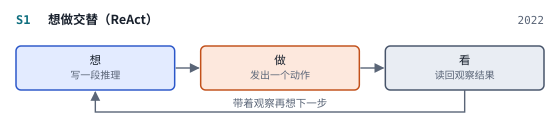 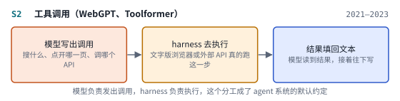

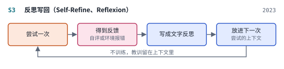 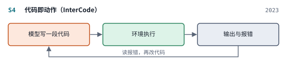

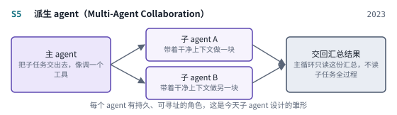 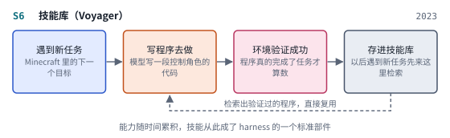

 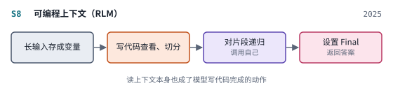

*图：八种扩张动作空间的做法的结构示意，每张卡对应上表的一行，颜色含义与解剖图相同。*

### 让 harness 学习：固定的部分一块块松动

> **要点**：从这一阶段开始，harness 里固定的部分依次变成被优化的对象：先是提示词，再是脚手架和 harness 代码，最后是运行中的在线适应。关键的一步是 Meta-Harness，它让编码 agent 读完全部历史，直接写出新的 harness 代码。

前一段里，无论动作空间怎样扩张，harness 的每一行代码、每一段提示都是人写的。DAIR.AI 的第三段讲的是这些固定部分怎样依次变成可以优化的对象，顺序也很有意思：先是提示词，然后是脚手架，再是 harness 代码，最后是运行中的在线适应。这和 Lilian Weng 的梯子几乎一一对应：指令提示、结构化上下文、工作流、harness 代码、优化器代码，越往上，被优化的对象越复杂，用的方法也越通用。

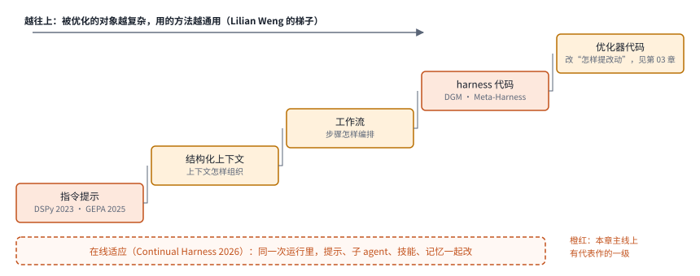

*图：被优化对象的梯子。五级来自 Lilian Weng 的长文，橙红色的两级是本章主线上有代表作的地方；底部的虚线框表示 Continual Harness 在同一次运行里横跨多级同时改动。*

这张梯子图把两篇文章的叙事叠在一起。从左下往右上，每一级是一类被优化的对象：最底下是指令提示，然后是结构化上下文、工作流、harness 代码，最顶上是优化器代码，也就是“怎样提出改动”的那段程序本身。越往上，被优化的东西越复杂，能用的方法也越通用；到了 harness 代码这一级，优化器面对的已经是一段任意的程序，只能交给一个会写代码的 agent。本章主线上有代表作的是两级：指令提示这一级有 DSPy 和 GEPA，harness 代码这一级有 Darwin Gödel Machine 和 Meta-Harness；最顶上的优化器代码属于递归自我改进，第 03 章有详细讨论。底部那条虚线框是 Continual Harness，它的特别之处在于不挑某一级，而是在同一次运行中把提示、子 agent、技能和记忆一起改。

第一步是 2023 年的 [DSPy](https://arxiv.org/abs/2310.03714)。它让人用声明式的方式写语言模型流水线，再用一个小训练集自动搜索每个模块的提示词和示例。系统提示从此成了一个被编译、被优化出来的产物，手写咒语的时代开始过去。2025 年的 [GEPA](https://arxiv.org/abs/2507.19457) 把搜索换成了自然语言反思加演化：读失败的轨迹，用文字说清哪里出了问题，据此变异提示词。论文标题直接宣称它可以胜过强化学习，DAIR.AI 的点评则强调它用的 rollout 次数少得多。

再往上一步，被改写的成了脚手架。2025 年的 [Darwin Gödel Machine](https://arxiv.org/abs/2505.22954) 让编程 agent 读自己的评测记录，改写自己的代码，新版本经过实测后放回档案库，作为以后继续演化的起点。它在第 03 章里是重点讨论的对象，这里只需记住它的意义：agent 改的已经是 harness 本身了。

2026 年的 [Meta-Harness](https://arxiv.org/abs/2603.28052) 把这件事做成了一个通用方法。作者 Yoonho Lee、Omar Khattab、Chelsea Finn 等人的出发点是：harness 决定了哪些信息被存储、检索和展示给模型，可它至今大多仍靠手写，而现有的文本优化器会丢掉太多反馈，搜不好 harness。Meta-Harness 让一个编码 agent 作为提议者，通过文件系统读取此前所有候选 harness 的源代码、分数和执行轨迹，再写出新的 harness。它在在线文本分类上比最好的上下文管理系统高 7.7 个点，同时少用四倍上下文；在 IMO 级别的检索增强数学题上，一个搜出来的 harness 在五个未参与搜索的模型上平均提升 4.7 个点；在 Terminal-Bench 2 上，搜出来的 harness 超过了人手设计的最好基线。DAIR.AI 的点评点出了关键：这一切都发生在模型权重不变的前提下。论文的结论也很值得记住：给提议者更丰富的历史经验，可以让 harness 工程本身走向自动化。本章三.3 的大部分新论文，都是在 Meta-Harness 开出的这条路上做改进。

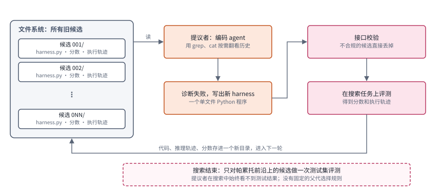

*图：Meta-Harness 的外循环。左边的文件系统保存了所有旧候选的源代码、分数和执行轨迹；提议者读完它们写出新 harness，经过接口校验和搜索集评测，结果存成新目录，进入下一轮。*

按图上的顺序走一遍这个循环。左边的文件系统是 Meta-Harness 的核心：每一个评测过的候选都有自己的目录，里面放着它的 harness 源代码、得到的分数和完整的执行轨迹。提议者是一个编码 agent，论文用的是 Claude Code 加 Opus-4.6，它像程序员排查问题那样，用 grep、cat 这类终端工具按需翻看这些目录，没有把全部历史一次塞进一个提示里。读完以后，它诊断出旧候选可能的失败原因，写出一个新的单文件 Python harness。新程序先过一道接口校验，不合规的直接丢掉；通过的在搜索任务上运行，得到分数和执行轨迹，连同提议者的推理过程一起存成文件系统里的一个新目录，下一轮的提议者就能看到它。论文维护一个由已评测候选组成的帕累托前沿，可它没有规定从哪个父代出发，提议者可以去看任何一个旧候选；搜索结束后，只对前沿上的候选做一次测试集评测，提议者在整个搜索中都看不到测试结果。和以往的文本优化器相比，关键差别在反馈的保真度：旧方法把执行情况压缩成几句话或一个分数，Meta-Harness 让提议者直接读原始轨迹。

这一段的最后一篇是 [Continual Harness](https://arxiv.org/abs/2605.09998)。它的故事从"Gemini 玩宝可梦"开始：团队先靠人在回路里反复打磨 harness，让 agent 打通了几代宝可梦游戏，在最难的阶段，agent 开始借助长上下文记忆自己调整策略。Continual Harness 接着把人从回路里拿掉：从一个极简的环境接口出发，agent 在同一次运行中一边行动，一边修改自己的提示、子 agent、技能和记忆，整个过程无需重置环境。作者还加了一个模型协同学习的环节，用前沿教师模型重新标注开源 agent 的轨迹，在线更新模型权重。DAIR.AI 说它"同时更新 harness 组件和权重"，Lilian Weng 也把它列为 harness 与权重联合优化的代表。至此，harness 的固定部分已经全部松动：提示词、脚手架、代码，以及运行中的适应。本章三.4 讨论在线学习，三.5 讨论 harness 与权重的关系，都从这里接着往下走。

### 速查：五种让 harness 学习的做法

这五种做法沿着梯子从低往高排列，也大致按时间先后排列。把它们画成同一种结构卡，可以看到一个共同的形状：先运行，再读反馈，然后修改，最后检验并留下更好的版本。它们的区别有两处，一是被修改的对象从提示词一路升到 harness 代码，二是反馈的保真度，从一个指标分数到一段文字反思，再到完整的执行轨迹。

| code | 名称 | 年份 | 代表 | 怎么做 | 解决了什么 | 代价 |
|---|---|---|---|---|---|---|
| L1 | 提示编译 | 2023 | DSPy | 用声明式模块写流水线，再用小训练集和评价指标自动搜索每个模块的提示与示例 | 手写提示难以复用，换了模型或任务就要重调；把提示变成编译产物，条件变了可以重新编译 | 只优化提示和示例，流水线结构仍由人决定；需要一个可靠的评价指标 |
| L2 | 反思演化 | 2025 | GEPA | 读失败轨迹，用自然语言说清哪里出了问题，据此变异提示词，保留更好的候选 | 强化学习要大量 rollout 才能从标量奖励里学到东西；文字反思直接利用轨迹里的信息，所需 rollout 少得多 | 改动对象仍是提示词；反思的质量受限于做反思的模型 |
| L3 | 档案式自改 | 2025 | Darwin Gödel Machine | 编程 agent 读自己的评测记录，改写自己的代码，实测后放回档案库，作为以后演化的起点 | 只保留当前最好的版本容易困在局部；档案库留住多样的中间版本，演化可以从不同起点继续 | 每个新版本都要实测，开销大；改的是 agent 自己，评测和权限要放在循环之外 |
| L4 | 读全史写代码 | 2026 | Meta-Harness | 编码 agent 通过文件系统读取全部旧候选的代码、分数和轨迹，写出新的 harness 程序 | 已有的文本优化器把反馈压缩得太狠，搜不好 harness；保留原始轨迹，提议者就能像程序员一样排查 | 提议者本身要很强，每轮都要跑完整的搜索任务；搜索集上的提升能否迁移，见三.7 |
| L5 | 运行中在线改 | 2026 | Continual Harness | 从极简接口出发，agent 在同一次运行里交替行动和修改自己的提示、子 agent、技能、记忆，还可以用教师重标轨迹更新开源模型 | 提示优化方法通常要重置回合，长程环境里做不到；在一次运行里在线修改，就不需要重置 | 改动发生在运行之中，旧行为可能被破坏，见三.4 的遗忘问题；收益依赖模型能力 |

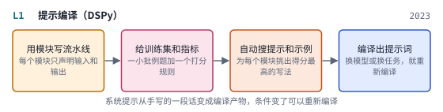 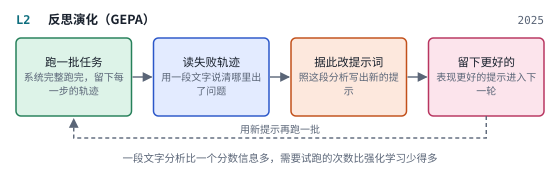

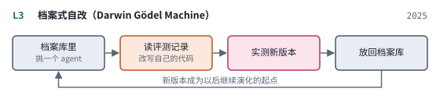 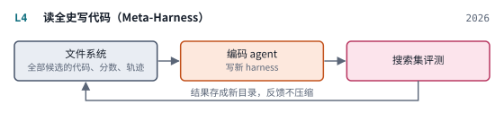

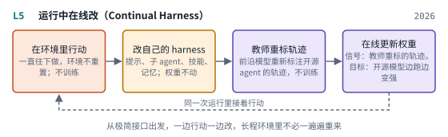

*图：五种让 harness 学习的做法的结构示意，每张卡对应上表的一行。*

### 2026 年发布的 harness：边界应该划在哪里

> **要点**：Prime Agent 和 OpenJarvis 把前面几段的想法打包成系统，各自回答了 harness 的边界划在哪里：前者把执行、恢复、验证和资源核算标准化，把策略留给模型；后者把整套个人 AI 系统写成可搜索的规格，为本地模型重新搜一遍。

DAIR.AI 的第四段只收了两个系统，都是 2026 年在那次 Paper Club 上展示的开源项目。它们的共同点是各自对一个问题给出了旗帜鲜明的回答：harness 的边界应该划在哪里，什么交给 harness 管，什么留给模型自己决定。

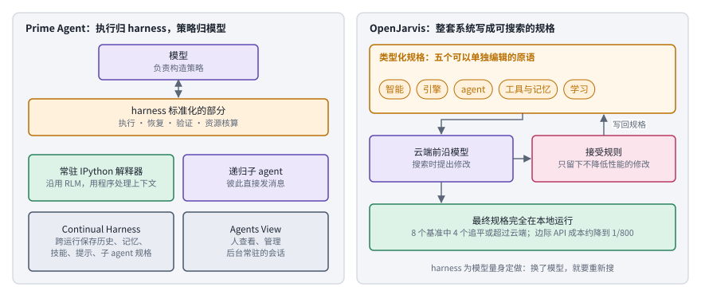

*图：2026 年两个成型系统对边界的不同回答。左边 Prime Agent 由 harness 统一负责执行层面的事情，右边 OpenJarvis 把系统写成五个原语组成的规格，由云端模型在搜索时修改。*

左右两栏回答的是同一个问题。左栏的 Prime Agent 把模型放在最上面，只让它负责构造策略；下面那条橙色的带子是 harness 统一接管的部分，也就是执行、恢复、验证和资源核算，作者的用意是让 harness 的失败不再被误记成模型的失败。再往下的四个方框是它的组成：常驻的 IPython 解释器沿用 RLM 的抽象，递归子 agent 之间可以直接发消息，Continual Harness 负责在多次运行之间保存历史、记忆、技能、提示和子 agent 规格，Agents View 让人能查看和管理后台常驻的会话。右栏的 OpenJarvis 先把整个个人 AI 系统写成一份类型化规格，由智能、引擎、agent、工具与记忆、学习五个原语组成，每个原语都能单独编辑；搜索时，云端前沿模型读规格并提出修改，只有不降低性能的修改才会被写回；搜索结束后，最终规格完全在本地设备上运行。两者一个把边界画在“执行”与“策略”之间，一个把边界画在“搜索时用云端”与“运行时用本地”之间。

[Prime Agent: A Self-Improving RLM Harness](https://arxiv.org/abs/2608.23552)（`2608.23552`）是本章开头那个数字的出处。它的设计可以看作前面几段的合流：一个常驻的 IPython 解释器沿用 RLM 的抽象，让模型用程序处理上下文；Continual Harness 负责在多次运行之间保存历史、记忆、技能、提示和子 agent 的规格；递归的子 agent 之间可以直接通信，人还可以通过一个 Agents View 查看和管理后台会话。论文强调，它把执行、恢复、验证和资源核算都标准化了，把构造策略的工作留给模型，用作者的话说，这是一层低摩擦、表达力强的"膜"，目的是防止 harness 的失败变成模型的失败。正是在这层膜的帮助下，ARC-AGI-3 的 RHAE Best@1 从 30% 升到 95.5%；在长上下文编码、GPU 内核生成、模拟器构建、自主 nanoGPT 竞速等任务上，它也追平或超过了模型原生的和流行的 harness。

[OpenJarvis](https://arxiv.org/abs/2605.17172) 则从另一个方向回答边界问题。它关心的是个人设备上的 AI：现在的个人助手大多把可能涉及隐私的本地数据发给云端前沿模型，可简单地把云端模型换成本地小模型，例如把 Claude Opus 4.6 换成 Qwen3.5-9B，在 PinchBench、GAIA 等任务上准确率会掉 25 到 39 个点，而且单靠优化提示词只能追回约 5 个点。原因在于整套系统是围绕某个云端模型调出来的。OpenJarvis 把个人 AI 系统写成一份由五个可以独立编辑的原语组成的类型化规格，分别是智能、引擎、agent、工具与记忆、学习，然后让云端模型在搜索阶段提出修改，只接受不降低性能的修改，最终规格完全在本地运行。结果是在 8 个基准中的 4 个上追平或超过云端准确率，平均只差 3.2 个点，边际 API 成本降到约八百分之一。它说明了一件对本章很重要的事：harness 是为模型量身定做的，换了模型，harness 就要重新搜。

把这两个系统和 Anthropic、OpenAI 的工程复盘放在一起读，会发现它们讲的是同一组经验。Anthropic 的长程 harness 用功能清单、进度文件和 git 来管理跨会话状态，Prime Agent 用持久化的解释器和 Continual Harness 做同样的事；OpenAI 把架构规则写进 linter，让 agent 读报错自己修，OpenJarvis 则只接受不降低性能的规格修改。它们都在把"约束"和"状态"从模型的脑子里搬到外部可检查的地方，把"策略"留给模型。

### 怎样知道它有效：任务时长必须变长

> **要点**：判断 harness 有没有进步，最有说服力的尺子是 agent 能独立完成的任务有多长。METR 用人类专家完成同类任务的用时来度量这一点。

合集的最后一段只有一篇论文，METR 的 [Measuring AI Ability to Complete Long Software Tasks](https://arxiv.org/abs/2503.14499)。它提出用"50% 任务完成时间跨度"来衡量能力：找到 AI 有一半把握做成的那类任务，看人类专家做它通常要花多久。论文报告，当时的前沿模型这个跨度大约是 50 分钟，并且自 2019 年以来大约每七个月翻一番，2024 年可能还在加速；作者认为，进步主要来自更高的可靠性、更强的纠错能力、更好的逻辑推理和工具使用。

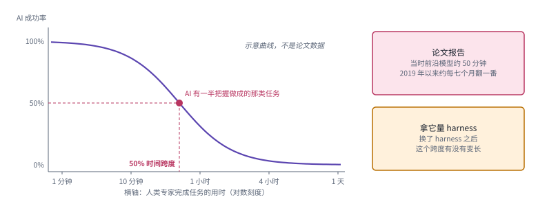

*图：50% 时间跨度的读法。横轴是人类专家完成一类任务的用时，纵轴是 AI 的成功率；曲线只是示意，取成功率为一半的那一点对应的人类用时。*

这张图解释的是 METR 怎样把“能力”换算成一个时间长度。把任务按人类专家需要的用时从短到长排开，很短的任务 AI 几乎都能做成，很长的任务几乎都做不成，中间有一段成功率逐渐下降的区域。在成功率恰好为一半的位置往下读出对应的人类用时，这个时长就是 50% 时间跨度。论文报告当时前沿模型的这个值约为 50 分钟，并且从 2019 年以来大约每七个月翻一番。图右下角的方框是本章借这把尺子要问的问题：同一个模型换了 harness 之后，这个跨度有没有变长。

DAIR.AI 把这篇放在最后，用一句话交代了理由：harness 的进步只有在任务时长增长时才算数。这句话的分量在于，它把评价 harness 的尺子从"某个基准涨了几个点"换成了"能独立完成多长的任务"。一个 harness 如果只是让短任务的分数好看一些，却不能让 agent 撑过更长的工作，它的价值就很有限。Anthropic 那篇长程 harness 的复盘、OpenAI 报告的单次 Codex 运行超过六小时，都是在这把尺子上量出来的。本章三.2 讨论长程任务的 harness，三.7 讨论怎样评测 harness，都要回到这把尺子上来。

### 边界：harness 越强，越要有独立的评测和权限

> **要点**：harness 握着权限、执行环境和日志，一旦开始改写自己，权限层、评测和日志就要放在它改不到的地方。

DAIR.AI 的合集到 METR 就结束了，可这条主线还有一个绕不开的边界。harness 握着工具权限、执行环境和日志，它越能干，出问题时的破坏面也越大；harness 一旦开始自己改写自己，评测和权限就更不能交给它自己管。Lilian Weng 在长文末尾列出了七个瓶颈，评价器太弱、上下文和记忆的生命周期难以管理、负面结果很少被报告、搜索过程容易多样性坍缩、系统会钻评价的空子、沙盒里的短期奖励不代表长期效果、人在回路里的位置不清楚，其中大半都直接落在 harness 上。她的建议是把权限和安全层放在自我修改的循环之外。

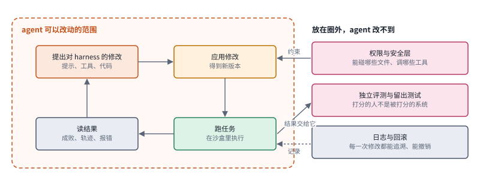

*图：自我修改的边界。左边虚线框里是 agent 可以改动的循环，右边三个方框放在圈外，由它们约束、打分和记录这个循环。*

左边的虚线框是一个自我修改的循环：agent 提出对提示、工具或代码的修改，应用后得到新版本，在沙盒里跑任务，读回成败和轨迹，再提出下一次修改。右边三个方框是 Lilian Weng 主张放在循环之外的东西。权限与安全层约束“应用修改”这一步能碰哪些文件、调哪些工具；独立评测和留出测试接收任务结果并打分，让打分的一方和被打分的一方分开；日志与回滚把每一次修改记下来，让任何一步都能追溯和撤销。如果这三样也落进了左边的虚线框，系统就可以通过修改评分器或删掉日志来给自己打高分，后面三.6 和三.7 的论文都在处理这种风险。

OpenAI 的复盘从另一个角度说明了同一件事。agent 会忠实地复制仓库里已有的模式，包括坏模式；小组一度每周拿出五分之一的时间清理 agent 留下的"AI 垃圾"，后来改成把"黄金原则"写进仓库，再让后台 agent 持续扫描偏离并提交小的重构。也就是说，harness 自己也需要一套持续运转的质量控制。本章三.6 讨论 harness 的安全，三.7 讨论 harness 的评测与归因，都是在这条边界上工作；自我演化的 harness 在多大程度上算得上递归自我改进，则请回到[第 03 章](03_skills_and_self_improvement.md)的梯子上去定位。

## 三、前沿研究方向

下面七个分支收录的都是 2026 年的新论文，按它们回答的问题组织，从"harness 应该长什么样"开始，经过"怎样让它自动变好""它和权重是什么关系"，一直走到"怎样保证安全"和"怎样知道它真的有效"。每个分支开头先交代问题从哪里来，第一段之后标出它在上面那条主线上的位置。读这些论文时，建议始终带着两个问题：这篇工作改动的是 harness 的哪一部分，模型有没有跟着变？它用什么证据说明提升来自 harness，又是否在没参与调优的任务和模型上检验过？

七个分支各配了至少一张图。前两个分支的图讲 harness 应该长什么样，第三到第五个分支的图讲 harness 怎样自动变好，这三个分支末尾还各有一张速查表，用和第二节相同的七列比较同一家族里的做法；最后两个分支的图讲安全和评测。读图时可以随时翻回第一节的解剖图，颜色的含义全章一致。

### 1. 一个好的 harness 由哪些部件组成，各自贡献多少？

DAIR.AI 的第二段告诉我们，动作空间已经扩张到了浏览、工具、代码执行、子 agent 和记忆。可当一个 harness 同时具备这些部件时，我们其实并不清楚每个部件到底贡献了多少：规划模块对强模型和弱模型的作用一样吗？上下文压缩是提高了准确率，还是只是避免了上下文溢出？预定义的工具是帮了忙，还是限制了本来会写 shell 的模型？这个分支的论文从不同方向拆解 harness，有的做严格对照，有的反过来追问 harness 最少需要多少东西。

> 主线位置：静态 harness 阶段的延续。接 ReAct 的循环形状、InterCode 的代码动作空间、MemGPT 的记忆管理和 RLM 的可编程上下文，以及 Building effective agents 的"先求简单"原则。

> **要点**：拆开 harness 有两条路：固定循环、逐个换部件做对照，或者干脆只留一个表达力足够强的原语。两条路得出的结论相通，部件的价值随模型能力和预算而变。

先看最直接的一个问题：在模型不变的情况下，单换 harness 能带来多大差别？**[The Harness Effect: How Orchestration Design Sets the Token Economics of Enterprise Agentic AI](https://arxiv.org/abs/2607.06906)**（`2607.06906`） 来自 Writer 公司，它做了一个很干净的对照：22 个锁定的评测任务，6 个基础模型，只把编排层从一个冻结的常规生产循环换成他们的 Writer Agent Harness。结果是每个任务的混合成本降低 41%，中位耗时降低 44%，每个任务的 token 减少 38%，完成质量持平。更有意思的是两个规律：效率提升对所有模型都成立，每个模型都便宜了 33% 到 61%；质量提升却取决于模型能力，模型的基线越强，从 harness 得到的质量增益越大，作者把这叫作"harness 杠杆"。在这组任务上，换编排层对成本的影响甚至超过了在整个模型菜单里挑来挑去。作者还把效率的来源归纳成六类机制，从缓存形状的纪律到失败开销的治理，这和 Manus 那篇长文把 KV cache 命中率当作首要指标的思路一脉相承。

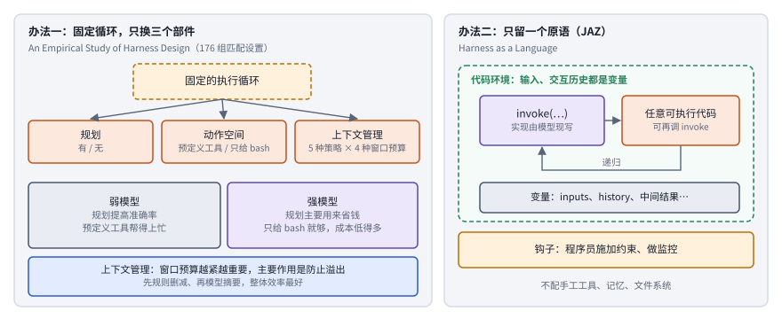

*图：拆解 harness 的两种办法。左边固定执行循环，只换规划、动作空间和上下文管理三个部件；右边只保留一个由模型现写实现的 invoke 原语，一切都是代码环境里的变量。*

左右两栏代表两种方向相反的拆法。左栏是 An Empirical Study of Harness Design for Coding Agents 的做法：执行循环固定不动，只在三个插槽里换部件，规划有或没有，动作空间是一组预定义工具还是只给一个 bash，上下文管理在五种策略和四种窗口预算之间组合，一共 176 组匹配设置。下面两个方框把它最重要的发现按模型强弱分开写：对弱模型，规划能提高准确率，预定义工具帮得上忙；对强模型，规划主要用来省钱，只给一个 bash 就够了。最底下的蓝框是关于上下文管理的结论。右栏是 JAZ 的做法：不提供任何现成部件，只暴露一个叫 invoke 的原语，它的实现由模型在每次被调用时现写，写出的代码可以再调用 invoke，形成递归；模型能看到的一切，包括输入和与代码环境的交互历史，都是环境里的变量；程序员只通过钩子施加约束和监控。下面两段分别细讲这两项工作。

知道了 harness 整体有用，下一步自然是拆开看部件。**[An Empirical Study of Harness Design for Coding Agents](https://arxiv.org/abs/2609.20804)**（`2609.20804`） 固定一个轻量编码 harness 的执行循环，只改变规划、动作空间和上下文管理三个部件，在 SWE-Bench Verified 和 Terminal-Bench 2.1 上用四个模型跑了 176 组匹配设置。它的发现很实用：上下文管理随着窗口预算收紧而越来越重要，主要作用是防止上下文溢出；先做基于规则的删减、再做基于模型的摘要，整体效率最好，而把删掉的内容做成可恢复的机制，模型却很少用，也没带来准确率提升；规划对弱模型是提高准确率的脚手架，对强模型则主要是省钱；预定义工具帮助不太会用 bash 的模型，而会用 bash 的模型只给一个 bash 接口就能做得很好，成本还低得多。这些结论提醒我们，harness 的部件没有绝对的好坏，它们的价值随模型能力和预算而变。

有了这样的对照，就会有人反过来问：harness 能不能小到几乎只剩一个循环？**[Harness as a Language: A Minimalist Agent Framework With Maximal Expressivity](https://arxiv.org/abs/2609.26891)**（`2609.26891`） 搭了一个叫 JAZ 的框架，只暴露一个基于模型的原语 `invoke`，外加一组让程序员施加约束和监控的钩子。`invoke` 满足两个性质：模型可以写任意可执行的代码，代码里还能递归调用 `invoke`；模型能看到的一切，包括输入和与代码环境的交互历史，都是代码环境里的变量。这正是 RLM 思路的推广。不配任何手工工具、记忆或文件系统，它在 StuLife 需要大量回忆的部分上比 Letta（也就是 MemGPT）高 8%，成本只有一半；在 AppWorld 的持续自我改进上比 ACE 高 4%，成本也更低。与之呼应，**[Language model harnesses are compositional generalizers](https://www.alphaxiv.org/abs/2607.language-model-harnesses)**（`2607.language-model-harnesses`） 从训练 RLM 的过程中观察到一个现象：结构相似的任务会被视为同构的，harness 里每一次单独的模型调用都变成了分布内的问题。换句话说，好的 harness 结构本身就能带来组合泛化。这两篇工作合起来看，给出了一个和"堆部件"相反的方向：与其给模型准备越来越多的专用工具，不如给它一个表达力足够强的执行环境。

部件之中，感知接口常常被忽视。**[VISTA: A Visual Harness for Reasoning in an Interactive World](https://arxiv.org/abs/2610.02200)**（`2610.02200`） 认为多模态模型本身已经有很强的推理能力，缺的是合适的 harness。它让模型直接通过视觉观察感知环境，并保留一份无损的视觉记忆，模型可以在推理时主动取回过去的画面并重新组织自己的视觉输入。在 ARC-AGI-3 上，它把 Claude Opus 5.0 的相对人类动作效率从 40.68 提到满分 100，25 个公开游戏全部完成，所用动作比第一次玩的人类少 57.4%。这和 Prime Agent 的数字放在一起看，几乎就是 DAIR.AI 核心论断的两个独立例证。

另一个常被忽视的部件是模型选择本身。**[Agentic Routing: The Harness-Native Data Flywheel](https://arxiv.org/abs/2607.11399)**（`2607.11399`） 指出，现在的模型越来越"偏科"，有的擅长改代码，有的擅长长上下文恢复，因此在 agent 内部选哪个模型是一个核心的系统问题。它提出在每一步根据完整的 harness 状态做路由，可以选一个最合适的模型省钱，也可以选几个互补的模型做集成。关键的洞察在于，每一次路由决策天然就产生一条结构化记录，包括查询、harness 状态、所选模型、执行轨迹、结果和成本，标签由环境给出，这些记录又能训练更好的路由器和模型，形成一个数据飞轮。作者报告在 PinchBench 上成本最多降到原来的十分之一左右，在 DRACO 上通过多模型集成提高了准确率。

最后两篇把视野放大到"harness 的组合"。**[Raven: The Harness of Harnesses for Composable Agentic Intelligence](https://arxiv.org/abs/2609.33439)**（`2609.33439`） 把每一对可执行的"模型加 harness"当作一个可以组合的智能单元，由一个主 agent 分解目标、把子任务分配给专门的 agent、协调依赖并整合结果，并给出了组合能在共享资源预算下扩大可靠任务覆盖的充分条件。**[openJiuwen: Beyond Static Harnesses for Long-Horizon Coding Agents](https://arxiv.org/abs/2608.27969)**（`2608.27969`） 则从开发者的角度提出两个需求：结构上可组合，运行时可适应。它提供共享的执行底座，让单 agent、委派的子 agent 和群体流程在同一套执行语义下组合，并让不断出现的新证据动态影响上下文、反馈和任务控制。在 SWE-bench Verified 和 Terminal-Bench 2.1 上分别达到 82.6% 和 87.19%，比所选官方榜单的最强点估计各高约 3.4 个点。

值得顺带一提的是，harness 的思路也正在被大量搬进其他方向，只是在那些论文里 harness 是手段，研究目标另有所在。机器人领域有 [RoboHarness](https://arxiv.org/abs/2607.18060)（`2607.18060`）这样编排异构机器人策略的框架，有 [Show-Harness](https://arxiv.org/abs/2609.10522)（`2609.10522`）这样让视觉语言模型通过语义动作接口直接操控机器人的"具身 harness"，导航方向有 [HarnessVLN](https://arxiv.org/abs/2609.15195)（`2609.15195`）。这些工作收在[具身智能](11_embodied.md)一章，读的时候可以留意它们借用了本分支里的哪些设计。

### 2. 长程任务需要什么样的 harness？

任务一长，harness 要面对的问题就完全变了。Anthropic 那篇复盘把失败归成三类：想一口气做完、过早宣布完工、没有端到端验证；OpenAI 的小组则发现，agent 在没有工具和结构的环境里进展缓慢，问题出在环境，模型本身没那么差。归根到底，长程任务的困难在于状态：目标、约束、已完成的部分、尚未验证的部分，都在一个不断变长的上下文里漂移，模型很容易把自己的错误评估一路带下去。这个分支的论文都在尝试把状态从上下文里搬出来，交给 harness 显式管理。

> 主线位置：静态 harness 阶段走向 2026 年的成型系统。接 MemGPT 的上下文管理、Anthropic 的初始化 agent 与功能清单、OpenAI 的仓库即记录系统，以及 METR 用任务时长衡量进步的尺子。

> **要点**：长程任务的难点在状态：目标、进度和已验证的事实都在一个越来越长的上下文里漂移。这一组论文都把状态搬到执行之外，交给 harness 显式管理，并且只用核实过的事实去更新它。

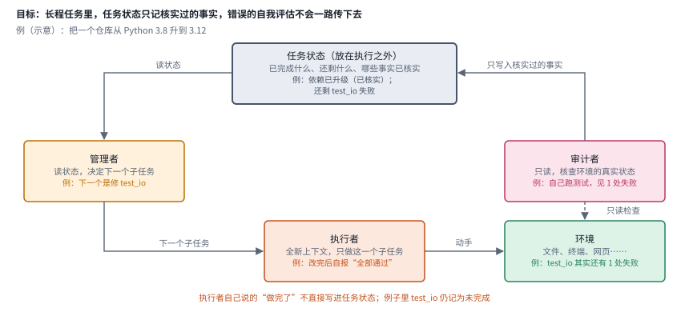

*图：LongHorizon-Harness 的管理、执行、审计循环。任务状态放在执行之外，只接受审计者核实过的事实。*

图的最上面是这一分支的核心概念：任务状态，记录已经完成了什么、还剩什么、哪些事实已经核实。它放在执行之外，不随着某一次执行的上下文一起变长。一轮循环从左边的管理者开始，它读取任务状态，决定下一个子任务；执行者用一个全新的上下文去完成这个子任务，动手改动环境；右边的审计者只有读权限，它去检查环境里真实发生了什么；只有它核实过的事实，才会沿着右上方的箭头写进任务状态。底部那行字是这个设计最要紧的地方：执行者自己说“做完了”，并不会直接进入状态，于是一次错误的自我评估就没法一路传到后面的决策里。下面几篇论文都可以对照这张图来读，看它们把状态放在哪里、用什么来核实。

**[LongHorizon-Harness: Advancing Long-Horizon Agents for Real-World Tasks](https://arxiv.org/abs/2608.01964)**（`2608.01964`） 把这个思路说得最直白：现有 harness 把任务执行、任务状态和完成判断都放在一个不断增长的上下文里，于是状态难以追踪，错误的自我评估会一路传下去。它把长程执行重新表述为任务状态管理问题，在执行之外显式维护任务状态，并且只用从环境独立验证过的事实去更新它。具体是一个"管理、执行、审计"的循环：管理者维护状态并决定下一个子任务，一个使用全新上下文的执行者去完成，一个只读的审计者在下一轮之前核查环境状态。这几乎就是 Anthropic 初始化 agent 加编码 agent 那套设计的形式化版本。它把 Qwen 3.7-Plus 在 WeaveBench 上从 51.8% 提到 80.7%，在 Terminal-Bench 2.1 上从 69.7% 提到 77.2%，并且能接在不同的模型和 harness 后端上。

**[OneDayAgent: Towards a Long-Horizon Harness for Autonomous Agents](https://arxiv.org/abs/2608.05013)**（`2608.05013`） 面对的是更日常的开放请求，横跨工作、学习和生活，涉及多种环境和附件。它关心的是，目标漂移、状态丢失、上下文溢出这些单独被研究过的问题，能不能在一个 harness 里一起管住。它把开放请求变成一个受管理的执行过程：分解成有边界的子任务，在上下文压力下维护执行记忆，最后验证并修复交付物。在 AgentIF-OneDay 的 104 个任务上，以 GLM-5.2 为后端得到 0.821 的总分，同一个 harness 不经调整就能跑在三个模型家族的五个后端上，只是不同模型在同一工作流下表现出不同的执行风格。

再看把状态管理推到极致的一篇。**[StateM: Reaching 95.3% Raw Accuracy, or a $15 Frontier Run, on Terminal-Bench 2.1 via Harness Scaling](https://arxiv.org/abs/2608.15089)**（`2608.15089`） 的出发点是一个常见的观察：长程 agent 会失败，即使底层模型能解决其中每一步。它会忘掉可变状态，想不起以前的教训，跳过已知的流程，或者过早停下。作者押注"harness 扩展"，构建了一个以持久状态、阶段局部上下文、带检查的状态转移、可恢复的运行手册和带版本的程序性实践为中心的运行时。在 Terminal-Bench 2.1 上，它把 GPT-5.5 xhigh 提到 92.1%，换成 GPT-5.6 Sol xhigh 后在 445 次试验中达到 95.3% 的原始准确率；同一套运行时让更便宜的 DeepSeek-V4 Flash 从 82.7% 升到 88.1%，最终计分的 API 开销约 15 美元，对照的 GPT 参考配置约 575 美元。它把事后复盘里找到的教训变成持久的、可执行的前置条件和实践，这和 OpenAI 把"黄金原则"写进仓库的做法如出一辙。

任务再长一些，就到了以天计的软件开发。**[Harness-of-Harness: Multi-Day Autonomous Software Development with Continual Improvement](https://arxiv.org/abs/2609.01481)**（`2609.01481`） 架在现有的编码 harness 之上，把它们的执行组织成"计划、编码、测试"的迭代循环，并在循环之间平衡修复与能力增长：把开发切成小而可验证的增量，把实现时的测试和独立评估分开，约束可验证的输出而不规定 agent 的工作流程，同时维护带版本的项目历史。在 GameCraft-Bench、FrontierSWE 和 ProgramBench 上，三组 harness 与模型的组合迭代三轮后平均相对提升 52.25%；在一次超过 70 轮的多日部署中，它自主开发出了一个第一人称射击游戏。这和 Anthropic 文中"每次只做一个功能、保持可合并状态"的经验完全对得上。

长程任务里还有一类状态是经验本身。**[Recursive Experiential-Working Memory Evolution for Long-Horizon Agent Harnesses](https://arxiv.org/abs/2608.24876)**（`2608.24876`） 提出 Recuris 架构，用工作记忆追踪任务进度，并据此从经验记忆里挑选技能，让技能调用对准当下的需要，避免被越来越长的历史淹没。执行过程本身又成了结构化证据，可以把失败定位到具体的记忆组件，再由一个固定的元 agent 对技能记忆做局部、经验证的更新。在四个长程基准和十个模型上，它在 37 组已完成的组合里有 35 组提高了成功率，而且交互越长优势越大，在最长的任务上高出 32.2 个点。这篇工作在第 03 章的坐标表里也出现过，在那里它是"教师式更新"的例子，在这里它说明了长程 harness 的记忆应当怎样组织。

最后，主线上的 Prime Agent 也属于这个分支：它的常驻解释器和 Continual Harness 本身就是为长程评测和编码工作流设计的，论文里 Factorio 的实验显示，持续的精炼让科技树能够不断推进，专门的子 agent 则让工作得以并行。把这一组论文放在一起看，长程 harness 的设计原则已经相当清楚：状态外置并只用验证过的事实更新，执行与审计分离，每次只推进一小步并保持可恢复，把教训写成可以强制执行的规则。

把这一分支的六项工作放进同一张表比较，会发现它们管理状态的位置各不相同，有的放在独立的任务状态里，有的放在运行手册和实践里，有的放在项目历史或记忆里；它们的共同点是都要求状态只用核实过的东西来更新。

| code | 名称 | 年份 | 代表 | 怎么做 | 解决了什么 | 代价 |
|---|---|---|---|---|---|---|
| T1 | 管理、执行、审计 | 2026 | LongHorizon-Harness | 状态放在执行之外；管理者派子任务，全新上下文的执行者去做，只读的审计者核查后才更新状态 | 执行、状态和完成判断混在一个上下文里，错误的自我评估会一路传下去；分开以后，状态只接收核实过的事实 | 每轮多出管理和审计的调用；审计者能核查的仅限环境里看得见的状态 |
| T2 | 受管理的开放请求 | 2026 | OneDayAgent | 把开放请求分解成有边界的子任务，在上下文压力下维护执行记忆，最后验证并修复交付物 | 目标漂移、状态丢失和上下文溢出过去被分别研究；放进一个 harness 里一起管住 | 同一工作流下不同模型表现出不同的执行风格，换模型时要留意 |
| T3 | 持久状态运行时 | 2026 | StateM | 以持久状态、阶段局部上下文、带检查的状态转移、可恢复运行手册和带版本的实践为中心组织运行时 | 模型能解决每一步，却会忘掉可变状态、跳过流程或过早停下；把教训写成可执行的前置条件，强制它照做 | 运行时本身复杂；实践和手册要从事后复盘里持续积累 |
| T4 | 多日迭代开发 | 2026 | Harness-of-Harness | 架在现有编码 harness 之上，按计划、编码、测试迭代；增量小而可验证，实现时的测试与独立评估分开，保留带版本的项目历史 | 以天计的开发里一次做得太多会失控；小增量加独立评估，让每一步都能检查 | 迭代轮数多，总耗时和成本高 |
| T5 | 记忆递归演化 | 2026 | Recuris | 工作记忆追踪进度，据此从经验记忆挑技能；执行证据把失败定位到记忆组件，由固定的元 agent 做局部、经验证的更新 | 技能调用容易被越来越长的历史淹没；按当前进度挑技能，交互越长优势越大 | 需要额外的元 agent 和验证步骤 |
| T6 | 常驻解释器加持续精炼 | 2026 | Prime Agent | 常驻 IPython 解释器处理上下文，Continual Harness 跨运行保存历史、记忆与技能，专门的子 agent 并行工作 | 长程评测和编码工作流需要跨运行积累；持续精炼让 Factorio 的科技树不断推进 | 组件多，搭建和维护的工程量大 |

### 3. 怎样让机器自动优化 harness？

harness 越来越重要，手工设计它的代价也越来越高：一个生产级 harness 的设计空间横跨提示、工具配置和控制逻辑，每一次修改都要跑一遍昂贵的评测。Meta-Harness 证明了让编码 agent 读历史、写新 harness 这条路走得通，于是 2026 年出现了一大批改进工作。它们面对的困难大同小异：搜索容易贪心地塌缩到少数候选；自己生成的反馈很嘈杂；在评测题上搜出来的改动可能只对这几道题有效；几个部件一起改会互相干扰；每次验证都很贵。这个分支按这些困难来组织论文。

> 主线位置："让 harness 学习"阶段，离线优化这一支。接 DSPy、GEPA 的提示优化和 Darwin Gödel Machine、Meta-Harness 的代码级搜索，对应 Lilian Weng 梯子上的工作流与 harness 代码两级。

> **要点**：自动优化 harness 的论文几乎都在同一个循环上做文章：定位、提议、验证、存档、选择。读一篇新论文，先看它加固的是循环里的哪一环。

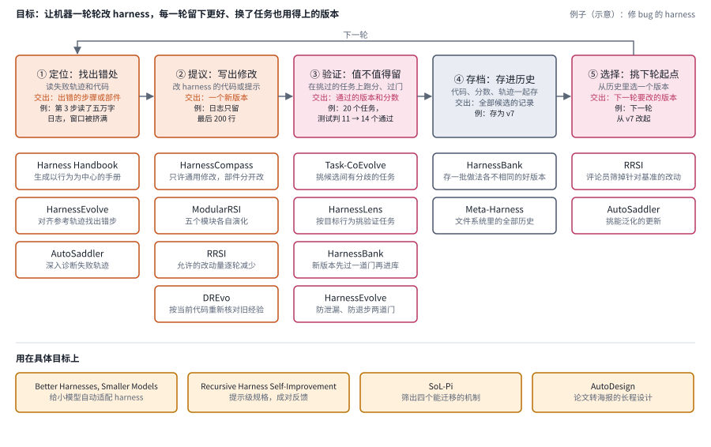

*图：自动优化 harness 的通用循环。上排五个方框是循环的五个环节，下面每一列是在这一环动手的论文；最下面一排是把这套方法用在具体目标上的工作。*

上排五个方框是几乎所有 harness 搜索方法共有的骨架。第一环是定位：一个生产级 harness 有成千上万行代码，先得知道要改哪里。第二环是提议：根据诊断写出一个修改。第三环是验证：在一部分任务上跑一遍，判断这个修改值不值得留下。第四环是存档：留下哪些历史给后面的提议者参考。第五环是选择：下一轮从哪个版本出发。Meta-Harness 把这五环都交给一个编码 agent 和一个文件系统，后来的改进工作则各自加固其中一两环。每一列下面列的就是在这一环动手的论文，例如 Task-CoEvolve 和 HarnessLens 都在验证这一环省钱，HarnessCompass、ModularRSI 和 RRSI 都在提议这一环加约束；同一篇论文出现在两列，说明它同时改了两环。下面的文字先讲最下面一排的第一项应用，说明为什么值得自动优化，再按这些论文要应对的困难依次讲，其余三项应用放在本分支末尾。

先看一个让人很有动力的应用场景。**[Better Harnesses, Smaller Models: Building 90% Cheaper Agents via Automated Harness Adaptation](https://arxiv.org/abs/2607.08938)**（`2607.08938`） 发现，小模型直接塞进为前沿大模型设计的 harness 里往往表现不佳，可如果给它配一个由元 agent 自动找到的适配 harness，在很多常规业务任务上就能接近大模型的水平。它的核心洞察是，许多任务难度是所有实例共有的，可以通过量身定制的指令、工具和编排循环，从模型那里"挪"到 harness 里。在七个业务任务和三个小模型家族上，优化后的 harness 在 21 组中的 16 组显著提升，最好的小模型 agent 以 4% 的成本恢复了大模型 89.7% 的表现。作者也坦白了适用条件：流程越重复、小模型的基础能力越够用，适配的效果越好。这与 OpenJarvis 的结论遥相呼应。

搜索塌缩和噪声反馈是最先被正面处理的问题。**[HarnessBank: Semantic Gene-Bank Search with Gated Verification for Agent-Harness Self-Evolution](https://arxiv.org/abs/2607.13683)**（`2607.13683`） 指出，现有方法依赖贪心的候选选择和自己生成的嘈杂反馈，结果容易出现搜索塌缩、对特定任务过拟合和难以验证。它让任务 agent 和一个独立的演化 agent 配对，维护一个"harness 基因库"，里面是语义坐标各不相同的高表现 harness，可以重新发明、重组、筛选；再用一道门控筛选机制，降低评估大量后代的成本。在七个基准上提升 5.1% 到 15.4%，跨模型实验还表明，提升来自针对特定模型的演化过程，世界上并没有一个对所有模型都最优的 harness。

历史经验怎样用，是第二个问题。**[DREvo: Distilling Recalibrated Historical Experience for Harness Self-Evolution](https://arxiv.org/abs/2607.26722)**（`2607.26722`） 发现，积累下来的历史经验并不总能转化为稳定的搜索方向，演化过程中的表现常常大起大落。它指出两个缺口：没有动态地重新评估一条旧经验对当前 harness 是否仍然成立，也没有明确的机制把有效经验翻译成可执行的搜索方向。它的办法是把证据锚定到函数级别，按当前状态重新校准，再提炼出带角色的搜索意图。在有限预算下，它的演化曲线更平滑，在五个基准上都拿到最高准确率。

第三个问题是泛化和部件干扰。**[HarnessCompass: Guiding Automatic Harness Evolution toward Generalizable and Effective Agent Harnesses](https://arxiv.org/abs/2608.01918)**（`2608.01918`） 认为现有方法容易对演化任务过拟合、只依赖从轨迹中提取的信号、还把各部件放在一起优化。它先施加全局约束，只允许与具体任务无关的修改；再让 agent 以第一人称主动反馈自己用 harness 时的感受，补充轨迹之外的信号；最后把各部件分开优化，再合成一个统一的 harness。在 SWE-bench Verified 上，它用 GPT-5.4 只演化五轮就把 Pass@1 从 54% 提到 66%，搜出的 harness 还能迁移到留出任务和其他模型。**[AutoSaddler: Automatic Harness Optimization with Durable Updates from Agent Execution Traces](https://arxiv.org/abs/2608.23041)**（`2608.23041`） 把 harness 优化当作一个离线学习问题，用小批量的失败信号迭代更新，结合失败轨迹诊断、把 harness 当代码处理的结构化补丁和基于验证的更新选择。它在 GAIA2、SWE-Bench Pro 和 Terminal-Bench 2.0 上分别提升 9.0、9.6 和 10.0 个点，消融实验总结出三条经验：深入调试比浅层反思有效，有针对性的修改比无约束的编辑有效，挑选能够泛化的更新比修补单条轨迹有效。

把部件拆开来演化，是另一组工作的共同选择。**[ModularRSI: Modular and Generalizable Recursive Harness Self-Improvement](https://arxiv.org/abs/2609.14857)**（`2609.14857`） 把可演化的 harness 分成五个功能模块：agent 循环、工具使用、观察管理、上下文管理和任务完成检测，每个模块在受限的修改范围内独立演化，再统一整合、解决冲突。它还专门从外部来源整理了 2,000 个与下游评测基准不相交的可执行演化任务，从源头上避免在评测集上演化。**[RRSI: Regularized Recursive Self-Improvement of Agent Harnesses](https://arxiv.org/abs/2609.24972)**（`2609.24972`） 则借用机器学习里正则化的思想：提议者的编辑预算随时间退火，限制一个候选能打包多少改动，并鼓励探索没走过的轨迹；选择者配一个评论员筛掉针对特定基准的提议，再配一个剪枝器删掉太小、太贵或已经没用的改动。在八个基准上，它在演化所用的数据划分上最多提升 14.1 个点，在五个分布外基准上最多提升 4.7 个点，得到的 harness 比不加正则的演化少用 30% 的策略 token。这两个数字的差距本身就很说明问题，后面三.7 会回到这件事。

验证成本是第四个问题。**[Task-CoEvolve: Efficient Harness Optimization via Adaptive Validation Task Selection](https://arxiv.org/abs/2608.20169)**（`2608.20169`） 观察到，候选 harness 之间结果有分歧的任务，比那些总是全做对或全做错的任务更能区分好坏。它按历史结果的方差加权采样，把评估集中在能力前沿附近的任务上，并根据采样概率从部分评估估计全集分数。在在线文本分类和 Terminal-Bench 2.1 上，它以少 80% 的评估次数达到了全集搜索的最终表现。**[Verify Smarter, Evolve Further: Efficient Harness Evolution through Behavior-Aware Verification](https://arxiv.org/abs/2608.27311)**（`2608.27311`） 提出的 HarnessLens 走另一条路：每个候选修改都瞄准某种行为，那就只在能检验这种行为的任务上验证，再配一道"可归因证据"的门控。这样既省预算，又能避免总分掩盖局部退化。在三个 harness 和四个基准上，留出集表现平均提升 7.6% 到 13.6%。**[HarnessEvolve: Learning from Reference Trajectories for Reliable Agent Self-Evolution](https://arxiv.org/abs/2609.00829)**（`2609.00829`） 处理的是信用分配：终局的成败信号说不清哪一步出了错。它让 agent 在知道标准答案的条件下再跑一遍，得到参考轨迹，把失败轨迹与之对齐来提取错误信号并聚类成系统性模式；每次 harness 更新还要过两道门，一道过滤数据泄漏和提示膨胀，一道要求在当前批次上改进且不损害最近的批次。

在改动之前，还有一个常被忽略的步骤：找到该改哪里。**[Harness Handbook: Making Evolving Agent Harnesses Readable, Navigable, and Editable](https://arxiv.org/abs/2607.13285)**（`2607.13285`） 指出，生产级 harness 庞大、耦合紧密，同一个行为散落在许多文件里，而修改请求描述的是"系统应该做什么"。它用静态分析加模型辅助的整理，从代码库自动生成一份以行为为中心的"手册"，把每个行为链接到对应的源码，再引导 agent 从高层行为逐步深入到实现细节。在两个开源 harness 上，它提高了行为定位和修改计划的质量，同时节省了规划 token，收益在分散的修改点和很少执行的路径上最大。这让人想起 OpenAI 把 AGENTS.md 改成目录、背后挂一个结构化 docs 目录的做法：harness 要能被 agent 改，先得能被 agent 读懂。

最后三篇把自动优化用在了特定目标上。**[Recursive Harness Self-Improvement](https://arxiv.org/abs/2607.15524)**（`2607.15524`） 把 harness 表示为对 agent 循环的提示级规格，利用对自身修订历史的成对反馈迭代改进；在 30 个合成的机器学习研究任务上，几轮迭代就让低推理强度的 agent 超过了最高推理强度的设置，推理成本最多降低 60%，作者分析收益主要来自更有效的 agent 间信息流，与更长的推理无关。**[SoL-Pi: Recursively Scaling Auto-Research Loops for Efficient Agent Harness](https://arxiv.org/abs/2609.20519)**（`2609.20519`） 把自动研究循环扩展到越来越多、越来越多样的环境里，筛出四个能迁移的机制，涵盖动作执行、上下文压缩、观察处理和委派阅读；在 EdgeBench 上与 Pi 表现相当，token 流量减少 44.7% 到 49.0%，API 成本减少约三分之一。**[AutoDesign: Meta-Harness Optimization for Long-Horizon Agentic Design](https://arxiv.org/abs/2608.13560)**（`2608.13560`） 把 Meta-Harness 式的优化器用到论文转海报这种长程设计任务上，并构建了 PosterBench；在七种编码 agent 与模型配置上，接入学到的 DesignHarness 让平均分从 54.99 提到 67.39。

把这一分支的方法放进同一张表，按它们加固的环节大致排序，最右两列分别是它补上的短板和留下的代价。

| code | 名称 | 年份 | 代表 | 怎么做 | 解决了什么 | 代价 |
|---|---|---|---|---|---|---|
| O1 | 语义基因库 | 2026 | HarnessBank | 任务 agent 配一个独立的演化 agent，维护语义坐标各异的 harness 基因库，用门控筛选后代 | 贪心选择加嘈杂的自生成反馈容易搜索塌缩；保留多样的高表现候选，再用门控压低评估成本 | 跨模型实验表明演化结果针对特定模型，换模型要重新演化 |
| O2 | 经验重校准 | 2026 | DREvo | 把历史证据锚定到函数级别，按当前状态重新校准，提炼成带角色的搜索意图 | 旧经验对当前 harness 未必还成立，演化曲线大起大落；重校准以后搜索方向更稳 | 要额外维护和校准经验 |
| O3 | 约束加分部件 | 2026 | HarnessCompass | 只允许与具体任务无关的修改，加入 agent 的第一人称反馈，各部件分开优化再合成 | 修改容易对演化任务过拟合，部件一起改又会互相干扰；约束加拆分让搜出的 harness 能迁移 | 全局约束会排除一部分可能有效的任务特定修改 |
| O4 | 持久的离线更新 | 2026 | AutoSaddler | 用小批量失败信号迭代，结合失败轨迹诊断、把 harness 当代码的结构化补丁和基于验证的更新选择 | 修补单条轨迹的改动不持久；深入调试、有针对性地修改、挑能泛化的更新，收益更持久 | 每个小批量都要诊断和验证，迭代成本高 |
| O5 | 模块化演化 | 2026 | ModularRSI | 把 harness 分成五个功能模块，各自在受限范围内演化再统一整合；用 2,000 个与评测不相交的任务来演化 | 在评测集上演化会污染结论；拆模块加不相交的演化任务，从源头上把两者隔开 | 模块之间的冲突需要额外的整合步骤 |
| O6 | 正则化演化 | 2026 | RRSI | 编辑预算随时间退火，评论员筛掉针对基准的提议，剪枝器删掉太小、太贵或已经没用的改动 | 无约束的演化会堆出臃肿、只对基准有效的 harness；正则化让结果更精简，少用 30% 的策略 token | 演化集上最多提升 14.1 个点，分布外最多 4.7 个点，泛化差距仍然存在 |
| O7 | 省验证的任务选择 | 2026 | Task-CoEvolve、HarnessLens | 前者按历史结果的方差挑候选之间有分歧的任务，后者只在能检验目标行为的任务上验证，并加可归因证据的门控 | 每次全集评测都很贵，总分还会掩盖局部退化；把评估集中在信息量大的任务上 | 部分评估要靠估计全集分数，估计偏差会影响选择 |
| O8 | 参考轨迹加两道门 | 2026 | HarnessEvolve | 在知道标准答案的条件下再跑一遍得到参考轨迹，与失败轨迹对齐找出错步；更新要过防泄漏和防退步两道门 | 终局的成败信号说不清哪一步出错；对齐参考轨迹，就能把错误定位到具体步骤 | 要用到标准答案，因此必须专门防范数据泄漏 |
| O9 | 行为手册 | 2026 | Harness Handbook | 静态分析加模型辅助整理，从代码库生成以行为为中心的手册，把每个行为链接到源码 | 同一个行为散落在许多文件里，修改请求描述的却是行为；手册把两者对上 | 手册要随代码一起更新，否则会过时 |

### 4. harness 能不能在运行中持续学习？

前一个分支的方法大多是离线的：先在一批开发任务上搜好 harness，部署时冻结。可部署后的情况往往和开发时不一样，测试分布会变，失败模式会变，工具的行为也会变。Continual Harness 把适应搬进了同一次运行里，这个分支的论文沿着这条路继续走：harness 能不能在测试时、在部署中、在一个任务接一个任务的流里持续更新，同时又不把以前会做的事忘掉？

> 主线位置："让 harness 学习"阶段的最后一步，在线适应。接 Reflexion 的语言反馈、Continual Harness 的免重置在线更新，以及第 03 章梯子上第 1、2 级之间的经验沉淀。

> **要点**：在线学习把 harness 的更新搬到部署之后。难点有两个：没有标签时用什么信号判断改得好不好，以及新的改动会不会破坏以前会做的事。

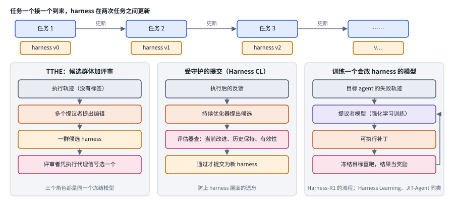

*图：harness 在运行中持续学习的三种做法。上排是一条任务流，harness 在两次任务之间更新；下面三栏分别是 TTHE 的候选群体加评审、受守护的提交，以及训练一个专门会改 harness 的模型。*

最上面一排是这一分支共同的设定：任务一个接一个到来，harness 在两次任务之间从 v0 变成 v1、v2，模型权重始终冻结。三种做法的区别在于两次任务之间发生了什么。左栏是 TTHE：执行留下的轨迹没有标签，多个提议者据此提出编辑，形成一群候选 harness，再由评审者依据从执行中得到的代理信号选出一个，用于这一批，并作为下一批的起点；三个角色都由同一个冻结模型扮演。中栏是 Harness Continual Learning 提出的受守护的提交：优化器只负责提出候选，评估器检查当前改进、历史保持和有效性三件事，都通过了才提交，目的是防止“harness 层面的遗忘”。右栏把提议者本身变成一个训练出来的模型，图里画的是 Harness-R1 的流程：读目标 agent 的失败轨迹，写出可执行补丁，让冻结的目标 agent 重跑，结果作为强化学习的奖励回到提议者；Harness Learning 和 JIT-Agent 也属于训练专门模型的这一类。

**[TTHE: Test-Time Harness Evolution](https://arxiv.org/abs/2607.08124)**（`2607.08124`） 把问题问得很尖锐：如果手里只有 agent 在测试输入上产生的、没有标签的执行轨迹，能否在评测过程中优化 harness？它把可执行的 harness 当作测试时适应的状态，维护一组候选 harness，由一个 agent 式的提议者根据执行轨迹改进它们，再由一个评审者依据从执行中得到的代理信号选定改进后的版本，选中的程序持续作用于后续输入。求解者、提议者和评审者都是同一个冻结模型外面套的不同角色和 harness，所有适应都通过改变外围程序完成。它在文本转 SQL、竞赛编程、软件工程、数据科学编程和工具使用任务上都改进了固定的 ReAct 式基线。作者把"从执行中得到的代理信号有多可靠"列为这条路上的核心挑战，这和三.7 讨论的评测问题是同一个根源。

**[MemoHarness: Agent Harnesses That Learn from Experience](https://arxiv.org/abs/2607.14159)**（`2607.14159`） 注意到，大多数自动改进方法只优化提示、流水线或工作流这些较窄的对象，部署的 agent 也通常对所有情况用同一个全局 harness。它把 harness 拆成六个可编辑的控制维度，用双层经验库保存逐案的诊断和提炼出的全局模式，测试时根据检索到的经验为每个案例调整 harness，无需测试标签、反馈或额外搜索。它在终端、代码生成和分析推理任务上胜过固定 harness，并对没见过的测试集和基础模型表现出一定的迁移。作者在结论里很克制，把统计稳健性和部件归因留给了后续工作。

**[Living-Harness Is an Interactive-Agent Evolver](https://arxiv.org/abs/2607.26598)**（`2607.26598`） 关心的是交互式 agent 里反复出现的同一种失败：一次对话里也许能靠重试恢复，可下一个任务又会犯同样的错，因为事后的反馈很少回头修改那个持久的 harness。它把每条完成的轨迹和评估信号转成有边界的 harness 更新证据，写成两种互补的程序性知识：记录触发条件、失败模式和恢复动作的情景记忆，以及记录状态节点、修复边和转移规则的状态图。工具和基础上下文保持冻结，修复可以跨演化周期不断积累。在由 τ²-Bench 和 MultiWOZ-2.4 改造的八个交互环境上，平均 Pass@1 比最强基线高出约 10 个点，演化出的 harness 状态还能被不同的模型骨干直接检索复用。

在线学习一定会碰到遗忘问题。**[Harness Continual Learning: Continual Adaptation Beyond Model Parameters](https://arxiv.org/abs/2608.19013)**（`2608.19013`） 把它正式提了出来：持续学习过去一直以模型参数为中心，可现代 agent 也会通过提示、记忆、工具、技能和路由规则来适应，这些内容共同塑造后续执行，一次 harness 更新就可能破坏以前可靠的行为，即使模型完全冻结。作者把这种现象叫作"harness 层面的遗忘"，并提出受守护的 harness 演化：一个持续优化器根据执行后的反馈提出候选，一个持续评估器只有在检查了当前改进、历史保持和有效性之后，才提交这个候选。可控的保持率实验显示，这种遗忘是可以测量的，稳定性与可塑性之间的权衡也可以显式调节。

**[Evo-Harness: Context-to-Harness Skill Compilation for Self-Evolving Agents](https://arxiv.org/abs/2608.15071)**（`2608.15071`） 处理的是一种更苛刻的情形：现实中 agent 不断遇到新任务，往往只有一次改进的机会，而执行留下的上下文虽然丰富却很嘈杂，普遍有用的教训和任务特有的细节缠在一起。它提出在线 harness 学习的设定，冻结的 agent 在一连串任务中持续更新一个结构化 harness，核心是把嘈杂的单次执行"编译"成可复用的技能 harness，在 TerminalBench2、SWE-bench、WebArena-Infinity 等五个基准上做了评估。它在第 03 章的坐标表里是"联合更新"的例子，在这里说明的是在线学习里"从上下文到 harness"的这一步该怎么走。

上面几篇都靠提示一个通用模型来修改 harness，下一步自然是专门训练一个会改 harness 的模型。**[Harness Learning Enables Generalizable Test-Time Adaptation](https://arxiv.org/abs/2609.35738)**（`2609.35738`） 把这件事表述为在可执行程序上的元学习：harness 的修订扮演梯度更新中权重更新的角色，用强化学习训练一个提议者模型，奖励是修订后 harness 的任务表现；测试时，提议者根据一个新任务上连续执行的反馈修订 harness，不做任何参数更新。实验显示这种测试时适应的能力可以迁移到没见过的任务。**[Harness-R1: Learning to Edit Executable Runtime Harnesses from Agent Failure Trajectories](https://arxiv.org/abs/2608.02276)**（`2608.02276`） 用在线强化学习训练一个专门的 9B"harness 工程师"，把目标 agent 的一批失败转成经过验证的可执行补丁，奖励来自冻结目标重新运行的结果。它把 Qwen3.5-9B 在 WebShop、ALFWorld 和 DBBench 上的平均成功率从 44.3% 提到 53.6%；目标 agent 微调之后，一个针对它的工程师还能把平均分从 59.2% 再提到 64.2%。**[JIT-Agent: Scaling Harness Intelligence via Just-in-Time Harness Evolution](https://arxiv.org/abs/2608.25593)**（`2608.25593`） 更进一步，训练一个"harness 智能模型"，为任意现成的 agent 模型即时合成适配当前任务的 harness，并能修复 harness、从不断扩大的历史配置档案里自我演化。作为 harness 助手，它让 DeepSeek-V4-Flash 在 DeepSearchQA 和 OdysseyBench 上超过了 GPT-5.6，作者因此主张，harness 智能是一个可训练、可迁移、并与模型规模正交的能力维度。

这一分支的方法按同一张表比较如下。从上往下看，修改 harness 的一方从冻结模型扮演的不同角色，逐渐变成专门训练出来的模型。

| code | 名称 | 年份 | 代表 | 怎么做 | 解决了什么 | 代价 |
|---|---|---|---|---|---|---|
| C1 | 测试时演化 | 2026 | TTHE | 求解者、提议者、评审者都是同一个冻结模型的不同角色；候选群体按执行代理信号筛选，选中的程序作用于后续输入 | 测试时没有标签，固定的 harness 适应不了新分布；用执行中得到的代理信号在评测过程中改进 | 代理信号是否可靠，是作者列出的核心挑战 |
| C2 | 经验库调 harness | 2026 | MemoHarness | 六个可编辑的控制维度，双层经验库存逐案诊断和提炼出的全局模式，测试时按检索到的经验为每个案例调整 | 一个全局 harness 对所有案例一视同仁；逐案调整，而且不需要测试标签、反馈或额外搜索 | 统计稳健性和部件归因留待后续工作 |
| C3 | 情景记忆与状态图 | 2026 | Living-Harness | 把每条完成的轨迹和评估信号写成情景记忆与状态图，工具和基础上下文冻结，修复跨演化周期积累 | 交互式 agent 到下一个任务会重犯同样的错；把修复写进持久的 harness，下次就能用上 | 记忆和状态图会不断增长，需要管理 |
| C4 | 受守护的提交 | 2026 | Harness Continual Learning | 持续优化器根据执行后的反馈提出候选，持续评估器检查当前改进、历史保持和有效性后才提交 | 一次 harness 更新可能破坏以前可靠的行为；提交之前先检查保持率 | 稳定性与可塑性要显式权衡，守得太严就学得慢 |
| C5 | 上下文编译成技能 | 2026 | Evo-Harness | 冻结的 agent 在一连串任务中，把嘈杂的单次执行编译成可复用的技能 harness | 往往只有一次改进机会，普遍有用的教训和任务细节缠在一起；编译这一步把前者提取出来 | 编译质量依赖单次执行留下的上下文 |
| C6 | 训练专门的提议者 | 2026 | Harness Learning、Harness-R1、JIT-Agent | 用强化学习训练一个会改 harness 的模型，奖励来自修订后 harness 的表现或冻结目标重跑的结果 | 提示一个通用模型去改 harness 效果有限；专门训练以后，测试时适应的能力可以迁移到没见过的任务 | 要额外训练一个模型，它的训练分布决定了它能处理哪些 harness |

### 5. harness 与权重怎样一起优化，又怎样相互迁移？

harness 是围着模型量身定做的，这一点在前面几个分支里反复出现：HarnessBank 发现提升来自针对特定模型的演化，OpenJarvis 发现换了模型就得重新搜规格。可模型本身也在变：harness 产生的轨迹可以拿来训练模型，模型一变，原来的 harness 又未必合适。Lilian Weng 把这称为 harness 与权重的联合优化，并直言证据还不够扎实。这个分支收录的论文分别从三个方向推进：怎样交替优化两者，怎样把 harness 带来的能力迁移到权重里或别的模型上，以及在 harness 里训练模型会遇到什么问题。

> 主线位置："让 harness 学习"阶段与第 03 章梯子第 4 级的交汇处。接 Continual Harness 的模型协同学习和 OpenJarvis 的跨模型规格搜索。

> **要点**：harness 和权重之间有三条通道：交替优化两者，把 harness 带来的行为蒸进权重，或者让强模型造一个 harness 给弱模型用。它们共同说明，harness 与模型之间存在一种需要维护的契合。

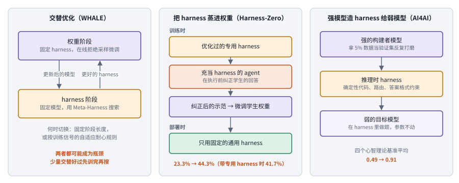

*图：harness 与权重之间的三条通道。左栏交替优化，中栏把 harness 的行为蒸馏进权重，右栏让强模型在测试时通过 harness 把能力传给弱模型。*

三栏分别对应本分支的三个方向。左栏是 WHALE 的交替优化：权重阶段固定 harness，用在线拒绝采样微调更新模型；harness 阶段固定模型，用 Meta-Harness 搜索更好的 harness；两个阶段之间何时切换，可以用固定的阶段长度，也可以用一个看训练信号的自适应耐心规则。中栏是 Harness-Zero 的蒸馏：训练时，一个充当 harness 的 agent 在专用 harness 的指导下，在学生的回答执行之前纠正它，纠正后的回答成为训练示范，用来微调学生的权重；部署时把专用 harness 拿掉，只用一个固定的通用 harness。右栏是 AI4AI：强的构建者模型用 5% 的数据当验证集反复打磨一个推理时 harness，弱模型在这个 harness 里做题，自己的参数一点不动。三栏底部的数字都在下面的正文里有交代。

最直接的做法是交替优化。**[WHALE: A Simple Recipe for Joint Harness-Weight Optimization](https://arxiv.org/abs/2609.00196)**（`2609.00196`） 的配方很简单：在当前 harness 下更新模型，再在更新后的模型下搜索更好的 harness，前者用在线拒绝采样微调，后者直接用 Meta-Harness。何时切换是关键的设计选择，它用固定的阶段长度或一个基于训练信号的自适应耐心规则。在搜索问答、数学推理和国际象棋谜题上，它比只训权重、只搜 harness 以及 Fast-Slow Training 高出 4.15 到 24.38 个点。最有意思的发现是，两者都可能成为瓶颈：在 SearchQA 上，harness 搜索用少得多的 rollout 就追平了只训权重的峰值；在数学上，harness 只有在权重更新之后才开始起作用。少量交替的更新也比"先训完权重再搜 harness"的分阶段做法更好、更省。

交替起来并不总是那么顺利。**[Co-Evolving Harnesses and Models: On-Policy Correction Helps Weaker Models Catch Up Where Imitation Fails](https://arxiv.org/abs/2609.09134)**（`2609.09134`） 在七个企业 agent 任务上先用弱模型演化出一个 harness，发现强模型往往能更好地利用它，于是想用强模型的示范来训练弱模型。结果适得其反：在演化过的 harness 下用强模型的完整轨迹训练弱模型，七个任务全部退步 4 到 30 个点，而同样的做法在没演化的 harness 下是有帮助的。分析显示，模仿确实传递了知识，也让弱模型更多地使用脚手架，可它也破坏了模型与 harness 之间的契合：弱模型学来了强模型的规划方式，却没有执行它的能力，也不再匹配那个围绕自己原生规划风格演化出来的 harness。作者的解法是在策略上纠正：只定位弱模型自己轨迹里出错的那一步，请强模型改写这一步。这篇工作给"harness 与模型的契合度"提供了迄今最清楚的证据。

**[HELIX: Model-Harness Co-evolution for Recursive Self-Improvement](https://arxiv.org/abs/2608.13951)**（`2608.13951`） 强调 harness 的双重角色：它既决定模型当前能做成什么，也决定模型能从哪些轨迹里学习。HELIX 是一个可以追溯来源的 harness 演化底座，把 agent 系统分解成类型化的端口、可复用的原子、配方、产品外壳和运行时策略，让每一次干预都显式、可审计。在一轮代码修复的演化中，一组 65 个候选找到了一个比 Pi 多覆盖 4.0% 任务的固定 harness，而整组候选通过互补的兄弟行为暴露出最多 58.0% 的额外已验证覆盖，从中得到 438 条可用于监督微调、评论员、过滤和偏好训练的已验证记录。harness 的演化于是既扩展了当前能力，又为下一代模型制造了学习信号。

第二个方向是迁移和内化。**[Harness-Zero: Harness Distillation via Agent-as-Harness](https://arxiv.org/abs/2609.24974)**（`2609.24974`） 研究 harness 蒸馏：用一个针对领域或实例优化过的 harness 作为训练时的指导，把它诱导出的行为转移进模型权重，使得部署时只用一个固定的通用 harness。难点在于两个 harness 的动作空间和可用信息都不同。它的办法是让一个"充当 harness 的 agent"在目标 harness 的动作空间里、在执行前纠正学生的回答，把 harness 的指导变成训练示范。部署时去掉专门的 harness 后，基础模型的宏平均成功率从 23.3% 升到 44.3%，甚至超过了带着那个 harness 时的 41.7%。**[EvoHarness-RL: Learning Self-Evolving Runtime Harness for Long-Horizon LLM Agents](https://arxiv.org/abs/2608.05446)**（`2608.05446`） 从另一侧观察到相似的现象：它让 agent 学习"harness 策略"，即怎样构建和更新外部的信念、进度和经验状态，在 ALFWorld 上用 Qwen3-8B 达到 96.9% 的成功率，并记录了一种"harness 退火"：训练把反复出现的 harness 使用模式内化进策略，agent 从频繁调用 harness 转向有选择地访问外部状态。这正是 Lilian Weng 预期的那种演化：一部分 harness 的收益会被模型吸收，而对外部上下文和工具的接口会留下来。

harness 还可以在模型之间传递能力。**[AI4AI at Test-Time: Strong-to-Weak Capability Transfer via Harnesses](https://arxiv.org/abs/2608.12307)**（`2608.12307`） 问的是，能力从大模型到小模型的转移能不能发生在测试时，不更新任何参数。它让一个强的"构建者"模型用 5% 的数据作为验证集反复打磨一个推理时 harness，再让弱模型在这个 harness 里做题。在四个心智理论基准上，目标模型的平均表现从 0.49 几乎翻倍到 0.91。分析显示，收益主要来自把不稳定的模型推理卸载到确定性的代码里、按基准路由和严格的答案格式约束，与让目标模型想得更多或采样更广关系不大。**[One Recipe, Many Harnesses: What Self-Evolution Encodes Across Languages and Models](https://arxiv.org/abs/2608.10178)**（`2608.10178`） 则追问演化出的 harness 里到底装了什么。它固定一个演化配方，在八种编程语言和三个基础模型的网格上分析结果，每次编辑都对应一个类型化的失败信号并记成一条可证伪的契约。结论很有启发：harness 的收益主要用来补偿可恢复的执行缺陷，缺陷少的地方收益也近乎为零，用作者的话说，harness 弥合的是策略能做到和实际做到之间的差距；演化出的 harness 在不同语言之间共享一套抽象的打法，可具体落地时用的语言生态机制几乎互不相交；共享的核心可以迁移并蒸馏成一个通用 harness，而依赖生态的那部分必须在新语言里重新演化。

第三个方向把 harness 当作训练的场所。今天的强化学习越来越多地直接在部署用的 harness 里做，这时 harness 拥有与环境交互的循环，训练器只能看到模型调用。[Agent Lightning v1.0](https://arxiv.org/abs/2608.17528)（`2608.17528`）、[LEGO-RL](https://arxiv.org/abs/2608.17393)（`2608.17393`）、[ClawGym II](https://arxiv.org/abs/2608.16798)（`2608.16798`）和 [OpenForgeRL](https://arxiv.org/abs/2607.21557)（`2607.21557`）都在解决这类"在 harness 里训练"的工程问题，比如让训练与推理一致、隔离沙盒、处理环境崩溃污染奖励。它们的主要贡献在训练基础设施上，收在[强化学习与蒸馏](05_rl_and_distillation.md)等章节，和本分支一起读，能看清 harness 与权重之间那条双向的通道。

把这一分支的工作放进同一张表，可以按“谁在适应谁”来读：前三行是 harness 和权重一起变，中间三行是能力在 harness、权重和不同模型之间搬家，最后一行是训练基础设施。

| code | 名称 | 年份 | 代表 | 怎么做 | 解决了什么 | 代价 |
|---|---|---|---|---|---|---|
| J1 | 交替优化 | 2026 | WHALE | 在当前 harness 下用在线拒绝采样微调更新模型，再在新模型下用 Meta-Harness 搜 harness，按固定长度或自适应耐心规则切换 | 只训权重或只搜 harness 都会碰到另一方的瓶颈；交替让两边轮流松动 | 训练与搜索耦合，切换时机是关键的设计选择 |
| J2 | 在策略纠正 | 2026 | Co-Evolving Harnesses and Models | 只定位弱模型自己轨迹里出错的那一步，请强模型改写这一步 | 直接模仿强模型的完整轨迹会破坏弱模型与演化 harness 的契合，七个任务全部退步；只改错步，契合就保住了 | 要先定位错步，还得有一个可用的强模型 |
| J3 | 可追溯的协同演化 | 2026 | HELIX | 把 agent 系统分解成类型化端口、原子、配方、产品外壳和运行时策略，每一次干预都显式、可审计 | harness 演化既要扩展当前能力，又要产出可信的学习信号；可追溯让 438 条已验证记录能用于后续训练 | 分解和记录带来额外的工程开销 |
| J4 | harness 蒸馏与内化 | 2026 | Harness-Zero、EvoHarness-RL | 前者让充当 harness 的 agent 在执行前纠正学生回答，后者让 agent 学习怎样构建和更新外部的信念、进度和经验状态 | 专用 harness 的收益依赖部署时一直带着它；把行为蒸进权重，部署时就可以去掉 | Harness-Zero 报告平均恢复 82.3% 的 harness 诱导行为，其余部分仍要靠外部 |
| J5 | 强到弱迁移 | 2026 | AI4AI at Test-Time | 强的构建者用 5% 数据打磨推理时 harness，弱模型在其中做题，不更新参数 | 能力迁移通常要更新参数；把不稳定的推理卸载到确定性代码、路由和格式约束里，测试时就能完成迁移 | 依赖构建者模型的能力和那 5% 验证数据的代表性 |
| J6 | 解剖演化出的 harness | 2026 | One Recipe, Many Harnesses | 固定一个演化配方，在八种语言和三个模型的网格上，把每次编辑对应到类型化失败信号和可证伪的契约 | 演化出的 harness 里到底装了什么一直说不清；分析发现收益主要用来补偿可恢复的执行缺陷 | 依赖语言生态的那部分无法迁移，到新语言里要重新演化 |
| J7 | 在 harness 里训练 | 2026 | Agent Lightning v1.0、LEGO-RL、ClawGym II、OpenForgeRL | 直接在部署用的 harness 里做强化学习，处理训练与推理一致、沙盒隔离和环境崩溃污染奖励等问题 | 训练环境与部署环境不一致，学到的策略就用不上；在同一个 harness 里训练可以消除这种差异 | harness 拥有交互循环，训练器只能看到模型调用，基础设施工程量大 |

### 6. harness 握着权限，安全该怎样设计和演化？

harness 决定了模型能调用什么工具、能改什么文件、看到哪些不可信的输入，它的每一个设计选择也都是安全选择。传统的做法是由专家设计一套固定的安全层，部署后不再改动，可这带来两个问题：一套对某个模型刚好合适的约束，换到另一个模型上可能过严，把正常任务也拦下；新的风险不断出现，固定的规则跟不上。与此同时，harness 一旦开始自我演化，就多了一种新的风险：一次让能力提升的修改，可能留下无法撤销的副作用。这个分支的论文分别处理这几件事。

> 主线位置：主线的边界部分。接 Lilian Weng 关于把权限和安全层放在自我修改循环之外的主张，与[安全与对齐](07_safety.md)章的提示注入、工具权限问题相连。

> **要点**：harness 的每一个设计选择也是安全选择。这一组论文把安全层本身做成可以演化的 harness，按 harness 的运行阶段系统地评测风险，并要求自我修改先保证能撤销。

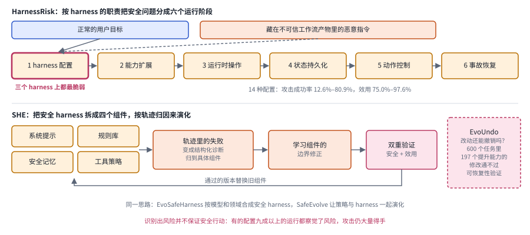

*图：harness 安全的两个视角。上排是 HarnessRisk 划分的六个运行阶段，恶意指令藏在不可信的工作流产物里，第一个阶段最脆弱；下排是 SHE 的四组件演化循环，以及 EvoUndo 提出的可恢复性检查。*

上排从左到右是 HarnessRisk 按 harness 职责划分的六个运行阶段：harness 配置、能力扩展、运行时操作、状态持久化、动作控制和事故恢复。每个测试案例都把一个正常的用户目标和一条藏在不可信工作流产物里的恶意指令配在一起，看 agent 会不会在完成正常任务的同时执行恶意指令。加粗的第一个阶段在三个 harness 上都最脆弱，因为攻击可以在授权的工作流里悄悄改掉安全敏感的参数。下排是 SHE 的做法：安全 harness 被拆成系统提示、规则库、安全记忆和工具策略四个职责明确的组件，轨迹里的失败先变成结构化诊断并归到具体组件，再学习这个组件的边界修正，最后同时检查安全和效用，两者都过关的版本才替换旧组件。最右边的虚线框是 EvoUndo 提出的另一道检查：一次提升能力的修改，在以后的状态下还能不能安全撤销。正文按先设计安全层、再评测、最后处理自我演化风险的顺序展开。

先是把安全层做成可以演化的 harness。**[SHE: Trajectory-driven Safety Harness Evolution for LLM Agents](https://arxiv.org/abs/2608.09885)**（`2608.09885`） 指出，agent 的安全不只取决于模型权重，也取决于管理上下文、记忆、工具、权限和运行时控制的 harness，而且各部件功能耦合，安全责任很难归到具体位置。它把 harness 分解成系统提示、规则库、安全记忆和工具策略四个职责明确的组件，再用一个由归因引导的演化循环，把轨迹中的失败转成结构化诊断，学习各组件的边界修正，并通过安全与效用的双重验证来挑选演化后的 harness。在 Agent-SafetyBench 上，攻击成功率比静态的安全 harness 降低到约三分之一，正常任务的效用还有所提升，演化出的 harness 也能泛化到留出的 AgentHarm 基准、迁移到其他模型。

**[EvoSafeHarness: Evolving Model- and Domain-Specific Harnesses for Securing Agents](https://arxiv.org/abs/2609.05903)**（`2609.05903`） 抓住了"一刀切"的问题：模型不同，需要的约束强度不同；领域不同，需要管控的效果、状态和动作序列也不同。它为一个冻结模型在目标领域里合成可部署的安全 harness，同时搜索自然语言策略和可执行的代码逻辑，并用全新上下文的对抗审查来拒绝只针对基准的规则。在 DecodingTrust-Agent 上，它把平均攻击成功率从 45.6% 降到 10.0%，效用只损失 3.3 个点；在 AgentDojo 上以 0.0% 的攻击成功率达到 82.8% 的效用。作者的分析给出了一个很好的分工：领域语义决定需要哪些安全关系和轨迹状态，模型和运行时行为决定这些关系该在哪里、以什么方式强制执行。

**[SafeEvolve: Harness-Policy Co-Evolution from Agent Experience for Safety Alignment](https://arxiv.org/abs/2609.02786)**（`2609.02786`） 把上一个分支的联合优化用在了安全上。harness 一侧，它把轨迹级的安全证据转成对安全提示和分层技能的有边界、组件级的更新，产物可审计、可撤销；策略一侧，先用 harness 使用的监督微调让模型学会主动利用演化出的 harness，再用 harness 增强的强化学习在多步探索中塑造自主的安全行为。对 Qwen3.5-4B，它在 AgentDojo 上把攻击成功率降到约三分之一，同时正常任务效用从 59.79% 微升到 61.86%。

评测也要跟上。**[HarnessRisk: A Lifecycle-Oriented Benchmark for Agent Harness Safety](https://arxiv.org/abs/2608.17597)**（`2608.17597`） 按 harness 的职责把安全问题分成六个运行阶段：harness 配置、能力扩展、运行时操作、状态持久化、动作控制和事故恢复，构造了 128 个沙盒案例，每个都把一个正常的用户目标和一条藏在不可信工作流产物里的恶意指令配在一起。在 14 种模型与 harness 的配置上，攻击成功率从 12.6% 到 80.9% 不等，而效用一直保持在 75.0% 到 97.6% 之间，也就是说"有用但不安全"的情况非常普遍。harness 配置阶段在三个 harness 上都是最脆弱的一环，攻击可以在授权的工作流里悄悄改掉安全敏感的参数。还有一个让人警惕的发现：明确识别出风险并不保证安全行动，有的配置在九成以上的运行里察觉了风险，攻击仍然大量得手。

最后是自我演化本身带来的风险。**[EvoUndo: Recoverability-Constrained Self-Evolution for LLM Agent Harnesses](https://arxiv.org/abs/2608.28363)**（`2608.28363`） 注意到，agent 越来越多地在运行时修改自己的提示、工具、中间件和 harness，一次成功的修改可能留下持久的影响，在与创建时不同的状态下无法安全撤销。它在 600 个未见过的一次性自我演化任务中找到了 197 个提升能力却通不过可恢复性验证的修改，常规的修复策略一个也救不回来。通过扩展恢复语言的表达力并提供精确的状态地址，可恢复的比例大幅上升。作者的结论是，可靠的自我演化需要把验证、状态落地和恢复语言放在一起设计，单靠反复提示是不够的。这与 OpenAI 依赖 git 回滚、Anthropic 要求每次会话结束时留下可合并状态的经验是同一个道理：harness 改得越大胆，撤销的能力就越要先准备好。

### 7. 怎样评测 harness，又怎样把失败归到正确的一层？

DAIR.AI 用 METR 的长任务研究收尾，是在提醒一件事：harness 的进步要用对尺子来量。可现实中的评测常常量不准。一篇论文报告"演化后的 harness 在 Terminal-Bench 上提高了十个点"，我们需要追问的问题很多：这些改动是在同一组题上搜出来的吗？对照组有没有用同样的预算？换一个模型还成立吗？更根本的是，一个 agent 失败了，问题出在模型、harness、环境还是评分器？这个分支的论文从几个角度回答这些问题。

> 主线位置：主线的第五段"怎样知道它有效"及其边界。接 METR 的任务时间跨度，以及 Lilian Weng 关于评价器太弱、系统会钻评价空子的提醒。

> **要点**：评测 harness 要守两条规矩：选版本用的数据和报分数用的数据彻底分开，对照组在同样的预算下比较；失败要先归到模型、harness、环境或评分器中的某一侧，再谈修复。

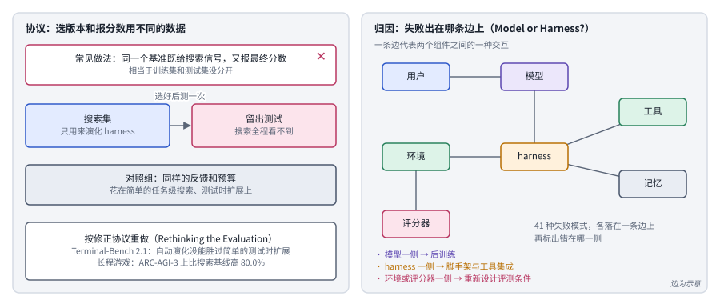

*图：评测 harness 的协议与归因。左边是修正后的评测协议，右边是 Model or Harness 的交互边归因，边的具体划分以论文为准。*

左栏讲协议。最上面打叉的是常见做法：同一个基准既为搜索提供验证信号，又用来报最终分数，等于训练集和测试集没有分开。修正后的做法是把数据切成两份，搜索集只用来演化 harness，留出测试在搜索全程都看不到，选定版本后只测一次；对照组则拿同样的反馈和预算去做简单的任务级搜索或测试时扩展。最下面的方框是 Rethinking the Evaluation 按这个协议重做的结果。右栏讲归因。Model or Harness? 把参与一次 agent 运行的组件画成节点，包括用户、模型、harness、工具、记忆、环境和评分器，每一条边代表两个组件之间的一种交互；41 种失败模式各自落在一条边上，并标出出错的是哪一侧：模型一侧指向后训练，harness 一侧指向脚手架和工具集成的修复，环境或评分器一侧说明评测条件需要重新设计。图里边的连法只是示意，论文给出的是失败模式到边的分配。

最值得先读的是一篇泼冷水的论文。**[Rethinking the Evaluation of Harness Evolution for Agents](https://arxiv.org/abs/2607.12227)**（`2607.12227`） 指出现有评测协议有两个根本问题：没有在相同的反馈和推理预算下与简单的任务级搜索基线比较；用于搜索 harness 的验证信号，比如单元测试，又来自最终报告成绩的同一个基准，违背了训练集与测试集分开的基本规矩。按照修正后的协议重新做实验，在 Terminal-Bench 2.1 上，自动 harness 演化无论有没有测试用例，都没能胜过简单的测试时扩展方法，泛化也很有限。作者并没有就此否定这条路：在长程游戏这类难度够高、依赖对陌生动态的适应、反馈又天然细致的场景里，针对任务的 harness 演化在相同预算下比搜索基线在 ARC-AGI-3 上提升 80.0%，在 EdgeBench 上提升 10.9%。RRSI 在演化集和分布外基准上 14.1 与 4.7 的差距，也可以放在这篇论文的框架里理解。

**[Automated Discovery Has No Universally Superior Harness](https://arxiv.org/abs/2607.18235)**（`2607.18235`） 用同样严格的态度审视了自动发现系统。OpenEvolve、TTT-Discover 这类系统常被当作通用 harness 使用，可它们其实把档案管理、父代选择、探索策略和预算分配等多种设计选择打包成了一个配方，而且常常只用很少的独立试验做比较，分不清方法改进和运行间的随机波动。作者把它们拆成组成部件，用超过 310 万次 rollout，在 12 组模型与问题的组合上系统评估了 30 个预算匹配的 harness。结论正如标题：没有一个固定的 harness 能在所有组合上稳定胜出，OpenEvolve 的变体通常还不如更简单的方案，harness 的选择更像一个超参数。好在早期进展能预测最终表现，于是先并行启动多个 harness、剪掉表现差的、把算力转给领先者的自适应分配策略，胜过了任何固定选择。

有了严格的协议，还需要标准化的基准来衡量"优化 harness"这种能力。**[HarnessOpt-Bench: Evaluating LLMs at Harness Optimization](https://arxiv.org/abs/2608.06301)**（`2608.06301`） 让一个优化器，也就是一个大模型加一个编码 harness，拿到目标 agent 的初始 harness、带分数的评测反馈和固定的评测预算，修改 harness 并提名最终候选，最后在搜索全程都无法接触的留出测试集上按相对初始版本的增益计分；一个可信执行环境负责守住评测边界、计量资源并保存所有候选版本供审计。在 111 次计分运行中，作为优化器的模型之间差距比它们所用的编码 harness 之间差距更大，原生 harness 也并不总是更好。**[Evo-Bench: Can Language Models Improve Agent Harness?](https://arxiv.org/abs/2608.09096)**（`2608.09096`） 则专门挑出对 harness 改进敏感的任务，并按敏感度分层划分数据，以保证跨套件的泛化；在九个模型上，最强的模型能带来高达 16.6 个点的绝对提升，接近人工设计的最好基线，在搜索类任务上表现突出，在需要高度特定流程的办公任务上则很吃力。**[HarnessDev: Can LLMs Create and Evolve Their Own Agent Harness?](https://arxiv.org/abs/2609.01437)**（`2609.01437`） 把评测单位从任务输出换成可运行的基础设施：先让 agent 从一个极简种子和少量案例出发造出完整的执行系统，再让它根据下游反馈迭代改进。结果是，生成的 harness 在代码、搜索与研究类任务上明显落后于成熟的人工 harness，在写作和机器学习实验上则追平甚至超过；演化带来的收益不稳定，只能部分迁移到留出任务，而且强烈依赖执行 harness 的那个模型。

评测之外，还需要把失败定位到正确的一层。**[Model or Harness? An Interaction-Centric Taxonomy for Localizing Agent Failures](https://arxiv.org/abs/2607.28802)**（`2607.28802`） 把这称为"修复分派"问题：同一个可见的失败，可能需要模型后训练，也可能需要 harness 工程、环境重设计或基准修复。它提出一套以交互为中心的分类法，把 41 种失败模式各自分配到两个组件之间的一条边上，并标出修复应该落在哪一侧：模型侧的失败指向后训练的目标，harness 侧的失败指向脚手架和工具集成的修复，环境或评分器侧的失败则说明评测条件需要重新设计。用独立的推理 agent 当评审，最强的评审与人类标注的一致性达到 Cohen's κ 0.76。**[A²E: An End-to-End Agent Auditing Engine](https://www.alphaxiv.org/abs/2608.07346)**（`2608.07346`） 提供了做这类分析所需的基础设施：一个面向 agent harness 的端到端评测引擎，用统一的任务协议把评测任务快速接入不同的 harness，自动插桩记录标准化的执行轨迹，再从执行效率、工具使用、任务规划和错误恢复等多个维度刻画 harness 之间的差异。它的实验也印证了前面的结论：模型与 harness 的组合在不同任务类型上差别很大，没有哪个组合能在所有任务上都领先。

**[Engineering Reliable Coding Agents: Evaluating and Operating the System Around the Model](https://arxiv.org/abs/2608.13867)**（`2608.13867`） 是一部专著式的综述，开篇一句话就点明主题：AI 编码 agent 常常被当作模型来评测，却被当作系统来部署。它综合了 164 篇学术文献、100 份从业者记录、29 个基准记录和 17 个系统案例，发现许多看起来是模型的失败其实源自系统的其他部分，而某一层的改进又常常传不到端到端的结果上。作者把评测和运维看成一条依赖链：任务构造、执行环境、检索、状态管理、验证或可观测性中的任何一处薄弱，都可能让下游结论失效。书中整理了 206 条可靠性记录，其中有 193 条带门槛的实践。

这些工作合起来，给评测 harness 立了几条规矩：搜索 harness 用的反馈和最终报告的测试要彻底分开；对照组要在相同的预算下比较，包括"把同样的预算花在简单重试上"这种朴素基线；结论要在没参与调优的模型上复核；失败要先归因到模型、harness、环境或评分器中的某一层，再谈改进。同一个词也会出现在别的评测里，例如 [Harness-IF](https://arxiv.org/abs/2608.11727)（`2608.11727`）检验编码 agent 是否遵守写在系统提示、工具描述等不同位置的规则，[Harness the Memory](https://arxiv.org/abs/2608.15008)（`2608.15008`）比较记忆 agent 的各种存储基底；它们的研究对象分别是指令遵循和记忆，收在[评测](06_evaluation.md)一章，与本分支对照阅读会很有收获。

## 四、方法对照与全章总对照

> **要点**：七个分支面对的困难可以归成七类，每一类有自己的方法和代价；再把全章的工作放进“改什么”和“什么时候、由谁改”两根轴组成的格子里，就能看清这个方向从左上往右下推进的路线。

读完七个分支，很容易被几十个系统的名字淹没。其实它们面对的困难来来回回就那么几类：不知道 harness 的哪些部件真正有用，长程任务里状态守不住，手工设计 harness 太贵，部署后的情况和开发时不一样，harness 和模型彼此牵制，harness 握着权限却缺少安全设计，以及评测本身不可信。下面这张表把这些困难和对应的方法、代价放在一起。真实的系统往往会同时用到其中好几行，但每一行的代价和该追问的问题都不一样，最右边一列是证据不够充分时最值得追问的，拿来审自己的实验设计也很合适。

| 问题 | 方法选择 | 主要代价 | 证据不足时要追问 |
|---|---|---|---|
| 不清楚部件贡献 | 固定循环做部件消融、极简 harness、只换编排层的对照 | 匹配设置数量多，结论依赖模型与预算 | 结论在更强或更弱的模型上是否反转 |
| 长程状态守不住 | 状态外置、执行与审计分离、运行手册、增量交付 | 额外的管理与验证调用 | 是否真的延长了可完成的任务时长 |
| 手工设计太贵 | 档案式演化、模块化演化、正则化、行为定位 | 多轮搜索与评测预算 | 演化集与留出集之间的差距有多大 |
| 部署后分布变化 | 测试时演化、经验库、受守护的提交、训练专门的提议者 | 代理信号不可靠、harness 层面的遗忘 | 新增收益是否以旧能力退化为代价 |
| harness 与模型失配 | 交替优化、在策略纠正、harness 蒸馏、强到弱迁移 | 训练与搜索耦合，数据随之非平稳 | 换模型或去掉 harness 后收益还剩多少 |
| 安全缺少设计 | 职责分解的安全 harness、领域与模型专属合成、可恢复性验证 | 效用损失与验证成本 | 识别出风险后是否真的采取了安全动作 |
| 评测不可信 | 匹配预算基线、留出测试、可信执行环境、失败归因分类 | 评测基础设施与重复试验 | 是否在同一组测试上既选版本又报分数 |

### 全章总对照：改什么，什么时候改

上面这张表按困难来组织，适合审自己的实验设计。下面换一个角度，把全章的工作放到两根共享的轴上，像多模态那几章的读写矩阵一样，用一张格子图看清每篇论文的位置。

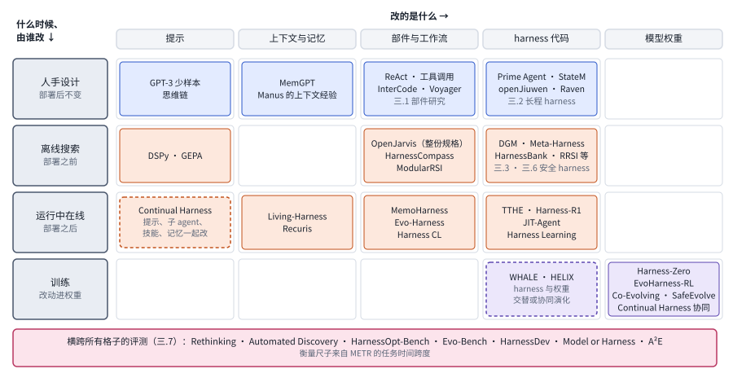

*图：全章总对照。横轴是改动的对象，从提示一直到模型权重；纵轴是改动发生的时间和执行者，从人手设计到训练；最下面的评测横跨所有格子。*

这张格子图把全章放在两根共享的轴上。横轴从左到右是被改动的对象：提示、上下文与记忆、部件与工作流、harness 代码、模型权重，对应第一节那张解剖图里由内到外、最后落到紫色方框的顺序。纵轴从上到下是改动发生的时间和执行者：人手设计后部署不变，部署前离线搜索，部署后在线更新，以及通过训练改进权重。第二节的主线大致沿着从左上到右下的方向走：V0 和静态 harness 阶段的工作都在第一行；让 harness 学习的阶段先占据第二行的左侧，再往右扩展到 harness 代码；Continual Harness 把改动推进到第三行。第三节的分支三、四、五分别填进了第二、第三、第四行。最下面那条横带是分支七的评测工作，它们不改任何一个格子，衡量的是所有格子。空着的格子同样有信息，比如离线搜索上下文与记忆的那一格，在本章收录的论文里还没有专门的代表作，可以当作选题的线索。

最后，把各家族的代表放进同一张表，用同样的几列比较：改什么，什么时候改，谁来改，判断改得好不好的信号从哪里来，以及最主要的风险。

| 家族 | 代表 | 改什么 | 什么时候改 | 谁来改 | 信号从哪来 | 主要风险 |
|---|---|---|---|---|---|---|
| S 扩张动作空间 | ReAct、Toolformer、MemGPT、RLM | 模型能发出的动作 | 设计时 | 人 | 设计者的经验和基准分数 | 部件越堆越多，各自的贡献说不清（三.1） |
| L 让 harness 学习 | DSPy、GEPA、Meta-Harness | 从提示词到 harness 代码 | 部署前离线 | 优化器或编码 agent | 搜索集上的分数和轨迹 | 对搜索集过拟合（三.7） |
| T 长程状态管理 | LongHorizon-Harness、StateM | 状态的存放位置和更新规则 | 设计时 | 人 | 环境里独立核实的事实 | 管理与审计带来额外调用 |
| O 离线优化的改进 | HarnessBank、RRSI、Task-CoEvolve | 搜索循环里的某一环 | 部署前离线 | 演化 agent | 门控验证与留出集 | 演化集与分布外之间的差距 |
| C 在线学习 | TTHE、Harness Continual Learning、Harness-R1 | 部署中的 harness | 部署后在线 | 冻结模型扮演的角色，或训练出的提议者 | 执行代理信号与保持率检查 | harness 层面的遗忘，代理信号不可靠 |
| J harness 与权重 | WHALE、Harness-Zero、AI4AI | harness 和权重两边 | 训练时或测试时 | 训练器加优化器，或强模型 | 任务成功率 | 模型与 harness 失配 |
| 安全 | SHE、EvoSafeHarness、EvoUndo | 安全组件与权限 | 部署前或运行中 | 演化循环 | 安全与效用双重验证、可恢复性验证 | 识别出风险却没有采取安全动作 |

## 五、开放问题与研究机会

> **要点**：同一套权重从 30% 到 95.5% 的差距有三种读法，本章的论文为每一种都提供了证据。下面四个问题按设计、优化、协同、评测的顺序排列，每一个都适合作为选题的起点。

回到本章开头那个数字。同一套权重，在同一个基准上从 30% 到 95.5%，这件事至少可以有三种读法。乐观的读法是，模型的潜力远比我们以为的大，只是被粗糙的 harness 压住了；谨慎的读法是，这组任务恰好特别吃 harness，换一组任务、换一个模型，差距可能小得多；还有一种读法介于两者之间，harness 把一部分本该由模型完成的工作接了过去，至于这算模型的能力还是 harness 的能力，取决于你想用这个分数回答什么问题。本章收录的论文为这三种读法都提供了证据，也留下了大片空白。下面四个问题按"设计、优化、协同、评测"的顺序排列，每一个都适合作为选题的起点。

**1. harness 的设计原则能不能从经验上升为可预测的规律？**

现在我们知道很多零散的经验：上下文管理在窗口紧张时最有用，规划对弱模型是脚手架、对强模型是省钱工具，会用 bash 的模型给它一个 bash 就够了，harness 的质量收益随模型基线变强而变大。可这些经验大多来自少数基准、少数模型，还说不清在什么条件下会反转。一个有价值的方向是系统地刻画"模型能力、任务结构、预算"这三个变量与 harness 部件收益之间的关系，就像过去研究模型规模与性能的关系那样，让人在设计 harness 之前就能大致预测哪些部件值得投入。评价这类工作时，最关键的是看它能不能对没参与拟合的模型和任务做出正确的预测。

**2. 自动优化出来的 harness，怎样才能知道它学到的是可迁移的机制？**

几乎每一篇 harness 演化论文都报告了提升，可 Rethinking the Evaluation 和 Automated Discovery 两篇工作提醒我们，在匹配预算和留出测试下，很多提升会缩水甚至消失。One Recipe, Many Harnesses 则展示了一种更好的问法：把演化出的 harness 当作一份可以读懂的补偿层，看它到底在补什么。这里的研究机会在于建立一套"harness 可解释性"的方法：区分哪些改动编码了跨任务、跨模型的通用机制，哪些只是对评测集的适应，哪些在补偿某个模型特有的缺陷。做这类实验时，可以有意构造任务表面形式不同、执行结构相同的测试，或者反过来，看演化出的规则能否随结构而迁移。

**3. harness 和权重之间的分工应该怎样随时间调整？**

EvoHarness-RL 观察到 harness 的使用模式会被训练内化进模型，Harness-Zero 甚至做到了去掉 harness 后表现更好，可 Co-Evolving Harnesses and Models 又发现，用不恰当的方式训练模型会破坏它与 harness 的契合。这说明 harness 与权重之间存在一个动态的分工：哪些能力应该留在外部，以便检查、修改和撤销，哪些应该内化进权重，以便省去每次调用的开销。Lilian Weng 预期一部分 harness 的收益会被模型吸收，而对外部上下文和工具的接口会留下来，可这条边界具体在哪里，还没有人给出可操作的判据。一个有前景的实验设计是在多轮交替优化中持续追踪每个 harness 部件的使用频率和撤除后的表现变化，看它们是否、何时以及以怎样的顺序被内化。

**4. 怎样为 harness 建立一套可信、独立于被评对象的评测体系？**

DAIR.AI 说 harness 的进步只有在任务时长增长时才算数，可今天绝大多数 harness 论文报告的仍是某个短任务基准上的分数，而且搜索 harness 用的反馈和最终报告的测试常常没有分开。与此同时，harness 越来越多地由 agent 自己来改，评分器、日志和权限如果也在它的修改范围之内，任何进步都可能是系统给自己打的高分。这里的研究机会是把可信执行环境、留出测试、匹配预算基线和失败归因做成标准化的评测设施，并把 METR 那种以任务时长为单位的衡量方式用到 harness 的比较上：同一个模型，换一个 harness，能独立完成的任务长度增加了多少。如果能做到这一点，本章开头那个 30% 与 95% 的问题，就会有一个比单一分数更有说服力的答案。

**实验资源：** [Meta-Harness 论文](https://arxiv.org/abs/2603.28052) · [Prime Agent](https://arxiv.org/abs/2608.23552) · [Recursive Language Models](https://arxiv.org/abs/2512.24601) · [DSPy](https://arxiv.org/abs/2310.03714) · [GEPA](https://arxiv.org/abs/2507.19457) · [Darwin Gödel Machine](https://arxiv.org/abs/2505.22954) · [METR 长任务研究](https://arxiv.org/abs/2503.14499)。动手之前，请先核对各项目的任务设定、代码版本、模型版本和运行条件。
