# 19｜多模态 agent：模型能不能看到自己行动的结果

[首页](../README.md) · [专题索引](../README.md#topics) · [文献目录](../catalog/19_multimodal_agent.md)

## 方向背景：从看懂一张发票，到把报销真正办完

设想月底你要报销一趟出差。邮箱里躺着三张电子发票，一张是 PDF，一张是手机拍的纸质小票，还有一张藏在订票网站的订单页面里；学校的报销系统是一个十几年前的网页，没有任何程序接口，只能一格一格地点、一格一格地填。你要做的事情其实很清楚：读出每张票上的金额和日期，打开系统，找到对应的输入框，把数字填进去，上传附件，最后确认页面上显示“提交成功”。

前一半事情，读懂票据上的金额和日期，是[多模态理解](09_multimodal_gui.md)那一章的故事：让模型把图片、截图和文档里的信息变成可以推理的东西。后一半事情才是本章要讲的。要把报销办完，模型得移动鼠标、敲击键盘，去操作那个从来没打算给程序调用的网页；更要紧的是，它每做一步，都得回头看一眼屏幕，确认刚才那一下真的生效了。人做事几乎都是这样的闭环：点一下按钮，看看页面有没有变；画一笔，看一眼再画下一笔。

这一章借用多模态范式图谱第九节的一个问题来串起整条线：**模型能不能看到自己行动的结果。** 做完一步就交差、不回头看结果的系统，叫开环；做完一步先看一眼结果、再决定下一步的系统，叫闭环。视觉 agent 这几年的发展，大体就是环路一段一段闭合的过程。2023 年，语言模型指挥一组视觉工具，却看不见工具画出来的东西；2025 年，模型能在思考途中反复拿起同一张图，裁剪、放大、再看；同一时期，屏幕成了第一个规模够大、又能让模型真正动手的视觉世界，每点一下，电脑都会回一张新截图；到 2026 年，模型能写 Blender 脚本、调用视频模型，再去看渲染出来的成品，不满意就改；最后，长程交互里那些早已滑出上下文的旧画面，也可以原样存档、随时调回来看。

难处在于，环路闭合只是让模型有机会看到结果，看没看对、信不信得过，是另一回事。模型认出了“税额”这两个字，未必知道该点的是它右边那个输入框；点对了位置，页面可能正在加载，点下去什么也没发生；填完了表，屏幕上那个“成功”提示也许只是旧页面的残影。屏幕只是软件状态的一个快照，它可能不完整，也可能已经过时，甚至可能被人动过手脚。所以本章在讲每一段环路怎样闭合的同时，也会一直追问三件事：模型看到的结果是不是真实的证据，它据此做出的下一步动作是否落在了正确的位置，而“任务完成”这个判断，最后又是由谁、依据什么做出的。

## 先读这几篇

这一章的主线由几篇出自一线团队和独立写作者的长文搭起来。前两篇是 Anthropic 和 OpenAI 发布电脑操作模型时写下的技术说明，讲清楚了“为什么要让模型直接看屏幕”以及代价在哪里；第三篇是 OpenAI 关于“看图思考”的说明，它代表环路在一张图上闭合的那一步；Simon Willison 的上手记录让你看到这些能力在真实使用里是什么样子；第五、六篇来自基准作者和开源社区，一篇反思分数，一篇公开训练配方；最后两篇是 2026 年的综述，一篇把多模态 agent 的整张版图摊开，一篇把电脑操作和机器人放进同一个能力框架里比较。建议按顺序读，读完再回来看各阶段和前沿分支。

| 顺序 | 文章 | 为什么读 |
|---|---|---|
| 1 | Anthropic，[Developing a computer use model](https://www.anthropic.com/news/developing-computer-use)（2024-10-22） | 本章主线的转折点。Anthropic 解释了为什么放弃为每个应用单独做工具的路线，转而让模型学会人类本来就在用的那个通用接口：看截图、动鼠标、敲键盘，去操作“几乎任何软件”。文章里有几处细节特别值得记住：模型要靠数像素来决定光标往哪里移，作者说把数像素训练准是让鼠标命令起作用的关键；训练只用了计算器、文本编辑器这样的简单软件，而且出于安全考虑不联网，泛化却比团队预想的快，模型遇到障碍时还会自己纠正。作者也很坦率：当时在 OSWorld 上是 14.9%，同类第二名是 7.7%，人类在七成上下；操作慢、容易出错，还不会拖拽和缩放，截图式的观察会漏掉一闪而过的通知。文中把提示注入列为头号担忧，这个判断至今仍是整个方向的安全底色。同一天的发布文 [Introducing computer use, a new Claude 3.5 Sonnet, and Claude 3.5 Haiku](https://www.anthropic.com/news/3-5-models-and-computer-use) 可以对照着读，它说明这项能力以公开测试版的形式经 API 开放，并补充了允许更多步数时 22.0% 的成绩。 |
| 2 | OpenAI，[Computer-Using Agent](https://openai.com/index/computer-using-agent/)（2025-01-23） | 和第一篇是同一条路线的另一种讲法。OpenAI 把 Operator 背后的模型写成一个“感知、推理、行动”的循环：截图让模型看见屏幕，模型结合当前和过去的观察一步步推理，再用虚拟鼠标键盘执行，直到任务完成或需要用户介入。它报告 OSWorld 38.1%、WebArena 58.1%、WebVoyager 87%，对应的人类成绩分别是 72.4% 和 78.2%。这篇最值得细读的是安全设计：有外部后果的最后一步要请用户确认，银行这类高风险任务直接拒绝，在邮箱等敏感网站上要求用户盯着，另有一个发现可疑内容就暂停执行的监控器。作者也承认它还很早期，可靠性随网站和任务措辞而变，不熟悉的界面和文本编辑仍然吃力。 |
| 3 | OpenAI，[Thinking with images](https://openai.com/index/thinking-with-images/)（2025-04-16） | 环路在一张静态图上闭合的标志。o3 和 o4-mini 被描述为第一批能在思维链里“用图思考”的 o 系列模型：它们会在推理途中裁剪、放大、旋转图片，把处理后的结果放回上下文接着想，OpenAI 说这为测试时计算开出了一条视觉与文字混合的新维度。文中只给了一个具体数字，V* 视觉搜索基准上 95.7%，并称这个基准基本被解决了。更有价值的是它列出的三条局限：推理链过长，工具调用和图像操作有冗余；感知错误即使工具用对了也会导致答错；同一道题多次尝试会走出不同的视觉推理路径，其中一些是错的。读完会明白，“能反复看”只是第一步，看得准、看得省还远没有解决。 |
| 4 | Simon Willison，[Initial explorations of Anthropic's new Computer Use capability](https://simonwillison.net/2024/Oct/22/computer-use)（2024-10-22） | 一位独立开发者在发布当天的上手记录，读来比官方文档更有现场感。他在 Docker 容器里跑起官方演示，让 Claude 打开自己的博客搜索鹈鹕、编译运行 C 程序、用 apt 装 ffmpeg，都一次成功；让它解数独，结果一塌糊涂。他点出了一个容易被忽略的事实：Anthropic 并不提供那台电脑，机器由开发者自己准备，模型只接收截图、返回动作；他认为这次最重要的新能力是模型终于能可靠地给出屏幕坐标。他最大的担心仍是提示注入，并引用了一个网页诱导模型下载并运行文件的演示。半年后他写的 [Watching o3 guess a photo's location is surreal, dystopian and wildly entertaining](https://simonwillison.net/2025/Apr/26/o3-photo-locations/) 是理解“看图思考”的最好旁证：o3 为了认出一块车牌，前后裁剪了大约 25 次，他一面觉得这有点表演成分，一面判断把工具调用放进推理阶段是一种别家很快会跟进的强大模式，同时提醒任何一张随手分享的照片都可能暴露拍摄地点。 |
| 5 | XLANG Lab，[Introducing OSWorld-Verified](https://xlang.ai/blog/osworld-verified)（2025-07-28） | OSWorld 作者团队回头审视自己的基准，是理解“GUI agent 的分数到底意味着什么”的最佳读物。原版发布前做了四轮、超过 400 个人时的检查，发布后仍然收到了 300 多条反馈：网站改版、验证码、加载时序、指令有歧义、合理的替代解法被判错。一个十人左右的小组花了大约两个月主要修检查器。修完之后的格局很有参考价值：最好的 agent 框架 CoACT-1 达到 60.76%，约为人类水平的 84.4%；通用基础模型在 35% 到 44% 之间；专门的 GUI 模型在 25% 到 40% 之间。作者还判断，UI-TARS、OpenCUA 这类专门模型的成功主要来自大量人类操作电脑的轨迹数据。 |
| 6 | Hugging Face，[Smol2Operator: Post-Training GUI Agents for Computer Use](https://huggingface.co/blog/smol2operator)（2025-09-23） | 想动手的同学最该读的一篇。作者把 Aguvis 数据里五花八门的手机和桌面动作统一成一套函数式动作，把坐标归一化到 0 到 1 之间，然后分两阶段训练一个 2.2B 的 SmolVLM2：第一阶段学定位，第二阶段学带推理的操作。它在 ScreenSpot-v2 上从几乎为零起步，第一阶段后到 41.27%，第二阶段后到 61.71%；同一配方用在 460M 的 nanoVLM 上也有约 58%。整篇文章是一份完整、可复现的配方，读完你会相信 GUI 定位在很大程度上是一个数据问题。 |
| 7 | Neel Mokaria、Kevin Qinghong Lin、Mike Zheng Shou、Philip Torr、Dinesh Manocha 等，[A Survey on Foundations and Frontiers of Multimodal Agentic Frameworks: Techniques and Applications](https://arxiv.org/abs/2608.20379)（2026-06） | 读完前面几篇，再用这篇综述把视野拉到 2026 年。作者认为以往的 LLM agent 综述没有系统地回答多模态怎样改变 agent 这个问题，于是把 agent 拆成感知、推理、规划、记忆、行动五个模块，逐个讨论多模态带来的变化，并比较了三种架构：委托式让纯文本模型去调用外部的视觉或音频工具，把输入翻译成描述和转写再交给语言模型；晚融合用一个投影层把预训练编码器的特征接进语言模型的嵌入空间；早融合让一个统一的模型直接处理原始的多模态 token。作者的判断很明确：把各种模态转成语言会丢掉大量信息，融合了多模态信息的框架普遍表现更好；晚融合轻便、推理快，早融合更适合细粒度的理解和推理。应用部分覆盖机器人、GUI 与网页导航、多媒体内容生成与编辑、长视频理解与检索四个领域，恰好对应本章的屏幕、闭环创作、长程视觉记忆和走出屏幕几段；文中还强调，经过微调的领域专用架构在成本和延迟上比消耗大量 token 的闭源 API 更有优势。委托式正是本章“开环”一段的做法，读它可以看清这条主线在更大的版图里处在什么位置。 |
| 8 | Yanzhe Chen、Kevin Qinghong Lin、Mike Zheng Shou 等，[Multimodal Embodied Agents: A Unified Capability-centric Perspective from Computer-Use to Robot-Use](https://arxiv.org/abs/2610.30108)（2026-10） | 本章“两个出口”一段最新的一篇综述，把电脑操作和机器人放在同一把尺子下比较。作者把多模态具身 agent 定义为把多模态任务推理和物理动作结合起来、并根据反馈修正决策的目标驱动系统，提出一个按功能划分的能力框架 PAPAV：感知当前状态，预判动作的后果，规划可行的路线，通过界面或身体去行动，最后验证结果。框架按功能定义、不绑定具体架构，computer-use agent 和机器人因此可以放在同一张表上对比。作者还归纳了五类物理约束，从部分可观测一直到结果无法验证，它们让事先能定下来的选择更少，犯错之后能挽回的余地也更小。最值得记住的是他们对 64 个基准的统计：显式评测几乎都集中在行动上，只有 5 个评测预判、3 个评测验证，这两种能力基本藏在任务成功率背后。这和本章边界一段的教训是同一件事：环路闭合之后，验收那一环最容易被忽略，也最决定系统能走多远。 |

如果还想多读一点，Chip Huyen 的 [Agents](https://huyenchip.com/2025/01/07/agents.html)（2025-01-07）是理解本章所需 agent 概念的好起点：她把 agent 定义为感知环境并作用于环境的东西，它的行为由环境和可用的动作集合决定；工具分为扩充知识、扩展能力和会改变外部数据的“写”动作三类，文中还专门说工具能把纯文本模型变成多模态模型，这正是本章第一段“开环”所做的事；她对规划与执行分离、反思和三类失败模式的讨论，在 GUI agent 上几乎一一对应。Hugging Face 的 [ScreenSuite](https://huggingface.co/blog/screensuite)（2025-06-06）把 13 个基准按感知、定位、单步动作、多步 agent 四类统一起来，并且坚持只用截图、不给无障碍树和 DOM，适合拿来理解“纯视觉设定”为什么会让分数和别处不同。Epoch AI 的 [What does OSWorld tell us about AI's ability to use computers?](https://epoch.ai/blog/what-does-osworld-tell-us-about-ais-ability-to-use-computers)（2025-10-30）从外部审计了 OSWorld 的任务构成，是第五篇最好的补充。最后，VISTA 的[项目页](https://vista-research.github.io/)讲的是本章主线的最后一段，长程视觉记忆。

## 一、先看全景，再分清几个容易混在一起的概念

> **本节要点：** 本章所有的工作都可以放回同一条“观察、状态估计、动作、执行、验证”的环上去看。先用一张全景图把这条环和本章反复追问的三个问题摆出来，再把四组容易混在一起的词逐一分开，最后用一条时间线看各阶段的代表工作是怎样先后登场的。

先看全景。开头那次报销，是读出三张发票上的金额和日期，在一个没有程序接口的老旧网页里一格格填好，最后确认页面显示提交成功。下图把它拆成了一圈。最左边的琥珀色框是观察：模型拿到的可能是一张截图，也可能连带网页的 DOM 或操作系统的无障碍树。紫色框是状态估计，模型要在心里拼出一份当前的局面，除了屏幕上看得见的东西，还包括已经做过哪几步、还剩哪些目标、用户授权它做到哪里。橙色框是动作，可以是一次坐标点击、一次对某个元素的操作，也可以是一条命令行。动作交给电脑执行之后，软件的状态真的变了，电脑随即返回一张新截图，底下那条虚线把它送回最左边，下一轮从这里开始。最右边的验证框单独画出来，是因为“做完了没有”这个判断最好去读真实的文件、数据库或应用状态。

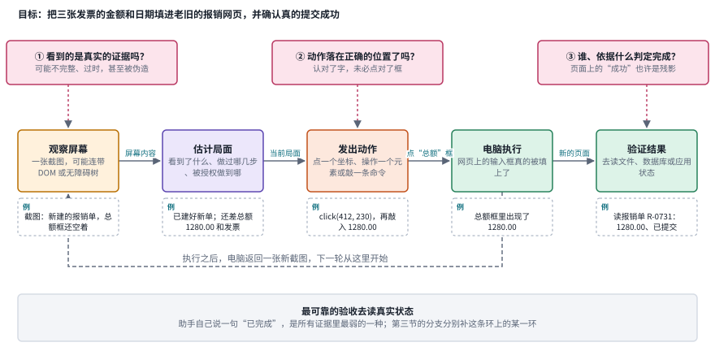

*图：一次电脑操作的闭环。上方三个粉色框是本章反复追问的三个问题，分别挂在观察、动作和验证三环上；底部提醒最弱的证据是助手自己的一句“已完成”。*

图上方的三个粉色框，对应方向背景里提出的三件事。第一个问题挂在观察上：屏幕只是软件状态的一个快照，它可能还没加载完，可能已经过时，也可能被人伪造，所以看到的东西能不能当证据，本身就是一个问题。第二个问题挂在动作上：认出了“税额”两个字，和点中它右边那个输入框，是两种不同的能力。第三个问题挂在验证上：页面上闪过的“成功”提示也许只是旧页面的残影，判定完成的那一方看的是什么、凭什么下结论，决定了整条环最后交出去的结果是否可信。本章第二节的每一段主线、第三节的每一个分支，都是在这条环上补某一环，读的时候可以随时回到这张图，问一句它补的是哪一环。

第一组是**开环和闭环**。这里的环指的是“动作”和“看到动作的结果”之间那条回路。开环系统做完一步就把结果交出去，中间的产物它自己并不检查；闭环系统每做一步都会拿到一份新的观察，再据此决定下一步。区分的关键在于模型看到的是什么：如果它只看到工具返回的一句文字描述，比如“检测到三个人”，那么环路其实并没有闭合，因为它看不见那三个框画在了哪里。本章说的“看到结果”，指的是模型能直接读到行动之后的画面本身。

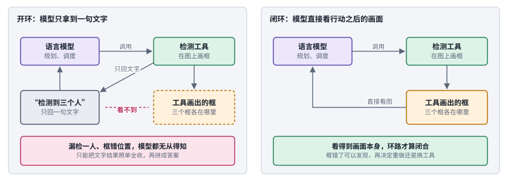

*图：同一个检测工具，左边只把一句文字交回给语言模型，右边让模型直接看到工具画出的框。差别只在一条箭头：工具的产物有没有回到模型眼前。*

两个面板用的是同一套框。左边的语言模型调用检测工具，工具在图上画好了框，可交回来的只有“检测到三个人”这一句话；琥珀色的虚线框表示那张画了框的图其实存在，只是模型看不到。于是漏检了一个人、某个框画歪了，模型都无从得知，只能照单全收。右边多了一条从画面回到模型的箭头，模型能直接看到三个框各在哪里，发现不对就可以重做或者换工具。本章说“环路闭合”，指的就是右边这条箭头。

第二组是**看图思考和电脑操作**。两者都是让模型在推理途中发出动作、读回图像，区别在于动作作用在哪里。看图思考的动作作用在模型自己的输入上：裁剪、放大、画线，改变的是“怎么看”，世界本身没有变；电脑操作的动作作用在外部环境上：点击、键入、滚动，改变的是软件的状态，而且这种改变往往无法撤回。所以前者的风险主要是看错，后者还多了一层做错之后的副作用。[多模态理解](09_multimodal_gui.md)一章把裁剪放大这类主动观察视为“看”的延伸，本章则把它放在环路闭合的第二步，看作通向真正动手之前的一个台阶。

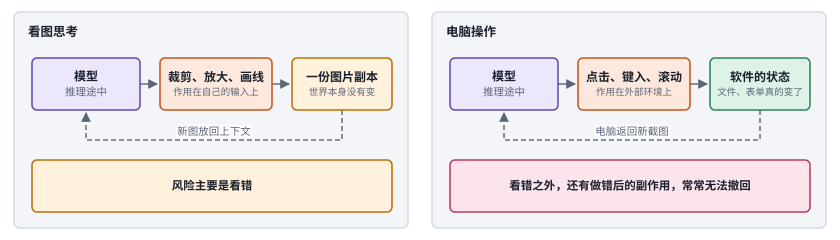

*图：两种“推理途中发出动作、读回图像”的做法。左边的动作只改变模型怎么看，右边的动作改变了外部软件的状态。*

两边的结构几乎一样：模型在推理途中发出一个动作，动作的结果以图像的形式回到模型眼前。差别在中间那个框作用在哪里。左边裁剪、放大、画线，作用的是一份图片副本，原图和世界都没有动，最坏的情况是看错了，重新看一次就行。右边点击、键入、滚动，作用的是软件本身，表单提交了就是提交了，文件删掉了就是删掉了，所以底部那个框换成了粉色：除了看错，还多了做错之后收不回来的副作用。这也是第二节把看图思考放在屏幕之前的原因，它是环路闭合的一个更安全的台阶。

第三组是**一次操作的闭环**。把一次电脑操作写成“观察、状态估计、动作、执行、验证”五步，几乎所有研究问题都能在上面找到位置。观察可能是截图，也可能包括网页的 DOM 或无障碍树（accessibility tree，操作系统为读屏软件提供的界面结构描述）；状态除了屏幕上看到的，还要包括已经处理过哪些文件、还有哪些目标没完成、被授权做到哪一步。动作可以是坐标点击、对某个元素的操作，也可以是一条命令行调用。最后的验证，最好去读真实的文件、数据库或应用状态；助手自己说一句“已完成”，是最不可靠的证据。

这五步就是本节开头那张全景图上从左到右的五个框。状态估计那一格之所以写得那么宽，是因为后面三.4 讨论的停止、三.5 讨论的权限，都要靠它记住“被授权做到哪一步”；而验证那一格单独放在最右边，是因为本章第二节的“边界”一段和第三节的好几个分支，讨论的都是这一格怎样才立得住。

第四组是**模型、harness 和环境**。一个电脑操作 agent 的成绩，既取决于模型本身，也取决于包在模型外面的那一层：截图怎样压缩、历史保留几张、允许哪些动作、出错怎样重试。这一层在[第 18 章 Harness 工程](18_harness_engineering.md)里是研究对象本身，在本章则是比较不同系统时必须先对齐的条件。环境也一样：同一个任务，允许用命令行和只允许点鼠标，难度可以差得很远。本章的前沿分支会反复回到这一点。

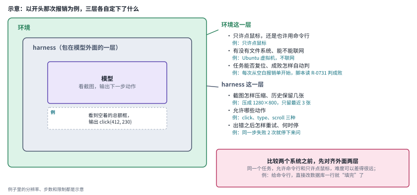

*图：一个电脑操作 agent 的成绩由三层共同决定。右边列出 harness 和环境两层里最常被调整的旋钮。*

最里面的紫色框是模型，它只负责看截图、给出下一步动作。包在外面的灰色框是 harness：截图要不要压缩，历史截图留几张，允许模型发出哪些动作，出错之后重试几次、什么时候放弃，都在这一层决定。最外面的绿色框是环境：它只许点鼠标，还是也开放命令行和文件系统，任务能不能一键复位，成败由什么程序来判。右下角的粉色框是本章反复要用的一条比较规则：两份成绩之间的差距，可能来自模型，也可能来自外面两层的设置，先把这两层对齐，比较才有意义。

最后看时间线。下图每一行是第二节主线的一个阶段，屏幕阶段因为工作最多，拆成“环境与基准”和“定位与产品”两行；点的位置按 arXiv 编号或发布日期取到月份。

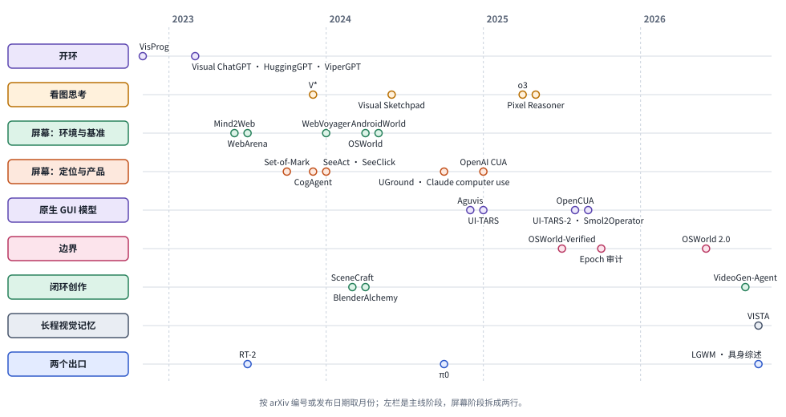

*图：主线上的代表工作按阶段分行排开。开环和看图思考两行起步最早，屏幕相关的两行在 2023 到 2025 年最密集，闭环创作、长程视觉记忆和两个出口的最新工作都落在 2026 年。*

把这张图和第二节开头的阶段表对照着看，会发现几条线并没有一条接一条地登场。屏幕上的环境和基准早在 2023 年就搭起来了，那时语言模型还在靠调度工具“看”图；看图思考到 2025 年才真正训练进模型，几乎和原生 GUI 模型同时成熟；闭环创作的早期例子 SceneCraft 和 BlenderAlchemy 出现在 2024 年，把强化学习用到这类创作循环上的 VideoGen-Agent 则要等到 2026 年。环路一段一段闭合，是一条逻辑上的顺序；在时间上，这几段往往是交错着推进的。

## 二、发展主线：环路一段一段闭合

这条主线的骨架来自图谱第九节“环路逐渐闭合”那张图，各阶段的细节则分别由上面几篇长文补上。下面这张总表先把全貌摆出来，再逐段展开。你会看到，每往下走一段，模型能看到的“结果”就多一层，它要承担的责任也跟着多一层，前一阶段的评测于是多出一类覆盖不到的错误。

> **本节要点：** 主线按“模型能看到哪一层结果”排成几段：先是看不见工具的产物，再是能在一张图上反复看，然后是每一步都有新截图的屏幕，接着是从截图直接出动作的原生模型和对分数、长度、安全的反思，最后是看成品再改的创作、能回查旧画面的长程记忆，以及走出屏幕的两个出口。每一段都配一张解说图，屏幕和原生模型两段各配一组结构卡与对照表，节末用一张格子图把全部做法放在两条轴上。

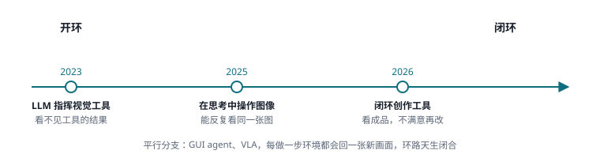

*环路从开到闭：2023 年看不见工具的结果，2025 年能反复看同一张图，2026 年看成品再改；GUI agent 与 VLA 是平行分支，每做一步环境都会回一张新画面。*

| 阶段 | 内容 | 代表工作 | 本章对应分支 |
|---|---|---|---|
| 开环（2023） | 语言模型当调度员，调用现成视觉模型或写调用视觉函数的程序，自己看不见工具的产物 | Visual ChatGPT、HuggingGPT、VisProg、ViperGPT | 三.1 |
| 看图思考（2023–2025） | 推理途中主动裁剪、放大、画线，把新图放回上下文；环路在一张静态图上闭合 | V*、Visual Sketchpad、o3、Pixel Reasoner | 三.1 |
| 屏幕（2023–2025） | 把模型放进可交互的网页和操作系统，每一步都有新截图；定位成为瓶颈 | Mind2Web、WebArena、SeeAct、WebVoyager、OSWorld、AndroidWorld、Claude computer use、OpenAI CUA | 三.2、三.3 |
| 原生 GUI 模型（2025–2026） | 端到端模型从截图直接输出动作，靠轨迹数据和多轮在线强化学习变强 | Aguvis、UI-TARS、UI-TARS-2、OpenCUA、Smol2Operator | 三.3、三.4 |
| 边界 | 分数可信吗，长任务做得完吗，安全吗 | OSWorld-Verified、Epoch 的审计、OSWorld 2.0、提示注入 | 三.4、三.5 |
| 闭环创作（2025–2026） | 写脚本、调用生成模型，再看渲染成品，不满意就改 | SceneCraft、BlenderAlchemy、VideoGen-Agent | 三.6 |
| 长程视觉记忆（2026） | 每一帧原样存档，按回合调回旧画面细看 | VISTA | 三.7 |
| 两个出口 | 在学出来的世界里行动；用身体在真实世界里行动 | 世界模型当验证器、VLA | 三.7，以及第 10、11 章 |

### 开环：语言模型指挥视觉工具，却看不见工具的结果

> **要点：** 2023 年的语言模型还看不见图，于是当起了调度员，把感知和生成交给现成的视觉模型，或者写一段调用视觉函数的程序。它们不训练任何东西就让语言模型处理了图片，代价是看不见工具真正产出了什么。

故事从 ChatGPT 还看不见图的时候讲起。2023 年 3 月，[Visual ChatGPT](https://arxiv.org/abs/2303.04671) 和 [HuggingGPT](https://arxiv.org/abs/2303.17580) 几乎同时想出了一个办法：既然训练一个多模态大模型又贵又慢，那就让语言模型当调度员。它把用户的请求拆成子任务，挑选现成的检测、分割、生图、修图模型去执行，再把各个工具返回的结果拼成最终答案。HuggingGPT 把这个分工说得最直白，语言模型负责规划、选模型、调用和汇总，具体的感知和生成交给 Hugging Face 上成千上万个专门模型。不训练任何东西，ChatGPT 就有了处理图片的能力，这是多模态工具调用的起点。

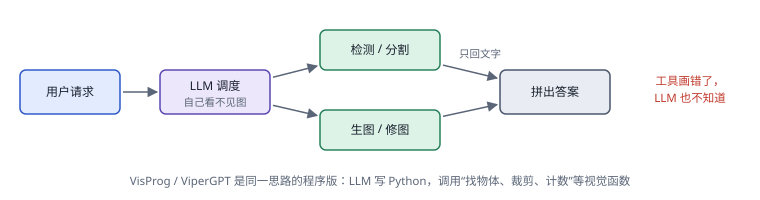

*开环：LLM 只拿到工具返回的文字，工具画错了它也不知道；VisProg、ViperGPT 是同一思路的程序版。*

同一时期还有一条更讲究的路。CVPR 2023 最佳论文 [VisProg](https://arxiv.org/abs/2211.11559) 和稍晚的 [ViperGPT](https://arxiv.org/abs/2303.08128) 让语言模型根据问题写一段小程序，程序里调用“找物体”“裁剪”“计数”“比较大小”这些视觉函数，程序跑完，答案就出来了。这样做的好处是推理过程被写成了代码，每一步调用了什么、得到了什么都可以逐行检查，几个简单函数也能组合出复杂的推理。

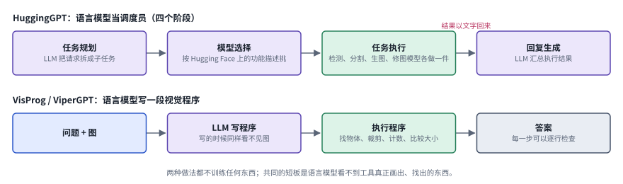

*图：上一行是 HuggingGPT 的四个阶段，下一行是 VisProg 和 ViperGPT 的视觉程序。两行的绿色框都是真正接触图像的地方，紫色的语言模型只读到它们交回的结果。*

上一行按 HuggingGPT 论文自己的划分画成四步。任务规划阶段，语言模型把用户的请求拆成若干子任务；模型选择阶段，它根据 Hugging Face 上每个模型的功能描述，为每个子任务挑一个合适的模型；任务执行阶段，被选中的检测、分割、生图、修图模型各做一件事；回复生成阶段，语言模型再把各个执行结果汇总成答案。注意第三、第四步之间那行粉色小字：结果是以文字的形式回到语言模型那里的。下一行的视觉程序换了一种组织方式，语言模型一次写好一段程序，程序里依次调用找物体、裁剪、计数、比较大小这些函数，执行完答案就出来了，好处是每一步调用了什么、得到了什么都能逐行检查。两行有一个共同点：写计划或写程序的那个语言模型，自始至终没有亲眼看过图。

Chip Huyen 在 *Agents* 里说，工具能把纯文本模型变成多模态模型，这一段正是她那句话最早的大规模实践。可这两种做法有一个共同的短板：语言模型看不到工具到底画出了什么、找到了什么。检测漏了一个物体，计数就错；分割框住了别的东西，后面的修图就修错了地方；而语言模型拿到的只是一段文字结果，只能照单全收。图谱把这叫作开环。要让环路闭合，模型自己必须能看图，而且要在推理的过程中反复地看。

### 看图思考：环路先在一张图上闭合

> **要点：** 下一步是让模型自己看图，并且在思考途中回头再看。四个代表工作的差别，主要在“谁来决定再看一眼”：从语言模型引导的搜索，到一块给模型用的画板，再到直接训练进模型本身。

下一步是让模型自己看图，并且在思考的过程中回头再看。人遇到看不清的地方会凑近了看，模型也可以这样做。2023 年底的 [V*](https://arxiv.org/abs/2312.14135) 提出用语言模型引导视觉搜索，让多模态模型在高分辨率、杂乱的图像里主动去找小目标，并配了一个专门考这件事的 V*Bench。2024 年的 [Visual Sketchpad](https://arxiv.org/abs/2406.09403) 给模型一块可以画线、画框、做标记的画板，必要时还能调用专门的视觉模型，把“画草图”当作视觉版的思维链；作者报告它在数学题上平均提升 12.7%，在视觉任务上平均提升 8.6%，配上 GPT-4o 在 V*Bench 上达到 80.3%。

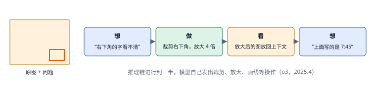

*在思考中操作图像：推理链进行到一半，模型自己发出裁剪、放大、画线等操作，再把新图放回上下文。*

2025 年 4 月，OpenAI 在 *Thinking with images* 里宣布，o3 和 o4-mini 把这种能力训练进了模型本身：它们会在推理途中裁剪、放大、旋转图片，处理后的结果直接回到思维链里，V* 上达到 95.7%。开源一侧的 [Pixel Reasoner](https://arxiv.org/abs/2505.15966) 用指令微调加“好奇心驱动”的强化学习，教 7B 的视觉语言模型在像素空间里放大、选帧，作者报告 V* bench 达到 84%。Simon Willison 那篇看 o3 猜照片位置的文章，把这种能力在真实使用中的样子写得很生动：为了认出一块车牌，模型前后裁剪了二十多次，最后给出的第二个猜测正是拍摄的小镇。

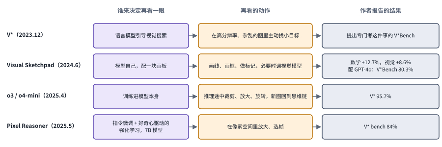

*图：四个代表工作排成同一种三格结构。紫色一列是谁来决定再看一眼，琥珀色一列是再看的动作，灰色一列是作者报告的结果。*

从上往下读紫色那一列，能看到“再看一眼”这个决定一步步收进了模型内部。V* 用语言模型引导一个专门的视觉搜索过程，去高分辨率、杂乱的图里找小目标；Visual Sketchpad 让模型自己在画板上画线、画框、做标记，需要时再调专门的视觉模型；o3 和 o4-mini 把裁剪、放大、旋转直接训练进了模型的推理过程；Pixel Reasoner 则用指令微调加好奇心驱动的强化学习，让一个 7B 的开源模型学会在像素空间里放大和选帧。琥珀色那一列的动作越来越像人凑近了看，灰色那一列的数字也集中在 V* 这类找小目标的基准上。这一点正好提醒我们，这些收益主要证明了“看得更细”，看得细能不能换来“做得对”，要到屏幕那一段才见分晓。

这一步的意义在于，视觉第一次成了推理过程中可以反复查看、主动处理的对象，找小目标、读小字这类问题因此大幅改善。可它的局限也很清楚。OpenAI 自己列出了推理链过长、感知错误、多次尝试路径不稳定三条；Willison 觉得二十多次裁剪有些表演的成分；本章三.1 还会看到一篇论文质疑，返回的像素究竟有没有带来新的证据。更根本的是，这里的动作只改变了“怎么看”，世界本身纹丝不动。要让动作改变环境，就得把模型放进一个会对动作作出反应的地方。

### 屏幕：第一个能大规模动手的视觉世界

> **要点：** 网页和操作系统成了第一个规模够大、又能真正动手的视觉世界。几年里，舞台从网页扩大到整个操作系统和手机，判定成败越来越多地交给程序去查内部状态；与此同时，大家发现最难的一环是把“知道该做什么”落到“点在哪里”。

这样的地方很早就有人在搭了。2023 年的 [Mind2Web](https://arxiv.org/abs/2306.06070) 从 137 个真实网站、31 个领域里收集了 2000 多个开放式任务，第一次让大家看到通用网页 agent 要面对多么杂乱的真实网页。同年的 [WebArena](https://arxiv.org/abs/2307.13854) 更进一步，搭了一组可以自己部署、可以复位的网站，让 agent 在里面真的去下单、发帖、改设置，最后检查网站状态有没有按要求改变。评测的终点从“选出正确答案”变成了“实际建立、修改或查找一个外部对象”。

把看得懂截图的模型放进这样的环境，会怎样？2024 年初的 [SeeAct](https://arxiv.org/abs/2401.01614) 给出了一个清醒的回答，论文标题就是结论：GPT-4V 是一个通用的网页 agent，前提是它能定位准。作者发现，模型常常知道下一步该做什么，却说不准该点哪个元素；[Set-of-Mark](https://arxiv.org/abs/2310.11441) 那种先给区域编号、再让模型报号码的办法在网页上并不好使，最好的方案要把 HTML 结构和视觉信息结合起来。同月的 [WebVoyager](https://arxiv.org/abs/2401.13919) 在 15 个热门真实网站上搭了任务，报告端到端的多模态 agent 成功率 59.1%，并用 GPT-4V 自动评判开放式结果，与人工判断的一致率为 85.3%。4 月的 [OSWorld](https://arxiv.org/abs/2404.07972) 把舞台从浏览器扩大到整个操作系统：在真实的 Ubuntu 虚拟机里，agent 要操作办公软件、图片编辑器、终端和浏览器，每个任务配一段可执行的检查脚本来判定成败。5 月的 [AndroidWorld](https://arxiv.org/abs/2405.14573) 又把这套做法搬到手机上，在 20 个真实应用里搭了 116 个带参数的程序化任务，每个任务都有初始化、成功检查和清理逻辑，最好的基线完成 30.6%。

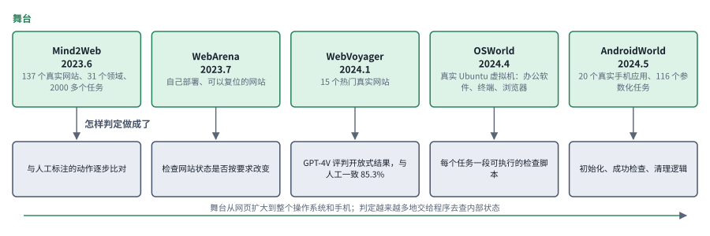

*图：上排绿色框是五个环境各自搭建的舞台，下排灰色框是它们判定任务做成与否的方式，底部箭头标出两条变化的方向。*

从左往右读上排，舞台在一步步变大：Mind2Web 收集的是真实网站上的任务和人工标注的操作序列，WebArena 把网站搬进了可以自己部署、随时复位的环境，WebVoyager 回到 15 个热门的真实网站，OSWorld 把整个 Ubuntu 虚拟机交给 agent，AndroidWorld 又把同样的做法搬上了手机。下排的判定方式也在变：从和人工标注的操作序列比对，到直接检查网站状态，到用 GPT-4V 评判开放式结果，再到每个任务配一段可执行的检查脚本、配好初始化和清理逻辑。越往右，“做没做成”越像一个能用程序回答的问题，这正是后面强化学习能够大规模展开的前提。

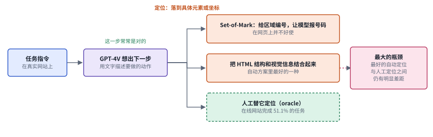

*图：SeeAct 把一次网页操作拆成“想出下一步”和“定位”两段。橙色框是两种自动定位方式，绿色虚线框是人工替它定位时的成绩。*

SeeAct 的实验设计很能说明问题。它先让 GPT-4V 用文字描述下一步要做什么，比如点击“搜索”按钮，这一步往往是对的；难的是第二段，把这句描述落到网页上一个具体的元素或坐标。作者比较了几种做法：Set-of-Mark 那种给区域编号、让模型报号码的办法在网页上并不好使；把 HTML 结构和视觉信息结合起来，是自动方案里最好的一种；如果由人来替它完成定位，GPT-4V 在真实网站上能完成 51.1% 的任务。最好的自动定位和人工定位之间仍有明显差距，所以论文的结论落在右边那个粉色框上：定位是最大的瓶颈。后面几年里专门做定位的工作，都是在填这道差距。

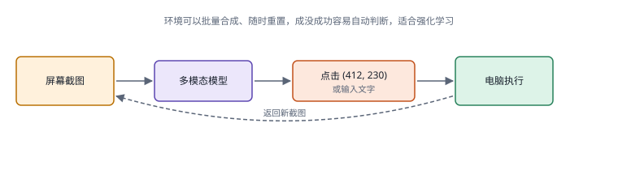

*GUI agent 的闭环：看截图、输出动作、电脑执行、返回新截图；环境可以批量合成、随时重置，成没成功容易自动判断。*

图谱对这一段有一个很到位的判断：屏幕是第一个规模大、又能真正动手的视觉世界。网页和软件本身就是程序，可以用脚本批量造出各种初始状态，做砸了一键恢复；任务做没做成，也能直接去查程序内部的状态，文件有没有保存、表单有没有提交，用不着人来打分。强化学习最需要的正是大量可以重置的环境和自动给出的奖励，GUI 恰好两样都有。

真正让这个方向出圈的，是 2024 年 10 月 Anthropic 发布的 computer use。在 *Developing a computer use model* 里，Anthropic 解释了他们的选择：与其为每个应用造一套工具，不如让模型学会人类本来就在用的那个通用接口。Simon Willison 当天的试用记录则点出了技术上的关键一环，模型终于能可靠地报出屏幕坐标了，这件事此前一直是瓶颈，学术界为此做过 [SeeClick](https://arxiv.org/abs/2401.10935)、[UGround](https://arxiv.org/abs/2410.05243) 这类专门把文字落到坐标上的工作，[CogAgent](https://arxiv.org/abs/2312.08914) 则用高低两路分辨率的编码器去看清界面上的小字。三个月后，OpenAI 的 Computer-Using Agent 把这个循环讲成了感知、推理、行动三步，在 OSWorld 上报告 38.1%，并在登录、验证码、付款这类步骤上停下来请用户确认。

**速查：把文字落到坐标上的四种做法。** 上面提到的几项定位工作，思路各不相同。下面四张结构卡用同一种画法从左往右读：Set-of-Mark 在图上叠编号，让模型把定位变成选择题；CogAgent 从模型结构入手，用两路分辨率看清小字；SeeClick 和 UGround 从数据入手，自动造出大量“这句话指的是屏幕上哪个位置”的样本去训练。

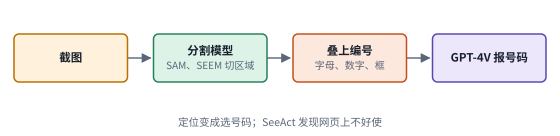 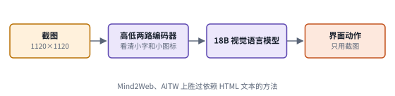

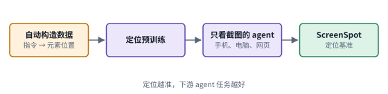 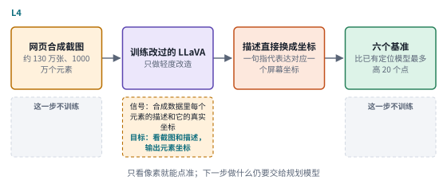

*图：定位的四张结构卡，每张卡对应下表的一行。*

| code | 名称 | 年份 | 代表 | 怎么做 | 解决了什么 | 代价 |
|---|---|---|---|---|---|---|
| L1 | 编号提示 | 2023.10 | [Set-of-Mark](https://arxiv.org/abs/2310.11441) | 用 SAM、SEEM 等分割模型把图切成区域，叠上字母、数字、框等标记，让 GPT-4V 按编号回答 | 不训练就提升了 GPT-4V 的视觉定位，零样本在 RefCOCOg 指代任务上超过专门微调的模型 | 定位好坏取决于分割有没有切对区域；SeeAct 发现它在网页上并不好使 |
| L2 | 高分辨率界面模型 | 2023.12 | [CogAgent](https://arxiv.org/abs/2312.08914) | 18B 视觉语言模型配高低两路图像编码器，支持 1120×1120 的输入，只看截图给出界面动作 | 看清界面上的小字和小图标，在 Mind2Web、AITW 上胜过依赖 HTML 文本的方法 | 模型大、输入分辨率高，推理成本随之上升 |
| L3 | 定位预训练 | 2024.1 | [SeeClick](https://arxiv.org/abs/2401.10935) | 自动构造“指令对应哪个界面元素”的数据做定位预训练，只用截图完成手机、电脑、网页任务，并发布 ScreenSpot 基准 | 把定位确立为视觉 GUI agent 的关键能力，并显示定位越准，下游 agent 任务越好 | 静态截图上的定位精度和交互中的落点正确率仍是两个不同的量（三.2） |
| L4 | 通用视觉定位 | 2024.10 | [UGround](https://arxiv.org/abs/2410.05243) | 用网页合成的约 130 万张截图、1000 万个界面元素训练轻度改造的 LLaVA，把指代表达直接映射成屏幕坐标 | 支撑“像人一样只看像素”的路线，在六个基准上比已有定位模型最多高 20 个点 | 训练数据主要来自网页合成，其他平台靠泛化；它只回答“点哪里”，下一步做什么仍要交给规划模型 |

这一阶段确立了今天 GUI agent 的基本形态，也同时留下了两个分歧。一个是接口之争：是像 Anthropic 和 OpenAI 那样只看像素，还是像很多学术框架那样把 HTML、无障碍树、命令行一起用上？另一个是架构之争：是用一个强大的通用模型加上精心设计的框架，让规划器、定位器、反思模块各司其职，还是训练一个从截图直接输出动作的端到端模型？本章三.3 讨论的正是第一个分歧，第二个分歧则引出了下一阶段。

### 原生 GUI 模型与在线强化学习

> **要点：** 端到端的路线开始占上风：一个模型从截图直接出键鼠动作，靠大规模轨迹数据和多轮在线强化学习变强。问题的重心随之从“能不能看懂屏幕”移到“交互经验从哪里来、反馈信号可不可信”。

2025 年前后，端到端的路线开始占上风。2024 年底的 [Aguvis](https://arxiv.org/abs/2412.04454) 只用截图作为输入，把不同平台的动作统一到同一套动作空间里，并在动作前加入显式的推理；训练分两步，先学定位界面元素，再学规划和推理。2025 年 1 月字节跳动的 [UI-TARS](https://arxiv.org/abs/2501.12326) 把这条路线命名为“原生 agent”：一个模型从截图直接输出键鼠动作，不依赖外部的商业模型，也不依赖手工设计的工作流。它的配方有四样：大规模界面截图带来的感知能力，跨平台统一的动作建模，任务分解、反思和里程碑识别这类慢思考，以及在数百台虚拟机上收集、筛选、修正新的交互轨迹，让模型从自己的错误里学习。论文报告它在 OSWorld 上 50 步预算时得到 24.6，同条件下 Claude 是 22.0。

到了 2025 年 9 月的 [UI-TARS-2](https://arxiv.org/abs/2509.02544)，强化学习已经从配料变成了主菜。技术报告把难点归成四个：数据稀缺、多轮强化学习不稳定、只靠 GUI 做不了的事情、以及环境本身不可靠；对应的办法是数据飞轮、稳定化的多轮强化学习框架、带文件系统和终端的混合环境，以及大规模的沙箱平台。作者报告 OSWorld 47.5、AndroidWorld 73.3，在 15 个游戏上的平均归一化得分约为人类水平的六成。同年 8 月的 [OpenCUA](https://arxiv.org/abs/2508.09123) 则把整套基础设施开源出来：一个采集人类操作演示的标注工具，一个横跨 3 个操作系统、200 多个应用和网站的数据集 AgentNet，以及把演示变成带反思推理的状态动作对的流水线；作者报告 OpenCUA-72B 在 OSWorld-Verified 上平均成功率 45.0%，是当时开源模型中最好的。

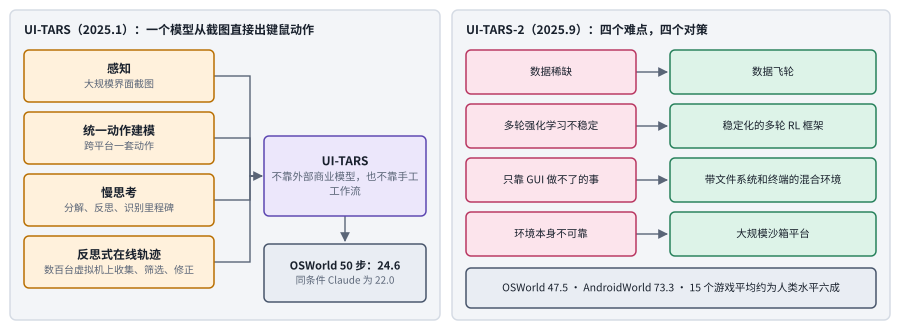

*图：左边是 UI-TARS 的四样配料汇进一个原生模型；右边是 UI-TARS-2 技术报告列出的四个难点和对应的四个对策。*

左半边按 UI-TARS 论文的说法，把配方拆成四个琥珀色的框：大规模界面截图带来的感知，跨平台统一的动作建模，任务分解、反思和里程碑识别这类慢思考，以及在数百台虚拟机上收集、筛选、修正新轨迹的反思式在线学习。四样汇进中间那个紫色框，得到一个不依赖外部商业模型、也不依赖手工工作流的原生 agent。右半边是八个月后的 UI-TARS-2，粉色的四个难点一一对应绿色的四个对策。对照两边会发现，左边的第四样配料到了右边已经长成了整张图的主体：数据飞轮、稳定的多轮强化学习、混合环境和沙箱平台，四个对策都在回答同一个问题，怎样让模型持续、稳定地从自己的交互里学习。两个灰框里的分数从 24.6 到 47.5，记录了这段时间的进展；两次评测的步数预算和环境设定未必相同，直接相减时要留个心。

**速查：原生 GUI 模型的五种配方。** 下面五张卡代表这一段的五个开放或半开放的系统。并排看会发现，它们的模型结构差别不大，真正拉开距离的是左边那几个框：数据怎么来，动作怎么统一，训练分几段，反馈从哪里来。

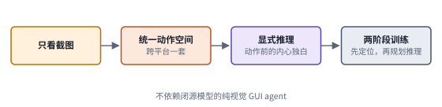 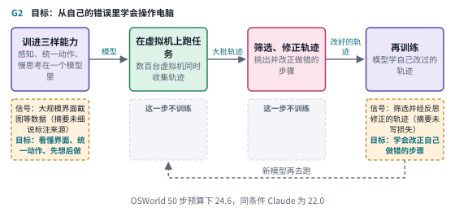

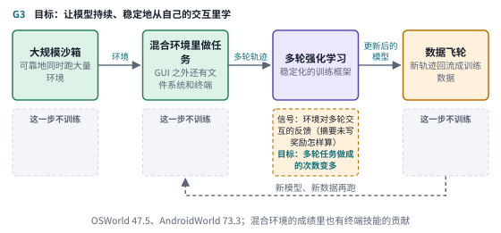 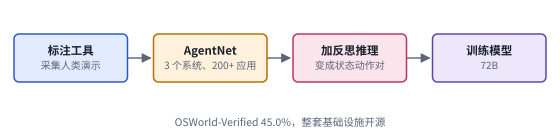

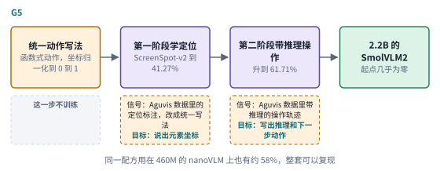

*图：原生 GUI 模型的五张结构卡，每张卡对应下表的一行。*

| code | 名称 | 年份 | 代表 | 怎么做 | 解决了什么 | 代价 |
|---|---|---|---|---|---|---|
| G1 | 统一纯视觉 agent | 2024.12 | [Aguvis](https://arxiv.org/abs/2412.04454) | 只用截图作输入，把不同平台的动作统一成一套动作空间，动作前加入显式推理；两阶段训练，先学定位，再学规划和推理 | 不依赖界面的文本表示，也不依赖闭源模型，就能跨平台自主操作 | 需要先构建带定位和推理标注的大规模数据集 |
| G2 | 原生 agent | 2025.1 | [UI-TARS](https://arxiv.org/abs/2501.12326) | 感知、统一动作、慢思考三样能力训进一个模型，再在数百台虚拟机上收集、筛选、修正轨迹，从自己的错误里学 | 不靠外部商业模型和手工工作流；OSWorld 50 步预算下 24.6，同条件 Claude 为 22.0 | 依赖大规模虚拟机基础设施和轨迹筛选流程 |
| G3 | 多轮强化学习 | 2025.9 | [UI-TARS-2](https://arxiv.org/abs/2509.02544) | 数据飞轮、稳定化的多轮强化学习框架、带文件系统和终端的混合环境、大规模沙箱平台 | 回应数据稀缺、训练不稳、纯 GUI 做不了的事、环境不可靠四个难点；OSWorld 47.5、AndroidWorld 73.3 | 整套系统工程量很大；混合环境里的成绩也带上了终端技能的贡献 |
| G4 | 开源演示数据栈 | 2025.8 | [OpenCUA](https://arxiv.org/abs/2508.09123) | 用标注工具采集人类演示，汇成横跨 3 个操作系统、200 多个应用和网站的 AgentNet，再转成带反思推理的状态动作对 | 整套基础设施开源；OpenCUA-72B 在 OSWorld-Verified 上 45.0%，是当时开源模型中最好的 | 依赖人类演示的采集成本；XLANG Lab 也指出公开可用的轨迹数据集仍然很小 |
| G5 | 两阶段小模型配方 | 2025.9 | [Smol2Operator](https://huggingface.co/blog/smol2operator) | 把 Aguvis 数据里的动作统一成函数式动作、坐标归一化到 0 到 1，再分两阶段训练 2.2B 的 SmolVLM2：先学定位，再学带推理的操作 | ScreenSpot-v2 从几乎为零升到 61.71%，配方完整、可以复现 | 报告的主要是定位基准上的成绩，完整多步任务上的表现要另外评测 |

为什么这条路走得通？XLANG Lab 在 *Introducing OSWorld-Verified* 里给了一个很直接的判断：专门模型的成功主要来自大量人类操作电脑的轨迹数据，而公开可用的轨迹数据集仍然很小。Hugging Face 的 Smol2Operator 用一个开放的小实验印证了数据的分量，一个 2.2B 的小模型，只换了数据的组织方式和训练顺序，定位准确率就从几乎为零升到了 61.71%。到这里，问题的重心已经从“模型能不能看懂屏幕”转到了“交互经验从哪里来，反馈信号可不可信”。在线强化学习要求任务能复位、奖励能自动判定，合成任务又可能只教会模型应付出题器的固定套路。本章三.4 收录的工作，基本都在这条线上往前推。

### 边界：分数可信吗，任务做得完吗，安全吗

> **要点：** 梯子越往上爬，“怎么知道真的做成了”越难回答。分数会被检查器误判和接口差异扭曲，长流程任务远没有做完，屏幕上的文字还可能被当成指令。

梯子越往上爬，“怎么知道真的做成了”就越难回答。OSWorld 的作者团队自己就踩过这个坑。OSWorld-Verified 那篇文章记录了他们的复盘：网站改版和反爬机制让任务悄悄变了样，应用没加载完动作就执行了，“把所有空白格填上”这样的指令可以有好几种理解，合理的替代解法被检查脚本判错。修改时他们尽量只动检查器、少动任务描述，好让新旧分数还能接得上。

Epoch AI 的 Florian Brand 和 Greg Burnham 从外部又审了一遍，结论更让人警醒。他们估计，约 15% 的任务只用终端就能完成，另有约 30% 的任务可以用终端和 Python 脚本代替大部分界面操作，加起来将近一半的任务几乎用不着 GUI；大多数任务十个原子动作以内就能做完；约 10% 的任务存在使其失效的严重错误。所以分数从不到 10% 涨到将近 70%，固然很大程度上反映了能力的真实进步，其中也混着终端技能、基准版本更替和指令理解的差异。Hugging Face 的 ScreenSuite 从另一个方向提醒了同一件事：同一个模型，只给截图、不给无障碍树和 DOM，分数就会和别处的榜单不一样，比较之前先得问清楚观察条件。

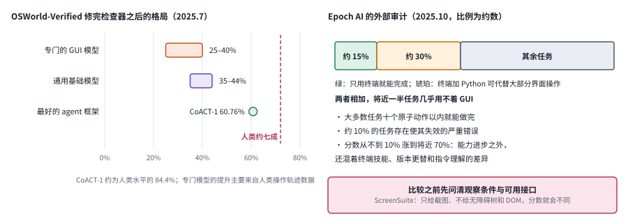

*图：左边是 OSWorld-Verified 修完检查器之后三类系统的成绩区间，粉色虚线是人类水平；右边是 Epoch AI 对任务构成的估计，比例都是约数。*

左半边把 XLANG Lab 文章里的几组数字画在同一把尺子上。专门的 GUI 模型落在 25% 到 40%，通用基础模型在 35% 到 44%，最好的 agent 框架 CoACT-1 到了 60.76%，约为人类水平的 84.4%，粉色虚线标出人类大约七成的位置。右半边换成 Epoch AI 的视角：绿色一段是只用终端就能完成的任务，约占 15%；琥珀色一段是可以用终端加 Python 脚本代替大部分界面操作的任务，约占 30%；两段加起来将近一半。下方几行是同一份审计的其他发现。两边放在一起读，结论就很清楚了：一个 OSWorld 分数里同时装着界面操作、终端技能、基准版本和指令理解好几样东西，比较两个系统之前，先问清它们看到的是什么、被允许用哪些接口，右下角 ScreenSuite 那条提醒说的也是这件事。

往更长的任务看，差距仍然很大。2026 年的 [OSWorld 2.0](https://arxiv.org/abs/2606.29537) 收集了 108 个长流程任务，人类完成每个任务的中位时间约 1.6 小时，agent 平均要调用 318 次工具，而初版 OSWorld 大约只要 30 次。在 500 步预算下，表现最好的配置也只完整完成了 20.6% 的任务，部分得分 54.8%。作者总结的失败模式很具体：忘了约束条件，漏看任务中途才出现的信息，该问用户时自己瞎猜，做完不检查。

安全这条边界从一开始就摆在桌面上。Anthropic 在发布 computer use 时就把提示注入列为头号担忧：模型会读联网电脑的截图，网页上的恶意文字可能让它偏离用户的本意。Simon Willison 发布当天就引用了一个网页诱导模型下载并运行文件的演示。OpenAI 的做法是让多层防护叠在一起，包括拒绝高风险任务、在外部动作前请用户确认、在敏感网站上要求用户盯着，以及一个发现可疑内容就暂停的监控器。本章三.4 讨论裁判和停止，三.5 讨论跨任务的攻击与统一接口的风险，都是在这条边界上工作。

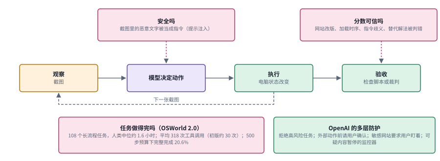

*图：中间是一条闭合的屏幕环路，三个粉色框标出这一段讨论的三条边界，右下的绿色框是 OpenAI 在发布时给出的多层防护。*

三条边界落在环路的不同位置。“分数可信吗”挂在最右边的验收上，网站改版、加载时序、指令歧义、替代解法被判错，都会让检查脚本给出错误的结论。“安全吗”挂在模型决定动作这一步：截图里的一段恶意文字一旦被当成指令，后面执行得再准确，也只会把事情做坏。“任务做得完吗”画在左下，它不属于某一环，属于整条环要转的圈数，OSWorld 2.0 平均要调用三百多次工具，任何一环的小错都会被一圈圈放大。右下角的绿色框是 OpenAI 的回应，几层防护分别卡在任务开始之前、外部动作之前和执行过程之中。本章三.4 和三.5 两个分支，就是在这几个粉色框上继续往前做。

### 闭环创作：调用工具，再看成品

> **要点：** 环路接到了生成工具上：写脚本、调用生成模型，再看渲染出来的成品，不满意就改。和开环一段相比，差别就在“看成品”这一眼，整个循环的上限也卡在这一眼上。

在屏幕之外，环路在创作上也闭合了。图谱把这一段放在 2025 到 2026 年：模型先规划分镜或建模步骤，然后写 Blender 脚本、调用视频生成模型、或者写绘图代码；工具产出成品后，模型去看渲染出来的画面，判断好不好，不好就改脚本、换提示词再来一遍。2023 年那种开环做法里，语言模型只拿到工具交回的一句文字，看不见工具真正画出了什么；和它相比，关键差别就在于这里能看到工具产出的成品，出了问题自己会改。

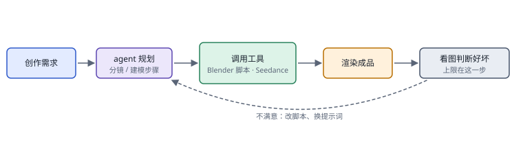

*闭环创作：规划、调用工具、渲染成品、看图判断好坏，不满意就改脚本或换提示词；上限在“看图判断好坏”这一步。*

这条线的早期例子来自三维。2024 年的 [SceneCraft](https://arxiv.org/abs/2403.01248) 让语言模型 agent 把文字描述变成可以在 Blender 里执行的 Python 脚本，处理多达约一百个三维资产的场景，并用视觉语言模型分析渲染出来的图像，迭代修改场景。同年的 [BlenderAlchemy](https://arxiv.org/abs/2404.17672) 把一个基于视觉的编辑生成器和一个状态评估器配成一对，去搜索满足用户目标的 Blender 操作序列，必要时还先用生图模型“想象”一张参考图，让抽象的文字描述有一个视觉上的落点。到了视频，单个生成模型一次只能稳定生成几秒到十几秒，[多模态生成](16_generation.md)那一章讲过这是模型本身的限制；agent 把一部片子拆成许多镜头，每个镜头交给生成模型去做，自己负责规划、检查和拼接，整体长度和复杂度就不再受单个模型的限制。第 16 章在它的“Agent 编排与可编辑交付”分支里专门讨论这类生成工作流，本章只从“看成品”这一环来看它。

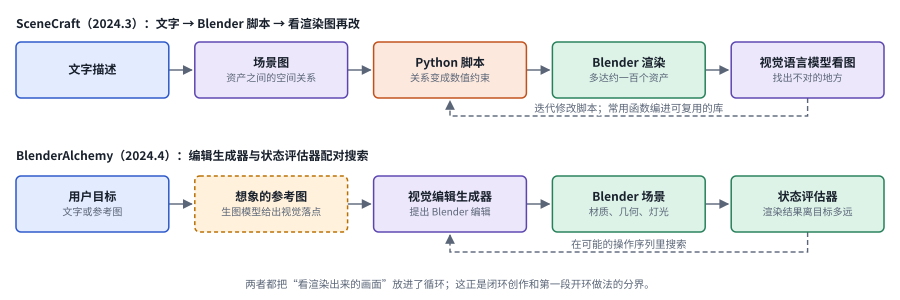

*图：两个三维创作系统的循环。上一行由文字一路写成 Blender 脚本再看渲染图，下一行由编辑生成器和状态评估器配对搜索操作序列。*

上一行是 SceneCraft。它没有直接从文字写代码，先把描述整理成一张场景图，记下各个资产之间的空间关系，再把这些关系翻译成数值约束写进 Python 脚本；脚本在 Blender 里渲染出画面，视觉语言模型看图找出不对的地方，虚线把修改意见送回脚本那一步。作者还把常用的脚本函数编进一个可复用的库，让系统不调模型参数也能越做越好。下一行是 BlenderAlchemy，它的任务是编辑已有的场景：视觉编辑生成器提出一批 Blender 操作，状态评估器看渲染结果离用户目标有多远，两者配合着在可能的操作序列里搜索；琥珀色虚线框是生图模型“想象”出来的参考图，给抽象的文字目标一个看得见的落点。两行的共同点写在底部：渲染出来的画面回到了模型眼前，这正是闭环创作和第一段开环做法的分界。

图谱对这一段的评价很中肯：整个循环的上限卡在“看成品判断好坏”这一步，模型看不出画面哪里有问题，就不会去改。这和 OSWorld-Verified 的教训是同一个道理：OSWorld 团队发现检查脚本会把合理的替代解法判错，也会被加载时序骗过，环路闭合之后，验收者的眼力决定了系统能走多远。交互一长，还会冒出另一个问题：看过的画面越来越多，早先那些画面要么被丢掉，要么被压缩成一句文字，等后面需要回头核对细节时，已经找不回来了。

### 长程视觉记忆：旧画面原样存档，随时调回来看

> **要点：** 交互一长，早先的画面要么被丢掉，要么被压成一句文字。VISTA 不改模型，只在外面加一层 harness，把每一帧原样存档，让模型按回合号随时调回来细看。

2026 年 10 月，MIT 何恺明组的 [VISTA](https://arxiv.org/abs/2610.02200) 把这个问题单独拎了出来。它不改模型，只在外面包了一层 harness：模型直接以截图的形式观察环境，交互中的每一帧画面都原样存档，不转成文字；推理时，模型可以按回合号调出任何一帧旧画面，裁剪放大、并排比较、读出精确的像素值，还可以写笔记。论文摘要报告，在 ARC-AGI-3 上，它把 Claude Opus 5.0 的相对人类动作效率从 40.68 提到满分 100，25 个公开游戏全部完成，所用动作比第一次玩的人类少 57.4%。

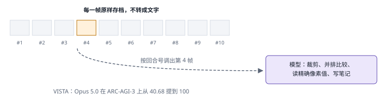

*长程视觉记忆：每一帧原样存档，按回合号调出旧画面，裁剪、并排比较、读精确像素、写笔记。*

这一段值得和前面几段对照着看。看图思考让模型在一张图上反复看，VISTA 让模型在一整段交互历史上反复看；GUI agent 的环路每一步都闭合，VISTA 则让很多步之前的结果也重新可见。它的局限也写在项目页上：存储和检索都依赖外部系统，模型自身的记忆能力并没有变强；三维环境里画面变化更复杂，项目页只给了两个游戏第一关的示意；公开游戏发布在模型之后，可能出现在训练数据里，真正的泛化要看私有测试集。VISTA 在[第 18 章](18_harness_engineering.md)里是“感知接口也是 harness 部件”的例证，在本章则是环路闭合的最后一段。

### 两个出口：在学出来的世界里行动，用身体行动

> **要点：** 环路闭合之后还有两条路：在学出来的世界里先预判后果再行动，或者用身体在真实世界里行动。2026 年的具身综述用同一把尺子量这两条路，发现预判和验证两环很少被单独评测。

走到这里，环路已经在工具、图像、屏幕、创作和长程记忆上一段段闭合了。再往前，图谱指出了两条路，各自已有专门的一章。

第一条是在学出来的世界里行动。屏幕之所以适合训练，是因为它可以重置、可以自动判分；可如果环境本身是一个学出来的模型，agent 就能在里面先“想一想”动作的后果，再决定要不要真的去做。[世界模型](10_world_models.md)一章讲的就是这件事。本章三.5 会看到一个很有意思的交汇：有人把世界模型用作 GUI agent 的验证器，先预测点击之后下一屏应该是什么样，再和真实的下一屏比对。

第二条是用身体在真实世界里行动。机器人和 GUI agent 一样，环路天生闭合，每做一步，相机都会回一张新画面；区别在于动作是连续的、不可撤回的，环境也没法一键重置。图谱的速查卡里有两张属于这条路：把动作切成 256 档当词来说的 [RT-2](https://arxiv.org/abs/2307.15818)，和在模型后面接一个用流匹配输出连续动作的动作专家的 [π0](https://arxiv.org/abs/2410.24164)。前者放在下面的速查表里作为过渡，后者（图谱卡片 X8）请到[具身智能](11_embodied.md)一章去读，那里用“叠一件 T 恤”的例子从头讲过。

2026 年的两篇综述可以帮你把这两个出口和前面几段放回同一张图里。Mokaria 等人的[多模态 agent 框架综述](https://arxiv.org/abs/2608.20379)把机器人、GUI 与网页导航、多媒体生成与编辑、长视频理解放在一起，按感知、推理、规划、记忆、行动五个模块比较；它指出把各种模态转成语言会丢掉大量信息，可以和本章开头的开环一段对照着读，那一段里语言模型只拿到视觉工具交回的文字描述，看不见工具的真实产物。2026 年 10 月 Chen 等人的[多模态具身 agent 综述](https://arxiv.org/abs/2610.30108)更进一步，用感知、预判、规划、行动、验证五种能力同时衡量 computer-use agent 和机器人，发现 64 个基准里只有 5 个评测预判、3 个评测验证。从屏幕走到身体，事先能定下来的选择更少，犯错后的挽回余地也更小，预判和验证这两环只会更要紧，这也正是世界模型和具身智能两章接着要讲的事。

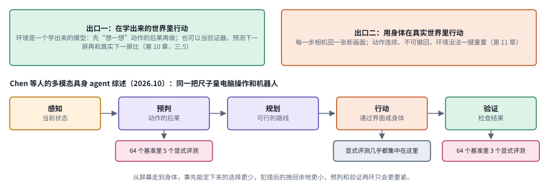

*图：上方是两个出口，下方是 Chen 等人综述里的 PAPAV 五种能力；粉色小框是 64 个基准里显式评测预判和验证的数量。*

上排两个框对应这一节的两个出口。绿色的出口一把环境换成一个学出来的模型，agent 可以先在里面推演动作的后果，三.5 的 LGWM 更进一步，用它预测下一屏，再和真实的下一屏比对。橙色的出口二是机器人，它的环路天生闭合，可动作是连续的，做了就收不回，环境也没法一键重置。下排是综述提出的能力框架，按功能把一个 agent 拆成感知、预判、规划、行动、验证五步，computer-use agent 和机器人都能套进去。下面三个小框是作者对 64 个基准的统计：显式的评测几乎都落在行动上，单独考预判的只有 5 个，考验证的只有 3 个。这和本章开头全景图上的第三个问题是同一件事，“谁来验收、凭什么验收”，恰恰是现有评测最少直接回答的一环。

### 速查：七种做法

> **要点：** 图谱第九节的七张速查卡，覆盖了从开环到 VLA 的七种做法。七张卡用同一种画法，每张对应下表的一行。

下表把图谱第九节的速查卡改写成表格，方便对照。X8（VLA 的连续动作专家，π0、π0.5、GR00T N1）留给第 11 章。

下面七张卡沿用全景图的配色：琥珀色是模型看到的画面，紫色是模型，橙色是动作，绿色是工具、环境或执行端，灰色是被保存下来的东西或最后的结果。卡片底部的虚线就是环路闭合的那一段，X1 和 X2 两张卡没有这条虚线，正是开环的样子。

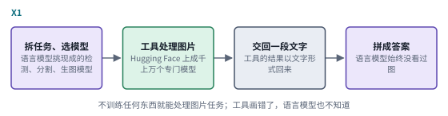 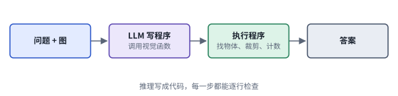

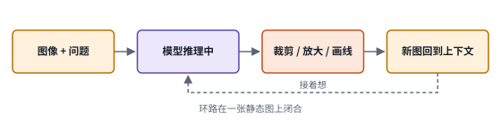 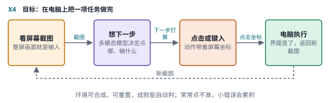

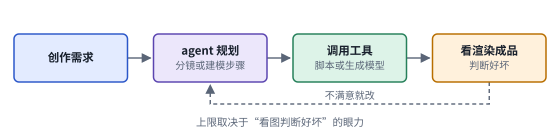 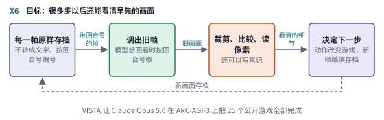

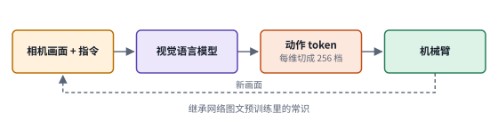

*图：图谱第九节的七种做法，每张卡对应下表的一行。*

| 代号 | 名称 | 年份 | 代表 | 怎么做 | 解决了什么 | 代价 |
|---|---|---|---|---|---|---|
| X1 | LLM 指挥视觉工具（开环） | 2023.3 | Visual ChatGPT、HuggingGPT | 语言模型拆解请求，调用现成的检测、分割、生图、修图模型，把工具返回的文字拼成答案 | 不训练任何东西，就让当时看不见图的语言模型能处理图片任务，是多模态工具调用的起点 | 语言模型只看到文字描述，看不见工具的真实产物，工具出错只能照单全收 |
| X2 | 视觉程序 | 2022–2023 | VisProg、ViperGPT | 语言模型写一段调用视觉函数的 Python 程序，执行程序得到答案 | 推理过程写在代码里，每一步都能检查，简单函数能组合出复杂推理 | 准确率取决于视觉函数本身，程序错一行就全错，写程序时同样看不见图 |
| X3 | 在思考中操作图像 | 2023–2025 | V*、Visual Sketchpad、o3、Pixel Reasoner | 推理途中自己发出裁剪、放大、旋转、画线等操作，把新图放回上下文接着想 | 图片成了推理中可以反复查看的对象，小目标、细节和空间关系类问题大幅改善 | 主要针对单张静态图上的一道题，操作多了 token 消耗很大 |
| X4 | GUI agent | 2024.10 至今 | Claude computer use、OpenAI Operator、UI-TARS、CogAgent | 看截图，输出点击、键入、滚动等动作，电脑执行后返回新截图，循环到任务完成 | 屏幕是第一个大规模、能真正动手的视觉世界，环境可合成、可重置，奖励可自动判，适合强化学习 | 常常点不准，长任务规划容易跑偏，小的感知错误会逐步累积 |
| X5 | 闭环创作工具调用 | 2025–2026 | VideoGen-Agent、Blender 与三维代码 agent | 规划分镜或建模步骤，写脚本或调用生成模型，看渲染结果，不满意就改 | 突破单个生成模型的长度和复杂度限制，并且能看到工具产出的结果 | 整个循环的上限取决于“看图判断好坏”的眼力 |
| X6 | 长程视觉记忆 harness | 2026.10 | VISTA | 不改模型，每一帧原样存档，按回合号取帧、裁剪、读像素、写笔记 | 长程交互里旧画面不再丢失，模型可以像翻相册一样回查 | 记忆依赖外部系统，三维环境效果下降 |
| X7 | VLA：动作当 token | 2023–2024 | RT-2、OpenVLA | 把机械臂每个动作维度切成 256 档，视觉语言模型像说话一样输出动作 token | 机器人直接继承网络图文预训练里的常识，能理解没训练过的指令和物体 | 档位粗，生成慢，做不了需要快速精细调整的操作 |

### 总对照：七种做法放在两条轴上

> **要点：** 把七种做法和第三节的代表工作放进同一组坐标：横轴是动作作用在哪里，纵轴是模型能看到的结果。主线大体从左上往右下推进，前沿分支补的是格子里的空白和短板。

速查表按做法逐一比较，这里换一个角度，把它们放进两条共同的轴里。下面这张表先按几个固定的维度横向比较七种做法，再加上第三节里新出现的一种做法，即转移级验证。“谁判定完成”这一列尤其值得留意，它回答的正是全景图上的第三个问题：“任务完成”这个判断，最后由谁、依据什么做出。

| 做法 | 动作作用在哪里 | 模型看到的结果 | 谁判定完成 | 主要优点 | 主要代价 | 本章分支 |
|---|---|---|---|---|---|---|
| X1 LLM 指挥视觉工具 | 调用现成视觉模型处理图像 | 只有工具交回的文字 | 语言模型汇总时自己判断 | 不训练就能处理图片任务 | 工具出错只能照单全收 | 三.1 |
| X2 视觉程序 | 程序里的视觉函数 | 程序执行的返回值 | 程序跑完即给出答案 | 推理过程可以逐行检查 | 视觉函数出错，答案跟着错 | 三.1 |
| X3 看图思考 | 自己的输入：裁剪、放大、画线 | 这一步处理后的新图 | 模型在推理中自己判断 | 小目标和细节类问题大幅改善 | 推理链长、token 多，新图未必带来新证据 | 三.1 |
| X4 GUI agent | 软件与屏幕 | 每一步的新截图 | 环境里的检查脚本或裁判 | 环境可合成、可重置，适合强化学习 | 点不准、长任务跑偏、动作有副作用 | 三.2 至三.4 |
| X5 闭环创作 | 生成工具与成品 | 渲染出来的成品 | 模型看图判断好坏 | 突破单个生成模型的长度和复杂度 | 上限取决于看图的眼力 | 三.6 |
| X6 长程视觉记忆 | 游戏或软件环境 | 很多步之前的旧画面 | 游戏环境本身 | 旧画面不再丢失，可以回查细节 | 依赖外部的存储与检索 | 三.7 |
| X7 VLA | 物理世界中的机械臂 | 每一步的相机画面 | 真实任务是否成功 | 继承图文预训练里的常识 | 动作不可撤回，环境不能一键重置 | 三.7，第 11 章 |
| 转移级验证（LGWM） | 自己不发出动作，检查动作前后的两屏 | 预测的下一屏表示 | 预测与实际是否一致 | 能识别只看屏幕识别不了的重放攻击 | 要额外训练一个世界模型 | 三.5 |

下图把同样的内容画成一张格子图。横轴从左到右，动作从只改变“怎么看”，到改变软件、成品，再到物理世界；纵轴从上到下，模型看到的结果从没有，到这一步的新画面、很多步之前的旧画面，再到还没发生的下一屏。主线大致是从左上角往右下角推进的：开环的两种做法挤在左上角“看不到”那一格，看图思考、GUI agent、闭环创作和 VLA 排在第二行，VISTA、JarvisHub 和 OpenVLHarness 把第三行填上了几格，最下面一行只有转移级验证和世界模型。空着的格子同样有信息量，比如在本章收录的论文里，生成工具那一列的最后一行还是空的。

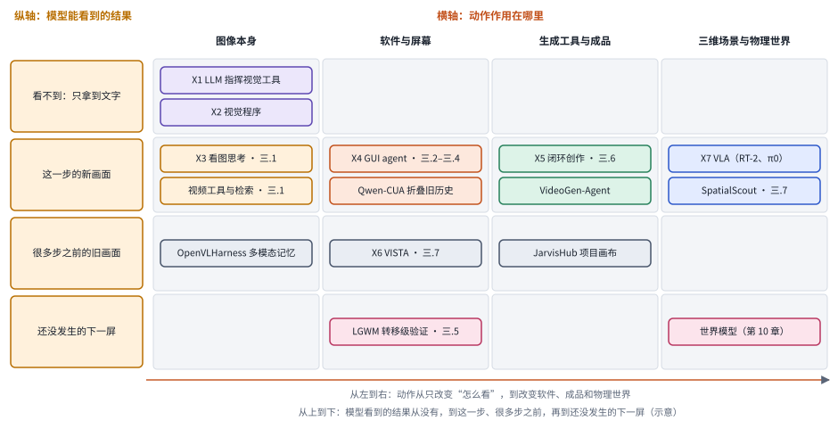

*图：七种做法和第三节的代表工作在两条轴上的位置（示意）。每个框后面的“三.N”标出它在第三节的分支。*

## 三、前沿研究方向

下面七个分支收录的大多是 2026 年的新论文，按它们落在环路上的位置来组织：先是看图思考与视觉工具，然后是屏幕操作的三个环节，即点击落点、动作接口、轨迹与奖励，接着是安全，再往后是闭环创作和长程视觉记忆，最后一个分支看 agent 怎样走出屏幕。每个分支开头先交代问题从哪里来，第一段之后标出它在主线上的位置。读这些论文时，建议一直带着两个问题：这篇工作让模型多看到了哪一层结果，这份结果本身又是怎样被验证的？

> **本节要点：** 七个分支按它们落在环路上的位置排列。每个分支开头先讲问题怎么来的，用一行“主线位置”挂回第二节，再用一张图把本分支几篇论文的做法摆在一起。第二节末尾那张格子图可以当作本节的目录。

### 1. 视觉工具与看图思考：返回的图片真的提供了新证据吗

当模型一眼看不清时，人会凑近看、放大看、换个角度看。于是很自然地，研究者给视觉语言模型配上了裁剪、放大、画辅助线、生成中间图像这类工具，让它在推理过程中再看一眼。这些工具确实改变了模型的观察，可并非每一张额外的图片都带来了新信息：有的只是把已有内容重新编码一遍，有的还会引入生成误差。要弄清楚收益从哪里来，就得固定原始输入，拿工具返回的结果和不用工具的基线比较，分辨收益来自补充了证据、重新分配了注意力，还是仅仅多花了计算。更长的视觉推理链和更可靠的推理之间，还隔着这样一道检验。

> 主线位置：“看图思考”阶段，并延伸到视频和外部检索。接 V*、Visual Sketchpad、o3 的 thinking with images 和 Pixel Reasoner，以及 OpenAI 自己列出的“推理链过长、感知错误、路径不稳定”三条局限。

> **要点：** 给模型配上裁剪、放大、检索这类工具之后，先要证明返回的东西真的带来了新证据，再去讨论该怎样用、什么时候用。视频把这个问题放大了，证据常常藏在画面之外。

有一个很容易被忽略的因素：调用工具时写下的那段文字本身。模型在调用裁剪工具时要写出目标描述、坐标和意图，这一步已经在帮它组织问题了，哪怕它根本不去读返回的像素，后续推理也可能因此变好。要识别视觉证据真正的贡献，就得保留调用文字，只替换返回的图像，做一组对照。

[2608.09682 · Thinking With Tools, Not With Pixels: Tool Calls as Text Scaffolds for Visual Reasoning](https://arxiv.org/abs/2608.09682) 做的正是这组对照。它保留工具调用的文字结构，用占位文本替代返回的图片，比较完整图像工具链和只留结构的路径，还进一步拆分了推理文字和空间代码各自的贡献。在所测的数据分布上，返回图片的必要性受到了挑战。这个结论要读得准确：它说明一些基准允许结构化文字携带主要信息，图像在别的任务上依然可能不可或缺。真正需要读取新证据的任务应该成为更强的对照，比如只有裁剪放大之后才能认出来的随机金额。Simon Willison 觉得 o3 二十多次裁剪有些表演成分，这篇论文可以看作对那种直觉的一次系统检验。

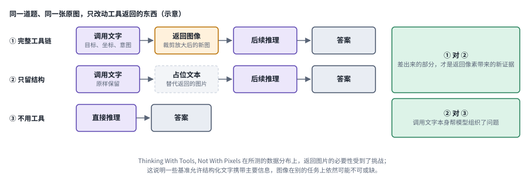

*图：三种条件只改动工具返回的东西。右边两个绿色框说明两两比较各自能分离出什么（示意）。*

第一行是平常的完整工具链：模型写下调用文字，说明要看哪里、为什么看，工具交回一张裁剪放大后的新图，模型接着推理。第二行把那张新图换成一段占位文本，调用文字原样保留，这就是 2608.09682 的关键设计。第三行是完全不用工具的基线。右边两个绿色框写出了这组对照的读法：第一行和第二行的差，才是返回像素本身带来的新证据；第二行和第三行的差，则来自调用文字帮模型把问题组织了一遍。第三行和右下那个框是为了说明读法画的示意，具体的实验条件以论文为准。

[2609.19664 · VideoResearcher: Self-Improving Tool Design for Long-Video Understanding](https://arxiv.org/abs/2609.19664) 从另一个方向改进工具。它运行“解题”和“演化”两个循环，分析轨迹里的证据缺口，然后设计、验证并复用新的可执行工具，改动落在工具上，提示词保持不动。这样能力的提升被放到了外部的工具设计里，不必更新模型参数。它的局限是验证集的选择和迭代预算可能带来过拟合；比较稳妥的做法是记录每次新增工具带来的收益，再到没有参与演化的视频上测试。

两篇工作之间形成了一种很有用的张力：一边在问现有的工具到底有没有必要，另一边在问还缺什么工具。一个好的工具系统应当先证明它带来了信息增益，再证明执行是正确的，最后才去比较总成本。工具调用的次数，说明不了推理有多深。

视觉工具有没有用，要同时看它增加了哪些信息，以及模型能不能用上这些信息。[CausalDS: Benchmarking Causal Reasoning in Data-Science Agents](https://arxiv.org/abs/2607.08093) 用可控的因果结构检查数据科学 agent 的代码、推断和恰当的弃答；它是证据使用方面的跨类对照，并不测试视觉定位。[OmniReasoner: Thinking with Long Audio-Video via Native Tool Use](https://arxiv.org/abs/2607.19339) 把看图思考推广到长音视频：模型先做一个低成本的全局预览，再通过监督微调和强化学习学会决定要不要、在哪里调用放大工具，把高保真的计算集中到相关的时间段上。它关心的是什么时候值得多花这份观察成本。

视频把这个问题放大了，因为证据不光藏在画面里，还常常藏在画面之外。[Thinking Beyond Videos: Unifying Video Reasoning and Deep Research for Open-World Video Agents](https://arxiv.org/abs/2608.23329) 把视频裁剪、多模态检索和网页浏览协调在一起，去处理那些只看片段答不出来的开放世界问题。证据一旦来自外部网页，核对来源也就成了任务的一部分。[Video-DeepResearch: Towards the Next-Generation Multimodal Deepresearch Agent](https://arxiv.org/abs/2608.03979) 在初步评测里抓到了两个很能说明问题的毛病：模型会绕开视觉工具，直接去做文字搜索；还会依赖参数里记住的知识，假装自己用工具查过。它的办法是把感知和外部探索拆开，分阶段解锁工具，强迫模型先做完跨帧的视觉定位，再去网上检索；作者报告 35B-A3B 版本在自建的 200 题多跳视频问答上平均 64.0%。[AdaVDR: Adaptive Tool Use and Reflection for Video Deep Research](https://arxiv.org/abs/2608.25559) 关心的是反过来的问题：不恰当的工具调用本身会产生错误结果，所以 agent 要按任务和自身能力挑工具，只在中间结果不可靠时才回退修正；作者报告它比基座模型在 VDR-EE 上高 15.20 个点，在已有的 VideoDR 基准上高 29.00 个点。三篇放在一起读，能看出“看”与“查”之间的分寸正在变成一个可以学习的决策。

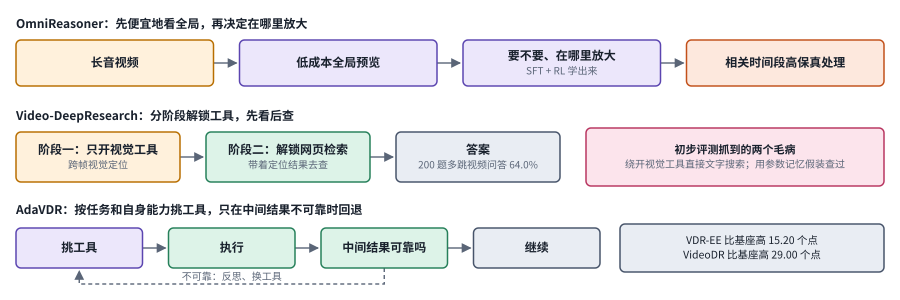

*图：三篇视频工作各自怎样安排“看”与“查”。上一行是 OmniReasoner 的先预览后放大，中间是 Video-DeepResearch 的分阶段解锁，下一行是 AdaVDR 的按需回退。*

三行可以看成三种不同的“分寸”。OmniReasoner 管的是成本：先用一个便宜的全局预览把长音视频过一遍，再由学出来的策略决定要不要放大、在哪里放大，把昂贵的高保真处理只花在相关的时间段上。Video-DeepResearch 管的是顺序：右边粉色框里那两个毛病，绕开视觉工具直接搜文字、拿参数记忆假装查过，都出在模型跳过了“看”；所以它把工具分阶段解锁，第一阶段只开视觉工具，跨帧定位做完之后才允许上网检索。AdaVDR 管的是可靠性：先按任务和自身能力挑工具，执行之后检查中间结果，只有不可靠时才沿着虚线回退、反思、换工具，右边的灰框是作者报告的提升幅度。

最后两篇来自本周的新工作，把视觉工具推向了更通用的执行环境。[OpenVLHarness: Real World Visual Agentic Tool-Use with Multimodal Memory](https://arxiv.org/abs/2610.26860)（`2610.26860`）先做了一个对照研究：在 22 个基准上，单纯给基座多模态模型更多推理预算，视觉推理只涨一点点。它于是搭了一个两层的 harness，能力层把各种异构工具包装起来，并把它们的输出渲染成模型读得懂的观察；持久的多模态记忆把图像、结构化数据和网页引用存成可以取回的产物，再由一个编码接口在这些产物上运行生成的程序，把多个工具的结果组合起来。作者报告，在八个开源和闭源骨干上，它比匹配的无工具基线平均高 9.7 到 12.6 个点，搭配中等推理强度的 GPT-6 Luna 时，比最高推理强度下的基座模型、Codex 和 Visual Sketchpad 高 7.7 到 8.5 个点，模型 token 成本最多只有它们的 37%。[S-Agent 2.0: Spatial Reasoning with a General Coding Agent](https://arxiv.org/abs/2610.28354)（`2610.28354`）走得更直接：给一个现成的通用编码 agent 加一套命令行三维感知工具，让它获取场景证据、存进持久的场景记忆、再用平实的空间语言解释读数，作者称之为帮视觉语言模型“闭合证据回路”。作者报告，同一个 agent 加上这套工具后，Qwen3.8-27B 在 MMSI-Bench 和 ReVSI 上分别提高 13.9 和 20.5 个点，并且能在 Codex、Claude Code 等不同的编码 harness 上工作；一个有意思的观察是，骨干越强，专门工具的收益缩得越快，而这套通用工具的收益保持得更好。这两篇都把“看图思考”从一张图推广到了一个能存、能查、能编程的工作台上，和下面三.7 的长程视觉记忆可以对照着读。

### 2. 点击落点：语义正确之后，还要点在正确位置

主线讲过，SeeAct 发现模型常常知道该做什么，却说不准该点哪里；Simon Willison 也认为 computer use 最关键的进步是模型终于能报出可靠的坐标。可定位这件事比给物体画框要复杂：界面会缩放、会滚动、会被弹窗遮住，状态也在不停地变。上一帧里某个坐标对应“提交”按钮，等动作真正执行时，同一个坐标下可能已经换成了别的东西。所以比较定位方法时，静态截图上的定位精度和交互过程中的落点正确率是两个不同的量，还得看系统怎样处理刷新和重试。离线定位拿了高分，未必能换来可靠的操作。

> 主线位置：“屏幕”阶段的定位瓶颈。接 Set-of-Mark、SeeClick、UGround、CogAgent 把文字落到坐标上的工作，以及 Anthropic 关于“数像素”的说明和 Smol2Operator 的定位数据配方。

> **要点：** 定位要过两道坎：先认对目标，再把它兑现成一次落在正确像素上的点击。失败时要把“选错了目标”和“坐标偏了一点”分开，两者的修法完全不同。

拿一句很普通的指令来体会：“点击总额下方的输入框”。它里面混着三件事：认出“总额”这个对象，理解“下方”这个相对位置，再换算成一个具体的动作坐标。前两件事主要是感知和空间理解，[多模态理解](09_multimodal_gui.md)一章有专门的空间定位分支，那里收录的 [SpatioLM](https://arxiv.org/abs/2608.01899)、[Multi-View Relational Distillation](https://arxiv.org/abs/2608.10864)、[Qwen-3D](https://arxiv.org/abs/2608.02980)、[ReToken](https://arxiv.org/abs/2607.28627v1)（[v2](https://arxiv.org/abs/2607.28627v2) 已改名为 *ReToken: Improving Long-Context VLMs with Visual Retrieval Token*）和 [Mixture-of-Thought-Tokens](https://arxiv.org/abs/2607.24407)，分别从训练时补几何、蒸馏多视角关系、三维场景识别、视觉检索 token 和落在空间位置上的思考 token 这几条路去补强。本章关心的是第三件事，也就是把这些空间知识最终兑现成一次落在正确像素上的点击。

从行动的角度看，这些空间方法都还要过一关：几何上的改善能不能保留到实际的落点上。SpatioLM 这类方法在空间问答上的提升，要通过实际的定位偏差和操作后果来检验，才能说转化成了 GUI 上的收益；多视角关系蒸馏解决的是几何对应，解决不了界面语义上的歧义，比如屏幕上有两个都叫“保存”的按钮。分析失败时，要把“选错了语义目标”和“坐标偏了一点”分开，这两种失败需要完全不同的修法：前者要更好的界面理解和任务记忆，后者要更好的定位数据，或者干脆换一种不依赖坐标的动作接口。

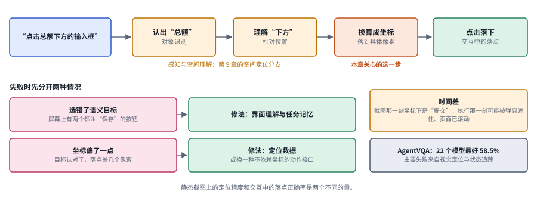

*图：上排把“点击总额下方的输入框”拆成三步，前两步属于第 9 章的空间定位分支，第三步是本章关心的；下排是两种失败和各自的修法，右侧是交互中特有的时间差和 AgentVQA 的诊断。*

上排从左往右，是一句指令变成一次点击要走的路。认出“总额”是对象识别，理解“下方”是相对位置，这两步属于感知和空间理解，第 9 章那几篇空间方法补的就是它们；换算成坐标这一步才真正落到像素上，最后在交互中点下去。左下两行是诊断时最该分开的两类失败：屏幕上有两个都叫“保存”的按钮而模型选了另一个，属于语义目标选错，要靠更好的界面理解和任务记忆来修；目标认对了、落点却差了几个像素，属于坐标偏移，要靠更好的定位数据，或者换一种不依赖坐标的动作接口。右上的琥珀色框是交互独有的麻烦：截图那一刻某个坐标下是“提交”，执行那一刻那里可能已经被弹窗盖住。右下的灰框是下面 AgentVQA 的结论，即使不让模型动手，单是“看准”这一项，最好的模型也只有 58.5%。

本周的一篇新基准给这件事提供了很直接的证据。[AgentVQA: A Unified Benchmark for Agentic Visual Understanding](https://arxiv.org/abs/2610.31494)（`2610.31494`）从 23 个来源数据集里人工挑出 1000 道难题，覆盖网页 agent、机器人、第一人称视频、游戏和空间规划五个领域，用离线问答的方式测 agent 场景下的视觉理解；作者报告 22 个模型中最好的只有 58.5%，排名和对应的在线评测基本一致，而主要的失败来自视觉定位和状态追踪，包括定位界面元素、理解运动、追踪状态变化和推断三维空间关系，较少来自误解任务或下游推理。也就是说，即使把“动手”这一环拿掉，agent 场景里的“看准”本身就还远没解决。

### 3. 动作接口：纯屏幕与混合工具各付什么代价

主线“屏幕”阶段留下的第一个分歧，在这里正面展开。纯屏幕接口最接近人的操作方式，适用范围最广，Anthropic 当初选这条路，看中的就是它能用“几乎任何软件”；可许多信息只能从像素里间接推断，每一步都要重新看懂一遍界面。原生工具和命令行能直接给出结构化的结果，却依赖平台提供的接口和权限约定。混合方案要回答的问题因此很具体：哪些操作值得绕开 GUI，哪些必须保留可视交互，两条路径之间的状态又怎样保持同步。Epoch 对 OSWorld 的审计让这个问题变得更尖锐：既然将近一半任务几乎用不着界面，比较不同系统之前，先得讲清楚它们被允许用哪些接口。

> 主线位置：“屏幕”到“原生 GUI 模型”。接 Claude computer use 与 OpenAI CUA 的纯像素路线，WebArena、OSWorld 中混用结构化信息的框架路线，以及 UI-TARS-2 引入文件系统和终端的混合环境。

> **要点：** 纯像素接口兼容面最广，每一步却都要重新看懂界面；结构化工具和命令行直接给出结果，却依赖平台的接口和权限。比较不同系统之前，先统一它们被允许使用的输入和工具。

先看两个把边界画得很清楚的系统。[PalmClaw](https://arxiv.org/abs/2607.13027) 在手机本地管理会话、记忆、技能和执行循环，并把设备能力作为参数和返回结果都很明确、带权限检查的工具开放出来。它提供了一种和“连续点击”很不一样的系统边界，适合用来比较两者的接口长度和权限的可解释性。[HumanCLAW](https://arxiv.org/abs/2607.27180) 来自身体行动的评测，它把高层的动作决策和低层的运动执行解耦开来，作者发现识别物体比导航和交互容易得多，主要原因是模型追踪不好自己的身体。它算不上 GUI 基准，却能帮我们理解同一个诊断原则：先把执行端的干扰控制住，再去测模型有没有选对动作。

人能操作的软件未必提供标准 API，所以纯截图加鼠标键盘有很广的兼容面。它的代价是每一步都要重新理解界面，批量处理一百个文件时会非常慢。引入命令行可以绕过不少界面上的摩擦，同时也带来了权限、文件副作用和评测条件上的差异。

[2607.28227 · Qwen-UI-Agent Technical Report: Toward Next-Generation Real-World Centric Foundation GUI Agents](https://arxiv.org/abs/2607.28227) 走的是混合路线。它把移动端、电脑、网页和搜索环境放进统一的工作流，动作空间里 GUI 和 CLI 交替出现，并支持一轮输出多个动作。它还把环境与任务的构建、失败诊断都纳入了训练迭代。这套方法的吸引力在于把跨设备办事当作一个系统问题来做；限制在于结果依赖环境基础设施和执行层，整套工程带来的收益不好全部归到骨干模型的参数上，批量动作也要重新检查中途有没有冒出弹窗。

[2608.02352 · Qwen-CUA: Native Computer Use for (almost) Everything](https://arxiv.org/abs/2608.02352) 则站在纯像素一边，只用截图观察和键鼠事件，不用 DOM、无障碍元数据和任务专用的 API；它保留最近的几张截图，把更早的视觉历史折叠起来。这样更接近通用的人类界面，却需要大量可以验证的交互经验，这正是主线“原生 GUI 模型”一段所说的数据瓶颈：专门模型的进步主要靠大量人类操作电脑的轨迹，而公开可用的轨迹数据集仍然很小。拿它和混合系统比较时，要先统一双方允许的输入和工具，否则“谁更强”可能只是在比“谁能直接访问文件”。它的历史折叠也要检查一下：被压缩掉的细节，会不会在后面某一步重新变成关键，这正是三.7 里 VISTA 想解决的问题。

本周阿里的 [OpenGCUA: Toward a Fully Open Stack for Generalist Computer Use](https://arxiv.org/abs/2610.22200)（`2610.22200`）把混合路线做成了一整套开放的栈。作者报告，在 OSWorld-v2 上，完整配置让所测的八个模型全部提分，平均部分得分提高 19.6 个点，每个任务的步数比只用 GUI 的批量执行平均少 53.0%；在四个真实 macOS 任务上，不同模型消耗的推理 token 差距可以达到十几倍。这组数字说明，接口和执行层的设计对成本的影响，可能不亚于换一个模型，和第 18 章里“换 harness 能省下多少”的那些对照是同一类证据。

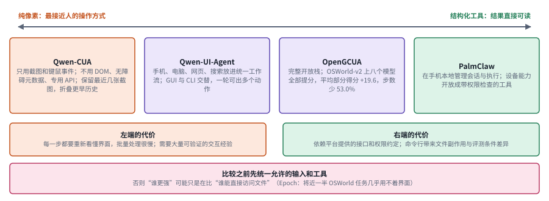

*图：本分支几个系统在“纯像素”与“结构化工具”之间的位置，下方两个框是两端各自的代价。*

光谱最左边是 Qwen-CUA，只看截图、只发键鼠事件，刻意不用 DOM、无障碍元数据和任务专用的 API；最右边是 PalmClaw，它在手机本地把设备能力包装成参数清楚、带权限检查的工具，模型调用的是函数，用不着去点屏幕。中间两个紫色框是混合路线：Qwen-UI-Agent 让 GUI 和命令行在同一个动作空间里交替出现，一轮还能出多个动作；OpenGCUA 把这种做法做成完整的开放栈，作者报告它让所测的八个模型全部提分、步数平均少了 53.0%。下方两个框分别写出两端的代价，最底下的粉色框是比较时要守的规矩。

对实际使用者来说，选接口之前不妨先写一张权限表：可以读哪些目录，可以写哪些应用，哪些动作必须让人确认。效率也不只是少点几次鼠标，遇到错误能不能恢复、有没有留下可以审计的记录，同样算在效率里。

接口的选择还要和适配数据、任务环境以及可执行的验收放在一起考虑。[UI-Mate: Advancing Open-Weight Foundation GUI Agents with In-Context Demonstrations](https://arxiv.org/abs/2608.15930) 通过环境化的训练和上下文中的示范，帮助 GUI 模型适应新的流程，可以用来比较“给示范”和“更新参数”两种适配方式的成本。[CUA-Universe: A Scalable and Dynamic Environment for Hybrid GUI+CLI Agents](https://arxiv.org/abs/2609.05374) 用动态的 GUI 与命令行混合任务来训练，研究跨工具的组合能力能否迁移到其他环境。[RecreationWorld: Scalable and Verifiable Environments for Hybrid Computer-Use Agents](https://arxiv.org/abs/2609.22000) 运行参考应用来产生轨迹和行为测试，把“看起来像是完成了”变成了可以执行的结果检查。这和 OSWorld 给每个任务配检查脚本是一脉相承的思路，只是它想把这件事做得更可扩展。

### 4. 轨迹、环境、奖励与停止：更多数据之前先保证反馈可信

主线说，原生 GUI 模型靠轨迹数据和在线学习变强。可交互数据有一个麻烦的性质：它把策略和环境绑在了一起。一条成功的轨迹里可能夹着大量无效动作，一条失败的轨迹里也可能有正确的观察和很有价值的恢复步骤。静态截图上的标签告诉不了模型一次失败是怎么发生的，而成功轨迹又常常缺少恢复动作的示范。在线强化学习能补上交互，前提是任务可以复位、奖励值得信任、采样预算花在有学习价值的地方。奖励设计还得分清动作是否有效、阶段是否完成、最终目标是否达成，并且说清楚系统什么时候必须停下来。停止信号如果不可靠，模型可能在已经成功之后继续操作，亲手把结果破坏掉。

> 主线位置：“原生 GUI 模型与在线强化学习”的核心，同时触及边界。接 UI-TARS 的反思式在线轨迹、UI-TARS-2 的数据飞轮与沙箱平台、OpenCUA 的人类演示数据，以及 OSWorld-Verified 对“可靠奖励极其耗费人力”的复盘。

> **要点：** 在线学习靠三条供给线：任务从哪里来，环境有多深，裁判信不信得过。三者分别管着数据供给、经验质量和信号质量，再加上一道“该停就停”的闸门，反馈才算可信。

把所有状态都塞给模型，并不会自动增加有效的经验。[2607.11185 · SCALECUA: Scaling Computer Use Agents with Verifiable Task Synthesis and Efficient Online RL](https://arxiv.org/abs/2607.11185) 把可验证的任务合成和在线训练结合起来：通过容器里的交互和多个 agent 的反馈来构造任务，再按模型当前的能力边界分配采样，并把视觉上下文分段，缓解训练压力。它同时回应了数据稀缺和训练吞吐两个问题。它的限制在于，自动生成的验收器也可能漏掉条件；评测时要把独立的人工任务和合成任务分开测，确认模型优化的是能力，没有只学会出题流程的固定套路。

环境从哪里来，是第二个问题。[Echoverse: Deep, Evolving Environments for Training Computer-Use Agents at Scale](https://www.alphaxiv.org/abs/2607.echoverse) 来自微软研究院，它的出发点是在线真实网站难以复位、难以大规模采样，于是合成一批有深度、会演化的环境，让任务带着真实的状态依赖。作者报告，一个 9B 模型在十二个环境上训练后，在十四个评测划分上的平均成功率从 36.5% 升到 67.1%；更有意思的是两个消融：浅的环境反而会拉低真实网站上的表现，深的环境才能带来提升；修好一个有问题的环境，在它上面训练的模型就从 16.2% 升到 38.5%。环境质量本身就是一个一阶变量。本周同样来自微软的 [Agent World Model in the Wild: Computer-Use Agent Environment Synthesis](https://arxiv.org/abs/2610.26828)（`2610.26828`）把环境合成做成了一条完全由开源模型驱动的流水线，环境里同时有 GUI、MCP 服务和命令行，质量控制包括基于执行的门槛、多个裁判的一致性检查和反事实探针；它产出 341 个长程环境与任务对，有些任务需要 100 步以上，GPT-6-Astra 也只能解出六成，只在这些合成环境里训练的两个 Qwen 模型在八个分布外基准上都有提升。

[2607.28609 · OSReward: Instituting Standardized Evaluation for Cross-Platform Computer-Use Reward Models](https://arxiv.org/abs/2607.28609) 把视角转向裁判本身。它用人工标注的跨平台轨迹来评测视觉模型的判定，再训练成本更低的奖励模型。最关键的是一个负面结果：裁判普遍偏宽松，会把没完成的任务判成完成。要是奖励器更相信 agent 自己写的文字历史，较少去看屏幕，强化学习就可能把这种偏差一轮轮放大。学习型奖励适合做规模化的初筛；文件是否存在、金额是否一致这类可以确定性检查的事，还是尽量交给确定性的验证去做。Echoverse 的消融也指向同一个方向：把有据可查的验证器和逐步的稠密裁判合起来用，比单用其中一种更好。

轨迹训练之间更细的区别，在于数据怎样产生、反馈针对哪个阶段，以及停止行为从哪里获得监督。[HyMobileAgent: Data-Environment Co-Scaling for Efficient GUI Agents](https://arxiv.org/abs/2607.14548) 同时扩展移动端的数据和环境，说明 GUI agent 的效率除了来自参数规模，也来自任务分布和交互条件。[Inducing Task Models from Computer-Use Traces](https://arxiv.org/abs/2608.20319) 把原始的操作轨迹整理成任务层次和程序控制流，为复用流程提供了一种比截图堆叠更有结构的记忆。[Do GUI Agents Know When Not to Act? Enabling Conflict-Aware Termination for Multimodal GUI Agents](https://arxiv.org/abs/2609.03438) 通过冲突识别和终止机制来处理那些根本无法执行的指令，并要求把“恰当地拒绝”和“普通的操作失败”分开计分。

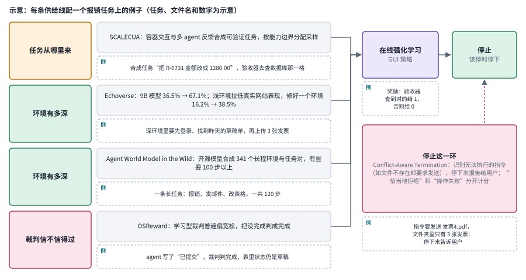

*图：左边四行是本分支几篇论文分别在补的供给线，汇入右上的在线强化学习；右下的粉色框是停止这一环。*

左边第一行是任务：SCALECUA 用容器里的交互和多个 agent 的反馈合成可以自动验证的任务，并按模型当前的能力边界分配采样。中间两行是环境：Echoverse 的数字说明环境的深度和质量本身就是一阶变量，Agent World Model in the Wild 则把环境合成交给开源模型，一次产出几百个长程环境。最后一行是裁判：OSReward 发现学习型裁判普遍偏宽松，会把没完成的任务判成完成。四行汇进右上方的在线强化学习，策略能学到的东西，取决于这几条供给线的质量。右下的粉色框单独画出停止，它把一个常被忽略的行为摆上了桌面：面对根本无法执行的指令，最好的做法是停下来报告，系统得为这种行为单独计分。

这几篇放在一起看，任务合成、环境深度和裁判质量分别管着数据供给、经验质量和信号质量，三者要配合着考虑。再加上停止这一环：面对“文件不存在却要求发送”这样自相矛盾的任务，系统要能正确地停下来，把它报告给用户，别一遍遍重试，直到偶然触发了某个奖励。OSWorld 2.0 总结的“该问用户时自己瞎猜”“做完不检查”，说的正是这一类问题。

### 5. 安全与统一接口：能跨任务复用，也能跨任务传播错误

统一接口降低了集成成本，也扩大了一条错误规则的影响范围。早在 2024 年发布 computer use 时，Anthropic 就把提示注入列为最担心的问题：模型会读联网电脑的截图，网页上的一段恶意文字就可能让它偏离用户的本意。到了今天，情况更复杂了。网页内容、截图里的文字、工具的返回值都可能被误当成操作指令，而能保存技能、记忆和程序的助手，又会把这种影响带到后续的任务里。屏幕本身也可能被伪造：一张看起来完全正常的截图，可能是攻击者重放的旧画面。安全设计因此要同时标明数据的来源、可执行的权限和共享的范围；界面可以统一，权限却要分得清清楚楚。

> 主线位置：“边界”中的安全一环。接 Anthropic 与 OpenAI 在发布电脑操作 agent 时提出的提示注入问题和多层防护，Simon Willison 引用的网页诱导下载演示，以及第 10 章把世界模型当作预测器的思路。

> **要点：** 统一接口让一条错误规则能跨任务传播。只看屏幕的监控器会被重放的合法画面骗过，安全要看的是动作前后的转移；能保存技能和记忆的助手，还要追踪内容的来源和权限怎样一路传下去。

能保存技能、记忆和程序的助手，比一次性的问答器有用得多，也随之产生了新的信任边界。网页上的内容不能升级成用户的授权；自动生成的工具，也不会因为“是自己写的”就变得可信。

[2608.06862 · SynChain: Inducing Computer-Use Agent Systems to Construct Their Own Attack Chains](https://arxiv.org/abs/2608.06862) 分析了恶意影响怎样藏进持久化的产物里，在后续任务中被重新激活，整个过程不需要每次都有新的外部恶意输入。它把安全评测从单次提示推进到了跨任务的轨迹上。防御的重点也随之变成来源、权限和状态的传播，单靠某一轮的文字过滤是拦不住的。它所测的攻击目标和任务链仍然有限，一次抵抗成功，推不出所有技能库都安全。

跨任务的安全测试要跨越任务边界去设计：第一次任务写入了什么，第二次任务为什么会读取它，第三次有没有因此改变权限。[ToolHazard: Scaling Adversarial Environments for Security Evaluation and Alignment of LLM-based Agents](https://arxiv.org/abs/2608.11878) 合成对抗性的环境状态来测试间接指令注入，适合检查模型会不会把环境里的内容误当成高优先级的命令；作者报告，用它生成的数据做对齐，能明显提高鲁棒性，同时保住正常任务的效用。

本周的 [Right Screen, Wrong Transition: World Models as Verifiers for GUI Agents](https://arxiv.org/abs/2610.11942)（`2610.11942`）抓住了一个很巧妙的漏洞：安全取决于转移，也就是动作之后的那一屏，光看当前这一屏是不够的，因为攻击者可以把一个合法的屏幕重放给只看画面的监控器。作者训练了一个不带解码器、以动作为条件的世界模型 LGWM，在 185 万条真实 GUI 转移上学习预测下一屏的表示，于是检查一次转移就变成了比较两个向量；他们还构造了一个基准，让每个输入凭证的屏幕都配一条合法转移和一条被劫持的转移，只看屏幕的检测器在上面只能靠猜。作者报告这个免训练的打分达到 0.987 的 AUC，每次判断 17 毫秒，与最强的闭源视觉语言模型相当，速度快三个数量级以上。论文把“验证”提为世界模型在模拟和规划之外的第三种用途，这正好是本章第一个出口的一个具体落点，那个出口说的是在学出来的世界模型里先预判动作的后果，再决定要不要真的去做。

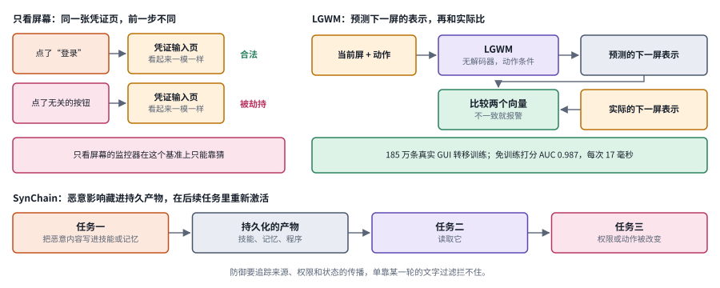

*图：左上是只看屏幕的困境，右上是 LGWM 的转移级验证，下排是 SynChain 描述的跨任务攻击链。*

左上两行画的是 Right Screen, Wrong Transition 的出发点。同一张凭证输入页，如果前一步点的是“登录”，它是合法的；如果前一步点的是一个毫不相干的按钮，它就可能是被劫持后重放的画面。两张屏幕一模一样，只看屏幕的监控器在作者构造的基准上只能靠猜。右上是 LGWM 的做法：把当前屏和动作交给一个不带解码器的世界模型，直接预测下一屏的表示，再和实际下一屏的表示比较，两个向量对不上就报警。下排换到更长的时间尺度：SynChain 发现，恶意内容可以在任务一里被写进技能、记忆或程序这类持久产物，任务二读取它，到任务三时权限或动作已经被悄悄改变。两部分合起来读，安全检查的单位从一张屏幕扩大到了一次转移，又从一次任务扩大到了一串任务。

统一模型还会带来另一种混淆：一张图像究竟是模型新画出来的作品，还是从屏幕上读到的证据，必须标得明明白白。[2609.11244 · OmniHallu: Unified Hallucination Detection for Cross-Modal Comprehension and Generation in Multimodal Large Language Models](https://arxiv.org/abs/2609.11244) 把多模态理解与生成中的幻觉拆成一条条原子声明，交给各模态的专家去核对，再训练一个低成本的验证器去近似这个过程；[PixelUMM: Encoder-Free Unified Image and Video Understanding and Generation](https://arxiv.org/abs/2609.38597) 探索直接从像素出发统一图像视频的理解与生成。这两篇的主体在[多模态理解](09_multimodal_gui.md)一章，放在这里提一句，是为了提醒设计验收层的人：内容是否真实和操作是否获得授权是两件事，生成能力本身也不构成执行上的授权。

[The Interface of Theseus: The Rise of Just-In-Time Interfaces](https://arxiv.org/abs/2609.06770) 从更远的地方提出了一个问题。当软件可以在几分钟内为每个人、每个任务临时生成时，界面本身可能变成用完即弃的东西。这对 GUI agent 既是机会也是麻烦：界面可以按 agent 的需要生成，可轨迹回放时，原来的坐标可能早已失去意义。可定制性怎样和可复现、可审计兼容，是接口设计迟早要面对的问题。

### 6. 闭环创作：看成品的那一眼由谁来做

闭环创作把环路接到了生成工具上。agent 写脚本、调用图像或视频模型、拿到渲染结果，再决定改哪里。这和 GUI agent 很像，每一步都有新的画面回来；区别在于这里没有一个“任务完成”的程序状态可以查，好不好全凭眼睛。图谱对这一段的判断很直接：模型的视觉判断力有多强，做出来的东西就能有多好。所以这个分支真正的研究问题，是怎样把“看成品”这一眼做得可靠、可训练，并且让整个创作过程的状态留得下来、改得回去。

> 主线位置：“闭环创作”阶段。接 SceneCraft 用视觉语言模型检查渲染图、BlenderAlchemy 的状态评估器，以及第 16 章“Agent 编排与可编辑交付”分支对生成工作流的讨论。

> **要点：** 创作循环里没有一个可以直接查询的“任务完成”状态，好不好全凭那一眼。研究问题因此集中在两处：怎样把看成品这一眼做得可训练，怎样把长程创作的状态留下来。

[VideoGen-Agent: Reinforcing Video Generation Agents](https://arxiv.org/abs/2609.24997) 把这个循环拿去做强化学习。agent 在多轮交互里协调增强、生成和验证三类工具，先用教师轨迹做监督微调，再用一个按任务类别区分的混合奖励做多任务强化学习，奖励同时看工具调用是否有效、工具用法是否合适，以及最终视频的质量。作者构建了一个 600 条提示的留出基准，报告 agent 把底层文生视频模型的分数从 56.5 提到 75.6；不重新训练 agent、只把生成工具换成更强的，分数还能升到 86.1。后一个数字很说明问题：学到的是调用和检查的策略，它可以随着工具变强而直接受益。这篇论文的主类在[多模态生成](16_generation.md)，本章看重的是它把“验证工具”明确放进了动作空间。

另一个难点是长程创作的状态。[JarvisHub: An Open Harness for Canvas-Native Multimodal Creative Agents](https://www.alphaxiv.org/abs/2607.23588) 指出，真实的创作涉及参考、草稿、备选、编辑、失败的尝试、版本关系、工具动作和评估信号，这些合起来是一个不断演化的项目状态，线性的对话历史很难装下。它让 agent 在一张可编辑的项目画布上工作，把状态外置成一张图，使创作过程可查看、可追溯、可由人引导。这和 VISTA 把旧画面原样存档是同一种直觉：要让模型回头看，先得把能看的东西留住。

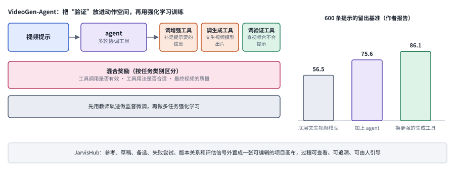

*图：左上是 VideoGen-Agent 的工具与奖励，右边是作者在 600 条提示上报告的三个分数，底部是 JarvisHub 把创作状态外置成项目画布的做法。*

VideoGen-Agent 的 agent 在多轮交互里协调增强、生成、验证三类工具，绿色的“验证”和另外两个工具并列，意思是检查成品也成了一个可以学习的动作。中间的粉色框是它的奖励，同时看工具调用有没有效、用法合不合适、最终视频好不好；训练先用教师轨迹做监督微调，再做多任务强化学习。右边三根柱子是最值得记的数字：底层文生视频模型 56.5，加上 agent 后 75.6，不重新训练 agent、只把生成工具换成更强的，就升到 86.1。最右那根柱子说明，学到的调用和检查策略可以直接搭上更强工具的便车。底部的 JarvisHub 处理的是另一件事：参考、草稿、备选、失败的尝试和评估信号一多，线性的对话历史装不下，就把它们外置成一张可以查看、可以回溯的项目画布。

### 7. 长程视觉记忆与走出屏幕

交互一长，视觉 agent 就会遇到一个人类很少意识到的问题：旧画面去哪儿了。大多数系统为了控制上下文长度，只保留最近几张截图，更早的画面要么丢掉，要么压成一句文字描述。可很多任务恰恰需要回头核对：三十步之前那个弹窗里写了什么，游戏第一关的墙在哪个格子。与此同时，agent 的活动范围也在走出屏幕，进入需要主动探索的三维场景。这个分支收录的工作一头连着长程记忆，一头连着本章的两个出口。

> 主线位置：“长程视觉记忆”与“两个出口”。接 VISTA 的无损帧存档、Qwen-CUA 的历史折叠，以及第 10 章世界模型和第 11 章具身智能。

> **要点：** 这个分支放了两件事：怎样让旧画面留得住、找得到，怎样让 agent 靠自己的动作去看见还没看到的东西。把 VISTA、SpatialScout 和 LGWM 放在一起，会得到三种时间方向上的“看到结果”。

[VISTA: A Visual Harness for Reasoning in an Interactive World](https://arxiv.org/abs/2610.02200)（`2610.02200`）的设计很克制。项目页写明，模型拿到的是原始的 512×512 PNG 画面，用自由形式的语言推理，通过查看和读像素两类调用去访问无损的视觉记忆，没有程序合成，也没有针对具体游戏的逻辑。论文摘要报告 Claude Opus 5.0 的相对人类动作效率从 40.68 提到 100，作者称据他们所知这是第一个不靠程序合成就拿到满分或接近满分的系统。读这组数字时要记住两点：项目页给出的官方最小接口基线与摘要里的起点数字并不相同，引用时要注明出处；公开游戏可能出现在模型的训练数据里，私有测试集才是真正的泛化检验。它和三.3 里 Qwen-CUA 的历史折叠正好构成一组对照：一个把旧画面压缩掉以控制成本，一个把旧画面原样留下以便回查，哪种更合适，取决于任务里关键信息出现和被需要之间隔了多久。

走出屏幕的第一步，是让 agent 自己去看它还没看到的东西。[SpatialScout: Can VLM Agents Actively Explore and Map 3D Scenes?](https://arxiv.org/abs/2610.26659)（`2610.26659`）给视觉语言模型 agent 一份物体清单、RGB 观察、相机标定和位姿，让它在有限的交互预算内控制相机去探索 80 个室内场景，估计 3140 个目标物体在统一坐标系里的中心位置，考察选视角、跨视角关联、几何估计和地图修正这几项能力。作者报告最强的模型平均重叠得分只有 41.71%，超过 0.5 IoU 的目标占 47.23%，超过 0.9 的只有 3.25%。粗略的物体布局和完整精确的度量地图之间，还隔着很大一段路。这件事在屏幕上不太明显，因为截图总是完整的；一旦视野要靠自己的动作去换，主动观察就成了 agent 的基本功，这也是[具身智能](11_embodied.md)一章反复讨论的问题。

另一个出口在三.5 已经露过面：Right Screen, Wrong Transition 把世界模型用作 GUI 动作的验证器。把它和 SpatialScout、VISTA 放在一起看，会发现三者其实在补同一件事的不同侧面：VISTA 让过去的结果重新可见，SpatialScout 测 agent 能不能主动让未知的部分变得可见，LGWM 则让还没发生的结果提前可见。本章开头那个问题，模型能不能看到自己行动的结果，在这里有了三种时间方向上的回答。

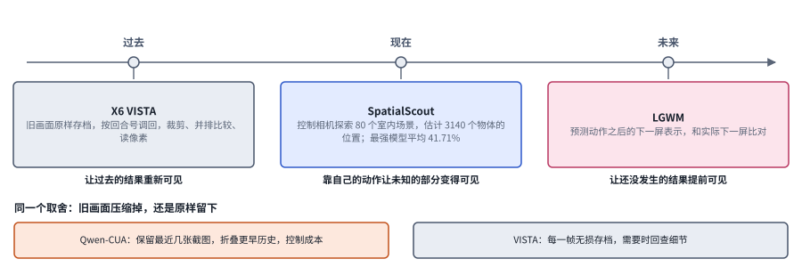

*图：VISTA、SpatialScout 和 LGWM 分别让过去、现在和未来的结果变得可见；下方是 Qwen-CUA 与 VISTA 在处理旧画面上的不同取舍。*

把上排三个框沿时间轴读。VISTA 在“过去”一侧，旧画面原样存档，按回合号随时调回来，让很多步之前的结果重新可见；SpatialScout 在“现在”，三维场景里的视野要靠 agent 自己转动相机去换，考的是能不能靠动作让未知的部分变得可见，最强模型平均 41.71% 的成绩说明这件事还很难；LGWM 在“未来”，在动作真正生效之前就预测出下一屏，让还没发生的结果提前可见。下排把三.3 和本分支连了起来：Qwen-CUA 折叠旧历史来控制成本，VISTA 原样保留旧画面以便回查，两种取舍孰优孰劣，取决于关键信息出现和被需要之间隔了多久。

## 四、方法比较：先找到环路上最早断开的那一环

读完七个分支，很容易被几十篇论文的名字淹没。其实它们补的都是同一条环路上的某一环：看不到结果，看错了结果，点偏了，接口不合适，交互经验不够，裁判不可信，旧画面丢了，或者被伪造的画面骗了。真实的流程里，最好先找出最早断开的那一环，再决定是加视觉工具、补定位数据、换动作接口、合成环境，还是加记忆和验证，然后检查局部的改善能不能一直保留到最终结果。下面这张表把常见的路线和它们的代价放在一起，最右边一列是验收时最该看的东西。

> **本节要点：** 第三节的几十篇论文，补的都是同一条环路上的某一环。先找出最早断开的那一环，再选对应的路线，最后检查局部的改善有没有一路保留到最终结果。

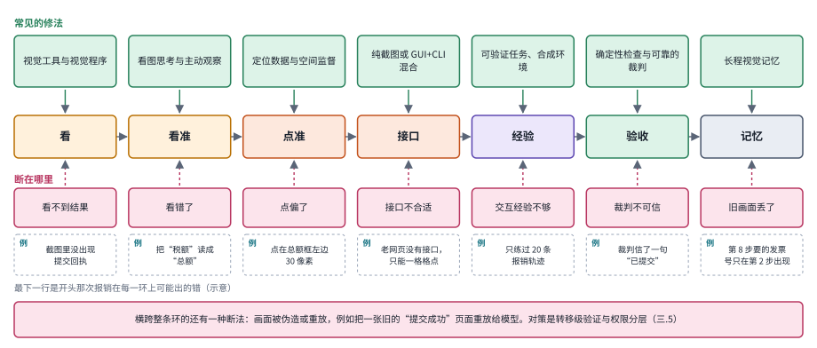

*图：中间一行是环路上的七关，下排粉色框是每一关的典型断法，上排绿色框是常见的修法；底部是横跨整条环的伪造与重放。*

这张图把上一段那串“看不到结果，看错了，点偏了”排成了一行。中间七个框从左往右，是一次操作要依次过的七关：先要看得到结果，再要看得准，然后点得准，用对接口，有足够的交互经验，验收信得过，最后旧画面还留得住。每一关下面的粉色框是它典型的断法，上面的绿色框是对应的修法，它们大致对应下表的各行：纯截图和 GUI 与 CLI 混合两种接口合在“接口”一关，闭环创作里的看图检查属于“验收”一关。用的时候从左往右找，第一个断开的地方往往就是最该投入的地方；底部那个横跨全图的粉色框提醒，伪造和重放的画面可以从任何一环混进来，所以下表最后一行的转移级验证与权限分层要贯穿始终。

| 路线 | 主要解决什么 | 必须付出的成本 | 关键验收 |
|---|---|---|---|
| 调用视觉工具与视觉程序 | 模型自己看不见或看不准 | 工具本身的误差直接传给答案 | 替换工具输出后答案是否随之改变 |
| 看图思考与主动观察 | 小目标、细节和长视频证据不足 | 更长的推理链与 token 成本 | 保留调用文字、替换返回图像后的收益差 |
| 定位数据与空间监督 | 知道该点什么却点不准 | 标注与教师监督 | 语义选错和坐标偏移分开统计 |
| 纯截图键鼠 | 缺少专用软件接口 | 长轨迹、视觉历史和交互采样 | 同样输入权限下的完整完成率 |
| GUI 与 CLI 混合 | 跨应用与批量任务效率 | 更复杂的权限及副作用管理 | 实际文件和进程状态，以及步数和 token |
| 可验证任务、合成环境与在线学习 | 交互经验不足 | 环境复位、环境质量与奖励器维护 | 独立人工任务上的表现与奖励误判率 |
| 闭环创作中的看图检查 | 单个生成模型做不了完整作品 | 多轮生成与检查的总成本 | 换更强工具时收益能否直接转移 |
| 长程视觉记忆 | 旧画面丢失或被压成文字 | 存储与检索的外部基础设施 | 关键信息相隔很远时的回查成功率 |
| 转移级验证与权限分层 | 注入、重放和跨任务传播 | 额外的验证模型与确认步骤 | 识别风险之后是否真的采取了安全动作 |

这些路线在实际系统里往往要组合起来用，但组合之前最好先有一个简单的基线。如果读一下文件就能验收，就没必要先去训练一个视觉裁判；如果工作流永远固定不变，一段脚本可能比通用 agent 更合适，这也是 RPA 至今没有消失的原因。选择更强系统的理由，应当是任务在变化、信息不确定，或者真的需要跨工具协作。

## 五、负面结果与开放问题

> **本节要点：** 本章的几个负面结果放在一起，指向同一条方法论：用干预实验找出收益从哪里来。开放问题集中在四处：把三种能力绑在一起考的基准，独立的验收信号，可以重放的轨迹，以及创作里“好不好”的可检查性。

这一章里有好几个负面结果，单看每一个都像是给热闹的方向泼冷水，放在一起却能读出一条很实在的方法论。Thinking With Tools, Not With Pixels 把工具返回的图片换成占位文本、只保留调用文字，在所测的数据分布上，返回图片的必要性受到了挑战，工具调用带来的收益未必来自返回的像素，也可能来自调用文字本身搭起的推理结构。Video-DeepResearch 发现视频 agent 会绕开视觉工具直接搜文字，还会拿参数里记住的知识假装自己查过。OSReward 发现学习型裁判普遍偏宽松，会把没做完的任务判成完成。Echoverse 发现只在浅的合成环境里训练，模型在真实网站上反而变差。Right Screen, Wrong Transition 发现，攻击者把一张合法的凭证输入页重放出来，只看屏幕的监控器就分辨不出这一屏是不是被劫持后才出现的。再加上主线里的两条：Epoch 发现 OSWorld 将近一半任务几乎用不着界面，OSWorld-Verified 发现基准本身有大量需要修补的问题。它们共同要求我们去做干预实验，光换更大的模型是解释不了收益来源的：屏蔽返回的图像，移除历史，替换裁判看到的证据，换掉环境的深度，然后观察收益从哪里来。每次只改变一个关键因素，才能把因果关系讲清楚。

未解决的问题主要有四组。第一，有没有一个基准，同时要求细粒度的新观察、长期视觉记忆和真实执行，把三种能力真正绑在同一个任务里考？OSWorld 2.0 的长流程任务往这个方向走了一步，最好的配置完整完成率也只有 20.6%。第二，当奖励器和执行器共享同样的视觉偏差时，怎样得到独立的验收信号？第三，任务、界面和权限都在持续变化时，怎样保留可以重放的轨迹，同时避免记忆里的旧假设继续支配动作？第四，闭环创作里那一眼“好不好”的判断，能不能像 GUI 任务的程序状态那样变得可以检查，至少在一部分维度上？这些问题，都没法靠一个总成功率来回答。

## 六、研究机会

> **本节要点：** 回到开头那次报销，还没被做好的四件事对应四个研究方向：贴近真实工作的跨应用环境，主动选择观察，长程视觉证据的留存，以及界面变化之后的可靠执行。

回到开头那次报销。要让一个 agent 真正替你办完，它得先看懂三种不同来源的票据，这是多模态理解解决的事；然后在一个老旧网页里找到正确的输入框、填对数字、等页面加载完、确认提交真的成功，这是本章主线正在解决的事；它还得记得半小时前在邮箱里看到的那张小票上写着什么，知道自己哪一步不确定、该停下来问你，而且不能被网页上的一段奇怪文字带偏。下面四个方向，分别对应这个例子里还没被做好的四件事。

**1. 如何构造覆盖真实跨应用工作的多模态交互环境？**

静态截图和孤立的点击，很难表达软件工作里的状态依赖、等待、权限和跨应用的交接。报销这件事，就要在邮箱、PDF 阅读器、相册和网页之间来回切换。这里的研究机会是构建可以复位、又保留真实约束的桌面或网页环境，让任务覆盖自然的工具组合和失败分支。OSWorld-Verified 的经验说明，这类环境最贵的部分是可靠的结果检查；Echoverse 的消融说明，环境的深度和是否被修好，会直接决定训练出来的模型好不好。Epoch 的审计还提醒我们，设计任务时要想清楚它究竟在测界面操作，还是在测终端技能。

**2. 如何让 agent 主动选择需要观察的视觉信息？**

全屏高分辨率输入、历史截图和工具返回的图像之间，存在成本与证据覆盖的取舍。读一张手机拍的小票，可能需要放大好几次；扫一眼报销系统的首页，低分辨率就够了。可以研究怎样根据当前的不确定性，选择裁剪、放大、重新观察或者调用视觉工具，把“观察”本身当作一种可以学习的动作。关键是衡量这些选择是否保留了后续任务需要的信息，并把观察缺失和推理错误区分开；Thinking With Tools, Not With Pixels 那组“保留文字、替换像素”的对照，是一个很好的实验模板。

**3. 如何让长程交互里的视觉证据留得住、找得到？**

报销做到一半，系统要求填写发票号，而那张小票是二十步之前在相册里看过的。VISTA 证明了原样存档加按需回查在二维游戏里非常有效，Qwen-CUA 则选择折叠旧历史以控制成本。一个有价值的方向是系统地刻画“关键信息出现的时间”和“被需要的时间”之间的距离怎样影响这两种做法的优劣，以及怎样让模型自己学会决定哪些画面值得留、什么时候该回头看。评价时要构造信息相隔很远、只有回查原图才能答对的任务，只看总分会掩盖记忆是否真的起了作用。

**4. 如何从局部感知与操作能力走向跨界面、长流程的可靠执行？**

界面一变，语义目标、空间定位和已经形成的操作习惯会同时受到影响。报销系统哪天改了版，按钮挪了位置，agent 就得重新建立对应关系。研究机会在于把任务记忆、状态确认和恢复策略连接起来，让系统在布局变化或动作失败之后，能重新找到正确的对应；Right Screen, Wrong Transition 那种转移级的验证，可以成为状态确认的一块现成积木。评价时要主动改变界面、工具和任务组合，观察单项能力能否组成完整的工作；只扩充静态的定位样本，回答不了这个问题。OSWorld 2.0 里那些“忘了约束”“漏看中途信息”“做完不检查”的失败，都是很好的起点。

**实验资源：** [SCALE-CUA 官方代码与训练资源](https://github.com/THUDM/SCALE-CUA) · [OSWorld](https://arxiv.org/abs/2404.07972) · [UI-TARS](https://arxiv.org/abs/2501.12326) · [OpenCUA](https://arxiv.org/abs/2508.09123) · [Aguvis](https://arxiv.org/abs/2412.04454) · [Smol2Operator](https://huggingface.co/blog/smol2operator) · [ScreenSuite](https://huggingface.co/blog/screensuite) · [VISTA 项目页](https://vista-research.github.io/)。动手之前，请先核对各项目的任务设定、代码版本、数据和运行条件。
