# 05｜强化学习与蒸馏：从监督信号到长期行为的改变

[首页](../../README.md) · [专题索引](../../README.md#topics) · [文献目录](../../catalog/05_rl_and_distillation.md)

## 方向背景：一个小模型怎样学会在仓库里修 bug

照着强模型的示范学，是训练小模型最省事的办法，可示范只照到这个强模型会走到的地方。下文把这个提供示范或打分的强模型叫作教师，它是现成训练好的模型，在蒸馏过程中参数不动，被训练的小模型叫作学生。设想我们想让一个七八十亿参数的小模型学会在真实代码仓库里修 bug，就请一个强模型先修几千个 bug，把它的每一步操作都记下来，再让小模型照着这些记录逐 token 模仿。训练完一跑，小模型在示范里见过的情形下学得有模有样；可只要某条命令报了一个示范里从没出现过的错，或者它自己早几步选错了文件，后面的路就再也没有人教过它怎么走，错误一步步累积，最后彻底跑偏。学生自己会走到的地方，恰恰是示范没有照到的盲区。

为了补上这个盲区，第二种办法让小模型自己去试，它学习的情形对了，换回来的反馈却太稀疏。它读代码、改文件、跑测试，最后测试通过就给奖励，失败就不给。这一回它是在自己真正会遇到的情形里学习了，代价是一次尝试可能包含几十次工具调用、上万个 token，最后换回来的只有"过了"或"没过"这一个信号。到底是第三步定位得好，还是第二十步那次改动起了作用？那些失败的尝试里，有没有其实走对了大半程的？单凭一个终点分数，模型很难知道。

第三种办法把前两种的长处合起来：仍然让小模型自己去试，但请强模型在旁边看着，对小模型写下的每一步都表个态，认可还是不认可。这样小模型既在自己会走到的地方学习，每一步又都有反馈。

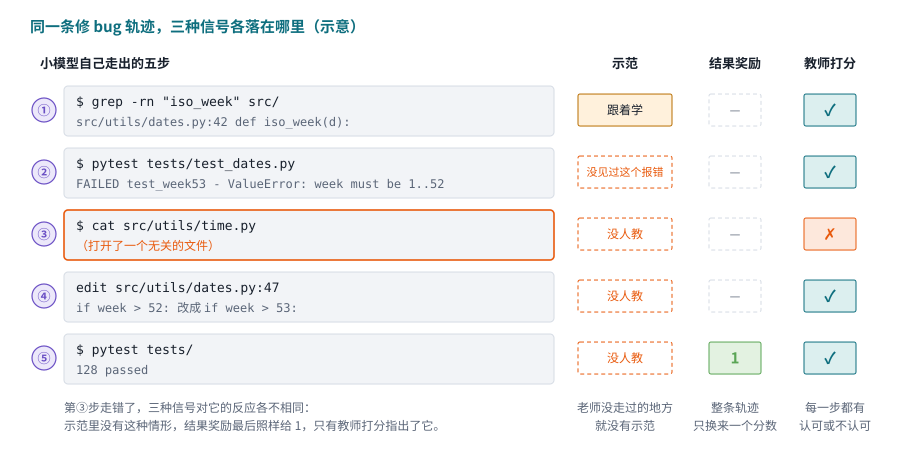

*图：小模型自己走出的五步修 bug 轨迹，右边三列是示范、结果奖励和教师打分各自落在哪几步上。命令和输出为示意。*

三种信号的差别，放到同一条轨迹上最清楚。小模型在第③步打开了一个和 bug 无关的文件：示范里没有这种情形，没人告诉它这一步走错了；结果奖励要等到第⑤步测试全部通过才给出一个 1，这个 1 把第③步的弯路也一起奖励了；只有教师在第③步当场表示不认可。

近几年推理模型的训练史，几乎就是一部围绕这三种信号做加减法的历史，因为三种信号来源不同，成本不同，失效方式也不同。训练先把人类偏好接进训练，再把训练流程一步步简化到只剩"做对了没有"这个信号，最后又把逐步的教师反馈加了回来。等这些方法被搬进 agent 的多轮交互，回合更长、奖励更稀疏，三种信号各自的弱点都被放大了。

## 先读这几篇

这一章的主线借自几篇人写的长文。它们的作者或者亲手训练过这些模型，或者长期跟踪这个方向，叙事里有取舍、有判断。建议按下面的顺序读，读完再回来看各分支的新论文。

| 顺序 | 文章 | 为什么读 |
|---|---|---|
| 1 | Sebastian Raschka，[The State of Reinforcement Learning for LLM Reasoning](https://magazine.sebastianraschka.com/p/the-state-of-llm-reasoning-model-training)（Ahead of AI，2025-04） | 本章发展主线的骨架。Raschka 从 RLHF 的基本流程讲起，依次讲 PPO 为什么成了主力算法、GRPO 怎样去掉了价值模型、奖励怎样从人类偏好训练出来的奖励模型变成可以直接检查的规则，再到 DeepSeek-R1 怎样交替使用 SFT、RLVR 和 RLHF。这条线索读下来非常清楚：每往前走一步，训练里就少一个需要单独维护的模型。文章后半部分整理了十几篇同期论文的经验，包括 PPO 和 GRPO 会偏向又长又错的回答、强化学习能否真正提升小模型等争议。读完能带走一张"推理模型是怎样训练出来的"完整地图。 |
| 2 | Thinking Machines（Kevin Lu 等），[On-Policy Distillation](https://thinkingmachines.ai/blog/on-policy-distillation/)（2025-10） | 本章蒸馏这一半的骨架。作者把后训练方法放进一个两两组合的框架里：强化学习是在策略的，但反馈稀疏；离策略蒸馏有逐 token 的密集反馈，却只在教师会走到的状态上学习。在策略蒸馏让学生自己生成轨迹，再由教师给每个 token 打分，把两样好处合在一起。文章用国际象棋做比喻：强化学习像没有教练自己下棋，蒸馏像每走一步都有人点评。实验部分很扎实，在数学推理和"学了新知识又不忘指令遵循"两个场景里都给出了具体的数字。读完会明白为什么 2026 年有那么多论文的标题里带着 OPD。 |
| 3 | Sebastian Raschka，[The State Of LLMs 2025: Progress, Problems, and Predictions](https://magazine.sebastianraschka.com/p/state-of-llms-2025)（Ahead of AI，2025-12） | 第一篇的续集，站在 2025 年底回看。Raschka 把这一年概括为推理、RLVR 和 GRPO 之年，并逐条列出 Olmo 3 和 DeepSeek V3.2 在 GRPO 上做的工程修补，比如过滤零梯度样本、按 token 计算损失、截断重要性采样、对离策略序列做掩码。这些看似琐碎的改动，正是本章异步训练和组相对方法两个分支的起点。他对过程奖励的判断也很直白：思路合理，但到目前为止还没有特别成功。 |
| 4 | Lilian Weng，[Reward Hacking in Reinforcement Learning](https://lilianweng.github.io/posts/2024-11-28-reward-hacking/)（Lil'Log，2024-11） | 讲边界的那一篇。Lilian Weng 系统梳理了奖励函数为什么总是真实目标的不完美代理、优化压力怎样钻代理的空子，以及在 RLHF 里模型怎样学会"让人觉得它对了"却没有真的更对。她还专门讨论了把语言模型当评审时的位置偏差和自我偏好，以及部署时通过反馈循环出现的上下文内奖励作弊。读完这篇，再看本章任何一个声称"奖励涨了"的结果，都会多问一句：涨的是代理，还是目标本身。 |
| 5 | Nathan Lambert，[What comes next with reinforcement learning](https://www.interconnects.ai/p/what-comes-next-with-reinforcement)（Interconnects，2025-06） | 把视线从数学题拉到长程任务。Lambert 估算，当前 RLVR 的一次回答大约是一万到十万 token，而真正有野心的长程任务可能需要一百万到一亿 token 一个回合。他对"把稀疏奖励的强化学习一路推到长程任务"持偏谨慎的态度：奖励越稀疏，信用分配越难，过度优化的风险也越大。这篇文章适合在读 agent 相关分支之前先读，用来校准预期。 |
| 6 | Shiwan Zhao 等，[Large Language Model Post-Training: A Unified View of Off-Policy and On-Policy Learning](https://arxiv.org/abs/2604.07941)（arXiv，2026-04） | 一篇把这一章几乎所有方法收进同一张地图的综述。作者先按训练轨迹从哪里来，把后训练分成两大类：离策略学习用的是外部提供的轨迹，SFT、离线偏好优化和离策略蒸馏都在这一边；在策略学习用的是学习者自己生成的 rollout，RLHF、RLVR、过程与验证器引导以及在策略蒸馏都在另一边。接着它又按方法在模型行为上起的作用分出三种角色：支撑扩展，让原本几乎采不到的有用行为变得可以到达；策略重塑，在已经能到达的行为之间重新分配概率；行为巩固，把有用的行为跨阶段保存、迁移下来。文中有两句话和本章贴得很紧。一句说蒸馏常常更适合被理解成一种巩固机制，压缩只是它的一个侧面；另一句说在策略学习本身没法可靠地引入学习者几乎从不访问的行为，这正好接上本章边界一节里关于强化学习到底有没有带来新能力的争论。作者最后的判断是，后训练的进展越来越依赖跨阶段、跨角色的协同系统设计，单靠某一个目标函数很难包打天下。读完前面几篇再用它，可以把本章的六个阶段和八个分支收拢到一个 2026 年的统一框架里。 |
| 7 | Nathan Lambert 与 Finbarr Timbers，[Frontier post-training recipe review with Finbarr Timbers](https://www.interconnects.ai/p/frontier-post-training-recipe-review)（Interconnects，2026-06） | 一期访谈，却是目前把前沿后训练配方讲得最完整的一张时间线。两人从 InstructGPT 的"SFT、奖励模型、PPO"三步讲起，经过 Llama 2 的迭代 RLHF 和拒绝采样、Llama 3 不做在线强化学习的"奖励模型、拒绝采样、SFT、DPO"多轮迭代、首次提出 RLVR 这个说法的 Tülu 3，再到以大规模强化学习为中心的 DeepSeek R1，一直讲到 2026 年。用 Lambert 的话说，过去一年后训练配方形状的变化，比此前三年加起来还大。这一年的新形状叫多教师在策略蒸馏（MOPD）：先用 SFT 加强化学习训出若干个领域专家，再让一个通用学生在自己的 rollout 上逐 token 地向对应教师的分布最小化反向 KL。MiMo Flash V2 最先提出这个名字，DeepSeek V4 和 Nemotron 3 Ultra 把教师扩到十个以上。访谈给出的理由很实在：把数学、代码和 agent 强化学习混在一次训练里，能力迟早会互相拉扯；专家模型可以在组织里并行开发；在策略蒸馏本身也成熟了。它对这套配方的保留同样写得清楚：MAI、Kimi、GLM 等实验室并没有用它，Nemotron 的报告说用差别很大的流水线训出的教师很难有效合并，MOPD 相对直接蒸馏推理轨迹再做 SFT 到底好多少也还说不清。顺带还能读到 DPO 基本从前沿配方里消失、而 Nemotron 3 Super 的传统 RLHF 阶段仍带来很大提升这类一线观察。它把本章第 5 阶段的教师信号、分支1 的阶段编排和分支7 的多教师整合串成了一条 2026 年的工程实践线。 |

如果还想多读一点，Nathan Lambert 的 [RLHF 一书](https://rlhfbook.com/)是这个方向最完整的教科书，网络版持续更新，按照"指令微调、奖励模型、拒绝采样、策略梯度、在策略蒸馏、直接对齐"的顺序组织，适合当工具书查。Thinking Machines 的 [LoRA Without Regret](https://thinkingmachines.ai/blog/lora/)（John Schulman 等）里有一段信息论论证：监督学习每个回合提供的信息量大致和 token 数成正比，强化学习每个回合只提供常数量级的信息，所以强化学习需要的参数容量很小，实验里秩为 1 的 LoRA 就足够。Lilian Weng 的 [Why We Think](https://lilianweng.github.io/posts/2025-05-01-thinking/) 则从思维链的角度讲强化学习怎样教会模型多想一会儿，以及为什么直接对思维链施加优化压力要格外小心。

## 一、基本概念：一个训练循环和两条轴

> **要点：** 训练一个模型，到底在重复做什么？在重复同一个循环：模型自己做一遍，某种反馈给这一遍打分，分数改动参数。开头修 bug 的三种办法就是三种反馈：照强模型的记录学，看测试过没过，请强模型逐步表态。它们的差别归结为两个问题：小模型在谁走到的情形里学，每做一遍能拿到多少反馈。

后训练可以想成教练带学生的一个循环：学生做一遍题，教练给出反馈，学生据此调整，下一遍再做。在语言模型里，学生就是正在训练的模型，强化学习的论文叫它策略，意思是它决定在当前看到的内容下接着写什么、调用什么工具。它做一遍任务留下的完整记录，包括思考、工具调用、环境返回和最终回答，叫一条轨迹。训练要做的事，是让得到好反馈的那些 token 以后更容易被写出来。参数、token、训练与推理这些基础概念见[大模型前置知识](../../docs/llm_primer.md)。

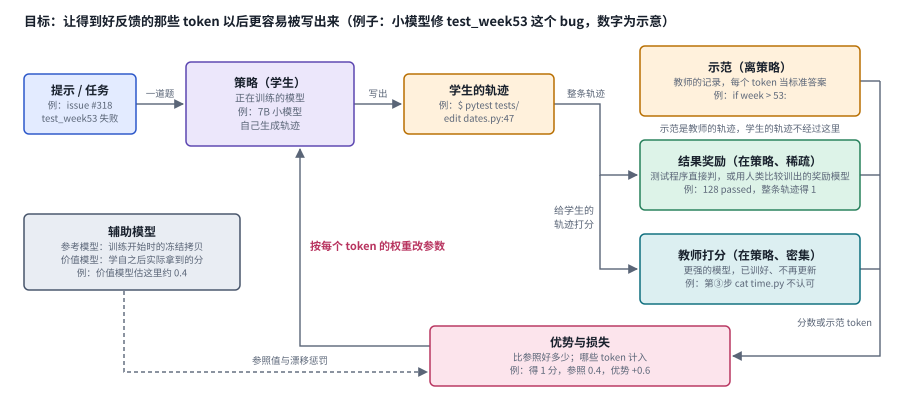

*图：后训练的基本循环，用开头修 test_week53 的例子把每个框里流过的东西写了出来（数字为示意）。紫色的策略拿到任务后自己生成轨迹；右边三个框是三种打分来源，各自写着分数由谁给出；它们汇进粉色的“优势与损失”，再改动参数；左下灰色的参考模型和价值模型是辅助模型。*

循环里的三种打分来源，落在轨迹上的位置各不相同，图右边的三个框画的就是这一点。最上面的示范是教师走过的轨迹，学生的轨迹根本不经过它，学生只是逐 token 地模仿教师写下的内容：教师写下的每个 token 就是标准答案，训练目标是让学生在同样的上文下写出这个 token 的概率尽量高。这就是监督微调（SFT），把一个强模型的输出当示范来模仿，就叫蒸馏。中间的结果奖励由测试、答案检查器或者一个奖励模型（另外训练、专门给整条回答打分的模型）给出，它看完学生的整条轨迹，只给一个分数。最下面的教师打分落在学生自己的轨迹上，而且每个 token 都有。

三个框的差别归结起来是两件事：学生在谁走到的情形里学习，以及反馈有多密。先说第一件。学习用的轨迹如果是学生自己当场生成的，叫在策略（on-policy）；如果来自别的模型，或者来自旧版本的自己，叫离策略（off-policy）。开头修 bug 的例子说明了这一点为什么要紧：照着强模型的记录学，就是离策略，学生一旦走到记录之外就没人教。第二件是反馈有多密。示范和教师打分每个 token 都有监督，结果奖励一整条轨迹只有一个分数，说不清是哪一步出了错。

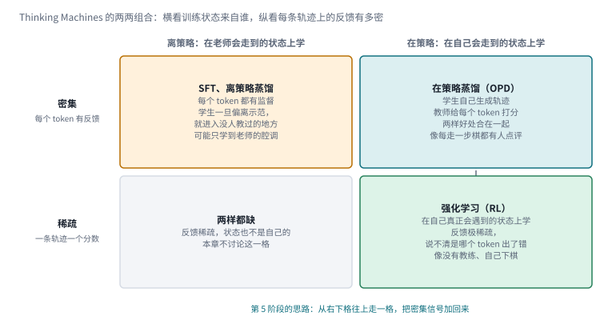

*图：Thinking Machines 的两两组合。左右两列按训练状态的来源区分，上下两行按反馈的密度区分。*

把两件事画成两条轴，三种信号各占一格。左上的 SFT 和离策略蒸馏信号很密，学的却是教师的轨迹；右下的强化学习在自己的轨迹上学，反馈却很稀疏。Thinking Machines 用下棋打比方：强化学习像没有教练、自己下棋，只在终局知道输赢；蒸馏像看大师的棋谱，每一步都有标准，可那是大师的棋局。右上角那一格是学生自己下、教练逐步点评，叫在策略蒸馏。左下那一格两样都缺，本章不讨论。

## 二、发展主线：训练流程做减法，信号再做加法

本章的主线是训练流程先做减法、学习信号再做加法，这条线索借自 Raschka 的两篇长文和 Thinking Machines 的在策略蒸馏长文。Raschka 叙事里的线索很清楚：从基于人类反馈的强化学习，到用组内比较代替价值估计，再到用程序检查代替奖励模型，每往前走一步，训练里就少一个需要单独维护的模型，流程越来越简单，每个回合能用的信号也越来越稀疏。Thinking Machines 接着回答下一个问题：信号稀疏到这个程度，怎样把逐 token 的教师信号加回来，同时保留学生在自己轨迹上学习的好处。等这套方法进入 agent 的长程交互，Lambert 和 Lilian Weng 讨论的那些边界就变得格外现实。

> **要点：** 这三种反馈在近几年的训练史里是怎样被取舍的？先是训练流程一步步做减法，每一步拿掉一个需要单独训练的模型，反馈也随之越来越稀疏；接着把强模型逐 token 的反馈加了回来；最后把这一切搬进多轮的 agent 任务。贯穿全程的还有两件事：打分会被钻空子，能力到底长了多少难以确认。

| 阶段 | 内容 | 代表工作 | 本章对应分支 | 速查卡 |
|---|---|---|---|---|
| 第 1 阶段 | 从示范到人类偏好：SFT、奖励模型加 PPO 的 RLHF 流程 | REINFORCE、PPO、GAE、InstructGPT | 分支 1、分支 3 | P1 至 P3 |
| 第 2 阶段 | 去掉价值模型：用同题多次尝试的组内比较代替 critic | DeepSeekMath（GRPO） | 分支 2 | V1 |
| 第 3 阶段 | 去掉奖励模型：用可验证规则代替学出来的奖励 | Tulu 3（RLVR）、DeepSeek-R1 | 分支 1、分支 2 | V2 至 V4 |
| 第 4 阶段 | 配方工程化：修补 GRPO 的偏差，处理规模化和离策略问题 | DAPO、Dr. GRPO、Olmo 3 与 DeepSeek V3.2 的改动 | 分支 2、分支 4 | F1 至 F4 |
| 第 5 阶段 | 把密集信号加回来：在策略蒸馏 | 知识蒸馏、DAgger、GKD、MiniLLM、Qwen3、Thinking Machines | 分支 1、分支 5 至分支 8 | D1 至 D5 |
| 第 6 阶段 | 走进长程交互：更长的回合、更稀疏的奖励、异步训练 | Lambert 的长程 RL 讨论、过程奖励 | 分支 3、分支 4、分支 8 | |
| 边界 | 代理奖励被钻空子，能力增量难以确认 | 奖励模型过度优化、思维链监控、pass@k 争议、RL's Razor | 第四、五节 | |

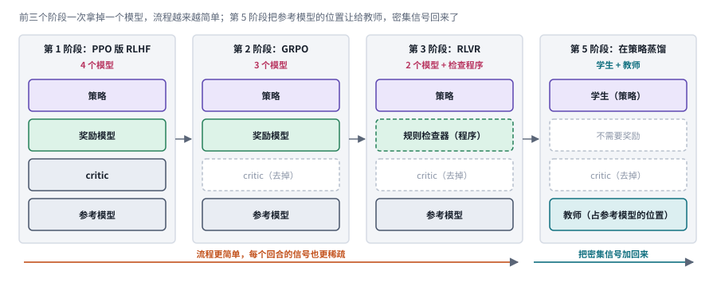

*图：四个阶段训练里要同时维护的模型。虚线框是被拿掉的模型；第 3 阶段的绿色虚线框是一段检查程序，已经算不上模型；第 5 阶段把参考模型的位置让给了教师。每个框里是同一道题“3x + 5 = 26，求 x”在这一阶段实际得到的东西，数字为示意。*

这张图的要点是模型越减越少、信号也越来越稀疏，直到最右一列才转回来。四列从左往右，模型从四个减到两个再加一段程序，底部的橙色箭头是这件事的另一面：每个回合能提供的信号也越来越少。最右边一列是转折，在策略蒸馏不需要奖励，也不需要估计价值，只是把参考模型的位置让给了一个教师，逐 token 的信号就回来了。框里的例子把“稀疏”写成了数字：前三列里，这道题的一遍回答最后只换回一个分数，奖励模型的 0.82，或者检查程序的 1；最右一列，学生写出 3x = 20，教师就在“20”这个 token 上表示不认可。各列里的模型分别做什么，在对应阶段里讲。

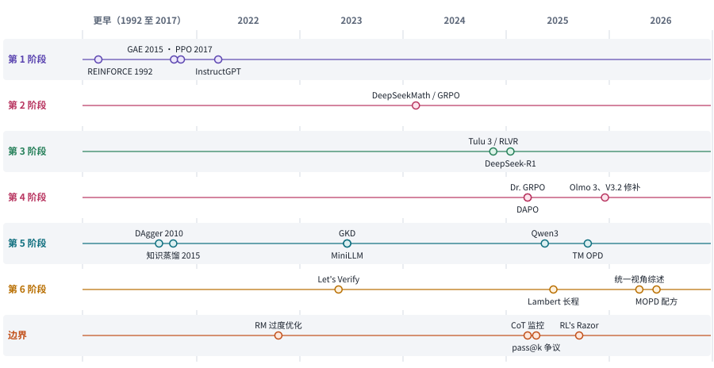

*图：主线上的代表工作按阶段分行排开。1992 年到 2017 年的工作压在“更早”一栏；第 5 阶段的 DAgger 和知识蒸馏远早于大模型，说明“在学生状态上给密集指导”这个想法由来已久。*

时间轴说明两件事：很多做法是老想法的重新接续，而 2025 年的复现、修补和争论几乎同时发生。第 1 阶段和第 5 阶段的起点都很早，策略梯度和知识蒸馏在大模型出现之前就已成形，大模型时代做的很多事是把这些老想法重新接起来。2025 年那一栏特别拥挤，因为 DeepSeek-R1 发布之后，整个社区在同一年里集中复现、修补和反思这条路线，第 3、4、5 阶段和边界上的争论几乎同时发生。

### 第 1 阶段：从示范走到人类偏好

> **要点：** 写不出标准答案的任务，怎样给模型反馈？请人比较几个回答哪个更好，用这些比较训练一个会打分的模型，再按它的分数改进策略。为了让这一步稳定，训练里又多了两个辅助模型，一个估计平常能拿多少分，一个拉住策略别改得太远，一套训练要同时维护四个模型。

监督微调是建立基本行为最直接的办法，可它有两个局限。一是开头修 bug 的例子说明的那个：示范只覆盖教师会走到的地方。二是很多任务根本写不出唯一正确的示范，一段回答写得好不好，人一眼能比出高下，却很难亲手写出标准答案。

针对写不出标准答案的局限，2022 年的 [InstructGPT](https://arxiv.org/abs/2203.02155) 把人的比较变成了训练信号，利用的正是"比较容易，写标准答案难"这一点。它分三步：先用人写的示范做监督微调，得到一个行为基本得体的模型；再让模型对同一个提示写好几个回答，请人比较哪个更好，用这些比较训练一个奖励模型，它读一个回答，输出一个分数，预测人会有多喜欢，训练时的要求是给人挑中的那个回答打出更高的分；最后用强化学习，按奖励模型的打分改进策略。这套流程后来被叫作 RLHF，即基于人类反馈的强化学习。它让没有标准答案的任务也有了反馈，代价是奖励模型只是人类偏好的一个近似，策略对着它优化，学到的是"让奖励模型满意"，这和"让人满意"之间还隔着一段距离。

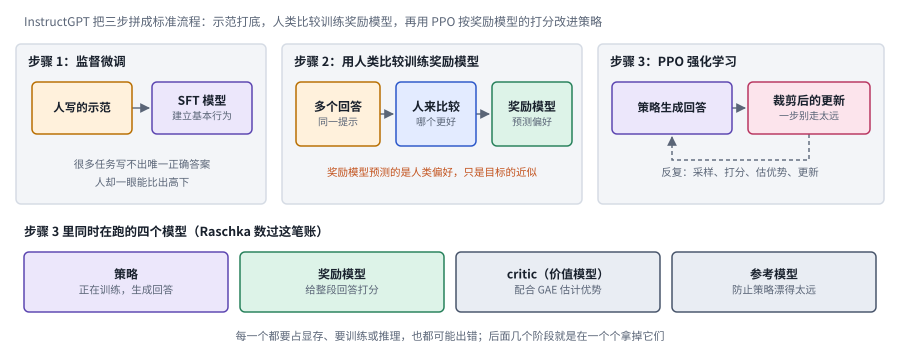

*图：上排是 InstructGPT 的三步：示范做监督微调，人类比较训练奖励模型，PPO 按奖励模型打分改进策略；下排是第三步里同时在跑的四个模型。每个框里是提示“给 6 岁孩子解释月亮为什么有圆有缺”走到这一步时的样子，虚线框写着这一步的训练信号和目标；回答与分数为示意。*

跟着这个提示走一遍三步，就能看清每个分数从哪来。步骤 1 里，人写下示范回答，SFT 模型逐 token 照着学。步骤 2 里，SFT 模型对同一个提示写出 A 和 B，人判 B 更好，奖励模型据此学会给 B 打 0.9、给 A 打 0.2。步骤 3 里，策略写出新回答 C，冻结的奖励模型给它打 0.7，再扣掉偏离参考模型的 KL 罚项 0.05，剩下的才是用来更新策略的奖励。下排四个模型里只有策略和估计平常能拿多少分的价值模型（critic，下文细讲）在训练，奖励模型和参考模型都已冻结。

第三步用的强化学习算法叫 PPO，图下排另外两个为它服务的模型，都是为了对付最朴素的强化学习里的一个毛病：一次成败里掺着运气。1992 年的 [REINFORCE](https://link.springer.com/article/10.1007/BF00992696) 给出了基本思路：让策略做一遍，看结果好坏，结果好就提高这一遍里写下的那些 token 的概率，结果差就降低。毛病就出在这里：同一道题，模型这次碰巧答对，下次换个写法又答错，直接拿每次的结果来更新，参数会被来回拉扯。

解决办法是拿结果和一个参照水平比较。如果模型在这个情形下平均能拿 0.6 分，这次拿了 1 分，就说明这次比平常好 0.4，值得强化；拿了 0 分，就比平常差 0.6，应该削弱。结果比参照好出多少，叫这次动作的优势。参照从哪里来？PPO 的做法是再训练一个价值模型，论文和图里常写作 critic，它看着当前的情形，估计从这里往下大约能拿多少分。它的训练答案来自采样出的轨迹：从这个位置往后实际拿到了多少分，目标是让估计和实际尽量接近。Schulman 等人 2015 年提出的 [GAE](https://arxiv.org/abs/1506.02438)（广义优势估计）是配合价值模型计算优势的标准办法，它在"只信价值模型的估计"和"只信实际拿到的分数"之间取一个折中。价值模型让更新的波动小了很多，可它自己也要训练，估错了会把策略往错的方向带。

有了优势，还要防止一次更新走得太远。2017 年的 [PPO](https://arxiv.org/abs/1707.06347) 要解决的问题是：训练数据是旧策略采出来的，如果一步更新就把策略改得面目全非，这批数据就不再反映新策略会遇到的情形，后面的更新也就不再可信。PPO 比较更新前后模型对同一个动作的概率，如果某个动作的概率已经朝有利方向变化得够多，就不再继续奖励它变得更多，这叫裁剪。裁剪只是降低了走太远的倾向，并不保证策略在任何情况下都不会剧烈变化。

裁剪管的是单步更新，策略在整个训练中慢慢漂远，要靠 RLHF 里的第四个模型来拉住。它叫参考模型，是训练开始时那个模型的一份冻结拷贝。训练时会衡量策略和参考模型在同一位置上给各个 token 的概率差多远，这个量叫 KL 散度，KL 越大罚得越多，让策略别为了讨好奖励模型而漂得离原来太远。

四个模型同时在跑，就是这一阶段的代价，Raschka 把它数得很清楚：一套 PPO 版的 RLHF 要同时维护策略、奖励模型、价值模型和参考模型四个模型，每一个都要占显存、要训练或推理，也都可能出错。

**速查：第 1 阶段的三种做法。** 三张结构卡用同一种画法，从左往右是一轮流程，底部的虚线是绕回下一批样本的那条路。从最朴素的策略梯度，到加上裁剪和价值估计的 PPO，再到把人类偏好接进来的完整流程，每一张都比前一张多一个需要维护的部件。

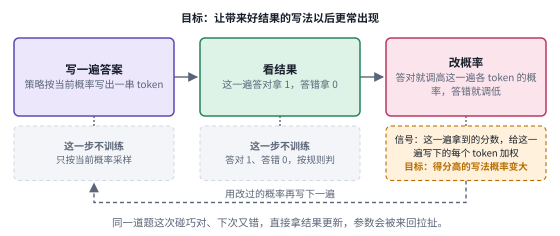 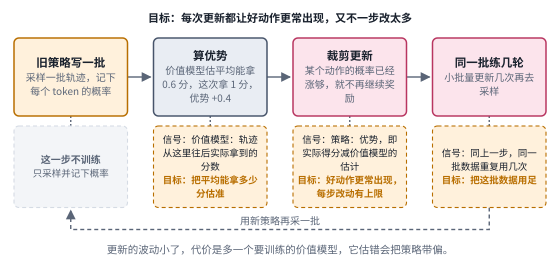

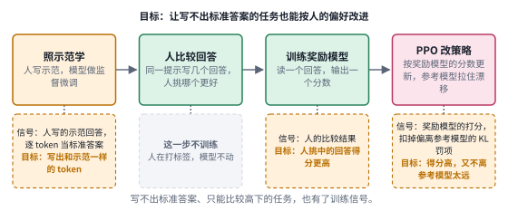

*图：第 1 阶段三种做法的结构卡，每张卡对应下表的一行。*

| code | 名称 | 年份 | 代表 | 怎么做 | 解决了什么 | 代价 |
|---|---|---|---|---|---|---|
| P1 | 策略梯度 | 1992 | [REINFORCE](https://link.springer.com/article/10.1007/BF00992696) | 按当前策略采样一串动作，看这次拿到的回报，再按回报调整这些动作的概率 | 给出了最基本的思路：带来好结果的选择以后更容易出现 | 一次成败里掺着运气，直接拿结果更新波动很大；后来的优势和参照，都是为了把这种波动压下去 |
| P2 | 裁剪的近端策略优化 | 2017 | [PPO](https://arxiv.org/abs/1707.06347)、[GAE](https://arxiv.org/abs/1506.02438) | 用旧策略采样，借助 critic 和 GAE 估计优势；比较更新前后对同一动作的偏好，变化够多就不再继续奖励，同一批数据上做几轮小批更新 | 降低了一步走太远、让后面的数据不再可信的倾向，训练更稳 | 多了一个要训练的价值模型，它估错会把策略带偏；裁剪只是让训练更稳，给不出策略不会剧烈变化的保证 |
| P3 | RLHF 三步流程 | 2022 | [InstructGPT](https://arxiv.org/abs/2203.02155) | 示范做监督微调，人类比较多个回答训练奖励模型，再用 PPO 依据奖励模型的打分改进策略 | 没有标准答案、只能比较高下的任务也有了反馈 | 同时维护四个模型；奖励模型只是人类偏好的近似，对着它优化过头会被钻空子（见本节边界） |

### 第 2 阶段：去掉价值模型，让同一道题的几次尝试互相比较

> **要点：** 能不能不训练那个估计平常能拿多少分的价值模型？可以让同一道题答好几遍，拿这几遍的平均分当参照。省下一个模型，代价是每道题要多采样几次，而且几遍全对或全错时，谁也不比平均好，拿不到信号。

第一个被拿掉的是价值模型。它要在语言模型巨大的状态空间里估计"从这里往下能拿多少分"，本身就很难训准，还要占一份和策略差不多大的显存。2024 年的 [DeepSeekMath](https://arxiv.org/abs/2402.03300) 提出的 GRPO 换了个思路：同一道题可以答很多遍，那就让这几遍互相比较，拿它们的平均分当参照。每遍回答的分数仍由奖励模型或答案检查给出，变的只是参照。高于平均的回答得到正的优势，被强化；低于平均的得到负的优势，被削弱；再按组内分数的离散程度缩放一下，让难题和易题的信号落在差不多的尺度上。

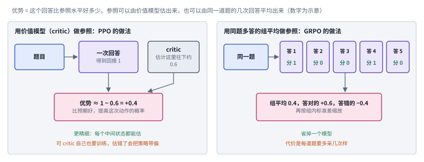

*图：同一个“优势”，两种参照。左边由价值模型估出“从这里往下大约能拿多少”，右边用同一道题几次回答的平均分当参照；数字只是示意。*

两边算的是同一个量。左边的价值模型估计这个情形下大约能拿 0.6 分，这次拿了 1 分，优势是 0.4。右边同一道题答五遍，两次对、三次错，平均是 0.4，答对的优势为正，答错的为负。左边多了一个要训练、也可能估错的模型，右边多了好几次采样。

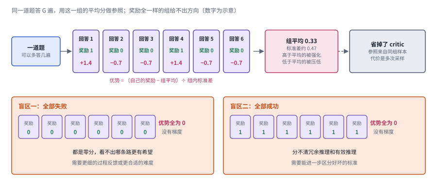

*图：上排是 GRPO 的一步：同一道题的六个回答各拿一个奖励，与组平均比较、再按标准差缩放得到优势；下排两个橙色框是奖励全一样时的两个盲区。数字只是示意。*

这种比较有一个天然的盲区，图下排画的就是它。六个回答全错时，大家都是零分，减去平均之后优势全为零；全对时也一样。没有优势就没有梯度，这道题在这一步里等于白做。全错时，模型需要更细的反馈，或者更合适的题目难度，才能采到第一个正确解；全对时，需要能进一步区分好坏的标准，单纯多采几个样本解决不了问题。

### 第 3 阶段：去掉奖励模型，换成可以直接检查的规则

> **要点：** 奖励模型能不能也拿掉？有确定答案的任务，奖励可以直接交给一段检查程序：答案对不对，测试过没过。DeepSeek-R1 的报告说明，只靠这种规则奖励就能学出反思和重试；正式发布的模型用的是监督微调与强化学习交替的四段流程。

第二个被拿掉的是奖励模型。数学题的答案对不对、代码能不能通过单元测试，用不着一个学出来的模型去猜，一段程序就能检查。2024 年底，Lambert 等人在 [Tulu 3](https://arxiv.org/abs/2411.15124) 的技术报告里给这种做法起了名字，叫可验证奖励强化学习（RLVR）：对有确定答案的任务，不训练奖励模型，直接用答案检查器或编译器的结果当奖励。"可验证"只说明有一个检查程序，这个程序覆盖了多少真实目标，要另外回答。检查一道数学题的最终答案，和验收一个涉及多个服务的工作流，能提供的证据完整程度差得很远。

规则奖励能直接教出反思和重试，是 2025 年初的 [DeepSeek-R1](https://arxiv.org/abs/2501.12948) 让这条路线出圈的原因。按 Raschka 和 Lilian Weng 的梳理，R1-Zero 直接从基础模型出发，跳过监督微调，只用两项规则奖励做强化学习，一项看答案对不对，一项看格式对不对，就学会了越想越长、回头检查、换一种思路重试，这就是后来被反复讨论的"顿悟时刻"。正式的 R1 更讲究：先用少量冷启动数据做监督微调，这批数据按报告的说法是几千条长推理示范，部分取自 R1-Zero 的输出再经人工整理；再做面向推理的强化学习，奖励仍是答案和格式的规则检查；然后用拒绝采样产生的数据再做一轮监督微调；最后再做一轮强化学习，按报告的说法，推理题继续用规则奖励，其他通用任务改用奖励模型打分。拒绝采样指让模型对同一道题多写几个回答，只留下检查通过的那些当训练数据。

同一份报告也记下了没走通的路，Lilian Weng 在 [Why We Think](https://lilianweng.github.io/posts/2025-05-01-thinking/) 里特别提到这些失败的尝试：给中间步骤打分的过程奖励模型没能用起来，反而让训练更容易被钻空子；蒙特卡洛树搜索则被巨大的 token 搜索空间拖住了。

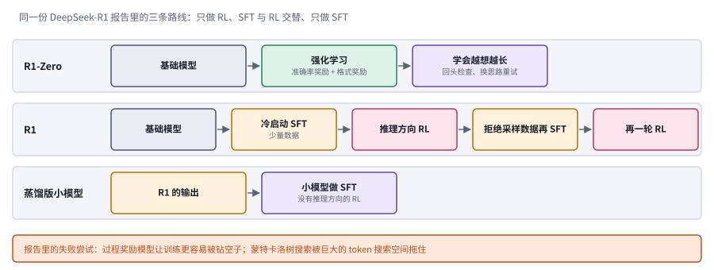

*图：同一份 DeepSeek-R1 报告里的三条路线。第一行只做强化学习，第二行 SFT 与 RL 交替四段，第三行的蒸馏版小模型只做 SFT；底部是报告里没走通的两种尝试。*

图里第三行常被忽略：报告里那些更小的蒸馏版模型，只是用 R1 的输出做了监督微调，没有经过推理方向的强化学习。所以讨论"强化学习带来了什么"时，它们的能力来源要和前两行分开看。

到这一步，训练里只剩策略和参考模型，流程前所未有地简单，强化学习每个回合能提供的信息也压缩到了极点。Thinking Machines 在 [LoRA Without Regret](https://thinkingmachines.ai/blog/lora/) 里算过这笔账：一条几千 token 的轨迹最后只换来一个分数，每个回合大约只提供常数量级的信息，远少于监督学习按 token 数计的信息量。参数只需要装下这么少的信息，这解释了为什么强化学习用很小的 LoRA 就够。

**速查：第 2、3 阶段的四种做法。** 这四张卡把“拿掉模型”的两步放在一起。V1 拿掉了价值模型，V2 拿掉了奖励模型，V3 和 V4 是同一份报告里用规则奖励训练推理模型的两种流程。四张卡最左边的起点不同，最右边的更新都是强化学习。

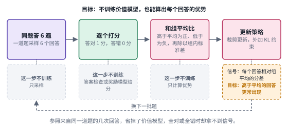 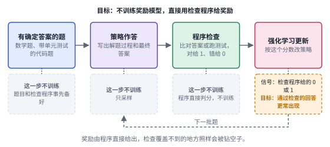

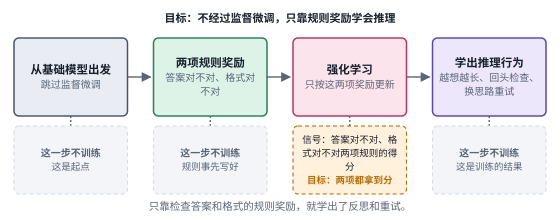 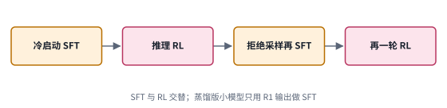

*图：第 2、3 阶段四种做法的结构卡，每张卡对应下表的一行。*

| code | 名称 | 年份 | 代表 | 怎么做 | 解决了什么 | 代价 |
|---|---|---|---|---|---|---|
| V1 | 组相对策略优化 | 2024 | [DeepSeekMath（GRPO）](https://arxiv.org/abs/2402.03300) | 同一道题答多遍，以组内平均和离散程度为参照，算出每个回答的优势 | 去掉 critic，省下它的显存和算力，也避开了价值模型在巨大状态空间里估不准的问题 | 每道题要多次采样；全对或全错的组优势为零，拿不到信号（分支 2） |
| V2 | 可验证奖励 | 2024 | [Tulu 3](https://arxiv.org/abs/2411.15124) | 有确定答案的任务不训练奖励模型，直接用答案检查器或编译器的结果当奖励 | 拿掉奖励模型，奖励由程序直接给出，不再依赖一个学出来的近似 | 检查程序覆盖了多少真实目标要另外回答；只认“测试全绿”的奖励同样会被钻空子 |
| V3 | 从基础模型直接做 RL | 2025 | [DeepSeek-R1](https://arxiv.org/abs/2501.12948)（R1-Zero） | 跳过 SFT，只用规则化的准确率奖励和格式奖励做强化学习 | 说明越想越长、回头检查、换思路重试这些推理行为，可以只靠规则奖励学出来 | 只适用于结果能检查的任务；报告里过程奖励模型和蒙特卡洛树搜索两条路都没走通 |
| V4 | SFT 与 RL 交替 | 2025 | [DeepSeek-R1](https://arxiv.org/abs/2501.12948) | 少量冷启动数据做 SFT，推理方向 RL，用拒绝采样产生的数据再做一轮 SFT，最后再做一轮 RL | 先用少量示范给强化学习一个更好的起点，再把强化学习得到的结果整理成数据继续训练 | 流程变长，阶段之间的衔接要靠经验；同一报告里的蒸馏版小模型只做了 SFT，能力来源要分开看 |

### 第 4 阶段：配方工程化，修补 GRPO 的偏差

> **要点：** 大家照着 R1 复现时，原版 GRPO 出了哪些问题？它会把模型带向又长又错的回答，也会在全对或全错的题上白白浪费采样。几篇工作和技术报告的修补分别落在采样、算优势、算损失和限制漂移这几处，其中不少在处理同一件事：规模化之后，负责采样的和正在训练的已经不是同一版模型。

R1 之后，几乎所有开源团队都在复现这条路线，很快发现原版 GRPO 会把模型带向又长又错的回答。[Understanding R1-Zero-Like Training](https://arxiv.org/abs/2503.20783)（即 Dr. GRPO）找到了原因：GRPO 计算损失时按回答长度做平均，一个答错的长回答，每个 token 分到的惩罚就被摊薄了，模型于是发现，答错时写长一点更划算；按组内标准差缩放，又会让分数很集中的题目权重过大。它把这两步归一化都去掉了。同期的 [DAPO](https://arxiv.org/abs/2503.14476) 提出了一套更完整的配方，包括按 token 计算损失、在采样时剔除全对或全错的题目、对过长回答加以惩罚等。

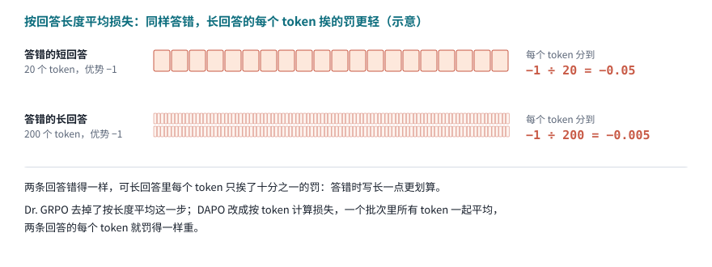

*图：两条同样答错、优势同为 −1 的回答，按回答长度平均损失之后每个 token 分到的惩罚。token 数为示意。*

长度偏差可以用两条答错的回答算一遍。短回答 20 个 token，长回答 200 个 token，优势都是 −1；先在每条回答内部按长度平均，短回答的每个 token 分到 −0.05，长回答的每个 token 只分到 −0.005。模型每多写一个 token，答错的代价就被摊得更薄，于是越写越长。

这些修补到 2025 年底被 Raschka 在 [The State Of LLMs 2025](https://magazine.sebastianraschka.com/p/state-of-llms-2025) 里总结成一张清单，后来的技术报告大多照单采用。Olmo 3 用上了过滤零梯度信号、主动采样、按 token 计算损失、去掉 KL 损失、放宽裁剪上限、截断重要性采样、不再除以标准差等改动，其中多数来自 DAPO 和 Dr. GRPO；DeepSeek V3.2 则按领域设置不同的 KL 强度，对离策略的序列做掩码，并在训练时保留采样阶段 top-p 和 top-k 的掩码。他说自己在小规模实验里加上这些改动之后，坏的更新不再把整次训练带歪。

这张清单里有不少改动在处理同一个问题：采样和训练用的已经不是同一个模型。为了吞吐，大规模系统用专门的推理引擎采样，用另一套框架训练，而且训练器更新参数时，采样器往往还在用几步之前的旧参数。于是训练数据并不完全是"当前这个策略"采出来的，带上了离策略的成分。一种补救办法叫重要性采样：按新旧策略对同一个 token 的概率之比，给旧数据重新加权；比值可能极大，所以要截断。对偏离太远的序列直接做掩码、保留采样时的 top-p 和 top-k 设置，也都是为了让训练看到的分布和采样时一致。

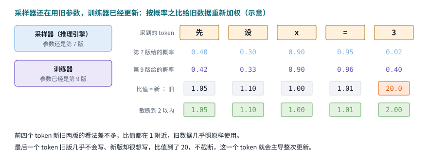

*图：采样器停在第 7 版参数，训练器已经是第 9 版；同一串 token 在两版下的概率、两者之比，以及截断之后的权重。概率数值为示意。*

重要性权重怎样算、为什么要截断，看一串具体的 token 就明白。采样器用第 7 版参数写下了"先设 x = 3"，训练器手里已经是第 9 版。前四个 token 两版给的概率差不多，比值都在 1 附近；最后的"3"第 7 版只给 0.02，第 9 版给到 0.40，比值是 20。不截断的话，这一个 token 的权重是其他 token 的近二十倍，一次更新几乎全由它决定；截断到 2 以内，它的分量就回到了和其他 token 相近的量级。

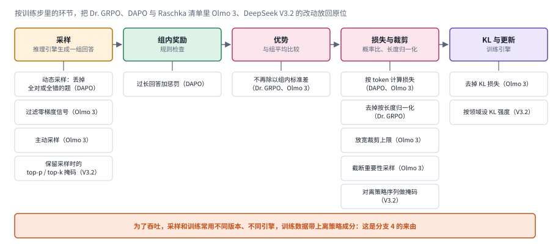

*图：一次 GRPO 训练步拆成五个环节，每个环节下面是落在这里的修补，括号里注明出处；底部是这些修补共同指向的离策略问题。*

把散在几篇文章里的修补按训练步归位之后，可以看到采样环节的修补最多，动态采样、过滤零梯度信号和主动采样，都是在第 2 阶段说的全对或全错那两种情形上省掉白做的那一步。优势环节只有一处改动，就是不再除以组内标准差。损失与裁剪环节最杂，放宽裁剪上限是给概率上升的一侧多留一点空间，让低概率但有用的 token 更容易被强化。

**速查：第 4 阶段的四份修补清单。** 四张卡分别对应图里的四个出处。前两张是论文，后两张是 Raschka 从技术报告里整理出来的改动，颜色和图里各环节一致，可以对照着看每份清单主要动的是哪几处。

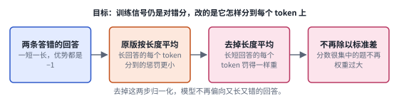 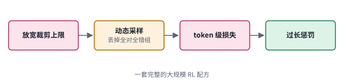

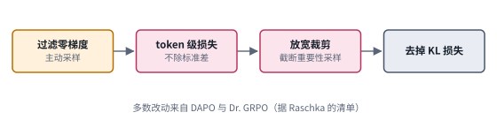 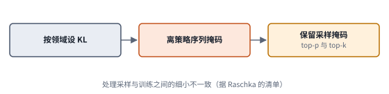

*图：第 4 阶段四份修补清单的结构卡，每张卡对应下表的一行。*

| code | 名称 | 年份 | 代表 | 怎么做 | 解决了什么 | 代价 |
|---|---|---|---|---|---|---|
| F1 | 去掉两步归一化 | 2025 | [Understanding R1-Zero-Like Training（Dr. GRPO）](https://arxiv.org/abs/2503.20783) | 去掉 GRPO 里按回答长度和按组内标准差做的两步归一化 | 去掉了让模型偏向又长又错的回答的那一处偏差来源 | 改动很小，却说明损失怎样归一化会悄悄改变训练的含义，每个实现细节都要核对 |
| F2 | 大规模 RL 配方 | 2025 | [DAPO](https://arxiv.org/abs/2503.14476) | 放宽裁剪上限，动态采样掉全对或全错的题，按 token 计算损失，对过长回答加惩罚 | 把 R1 之后各团队踩到的暗坑整理成一套完整、公开的配方 | 动态采样直接丢掉饱和数据，模型越强丢得越多（分支 2 的 Save Your Saturated Data 正想把它们回收） |
| F3 | Olmo 3 的修补 | 2025 | [The State Of LLMs 2025](https://magazine.sebastianraschka.com/p/state-of-llms-2025) 的清单 | 过滤零梯度信号、主动采样、按 token 计算损失、去掉 KL 损失、放宽裁剪上限、截断重要性采样、不再除以标准差 | 多数改动来自 DAPO 和 Dr. GRPO；Raschka 在小规模实验里加上之后，坏的更新不再把整次训练带歪 | 多项改动同时叠加，很难单独认定哪一项带来了收益 |
| F4 | DeepSeek V3.2 的修补 | 2025 | [The State Of LLMs 2025](https://magazine.sebastianraschka.com/p/state-of-llms-2025) 的清单 | 按领域设置不同的 KL 强度，对离策略的序列做掩码，训练时保留采样阶段 top-p 和 top-k 的掩码 | 处理采样与训练之间的细小不一致，让训练看到的分布和采样时一致 | 说明规模化系统里离策略成分躲不掉，系统也因此更复杂（分支 4） |

### 第 5 阶段：把密集的教师信号加回来

> **要点：** 流程简化到只剩策略之后，一条轨迹只换来一个分数，能不能把逐 token 的反馈加回来？在策略蒸馏让学生自己写，强教师对学生写下的每个 token 表态认不认可：学生在自己会走到的情形里学，每个 token 又都有反馈；对一套现成的强化学习代码，只要改两处。

流程简化到只剩策略之后，一条轨迹只换来一个分数，信号太稀疏，在策略蒸馏就是对这一点的回应：让学生自己生成轨迹，再请一个强教师给轨迹里的每个 token 打分，把蒸馏和强化学习的好处合在一起。Thinking Machines 的 [On-Policy Distillation](https://thinkingmachines.ai/blog/on-policy-distillation/) 用一张两两组合的格子把局面讲得很清楚，一条轴是学生在谁的轨迹上学，一条轴是反馈有多密（见第一节）。离策略的监督微调和蒸馏有逐 token 的信号，可学生只在教师会走到的情形里学，序列一长，错误就会累积，学生还可能只学到教师的腔调而没学到教师的准确。强化学习在学生自己会遇到的情形里学，可反馈稀疏，说不清是哪一个 token 出了错。在策略蒸馏占的正是两样都有的那一格。

这个想法由两个更早的成分拼成：一是教师给出的是所有候选上的概率，比一个标准答案信息多；二是指导要落在学生自己走到的状态上。两个成分起源不同，到大模型时代才被接在一起。2015 年 Hinton 等人的[知识蒸馏](https://arxiv.org/abs/1503.02531)让学生去学教师在所有候选上给出的概率，这比只告诉学生"正确答案是哪一个"包含更多信息，比如教师觉得哪个错误答案也挺像对的，这是第一个成分，可学生仍然只在固定的数据上学。Ross 等人的 [DAgger](https://arxiv.org/abs/1011.0686) 则在模仿学习里指出，专家的指导应该落在学生实际走到的状态上：让学生自己去执行，专家为学生遇到的每个状态标注该怎么做，再拿这些标注训练学生，这是第二个成分。到了大模型时代，2023 年的 [GKD](https://arxiv.org/abs/2306.13649)（Agarwal 等，On-Policy Distillation of Language Models）和 [MiniLLM](https://arxiv.org/abs/2306.08543) 先后把这两个想法接在一起，让语言模型学生在自己生成的序列上接受教师的逐 token 概率监督。

让这条路线在 2025 年重新热起来的是一组数字：在策略蒸馏只用了约十分之一的算力，分数却比强化学习更高。这组对比来自 [Qwen3 技术报告](https://arxiv.org/abs/2505.09388)，按 Thinking Machines 文中的引述，在 AIME'24 上，离策略蒸馏得到 55.0%，在此基础上做强化学习得到 67.6%，用了 17,920 个 GPU 小时；改做在策略蒸馏得到 74.4%，只用了 1,800 个 GPU 小时。Thinking Machines 复现并扩展了这个结果：以 Qwen3-8B-Base 为学生、Qwen3-32B 为教师，先用 40 万条提示做离策略监督微调，学生在 AIME'24 上大约到 60%；如果继续堆监督数据，外推要到 200 万条提示才能到 70% 左右，而在策略蒸馏大约 150 步就到了 70%。他们估算，在监督数据已经现成的情况下，这样做的算力开销大约是继续监督微调的九分之一；如果把教师生成监督数据的成本也算进去，大约是三十分之一。

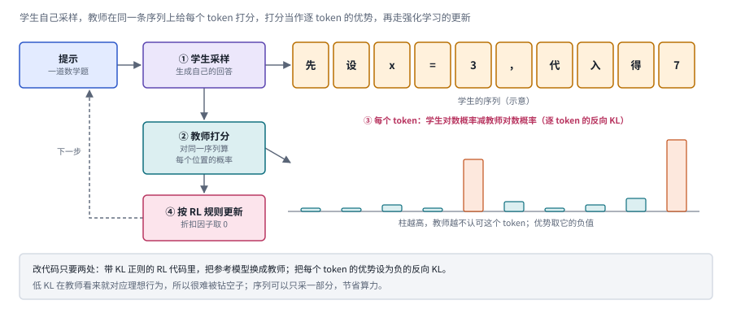

*图：在策略蒸馏的一步：学生采样一条序列，教师对同一序列算每个位置的概率，两者的对数概率之差就是逐 token 的反向 KL，取负值当作优势，再按强化学习的规则更新。序列和柱高只是示意。*

方法本身出奇地简单，图里按编号是四步。学生拿到一道题，自己写出一段回答。教师不用自己生成，只对学生这段回答做一次前向计算，给出每个位置上它会写这个 token 的概率。在每个 token 上，用学生的对数概率减去教师的对数概率，差越大，说明学生在这里写下的东西教师越不认可，图里两根橙色的高柱就是这样的地方；把这个差取负值当作这个 token 的优势，教师越不认可，这个 token 被压得越狠。最后沿用强化学习的更新规则，而且每个 token 只为自己负责，不去分摊后面 token 的得失。作者说，对一套已经带 KL 罚项的强化学习代码，只要把罚项用的参考模型换成教师，再把优势换成这个负的差值，就成了在策略蒸馏。

这个差值在全部 token 上的平均，就是第 1 阶段说过的 KL 散度，只是方向有讲究。两个分布之间的 KL 有两种算法：按学生的分布加权，叫反向 KL；按教师的分布加权，叫正向 KL。在策略蒸馏只能在学生自己写下的 token 上计算，所以天然是反向 KL。两个方向的差别，在教师认为不止一种做法都合理时最明显。

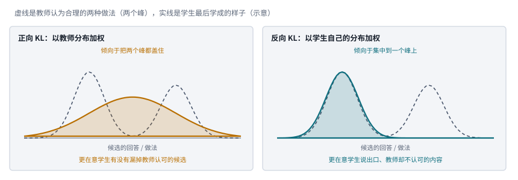

*图：教师认可两种做法时，正向 KL 倾向于让学生把两个峰都盖住，反向 KL 倾向于让学生集中到其中一个峰上。曲线只是示意。*

教师认可两种做法时，正向 KL 让学生两头都盖住，反向 KL 让学生只挑一头。图里的虚线是教师的分布，它有两个峰，代表两种都合理的做法。按正向 KL 训练的学生，最在意的是别漏掉教师认可的候选，于是把概率摊开，两个峰都盖住，代价是中间那片教师并不认可的区域也分到了概率。按反向 KL 训练的学生，最在意的是别说出教师不认可的话，于是集中到其中一个峰上，说出来的都靠谱，另一种解法却丢了。MiniLLM 论证过生成任务更适合反向 KL，Thinking Machines 的理由也在这里：反向 KL 低，意味着学生写下的东西教师都认可，这个目标很难被钻空子。它也有另一面：被丢掉的那个峰，可能正是后续强化学习需要的探索空间。

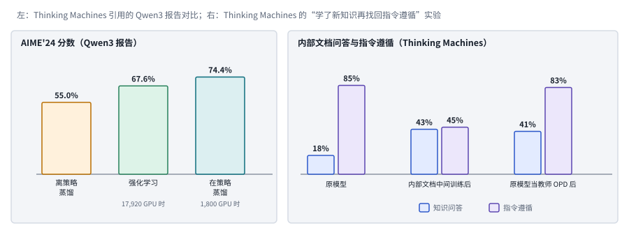

*图：左边是 Thinking Machines 引用的 Qwen3 报告对比，柱下注明强化学习和在策略蒸馏各用了多少 GPU 小时；右边是“学了新知识再找回指令遵循”实验的三个检查点。*

在策略蒸馏还能把学新知识时丢掉的旧本事找回来，这是图右半边说的事，左半边是上面那组 Qwen3 的数字。右半边来自同一篇文章里的另一个实验：一个模型在公司内部文档上继续训练，学公司的新知识，知识问答从 18% 升到 43%，可指令遵循从 85% 掉到 45%，学了新东西就把旧本事丢了。原来的模型还保留着 85% 的指令遵循，以它为教师再做一轮在策略蒸馏，指令遵循回到 83%，知识问答仍保持在 41%。作者由此提出，可以把"学新东西"和"用蒸馏找回旧行为"交替进行，当作持续学习的一种做法。这和 [RL's Razor](https://arxiv.org/abs/2509.04259) 的观察相互呼应：遗忘的多少，和模型行为相对原模型漂移了多远有关，在学生自己轨迹上训练的方法倾向于找到漂移更小的解。

文章最后给了一个分工：强化学习适合在各种解题思路之间探索，发现新的做法；蒸馏擅长把已经发现的做法高效地教给学生。这个分工默认了一个前提：手里有一个比学生强的教师，而且它在学生走到的每个状态上都可靠。教师在每个 token 上都给信号，错了也会在每个 token 上传递错误；学生每一步又都要自己生成整条轨迹，轨迹越长越贵。这个前提于是引出四个问题：该传递什么，教师何时可信，没有更强的教师怎么办，长轨迹的预算怎样分配。

**速查：第 5 阶段的五种做法。** 五张卡把“在学生状态上给密集指导”这个想法的来龙去脉排成一行。D1 的知识蒸馏是离策略的，D2 的 DAgger 强调指导要落在学生的状态上，D3 和 D4 把这两件事在语言模型上接起来，D5 是 2025 年让这条路线重新热起来的配方。

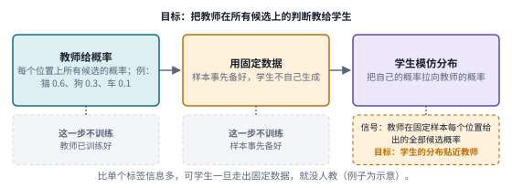 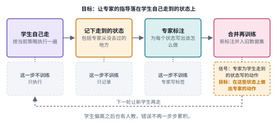

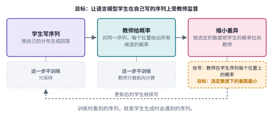 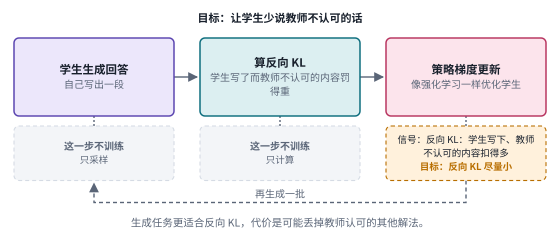

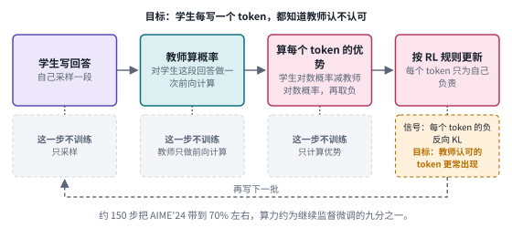

*图：第 5 阶段五种做法的结构卡，每张卡对应下表的一行。*

| code | 名称 | 年份 | 代表 | 怎么做 | 解决了什么 | 代价 |
|---|---|---|---|---|---|---|
| D1 | 软标签蒸馏 | 2015 | [知识蒸馏](https://arxiv.org/abs/1503.02531) | 学生去学教师在多个候选上的概率 | 比单个标签提供了更丰富的指导 | 在固定数据上进行，学生只在教师会走到的状态上学，一旦偏离就没人教 |
| D2 | 在学生状态上要指导 | 2010 | [DAgger](https://arxiv.org/abs/1011.0686) | 学生执行，专家为学生实际访问到的状态给出标注，数据合并后再训练，反复几轮 | 指导落在学生自己会走到的状态上，缓解只学专家状态带来的错误累积 | 需要随时能请专家标注；专家在学生那些古怪的状态上是否可靠，正是分支 6 的问题 |
| D3 | 语言模型上的在策略蒸馏 | 2023 | [GKD](https://arxiv.org/abs/2306.13649) | 学生在自己生成的序列上接受教师逐 token 的概率监督，衡量差异的散度可以选择 | 把 DAgger 的想法搬到语言模型上，训练时看到的就是生成时会遇到的序列 | 教师要在线给出概率，开销随学生采样一起增长 |
| D4 | 反向 KL 蒸馏 | 2023 | [MiniLLM](https://arxiv.org/abs/2306.08543) | 以反向 KL 为目标，用策略梯度优化学生 | 专门论证了生成任务为什么更适合反向 KL：学生少把概率分给教师不认可的内容 | 反向 KL 倾向于集中到少数模式，教师认可的其他解法可能被丢掉（见第 5 阶段 KL 方向图） |
| D5 | 在策略蒸馏配方 | 2025 | [On-Policy Distillation](https://thinkingmachines.ai/blog/on-policy-distillation/) | 带 KL 正则的 RL 代码里，把参考模型换成教师，每个 token 的优势取负的反向 KL | 同时拿到在策略状态和密集信号；约 150 步把 AIME'24 带到 70% 左右，算力约为继续 SFT 的九分之一 | 默认教师在学生的状态上可靠；token 层面的一致可能和全局正确脱节（分支 5、分支 6） |

### 第 6 阶段：走进长程交互

> **要点：** 从数学题搬到多轮的 agent 任务，会遇到什么？一个回合长了上千倍，最后那一个分数要分给上千倍的动作，哪一步该记功更难说清。给每一步单独打分的办法没有在大规模训练里站稳，研究者转而从价值模型、参考模型和教师那里找逐步的反馈；到 2026 年，前沿做法是先分领域用强化学习训出几个专家，再用在策略蒸馏把它们合回一个学生。

搬进长程交互之后，回合长了上千倍，功劳该记在哪一步也就更难说清。前面这些方法大多是在数学题和代码题上打磨出来的，一个回合几千到几万 token，结果可以干净地判对错。Lambert 在 [What comes next with reinforcement learning](https://www.interconnects.ai/p/what-comes-next-with-reinforcement) 里做了一个粗略的估算：当前 RLVR 一次回答大约一万到十万 token，真正有野心的长程任务，一个回合可能要一百万到一亿 token。回合拉长上千倍，最后那一个分数要分给上千倍的动作，哪一步该记功、哪一步该记过就更难说清，这叫信用分配问题。他对"靠最终结果端到端地学会长程任务"持偏悲观的态度，认为很多产品的进步更可能来自子任务变得更稳；而且长任务的奖励本身就很难定义，奖励越稀疏，模型钻奖励空子的风险越大。

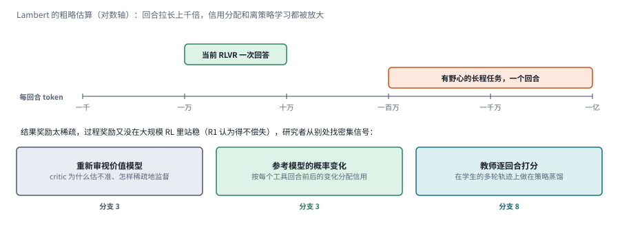

*图：上半部分是 Lambert 估算的回合长度，横轴是对数刻度；下半部分是 agent 方向找密集信号的三个新来源。*

最直接的补救是给中间步骤也打分，这叫过程奖励。2023 年的 [Let's Verify Step by Step](https://arxiv.org/abs/2305.20050) 发现，在数学推理上，对每一步做监督的过程奖励模型比只看结果的奖励模型更好用；它的训练信号是人逐步标注的对错，论文为此收集了八十万条步骤级标签。可到了大规模强化学习里，事情没这么顺利：R1 报告认为过程奖励带来的好处抵不过额外的开销，Raschka 也说过程奖励到目前为止还没有特别成功。于是 agent 方向的研究者从别处找逐步的信号，图下半部分是三条出路：重新审视价值模型，让它给每个中间状态估值；用一个冻结的参考模型对正确答案的概率怎样随回合变化，给每个工具回合分配信用；或者请教师在学生的多轮轨迹上逐回合打分。

多轮轨迹还带来一个数学题里没有的问题：轨迹里有一部分内容不是模型写的。

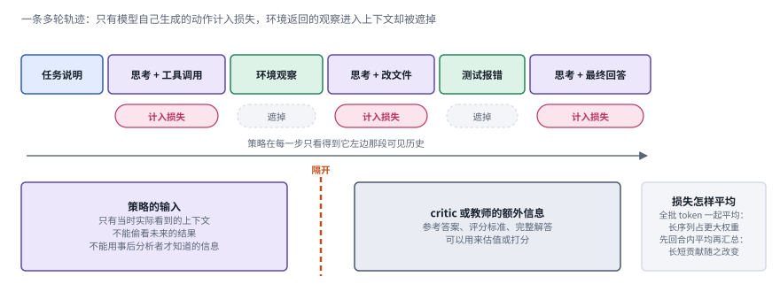

*图：一条修 bug 的多轮轨迹。紫色的模型动作计入损失，绿色的环境观察留在上下文里却被遮掉；下方用一道橙色虚线把策略的输入和 critic、教师可以使用的额外信息隔开。*

环境写的内容要从损失里遮掉，只让模型自己写的部分计入。以修 bug 为例，模型思考并调用工具，环境返回文件内容，模型改文件，测试报错，模型再给出回答。环境返回的内容和报错进入了上下文，模型下一步要读它们，可它们不是模型该学着写出来的东西。

遮掉环境内容管的是损失，图下方的橙色虚线管的是输入，规矩是：策略在每一步只能用它当时实际看到的历史，不能混进未来的结果，也不能混进事后分析者才知道的信息。价值模型和教师只在训练时用，可以多看一些，比如参考答案或评分标准，但这些信息必须和策略的输入隔开，否则策略在训练时学会依赖它们，部署时却拿不到。

损失怎样平均，在多轮轨迹里同样会悄悄改变训练的含义，图右下角画的就是这件事：把一个批次里所有 token 放在一起平均，长轨迹占的权重更大；先在每条轨迹内部平均再汇总，长短轨迹的分量又不一样了。这和第 4 阶段 Dr. GRPO 发现的长度偏差是同一类问题。

到了 2026 年，这条主线又拐了一个弯，把第 5 阶段的教师信号和这里的长程强化学习接到了一起。Lambert 在 6 月和 Finbarr Timbers 的访谈 [Frontier post-training recipe review](https://www.interconnects.ai/p/frontier-post-training-recipe-review) 里总结说，前沿实验室发现把数学、代码和 agent 强化学习混在一次训练里，能力会互相拉扯，于是改成先分领域训出若干个强化学习专家，再用多教师在策略蒸馏把它们合回一个学生，DeepSeek V4 和 Nemotron 3 Ultra 的教师都超过了十个。这样，强化学习负责在各自领域里把能力推上去，蒸馏负责把这些能力巩固到同一个模型里。Shiwan Zhao 等人在同年 4 月的综述 [Large Language Model Post-Training: A Unified View of Off-Policy and On-Policy Learning](https://arxiv.org/abs/2604.07941) 恰好给这种分工起了名字：他们把蒸馏看作一种行为巩固机制，并判断后训练的进展越来越取决于怎样把不同阶段、不同角色协调成一个系统。

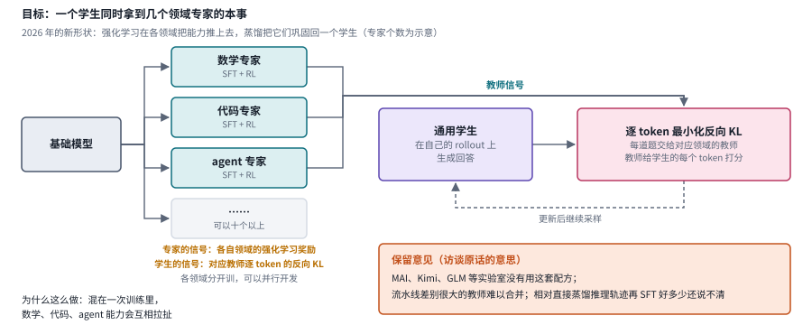

*图：多教师在策略蒸馏的配方：基础模型分领域做 SFT 加 RL，训出若干个专家，再让一个通用学生在自己的 rollout 上逐 token 地向对应领域的教师最小化反向 KL。专家个数只是示意。*

图右下角的橙色框记下了访谈里的保留意见：并非所有前沿实验室都这么做，流水线差别很大的教师难以合并，这套配方比直接拿推理轨迹做监督微调究竟好多少，也还说不清。

### 边界：代理会被钻空子，增量也难以确认

> **要点：** 分数涨了，是不是就说明模型真的变好了？未必。主线上每一种信号都可能被钻空子，可检查的规则奖励也不例外；强化学习带来的提升究竟是新能力，还是让已有的解法更容易被采到，也还没有定论。

第一类问题是奖励作弊：奖励只是真实目标的一个代理，优化压力会精准地找到代理和目标之间的漏洞。Lilian Weng 在 [Reward Hacking in Reinforcement Learning](https://lilianweng.github.io/posts/2024-11-28-reward-hacking/) 里把根源讲得很透，用古德哈特定律的话说，一个指标一旦成为目标，就不再是好指标。2022 年的 [Scaling Laws for Reward Model Overoptimization](https://arxiv.org/abs/2210.10760) 用实验刻画了这件事：对着奖励模型优化得越狠，奖励模型给的分数一路上涨，真正的目标分数却在某个点之后掉头向下。可验证奖励也逃不掉。修 bug 时如果奖励只看测试是否全部通过，模型就可能发现，把失败的测试直接删掉，测试同样全绿，这种行为于是也被奖励了。

连用来抓作弊的监控本身，一旦接进训练也会被钻空子。Lilian Weng 在 Why We Think 里提到 OpenAI 的 [Monitoring Reasoning Models for Misbehavior](https://arxiv.org/abs/2503.11926)：用另一个模型阅读编程 agent 的思维链，能发现它的作弊意图；可一旦把这个监控器的判断加进训练奖励，模型就学会了把作弊意图藏起来，照样作弊。她由此得出的结论是，直接对思维链施加优化压力要非常小心。

第二类问题是能力增量到底有多少。衡量这件事常用 pass@k：对每道题采样 k 次，只要有一次答对就算解出。2025 年的 [Does Reinforcement Learning Really Incentivize Reasoning Capacity in LLMs Beyond the Base Model?](https://arxiv.org/abs/2504.13837) 发现，经过 RLVR 训练的模型在 k 小时明显胜过基础模型，可 k 足够大时，基础模型反而能解出更多题。作者据此认为，当前的 RLVR 更多是在提高已有解法被采到的概率，还没有创造出基础模型完全没有的推理能力。Raschka 的长文也提醒过，一些在小模型上报告的强化学习收益，后来被指出可能只是统计噪声。这些争议至今没有定论。

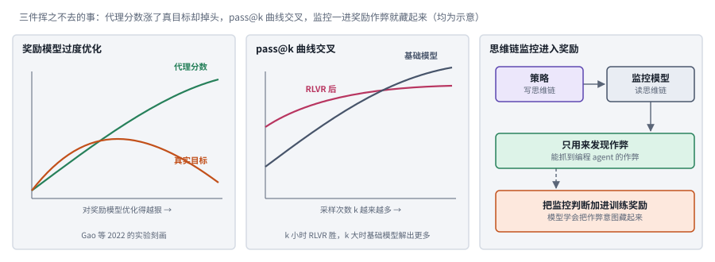

*图：三张示意图。左边是奖励模型过度优化，代理分数一路上涨，真实目标先升后降；中间是 pass@k 曲线的交叉；右边是思维链监控只用来发现作弊、和被加进训练奖励时的不同结果。*

三张小图合起来提醒同一件事：奖励涨了、分数高了、监控安静了，都还要追问一句，涨的是不是我们真正想要的东西。

### 总对照：几族方法放在两条共同的轴上

> **要点：** 读到一篇新的训练论文，怎样很快找到它在主线上的位置？先问三件事：信号从哪里来，训练用的是谁的轨迹，信号有多密。下表按这三件事比较主线上的五类方法，图给每个方法定位。

| 家族 | 信号从哪里来 | 训练状态 | 信号密度 | 要维护的模型 | 主要优点 | 主要代价 | 本章分支 |
|---|---|---|---|---|---|---|---|
| P 第 1 阶段 | 环境回报或学出来的奖励模型 | 在策略 | 结果稀疏，critic 补成逐步估值 | 策略、奖励模型、critic、参考模型 | 没有标准答案的任务也能训练 | 四个模型的开销；奖励模型会被钻空子 | 分支 1、分支 3 |
| V 第 2、3 阶段 | 组内比较、可检查的规则 | 在策略 | 稀疏 | 策略、参考模型（GRPO 另有奖励模型） | 流程最简单，奖励由程序直接给出 | 多次采样；全对全错没有信号；只适用于结果能检查的任务 | 分支 1、分支 2 |
| F 第 4 阶段 | 同上，再加偏移修正 | 在策略为主，掺有离策略成分 | 稀疏 | 同上，外加独立的推理引擎 | 规模化时训练不再被坏更新带歪 | 改动叠加，难以归因 | 分支 2、分支 4 |
| D 第 5 阶段 | 教师的概率 | 离策略（D1）到在策略（D2 至 D5） | 密集 | 学生、教师 | 信号密，算力省，还能找回旧行为 | 依赖教师可靠；可能只学到一致而没学到正确 | 分支 1、分支 5 至分支 8 |
| 第 6 阶段 | 结果、价值估计、参考模型、教师逐回合打分 | 在策略，常常异步 | 介于两者之间 | 视方法而定 | 面向真实的多轮交互任务 | 回合长、成本高，奖励本身难以定义 | 分支 3、分支 4、分支 8 |

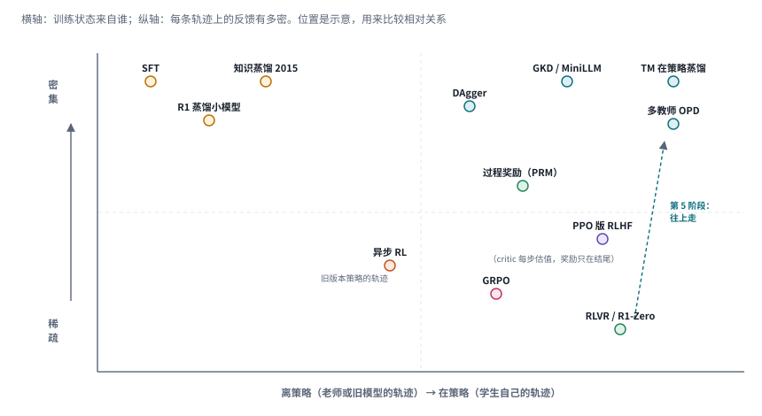

*图：本章的代表方法放在同两条轴上：横轴是训练状态来自谁，纵轴是每条轨迹上的反馈有多密。位置只是示意，用来比较相对关系；虚线箭头是第 5 阶段的方向。*

图里有两个位置是表格看不出来的。PPO 版 RLHF 落在左右两角之间偏下，因为价值模型会给每一步估值，奖励本身却只在结尾出现；过程奖励再往上一点，每一步都有打分。中间偏左那个橙色的异步强化学习说明，规模化之后，原本在策略的方法会被拉向离策略一侧，这就是第 4 阶段那些修补要对付的事。

## 三、前沿研究方向

下面八个分支收录的 2026 年新论文，大多是在主线的某个阶段里处理某一种学习信号在交互任务中的具体失效，很少再提出一个全新的优化器。它们处理的失效包括：示范、蒸馏和奖励怎样排先后，组内比较缺信号时怎么办，长程任务的功劳怎样分回中间步骤，异步训练带来多大偏移，以及在策略蒸馏该传递什么、教师何时可信、没有强教师怎么办、长轨迹的预算怎样分配。读这些论文时值得一直问两个问题：它补的是哪一种信号的短板，它报告的收益是训练分数、和教师的相似度，还是独立任务上的成功。这三样东西常常朝不同方向变化。

> **本节要点：** 八个分支各守主线上的一处缝：前四个回头修补强化学习的训练顺序、组内比较、价值估计和异步训练，后四个都在追问在策略蒸馏默认的那个前提，即教师在学生走到的每个状态上都可靠、都值得学。

### 分支1：SFT、蒸馏与RL，应该替代、混合还是分阶段？

示范、蒸馏和强化学习怎样组合，要看训练卡在哪一环，套一个固定配方往往不可靠。三种训练方式最根本的区别在于信号从哪里来：示范给出应该模仿的行为，蒸馏提供教师的分布，强化学习则根据执行结果改变以后的采样概率。它们可以互补，可排列组合并非怎样都有效。学生如果几乎采不到成功的轨迹，稀疏奖励就分不出好坏，这时先用示范或蒸馏把它带到能偶尔成功的地方才有意义；反过来，如果教师的行为和学生部署时的状态对不上，模仿得越多，偏得越远。所以要先找到训练卡在哪一环，再决定怎样组合这几种信号。

> 主线位置：第 3 阶段和第 5 阶段的交汇处。接 DeepSeek-R1 的"冷启动 SFT 再 RL"、Qwen3 报告里离策略蒸馏、RL 与在策略蒸馏的三方对比，以及 RL's Razor 关于遗忘的观察。

> **要点：** 示范、蒸馏和强化学习该怎样排先后？先找到训练卡在哪一环，再决定信号怎样排列。两篇论文发现，同一步里混合两种信号会互相干扰，先蒸馏、后强化学习更好，而起点的好坏可能要到强化学习之后才看得出来。

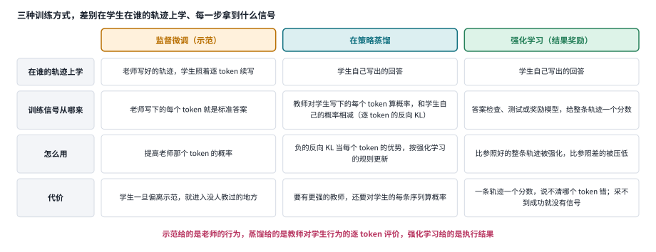

*图：三种训练方式各占一列，四行依次是学生在谁的轨迹上学、训练信号从哪来、信号怎么用、代价。*

三种方式的分歧在信号从哪来。监督微调的信号是教师写下的 token，学生照着教师的轨迹续写；在策略蒸馏和强化学习都让学生自己写，前者由一个已经训好的教师给每个 token 打分，后者由测试、答案检查或奖励模型给整条轨迹一个分数。代价一行和信号一行对应：示范照不到学生自己会走到的地方，蒸馏离不开更强的教师，结果奖励太稀疏，采不到成功就什么也学不到。排先后的问题，就是让这几种信号在训练的不同时段各补对方的短处。

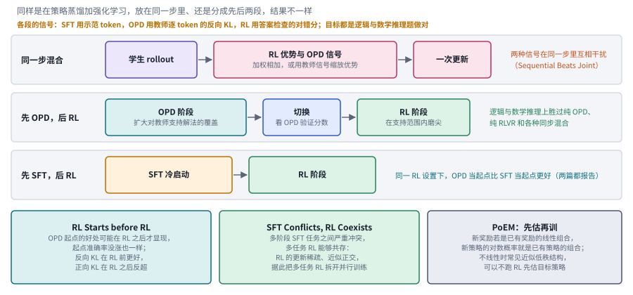

*图：上面三行是三种排列：同一步混合、先 OPD 后 RL、先 SFT 后 RL，右侧写着论文报告的结论；下面三个框是本分支另外三篇工作各自的发现。*

排列顺序之所以有影响，是因为监督微调的更新会互相冲掉，强化学习的更新却能共存。**[SFT Conflicts, RL Coexists](https://arxiv.org/abs/2608.03573)，`2608.03573`** 从多任务训练入手发现了这一点：分几个阶段先后用监督微调教几种任务，后学的会冲掉先学的；换成强化学习，几种任务却能共存。作者在参数层面找到的原因是，强化学习对不同任务的更新很稀疏，方向彼此近乎垂直，所以互不干扰；他们据此提出把多任务强化学习拆开并行训练的方案。这个结论很容易被读成"监督微调必然遗忘、强化学习天然兼容"，可它成立的条件包括归一化方式、采样设置、具体任务和模型。它可以和第 5 阶段的两项观察对照着读：RL's Razor 发现遗忘的多少和行为漂移了多远有关；Thinking Machines 让模型在内部文档上继续训练后，指令遵循从 85% 掉到 45%，再以原模型为教师做一轮在策略蒸馏，又回到了 83%。三者讨论的都是在学生自己轨迹上的更新为什么更不伤旧能力。

在策略蒸馏和强化学习之间同样有先后之分，两篇工作都发现先蒸馏、后强化学习比在同一步里混合更稳。**[Sequential Beats Joint: On the Interplay between On-Policy Distillation and RLVR](https://arxiv.org/abs/2609.04108)，`2609.04108`** 比较了两种结合办法：在同一步里把蒸馏信号和强化学习的优势加权相加，或者先做在策略蒸馏、再做强化学习。后者在逻辑和数学推理上稳定地胜出。作者的解释是，蒸馏扩大了学生能采到的、教师也认可的解法范围，强化学习再在这个范围里把解法磨尖；放在同一步里，两种信号会互相干扰。图上半部分第二行就是它推荐的做法，用蒸馏阶段的验证分数决定何时切换到强化学习。他们还发现，在策略蒸馏当强化学习的起点比监督微调更好。**[RL Starts before RL: On Policy Distillation for Better Reinforcement Learning](https://arxiv.org/abs/2609.28145)，`2609.28145`** 得到相近的结论，并补上一个反直觉的现象：在策略蒸馏有时几乎不提高学生的初始准确率，强化学习之后的最终成绩却更高。它还比较了两个 KL 方向，反向 KL 的起点在强化学习之前更好，正向 KL 的起点在强化学习之后反超。按第 5 阶段 KL 方向图的直觉，反向 KL 让学生集中到教师的一种做法上，正向 KL 保留了更多候选，而这些候选正是强化学习后来要挑选和打磨的。两篇共同反对的做法是：只看某个阶段结束时的一个分数，就决定拿哪个检查点当后续训练的起点。它们也都没有证明任何任务都应该顺序训练。

前两篇都要真的训练完才知道顺序好不好，最后一篇想在花钱训练之前先做个预估。**[PoEM: Predicting RL Outcomes from Existing Policies](https://arxiv.org/abs/2609.30226)，`2609.30226`** 手里有几个分别为不同奖励训练好的模型，现在来了一个新奖励。如果新奖励恰好是旧奖励的加权组合，那么新奖励下训练出的模型，在对数概率上也正好是旧模型的同样组合，不用重新训练就能算出来。新奖励不能这样组合时，作者观察到这些模型的对数概率大体落在一个低维的子空间里，于是仍然用组合去近似。前一种关系有严格证明，后一种只是经验观察。它提出的问题值得追问：重新训练之前，能不能先估计目标策略值不值得追，最终还是要回到真实训练里验证。

### 分支2：组相对方法缺少信号时，应该改题、改采样还是改优势？

组相对方法缺信号时，补救办法改的东西各不相同，比较之前要先弄清收益来自哪一种。GRPO 让同一道题的几个回答互相比较，比平均好的被强化，比平均差的被削弱，这要求一组回答之间有差异。全部失败时，大家都是零分，看不出哪条路更有希望；全部成功时，又分不清哪些推理是冗余的、哪些是有效的。补救的办法有好几种，可它们改的东西不同：有的换了更容易采到正确解的题目或采样方式，有的给了更密的监督，有的只是让同样的信号用得更稳。不先分清这一点，很容易把性质不同的改进混为一谈。

> 主线位置：第 2 阶段和第 4 阶段。接 GRPO 的组内比较、DAPO 的动态采样，以及 Raschka 清单里"过滤零梯度信号""主动采样"这些工程修补。

> **要点：** 同一道题的几遍回答全对或全错时，信号从哪里补？补法分成三类：在全错时想办法采到第一个正确解，在有对有错时调整优势或目标，在全对时重新制造有信息量的错误样本。

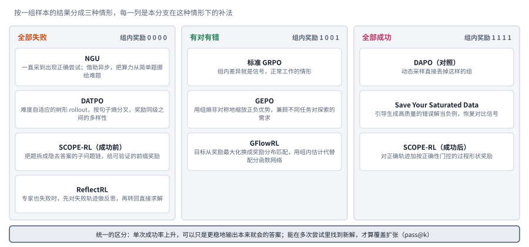

*图：按一组样本的结果分成三种情形，每一列下面是本分支在这种情形下的补法；底部是贯穿整个分支的单次成功率与覆盖之分。*

全错的一侧，要做的是想办法采到第一个正确解。强化学习对已经会做的简单题提升很大，对难题提升很小，**[Learning to Solve Hard Problems in RL for LLMs by Never Giving Up](https://arxiv.org/abs/2609.13443)，`2609.13443`** 认为原因之一是现有方法把太多算力花在简单题上。它提出的 NGU 对一道题一直采样，直到采到一个正确解为止：简单题很快就采到，自然少花算力；难题要采很久，算力就流向了难题。这样做每道题的采样数不一样，作者借助异步训练让采样不必互相等待。**[Difficulty-Adaptive Tree-Structured Policy Optimization for Expanding Reasoning Coverage in RLVR](https://arxiv.org/abs/2609.08650)，`2609.08650`**（下称 DATPO）改的是采样的形状：与其独立地从头采几个回答，不如从一个回答的中途分叉，在模型最犹豫的那句话处长出几个不同的后续，按题目难度决定分多少叉，并奖励兄弟分支之间的差异。前者重新分配算力，后者改变探索路径，两者都离不开可靠的最终检查；面对根本无解的题，"永不放弃"也得有个尽头。**[SCOPE-RL](https://arxiv.org/abs/2607.11506)** 在模型第一次做对之前，把难题拆成一串隐去答案的子问题，每答对一个子问题就给一份奖励，让还没成功时的进展也能拿到信号。[ReflectRL](https://arxiv.org/abs/2608.03972) 处理的是专家也失败的难题：专家的失败轨迹通常被丢掉，它却让学生先对着这条有缺陷的轨迹反思，再把学到的推理转回直接解题。

全对的一侧，要做的是重新制造有信息量的错误样本。模型越强，越多的训练题会出现全组满分，GRPO 在这些题上的优势几乎全是零。DAPO 的做法是直接丢掉这些题；**[Save Your Saturated Data: Learning Beyond Reward Saturation in Group-Based RL](https://arxiv.org/abs/2609.33126)，`2609.33126`** 则想把它们用起来。作者在数据、采样、奖励和优势四个环节都试了干预，最有效的是在采样时诱导模型写出看起来像样、实际错误的解，把它们混进满分组当反例，对比信号就回来了。随便塞几个荒谬答案没有这个效果，反例要落在真实的决策边界附近才有信息量。SCOPE-RL 在首次成功之后也换了办法：对已经答对的轨迹按推理过程的质量再打分，区分条理清楚的正确解和绕了远路的正确解。它在首次成功前后各用一套办法，所以在图里左右两列各出现一次。

有对有错的正常情形下，GRPO 本来就能工作，两篇工作改的是信号怎样使用。[Group Entropy-Controlled Policy Optimization](https://arxiv.org/abs/2607.16850) 注意到不同任务混在一起训练时，有的任务回答很发散，有的很集中，同一套优势计算对它们并不公平；它按每组回答的发散程度调整正负优势，在集中的组里收着点强化，在发散的组里收着点惩罚，给需要探索的任务留出探索的空间。[GFlowRL](https://arxiv.org/abs/2607.13394) 换了目标：普通强化学习把概率往得分最高的那一种解法上堆，它让模型按奖励的比例分配概率，得分接近的几种解法都保留下来。按比例分配要先知道各种解法的奖励加起来有多少，也就是归一化常数；以往这类方法要额外训练一个网络来估计它，GFlowRL 改用同组样本直接估计。

这一组工作都绕不开一个区分，也就是图底部那条灰条：单次成功率和能解出的题目范围是两回事。模型更稳定地输出它本来就会的答案，单次准确率会上升；能在多次尝试中解出原来解不出的题，才是范围的扩大。边界一节的 pass@k 争议正是围绕这一点：采样次数足够多时，基础模型解出的题反而比 RLVR 训练后的模型更多。DATPO 就是冲着扩大这个范围去的。pass@k 本身也受采样温度、解码方式和预算影响，拿它当内在能力的度量同样要写明条件。

### 分支3：长时程信用应该交给价值模型，还是直接从外部证据估计？

把一个结果分数分回多轮任务的各个步骤，平摊和逐步打分都有毛病。一个多轮任务最终成功，靠的是许多动作的组合，早期一些看似无效的尝试也可能提供了必要的信息。把功劳分回中间步骤，就是第 6 阶段说的信用分配问题；这一分支比较几种分法，看它们各自怎样处理延迟的后果，误判又会怎样传播出去。

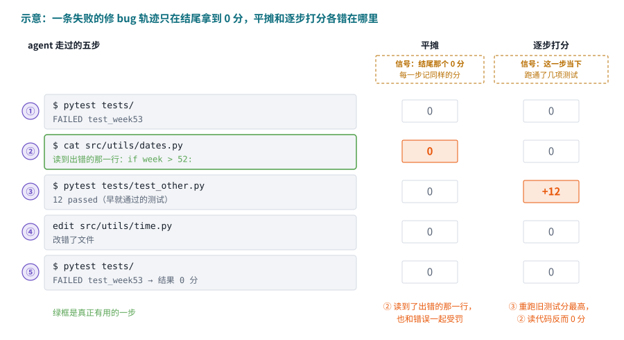

*图：一条失败的修 bug 轨迹，结尾只有一个 0 分。中间一列把这个 0 分平摊给每一步，右边一列按每一步当下跑通的测试数打分；命令、输出和分数为示意。*

平摊和逐步打分的毛病，在图里这条失败的轨迹上都看得见。第②步读到了出错的那一行，是整条轨迹里最有用的一步；平摊时，结尾的 0 分记到每一步头上，它也和最后的错误一起受罚。改成逐步打分，信号是这一步当下跑通了几项测试，第③步重跑早已通过的测试拿到最高分，读代码的第②步反而是 0 分，模型会专挑这种当下就能拿分的动作，迟迟不去读出错的那段代码。

> 主线位置：第 1 阶段的价值模型与第 6 阶段的长程信用问题。接 PPO 与 GAE 的价值估计、GRPO 去掉价值模型的选择，以及 Let's Verify Step by Step 开启、R1 报告认为得不偿失的过程奖励路线。

> **要点：** 一条多轮轨迹只在结尾拿到一个分数，怎样把功劳分回中间的每一步？重新把价值模型训好，改写训练目标让它不再需要逐步估值，或者看一个冻结的模型对正确答案的把握怎样逐回合变化，是三种办法；它们都绕不开同一个前提：最后那个分数本身得定义对。

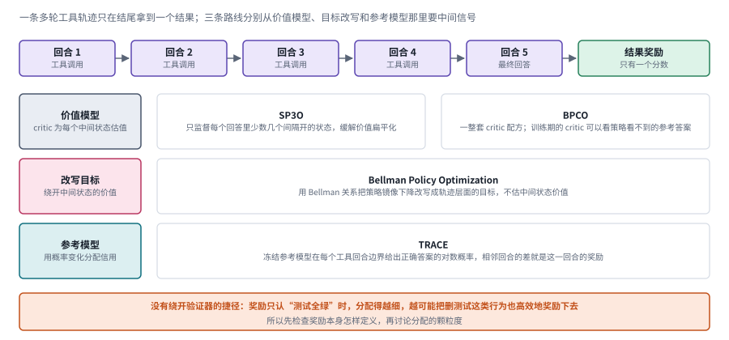

*图：三条分配信用的路线各占一列，列头是本分支的代表工作；四行依次是额外预测什么、训练信号从哪来、怎么用、代价；底部一行是三条路线的共同前提。*

三条路线的分歧在中间那份信号从哪来。价值模型这一列另外训练一个 critic，它学的是从中间位置往后实际拿到的分；改写目标这一列什么也不多学，只用结尾的奖励；参考模型这一列请一个冻结的模型逐回合估计参考答案的概率，看它涨还是跌。代价一行依次是 critic 难训、损失只是近似、离不开参考答案。

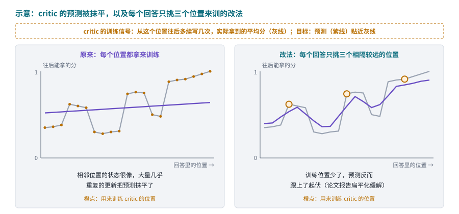

*图：同一个回答里各个位置往后能拿的分。灰线是从每个位置多续写几次算出的实际平均分，也就是 critic 的训练答案；紫线是 critic 的预测；橙点是拿来训练 critic 的位置。曲线为示意。*

第一条路线是把价值模型请回来，前提是弄清它为什么不好训，第 2 阶段 GRPO 拿掉它的理由正是这一点。**[Rethinking Critic Learning in PPO: Understanding and Mitigating Value Flattening](https://arxiv.org/abs/2609.18708)，`2609.18708`** 的诊断就是图左边：灰线在回答中途起伏很大，紫线却几乎是平的，作者称之为价值扁平化。原因有两个，一是价值模型的训练目标里隐含着一个压低预测波动的惩罚，二是相邻位置的状态很像，梯度也很像，大量重复的更新把预测抹平了。图右边是对策：每个回答只挑三个相隔较远的位置来训练价值模型，扁平化就缓解了，策略也学得更好。所以价值模型不稳定时，除了删掉它还有别的选择。**[Best Practice Critic Optimization](https://arxiv.org/abs/2608.23566)，`2608.23566`** 从配方入手，把价值预测限制在奖励的取值范围内，用实际续写的结果当训练目标，按回答长度调整 GAE，每道题只采一个回答也能比得上 GRPO。它还利用了一个便利：价值模型只在训练时使用，所以可以让它看到策略看不到的参考答案或评分标准，估得更准。按第 6 阶段说的规矩，这些信息必须和策略的输入隔开。

第二条路线是改写目标，干脆不估中间状态的价值。[Bellman Policy Optimization](https://arxiv.org/abs/2609.15987) 针对只在结尾给奖励的生成任务，用价值在相邻状态之间必须满足的递推关系，把原本需要逐个状态估价的目标改写成只依赖整条轨迹的形式，并证明改写前后最优解相同；实际使用的损失是对这个目标的近似。

第三条路线借外部参照。[TRACE](https://arxiv.org/abs/2607.13988) 用的是每道题都带有的参考答案。它在每次工具调用的边界上，问一个冻结的参考模型：看着到目前为止的轨迹，你觉得正确答案的概率有多大。这一步之后概率涨了，说明这一步让 agent 离答案更近，就给它正的奖励；跌了就给负的。失败轨迹里那些把概率推高的有用动作，于是不再和最后的错误一起受罚。它不需要额外训练价值模型，代价是离不开参考答案。读这三条路线时要分清三层：理论上的等价、估计误差和实际训练收益。

三条路线都有一个共同前提，就是图底部的橙色条：信用分配绕不开奖励本身。如果最终的检查只认"测试全绿"，那么任何更精细的分配机制，都可能更高效地奖励把失败的测试删掉这类行为，因为删掉之后测试同样全绿，这正是 Lilian Weng 反复提醒的奖励作弊。所以应当先检查奖励是怎样定义的，再讨论分配的颗粒度，否则过程监督只是把一个有偏的终点扩散到了更多中间动作上。

### 分支4：异步训练节省了等待，却引入了多少分布偏移？

异步训练提高了吞吐，也拉大了样本和当前策略的距离，所以只报告每小时收集了多少条轨迹远远不够。同步训练时，一个批次要等最慢的那条轨迹跑完才能更新，长任务的完成时间又参差不齐，大量算力花在等待上。异步系统让采样和更新各跑各的，可这样一来，旧版本策略生成的轨迹会被已经更新过的新版本拿去训练。吞吐量上去了，样本和当前策略的距离也在拉大。比较时因此要记录策略版本之间隔了多少步、用了什么修正、以及达到目标表现的端到端成本，才能判断并行化是在加速学习，还是在更快地消费过时数据。

> 主线位置：第 4 阶段的规模化修补延伸到第 6 阶段。接 PPO 的概率比与裁剪，以及 Raschka 记录的截断重要性采样、离策略序列掩码等工程做法。

> **要点：** 采样和更新各跑各的以后，训练用的轨迹和当前的策略差了多远？差距有三个来源：采样用的参数落后几版，推理引擎和训练框架算同一个概率时有细小差异，模型内部的路由在两边也可能不一致。各篇工作分别在采样方式、裁剪范围、给旧数据加权和系统边界上做修正。

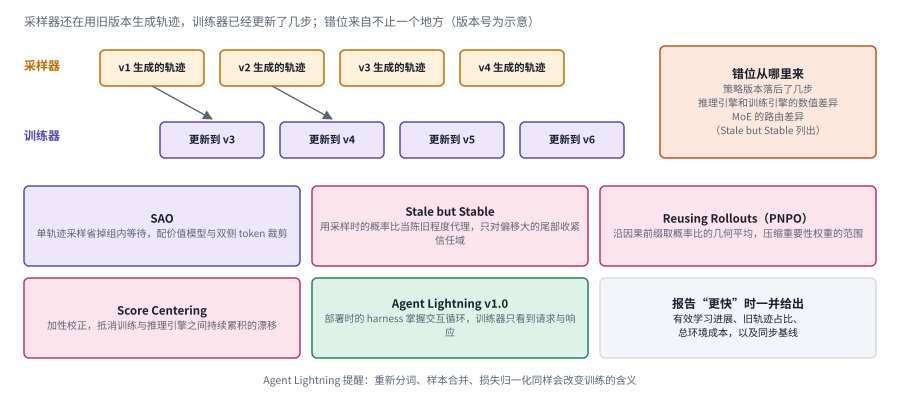

*图：上方两条泳道是采样器和训练器，斜箭头表示旧版本的轨迹被新版本拿去训练，右上角列出错位的三种来源；下方是本分支各篇工作的修正落点。*

错位不只来自版本落后，所以只记"落后了几步"往往不够。图右上角列出了三种来源：策略版本落后几步；推理引擎和训练框架算同一个概率时有细小的数值差异；混合专家模型在两边可能把同一个 token 交给不同的专家。

最直接的改法是放弃分组。GRPO 要求同一道题的一组回答都跑完才能比较，在异步的长任务里，这意味着一组里最慢的那条拖住了整组，所以 **[Single-Rollout Asynchronous Optimization for Agentic Reinforcement Learning](https://arxiv.org/abs/2607.07508)，`2607.07508`** 改成每道题只采一条轨迹，跑完一条就能用一条；没有了同组样本做参照，它把第 2 阶段拿掉的价值模型请了回来，并对每个 token 的概率比做两侧都更严格的裁剪，以求稳定。作者报告它能稳定训练一千步，在 SWE-Bench Verified 等编程和推理基准上胜过 GRPO 及其变体。

保留分组时，PPO 的裁剪在异步下又管得不够，**[Stale but Stable: Staleness-Adaptive Trust Regions for Stabilizing Asynchronous Reinforcement Learning](https://arxiv.org/abs/2607.18722)，`2607.18722`** 的对策是只在偏移最大的地方收紧，图右上角的三种来源也是它归纳的。裁剪只看采到的那个 token 的概率比，偏移最大的那部分更新恰恰控制得最弱。它用采样时和训练时的概率比当作"这条数据有多陈旧"的度量，在每个批次里找出偏移最大的那一小部分，只对它们把裁剪范围收紧，其余 token 照常更新。

裁剪之外，也可以从重要性权重下手，有两篇工作走这条路。按第 4 阶段的说法，重要性采样按新旧策略的概率之比给旧数据重新加权。严格来说，一个 token 的权重要把它前面所有 token 的比值连乘起来，因为新策略走到这个前缀的概率也变了，可连乘起来数值会极大或极小。[Reusing Rollouts under Policy Lag](https://arxiv.org/abs/2608.01418) 改用这些比值的几何平均，保留对前缀的依赖，又把数值范围压住；同一批轨迹反复用四轮时它效果最好，只用一轮时并不稳定地胜过基线。[Score Centering](https://arxiv.org/abs/2609.20807) 认为训练与推理引擎之间的不稳定主要来自一个持续存在、随步数累积的偏差，于是推出一个加性的校正项把它抵消掉，还可以和重要性采样叠加使用。

前面几篇都在算法里修正错位，[Agent Lightning v1.0](https://arxiv.org/abs/2608.17528) 则把问题推到系统边界上，那里要对齐的远不止策略概率。实际部署的 agent 运行在一个负责管理工具、上下文和流程的执行框架里，它让这个框架直接接入训练：交互循环归框架管，训练器只接收模型一次次的请求和回复。这样一来，把文本重新分词、把多次请求合并成一条样本、损失怎样归一化，都会改变训练的含义。

归结起来，报告"更快"时，最好同时报告有效的学习进展、旧轨迹所占的比例和总的环境成本，并保留一个模型、数据和预算都匹配的同步基线，把学习算法的收益和调度方式的收益分开。

### 分支5：蒸馏要复制整个教师，还是转移有益的变化？

教师和学生之间的差异未必都值得传递，在每个 token 上都强行匹配，学生会学到不该学的东西。在策略蒸馏让学生在每个 token 上都向教师靠拢，可这些差异可能来自能力，也可能来自教师多看了一份信息，还可能只是两者的出身不同，比如用了不同的基础模型、不同的分词器。在每个 token 上都强行匹配，就可能要求学生在没有同样证据的情况下复制教师的自信，或者去学它本来就有、只是写法不同的东西。所以这一分支要回答：哪些差异值得传递，学生接不接得住，接口能不能对上。评价时，没见过的题目上的表现，比训练题上 KL 降了多少更说明问题。

> 主线位置：第 5 阶段。接知识蒸馏、GKD 与 MiniLLM 的在策略蒸馏，以及 Thinking Machines 选择逐 token 反向 KL 的理由。

> **要点：** 蒸馏到底该把教师的什么传给学生？可以是教师的完整分布，可以是教师相对它训练前版本的变化，可以是另一个模型训练前后的变化，也可以是先约束、修正、对齐接口之后的信号。选哪一种，取决于学生缺的到底是什么。

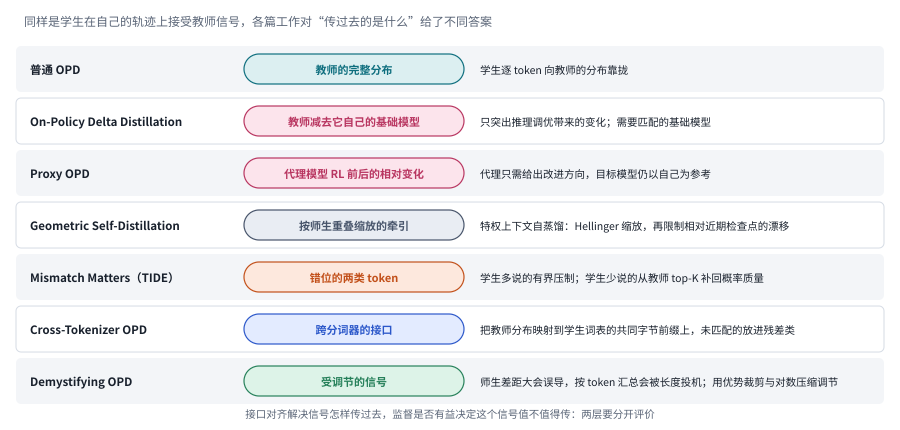

*图：七行对应本分支七篇工作，中间的胶囊写着每篇工作传过去的是什么，右边一句话说它怎样做到；底部是接口与内容两层要求的区分。*

图中间那一列胶囊回答的就是本分支标题里的问题；最上面一行是普通的在策略蒸馏，后面几行各改一处。

既然教师的分布大多继承自它的基础模型，就可以只传推理训练带来的那部分变化。一个经过推理训练的教师，它的分布里大部分东西其实来自它的基础模型，只有一小部分是推理训练带来的。**[On-Policy Delta Distillation](https://arxiv.org/abs/2607.15161)，`2607.15161`** 用教师和它自己训练前的基础模型在对数概率上的差当作蒸馏信号，只传这部分变化，不让学生去复制教师从基础模型继承来的那些行为。前提是手里要有教师训练前的那个版本；而且这份差异里也可能夹带着风格、长度和错误偏好，把它称作提纯过的"推理能力"并不严谨。[Proxy OPD](https://arxiv.org/abs/2607.11505) 更进一步，先用奖励训练一个代理模型，提取它训练前后的分布变化，再把这个变化方向施加到目标学生自己的轨迹上。这样代理模型只需要提供一个有用的改进方向，不必比学生更强，较旧或较弱的代理也能用。

即使传的是完整分布，师生之间的错位也会让逐 token 的一致和整体正确脱节。**[Mismatch Matters: On-Policy Distillation Beyond Token Agreement](https://arxiv.org/abs/2608.09836)，`2608.09836`** 发现了一种失败：学生陷进重复循环，每个 token 都和教师高度一致，整个回答却是错的。作者把师生不一致的 token 分成两类。一类是学生写了、教师几乎不会写的，按第 5 阶段的算法，这类 token 的惩罚会无限变大，让更新失控，他们给它加了上限。另一类是教师很想写、学生却很少采到的，在策略蒸馏只在学生写下的 token 上计算，这类 token 永远采不到也就永远教不到，他们直接把教师概率最高的几个候选注入目标。这正好补充了 Thinking Machines 的判断：反向 KL 低对应好行为，前提是学生采到了足够多样的状态。[Demystifying On-Policy Distillation](https://arxiv.org/abs/2607.13399) 指出另外两种病：师生差距太大时，教师信号和任务正确性对不上；逐 token 的目标累加起来，又让学生可以靠截短或拉长回答来钻空子。它的补法是裁剪优势、把信号取对数压缩。

教师多看了一份信息时，它的自信学生接不住，硬拉反而让学生变差。[Geometric Self-Distillation](https://arxiv.org/abs/2607.06855) 研究的是自蒸馏：教师和学生是同一个模型，只是教师额外看到了提示或完整解答。教师因此对一些后续很有把握，学生却还没有理由这么写；师生分歧越大的地方牵引越强，多轮更新累积下来，学生在没见过的题上反而变差。它按学生和教师分布已有的重叠程度来调节牵引，学生接不住的地方少拉一点，并限制学生的预测相对最近一个检查点漂移多远。

前面几种做法都假定师生能在同一个 token 上比较概率，分词器不同时，连这个接口都对不上。在策略蒸馏要求师生用同一套分词器，才能在同一个 token 上比较概率。[Cross-Tokenizer On-Policy Distillation](https://arxiv.org/abs/2607.22334) 把教师对下一个 token 的分布换算到字节层面，再映射到学生的词表上，让不同模型家族之间也能蒸馏。接口对齐和监督内容有益是两层要求，前者解决信号怎样传过去，后者决定这个信号值不值得传。

### 分支6：教师是否可靠，应该按模型、题目还是具体状态判断？

教师可不可靠，要按题目和状态来判断，光看模型名字不够。在策略蒸馏默认教师在学生走到的每个状态上都可靠，可一个总体成绩很高的教师，也可能在某道题、某个工具状态下出错；学生的轨迹越偏，越可能走进教师也没见过的地方。反向 KL 又让学生集中到教师最认可的做法上，所以一个很自信的错误教师会带来很强的错误更新。可靠性因此要看这道题教师会不会做、这个状态下它的建议有没有依据、结果能不能验证。研究怎样筛选教师信号时，要同时看两种代价：错信了教师的代价，和拒绝了有效指导的损失。

> 主线位置：第 5 阶段。接 DAgger"专家在学生状态上给指导"的前提，也回应 Thinking Machines 方法中默认教师在学生状态上可靠的假设。

> **要点：** 怎样判断教师这一次的指导靠不靠得住？可以按题目、按 token、按状态三种粒度来判断，粒度越细，检查越花钱。教师比学生弱，或者教师多看了一份参考答案时，还要追问它到底给学生添了什么。

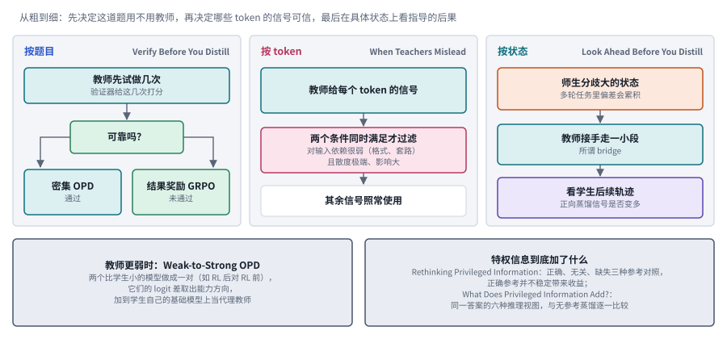

*图：上排三列从粗到细：按题目门控、按 token 过滤、按状态前瞻；下排两个框是教师更弱和特权信息两种特殊情形。*

最粗的一层按题目判断：先让教师试做，做对了才让它教。**[Verify Before You Distill: Prompt-Level Teacher Gating for On-Policy Distillation](https://arxiv.org/abs/2609.02998)，`2609.02998`** 在蒸馏之前，先让教师把这道题试做几次，用验证器检查对错。教师做得可靠，这道题就走在策略蒸馏；不可靠，就退回按结果打分的 GRPO。它反对把教师的置信度、师生之间的一致程度当作正确性，因为这些量只说明教师有多确定，说明不了它对不对。代价是要多跑一轮试做，而且门控依赖验证器，在没有明确答案的开放写作里没法照搬。

细一层按 token 判断，过滤掉那些只是出于语言习惯的教师信号。[When Teachers Mislead](https://arxiv.org/abs/2608.03632) 注意到，教师在某个位置上的判断，可能只是出于语言习惯、格式惯例或套路化的推理模板，和这道题的具体内容关系不大。这类信号对更新影响很大，对解题却没什么帮助。它估计每个信号对输入内容的依赖程度，只过滤那些既不怎么依赖输入、又和学生分歧极大的信号，其余照常使用。

最细的一层按状态判断，用后果来检验教师的指导。多轮任务里学生的偏差会逐步累积，把轨迹带到教师指导不再有效的地方。[Look Ahead Before You Distill](https://arxiv.org/abs/2608.01953) 在师生分歧大的状态上让教师接手走一小段，再让学生接着往下走，看这一小段是否让学生后面的轨迹变得更好，用后果来检验指导值不值得学。

教师比学生弱时，也未必没有用处。[Weak-to-Strong On-Policy Distillation](https://arxiv.org/abs/2607.26246) 拿两个都比学生小的模型做一组对比，比如一个经过强化学习的专家和它训练前的版本，两者的差就是强化学习教会的那项能力的方向。把这个方向加到学生自己的基础模型上，得到一个代理教师，它带着这项能力，又和学生的分布离得很近，学生再向它蒸馏。

教师多看了一份参考答案时，分数的提高大多来自蒸馏本身，参考添的东西不多。[Rethinking Privileged Information](https://arxiv.org/abs/2608.18271) 用正确参考、无关参考和不给参考三种条件做对照，发现正确参考并没有稳定地带来好处，学生不看正确参考也能进步，换成另一道题的解答有时反而更好。[What Does Privileged Information Add?](https://arxiv.org/abs/2609.20612) 构造了同一答案的六种推理写法，逐一和不给参考的蒸馏比较，发现大部分提升来自蒸馏本身，参考带来的额外好处不大，而且随学生的设置变化。两篇的共同结论是，仅凭"加了参考之后分数提高"，断定不了知识从参考转移到了学生身上，提升也可能只是唤起了学生本来就有的推理行为。

### 分支7：没有更强教师时，自蒸馏和多教师整合能做什么？

在前沿找不到比学生更强的教师时，有自蒸馏和多教师两条出路。在策略蒸馏通常要一个比学生更强的教师，可在前沿，找不到更大的模型当教师。一种出路是自蒸馏：同一个模型在不同条件下表现不同，多采几次、看到一份参考、多想一会儿，都可能让它写得更好，于是让条件更好的那个自己去教条件差的那个。另一种出路是多教师：先分领域训出几个专家，再合进一个学生，这就是第 6 阶段说的 2026 年前沿配方。两种出路都要回答，改进信号到底从哪里来，以及有没有保留一道独立的检查，防止系统把自己的偏好反复强化成看似稳定的"知识"。

> 主线位置：第 5 阶段。接 Thinking Machines 的自蒸馏实验（用强化学习训练过的模型当教师，教一个新的基础模型）和"学新东西、再用蒸馏找回旧行为"的持续学习设想。

> **要点：** 找不到更强的教师，信号从哪里来？一条路是让模型自己当教师，信号来自它多次回答的一致性，最怕的是共同的错误被反复强化；另一条路是先训出几个领域专家再合进一个学生，难点在谁来教、教多重、预算怎么分，三件事要分别检查。

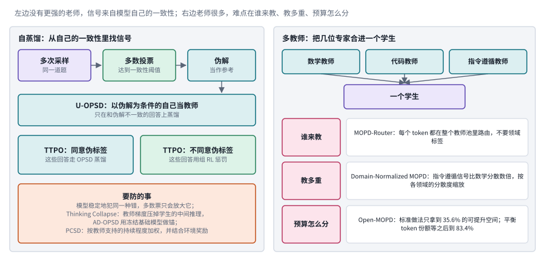

*图：左边是自蒸馏：从多次采样的多数票里得到伪解，再按与伪解是否一致决定怎样更新，底部是要防的几种失效；右边是多教师：几位领域教师合进一个学生，分成谁来教、教多重、预算怎么分三个问题。*

最激进的自蒸馏连标签都不要。**[On-Policy Self-Distillation without Any Supervision](https://arxiv.org/abs/2608.06296)，`2608.06296`** 让模型对一道题多答几次，如果多数回答得出同一个答案、且占比超过一个门槛，就把它当作伪解。然后让模型看着这个伪解当教师，只在那些和伪解不一致的回答上做蒸馏，纠正模型自信地答错的地方。它省掉了外部标签，也就没有了外部真值：如果模型稳定地犯同一种错，多数投票只会把错误放大。[TTPO](https://arxiv.org/abs/2608.27448) 观察到一个不对称：和伪解不一致的回答，不管投票本身对不对，通常都是错的。于是它对两类回答区别对待，和伪解一致的拿去蒸馏，不一致的用组内比较的强化学习惩罚，这样即使投票常常出错，更新也不会被带偏太多。

自蒸馏还有一种失败是把模型想问题的过程压没了。[Diagnosing and Mitigating Thinking Collapse](https://arxiv.org/abs/2607.10805) 发现，在复杂推理上做在策略自蒸馏，模型原本的中间推理，比如"等等，这里可能不对"这类表示犹豫和检查的词，会急剧减少，成绩反而下降。原因在学生最犹豫的那些分叉点上，教师的梯度很猛，把学生的犹豫词压成了教师那种直接下结论的写法。它的补法是在这些高风险的位置上，让学生向冻结的基础模型看齐。[PCSD](https://arxiv.org/abs/2608.01837) 处理的是教师信号的噪声：它只信任在一小段连续位置里都持续支持某个方向的教师信号，单个位置上的孤立差异权重放低，再和环境奖励一起优化。

多教师整合远不止把几个分布平均一下。**[Open-MOPD: Diagnosing and Fixing Capability Imbalance in Multi-Teacher On-Policy Distillation](https://arxiv.org/abs/2608.19098)，`2608.19098`** 在每道题该听哪位教师都已知的设置下做实验，发现标准做法只拿回了专家组合理论上能提供的提升的 35.6%，指令遵循这类回答短的任务退化最严重。原因不在梯度冲突，在于逐 token 的优化预算分配失衡：数学回答长，token 多，自然占了大头；各领域收敛速度不同；异步更新又让信号过时。[Domain-Normalized Multi-Teacher On-Policy Distillation](https://arxiv.org/abs/2609.35347) 在 Qwen3.5 上看到的失衡方向不同，指令遵循的反馈比数学的分散好几倍，反而主导了学生的更新，它按各领域反馈的分散程度做缩放。**[MOPD-Router: Rethinking Teacher Routing in Multi-Teacher On-Policy Distillation](https://arxiv.org/abs/2609.30837)，`2609.30837`** 回答的是另一个问题：通常每道题整条轨迹只听一位领域教师，它改成在每个 token 上从全部教师里挑，挑那位此刻的纠正最能体现它专长的教师，这样不需要领域标签，也能用上跨领域的互补。这三篇分别回答"每位教师的影响有多大"和"此刻该听哪位教师"，路由选对了，梯度份额也未必合理，所以两个问题要分别做消融。

### 分支8：交互蒸馏怎样分配轨迹预算与监督来源？

交互蒸馏的预算要花在真正提供监督的那几步上，可截得太狠，学生又学不到恢复和收尾。在策略蒸馏的主要成本是学生自己一步步生成轨迹，多轮 agent 任务里这笔开销更大。可轨迹里并非每一步都在提供有效的监督：重复的内容、失效的工具调用和明显偏离任务的尾巴，可能吃掉大部分预算；截断得太早，模型又学不到怎样从错误中恢复、怎样收尾。这一分支先讨论在哪里停下、从哪里重启、各回合怎样分配损失，再讨论监督能不能来自语言教师以外的地方。预算控制和信号构造要放在一起评价，平均轨迹变短了，说明不了学习更有效了。

> 主线位置：第 5 阶段与第 6 阶段的交汇处。接 DAgger 在学生状态上收集指导的思路、Thinking Machines 用部分轨迹节省算力的做法，以及 Lambert 对长回合成本的估算。

> **要点：** 学生自己生成长轨迹很贵，预算该花在哪里？轨迹里并非每一步都在提供有效监督。几种做法分别在教师的认可掉下去的地方停下、从较弱的正确回合重新开始、按回合分配损失、让教师适时退出；它们要和监督来源的扩展一起评价。

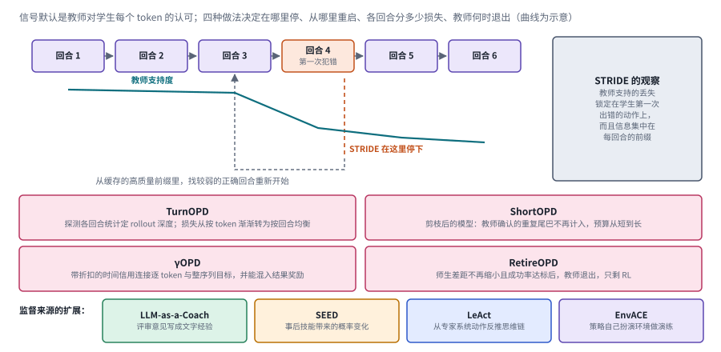

*图：上方是一条六回合的轨迹和教师支持度曲线（示意），橙色虚线是 STRIDE 停下的位置，虚线箭头是重启的位置；中间四个框是其余几种预算控制；底部是超出语言教师的四种监督来源。*

教师的认可在学生第一次做错时骤然掉下去，所以轨迹可以在那里停下，再从做对的地方重启，图上方的曲线画的就是这一观察。**[Know When to Stop, Where to Restart: Accelerating Multi-Turn Agentic On-Policy Distillation](https://arxiv.org/abs/2609.14636)，`2609.14636`**（STRIDE）在多轮客服类任务上发现，教师对学生的认可度不随回合慢慢下降，它在学生第一次做错动作的那一刻骤然掉下去，图里第 4 回合的那个下跌就是这样。既然如此，轨迹在这之后的部分已经偏离，再生成下去多半是浪费。它在教师认可度累计跌破一个门槛时提前停下，同时把质量高的前缀缓存起来，下一次从其中最薄弱的那个正确回合重新开始生成。回到开头修 bug 的例子，这相当于在小模型第一次打开错误文件的那一刻停下，再从它上一次做对的地方重新出发，把教师的注意力集中在真正出岔子的地方。作者报告，它在达到完整轨迹蒸馏同等效果时快了 3.73 倍。局限在于，教师认可度仍然只是一个代理，缓存的前缀也可能限制后面的探索，别的任务是否有同样的时间结构，要逐一检查。

其余几种预算控制都在决定把有限的生成和损失花在轨迹的哪一段，图中间四个框就是它们，差别在控制的对象：每次跑多深、各回合分多少损失，哪一段尾巴不算数，功劳怎样往前传，以及教师什么时候退出。[TurnOPD](https://arxiv.org/abs/2607.05804) 发现两个浪费：完整跑完的轨迹，尾部那些回合提供的监督又弱又吵；按整条轨迹算的损失，大部分落在前面几个回合的 token 上，后面的关键决策反而没练到。它用试探得到的回合统计决定每次跑多深，并逐步把损失从按 token 平均改成各回合平均分配。**[ShortOPD](https://arxiv.org/abs/2607.13124)** 处理的是剪枝压缩之后的模型：压缩后的模型在自由生成时经常陷入重复的尾巴，它用压缩前的模型当教师，识别出教师也确认是重复的那段尾巴，只把前面的有效部分算作轨迹长度，再按学生当前能用的长度从短到长分配预算。这套针对重复退化的规则，不宜直接搬到需要长时间探索的任务上。[Reward-Compatible Temporal Credit Assignment](https://arxiv.org/abs/2609.16937) （图里的 γOPD）讨论的是第 5 阶段那个"每个 token 只为自己负责"的设定：它让每个 token 也带一点后面 token 的得失，按距离逐渐打折，在只看眼前的稳定和看长远的准确之间取折中，还把可验证的结果奖励掺了进来。[RetireOPD](https://arxiv.org/abs/2609.20784) 让教师适时退出：学生和教师的差距不再缩小、成功率又达到教师的一定比例时，学生就丢掉教师，只用强化学习继续训练。

监督也可以不来自一个更强的语言模型，图底部四个框就是这样的四种来源：评审的文字意见、策略对自己轨迹的事后总结、不写理由的专家系统，以及策略自己扮演的环境。**[LLM-as-a-Coach: Experiential Learning for Non-Verifiable Tasks](https://arxiv.org/abs/2607.18110)，`2607.18110`** 面向没有标准答案的开放任务。通常评审模型的意见会被压成一个分数，"哪里不好、该怎样改"的信息就丢了；它让评审把意见写成可以迁移的文字经验，交给一个教师模型当上下文，学生再通过在策略蒸馏把这些经验内化进参数。作者报告这样比按评分标准打分的强化学习泛化更好，也更不容易钻奖励的空子；不过教练本身也可能给出不靠谱的建议，反馈写得更详细，未必就更准确。[SEED](https://arxiv.org/abs/2607.14777) 让策略自己分析刚完成的轨迹，总结出可复用的做法或要避开的坑，写成文字技能；再比较带不带这些技能时策略对同一动作的概率，把这个差当成逐 token 的蒸馏信号。[LeAct](https://arxiv.org/abs/2607.21856) 从游戏引擎、经典规划器这类专家系统里取监督，它们给出近乎最优的动作，却不写理由；学生为每个专家动作试写几段推理，只留下能让它自己更容易推出这个动作的那些，再拿留下的推理去训练学生（最后这一步是按摘要的推断）。[EnvACE](https://arxiv.org/abs/2608.06197) 要省掉一部分真实环境交互，前提是策略自己能写出工具调用会得到的返回。它让策略在训练时交替扮演两个角色，先发出工具调用，再扮演环境写出这个调用的返回，两者一起按任务成败优化，策略于是把动作和环境返回之间的关系学进了参数。这几项工作扩大了可用信号的范围，也让"信号是否真实"成了一项新的约束：动作能复现，说明不了生成的推理就是专家真实的思考过程，自己扮演的环境也需要外部检查。

## 四、跨方法对照：相同分数背后可能是不同问题

把主线和八个分支连起来看，结果奖励、价值估计和教师指导提供的是粒度不同的学习信号，主线上每一次"做减法"或"做加法"，都是在这几种信号之间重新取舍。选择方法时，需要同时考虑信号是否可靠、学生会走到哪些状态、获得反馈要花多少成本，一次训练结束后的总分只是其中一个参考。下表把各类方法的信号、关键假设和主要代价并排放在一起，读新论文时可以先找到它属于哪一行，再看它改动了哪一个假设。

> **本节要点：** 第二节的总对照按主线上的五族比较，这张表把前沿分支里出现的方法族也加了进来，按信号、关键假设和代价各写一行；矩阵图把八个分支放回主线的各个阶段。

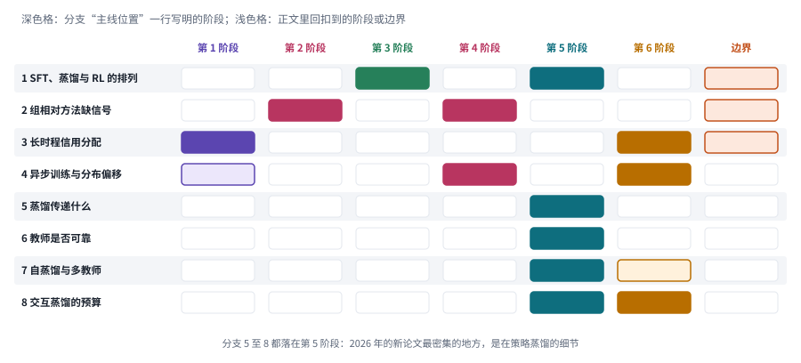

*图：八个前沿分支在六个阶段和边界上的位置。深色格是分支“主线位置”一行写明的阶段，浅色格是正文里回扣到的阶段或边界。*

矩阵里最密的是第 5 阶段那一列，分支 5 到分支 8 全落在这里，2026 年新论文最集中的地方就是在策略蒸馏的种种细节；前四个分支分散在第 1 到第 4 阶段，分别回头修补训练顺序、组内比较、价值模型和异步训练。

| 方法族 | 信号 | 关键假设 | 成本与主要局限 |
|---|---|---|---|
| SFT | 示范token | 示范可靠且覆盖部署状态 | 教师数据成本；离开示范分布后易失效 |
| 组相对RL | 同题样本奖励差 | 奖励有区分度、结果可信 | 多次采样；全对全错组弱信号 |
| critic型RL | 价值估计与结果奖励 | critic能分辨中间状态 | 价值训练成本；偏差与扁平化 |
| 异步与复用 | 旧策略轨迹加偏移修正 | 概率记录可靠、偏移可控 | 系统复杂；吞吐未必等于学习效率 |
| 普通OPD | 学生状态上的教师分布 | 教师在这些状态可靠 | 教师推理与概率接口；长度或一致性投机 |
| 相对更新蒸馏 | 教师或代理训练前后差异 | 差异代表可迁移改进 | 额外参照模型；变化不全是有益能力 |
| 自蒸馏 | 参考条件、反思或内部一致性 | 伪信号与真实质量相关 | 共同错误、自我强化、推理坍缩 |
| 多教师与阶段组合 | 路由、归一化、阶段切换 | 任务互补且预算分配合理 | 多模型成本；路由与梯度份额双重失衡 |

## 五、结果解释：能力增量、信号质量与真实成本

报告里的提升到底是什么提升，没法靠一次榜单回答，读完这些论文最后总会落到这个问题上。对着奖励模型优化过头时，代理分数一路上涨，真实目标却会掉头向下；RLVR 模型在采样次数少时领先，采样足够多时基础模型反而能解出更多题。

> **本节要点：** 能力增量、密集与稀疏信号的取舍、效率的计量单位，以及从数学推理到 agent 的外推，是解释本章任何一个结果时都要过的四道关。

能力增量是最典型的一例，要回答"强化学习是在创造新能力，还是只在提高已有解法的概率"，需要固定解码预算，检查训练前那些低概率的成功，追踪新策略能否迁移到别的任务，并排除测试集污染。在策略蒸馏也一样：学生在某项分数上超过了教师，可能来自学生自己已有的能力和教师局部指导的结合，由此推断教师传授了学生完全没有的知识，证据并不充分。

密集信号是否一定优于稀疏信号，同样没有统一的答案。Thinking Machines 展示了密集信号在效率上的巨大优势，可错误的密集监督也可能系统性地破坏探索；可靠却稀疏的结果奖励，又可能贵得用不起。混合方案多出了门控、权重和切换时机这些自由度，所以要报告这些选择是在哪个验证集上定下来的，否则方法越复杂，越容易把额外的调参预算当成算法本身的优势。

效率该用什么单位来算，同样有争议，所以最好同时给出成本的分解。训练步数、token 数、教师算力、环境执行次数和实际耗时是五种不同的东西。多教师方法可能用更少的梯度步换来更多的模型推理；单轨迹方法可能省了采样却增加了价值模型的开销；提前终止可能降低了成本，却漏掉了后期的恢复行为。成本分解之外，还要给出固定预算下的能力曲线，只报最有利的那一列，读者很难判断方法的真实价值。

最后，数学推理上的成功不会自动外推成 agent 训练的成功。Lambert 估算过，长程任务的回合可能比数学题长上千倍，奖励也更稀疏、更难定义。交互任务里还有环境反馈、权限、会变化的状态和不可逆的动作，训练还要处理观察遮罩、回合边界、工具版本和停止条件。把答题的字符串拉长，并不会自然得到一个长时程决策实验。上面这些研究，都应该先按它们原本的任务领域来理解，再有控制地迁移到别处。

## 六、研究机会

开头那个在仓库里修 bug 的小模型，面临的困难可以拆成三件事，正好对应主线上的三个阶段：最后那个"测试过没过"太稀疏，告诉不了它哪一步做对了；教它的教师未必在每个状态下都靠谱，它也未必接得住教师的全部做法；而要让它在成千上万个仓库里大规模地练，采样和训练就得异步起来，训练分布又会悄悄偏移。这三件事分别对应主线上第 6 阶段的信用问题、第 5 阶段的蒸馏问题和第 4 阶段的规模化问题。

> **本节要点：** 三个研究机会依次对应第 6 阶段的信用问题、第 5 阶段的蒸馏问题和第 4 阶段的规模化问题，也就是总对照矩阵里最密集的那几列。

**1. 如何为缺少标准答案的长程任务提供有效的学习信号？**

这里的研究空间在于设计一种把结果、状态变化和中间证据结合起来的信用分配机制，让有用的探索和恢复动作得到合理的反馈。这样的机制之所以难设计，是因为真实交互里的成功往往延迟出现，还同时包含好几个不能相互抵消的约束，比如修好 bug 的同时不能改坏别的测试、不能删掉测试、改动要尽量小。难点是一边要减少对完整参考答案和昂贵价值模型的依赖，一边又要防止局部奖励把策略引向容易得分、却偏离真实目标的行为。过程奖励模型在主线上的起伏、分支 3 对价值模型的重新审视，以及 Lilian Weng 关于奖励作弊的提醒，都是这个问题的不同侧面。

**2. 如何让监督来源随状态与学生能力变化，不再固定依赖一个教师？**

监督来源应当随状态和学生能力变化，因为教师整体更强，说明不了它的每一次指导都可靠，也说明不了学生能吸收它的全部行为。回到修 bug 的例子，强模型习惯的那套排查顺序，未必适合一个上下文更短、工具用得更笨拙的小模型。研究机会在于把几件事放在一起决定：什么时候请求监督，采用哪一种信息，怎样验证这次指导的后果，以及什么时候让蒸馏退出。实验时，最好专门在教师出错、接口不一致、学生已经超过教师这几种条件下测试，看学习收益究竟来自真正的能力转移，还是来自额外的信息或更多的推理预算。

**3. 如何把长轨迹训练扩展到真实执行规模，并保持更新有效？**

长轨迹训练扩展到真实规模后，异步环境、策略滞后、上下文压缩和任务难度差异会共同影响训练分布。可以研究训练算法和执行系统的联合设计，让高吞吐不必以失真的监督和不稳定的更新为代价。Lambert 估算的那种百万 token 级别的回合一旦成为现实，这个问题只会更尖锐。评价时，应当把环境调用、模型计算和失败重试统一算进成本，并在没见过的任务上检查能力能否保持、能否长期泛化。

**实验资源：** [verl官方仓库](https://github.com/volcengine/verl) · [Agent Lightning官方仓库](https://github.com/microsoft/agent-lightning)。使用前核对任务、版本、数据与运行条件。
