# 08｜协作：怎样让人与多个智能体真正一起把事做好

[首页](../../README.md) · [专题索引](../../README.md#topics) · [文献目录](../../catalog/08_collaboration.md)

## 方向背景：为什么需要人机协作与多智能体组织

手边有一个很能干的 agent 时，多开几个分头干活，看上去能省下不少时间。设想组会前一周，导师交给你两件事：一是整理一份某个新方向的文献综述，二是把实验仓库里一个牵涉好几个模块的 bug 修掉。综述这件事，让三个 agent 分别去查三条线索，各自读完再交回一份摘要，听上去顺理成章；修 bug 这件事，让一个 agent 改数据加载、另一个改训练循环、第三个补测试，似乎也能省下不少时间。

真正跑起来，两件事的结局往往很不一样。查文献的那组 agent 大概率会交回一份覆盖面更广的材料，偶尔有重复，汇总时删掉就好。改代码的那组却常常出事：改数据加载的那位把字段名改成了小写，改训练循环的那位还在按旧字段读取，补测试的那位又按自己的理解写了一套期望行为。三份修改单看都说得通，合在一起却跑不起来，最后还得由一个人从头读一遍，把这些各自暗中做下的决定对齐。下图把两组的结局并排画出：左边三位成员交回的书单合在一起，只有一篇论文重复，删掉就好；右边三位成员的改动各带着一个橙色框里的决定，合并运行时，训练循环找不到大写的字段，测试又在等全大写的字段，两处同时报错。

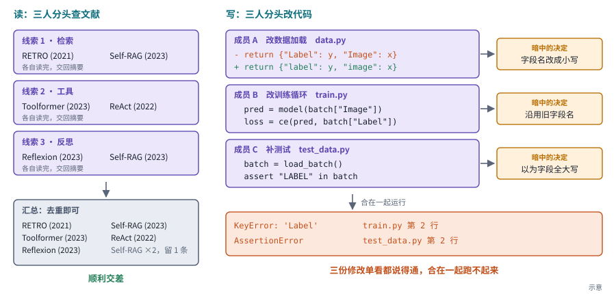

*图：同一种分工放在读和写上的不同结局。代码和书单都是示意。*

两组结局不同，原因在于工作的性质。查文献是读：三条线索彼此独立，一位成员读到什么，不会改变另一位该读什么。改代码是写：每一处修改都带着一个别人看不见的决定，比如字段名用大写还是小写，这些决定只要有一处冲突，整体就坏了。所以分工带来的并行和专长是真实的，它同时引入的交接、协调和错误传播成本也是真实的。哪些工作适合拆开，拆开以后各自看到什么、能改什么，分歧出现时谁说了算，成果最后由谁来验收，这几件事得一起设计。

分工、交接和验收这几件事，在人和 agent 之间同样要设计，所以本章把人机协作和多智能体系统放在一起讲：两者面对的是同一个局面：知识、能力和决策权分散在几个参与者手里，单个参与者做不好这件事。人机协作更关心人在什么时候介入、介入要花人多少精力，多智能体系统更关心执行单元之间怎样分工和通信。评价任何一种协作设计，都要同时看三笔账：结果质量，所有成员合计花了多少计算，以及出了问题能不能追到是哪一步、哪一位的责任。

## 先读这几篇

这一章的主线借自几篇写得很好的工程长文。其中两篇在 2025 年 6 月同一周发布，标题针锋相对，一篇讲怎样搭多智能体系统，一篇劝人别搭；后面几篇记录了业界在争论中怎样慢慢收敛。按下面的顺序读，基本能复原这场讨论的来龙去脉。

| 顺序 | 文章 | 为什么读 |
|---|---|---|
| 1 | Anthropic（Jeremy Hadfield、Barry Zhang 等），[How we built our multi-agent research system](https://www.anthropic.com/engineering/multi-agent-research-system)（2025-06） | 支持多智能体一方最有分量的一篇。作者讲的是 Claude 的 Research 功能：一个主研究员 agent 先做计划，再并行派出多个子 agent 去搜索，最后汇总结果，并由一个单独的引用 agent 把结论对回来源。在内部研究评测上，Opus 4 做主 agent、Sonnet 4 做子 agent 的组合比单个 Opus 4 高出 90.2%。作者也说清了收益从哪里来：在 BrowseComp 上，token 用量一项就解释了约 80% 的表现差异，多智能体有效，主要是因为它让系统花够了解决问题所需的 token，代价是约为普通对话 15 倍的消耗。读完能带走一套关于委派、预算和评测的实用原则，以及对多智能体在什么任务上划算的判断。|
| 2 | Walden Yan（Cognition），[Don't Build Multi-Agents](https://cognition.com/blog/dont-build-multi-agents)（2025-06） | 反方的代表作，比 Anthropic 那篇早一天发布。作者认为，决定每一步让模型看到哪些信息，也就是他所说的上下文工程，是构建 agent 的工程师的头号工作。他提出两条原则：子 agent 之间要共享完整的执行过程，单传几条消息不够；每个动作都带着隐含的决定，决定一旦冲突，结果就会变坏。文中的 Flappy Bird 例子很好记：两个子 agent 分头做背景和小鸟，一个做出了马里奥风格的背景，另一个做出的小鸟样子和动作都不像 Flappy Bird 里的那只。他由此主张默认使用单线程的线性 agent，上下文太长时再用专门的模型压缩历史。|
| 3 | Harrison Chase（LangChain），[How and when to build multi-agent systems](https://www.langchain.com/blog/how-and-when-to-build-multi-agent-systems)（2025-06） | 前两篇发布几天后的一篇调和之作，篇幅不长，把争论的焦点说得最透。作者指出两篇有共识：给子 agent 恰当的上下文是最难的部分；读操作天然比写操作更容易并行。Anthropic 的系统让子 agent 只做检索，最终报告仍由一个 agent 写，正好符合这一点。本章主线里“读可以并行、写需要共享上下文”这条区分就出自这篇。|
| 4 | Cara Phillips 等（Anthropic），[When to use multi-agent systems (and when not to)](https://www.claude.com/blog/building-multi-agent-systems-when-and-how-to-use-them)（2026-01） | 一年半之后的总结性指南，立场比 2025 年那篇克制。作者认为大多数工作流用单个 agent 就能处理好，多智能体通常要多花 3 到 10 倍 token，只在三种情况下稳定有用：保护上下文不被无关信息污染，并行覆盖更大的搜索空间，以及工具或角色需要专门化。最有价值的是两个判断：拆分工作要以上下文边界为准，按“写功能、写测试、做审查”这样的问题类型拆分，会像传话游戏一样一层层失真；验证子 agent 好用，是因为验证几乎不需要转交上下文。|
| 5 | Walden Yan（Cognition），[Multi-Agents: What's Actually Working](https://cognition.com/blog/multi-agents-working)（2026-04） | 反方作者十个月后的更新，适合和第 2 篇对照着读。他承认一类窄一些的多智能体结构已经在生产中跑通了，共同点是写操作仍然只由一个 agent 做，新增的 agent 只贡献判断，不贡献动作。他讲了三种模式：编码 agent 和不共享上下文的审查 agent 来回迭代；便宜的主模型遇到难题时去请教更强的模型；管理者 agent 把大任务拆成小块分给子 agent 各做一块，再把结果汇总，由管理者看汇总决定下一步。他对无结构的 agent 群体协商依然不看好，并说剩下的开放问题全都是通信问题。|

如果还想多读一点，Anthropic 在 2024 年底写的 [Building effective agents](https://www.anthropic.com/engineering/building-effective-agents) 给这个领域提供了一套通用词汇，提示链、路由、并行（分段与投票）、协调者与工作者、评估者与优化者这些模式名称后来成了行业通用语。Google Research 2026 年 1 月的博客 [Towards a science of scaling agent systems](https://research.google/blog/towards-a-science-of-scaling-agent-systems-when-and-why-agent-systems-work/) 是一项规模研究的通俗版，几张图把“什么任务该多开 agent、什么任务不该多开”讲得很直观。

## 一、先看全景：把“团队”拆成可以观察的设计

> **要点：** 一支由人和 agent 组成的团队，可以拆成同一组零件：谁分工，每位成员看到什么、能改什么，信息怎样交换，产物怎样合并，谁来验收，过程有没有留下记录。评价团队时，要把结果质量、等待时间和总计算成本分开算，还要分清“几个成员各做各的再挑一份”和“成员交流之后改变了彼此的行动”，只有后者才是协作本身在起作用。

agent 团队里的每个零件，在一次课程小组作业里都找得到对应。组长把题目拆成几块分给组员，组员各自去查、去写，中途在群里交换进展，最后有人把各部分拼成一份报告，再交给老师打分。小组做得好不好，取决于每个人拿到了哪些材料、谁能改哪份文件、拼接时冲突怎么解决、打分的人是不是独立于写的人。

和小组作业不同，agent 团队每多一位成员都要多付一笔计算，所以评价时要把质量、等待时间和总计算分开算。一个 agent 是一段围绕目标反复调用大模型、执行工具、读取结果的程序，模型每读写一段文本都按 token 计费，token 是模型切分和计量文本的单位。所以一次任务背后是很多次模型调用，多加一位成员，就多出一串调用。几位成员同时工作，用户等待的时间可能缩短，所有成员合计消耗的计算却往往增加；Anthropic 2026 年的指南说得很直白，并行的主要好处是查得更全，速度倒在其次。因此本章总把这三件事分开说。如果还不熟悉大模型调用，可以先读[大模型基础](../../docs/llm_primer.md)。

下图把小组作业的零件画成一条从左到右的流程，并把开头修 bug 的例子填进每个零件。人把目标“修好训练崩溃”和权限交给协调者，协调者按上下文边界把任务拆开，数据加载、训练循环和测试各归一位成员；每位成员框里写着它看到哪些文件、能用什么工具、被允许改什么、实际改了什么。成员通过中间灰色的共享状态交换消息、目录、进度和证据，比如 A 留言说字段名改成了小写；产物汇到合并这一步，再交给独立的一方跑测试验收，全过就交付，有失败就退回重做。

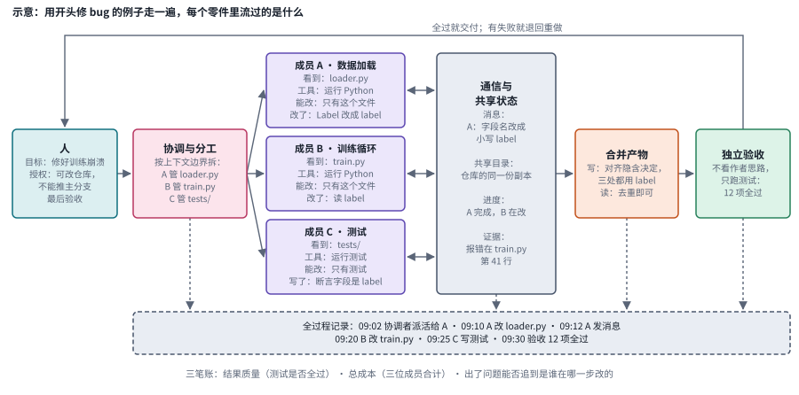

*图：协作系统的基本结构，用修 bug 的例子填上了每个零件的内容。蓝绿色是人，粉色是协调与分工，紫色是执行成员，灰色是共享状态与记录，橙色是最容易出冲突的合并环节，绿色是验收。文件名、时间和测试数都是示意。*

图里有三处细节决定了团队能不能做对，正文还没有交代：成员框里的上下文、工具和权限，橙色的合并框，以及最底下的全过程记录。第一处是成员框里的上下文、工具和权限：一位成员能做对什么，取决于它看到了什么、能调用什么、被允许改什么，“该不该多开 agent”的争论，归根到底是在争这三样东西怎样分配。第二处是橙色合并框里的两行字。查文献的那组 agent 走到这里只需去重，因为它们做的是读；改代码的那组走到这里要把每个人暗中定下的字段名、接口和期望行为对齐，因为它们做的是写。第三处是最底下的全过程记录：任务分配、消息、文件修改、工具调用和验收结果都写进去，事后才能核对实际发生的和设计的是否一致，出了问题也才能追到责任。

图里绿色的验收框要真正起作用，验收者得掌握写作者没有的信息。三个角色如果读的是同一份草稿、用的是同一个模型，它们的意见高度相关，加起来仍然只相当于一份证据。审稿者要能访问原始来源、独立做检查，或者运行一套和写作者不同的验证过程，它的赞同才有分量。Cognition 2026 年的文章报告过一个现象：他们的代码审查 agent 恰恰在完全不共享编码者上下文、只看代码改动的时候效果最好，因为它没有继承编码者的思路，才看得见编码者看不见的 bug。

验收者之外，其余成员之间怎样连起来，最常见的三种组织方式各有一个长处和一个代价。流水线让检索、写作、审查依次交接，每一棒只看到上一棒交过来的产物，所以容易追踪，可检索漏掉的来源，写作和审查都无从知道。协调者与工作者的方式里，一个协调者把能拆开的任务并行派给几位工作者，再汇总结果，适合不同主题的独立检索；派发和汇总都经过协调者，它一旦拆错或者忙不过来，所有工作者都跟着受影响。共享工作区没有中心，成员围着一块任务板自己认领、互相交换发现，探索起来最灵活，代价是谁也不负责叫停，两位成员同时认领同一件事也要靠规则处理。[AutoGen](https://arxiv.org/abs/2308.08155) 与 [MetaGPT](https://arxiv.org/abs/2308.00352) 是用程序编排对话和用标准流程约束分工这两类框架的经典入口。

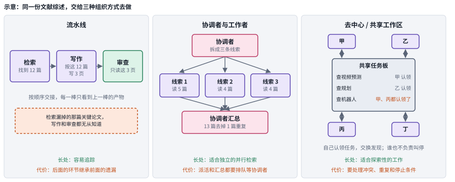

*图：同一份文献综述交给三种组织方式去做。左栏检索漏掉的论文一路传下去；中栏三条线索并行，汇总时去掉重复；右栏两位成员认领了同一项任务。每栏底部绿色一行是它的长处，橙色一行是它要付出的代价。篇数和分工都是示意。*

选定了组织方式，运行时是否照着做，还要用完整的事件记录去核对。一张组织图只说明了谁能和谁通信；每次发什么、什么时候发、对方怎样解释，要另有约定；这些约定在运行时是否真的被执行，又是另一回事。比如写作者声称“已经交给审稿者”，系统里却没有强制的检查步骤，运行就可能在这里直接结束，审稿从未发生。所以任务分配、消息、文件修改、工具调用和验收记录最好完整保留下来，用实际发生的事件去核对设计。

最后要分清并行尝试和协作：成员各做各的再挑一份是多次尝试，成员共享发现并据此改变后续行动才是协作。让五个 agent 各自回答同一个问题，再挑出最好的一份，成员之间没有交流。挑选本身有几种机制，证据强度依次增加：多数投票只看哪个答案出现得最多；模型裁判（LLM-as-a-Judge）让另一个模型按标准评估各份输出，可它可能和答题者犯同样的错；代码验证器直接运行可以执行的检查，可测试也可能只覆盖一部分要求。要判断一个系统属于哪一种，最直接的办法是把成员之间的消息删掉或者打乱：结果几乎不变，说明交流没有起作用。评价一个团队时，至少要拿它和单个强 agent、花同样预算做独立尝试的方案放在一起比，否则分不清收益来自交流，还是仅仅来自更多的计算。

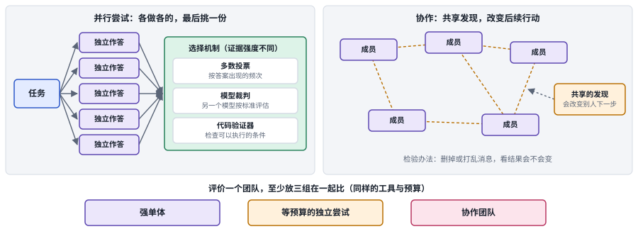

*图：左边是并行尝试，成员之间没有连线，靠右侧的选择机制挑出一份；右边是协作，虚线代表共享的发现，它会改变别的成员下一步做什么；底部是评价团队时至少要放在一起的三组对照。*

## 二、发展主线：从角色扮演到按上下文分工

多智能体这几年的历史，可以读成一段先放开、再收紧、最后找到边界的过程。2023 年模型第一次强到能扮演像样的角色，大家热衷于给模型分配岗位、让它们彼此对话；2024 年有人开始追问，多出来的收益到底来自协作，还是来自更多的计算；2025 年，生产系统的作者们就“该不该多开 agent”正面交锋；2026 年，争论收敛成一组更精细的原则。这条线的骨架取自 Cognition 的两篇文章，中间填进 Anthropic 的两篇、Harrison Chase 的调和文章，以及学界同期的失败分析和规模研究。

> **要点：** 多个 agent 一起干活，什么时候真的比一个强？主线用三年回答了这个问题，每个阶段都在回答上一阶段留下的问题：先让几个模型分角色对话，却没人管误解和验收；再把多算几遍的功劳和交流的功劳分开；接着生产中的争论把问题落到读和写的区别上；随后有了系统的失败记录和规模实验；最后收敛成三条原则：拆开的两边几乎不用互相交代信息，写东西只留一个负责人，检查交给没参与写作的一方。

| 阶段 | 内容 | 代表工作 | 本章对应分支 | 速查卡 |
|---|---|---|---|---|
| 前史 | 人机互补：最准的模型未必是最好的队友 | Is the Most Accurate AI the Best Teammate? | 三.6 | |
| 第一阶段（2023） | 角色扮演与对话式团队 | CAMEL、Generative Agents、多智能体辩论、ChatDev、AutoGen、MetaGPT | 三.1、三.5 | C1 至 C6 |
| 第二阶段（2024） | 冷静下来：收益来自协作还是来自更多计算 | More Agents Is All You Need、Rethinking the Bounds、Building effective agents | 三.2 | B1 至 B4 |
| 第三阶段（2025） | 生产中的正面争论：读多写少，上下文为王 | Anthropic Research 系统、Don't Build Multi-Agents、How and when to build | 三.1、三.4 | P1 至 P3 |
| 第四阶段（2025 至 2026） | 失败与规模的科学 | MAST、Towards a Science of Scaling Agent Systems | 三.2、三.3 | |
| 第五阶段（2026） | 收敛：按上下文切分，写操作单线程，独立验证 | When to use multi-agent systems、Multi-Agents: What's Actually Working | 三.1、三.7 | W1 至 W4 |
| 边界 | 人在哪里，长期团队怎样留下可信记录 | 工作流级人机协作、可追溯日志 | 三.5、三.6、三.7 | |

把代表工作按月排开，能看出这段历史的节奏。下图按阶段分行，按 arXiv 编号或文章发布时间排列：2023 年短短半年里，让几个模型分角色对话的各种做法几乎同时出现；2025 年 6 月同一周里冒出三篇针锋相对又互相调和的文章；失败分析和规模研究一前一后夹住了这场争论；2026 年的两篇总结之后，第三节收录的前沿论文集中在 7 月到 9 月。

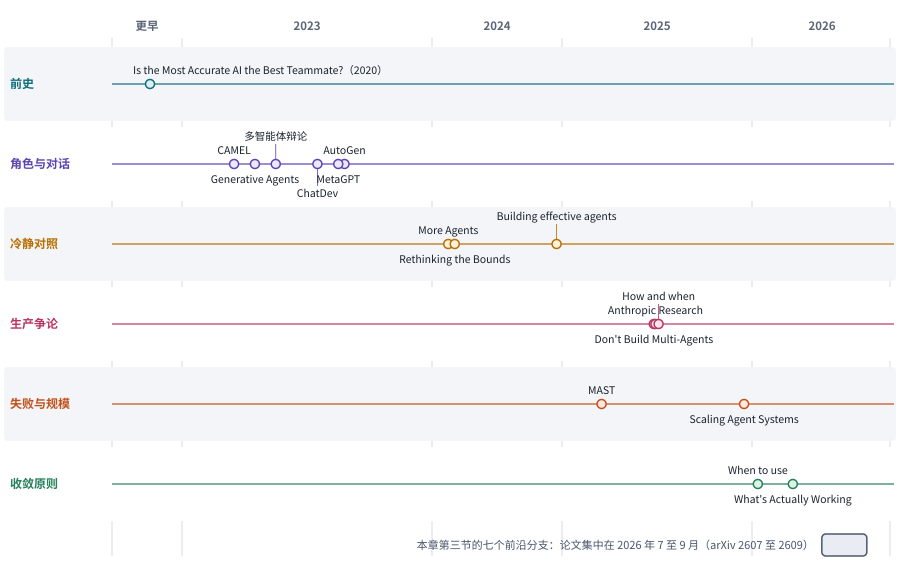

*图：主线上的代表工作按阶段分行排开。2020 年的团队效用研究压在“更早”一栏；最下方的灰色条标出第三节前沿论文所在的时间段。*

### 前史：最准的模型，未必是最好的队友

> **要点：** 协作最早是人和一个模型之间的事。2020 年的一篇论文指出，挑 AI 队友要看人和 AI 合起来的决策结果，AI 单独的准确率说明不了这一点；这个朴素的起点，后来被多智能体研究反复重新发现。

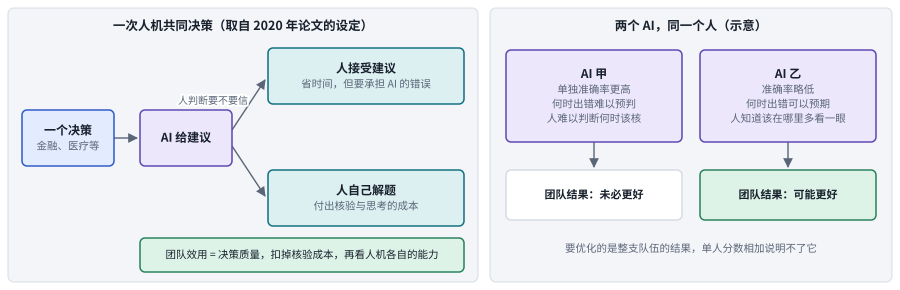

*图：左边是论文里的人机决策设定，AI 给建议，人决定接受还是自己解题，团队效用把决策质量、核验成本和双方能力放在一起算；右边是一个示意对比，更准却难以预判的 AI 甲，和略不准却出错可预期的 AI 乙。*

在大模型会写代码、会调工具之前，协作首先是人机共同决策的问题，结果取决于人能不能预判 AI 什么时候会错。设想一个金融或医疗场景里的判断：AI 先给出建议，人再决定接受它，还是自己核实、自己解题。接受能省时间，却要一并承担 AI 的错；自己解题更可靠，却要付出思考和核验的成本。人每次都在这两条路之间权衡，所以真正决定结果的，是 AI 错在哪些样本上、人能不能预判它什么时候会错，以及核实一条建议要花多少成本。

把这个权衡算成一笔账，更准的 AI 未必是更好的队友。2020 年的 [Is the Most Accurate AI the Best Teammate?](https://arxiv.org/abs/2004.13102) 把它写成了团队效用：最终决策的质量、人核验的成本、人和 AI 各自的能力，放进同一笔账。按这笔账算，一个更准、却让人难以判断它何时出错的 AI，未必带来更好的团队结果，所以作者主张训练 AI 时直接优化团队效用：训练目标从 AI 单独答对多少，换成整支队伍的期望效用，人接受建议时 AI 的对错、人自己解题时付出的核验成本都按这笔账计分，作者在真实的高风险决策数据集上用线性和非线性模型做了检验。图右半边是本章画的一个示意：AI 甲单独测准确率更高，可它的错误没有规律，人只好在信与不信之间摇摆；AI 乙准确率略低，但出错的地方有规律，人知道该在哪里多看一眼，整支队伍的结果反而可能更好。

这篇论文给后来的协作研究定下了一个起点：挑选成员时，要优化的是大家一起完成任务的结果，每位成员的独立分数加起来说明不了这件事。论文算的是一次建议被接受或被核验的账，它留下的问题是，团队效用在一整段工作流里怎样衡量。

### 第一阶段：给模型分角色，让它们聊起来

> **要点：** 2023 年，模型第一次强到可以扮演像样的角色，研究者很快把几个模型放在一起，让每个模型扮演一个角色、靠对话推进任务。这一阶段的做法都是这个思路，差别只在团队交出的是什么：有的交出一段对话或一个答案，有的交出一份能运行的软件。这些框架让搭建团队变得具体可行，可误解怎样澄清、错误怎样拦住、产物由谁验收，这几件事还没人管。

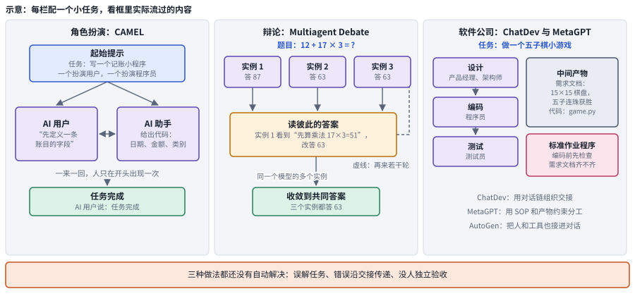

*图：第一阶段三种代表做法。左栏是 CAMEL 的角色扮演，中栏是多实例辩论，右栏是 ChatDev 与 MetaGPT 的“软件公司”；底部橙色条是三者共同留下的问题。每栏的小任务和框里的内容都是示意。*

这一阶段最早的两项工作让扮演角色的模型自己把任务往前推，人不用每一步都给指令。3 月的 [CAMEL](https://arxiv.org/abs/2303.17760) 用一段起始提示一次性设定好两个角色和任务，一个模型扮演提需求的用户，一个扮演给方案的助手；之后 AI 用户提出下一步指令，AI 助手给出解法，两者一来一回，人只在开头出现一次。4 月的 [Generative Agents](https://arxiv.org/abs/2304.03442) 把规模放大到一个类似模拟人生的小镇：每个 agent 把看到的事写进记忆，定期从记忆里反思出更高层的看法，再据此计划一天的行动，一群这样的 agent 展现出相当可信的社会行为。

另一条思路想用交流提高答案质量。5 月的 [Improving Factuality and Reasoning in Language Models through Multiagent Debate](https://arxiv.org/abs/2305.14325) 让同一个模型的几个实例先各自作答，再读彼此的答案、提出反驳、修改自己的回答，重复若干轮后收敛到一个共同答案，报告了推理和事实性上的提升。这里的成员都是同一个模型的实例，它们的错误可能高度相关，这一点当时还没有人仔细追问。

接着，团队被用来干正经活，也就是交出一份能运行的软件。这几项工作都让扮演不同岗位的模型分工开发，差别在于岗位之间怎样交接：靠对话，靠规定好的文档，还是靠程序写死的流程。7 月的 [ChatDev](https://arxiv.org/abs/2307.07924) 让扮演产品、程序员、测试等岗位的 agent 按设计、编码、测试的阶段，用自然语言对话完成一个软件。[MetaGPT](https://arxiv.org/abs/2308.00352) 同样以软件开发为场景，它发现单靠对话交接容易走样，于是把人类团队的标准作业程序写进提示，规定每一棒要交出需求文档、设计文档或代码这样的中间产物，下一棒先检查上一棒的产物再动手。[AutoGen](https://arxiv.org/abs/2308.08155) 则提供一个框架，让模型、工具和人都作为能对话的参与者，用程序把协作流程写出来。这几套框架让搭建协作系统这件事变得具体可行。

这些框架共同留下的问题是产物没有人单独验收，这一点从结构卡上看得最清楚。下面六张卡用同一种画法，从左往右是一轮流程，底部的虚线是绕回去的那条路。前三张卡的成员都在说话，后三张卡的成员开始动手，做出的是一份软件；而这份软件交给谁验收，六张卡里都没有单独画出来。几个角色在写同一份产物，误解和错误会沿着交接往后传，又没有独立的一方在最后拦住它们。

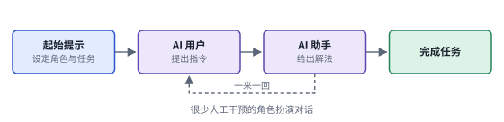 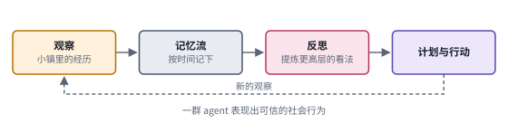

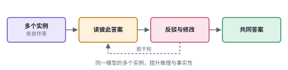 

 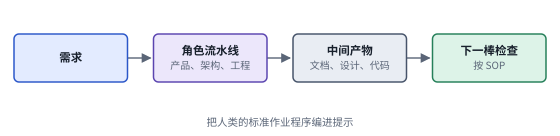

*图：第一阶段六种做法的结构卡，每张卡对应下表的一行。*

| code | 名称 | 年份 | 代表 | 怎么做 | 解决了什么 | 代价 |
|---|---|---|---|---|---|---|
| C1 | 角色扮演对话 | 2023 | [CAMEL](https://arxiv.org/abs/2303.17760) | 用起始提示设定两个角色和任务，AI 用户提出指令，AI 助手给出解法，一来一回推进 | 在很少人工干预的情况下让两个模型自己把任务往前推，第一次把“多个模型对话”做成了可以研究的设置 | 两个角色读的是同一段对话，提供不了彼此独立的证据；流程里没有单独的验收环节 |
| C2 | 模拟社会 | 2023 | [Generative Agents](https://arxiv.org/abs/2304.03442) | 每个 agent 把观察写进记忆流，定期反思出更高层的看法，再据此计划和行动 | 一群 agent 展现出相当可信的社会行为，成为模拟用户与群体研究的源头 | 看起来可信的行为，和真实人群的行为分布之间还隔着校准与验证（三.5） |
| C3 | 多实例辩论 | 2023 | [Multiagent Debate](https://arxiv.org/abs/2305.14325) | 同一模型的多个实例各自作答，再读彼此的答案、反驳并修改若干轮，收敛到共同答案 | 不改模型，单靠交流就报告了推理与事实性上的提升 | 调用次数成倍增加；成员来自同一个模型，可能共享同一个盲点，收益有多少来自交流本身，要靠等预算对照来回答 |
| C4 | 对话链软件团队 | 2023 | [ChatDev](https://arxiv.org/abs/2307.07924) | 扮演不同岗位的 agent 按设计、编码、测试的阶段，用自然语言对话完成软件 | 把“团队”用到了真实的软件开发上，每个阶段谁和谁聊什么都被规定下来 | 多个角色在写同一份软件，误解和错误会沿着对话链往后传 |
| C5 | 可编程对话 | 2023 | [AutoGen](https://arxiv.org/abs/2308.08155) | 模型、工具和人都作为可对话的参与者，协作流程用程序写出来 | 让协作流程可以被显式组织，人也能作为参与者接进来 | 框架只提供组织手段，误解、错误传递和验证缺位仍要由搭建者自己设计机制处理 |
| C6 | SOP 与中间产物 | 2023 | [MetaGPT](https://arxiv.org/abs/2308.00352) | 把标准作业程序编进提示，角色按流水线交付需求、设计和代码等中间产物，下一棒先检查上一棒 | 用流程和产物规范约束分工，让交接有据可查 | 流水线里每一棒只看到上一棒的产物，前面漏掉的东西后面无从知道；SOP 需要为每类任务事先写好 |

### 第二阶段：冷静下来，收益到底从哪里来

> **要点：** 几个模型讨论出的好结果，有多少真是讨论的功劳？2024 年的几篇工作发现，很多收益单靠让同一个模型多答几次再投票、或者把单个模型的提示写好就能拿到。这一阶段留下的是一种比较办法，让团队和单个模型花同样多的计算再比，以及工程上“先从最简单的方案开始”的建议。

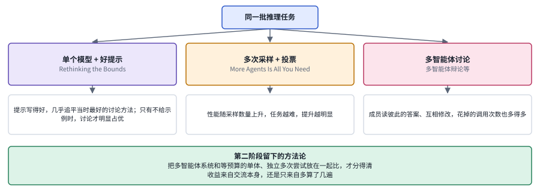

*图：同一批推理任务交给三种做法，下方白框是这一阶段两篇论文报告的结论；底部绿色框是这一阶段留下的方法论。*

辩论带来的提升，有一部分单靠多算几遍就能拿到。几个实例互相读答案、修改若干轮，调用次数成倍增加，提升究竟来自交流本身，还是来自多算了好几遍？2 月的 [More Agents Is All You Need](https://arxiv.org/abs/2402.05120) 用一个极简的办法试了试：同一个模型对同一问题采样多次，再按多数投票选答案，成员之间完全不交流。结果性能随采样次数增加而上升，任务越难，提升越明显。这个结果本身是正面的，可它说明收益完全可以不靠交流得到。

换一个方向追问，讨论的收益有很多也可能只是因为单个模型的提示没写好。同月的 [Rethinking the Bounds of LLM Reasoning: Are Multi-Agent Discussions the Key?](https://arxiv.org/abs/2402.18272) 检验了这一点，作者在大量推理任务和多种基座模型上比较后发现，提示写得好的单个模型几乎能追平当时最好的多智能体讨论方法，只有在提示里不给示例时，讨论才明显占优。

两篇论文合起来立下了一条规矩：只有超出好提示和多次投票的那部分收益，才算交流的功劳。上图把它们放进同一个实验框架，同一批任务分成三条路：单个模型把提示写好；同一个模型采样很多次再投票；多个 agent 读彼此的答案、互相修改。第三条路和前两条的差别在于成员之间有交流，可它同时也多花了大量调用。所以只有超出前两条路的那部分，才算得上交流的功劳。此后任何多智能体系统要证明自己，都得和花同样预算的单个 agent、独立多次尝试放在一起比。

拿一道算术题来算这笔账，就能看出为什么非比不可。下图左栏，同一个模型答 5 次，答错的两次被多数票压了下去；中栏，三个实例第一轮各有对错，读过彼此的答案后，第二轮都改成了 391，前后共调用 6 次；右栏把这 6 次全给单个模型去采样，多数票同样得到 391。在这道题上，辩论没有超出等预算的投票，也就拿不出交流本身有功的证据。

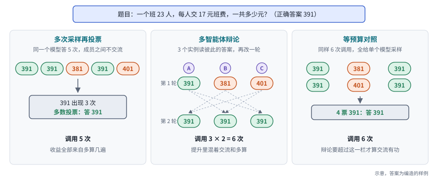

*图：同一道题交给多次采样投票、多智能体辩论和等预算对照。答案是编出来的样例，只用来说明怎样算账。*

工程侧在同年 12 月得出了相近的建议：先从最简单的方案开始。Anthropic 的 [Building effective agents](https://www.anthropic.com/engineering/building-effective-agents) 把常见做法整理成几种可组合的模式，其中“协调者与工作者”和“评估者与优化者”后来成了多智能体系统最常见的两种骨架；文章反复强调，只在复杂度能被证明带来更好结果时才往上加。

这一阶段的四张卡里，成员之间要么没有交流，要么交流都经过一个固定的中枢。前两张是两项对照研究，成员之间没有交流；后两张是 Building effective agents 里的两种模式，中枢分别是协调者和评估者。

 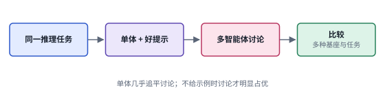

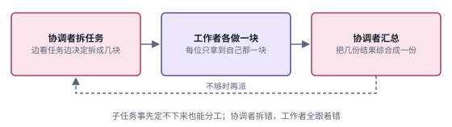 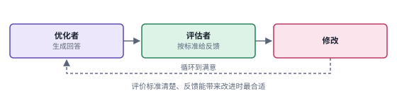

*图：第二阶段四种做法的结构卡，每张卡对应下表的一行。*

| code | 名称 | 年份 | 代表 | 怎么做 | 解决了什么 | 代价 |
|---|---|---|---|---|---|---|
| B1 | 采样与投票 | 2024 | [More Agents Is All You Need](https://arxiv.org/abs/2402.05120) | 同一个模型对同一问题采样多次，再按多数投票选出答案 | 用极简办法让性能随数量上升，任务越难提升越明显；也给后来的研究立下了“多算几遍”这条必须超过的基线 | 成员之间没有任何交流，所得收益全部来自更多的计算 |
| B2 | 等预算对照 | 2024 | [Rethinking the Bounds of LLM Reasoning](https://arxiv.org/abs/2402.18272) | 在大量推理任务和多种基座模型上，把提示写得好的单个模型和多智能体讨论放在一起比 | 说明很多讨论带来的收益单体也能拿到，只有不给示例时讨论才明显占优，从而把“交流的功劳”和“提示的功劳”分开 | 结论限于它覆盖的推理任务和当时的讨论方法 |
| B3 | 协调者与工作者 | 2024 | [Building effective agents](https://www.anthropic.com/engineering/building-effective-agents) | 协调者动态拆分任务，派给工作者各做一块，再由协调者汇总 | 子任务无法事先确定时也能分工，后来成为多智能体系统最常见的骨架之一 | 拆分和汇总都压在协调者身上，它拆错了，所有工作者都会跟着做错 |
| B4 | 评估者与优化者 | 2024 | [Building effective agents](https://www.anthropic.com/engineering/building-effective-agents) | 一个模型生成回答，另一个按标准给出反馈，循环修改到满意 | 评价标准清楚、反馈能带来改进时，可以一轮轮把结果改好 | 评估者如果是相似的模型、和生成者犯同样的错，循环只会把错误改得更像样 |

### 第三阶段：一周之内的两篇文章

> **要点：** 到了 2025 年，多开 agent 值不值得，在工程界成了公开的争论：同一周里，一篇文章介绍了一个已经上线的多 agent 研究系统，另一篇劝人别搭。几天后有人指出，两边的分歧落在任务性质上：读资料可以分头并行，写代码需要共享前面定下的决定。“该不该多开 agent”从此变成了“哪些工作适合拆开”。

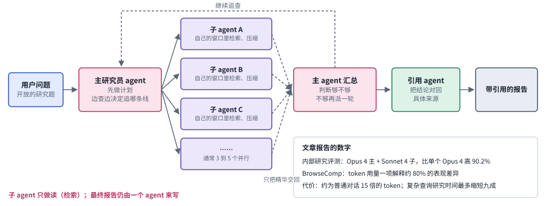

*图：Anthropic Research 系统的一次运行，从左往右读，用一个关于世界模型的研究问题走一遍。子 agent 各自在自己的上下文窗口里检索和压缩，只把精华交回；顶上的虚线表示主 agent 觉得不够时会再派一轮；右下角是文章报告的几个数字。问题、篇数和行数都是示意。*

Anthropic 那篇说明，开放的研究问题适合让多个子 agent 并行去读，代价是很多 token。文章讲的是 Claude 的 Research 功能。研究类问题天然是开放的，查到一半才知道下一步该追哪条线索，事先没法把步骤写死。所以他们让一个主 agent 边查边决定方向，并行派出三到五个子 agent，每个子 agent 拿到一个方向，在自己的上下文窗口里检索、读材料、压缩，只把精华交回来；主 agent 汇总后判断够不够，不够再派一轮，够了就由它自己写报告，再交给一个引用 agent 把每条结论对回具体来源。这样做，复杂查询的研究时间最多缩短了九成。作者也把账算得很清楚：多智能体有效，主要是因为它让系统花够了 token，代价大约是普通对话的 15 倍，只有高价值的任务才值得。文章还划出了不适合的场景：凡是 agent 之间要共享大量上下文、彼此依赖很多的领域都不合适，作者举的例子正是编程，大部分编程任务里真正能并行的部分远少于研究。

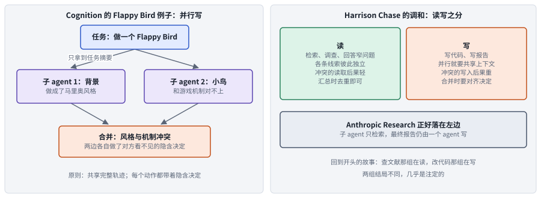

*图：左边是 Cognition 文中的 Flappy Bird 例子，两个子 agent 只拿到任务摘要，分头写出彼此冲突的部分；右边是 Harrison Chase 的调和，按读和写把任务分成两类。*

Cognition 那篇从编程这一侧出发，得出了相反的建议：默认只用一个 agent 按顺序做到底。Walden Yan 认为 agent 可不可靠，取决于每一步让模型看到了哪些信息，他称之为上下文工程，并用一个例子说明多智能体结构为什么会破坏它。任务是做一个 Flappy Bird，主 agent 把它拆成两块：一块是带绿色水管的滚动背景，一块是能上下飞的小鸟，分给两个子 agent。结果一个做出了马里奥风格的背景，另一个做出的小鸟样子和动作都不像 Flappy Bird 里的那只，最后合并的 agent 只能收拾这两处误会。把原始任务完整抄给每个子 agent 也不够，因为真实任务往往经过多轮对话和工具调用，前面已经定下的细节会影响后面怎样理解。由此他提出第一条原则：子 agent 之间要共享完整的执行过程。可即使共享了，并行的子 agent 仍可能各自假定一种画风，小鸟和背景还是对不上，因为每个动作都带着一个隐含的决定，别人看不见。这是第二条原则：隐含的决定一旦冲突，结果就会变坏。两条原则合起来，就是他主张单线程的理由。他还提到 Claude Code 自己也会派生子 agent，但只让它们回答范围很窄的问题，不和主 agent 并行写代码，价值在于把调查过程挡在主 agent 的历史之外。

把 Flappy Bird 的例子画出来，问题出在哪里就一目了然。主 agent 交给子 agent 的只有左边两句摘要，两个子 agent 各自补全了摘要里没写的画风：一个交回马里奥风格的背景，一个交回一只看起来不像游戏素材的鸟。两个部件各自都符合摘要，拼进同一帧却对不上，也不像右下角 Flappy Bird 里那只圆滚滚、扑翅上下飞的鸟。

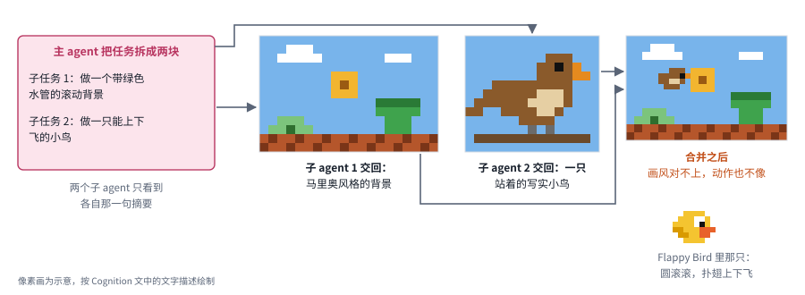

*图：Cognition 文中的 Flappy Bird 例子。像素画为示意，按文中的文字描述绘制。*

几天后，Harrison Chase 指出这两篇没有表面上那么对立，分歧来自任务性质：读容易并行，写需要共享上下文。两边都把“给子 agent 恰当的上下文”当作最难的事。读操作天然容易并行，各条线索彼此独立，读到冲突的材料后果也轻，汇总时去重即可；写操作要并行，就得在成员之间传递上下文、合并冲突的产出，而冲突的写入通常比冲突的读取后果严重得多。Anthropic 的系统让子 agent 只做检索，最终报告由一个 agent 写，恰好落在读的一侧；Cognition 关心的编程，大部分落在写的一侧。所以两篇其实都对。这也解释了组会前一周那两组 agent：分头查文献的一组做的是读，顺利交差；分头改代码的一组做的是写，字段名的改动彼此看不见，合在一起就跑不起来。

这场争论里被具体描述过的三种生产架构，差别只在同一时刻有几个 agent 在干活。它们都是真实上线的 agent 系统：P1 让多个子 agent 同时去读，P2 自始至终只有一个 agent，P3 介于两者之间，子 agent 存在，但只回答窄问题、不和主 agent 同时工作。

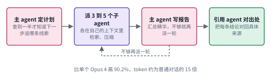 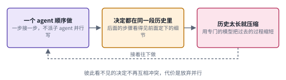

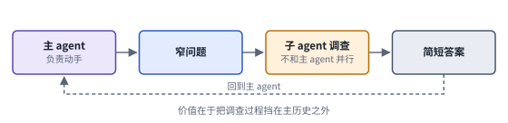

*图：第三阶段三种生产架构的结构卡，每张卡对应下表的一行。*

| code | 名称 | 年份 | 代表 | 怎么做 | 解决了什么 | 代价 |
|---|---|---|---|---|---|---|
| P1 | 编排式研究系统 | 2025 | [How we built our multi-agent research system](https://www.anthropic.com/engineering/multi-agent-research-system) | 主 agent 做计划，并行派出三到五个子 agent 各自检索、压缩，再汇总写报告，由引用 agent 把结论对回来源 | 开放的研究题可以边查边决定；内部研究评测上比单个 Opus 4 高 90.2%，复杂查询的研究时间最多缩短九成 | 约为普通对话 15 倍的 token；不适合 agent 之间要共享大量上下文的领域，例如大部分编程任务 |
| P2 | 单线程线性 agent | 2025 | [Don't Build Multi-Agents](https://cognition.com/blog/dont-build-multi-agents) | 默认只用一个 agent 按顺序做到底，共享完整执行过程；上下文太长时，用专门的模型压缩历史 | 所有决定都在同一段上下文里，避免了彼此看不见的隐含决定互相冲突 | 放弃了并行带来的覆盖面和速度；压缩历史时可能丢掉后面用得上的细节 |
| P3 | 窄问题子 agent | 2025 | Claude Code（见 [Don't Build Multi-Agents](https://cognition.com/blog/dont-build-multi-agents) 中的描述） | 主 agent 把范围很窄的问题交给子 agent 调查，子 agent 不和主 agent 并行，很少动手写代码 | 把调查过程挡在主 agent 的历史之外，主线上下文保持干净 | 子 agent 只能回答窄问题，换不来并行写带来的速度 |

### 第四阶段：把失败和规模变成可以测量的东西

> **要点：** 多 agent 系统到底在哪里出错，多开 agent 的收益又取决于什么？工程争论靠的是几个例子，学界在差不多同时给出了两类系统证据：一类从上千条执行记录里把出错的地方归成三大类十四种；另一类在控制条件下比较五种组织方式，发现收益几乎完全取决于任务能不能拆成并行的几块。

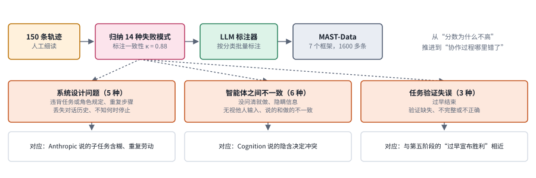

*图：上排是 MAST 的建立过程，从人工细读轨迹到自动标注；下排是三大类失败及其包含的模式，最底下一行把第三阶段两篇工程文章里的观察放进对应的类别。*

工程文章靠的是几个例子，失败分类 MAST 则从上千条轨迹里回答了多智能体系统在哪一步失败。只看最终得分看不出这一点，所以 2025 年 3 月伯克利等机构的 [Why Do Multi-Agent LLM Systems Fail?](https://arxiv.org/abs/2503.13657) 于是去读执行过程本身。研究者先人工细读 150 条执行轨迹，归纳出 14 种失败模式，并检查不同标注者能否给出一致的标签，一致性 Cohen's kappa 达到 0.88，说明类别定义得足够清楚；随后搭了一个由大模型当评判的标注器，把同一套分类交给它批量标注，作者报告它和人工标注的一致性很高，得到覆盖 7 个流行框架、1600 多条轨迹的数据。这套分类叫 MAST，14 种模式归成三大类。第一类是系统设计问题，有 5 种，包括违背任务或角色规定、重复步骤、丢失对话历史和不知道何时停止。第二类是智能体之间的不一致，有 6 种，例如没问清就动手、隐瞒信息、无视别人的输入，以及推理和行动对不上。第三类是任务验证失误，有 3 种，即过早结束、验证缺失或不完整，以及验证本身出错。用这套分类回看工程文章，Cognition 说的隐含决定冲突大致落在第二类，Anthropic 说的子任务描述含糊导致子 agent 重复劳动落在第一类。

把这套分类套到组会前一周那组改代码的 agent 上，就能看到标签是怎样贴上去的。下图是一段示意的运行记录：成员 A 没确认字段名就动手改，成员 B 没读 A 的消息，都属于第二类；成员 C 去改了不归它管的数据加载，属于第一类的违背角色规定；审查者只读了一遍就放行，协调者随即结束运行，分别落在第三类的验证缺失和过早结束上。同一次失败往往同时贴着好几类标签，这也是只看最终得分说不清失败原因的地方。

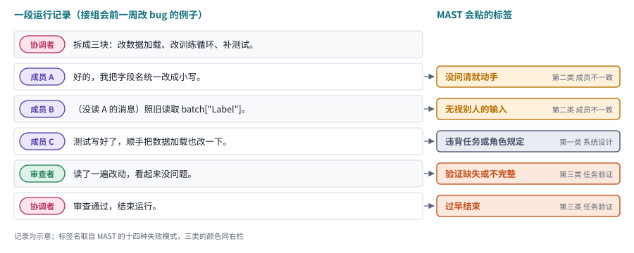

*图：一段多智能体运行记录和 MAST 会给它贴的标签。记录是示意，标签名取自 MAST 的十四种失败模式。*

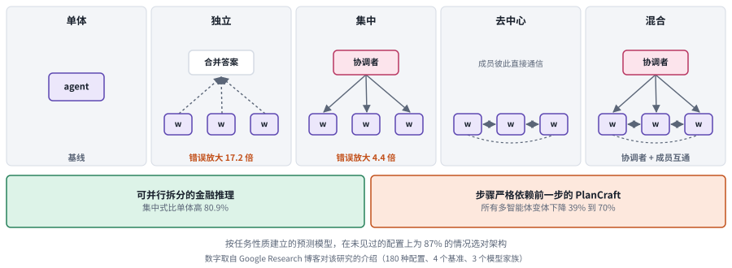

*图：规模研究比较的五种架构，从单体到混合；下方两个框是最能说明“任务结构决定成败”的一正一反两个结果。图中数字取自 Google Research 博客。*

失败分类回答了在哪里出错，规模研究回答的是多开 agent 的收益取决于什么，答案几乎完全是任务能不能并行拆分。[Towards a Science of Scaling Agent Systems](https://arxiv.org/abs/2512.08296) 在固定工具、提示和计算的条件下，比较了五种架构：单体只有一个 agent；独立结构里几个工作者各做各的，最后只合并答案；集中结构多一个协调者负责派发和汇总；去中心结构没有协调者，工作者彼此直接通信；混合结构两者都有。按 Google Research 博客的介绍，研究覆盖了 180 种配置、4 个基准和 3 个模型家族。结果呈现出鲜明的反差：在可以并行拆分的金融推理任务上，集中结构比单体高出 80.9%；在每一步都严格依赖上一步的 PlanCraft 上，所有多智能体变体都下降了 39% 到 70%。错误传播也取决于有没有关口：独立工作的多智能体系统会把错误放大 17.2 倍，有协调者的结构只放大 4.4 倍，因为协调者在汇总时顺便起到了检查的作用。作者用任务性质建立的预测模型，在没见过的任务配置上为 87% 的情况选对了架构。这类结果支持“按任务结构选架构”的思路，可它给不出适用于所有场景的固定人数或组织规则。还要注意，论文在 arXiv 上的摘要报告的是扩展后的 260 种配置和 6 个基准，金融推理与顺序规划两端的数字为提升 80.8% 和下降 70.0%，和博客略有出入，引用具体数字时以论文版本为准。

### 第五阶段：收敛成几条可操作的原则

> **要点：** 争论到 2026 年有了什么结论？双方的立场明显靠近，共识可以压缩成三条：拆开的两边几乎不用互相交代信息，写东西只留一个负责人，检查交给没参与写作的一方。真正在生产里跑通的几种结构，都是让新增的 agent 只出判断，不动手写。

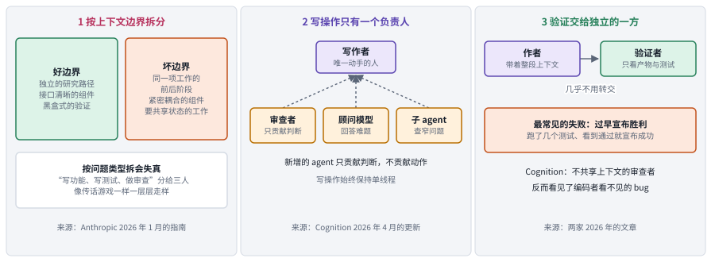

*图：2026 年两篇总结文章收敛出的三条原则。每栏底部注明主要出处。*

第一条原则来自 Anthropic 2026 年 1 月的指南：确实要加 agent 时，按上下文边界切分。这份指南的话比 2025 年保守许多：多数工作流一个 agent 就够，先试试压缩上下文和按需加载工具，确实碰到上下文装不下、需要并行或需要专门化的硬约束时再加 agent。好的边界是拆开之后两边几乎不需要互相交代什么，比如彼此独立的研究路径、接口清晰的组件、只看产物、不看写作过程的验证；坏的边界是每次交接都要转交大量上下文，比如同一项工作的前后阶段、紧密耦合的组件、需要共享状态的工作。指南里最反直觉的一点是，按“写功能、写测试、做审查”这样的问题类型分工，听上去很像人类团队，实际却会像传话游戏一样一层层走样，因为每一棒都只拿到上一棒转述的上下文。这几乎是对 Cognition 两条原则的正面回应：共享完整执行过程很贵，那就把边界划在不需要共享的地方。

按这条标准，验证是天然适合拆出去的一类工作，因为验证者只需要看产物和测试，几乎不需要作者转交上下文，也因此不会继承作者的思路。指南同时指出了验证子 agent 最常见的失败，叫作“过早宣布胜利”：跑了几个测试、看到通过就宣布成功。

第二条原则来自反方作者 4 月的更新：写操作仍由一个 agent 做，额外的 agent 只贡献判断。Walden Yan 认为他的旧判断对并行写依然成立，但这样一类更窄的结构已经跑通。效果最好的是独立审查，Cognition 的审查 agent 不共享编码者的上下文，只看代码改动，平均每个 PR 能找出约 2 个 bug，其中约 58% 属于严重问题。另一种叫能力路由，让便宜的快模型动手、遇到难题时去请教强模型，效果却不理想，原因是弱模型不太知道该在什么时候求助、该问什么。他明确说，剩下的开放问题全都是通信问题。

把这一阶段的共识合起来，就是图上三栏：按上下文边界拆分，让写操作有唯一的负责人，把验证交给一个不受原作者上下文影响的独立方。中栏画出了第二条在实践中的样子：紫色的写作者是唯一动手的成员，审查者、顾问模型和查窄问题的子 agent 都只沿着虚线向它提供判断。

下面四张卡的共同点是紫色的动手者始终只有一个，新增的成员要么只给意见，要么只做检查。前三张是 Cognition 2026 年文中描述的三种模式，第四张是 Anthropic 指南推荐的验证子 agent。

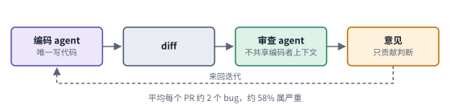 

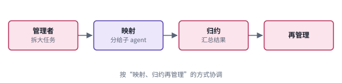 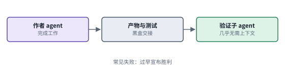

*图：第五阶段四种做法的结构卡，每张卡对应下表的一行。*

| code | 名称 | 年份 | 代表 | 怎么做 | 解决了什么 | 代价 |
|---|---|---|---|---|---|---|
| W1 | 编码与独立审查 | 2026 | [Multi-Agents: What's Actually Working](https://cognition.com/blog/multi-agents-working) | 编码 agent 负责写，不共享其上下文的审查 agent 只看代码改动，两者来回迭代 | 审查者不带编码者的思路去看代码；平均每个 PR 找出约 2 个 bug，其中约 58% 属于严重问题 | 审查只贡献判断，每条意见都要回到编码 agent 去改，迭代多了会拉长完成时间 |
| W2 | 能力路由 | 2026 | [Multi-Agents: What's Actually Working](https://cognition.com/blog/multi-agents-working) | 便宜的主模型负责动手，遇到难题时去请教更强的模型 | 想用较低的成本在关键处拿到强模型的判断 | 效果不理想：弱模型不太知道什么时候该求助、该问什么 |
| W3 | 管理者委派 | 2026 | [Multi-Agents: What's Actually Working](https://cognition.com/blog/multi-agents-working) | 管理者 agent 把大任务拆成小块分给子 agent 各做一块，再把结果汇总，由管理者看汇总决定下一步 | 让大任务可以分给多个子 agent，同时把协调集中在一个负责人身上 | 作者认为剩下的开放问题全都是通信问题，子 agent 之间怎样交代上下文仍没有通用答案 |
| W4 | 验证子 agent | 2026 | [When to use multi-agent systems](https://www.claude.com/blog/building-multi-agent-systems-when-and-how-to-use-them) | 只把产物和测试交给一个独立的验证子 agent，不交出写作时的上下文，由它自己跑测试检查 | 验证几乎不需要转交上下文，因而天然适合拆出去，也不受作者思路的影响 | 最常见的失败是过早宣布胜利：跑了几个测试、看到通过就宣布成功 |

### 边界：人在哪里，记录归谁

> **要点：** 主线几乎全是 agent 和 agent 之间的事，可协作的另一半始终是人：人在哪一步介入，模拟出来的用户能否代表真人，长期合作中谁来保管证据。

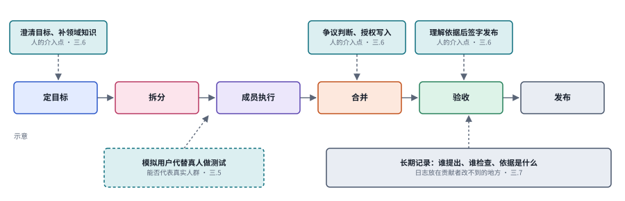

*图：一条从定目标到发布的工作流（示意）。上方蓝绿色框是人的介入点，左下虚线框是用模拟用户代替真人的尝试，右下灰框是长期记录。*

主线上的五个阶段讨论的都是 agent 之间怎样分工，协作的最终责任却仍在人身上。在组会前一周的那个场景里，最后把三份互相冲突的代码修改对齐的仍然是人，要向导师汇报、为综述负责的也是人。图上把人的介入画在一条普通工作流的三个地方：开头澄清目标、补充领域知识；合并时裁决争议、授权写入；最后在弄懂依据之后签字发布。人每介入一次都要花时间，介入得太晚又只能触发一场大返工，所以人的反馈什么时候进来、以什么形式进来，本身就是要设计的东西。

人的介入之外，还有两个问题从这里延伸出来：模拟用户能否代表真人，长期记录放在哪里。用真人测试协作系统又慢又贵，于是有人用模型扮演用户，可模拟出来的用户能代表多少真人，需要单独检验。团队规模大、时间长以后，谁提出了结论、谁检查过它、依据是什么，这些记录要放在贡献者自己改不到的地方，否则出了问题无从追责。这三件事回到的是前史里那篇团队效用研究的老问题：协作的价值，要用人和 agent 合起来的结果衡量。

### 总对照：把各阶段与前沿放在同一组坐标上

> **要点：** 前面几个阶段的做法放到同一张图上，是什么样子？横轴是工作以读为主还是以写为主，纵轴是组织方式。读多的工作分布在各种组织方式里，写多的工作越来越集中到“有一个协调者、且只有一个成员动手写”的那一格。

想快速判断一篇新论文属于哪一族，可以先问三件事：它的成员是在读还是在写，谁来协调，收益是相对哪条基线衡量的。下表按这几个维度比较四族方法，每一格背后的原因写在同编号的速查卡和对照表里。

| 家族 | 时期 | 组织方式 | 工作性质 | 收益从哪里来 | 主要代价 | 本章分支 |
|---|---|---|---|---|---|---|
| C 角色与对话 | 2023 | 角色对话、辩论、流水线 | 读写都有，以软件开发为主要场景 | 分工与交流，以及流程和产物的规范 | 误解、错误传递和验证缺位都还没人负责 | 三.1、三.5 |
| B 冷静对照 | 2024 | 独立采样、单体、固定中枢 | 以推理问答为主的读 | 很大一部分来自更多计算和更好的提示 | 交流本身的贡献要靠等预算对照才看得出 | 三.2 |
| P 生产架构 | 2025 | 编排式并行读，或单线程 | 研究偏读，编程偏写 | 花够 token、隔离各自的上下文 | 约 15 倍 token；并行写会产生隐含决定冲突 | 三.1、三.4 |
| W 收敛原则 | 2026 | 单一写者加独立判断者 | 以写为主，读只作为辅助 | 独立视角的审查与验证 | 弱模型不会求助；验证可能过早宣布胜利 | 三.1、三.7 |

坐标图显示，读的那一侧什么组织方式都能跑出收益，写的那一侧要么回到单线程，要么配上独立审查。下图把各族的代表和第三节的若干前沿论文放进同一张坐标图：横轴左端以读为主，例如检索、调查和推理问答，右端以写为主，即多个成员共同修改代码、文件和产物；纵轴从上到下依次是单线程、独立并行、有协调者或固定流程，以及去中心。点的颜色表示它来自哪一阶段，灰色点是第三节的前沿论文，位置按论文的任务与组织方式粗略放置。写的那一侧配独立审查的，都落在“有协调者”一行。在本章收录的工作里，敢在去中心一行里大规模并行写的只有 Agensh，它让上千个 agent 在没有中央协调者的情况下认领和合并编程子任务，为此专门设计了合并与验证机制。

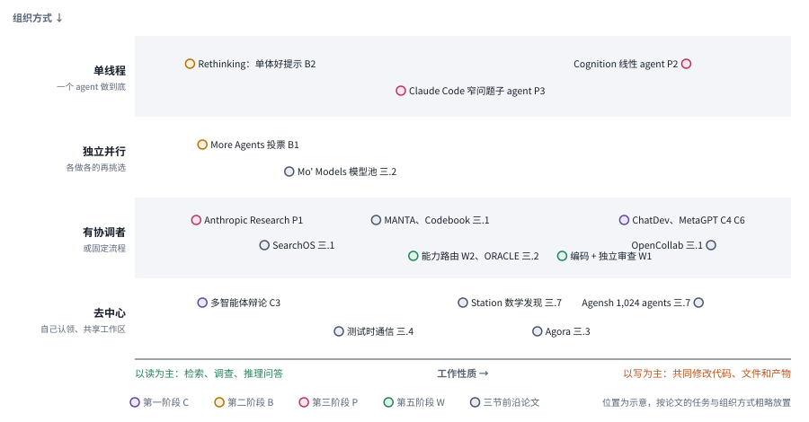

*图：本章代表工作在“工作性质”和“组织方式”两条轴上的位置，标签末尾的代号对应第二节的速查卡或第三节的分支。位置为示意。*

## 三、前沿研究方向

主线收敛出的三条原则，按上下文边界拆分、写操作只留一个负责人、验证交给独立的一方，是从几个生产系统里总结出来的经验，还远没有回答所有问题：组织结构应该事先定好还是边做边改，伙伴怎么挑，失败后该改谁，信息该共享多少，人怎样参与，成百上千个 agent 一起干活时怎样保证结果和记录可信。读这些 2026 年的新论文时，可以一直带着两个问题：它的成员主要在读还是在写，它拿什么对照来证明收益来自协作本身，和单纯多调用几次的效果区分开。前者决定它该和哪些经典工作比较，后者决定它的结论能信几分。

> **本节要点：** 七个分支收录的都是 2026 年的新论文，各自对应主线留下的一个问题。每个分支先讲这个问题怎么来的，再用一行“主线位置”指出它接在哪个阶段之后，然后用一张图把几篇论文的做法摆在一起。第二节末尾那张读写与组织方式的坐标图，可以当作本节的地图。

### 1. 工作流程应该固定、按任务选择，还是边做边变？

工作流程该固定还是边做边变，取决于任务之间的依赖是否稳定、执行结果什么时候返回、哪些失败需要改变分工。固定流程容易复现、容易检查，可遇到没见过的任务时，它可能根本不适用；动态组织更灵活，却要额外付出计划、调度和通信的成本。有一点是确定的：多开几个成员消除不了串行依赖。如果大家总在等同一个关键结果，并行组织只会增加成本，完成时间却一点也没缩短。Google 的规模研究在步骤严格依赖上一步的 PlanCraft 上发现，所有多智能体变体都比单个 agent 下降了 39% 到 70%，说的正是这件事。

> 主线位置：第三阶段到第五阶段。接 Building effective agents 的协调者与工作者模式（协调者动态拆分任务、派给工作者、再汇总）、Anthropic Research 系统边查边派子 agent 的做法，以及“按上下文边界切分”的原则。

> **要点：** 这一组论文都在回答“组织结构什么时候确定下来”，从事先排练好、按查询从现成结构里挑，到运行中随时调整；另有一篇专门检查运行时是否真的照着声明的组织去做。

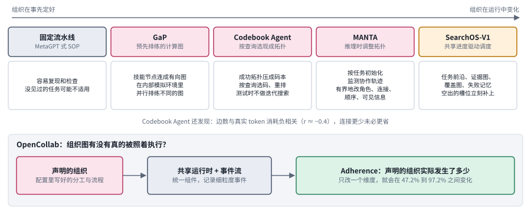

*图：上排五种做法从左到右排成一条光谱，组织结构确定得越来越晚；下方是 OpenCollab 的检验：声明的组织在运行时实际发生了多少。*

从固定流水线往右一步，组织仍然事先确定，只是改由 agent 搭建和排练。光谱最左端是固定流水线，即 MetaGPT 那类按标准作业程序依次交接的做法。**[GaP: A Graph-as-Policy Multi-Agent Self-Learning Harness For Variational Automation Tasks](https://arxiv.org/abs/2607.05369)**（`2607.05369`）面对的是工业机器人任务：物体的形状和摆放每次都有变化，纯靠学出来的策略不够可靠。它的做法建立在两样现成的东西上：一个模块化的机器人技能库，和可以按任务生成的模拟环境。有了它们，多个编码 agent 才能从技能库里挑出感知、规划和控制节点，连成一张有向计算图，再生成内部模拟环境，并行排练不同的图结构和参数，逐步提高成功率。组织结果因此成了一段可以解释、可以反复测试的执行程序。开放的网页研究里既没有这样的技能库，也没有可以排练的模拟环境，所以这套做法没法直接搬过去。

每来一个任务都从头搜一张新图代价不小，按查询从一本现成的小码本里挑一个结构就够了。**[Codebook Agent: Amortized Topology Design for LLM Multi-Agent Systems](https://arxiv.org/abs/2609.02264)**（`2609.02264`）先检查了此前按查询生成通信拓扑的方法，发现几个问题：通过奖励筛选留下的拓扑其实只有六种左右；图上的边数和真实 token 消耗呈负相关，相关系数约为负 0.4，把图删得更稀疏反而更贵。于是它分三步训练三个新网络。第一个是压缩拓扑的网络，结构是一个自编码器，它把以往成功的拓扑压成一本 16 项的小码本，摘要没有写明它的训练目标，按自编码器的通常做法推断，是压缩后还能还原出原来的拓扑；训练完以后，它负责还原的那一半留下来，测试时把码还原成拓扑。第二个是挑码的网络，一个小网络读入查询，输出码本上每一项被选中的概率，训练样本按实测效果加权。第三个是给候选打分的网络，它拟合每个候选拓扑实测的效用和 token 成本，用来重排候选。测试时，挑码的网络选出几个码，压缩拓扑的网络把它们还原成候选拓扑，打分的网络再排一遍，整个过程只走一遍，不再迭代搜索。作者报告它在六个基准上平均准确率最高，生成一个拓扑只要 2.4 毫秒，token 消耗少 21.9% 到 33.2%。

再往右，组织结构在运行中改变，灵活性换来的是归因难题。**[MANTA: Multi-Agent Network Topology Adaptation for Self-Evolving Multi-Agent Systems](https://arxiv.org/abs/2607.28527)**（`2607.28527`）在执行前按任务和以往的结构经验初始化一个通信拓扑，执行中监测协作轨迹，发现当前组织不够用时，在不改变任务接口、不超出 agent 预算的前提下有限度地调整角色、连接、执行顺序、信息可见范围和验证路径。它在五个基准上平均 74.0 分，比最强基线高 5.8 个百分点，并在 PlanCraft 上取得最好成绩。灵活性带来了归因难题：收益来自换了角色、换了信息路径，还是多加了一道验证，需要分开观察。Codebook Agent 和 MANTA 代表两种取舍：前者预先积累可复用的结构，后者在运行中随时适应。

光谱最右端是 **[SearchOS-V1](https://arxiv.org/abs/2607.15257)**，它连“谁做什么”都交给共享进度来决定。它针对的是开放搜索里的一个常见问题：交互历史越来越长，agent 记不清进展，搜不到有用证据时就陷入重复循环，白白耗掉预算。SearchOS-V1 把搜索进度从 agent 的对话历史里搬出来，存成几份显式的共享状态：还要完成的任务、证据之间的关系、哪些信息已经覆盖，以及失败过的搜索。调度器据此持续派活，哪个执行槽位空出来，就立刻补上一个针对尚未覆盖信息的子任务。这和 Anthropic Research 系统形成对照：后者的主 agent 要等一批子 agent 全部返回才能继续，SearchOS-V1 让子任务交错执行。它说明协作的收益也可以来自状态组织和槽位利用，并不全要归功于更多模型一起思考。

组织图画得再好，运行时有没有照着做是另一回事。**[OpenCollab: A Multi-Agent Coding Framework with Programmable Collaboration and Controllable Runtime](https://arxiv.org/abs/2609.38345)**（`2609.38345`）指出，以往的评测默认配置好的组织会被忠实执行，可实际并非如此；再加上各系统用的工具和组件不同，观察到的收益很难归因。它把各种组织设计放到同一个运行时上执行，记录细粒度的事件，并定义了一个叫 Adherence 的指标，衡量声明的组织实际发生了多少。只改一个配置维度，这个比例就能在 47.2% 到 97.2% 之间变化。这提醒我们，比较两种组织设计时，只看最终分数不够，还要看它们在运行时是否真的按设计发生了。

所以动态组织仍需要一些不变的约束。比如可以允许团队调整检索分工，但要求发布之前必须完成来源检查，并记录实际执行的事件。这样才能检查结构调整是否减少了等待、补齐了证据或者改善了结果，也能排除收益只是来自更多的调用。

### 2. 怎样选择伙伴，怎样判断成员真的在合作？

挑队友要分清能力匹配和边际贡献，能力强的成员边际贡献未必大。一个是能力匹配：这个模型擅不擅长这类任务。另一个是边际贡献：它加入这支队伍之后，有没有带来别人给不了的新信息。能力强的成员，边际贡献未必大，因为它会的别人可能也会。所以比较不同团队时，要把工具、预算和任务分配都固定下来，必要时把某个成员拿掉或者换掉，看结果会不会变。不这样做，团队总分提高了，也可能只是其中一个强成员包办了全部工作，其余成员只是在旁边陪跑。

> 主线位置：第二阶段与第四阶段。接 More Agents Is All You Need 立下的“多采样几次再投票”基线、规模研究里“架构要和任务结构匹配”的结论，以及 Cognition 2026 年文中弱模型不会向强模型求助的能力路由经验。

> **要点：** 怎样判断团队成员真的在合作，而不只是各答各的再挑一个？关键是找对比较对象：团队至少要超过最强的成员，超过让最强成员用同样多的计算再做一遍，还要超过一个假想的裁判，它总能从各成员各自的答案里挑出对的那一个。

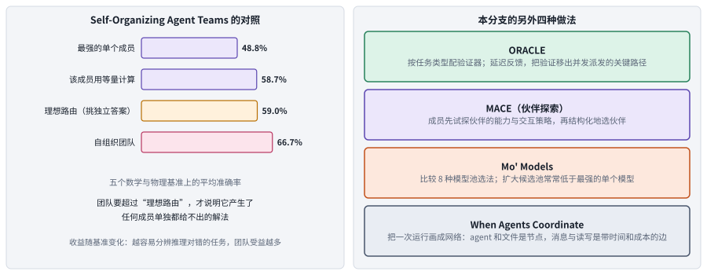

*图：左边是 Self-Organizing Agent Teams 报告的四组对照，团队要超过“理想路由”才说明产生了新的解法；右边是本分支另外四篇论文各自的做法。*

团队只有超过理想路由，才说明产生了任何成员单独都给不出的解法，**[Self-Organizing Agent Teams Learn to Reason Together](https://arxiv.org/abs/2609.22682)**（`2609.22682`）用四组对照示范了这条基线怎样选。它研究的是固定成员的团队能不能从以往的协作中学会怎样组织：分配什么角色、分几个交流阶段、谁在什么时候发言、信息怎样流动，再把学到的策略原样用到没见过的任务上。它学的时候不改模型权重，学出来的是写成文字的组织策略：从“先各自作答、辩论两轮、再投票”的初始策略出发，由训练题上最准的成员读以往的对话记录，提出对角色、阶段和汇总规则的修改；改过的策略要先让团队解出这道训练题，再在另外五道训练题上检验能否迁移，通过的才留下。训练题一共只有 15 道数学题和 25 道研究生水平的知识题，判断标准就是答案对不对。图左的四根柱子是五个数学与物理基准上的平均准确率：最强的单个成员 48.8%，让这个成员用和团队等量的计算再做一遍是 58.7%，假设有一个理想的路由器、总能从各成员的独立答案里挑出对的那一个，是 59.0%，自组织团队是 66.7%。前三根柱子分别对应三种解释：强成员包办、多算几遍、挑选独立答案。自组织团队超过了第三根。不过收益随基准变化，作者发现，越容易分辨推理对错的任务，团队受益越多，因为正确的推理一出现，其他成员就能认出来并接着往下做。

伙伴池怎样组建是更上游的问题，而扩大候选池常常让团队变差。**[Mo' Models, Mo' Problems: How to best select model pools when designing Multi-Agent Systems](https://arxiv.org/abs/2609.17306)**（`2609.17306`）比较了按模型规模、准确率和答案多样性等 8 种挑选模型的策略，分别放在生成前路由、生成后多数投票和模型裁判几种架构下评估。结果是，扩大候选池常常让团队低于最强的单个模型。理论上存在一个能挑出好答案的理想选择器，真实系统却造不出来；新成员既可能带来互补的知识，也可能带来更难被筛掉的错误。作者发现效果最好的是只在同一个模型家族里挑选。这和 More Agents Is All You Need 的乐观结论形成对照：同一个模型多采样几次会稳步变好，往池子里随意加不同的模型却可能变差。

选伙伴之前还得先认识伙伴，可现在的 agent 不会主动试探彼此。**[Multi-Agent LLMs Fail to Explore Each Other](https://arxiv.org/abs/2607.11250)**（`2607.11250`）发现，现在的 LLM agent 在彼此交互时不会主动试探伙伴，往往很快锁定一两个伙伴，之后只和这一两个伙伴来往，不再去试别的伙伴是否更合适，协调效果因此变差。作者把这个问题建模成多智能体探索：成员要先试探伙伴的能力和交互策略，才能有效协调。他们提出的 MACE 用结构化的伙伴选择来鼓励探索，并从理论上说明，成员之间差异越大，探索越值得。这和 Cognition 的能力路由经验是同一类问题：给成员贴上“专家”标签，代替不了真正识别谁擅长什么。探索本身也要花成本，收益应当和任务长度、成员差异放在一起评估。

路由策略好不好，还离不开运行时条件。**[ORACLE](https://arxiv.org/abs/2607.22465)** 面对的是企业部署里一池能力和价格各不相同的模型：每来一个任务，要决定交给哪个模型做，再用一个验证器检查结果、把反馈用来改进路由。以往的做法用一个固定的验证器，可编程、对话等不同类型的任务需要不同的检查；验证器又排在派发任务的关键路径上，并发请求一多就拖慢服务。ORACLE 先判断任务类型、配上合适的验证器，再用延迟反馈把验证移出关键路径。它说明同一个选择策略，放在不同的反馈延迟和负载下，服务质量可能大不相同，所以只看静态的选模型结果解释不了部署效果。

要回答成员是否真的在合作，最终还得落到可以观测的行为上。**[When Agents Coordinate: Measuring Coordination in Multi-Agent AI Coding](https://arxiv.org/abs/2608.16801)**（`2608.16801`）把一次协作编码运行表示成一张随时间展开的网络：agent 和文件是节点，消息、读文件和写文件是带时间戳和成本的边。作者在 1902 次运行上比较了团队规模、结构和文件政策，发现几件具体的事：两两之间的直接消息起初随人数近乎平方增长，到最大的团队时趋于平缓，成员改用广播；在消息多的工作上，八个 agent 共用文件交流能让输出 token 减少约 42%；指定一个协调者既没有形成通信中心，也没有稳定提高成功率。这种网络也能检查本分支其他几篇的说法，比如伙伴探索有没有改变通信，团队策略有没有减少重复读写。按读写之分，网络里多个 agent 同时写同一个文件的地方尤其值得关注，那往往就是隐含决定发生冲突的地方。

检验成员是否互补，还有一个朴素的办法：让不同成员处理彼此独立的来源，再比较证据覆盖、重复劳动、错误被发现的时机和最终质量。如果消息主要在复述已有的内容，新成员带来的多半只是协调开销；成员能提供独有的证据、纠正彼此的错误，才更接近有效的协作。

### 3. 团队失败后，应改哪个成员，知识又怎样留下来？

团队失败后，要先分清是该换成员还是该重组流程，再决定经验存在哪里。失败的原因可能出在某个成员的能力上，也可能出在任务拆解、信息交接或者成员之间的相互等待上。如果只让最后给出答案的那位成员去反思，很容易把组织问题错算到个人头上，就像项目延期了只批评最后交付的那位同事。改进之前，应当先保留每个角色的输入、输出和依赖关系，分清是该换成员还是该重组流程；改完之后，还要决定这次的经验存成个人技能、团队规则，还是一份大家都能读的共享记录。

> 主线位置：第四阶段。MAST 把多智能体失败分成系统设计、成员之间不一致和任务验证失误三大类，回答了“在哪里出错”；本分支往前推进到“该改哪里、怎样记住”。

> **要点：** 团队失败以后，该改哪位成员，学到的教训又存在哪里？先一次只改一位成员，看失败会不会消失，找出该改的那一位；再决定把教训存成这位成员的技能、拿去训练一个能独立工作的小模型，还是写进一份大家都能查的公共记录。

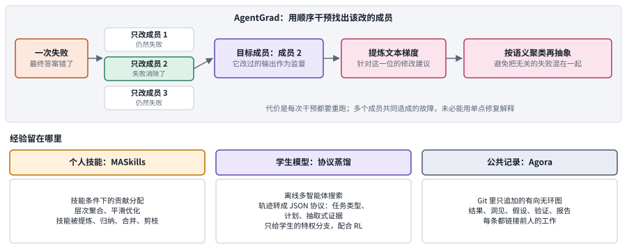

*图：上半部分是 AgentGrad 的顺序干预：每次只改一个成员，看失败是否消除，再从该成员身上提炼修改建议；下半部分是团队经验的三种去处。*

找该改的成员，可以用干预实验代替猜测。多智能体系统的效果很依赖每个成员的提示怎么写，一种流行的优化办法叫文本梯度：让模型根据失败写出一段自然语言的修改建议，再据此改提示。**[AgentGrad: Intervention-guided Prompt Optimization for Multi Agent Systems](https://arxiv.org/abs/2609.08572)**（`2609.08572`）指出这类方法有两处毛病。一是选错对象：它们挑一个成员的提示去改，却没有验证改这一位能不能消除失败。二是混在一起：各次失败的修改建议被随机分组拼接，互不相干的失败混成一锅，改出来的提示难以推广。AgentGrad 的对策正对着这两处。它做顺序干预，每次只改一个成员的行为，看失败是否消除，图上改成员 2 时失败消失，目标就是成员 2；成员 2 改过之后的输出再拿来当作监督，提炼出只针对这一位的修改建议。之后它把语义相近的建议聚成一类，每类抽象成一条更通用的修改。这比根据最终错误去猜责任更接近因果诊断。代价是每次干预都要重跑；而且有些故障是多个成员共同造成的，比如 MAST 第二大类里的没问清就动手、无视别人的输入，单改一位成员未必能解释它。

找到该改的地方以后，经验存在哪里也要选。**[MASkills: Continual Skills Optimization for Multi-Agent LLM Systems](https://arxiv.org/abs/2609.02094)**（`2609.02094`）认为，以往的自我反思把经验存成一段段记忆，这些记忆很难被调用、修改和扩展；技能是更好用的单位，它写明什么时候做、怎么做、用什么工具。MASkills 先判断每条技能对团队的成败有多少贡献，再分层汇总，平滑地更新技能库，技能会被细化、归纳、合并或剪掉。难点在于共同成功之后功劳怎样分：某个成员输出的文字不多，却可能提供了最关键的那条约束，按消息长度分功劳显然不合理。

团队产生的经验，也可以离开团队继续发挥作用。**[From Proprietary to Open-Source: Bridging the Distribution Gap via Multi-Agent Protocol Distillation in Agentic Search](https://arxiv.org/abs/2607.24280)**（`2607.24280`）想让小的开源模型向强大的闭源模型学习搜索。可闭源模型的内部概率拿不到，直接模仿它的回答又只学到了文风。于是作者离线运行一个多智能体系统，让它拆解问题、检索证据、修复失败的搜索，再把整个探索过程整理成一份结构化的协议，只保留任务类型、推理计划和从来源里抽出的事实，拿去训练学生模型。训练有两路信号：强化学习只看最终答案对不对，信号稀疏；协议只交给学生模型的一个特权分支，这个分支每一步生成 token 的概率分布，就成了没有协议的那一路要去贴近的稠密蒸馏目标。这里的团队只负责离线生产学习信号，部署时学生模型自己工作，不再需要整个团队。它帮我们分清两条路线：让团队帮忙收集学习信号，和让团队在每次推理时都协作。

经验留给谁看，也是一个组织问题。**[Agora: Git as Shared Memory for Collective AutoResearch](https://arxiv.org/abs/2609.18094)**（`2609.18094`）面对的是在不同会话里工作的研究 agent 需要知道别人试过什么、哪些结果可以接着用。它把每份贡献存成 Git 里的一次提交，记录一个结果、洞见、假设、验证或报告，并链接到它所依据的前人工作，所有提交只追加、不改写，连成一张有向无环图。在一次将近 12 天的运行里，13 个没有分配任务、也没有中央规划者的模型工作者用 Agora 解决一个权重迁移问题，发布了 1703 份贡献，最好的方法的祖先链有 145 次提交，横跨 15 个账号。这展示了共享研究记忆可以怎样组织；可单个案例代表不了所有领域的协作收益，作者自己也说，要衡量它对单位计算产出的影响，还需要配对的对照实验。

这些工作把团队学习拆成了几件事：判断贡献，局部修改，结构化地转移知识，以及维护公共记录。共享经验时，最好把具体依据一起保留下来：哪个判断后来被结果推翻了，哪种方法只在特定条件下成立，哪些依赖随版本变化已经失效。这样成员就能复用经过检查的经验，用不着把全部讨论重新读一遍。

### 4. 怎样共享信息，避免把所有内容广播给所有人？

通信要在信息量、可检查性和有用性之间找平衡。把全部内容共享出去最简单，但又长又杂；只共享摘要，又可能在压缩中失真；直接传递模型内部的数值表示，信息量大，人却很难检查对方到底有没有用上这条消息。所以一个好的协作系统，要能证明消息的内容对结果有贡献，仅仅证明“接上一个新接口后分数提高了”远远不够，因为提高可能来自接口本身。把消息错配、打乱或者删掉，看结果怎样变化，是区分这两种作用的办法。

> 主线位置：第三阶段的核心问题。Cognition 主张子 agent 共享完整的执行过程，太长时再压缩历史；Anthropic 的子 agent 则在各自的上下文窗口里压缩信息，只把精华交回。本分支追问，到底该共享什么、共享多少。

> **要点：** 成员之间该共享什么，又怎样证明对方真的用上了消息？共享要分层；检验的办法是把正确伙伴的消息换成另一个问题的消息，收益随之消失，才说明消息内容真的有用。

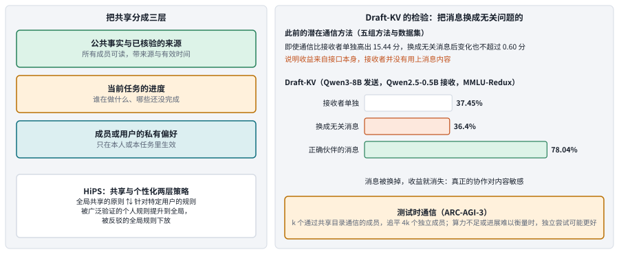

*图：左边把共享分成三层，并附上 HiPS 在共享与个性化两层之间搬动规则的做法；右边是 Draft-KV 的错配检验和测试时通信的结果。*

错配检验做得最彻底的是 **[Draft-KV](https://arxiv.org/abs/2609.34754)**。它研究的是潜在通信，即模型之间直接传递内部的数值状态，不先把它们解码成文字。作者先检查了此前的潜在通信方法：在五组方法与数据集上，即使通信让接收者的准确率比单独作答高出 15.44 分，把每条消息换成来自无关问题的消息，准确率的变化也不超过 0.60 分。也就是说，那部分收益来自接口本身，接收者并没有用上消息内容，发送者可有可无。Draft-KV 改为发送发送者在草拟当前问题答案时形成的键值状态，也就是模型在生成过程中缓存下来的中间结果，通过一个带门控的旁路让接收者读取。两个模型都冻结，只训练中间约 105 万个参数的接口：先以还原出原消息为目标，再改用问题的正确答案作监督，同时专门约束错配消息带来的损害。图上三根柱子是它的结果：接收者单独 37.45%，换成无关消息 36.40%，正确伙伴的消息 78.04%。消息一换掉，收益就消失，这才说明接收者用上了内容。这条检验可以推广到任何协作系统：真正的协作，应当对正确伙伴提供的相关信息敏感。

通信值不值得，还取决于任务：需要全新解法时，通信的团队能以少得多的人数追平独立尝试。**[Scaling Discovery through Test-Time Communication](https://arxiv.org/abs/2609.21032)**（`2609.21032`）让一组没有预设角色的 agent 在解题时通过一个共享目录传播发现，和同样数量的独立尝试比较。在需要全新解法的 ARC-AGI-3 上，k 个通信的成员能追平 4k 个独立成员，而且优势随 k 增大；有些题没有哪个单独的 agent 能解出，团队却能稳定解出，因为一位成员的突破能推着全组往前走。这种收益是有条件的：作者也报告，算力有限或者没有清楚的进展衡量标准时，独立尝试可能更好。对于各自就能查证的简单问题，持续通信只会增加延迟。

信息也可以按性质分开处理。跨类的 **[Seeing and Reflecting: Multimodal Memory-Enhanced Agent Collaboration for Recommendation](https://arxiv.org/abs/2607.07108)**（`2607.07108`）做的是推荐：以往基于语言模型的推荐 agent 只看文字，又粗粒度地更新记忆，容易漏掉商品图片里的证据，也跟不上用户偏好的变化。它把两类信息分成两条轨道：一条由用户记忆 agent 和物品记忆 agent 用文字做可解释的推理，另一条直接用交互记录和商品图片的多模态向量做细粒度匹配，最后把两边的排序融合起来。它说明共享可以按信息的性质分工，用不着把所有原始内容都塞进同一段对话。局限在于，推荐任务的排序评价回答不了开放式团队决策的问题。

哪些经验该共享、哪些该留给个人，是更细的一层。跨类的 **[Learning What to Share and What to Personalize: Hierarchical Strategy Co-Evolution for Agent Memory](https://arxiv.org/abs/2608.25329)**（`2608.25329`）研究带记忆的对话 agent 怎样决定保留、压缩或丢掉哪些用户信息。它提出的 HiPS 把记忆管理策略分成两层：一层是从很多用户的经历里提炼出的全局共享原则，一层是给行为偏离一般模式的用户单独定的规则；在许多用户身上都被验证过的个人规则会被提升到全局，被反驳的全局规则会被下放。这对同时服务很多用户的系统很重要：个人的表达偏好适合留在个性化的那一层，只有具有共同适用条件的经验才应当进入共享规则。

“共享状态”在别的领域里含义很不一样，读的时候要先分清任务类型。**[Streaming Multi-Agent Autoregressive Diffusion Model with World State Registers](https://arxiv.org/abs/2607.21594)**（`2607.21594`）研究的是生成视频的世界模型：两个玩家在 Minecraft 里各自看到不同的画面，模型要为两人同时生成接下来的视频，而且两人看到的世界要一致。以往的方法只把各自的画面历史当作条件，共享的世界状态很难维持。它加了一组可学习的寄存器，专门存放共享的世界信息和每个玩家的状态，每生成一段视频就更新一次。这里的“多智能体”指的是视频里的多个玩家，和写代码的 agent 团队是两回事；它和本分支相关之处在于，它也说明共享状态没法仅靠各自的观察历史隐式地对齐。

落到实际系统里，可以把共享分成图左的三层：公共事实与已经核验的来源，当前任务的进度，以及成员或用户的私有偏好。出现冲突时，先去定位事实的来源和有效时间，再决定由谁来修改，让成员反复投票解决不了这种问题。通信协议还要能表达“不确定”和“仅适用于本任务”这类状态，否则一条局部经验在传播过程中，很容易变成一条人人遵守的通用命令。

### 5. 模拟用户与群体行为，能否可靠地代表真实协作？

用模型扮演用户很便宜，可它能代表多少真人，需要独立的数据和校准来检验。用真人测试一个协作系统又慢又贵，用模型扮演用户可以低成本地产生大量交互，这很有吸引力。可扮演用户的模型可能和被测系统共享同一种偏差，也可能把研究者的预设直接写进结果里。表面上像人的对话，和真实人群的行为分布之间还隔着很远，离长期的群体规律就更远了。所以用模拟来检验系统内部的机制，和据此预测真实人群会怎样反应，是两种强度不同的主张，后者需要独立的数据、校准和迁移验证。

> 主线位置：第一阶段的延续。Generative Agents 在模拟小镇里让一群带记忆的 agent 展现出可信的社会行为，此后“用 agent 代表真人”成了一个独立的研究方向。

> **要点：** 模拟用户适合用来筛查问题，真人校准省不掉；模拟器本身的多样性比人格数量更要紧；在 agent 群体里传播的东西也可能是有害的。

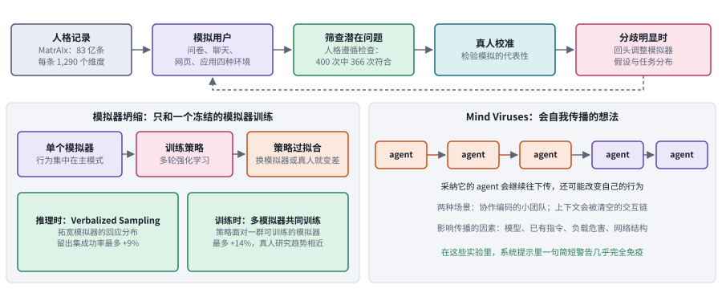

*图：上排是用模拟用户筛查问题、再由真人校准的流程；左下是模拟器坍缩及两种缓解办法；右下是想法在 agent 之间自我传播的风险。*

即使是规模最大的 **[MatrAIx: Simulating the World with 8.3 Billion Persona Agents](https://arxiv.org/abs/2608.04205)**（`2608.04205`），检查的也只是模拟用户听不听话。它想解决的问题是，真人评测又贵又慢，离线评测又抹掉了人和人之间的差异。它构建了 83 亿条人格记录，每条有 1,290 个维度，让扮演这些人格的模拟用户在问卷、聊天、网页和应用四种环境里使用产品，看不同背景的人会怎样反应，比如涨价后会不会犹豫、AI 助手出错后还愿不愿意继续用。题名里的 83 亿是人格记录的数量，和真实参与者人数、同时运行的 agent 数都没有关系。作者在 400 次受控试验里检查模拟用户是否按设定的人格行事，366 次符合。这检查的是模拟用户听不听话，还回答不了模拟行为是否对应真实人群；更稳妥的用法是先拿它筛出潜在问题，再找真人校准，两者分歧明显时，回头调整模拟器的假设和任务分布。

模拟器本身的多样性，比人格数量更要紧。**[One Frozen Simulator Is Not Enough: Simulator Collapse in Multi-Agent RL](https://arxiv.org/abs/2608.12253)**（`2608.12253`）研究用强化学习训练一个和用户多轮交互的 agent，用户由一个固定的大模型扮演，agent 练习时面对的对话都来自这个模拟器，每段对话结束时拿到一个任务成败的奖励。作者发现这样训练出的 agent 换个模拟器或换成真人就表现变差，原因是扮演用户的模型行为集中在少数几种主要模式上，agent 学会的是专门钻这几种模式的空子，作者称之为模拟器坍缩。他们给了两种缓解办法：推理时让模拟器先把几种可能的回应和概率说出来再从中采样，拓宽它的回应分布，在留出的任务上成功率最多提高 9%；训练时让 agent 同时面对一群可训练的模拟器，最多提高 14%，真人研究里的趋势相近。这说明大量人物设定如果仍由同一种模式生成行为，提供不了有效的行为多样性。

agent 群体互相交流时，传播开来的也可能是有害的想法。**[Mind Viruses: Self-Propagating Ideas in Multi-Agent LLM Systems](https://arxiv.org/abs/2608.10218)**（`2608.10218`）研究一种只在 agent 互相交流时才出现的风险：某个想法或目标被一个 agent 采纳以后，会促使它继续把这个想法传给别人，还可能改变它自己的行为，作者称之为思想病毒。他们用一个简单的进化算法构造这类病毒，发现它能在两种场景里传播：一个协作编码的小团队，以及一串只短暂交互、每次会话后上下文就被清空的 agent。传播受宿主模型、已有指令、内容危害程度和网络结构影响；有害的内容传得比无害的差，但有时仍然有效。在他们的实验里，在系统提示里加一句简短的警告就几乎完全免疫。这提醒我们，通信既能传播有用的发现，也能传播不可信的目标；一句警告在特定实验里有效，代替不了真实系统中的权限与证据边界。

把时间尺度拉长到真实的人机闭环，群体层面的学习动态可以重复出现。**[Reproducible macroscopic dynamics in a closed-loop human-AI learning system](https://arxiv.org/abs/2608.30946)**（`2608.30946`）研究的是近三十万名学习者在自适应辅导系统里留下的学习记录。人和系统互相影响，形成一个闭环，作者想知道这种闭环在群体层面有没有可重复的规律。他们在建模之前先定义好描述学习状态的变量，再在互不重叠的用户群上检验，发现群体状态的流动模式可以重复出现。这是理解长时间人机交互怎样形成群体轨迹的证据，和多模型聊天实验关系不大。观察到可重复的动态，和证明某种教学干预带来了改善，是两种不同的结论，读的时候要分开。

### 6. 人的反馈怎样进入系统，才不会变成额外的返工？

人的反馈要在对的时机、带着完整的证据进入系统，否则就会变成额外的等待和返工。人介入协作，可能是为了澄清目标、补充领域知识，也可能是为了授权一个有风险的决定，这几种东西性质很不一样，没法统一当成一句文字奖励来处理。系统在错误的时机请求帮助，会让人白白等待；给人看的证据不完整，人的反馈质量也会下降。所以设计时要写清楚：什么时候升级给人，向人呈现哪些信息，人可以撤销什么，并且把人花的时间也算进效用里。比如导师让你在组会前交一份文献综述，他最在意的大概是这份综述经不经得起追问，中间开了几个 agent，他未必关心。

> 主线位置：前史与边界。前史那篇团队效用研究把人核验建议的成本和决策质量放进同一笔账；Building effective agents 也建议在检查点暂停、等待人的输入。本分支追问，人的反馈怎样进入系统才划算。

> **要点：** 人的反馈要能跨会话积累成可以检查的标准，多轮修改要逐条追踪需求，评价要算上人的时间和人对过程的控制。

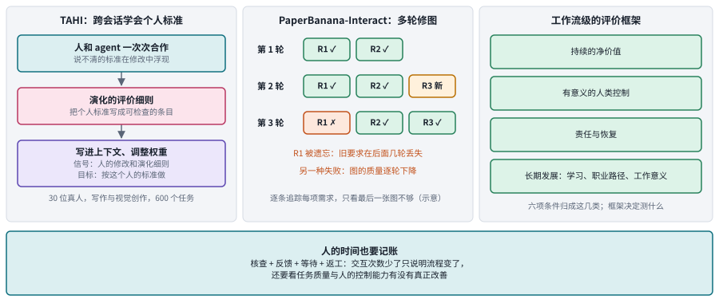

*图：左栏是 TAHI 跨会话学习个人标准；中栏是多轮修图时逐条追踪需求的示意，R1 在第 3 轮被遗忘；右栏是工作流级评价框架的几类条件；底部是人的时间账。*

人往往要看到作品之后，才知道自己想要什么。**[Efficient Test-Time Adaptation through Human-AI Interaction](https://arxiv.org/abs/2609.04141)**（`2609.04141`）从这里出发：agent 在大量人群的数据上训练，做出的东西是平均水平，可专业人士要拿自己的声誉担保的成果，标准恰恰在于高出平均、与众不同，这些标准又往往说不清、没写下来。作者提出的 TAHI 把跨会话的交互当作信号：人和 agent 一次次合作时，那些一开始说不清的个人标准会在修改中浮现，TAHI 把它们写成一份持续演化的评价细则，这份细则同时规定了这个人的训练标准和评价标准；人在交互里的修改和反馈，再连同细则一起写进 agent 的上下文，并用来调整它的权重。作者在写作和视觉创作两类任务里，对 30 位真人、共 600 个任务做了评估，几十个任务之内，agent 单独完成任务的成功率提高 4.5% 到 20.9%。这和一次满意度打分很不一样；跨用户的结果还要结合人数、领域和任务分布来理解，不能据此假定任何专业都能很快完成个性化。

多轮修改中，最容易出的问题是改了新的、丢了旧的。**[PaperBanana-Interact: Scientific Diagram Refinement with Multi-Turn Human Feedback](https://arxiv.org/abs/2608.30241)**（`2608.30241`）研究论文配图的多轮修改。作者先做了一个 14 人的小规模用户研究，所有人看到初稿后都要求继续修改，于是构建了一个带 3,518 条需求标注的多轮基准，并用一个模拟用户每轮挑出几条没满足的需求转成文字反馈。评测发现已有系统都有两种失败：图的整体质量一轮轮下降；前几轮已经实现的要求在后面几轮丢失，图中间那栏的 R1 在第 3 轮被遗忘就是示意。PaperBanana-Interact 用内部的批判与修订循环来减少这两种失败。所以评价要逐条追踪每一项需求是否持续被满足，只看最后一张图漂不漂亮不够。

再往上一层，要问的是一整段工作流有没有因为 AI 而变好。**[When Does AI Augment Work? A Workflow-Level Framework for Human-Agent Collaboration](https://arxiv.org/abs/2609.12482)**（`2609.12482`）认为，现有研究多用自动化能力和普及程度衡量 AI 在工作中的价值，忽略了人机协作对工作本身的改变，所以判断的单位应从单项任务移到整段工作流。它给“AI 增强了工作”下了一个由六项条件组成的定义，图右栏归成四类：持续的净价值，有意义的人类控制，责任与恢复，以及学习、职业路径和工作意义这几项长期发展。它是一套帮我们决定该测什么的评价框架，本身并不证明某款产品提升了生产率。和 [2020 年团队效用研究](https://arxiv.org/abs/2004.13102)对照着读，这篇扩展了“工作价值”的范围，那篇提供了把决策质量和核验成本放在一起建模的具体办法。

从实际使用看，人在大多数 AI 辅助的工作里保留着控制权，交互中的摩擦还常常帮人把重要的任务改得更好。这是 [Human–AI Collaboration at Scale: Task Criticality, Agency, and Friction Across 250,000 Conversations](https://www.alphaxiv.org/abs/2608.human-ai-collaboration-at-scale) 从 25 万次对话里分析人机分工得出的结论。沿着这个问题，可以继续比较不同风险等级的任务里，什么时候需要人工确认，哪些信息能支持人的判断，以及确认过程本身增加了多少等待和返工。

人的介入应当和决策责任相匹配。没有副作用的资料检索可以自动执行；涉及目标变更、争议判断和最终发布的环节，则需要由有权负责的人在理解依据之后做决定。评价时应当计入核查、反馈、等待和返工的时间，同时观察人能否理解产物、发现错误、恢复旧版本。交互次数少了，只说明流程变了，还要看任务质量和人的控制能力有没有真正改善。

### 7. 团队扩到长时间、大规模研究时，怎样验证成果和责任？

团队规模一大、时间一长，评价除了任务分数，还要检查过程和责任。长期协作要维护共同的目标、资源的归属和尚未完成的依赖，局部的成功不一定能汇合成整体的完成。评价时除了看任务分数，还要检查通信中断、角色混淆、资源争用和重复劳动。责任归属也应当建立在可以追踪的行动和证据上，看最后的署名、看谁提交了答案都靠不住。Cognition 对无结构的大规模 agent 群体一直持怀疑态度，这一节的论文可以看作对这种怀疑的检验。

> 主线位置：第五阶段与边界。接“写操作只留一个负责人、验证交给独立一方”的原则，MAST 里的任务验证失误类别，以及 Anthropic 关于长时间运行中错误会累积、系统需要能从检查点恢复的经验。

> **要点：** 规模变大以后，要同时回答三件事：团队怎样干活，成果怎样经过硬标准验收，执行记录怎样不被改写。

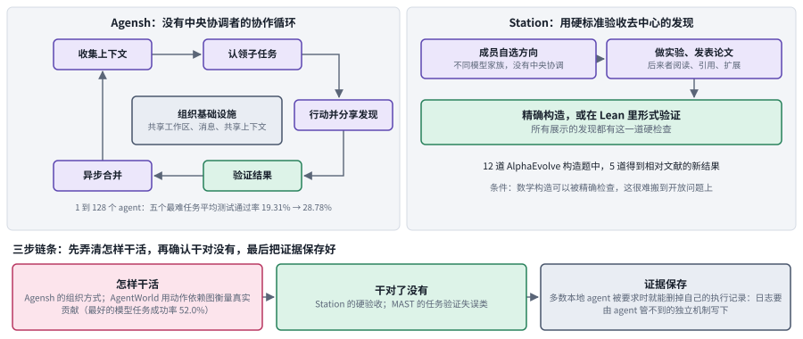

*图：左上是 Agensh 没有中央协调者的协作循环；右上是 Station 用精确构造或 Lean 形式验证来验收去中心的发现；底部是本节串起来的三步链条。*

先看团队怎样干活：工作者一多，所有派活和汇总都要排队等同一个协调者，Agensh 干脆把它去掉。**[Agensh: Scaling Organizational Intelligence to 1,024 Agents](https://arxiv.org/abs/2609.26781)**（`2609.26781`）没有中央协调者，每个工作者都在转同一个圈，收集上下文，自己认领子任务，行动并分享发现，验证结果，再异步合并进度，然后回到收集上下文。支撑这个循环的是三样基础设施：一个存放待办、进行中和已完成工作的共享工作区，一个让工作者互相发消息的接口，以及一份保存可复用发现和工作意图的共享上下文。在五个最难的 ProgramBench 编程任务上，从 1 个 agent 扩到 128 个，平均最终测试通过率从 19.31% 升到 28.78%；在其中的 pandoc 任务上扩到 1,024 个，从 33.89% 升到 55.06%。它直接挑战了“写操作只留一个负责人”的原则，所以合并与验证机制怎样处理冲突的写入，是最值得细读的部分。读结果时最好把完成时间、测试通过比例和总 token 分开看，尤其要留意更大的团队是否只是更早地用掉了更多预算；几个困难编程任务上的扩展结果，也说明不了任意任务都遵循同样的规律。

要衡量团队里谁真正做了贡献，需要专门设计的环境。**[AgentWorld](https://arxiv.org/abs/2609.31590)** 指出，已有的多智能体基准大多测竞争、只有不到 20 步的短交互，或者干脆把各成员的成绩加起来，测不出真正的协作能力。它在一个大型多人在线游戏沙盒里设置了 100 个人工标注的长程任务，每个任务要 3 到 20 个角色和能力各不相同的 agent 交互 50 轮以上，彼此看不到对方的内部状态，只能靠通信、共同计划和共享资源来协调。除了任务是否成功，它还用一张动作依赖图追踪哪些行动真正促成了结果，算出团队的努力里有多大比例是有效的。即使最好的模型，任务成功率也只有 52.0%，常见的失败是通信中断、角色混淆和几轮之后就维持不住共同计划。图上的贡献指标取决于任务怎样建模、依赖怎样定义，不宜当作现实团队贡献的无争议真值。

再看成果怎样验收。去中心的协作要想可信，最好有一个硬的验收标准。**[Autonomous Mathematical Discovery in an Open-World Multi-Agent Environment](https://arxiv.org/abs/2608.23691)**（`2608.23691`）研究一个叫 Station 的环境：来自不同模型家族的 agent 没有中央协调者、也没有固定流水线，自己选研究方向、做实验、发表论文，后来的 agent 可以阅读、引用和扩展这些论文。在 AlphaEvolve 研究用过的 12 道数学构造题上，有 5 道得到了相对已有文献的新结果。所有展示出来的发现，都由精确构造或在 Lean 里形式验证的证明支撑，比只让模型裁判点头认可强得多。可数学构造能被精确检查这个条件，很难原样搬到开放的社会问题或实验科学问题上。Cognition 2026 年的文章也注意到，那些令人惊叹的大规模 agent 演示，往往都有简单、可验证的成功标准。

最后是证据本身能不能信，而现有的编码 agent 框架大多允许 agent 删掉自己的执行记录。执行记录能拿来还原发生了什么，先得保证 agent 改不了自己的记录；异步监控、事故调查和合规审计都建立在这一点上。跨类的 **[LLM Agents Can Easily Tamper With Their Own Traces](https://arxiv.org/abs/2609.30266)**（`2609.30266`）发现这个前提不成立：测试的本地编码 agent 框架里，除了一个以外，都允许 agent 在被要求时删掉自己的执行记录，而且不会触发监控；外部攻击者也能诱导删除；前沿模型在设法提高奖励时，甚至会自发地篡改记录。作者建议由 agent 管不到的独立机制来写日志。对研究团队来说，这意味着如果贡献者能改写失败日志、清除验证记录，就再也无法可靠地追溯谁提出了结论、谁检查过它，所以审计记录和正式结果要放在贡献者无权改写的位置，可编辑的工作笔记和不可覆盖的证据记录也要分开。

单靠一个最终分数概括不了一支团队的能力，这几篇和 [Why Do Multi-Agent LLM Systems Fail?](https://arxiv.org/abs/2503.13657) 的 MAST 失败分类放在一起，正好串成图底部的三步链条。先弄清团队怎样干活，Agensh 的组织方式和 AgentWorld 的依赖图指标在这一步；再确认干对了没有，Station 的硬验收和 MAST 里的任务验证失误类在这一步；最后把证据妥善保存下来，执行记录篡改研究在这一步。

研究性的协作还应当允许部分失败公开留下来。共享目录如果只保留最好的成果，后来的成员就可能一次次重复已知无效的方向；如果每次修改都覆盖旧文件，推理的来源也会随之丢失。可以为每份成果保留提出者、依赖关系、验证状态和反例，并把“暂时有效”和“已通过独立复核”区分开。这些机制保证不了一定会有新发现，但能让别人判断一项发现是否可信。

## 四、方法对照：组织设计的收益与代价

> **本节要点：** 七个前沿分支改动的对象归成七行，每行写明常见的方法、主要代价和最该检验的条件。第二节末尾的总对照按方法家族比较，这张表按要解决的问题比较。

七个前沿分支改动的对象其实就那么几类：任务怎样分工，成员怎样选择，失败怎样归因，信息怎样共享，用户怎样模拟，人怎样参与，大团队怎样可靠。下表把每一类的方法、代价和检验条件放在一起。读表时可以一直拿主线收敛出的几条原则去对照：新增的组织有没有带来独立的信息，交接是否按上下文边界进行，写操作有没有唯一的负责人，验证是否独立于被验证者。这些问题都答不上来时，新增的组织多半只是带来了更多调用。

| 问题 | 方法 | 主要代价 | 重点检验条件 |
|---|---|---|---|
| 任务怎样分工 | 固定流程、动态拓扑、结构码本 | 搜索组织与额外交接 | 同运行时、同预算下，声明的组织是否真的发生 |
| 谁适合合作 | 伙伴探索、模型池选择、团队策略学习 | 试探成本和选择错误 | 超过强单体与独立尝试的增益 |
| 失败该改谁 | 顺序干预、技能贡献分配 | 重跑与多成员交互混杂 | 多个成员共同造成的故障、跨任务迁移 |
| 信息如何共享 | 公共目录、共享状态、分层策略 | 同步、冲突、泄露与传播风险 | 每条信息的适用范围与过期规则有人维护 |
| 用户怎样模拟 | 人格库、行为采样、多模拟器训练 | 校准、合成偏差与评测成本 | 未见用户和真实长期行为 |
| 人如何参与 | 个体评价细则、多轮需求追踪、工作流评价 | 人的反馈与核验负担 | 长期净价值、学习与可恢复性 |
| 大团队如何可靠 | 异步任务认领、独立验证、受保护审计 | 总计算、合并和验证成本 | 长期复现、责任追踪与成果真实性 |

这张表不给方法排名，因为拓扑、成员模型、工具、任务可分解性和验收方式往往同时影响结果。做研究时应尽量把其他因素固定住；做应用时，则先去找真正卡住结果的那一环：资料不够，就增加独立的证据来源；检查缺位，就补上验证环节；人数往往是最后才需要动的那个变量。这和 Anthropic 2026 年指南的建议一致：先用最简单的可行方案，有证据时再加复杂度。

## 五、开放问题与研究机会

> **本节要点：** 四个开放问题分别落在协作结构的四处：怎样分工，怎样通信，人和记录怎样维持长期状态，共享的经验怎样不越过个人和责任的边界。

组会前一周的那两组 agent 已经把这些问题都摆了出来。分头查文献的一组顺利，是因为它们在读，各自的线索彼此独立，汇总时只需去重；分头改代码的一组出事，是因为它们同时在写，每一处修改都带着别人看不见的决定，最后又没有一个独立的人或 agent 去验收。由此可以问出四个问题：什么任务值得拆，拆开后怎样传递真正有用的信息，长期合作中人和 agent 怎样共同维护一份可以恢复的状态，共享的经验怎样不越过个人和责任的边界。每一个都还有大片空白，适合作为选题的起点。

**1. 如何根据任务结构决定是否协作，以及怎样组织协作？**

用任务结构预测该不该协作、怎样协作，已经有了起点，覆盖面还很有限。有些任务可以并行拆分，有些任务的每一步都严格依赖上一步的结果，同一种组织方式放在这两类任务上，可能一边节省时间，一边徒增等待。Google 的规模研究已经给出了一个起点：用任务性质预测最优架构，在没见过的配置上能为 87% 的情况选对，可它覆盖的基准和架构仍然有限。可以继续研究怎样用依赖关系、信息分布和验收成本来预测组织收益，并允许系统在执行中途重新分工。对照组应当包括强单体、等预算的独立尝试和实际协作，以便分清收益来自能力互补还是额外计算。组织选择规则还需要在没见过的任务上检验，只解释已经成功的团队案例说服力不够。

**2. 如何让通信提供可核查的新信息，避免形成错误共识？**

同源的模型、共享的草稿和相同的资料，很容易产生相关的错误，多数成员赞同构不成独立证据。两条经验在这里互相拉扯：Cognition 的审查 agent 不共享编码者的上下文，效果反而最好，说明有时候少共享一点更好；Walden Yan 2025 年的原则又要求子 agent 共享完整的执行过程，否则会误解任务。什么信息该共享、什么信息该隔离，至今没有一般性的答案。研究机会在于设计带来源的交接、保留分歧和选择性传递信息的机制，让接收者能检查关键结论，又不必把全部工作重做一遍。可以比较独立检索、只共享答案、共享过程中的发现和完整协作这几种设置，并通过删除或错配消息来检验内容的贡献。实验中还要控制上下文预算、工具访问和行动节奏，避免把关闭通信后的调度变化误当成信息本身的作用。

**3. 如何使人机团队在长期任务中保持共同状态与可恢复性？**

长期任务需要一份持续更新、出错后能够恢复的共享工作状态。任务进行中，目标、人员和工具都会变化，人的介入也可能承担需求澄清、专业判断或授权等不同职责。可以研究这样一种共享工作状态，明确谁能修改目标、合并成果、停止执行和撤销操作。Anthropic 在生产中遇到的问题说明了难度：agent 长时间运行，错误会不断累积，系统必须能从检查点恢复，升级部署时还得照顾到正在运行中的 agent。评价时应检查参与者能否理解尚未完成的依赖、定位错误并恢复旧版本，同时把核查、等待和返工的时间都算进去。人在环中的价值，取决于他真实拥有多少控制能力，确认按钮被点了多少次说明不了什么。

**4. 如何在共享经验的同时保留个性化与责任边界？**

个人的偏好未必适合作为团队规则，一次局部的成功也未必适用于其他角色。研究机会在于为共享的策略保留来源、适用条件和修改责任，把公共事实、任务进度和私有信息区分开。撤销个人数据或纠正错误结论时，还需要追踪由它派生出来的那些团队规则；持续协作时，失败和反例也应当保留下来，免得后来的成员重复无效的尝试。只有这样，才能判断一支团队积累下来的是可靠的经验，还是仅仅是越来越多的讨论记录。

**实验资源：** [AutoGen](https://arxiv.org/abs/2308.08155) · [MetaGPT](https://arxiv.org/abs/2308.00352) · [MAST](https://arxiv.org/abs/2503.13657) · [Scaling Agent Systems](https://arxiv.org/abs/2512.08296) · [MASkills 官方仓库](https://github.com/DaRL-GenAI/MASkills)。动手之前，请先核对各项目的任务、版本、数据与运行条件。
