# 15｜前沿技术报告：模型路线与系统能力

[首页](../../README.md) · [专题索引](../../README.md#topics) · [文献目录](../../catalog/15_frontier_reports.md)

**相关基础：** 模型结构、训练目标、推理模式与评测协议的概念见 [LLM 前置知识](../../docs/llm_primer.md)。

## 方向背景：技术报告怎样连接模型与实际能力

一个新模型发布时，摆在读者面前的材料又多又杂，难处在于知道从哪里读起、哪些数字可以互相比较。设想周一早上，导师在组里的群里丢下一句话：“Kimi K3 出来了，下周组会谁来讲讲？”接下这个任务的同学打开网页，很快就发现自己面对的是一大堆材料：一份几十页的技术报告，一篇配了好多张柱状图的发布博客，一个写满配置参数的模型卡，GitHub 上的评测脚本，几天后可能还有第三方榜单和研究者的点评。同一周里，另一家闭源实验室也发布了新模型，那边没有技术报告，只有一篇讲“它能替你完成哪些工作”的博客和一份上百页的系统卡。他该从哪里读起？哪些数字可以拿来互相比较？哪些说法只是在某个推理预算、某个执行框架下才成立？

要回答这些问题，先得明白技术报告和方法论文是两种东西：报告是一整套工程选择的合集，读它的功夫主要花在弄清各个组件怎样共同形成能力上。方法论文通常围绕一个想法做干净的对照实验；报告里结构、数据、后训练和推理系统同时变了，能力来自这些组件的配合，很难从中拎出一项“独立创新”。本章想帮大家练的就是这种读法。

这种系统视角在 Agent 场景中尤其重要。长程任务要求模型持续处理上下文、调用工具并利用反馈，同一个底座换一个执行框架、换一档推理预算或换一种缓存配置，完成质量和成本都可能明显不同。因此我们比较的对象既包括模型，也包括它实际运行的条件。

除了带着系统视角，读者还得先认出手里材料的文体，因为“技术报告”这种文体本身也在变。几年前大家还在逐页读论文式的发布报告；今天闭源实验室越来越多地用博客加系统卡来发布，几乎不谈模型怎样造出来，开放权重的实验室则把技术报告当作展示工程实力的主要窗口。同样叫发布材料，两家能让外部读者核对的东西可能完全不同，所以读任何一份材料之前，先要知道它属于哪一种文体、为什么会写成这样。

## 先读这几篇

这一章的主线借自几位长期跟踪前沿模型的作者。他们每次新模型发布都会认真读报告、写长评，叙事里有立场、有取舍，比从论文分类里倒推出来的脉络可靠得多。建议按下面的顺序读，读完再回来看各分支的模型报告，会顺很多。

| 顺序 | 文章 | 为什么读 |
|---|---|---|
| 1 | Sebastian Raschka，[The Big LLM Architecture Comparison](https://magazine.sebastianraschka.com/p/the-big-llm-architecture-comparison)（2025-07，2026-04 更新） | 这是理解开放模型技术报告最好用的一张底图。Raschka 把 GPT-2 和 DeepSeek V3、Llama 4 放在一起比，开篇就给出一个让人意外的判断：七年过去，这些模型在结构上依然惊人地相似，主要变化是 RoPE 替换绝对位置编码、GQA 替换多头注意力、SwiGLU 替换 GELU 这类改良。接着他逐个拆解 DeepSeek V3、OLMo 2、Gemma 3、Qwen3、Kimi K2、GPT-OSS、GLM-4.5、Qwen3-Next、MiniMax-M2、Kimi Linear 等模型，归纳出 MLA、专家混合、共享专家、滑动窗口注意力、线性注意力混合等几条趋势。读完之后再看任何一份新报告的架构章节，都能很快分辨哪些是行业共识，哪些才是这一家真正的新东西。本章第二节的架构线索主要来自这篇。 |
| 2 | Sebastian Raschka，[The State Of LLMs 2025: Progress, Problems, and Predictions](https://magazine.sebastianraschka.com/p/state-of-llms-2025)（2025-12-30） | 一篇年终长文，按“发生了什么”往下讲：从 1 月的 DeepSeek R1 开始，他认为这一年的大模型开发基本被基于可验证奖励的强化学习（RLVR）和 GRPO 主导；接着讲 GRPO 的各种改进、开放权重模型在架构上向专家混合加高效注意力收敛、单靠扩大数据和参数已经不够划算、推理扩展和工具使用成为新杠杆。他评出的年度词是 benchmaxxing，也就是把刷榜本身当成目标，结论是基准分数已经不再是模型实际表现的可靠指标。读这篇能帮你理解，为什么今天的技术报告把大量篇幅花在后训练、强化学习环境和推理预算上。 |
| 3 | Nathan Lambert，[Open and closed models are on different exponentials](https://www.interconnects.ai/p/open-and-closed-models-are-on-different)（Interconnects，2026-06-01） | Lambert 长期在 Interconnects 上跟踪开放模型，这篇给出了他对开放与闭源两条路线最清楚的判断：两边都在指数增长，只是走在不同的曲线上。闭源实验室的曲线是一体化的，先吃下高价值的知识工作，尤其是愿意为最好模型付溢价的编码 agent 市场，他预计真正的前沿实验室会形成一个像今天云计算市场那样的寡头格局；开放生态的曲线起步晚、爬得慢，却会随着“够用”的模型变得便宜而扩散到更广的经济活动里。这个判断正好解释了为什么闭源发布越来越像产品说明加系统卡，开放发布越来越像工程报告。 |
| 4 | Nathan Lambert，[Kimi K3: The open-weights escalation](https://www.interconnects.ai/p/kimi-k3-the-open-weights-escalation)（2026-07-20）与 [GLM-5.3: How Chinese labs keep stride with the frontier](https://www.interconnects.ai/p/glm-53-how-chinese-labs-keep-stride)（2026-08-14） | 两篇紧贴本章旗舰模型的点评，可以当作“一位资深读者怎样读发布材料”的示范。前一篇称 Kimi K3 是迄今最强的开放模型、一个真正的前沿模型，并估计开放与闭源的差距从此前争论的 6 到 9 个月缩到大约 3 到 5 个月；他也提醒训练算力、数据和推理需求这些关键量几乎没有外部测量。后一篇围绕 GLM-5.3 与 GLM-5.2 共用基础模型这一事实展开，引用智谱“扩大后训练就是我们为 GLM-5.3 做的全部事情”的说法，认为中国实验室能跟上前沿主要靠强化学习环境、基础设施和算法，同时分析了发布周期以天计、模型只做文本、范围更窄等结构性原因。 |
| 5 | Epoch AI，[Open models lag state-of-the-art closed models by 4 months](https://epoch.ai/data-insights/open-closed-eci-gap)（Jack Edwards、Luke Emberson，2026-05-29） | 前面几篇都是观点，这篇提供数字。Epoch 用自己的综合能力指数 ECI 追踪开放权重模型与闭源前沿的差距：2026 年 1 月以来，最强开放模型平均落后闭源前沿 4 个月，ECI 平均差 8 分。它的上一版分析 [Open-weight models lag state-of-the-art by around 3 months on average](https://epoch.ai/data-insights/open-weights-vs-closed-weights-models)（Luke Emberson，2025-10-30）给出的是平均约 3 个月、约 7 分。两次结果放在一起读，能对“差距到底在缩小还是稳定”形成一个有数据支撑的直觉，也能体会到这类比较依赖一个统一的评测口径。 |

如果还想多读一点，Lambert 在 2026 年 9 月整理的 [Open-Source AI & Open Models Reading List](https://interconnects.ai/p/open-source-ai-reading-list) 把开放模型的经济逻辑、中美竞争和蒸馏争论都串在了一起，其中列出的 Pythia、OLMo 系列报告是“完全开放”报告的样板；Raschka 的 [From DeepSeek V3 to V3.2](https://magazine.sebastianraschka.com/p/technical-deepseek) 则逐代拆解了一个开放模型系列的技术报告，是练习“跨版本读报告”的好材料。至于系统卡这个词从哪里来，可以看 Meta 2022 年的 [System Cards, a new resource for understanding how AI systems work](https://ai.meta.com/blog/system-cards-a-new-resource-for-understanding-how-ai-systems-work/)。

## 一、读报告前先分清的四个维度

> **本节要点：** 报告里的几十个设计选择，都可以按它回答的问题归到四个维度上：结构管信息怎样流动，训练管本事从哪里来，推理与运行系统管本事用出来多少，评价管这一切在什么条件下成立。任何一项能力声明都是四者共同作用的结果。

一份前沿报告里通常塞着几十个设计选择，第一次读很容易迷路。好在每个选择回答的问题只有四种，按问题归类之后，读到任何一处新设计，都可以先问它落在哪个维度、解决什么问题、代价落在哪里。

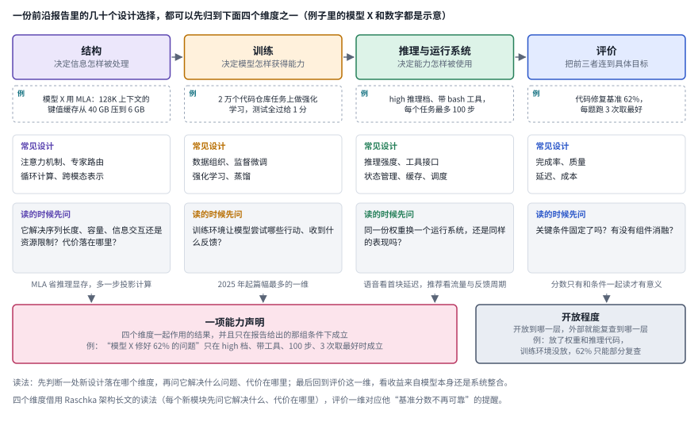

*图：读前沿报告的四个维度。上排四个色块从左到右是结构、训练、推理与运行系统、评价，紧挨着的虚线框用一个虚构的模型 X 举例（数字为示意），再下面两层分别是每一维的常见设计和读的时候先问的问题；四者共同汇成底部的一项能力声明，右下角的开放程度决定外部读者能复查到哪一层。*

图里四个色块之间的箭头表示一种依赖：结构定下了模型能学什么，训练定下了它学到了什么，运行系统定下了它用出来多少，评价最后说明这一切在什么条件下成立。所以底部粉色框里的能力声明，只在报告给出的那组条件下成立。拿图里的模型 X 来说，“修好 62% 的问题”这个数，背后是 MLA 省下的显存、在 2 万个仓库任务上的强化学习、high 推理档加 bash 工具和 100 步上限，以及每题 3 次取最好；换掉其中任何一条，这个数都可能变。右下角的灰框单独画出来，是因为它决定外部读者能不能核对：权重、代码、数据和环境开放到哪一层，我们就能复查到哪一层；模型 X 放了权重和推理代码，没放训练环境，62% 就只能复查一部分。

第一个维度是**结构，它决定信息在模型里怎样被处理**。注意力机制、专家路由、循环计算与跨模态表示改变的都是模型的计算路径。Raschka 在架构长文里反复演示一种读法：看到一个新模块，先问它对付的是序列太长、容量不够、信息交互不足还是资源受限，再问代价落在哪里。拿专家混合来说，它把网络里的前馈层拆成许多个并列的子网络，每个子网络叫一个专家，每个 token 只交给其中少数几个计算；这样模型的总参数可以很大，每一步实际参与计算的参数却很少，代价是要有一个路由器决定每个 token 交给谁，还要让各个专家的负载大致均衡。

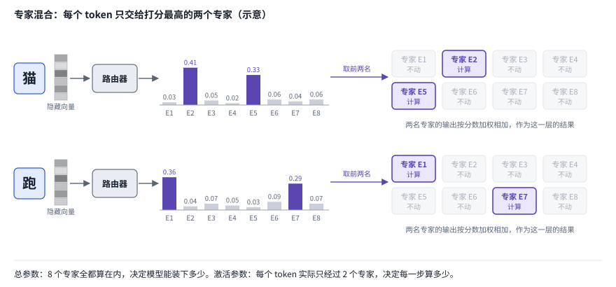

*图：两个 token 走过同一层专家混合。路由器给 8 个专家打分，每个 token 只交给分数最高的两个，其余 6 个专家这一步不参与计算（分数为示意）。*

图里“猫”和“跑”被路由器打出不同的分数，于是各自点亮了不同的两个专家。整层有 8 个专家，任何一个 token 只用到其中 2 个，所以报告里总参数和激活参数必须分开写：前者数的是全部 8 个，后者数的是每一步真正算过的那 2 个。

第二个维度是**训练，它决定模型从哪里学到本事**。数据组织、监督微调、强化学习和蒸馏作用在不同阶段。对 Agent 来说，训练环境还规定了模型能尝试哪些行动、会收到什么反馈，以及长任务里哪些行为值得保留下来。Raschka 在年终长文里认为 2025 年的大模型开发主要由强化学习推动，2025 年以后的报告也确实把越来越多的篇幅留给了这一维。

第三个维度是**推理与运行系统，它决定能力在实际调用时发挥出多少**。推理强度、工具接口、状态管理、缓存与请求调度共同影响最终结果。语音系统还要管第一段声音多久能播出来、用户插话时多快停下，在线推荐则要管流量怎样分配、反馈多久才回来。同一份权重放进不同的运行系统，表现出来可能像两个模型。

第四个维度是**评价，它把前面三类设计连到一个具体目标上**。完成率、质量、延迟和成本各自回答不同的问题。只有固定住关键条件做比较、再做组件消融，才分得清哪些收益来自模型本身，哪些来自系统整合。Raschka 在年终长文里认为，基准分数已经不再是模型实际表现的可靠指标，原因正在这里：一个分数脱离了测出它的条件，就说明不了多少事情。

## 二、发展主线：技术报告怎样从论文变成产品说明与工程档案

> **本节要点：** 技术报告这种文体走过了几个阶段：社区先定下发布时该交代什么，接着闭源发布变成产品说明，开放发布变成工程档案；开放报告随后成了外界看清前沿工程的窗口，后训练又成了报告的主角；到 2026 年，两条路线在能力上收敛，在发布方式上继续分化。

这条主线把几篇文章的视角叠在一起。Raschka 的两篇长文讲报告里写了什么，从架构收敛讲到后训练崛起；Lambert 和 Epoch 讲谁在写、为什么这样写，也就是开放与闭源两条路线的经济逻辑和能力差距；Model Cards 与 System Cards 的原始文章交代了“应该写什么”这套规范从哪里来。把它们放到时间轴上，技术报告的演变大致可以分成下面几个阶段。

| 阶段 | 内容 | 代表工作 | 本章对应分支 |
|---|---|---|---|
| 起点（2018–2022） | 先定下“应该披露什么”：数据、模型、系统三层文档规范 | Datasheets for Datasets、Model Cards、Meta System Cards | 4.8 |
| 第一阶段（2020–2023） | 发布从论文走向“技术报告”，闭源开始保留细节，开放权重带着长报告登场 | GPT-3、GPT-4 Technical Report、Llama 2 | 4.1、4.8 |
| 第二阶段（2024–2025） | 开放模型的报告成为外界了解前沿工程的主要窗口，架构向专家混合加高效注意力收敛 | DeepSeek-V3、OLMo、Raschka 的架构对比 | 4.1.1、4.1.4、4.1.5、4.2 |
| 第三阶段（2025） | 后训练、强化学习和推理扩展成为报告主角，基准分数的可信度开始动摇 | DeepSeek-R1、RLVR 与 GRPO、benchmaxxing | 4.1.2、4.1.3、4.1.6 |
| 第四阶段（2026） | 两条路线一边分化一边收敛：开放报告讲成本与结构，闭源发布讲工作能力与系统卡，差距缩到几个月 | Kimi K3、GLM-5.3、GPT-6 Astra、Claude Fable 5.1 与 Opus 5.5 | 4.1.1 至 4.1.10、4.8 |
| 旁支 | 报告文体扩散到语音、视觉、表格、推荐等专门领域 | wav2vec 2.0、Flamingo、TabPFN | 4.3 至 4.7 |
| 边界 | 报告能告诉我们什么，告诉不了什么 | 跨报告对照、系统卡的覆盖范围 | 第四节、第五节 |

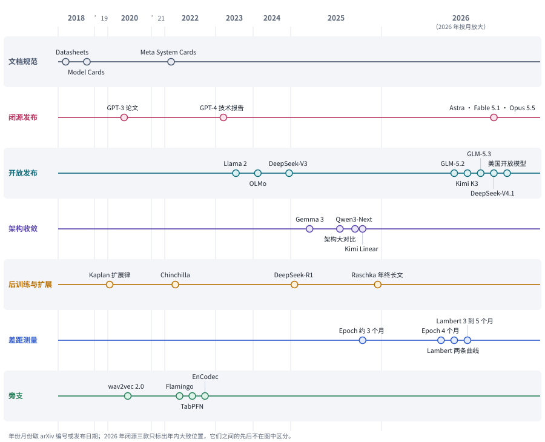

*图：技术报告文体的演进时间轴。每一行是一条线索：灰色是文档规范，玫红是闭源发布，青色是开放发布，紫色是架构收敛，琥珀色是后训练与扩展，蓝色是差距测量，绿色是专门领域的旁支；2026 年一栏按月放大。*

时间轴显示了表格里不显眼的先后关系：2026 年密集出现的开放报告，是沿着 2025 年形成的共识往前走的。文档规范一行的三个点都在 2022 年以前。开放发布一行在 2023 年的 Llama 2 之后才密集起来，到 2026 年夏天几乎每个月都有一份重要的开放报告，紧跟在架构收敛和后训练两行 2025 年的密集节点后面。差距测量一行集中在 2025 年底到 2026 年夏天，说明“开放落后闭源几个月”成为可以量化讨论的问题，只是最近一年的事。旁支一行里，语音、视觉、表格的经典起点都在 2020 到 2022 年之间。

### 文档规范：先说明能力声明在什么条件下成立

> **要点：** 发布一个模型时，到底该交代哪些东西？技术报告成为固定文体之前，社区就先回答了这个问题：数据、模型和整个系统各写一份说明，提问的范围一层比一层大，今天前沿实验室发布时附的那份系统说明，就是从最外面那一层长出来的。

技术报告还没成为固定文体之前，研究社区先用两篇文章定下了发布数据集或模型时该交代什么，也由此改变了读者的提问方式。2018 年的 [Datasheets for Datasets](https://arxiv.org/abs/1803.09010) 借用电子元件“数据手册”的比喻，要求数据集作者说明数据的动机、组成、收集过程和推荐用途；同年的 [Model Cards for Model Reporting](https://arxiv.org/abs/1810.03993) 把同样的思路搬到模型上，要求说明模型的适用情境，以及它在不同人群、不同条件下的表现。从此大家会追问哪些人、哪些任务、哪些条件被评估过，哪些没有，最高分只是其中一项信息。

模型卡管得了单个模型，可几年后模型越来越多地被嵌进更大的产品里，于是 Meta 提出了范围更大的系统卡。Meta 在 2022 年 2 月发布的 [System Cards](https://ai.meta.com/blog/system-cards-a-new-resource-for-understanding-how-ai-systems-work/) 一文讲得很直白：模型卡能很好地记录单个模型，却画不出一个 AI 系统的全貌，因为模型的行为取决于它所在的系统。系统卡要描述的是一组机器学习模型、AI 与非 AI 技术怎样一起完成特定任务，还要考虑模型输出在下游被怎样使用、会引出哪些策略动作、对使用产品的人有什么影响。

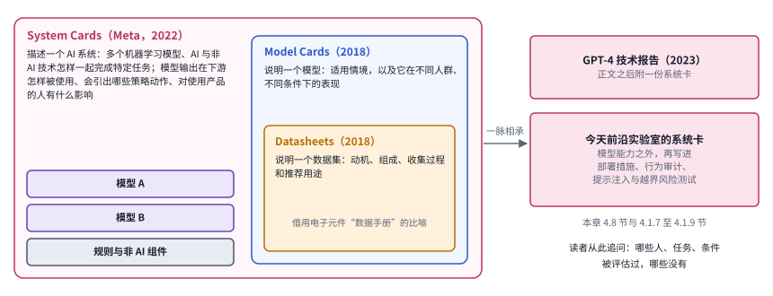

*图：三层文档规范一层套一层。最里面的琥珀色框是 Datasheets，中间的蓝框是 Model Cards，最外面的粉框是 Meta 的 System Cards，它把多个模型和规则等非 AI 组件一起框了进来；右边是这一脉在今天的延续。*

三层框的嵌套正好对应提问范围的扩大：数据手册只问一份数据从哪里来、该怎么用，模型卡问一个模型在哪些人群和条件下表现如何，系统卡再把多个模型、规则和下游使用一起纳入。图右的箭头画的是这一脉的延续：2023 年的 GPT-4 技术报告在正文之后附了一份系统卡，2026 年前沿实验室的系统卡又在模型能力之外写进了部署措施、行为审计和风险测试。读者从这一脉里继承下来的是一种提问习惯，看到任何一项能力声明，先问哪些人、哪些任务、哪些条件被评估过，哪些没有。

### 第一阶段：从论文到“技术报告”

> **要点：** 技术报告是怎样从普通论文分成两种文体的？2020 年的 GPT-3 还可以像普通论文那样读；2023 年起，不放权重的一方不再披露模型怎样造出来，只讲产品和安全，放出权重的一方则带着权重和长篇说明发布，写成了工程档案。

在大模型的早期，发布一个模型和发表一篇论文几乎是同一件事。2020 年的 GPT-3 论文 [Language Models are Few-Shot Learners](https://arxiv.org/abs/2005.14165) 就是典型：它在摘要里直接写明这是一个 1750 亿参数的自回归语言模型，正文里详细交代了模型规模、训练数据和评测方式，读者可以像读一篇普通的机器学习论文那样去读它。

2023 年，闭源一方打破了发布即论文的对应，“技术报告”开始指一种不交代模型怎样造出来的新文体。[GPT-4 Technical Report](https://arxiv.org/abs/2303.08774) 在“范围与局限”一节里写明，考虑到竞争格局和大规模模型的安全影响，报告不再披露架构（包括模型规模）、硬件、训练算力、数据集构建和训练方法等细节。这份报告篇幅并不短，重心却移到了能力评测、可预测的扩展规律和安全工作上，正文之后还附了一份系统卡。这种新文体告诉你模型能做什么、在哪些测试上表现如何、做了哪些安全工作，却不一定告诉你模型是怎样做出来的。

同一年，开放权重的一方给出了相反的回应。[Llama 2](https://arxiv.org/abs/2307.09288) 带着权重和一份很长的论文发布，把预训练、微调和安全评测分成独立的章节来写，读者可以把这三部分分开检查。闭源的报告越来越像产品与安全说明，开放的报告越来越像工程档案，两条路线从这里分岔。

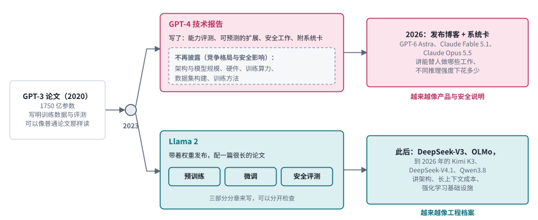

*图：2023 年的分叉。左边是 GPT-3 论文代表的“发布即论文”；上面一支是闭源路线，灰色虚线框列出 GPT-4 技术报告不再披露的内容，一路通向 2026 年的发布博客加系统卡；下面一支是开放路线，从 Llama 2 分章写的预训练、微调和安全评测，一路通向 2026 年讲架构与成本的开放报告。*

上面一支灰色虚线框里的五项，后来几乎成了闭源发布的默认空白；下面一支 Llama 2 分章写的做法，后来被 DeepSeek-V3、OLMo 继承了下来。两支最右端的方框，是这两条路各自走到 2026 年的样子。

### 第二阶段：开放报告成为看清前沿工程的窗口

> **要点：** 外界靠什么看清前沿模型是怎样造出来的？2024 年底到 2025 年，主要靠放出权重的实验室写的报告，而公开的程度又分好几级。这些报告里的模型结构越来越像，几种省钱的设计都在对付同一笔开销：上下文越长，模型为回看历史而存下的东西就越多。

2024 年底到 2025 年，外界了解前沿模型怎样被造出来，主要靠的已经是开放权重实验室的报告。[DeepSeek-V3 Technical Report](https://arxiv.org/abs/2412.19437) 是这个阶段的标志：它披露了 6710 亿总参数、每个 token 激活 370 亿参数的专家混合结构，在 14.8 万亿 token 上预训练，完整训练花费 278.8 万 H800 GPU 小时。这样具体的数字在闭源报告里已经很难见到。Raschka 在年终长文里专门讨论了这个成本数字引发的争论，他提醒大家，这个估算只覆盖最终那次训练运行的算力，前期的实验和失败尝试没有算进去。报告里的每个数字都有它的口径，这是读报告的第一课。

同样叫开放，开放的程度也分成几级。DeepSeek 开放权重和详细报告，训练数据并不公开；艾伦人工智能研究所的 [OLMo](https://arxiv.org/abs/2402.00838) 更进一步，作者指出此前很多开放发布只给权重和推理代码，OLMo 连训练数据、训练与评测代码一起放出，目的是让研究者能真正研究模型本身。Lambert 的阅读清单把 Pythia 和 OLMo 系列列为“完全开放”报告的样板。

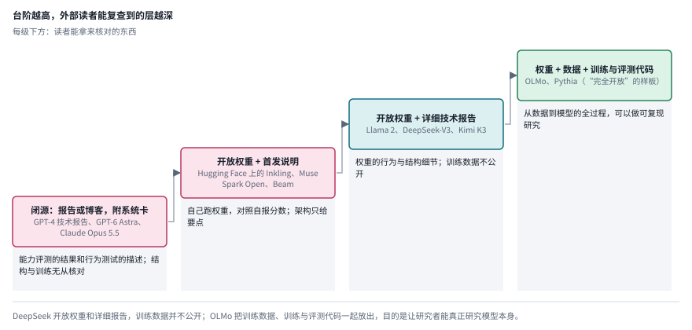

*图：开放程度的四级台阶。从左下到右上，外部读者能复查到的层越来越深；每级下方的灰色区域写的是读者能拿来核对的东西。*

分清台阶的用处在于，先判断一份报告站在哪一级，就知道哪些结论可以自己验证，哪些只能当作作者的说法。最低一级的闭源发布只给出能力评测的结果和行为测试的描述，结构与训练都无从核对；第二级多了权重，读者至少可以自己跑一跑，和首发说明里的自报分数对一对；第三级的详细技术报告把结构细节摊开，训练数据仍然看不到；最高一级的 OLMo、Pythia 连数据和训练、评测代码一起放出，从数据到模型的全过程都可以复现。想做可复现研究的同学，最好从最高一级的材料起步。

这一阶段的架构选择都围着长上下文的主要成本转，这份成本是一份随上下文增长的缓存。语言模型一个 token 接一个 token 地生成，每生成一个新 token，注意力层都要回看前面所有的 token。为了不每次重算，模型把每个旧 token 在每一层算出的两组向量（叫键和值）存起来，这份存储叫键值缓存，也常写作 KV 缓存。它随上下文长度一直增长，到了百万 token，存它要占大量显存，每一步读它也要花大量带宽，于是成了长上下文推理的主要成本。

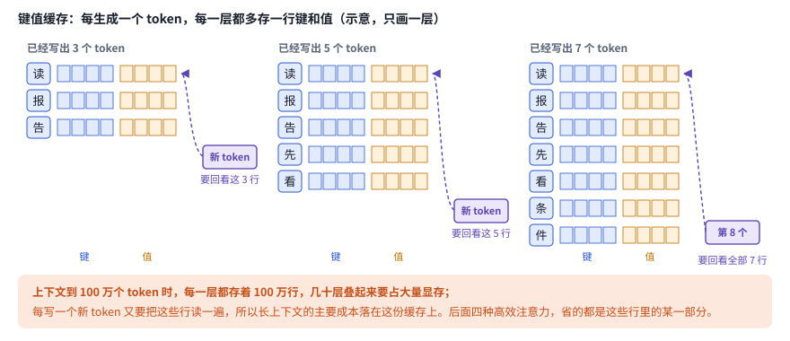

*图：同一层的键值缓存在三个时刻的样子。每写出一个 token 就多存一行键（蓝）和值（琥珀），新 token 要回看已经存下的每一行（示意，只画一层）。*

图从左到右是同一层缓存在三个时刻的样子：写出 3 个 token 时存着 3 行，写出 7 个时存着 7 行，第 8 个 token 要把这 7 行全部读一遍。把行数换成一百万、再乘上几十层，就是长上下文的账单。

为了压住键值缓存，开放模型的架构收敛到了专家混合加至少一种高效注意力，几种高效注意力的差别只在省掉缓存的哪一部分。Raschka 的大对比长文观察到，从 DeepSeek 开始，大多数开放模型都是这样搭的；省的方式各不相同：有的把每份键值压小，有的让多数层不看远处的历史，有的把整段历史压成一个定长状态，有的每步只挑少数位置来算。DeepSeek V3 用多头潜在注意力（MLA）把每份键值压小再存，Kimi K2 沿用并扩展了它；Gemma 3 让多数层只看最近一段，局部层与全局层的比例是 5 比 1；Qwen3-Next、Kimi Linear 用线性注意力替换大部分全注意力层；DeepSeek V3.2 则用稀疏注意力，只对挑出来的少数位置算注意力。Raschka 在逐代拆解 DeepSeek 的文章里还提到，V3.2-Exp 引入的 DeepSeek 稀疏注意力，很大程度上是在为 V3.2 准备推理基础设施。到这个阶段，报告里的架构创新越来越多地围绕“长上下文怎样便宜地跑起来”展开。

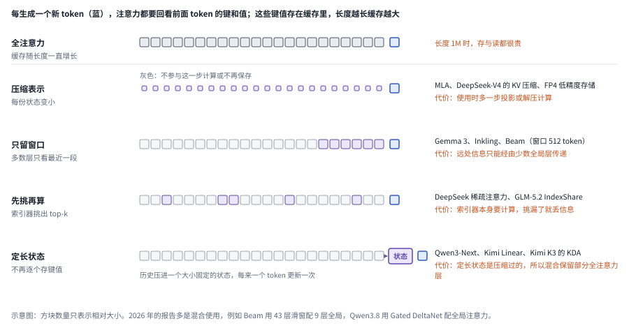

*图：压低键值缓存的四种办法（示意）。每一行左边是生成新 token（蓝色）时要回看的历史，紫色是仍然参与计算或被保存的部分，灰色是被省掉的部分；右边写出代表工作和代价。*

图里四种办法各省掉键值缓存的一部分，也各付出一种代价。最上面一行是基线：全注意力每生成一个新 token 都要回看前面所有 token 的键和值。第二行让每一份状态变小，方块数量没变，体积缩了，MLA、DeepSeek-V4 的 KV 压缩和 FP4 低精度存储都属于这一类，代价是用的时候多一步投影或解压。第三行只保留最近一段窗口，其余历史在这些层里直接不看，远处的信息只能靠少数全局层传过来。第四行先由一个轻量的打分网络（叫索引器）挑出最相关的几个位置，只对它们做注意力，省下的是计算，代价是索引器本身也要算，挑漏的位置就看不到了。最后一行不再逐个保存键值，把历史压进一个大小固定的状态，每来一个 token 更新一次，这就是线性注意力；这份状态是压缩过的，精确找回远处细节的能力会变弱，所以用它的模型都在其间保留了部分全注意力层。

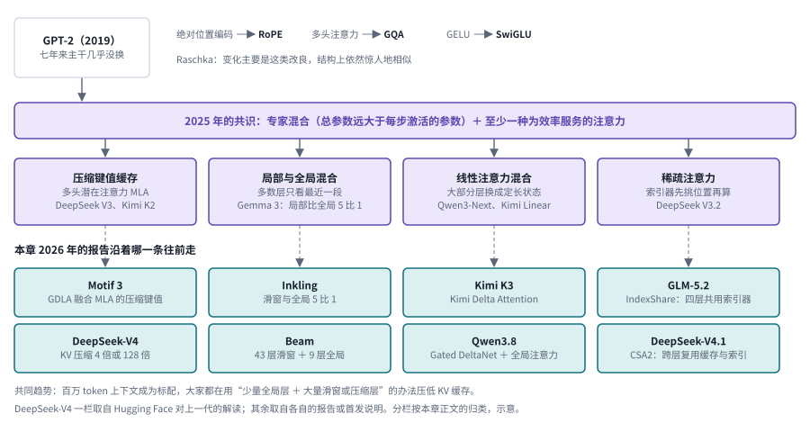

*图：开放模型的架构收敛与 2026 年的延续。最上面是 Raschka 指出的七年改良；紫色横条是 2025 年的共识；四个紫框是四条为效率服务的注意力路线；下面的青色框是本章 2026 年的报告各自沿着哪一条往前走。*

这张图补上的是 2026 年的去向：Kimi K3 和 Qwen3.8 走线性注意力混合，GLM-5.2 和 DeepSeek-V4.1 走稀疏与压缩，Inkling 和 Beam 走局部与全局混合，Motif 3 和 DeepSeek-V4 在压缩键值上继续做文章。2026 年的报告很少只用一种办法，把一份新报告放到这张图上，可以逐层问它属于哪条路、哪几条路怎样搭配，又在哪一处真正偏离了共识。

**速查：五种为效率服务的架构做法。** 五种做法都在决定什么要完整保留、什么可以省掉或压缩，差别只在省的位置。下面五张结构卡用同一种画法，从左往右是一个 token 经过这一模块的路径，并排看就能找到各自省在哪里：A1 压每一份状态，A2 省掉大部分专家的计算，A3 省掉远处的历史，A4 把历史整体压成定长状态，A5 只挑少数位置来算。

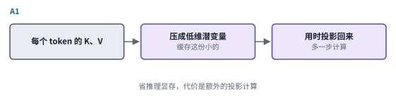 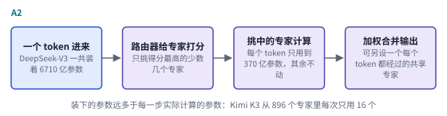

 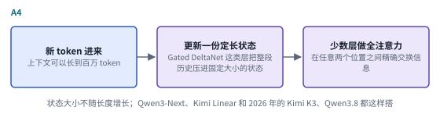

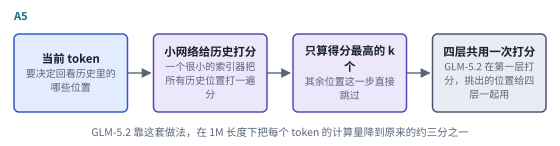

*图：五种架构做法的结构卡，每张卡对应下表的一行。*

| code | 名称 | 年份 | 代表 | 怎么做 | 解决了什么 | 代价 |
|---|---|---|---|---|---|---|
| A1 | 多头潜在注意力（MLA） | 2024 | [DeepSeek-V3](https://arxiv.org/abs/2412.19437)、Kimi K2 | 把每个 token 的键和值压成一个低维潜变量存进缓存，用到时再投影回来 | 键值缓存变小，长上下文推理省下显存 | 每次使用都多一步投影计算 |
| A2 | 专家混合 | 2024 | DeepSeek-V3（6710 亿总参数，每个 token 激活 370 亿） | 路由器为每个 token 挑少数几个专家计算，其余参数不动，可以另设共享专家 | 总参数（容量）可以远大于每一步实际计算的参数 | 路由与负载均衡带来工程复杂度；总参数和激活参数必须分开报告 |
| A3 | 局部与全局注意力混合 | 2025 | Gemma 3（局部比全局 5 比 1）；2026 年的 Inkling、Beam | 多数层只对最近一段窗口做注意力，少数层看全部历史 | KV 缓存主要来自少数全局层，长上下文变便宜 | 远处的信息只能经由少数全局层传递 |
| A4 | 线性注意力混合 | 2025 | Qwen3-Next、Kimi Linear；2026 年的 Kimi K3、Qwen3.8 | 大部分层把历史压进一个定长状态逐 token 更新，其间穿插少量全注意力层 | 状态大小不随长度增长，百万 token 上下文的计算与存储可控 | 定长状态是压缩过的，精确找回远处细节要靠保留下来的全注意力层 |
| A5 | 稀疏注意力 | 2025 | DeepSeek V3.2；2026 年的 GLM-5.2（IndexShare） | 轻量索引器先给历史位置打分，只对挑出的 top-k 位置算注意力；GLM-5.2 让四层共用一个索引器 | 长上下文下每个 token 的计算量下降，GLM-5.2 在 1M 长度下降到原来的约三分之一 | 索引器本身也要计算；挑漏了的位置就看不到 |

### 第三阶段：后训练与推理扩展成为报告主角

> **要点：** 模型结构越来越像以后，报告的篇幅花到了哪里？2025 年初的一份报告说明，只用能自动核对对错的分数去训练，模型也能学会推理；此后报告的篇幅从模型结构移到了预训练之后的那一段：怎样搭练习环境，怎样给分，让模型想多久。同一时期，榜单分数开始不那么可信，读分数时必须带上测分的条件。

架构收敛之后，2025 年 1 月发布的 [DeepSeek-R1](https://arxiv.org/abs/2501.12948) 把报告的重心移到了后训练上。论文的核心主张是，大模型可以仅通过强化学习获得更强的推理能力，用不着人类写好的推理示范，自我检查、调整策略这类行为会在训练中自然出现。它用的奖励只看最终答案能不能被自动核对，比如数学题对答案、代码跑测试，这种做法叫基于可验证奖励的强化学习（RLVR）。Raschka 把 R1 称为“一件非常大的事”，并认为 2025 年的大模型开发基本被 RLVR 和 DeepSeek 采用的更新算法 GRPO 主导。从此，技术报告的篇幅分配明显变了：架构章节越来越短，因为大家用的东西越来越像；后训练、强化学习环境、奖励设计和推理预算的章节越来越长。

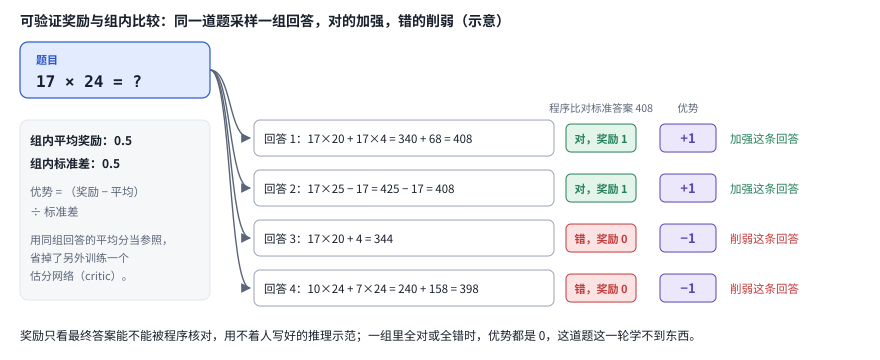

*图：同一道乘法题采样四个回答，程序比对标准答案给出奖励，再和组内平均比较，得到每个回答该被加强还是削弱（示意）。*

拿一道乘法题就能看清这套奖励怎样起作用。模型对“17 × 24”写出四个回答，程序只核对最后的数字是不是 408，前两个得 1 分，后两个得 0 分；组内平均是 0.5，高于平均的两条被加强，低于平均的两条被削弱。整个过程没有人去评判推理写得好不好，这就是 R1 说“用不着人类写好的推理示范”的含义。

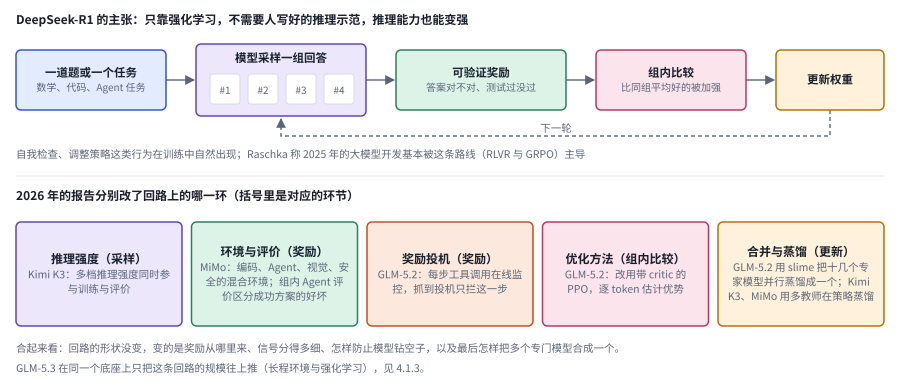

*图：基于可验证奖励的强化学习回路。上排是 DeepSeek-R1 代表的基本回路，沿用上一张图那道乘法题和四个回答，箭头上的小字是每一步交给下一步的东西（数值为示意），下排五个框是 2026 年的报告分别改动的那一环，括号里标出对应的环节。*

这张图说明，2026 年的报告都沿用 R1 的回路，各家只挑其中一环来加固。上排的回路只有五步：给一道题，让模型采样一组回答，用标准答案或测试判断每个回答对不对，在同一组里互相比较，比组内平均好的回答被加强，然后更新权重进入下一轮。图里的分数由核对程序算出，程序不需要训练：两个 408 得 1 分，344 和 398 得 0 分，各自减去平均分 0.5、再除以标准差 0.5，前两个回答被加强。组内比较这一步就是 GRPO 的做法，它用同组回答的平均分当参照，省掉了另外训练一个网络来估计“这一步之后还能拿多少分”。下排是各家挑中的那一环：Kimi K3 在采样一环引入多档推理强度，也就是让同一个模型按几档不同的思考长度作答；MiMo 在奖励一环把环境做杂、把评价做细；GLM-5.2 在奖励一环防止模型钻空子，又在比较一环改回带 critic 的 PPO，critic 就是 GRPO 省掉的那个估分网络；合并与蒸馏发生在更新之后，让一个学生模型学习多个分别训练好的专家模型，把它们合成一个。读一份新的后训练报告时，先找它动的是回路上的哪一环，比记住算法名字更有用。

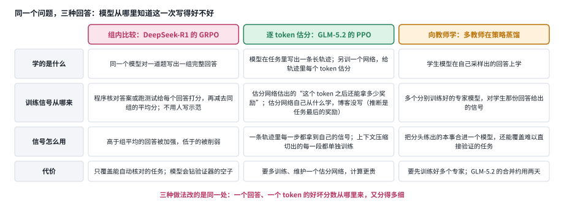

*图：三种后训练做法的范式对比。每一列是一种做法，四行分别是学的是什么、训练信号从哪来、信号怎么用和代价。*

三种做法的根本差别，在于模型从哪里知道自己这一次写得好不好。左列的组内比较由程序给每个回答打分，再减去同组平均分，一个回答只得到一个整体的好坏；中列另训一个估分网络，给长轨迹里的每个 token 各估一个分，信号细到每一步，代价是多养一个网络，而这个估分网络自己从什么学，博客没有写；右列的信号来自已经练好的专家模型，它们对学生自己写出的回答给出指导，所以能覆盖程序核对不了的任务。

后训练变成主角，背后是 Raschka 所说的另一件事：单靠扩大数据和参数已经不够划算。他举的例子是 GPT-4.5，更大的训练预算被认为性价比很差；进步更多来自更好的中期训练与后训练，以及推理扩展，也就是在使用时让模型多想一会儿，用延迟和成本换准确率。

后训练和推理扩展带来漂亮分数的同一年，读报告的人也开始对分数失去信心。Raschka 的年度词 benchmaxxing 说的就是这件事，他以 Llama 4 为例，指出一些模型的榜单分数在实际使用中站不住。他的态度很务实：基准仍然可以当作及格线，可两个模型都过了线，分数高一点并不说明好很多。这直接影响了今天的读法：看到一份报告里的漂亮表格，先追问推理强度、执行框架和任务预算这些条件，再看有没有第三方的独立测量。

**速查：五种后训练做法。** 五种做法都是在 R1 的回路上改一环，下面五张卡分别对应这五种改法，从左往右是一轮流程，底部的虚线是绕回下一轮的那条路。P4 的做法里，学生模型在自己采样出的回答上接受多个教师的打分或纠正，这叫多教师在策略蒸馏。

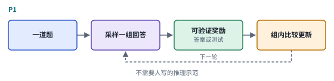 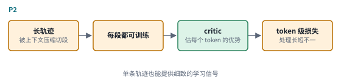

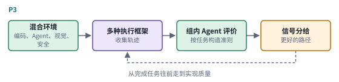 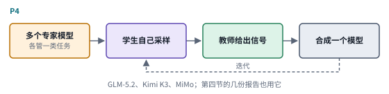

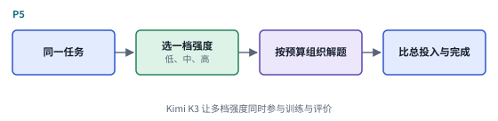

*图：五种后训练做法的结构卡，每张卡对应下表的一行。*

| code | 名称 | 年份 | 代表 | 怎么做 | 解决了什么 | 代价 |
|---|---|---|---|---|---|---|
| P1 | 可验证奖励的强化学习（RLVR）与 GRPO | 2025 | [DeepSeek-R1](https://arxiv.org/abs/2501.12948) | 对一道题采样一组回答，用答案或测试判对错，组内比平均好的回答被加强 | 用不着人写好的推理示范，自我检查、调整策略这类行为在训练中自然出现 | 奖励只覆盖能自动验证的任务；模型会钻验证器的空子（见 4.1.2 GLM-5.2 的自述） |
| P2 | 带 critic 的 PPO 与分段轨迹 | 2026 | [GLM-5.2](https://huggingface.co/blog/zai-org/glm-52-blog) | 另训一个估分网络（critic），估计每个 token 之后还能拿到多少奖励；上下文压缩切出的每一段都当作可训练的轨迹，用 token 级损失处理长短不一 | 单条轨迹也能提供细致的学习信号，长轨迹切段后仍能训练 | 要多训练和维护一个 critic，计算开销更大 |
| P3 | 混合环境强化学习与组内 Agent 评价 | 2026 | [MiMo-V2.6-Pro-RL](https://huggingface.co/XiaomiMiMo/MiMo-V2.6-Pro-RL) | 编码、通用 Agent、视觉、安全环境放进同一个强化学习过程；从对照轨迹构造准则，比较成功方案的质量 | 处理反馈的方法能在场景之间迁移；成功的轨迹之间也分得出好坏 | 要统一管理不同任务的观察、动作和完成条件；采样吞吐、奖励可信度和稳定性要一起维护 |
| P4 | 多教师在策略蒸馏 | 2026 | GLM-5.2（slime）、Kimi K3、MiMo | 先分别训练多个专家模型，再让学生在自己的采样上接受多个教师的信号，合成一个模型 | 把分头练出的能力合进一个模型，还能覆盖难以直接验证的任务 | 要先训练好多个专家；GLM-5.2 的合并过程本身就用了约两天 |
| P5 | 推理强度分档 | 2026 | Kimi K3、Qwen3.8、Claude Fable 5.1 | 同一模型在几档推理投入下运行，Kimi K3 让多档同时参与训练与评价 | 简单步骤不必用最高投入，模型学会在不同预算下组织解题 | 比较时必须对齐推理强度；保留更多推理历史，也要管理已经失效的假设 |

### 第四阶段：分化与收敛同时发生

> **要点：** 到 2026 年，放权重和不放权重的两条路是越走越近，还是越走越远？能力上越走越近，几种测法都把差距量成了几个月；发布方式上越走越远，因为两边做的是不同的生意：放权重的一方写工程报告，不放的一方写发布博客和安全说明，发布节奏一个以天计、一个以月计。

先说收敛：几种口径量出的数字对不齐，方向却一致，开放模型稳定地跟在闭源前沿几个月之后。Epoch AI 的测量显示，2025 年 10 月时最强开放权重模型平均落后闭源前沿约 3 个月，2026 年 5 月的更新是平均 4 个月、ECI 差 8 分。Lambert 在 Kimi K3 发布后的估计是差距从 6 到 9 个月缩到 3 到 5 个月，他的阅读清单里写的则是大约 4 到 6 个月，并且指出自 2024 年前后以来，领先的开放模型全都来自中国实验室。几个口径用的指数、时间点和估计方法各不相同，数字也就对不齐。

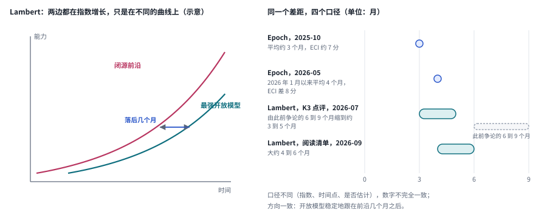

*图：开放与闭源的能力差距。左边是 Lambert“两条指数曲线”的示意，两条曲线之间的水平距离就是“落后几个月”；右边把四个口径放在同一根以月为单位的轴上，圆点是单个估计，横条是区间。*

图里的差距要看两条曲线之间的水平距离，它表示开放模型要再过多久才能达到闭源前沿此刻的能力。Lambert 认为两条曲线都在指数增长，所以这个距离以月为单位看起来相对稳定。右图把四个估计放在同一根轴上，它们落在不同位置，却都在半年以内。

再说分化：两条路线的发布材料长得不同，是因为它们做的是不同的生意。Lambert 在《不同的指数曲线》一文里把原因归到商业结构上：闭源实验室把最好的模型留在自己的一体化产品里，面向愿意为最强能力付溢价的知识工作和编码 agent；开放模型天然不是一体化的，要靠许多公司协作来部署和服务，它们比的是同样能力下谁更便宜。这种差异直接写进了发布材料的形态里。开放实验室要向下游的部署者和研究者证明这份权重值得用，所以 Kimi K3、DeepSeek-V4.1、Qwen3.8 的报告花大量篇幅讲架构、长上下文成本和强化学习基础设施；闭源实验室要向付费用户说明模型能替人做什么，所以 GPT-6 Astra、Claude Fable 5.1 和 Opus 5.5 的发布几乎不谈参数和结构，转而讲模型能完成哪些工作、在不同推理强度下花多少钱，并用系统卡交代行为审计、提示注入和越界风险。发布节奏也随之不同：Lambert 在 GLM-5.3 一文里指出，智谱的发布周期以天计，OpenAI 和 Anthropic 往往以月计，后者把这段时间花在发布前的测试上，系统卡也就越写越厚。

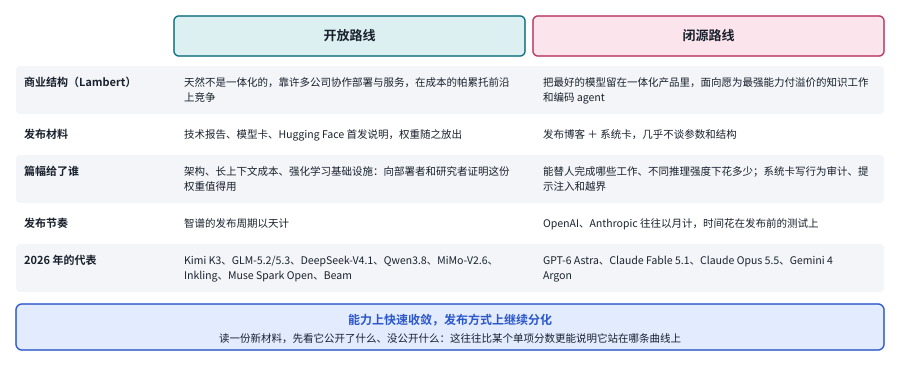

*图：两条路线怎样分化。左栏是开放路线，右栏是闭源路线，每一行比较一个侧面；底部的蓝条是这一阶段的总结。*

这张图把分化从生意一路推到发布材料，横着读，每一行是同一个问题的两种答案：第一行是生意的差别，往下几行是它在发布材料、篇幅分配和发布节奏上的后果，最后一行列出两条路线在 2026 年的代表。读一份旗舰发布时，每家公开了什么、没公开什么，往往比某个单项分数更能说明它站在哪条曲线上。

### 旁支：技术报告扩散到专门领域

> **要点：** 技术报告这种写法只出现在通用大模型上吗？语音、视觉、表格、推荐等专门领域也写起了这种报告。每个领域都有自己的经典起点，也多出了通用模型没有的约束，读的时候要先回到那个领域原来的技术路线上。

技术报告这种文体早已从通用旗舰扩散到各个专门领域，读这些报告光靠披露规范不够，还要懂这一领域的技术。披露规范帮助我们检查证据，却代替不了对技术本身的理解：不同模态的输入、输出与时序约束各不相同，同样一句“效果更好”，在语音、表格和推荐里要用完全不同的方式检验。

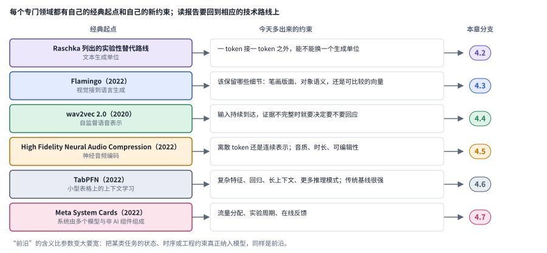

*图：技术报告文体向专门领域扩散。左列是各领域的经典起点，中列是今天多出来的约束，右列是本章对应的分支编号。*

左列的经典起点决定了一个领域默认的问题设定，中列是今天的新报告多出来的约束，正是这些约束让老的评价方式不够用了。语音这一侧，[wav2vec 2.0](https://arxiv.org/abs/2006.11477) 研究怎样从语音里自监督地学到有用的表示，[High Fidelity Neural Audio Compression](https://arxiv.org/abs/2210.13438) 研究怎样把音频压成可以生成的编码；前者服务于理解，后者服务于生成。今天的语音系统多出来的约束是时间：它要在一句话还没说完、证据不完整时就决定要不要回应。多模态这一侧，[Flamingo](https://arxiv.org/abs/2204.14198) 展示了把视觉信息接到语言生成上的路线；今天的实时视觉系统面对的是持续到达的输入，输出又不能无限等待，离线基准上的解释搬过来就不够用了。

表格和推荐两侧同样说明，“前沿”的含义比参数变大宽得多，把某类任务的状态、时序或工程约束真正纳入模型，同样是前沿。表格这一侧，早期的 [TabPFN](https://arxiv.org/abs/2207.01848) 用小型表格分类展示了“表格基础模型”的思路：模型看几行带标签的样本，就直接猜出新样本的标签，不再为每张表单独训练；近期报告把范围扩展到更复杂的特征、回归、长上下文和更多推理模式，同时要面对很强的传统基线。推荐这一侧，报告开始比较生成、排序、用户状态和在线策略控制等不同的组织方式，约束来自流量分配和在线反馈。

正因为各领域都有自己的技术路线，这些历史工作提供的是路线坐标，本身不是今天产品的说明书。一份新报告如果把多个既有模块组合起来，贡献可能主要在系统整合与可扩展的训练上；如果改变了目标函数或状态表示，才需要更细致的机制比较。没有全新架构，不妨碍一份报告有扎实的工程贡献；架构名字很新，也同样需要控制实验来支撑。

### 边界：报告能说明什么，说明不了什么

> **要点：** 一份报告到底能说明什么？技术报告始终在“展示能力”和“让外部读者判断条件”之间拉扯。读每一份材料都分开三件事：它声称了什么，在什么条件下测的，哪些部分外部能复查。

走完这几个阶段再回头看，技术报告这种文体始终在两种需求之间拉扯：作者要展示能力、吸引使用者，外部读者要足够的信息去判断这些能力在什么条件下成立。Lambert 在 Kimi K3 的点评里说得很坦率：训练算力、数据和推理需求这些关键量，外界几乎没有测量手段，实验室宣称的效率提升也就很难被独立核实。闭源一方的系统卡写得越来越详细，覆盖的却主要是行为和风险，对结构与训练依然沉默。所以本章读每一份报告时，都尽量分开三件事：报告声称了什么，它在什么条件下测的，以及哪些部分可以被外部复查。

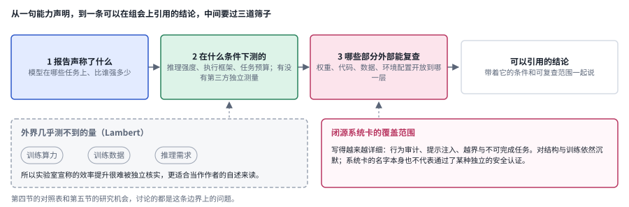

*图：从能力声明到可以引用的结论要过三道筛子。上排是三道筛子；左下的灰框是外界几乎测不到的量，右下的粉框是闭源系统卡覆盖到的范围，它们分别卡在第二道和第三道筛子上。*

三道筛子按先后过，而且常常漏。第一道只是把报告的说法原样记下来；第二道要求补齐推理强度、执行框架、任务预算和第三方测量这些条件，同一个分数换了条件可能就站不住；第三道再看权重、代码、数据和环境开放到哪一层，决定这句话我们能不能自己验证。图下方两个框说明筛子为什么常常漏：训练算力、数据和推理需求外界几乎测不到，第二道筛子在效率类的说法上经常无从下手；闭源系统卡对结构与训练留白，第三道筛子在这些部分也就没有材料可查。第四节的对照表和第五节的研究机会，讨论的都是这条边界上的问题。

## 三、前沿研究方向

这一节收录 2026 年的前沿报告和发布材料，它们排不成一列，所以读每一份时都要带着两个固定的问题。这些材料覆盖不同的任务和不同的发布形态，没办法只按模型规模或一个总分排成一列：通用模型、语音、多模态、表格与推荐系统面对的约束各不相同，开放的范围也和能力的范围是两回事。读的时候建议始终带着两个问题：这份材料属于开放路线的工程档案，还是闭源路线的产品说明加系统卡？它给出的每个数字，是在什么推理预算、什么执行框架下测出来的？带着这两个问题读，一串产品更新记录就能还原成一条研究脉络。

> **本节要点：** 八个分支收录 2026 年的前沿报告和发布材料。4.1 节按开放、闭源和美国开放三组逐个讲通用旗舰，每组末尾用一排发布卡和一张速查表横向比较；4.2 到 4.8 节分别是文本生成单位、视觉、语音、音频、表格、推荐和发布材料，每个分支先说清这一类任务特有的约束，再看几份报告怎样对付它。

### 4.1 通用旗舰模型：从模型能力到完整任务交付

通用旗舰各家都在解决同一个问题，就是怎样让一个模型撑起一段又长又杂的工作，差别只在把力气主要花在哪里。人们对通用旗舰的期待，早已超出把某一类题答得更准：它要让推理、代码、视觉理解和工具使用彼此配合。各家的差别在于把力气主要花在第一节四个维度里的哪一维：有的花在结构和运行系统上，重新安排长上下文的计算与存储；有的花在训练上，扩大混合任务的强化学习；闭源的几家则花在运行与评价上，强调自主执行、结果检查与人机协作。本节依次讲 Kimi、GLM、DeepSeek、Qwen、MiMo、GPT 和 Claude 的代表型号，以及 Thinking Machines、Meta、Reflection 的开放模型，说明每个模型的定位、公开的技术亮点，以及这些变化为什么和 Agent 有关。

> 主线位置：第四阶段，开放与闭源路线分化与收敛的现场。4.1.1 到 4.1.6 属于开放路线，接 DeepSeek-V3、Llama 2 一脉的工程报告；4.1.7 到 4.1.9 属于闭源路线，接 GPT-4 Technical Report 以来的“发布博客加系统卡”；4.1.10 是 2026 年下半年回归的美国开放权重模型。

> **要点：** 这些旗舰材料分属不同文体，披露深度差别很大，所以每个条目只讨论它的材料能解释的那部分设计：有技术报告的深入结构和训练，只有博客和系统卡的集中在任务能力与部署行为上。

材料的文体决定了能从里面读出多深的东西。完整的技术报告可以讨论架构与训练机制，模型卡有助于区分权重版本和服务配置，发布博客则更适合了解能力重点和使用方式的变化。开放模型还有一种常见材料：Hugging Face 博客上的首发说明，标题多半叫"Welcome X"。它们在模型发布当天出现，由 Hugging Face 与模型团队一起撰写，篇幅不长，内容固定为三块：最有特点的架构设计，自报的基准分数，以及怎样用 transformers、vLLM、llama.cpp、TRL 等工具把模型跑起来。读技术报告之前先读这样一篇，能很快抓住这个模型自己最想强调的几处设计；它的分数大多由模型团队提供，引用时应当注明出处，分量也低于正式的技术报告。

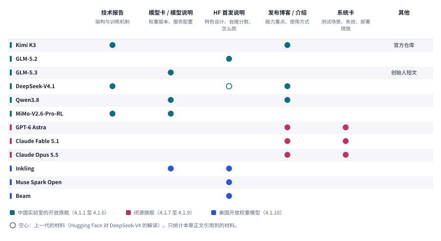

*图：各旗舰公开了哪几种材料。横向是五类发布材料，纵向是本节的十二个型号，实心点表示本章正文引用到的材料；青色是中国实验室的开放旗舰，玫红是闭源旗舰，蓝色是美国的开放权重模型。*

矩阵显示，闭源旗舰只公开能力与风险，开放旗舰公开构造却没有系统卡。玫红色的三行只在发布博客和系统卡两列有点，左边三列全空，这就是闭源路线“讲能力与风险、不讲构造”的样子；青色的六行几乎都落在技术报告、模型卡和发布介绍上，系统卡一列一个点也没有；蓝色的三行集中在 Hugging Face 首发说明一列，它们暂时都还没有完整的技术报告。读下面每个条目之前，先在图上找到它那一行，就知道这一条能讲多深。

#### 4.1.1 Kimi K3：把大规模容量、长上下文与自主执行共同扩展

Kimi K3 最值得看的地方，是它把模型容量的扩展和持续工作的能力放进了同一个设计里。它面向的不止文本问答，视觉输入、长上下文和多步工具任务都被纳入了通用底座。Lambert 在发布后的点评里称它是迄今最强的开放模型、一个真正的前沿模型，并据此判断开放与闭源的差距缩到了大约 3 到 5 个月。[Kimi K3: Open Frontier Intelligence](https://arxiv.org/abs/2607.24653) 因此值得当作一份完整的系统报告来读：模型结构、训练环境和部署方式都围绕更复杂、更持久的任务展开，能力提升的解释远不止“参数更多了”。

> 主线位置：第二阶段的架构线索加第四阶段的开放路线。接 Raschka 架构对比中 Kimi K2、Kimi Linear 的 MLA 与线性注意力路线，以及 DeepSeek-V3 的大规模专家混合。

> **要点：** 怎样既把模型做大，又让它撑得住长任务？Kimi K3 把这两件事放进同一个设计：结构上同时改善信息沿序列和沿深度的流动，后训练混合多类任务和多档推理强度，基础设施为长任务保存训练中的尝试进度和执行环境状态。

**结构上，它同时处理序列长度和网络深度两个方向上的信息传递。** 报告摘要说，K3 建立在两个模块上：Kimi Delta Attention 改善信息沿序列方向的流动，也就是模型怎样利用很长的历史；Attention Residuals 改善信息沿深度方向的流动，也就是深层计算怎样继续使用前面各层形成的表示。按本章第二阶段的分类，Kimi Delta Attention 属于 Kimi Linear 那条线性注意力路线，把历史压进定长状态逐 token 更新。容量一侧，K3 是一个 2.8T 总参数、每个 token 激活 104B 的专家混合模型，报告用一个叫 Stable LatentMoE 的设计让每个 token 从 896 个路由专家里激活 16 个，并称相对 K2 有约 2.5 倍的扩展效率。理解这组设计时，与其背下几个模块名，不如想清楚哪些信息要保留下来、又怎样被后续计算用到。

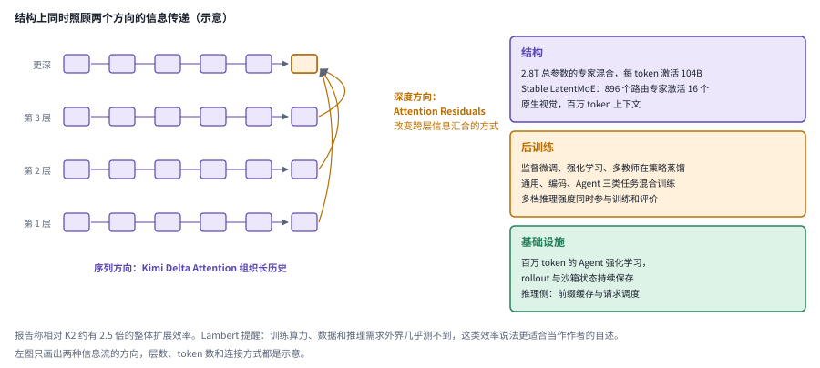

*图：Kimi K3 的三层设计。左边示意两种信息流，紫色横向箭头是序列方向上的 Kimi Delta Attention，琥珀色曲线是深度方向上的 Attention Residuals；右边三个色块是报告里的结构、后训练和基础设施三层。*

左图里每一行是一层网络，每个小方块是一个位置：横着走的紫色箭头是信息沿序列传递，从下面几层弯到顶层的琥珀色曲线是信息沿深度汇合。右边三个色块对应本条的三段正文，三层要一起看，才能解释能力从哪里来。

**原生视觉与长上下文，让任务输入不再局限于短文本。** 代码仓库、屏幕、文档和较长的工具记录，可以在同一个任务里共同构成判断依据。报告支持百万 token 级的上下文，可真正的研究问题在于模型能不能从这些信息中找出有效约束，并在后续执行中保持一致。窗口更大只解决了装得下的问题，能不能持续正确地使用这些信息，还要靠训练与系统管理。

**后训练的重点，是把通用、编码与 Agent 的经验组合起来。** 报告讨论了监督微调、强化学习、多教师在策略蒸馏（让一个学生模型在自己的回答上接受多个专家模型的指导），以及与部署条件相适配的后训练，并构建了可执行、可检查的任务环境。任务除了最终答案，还包括自主执行、网页开发、个人助理和代码优化等工作。同一个模型可以按几档不同的思考长度作答，这叫推理强度；K3 让几档推理强度同时参与训练和评价，模型因此学会在不同预算下组织解题，最长的推理不再是唯一的模式。

**长任务训练还离不开基础设施。** 在强化学习里，模型在环境中完整跑一遍任务叫一次 rollout，代码在一个隔离的执行环境（沙箱）里运行。百万 token 的长任务一次 rollout 要跑很久，K3 把持续保存 rollout 状态、沙箱状态和长上下文调度当作单独的问题来处理；推理侧又结合了前缀缓存与请求调度。它的亮点可以概括为一句话：**不光训练一个能读长输入的大模型，还为它准备了能持续交互、保留进度并检查结果的训练与运行条件。** [官方仓库](https://github.com/MoonshotAI/Kimi-K3)提供了权重与评测入口。比较结果时，要同时核对推理强度、工具框架和任务预算，光凭上下文长度推断不出长期可靠性。Lambert 也提醒过，训练算力、数据和推理需求这些量外界几乎测不到，报告里的效率说法更适合当作作者的自述来读。

**十月更新：Kimi K3.1 Pro，在同一个底座上加大后训练。** 2026 年 10 月 23 日，Moonshot 发布了 [Kimi K3.1 Pro](https://www.kimi.ai/blog/kimi-k3-1-pro)，它是新的 K3.1 系列里的第一个型号，官方称之为迄今最强的 3T 级开放权重模型。博客对它的来历交代得很直白：K3.1 Pro 是 Kimi K3 的后训练版本，底座沿用 K3，变化来自规模大得多的后训练算力。为了让数百个下游领域能放进同一个强化学习过程里联合训练，团队优化了强化学习框架、长上下文推理和训练效率，也改进了沙箱基础设施、rollout 调度和环境质量检查。这些部件正是 K3 报告里为长任务训练准备的那一层基础设施，K3.1 Pro 把它们推到了更大的规模上去用。

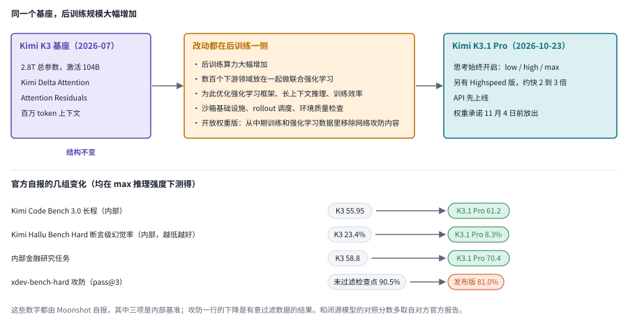

*图：从 Kimi K3 到 K3.1 Pro。上排左边是沿用的 K3 底座，中间是官方博客写到的全部改动，右边是发布形态；下排是官方自报的四组前后对比，前三组来自内部基准。*

上排说明改动全都落在后训练以及支撑后训练的系统上，结构不变。右边的发布形态是：思考模式始终开启，用 low、high、max 三档推理强度控制投入，另有一个速度约快两到三倍的 Highspeed 版本，API 先上线，完整权重承诺在 11 月 4 日之前放出。下排前三组是 Moonshot 的内部基准：长程编码从 55.95 升到 61.2，难题上的断言级幻觉率从 23.4% 降到 8.3%，内部金融研究任务从 58.8 升到 70.4。第四组是攻防基准，方向和前三组相反，下面单独讲。

**攻防能力是有意压下去的。** 博客专门交代，开放权重版本从中期训练和强化学习的数据里移除了网络攻防内容。Moonshot 给出的理由是一条发布原则：不发布会把网络攻防能力的绝对前沿继续往前推的开放权重。这条原则留下的痕迹是攻防基准 xdev-bench-hard 上的两个分数，指标是 pass@3，即每题尝试三次、至少一次成功的比例：未经过滤的内部检查点达到 90.5%，实际发布的版本是 81.0%；作为参照，博客列出的 K3 是 33.3%，智谱的 GLM-5.3 是 57.1%。开发方主动公开过滤前后各是多少分，这样的材料很少见，研究开放模型安全的同学可以把它和第 7 章的安全讨论放在一起读。

**读这些数字时要记住几个条件。** 所有结果都在 max 推理强度、温度 1.0、top-p 0.95 下测得；Terminal-Bench、DeepSWE 等编码基准用的是 Claude Code 的执行框架，攻防基准用的是 Kimi 自己的 KimiCode。和闭源模型的对照分数，很多取自对方的官方报告，测试条件未必完全一致。在公开基准上，它大致站在闭源旗舰的近旁：Terminal-Bench 4.0 得 65.7，Claude Opus 5.5 是 66.4，GPT-6 Astra 是 58.2；OfficeQA Pro v2 得 64.4，官方称这是目前最好的成绩。博客也特意说明，这里的幻觉率只反映难题上的情况，代表不了日常使用中的整体错误率。权重放出之前，外界还没有办法独立复现这些结果。最后，官方的[快速上手文档](https://platform.kimi.ai/docs/guide/kimi-k3-1-pro-quickstart)提醒，多轮对话和工具调用时要把完整的助手消息原样传回，采样参数也被锁定，所以把它接进自己的 Agent 框架做比较时，要先保证它的思考内容在轮次之间被完整保留。

#### 4.1.2 GLM-5.2：把上下文拉到百万，再正面对付奖励投机

GLM-5.2 是智谱在六月发布的长程任务模型，也是两个月后 GLM-5.3 继续沿用的底座。它没有单独的技术报告，智谱在 Hugging Face 上写的 [GLM-5.2: Built for Long-Horizon Tasks](https://huggingface.co/blog/zai-org/glm-52-blog)（2026-06-17）就是目前最详细的材料。这篇首发说明从注意力结构一路讲到后训练配方，难得的是还把训练里遇到的奖励投机问题原原本本地摊开来说，读起来很像一份浓缩的工程报告。

> 主线位置：第三阶段，后训练成为报告主角。材料属于 Hugging Face 首发说明，也就是模型发布当天由 Hugging Face 与模型团队合写、讲架构要点、自报分数和怎么跑起来的短文，深度介于发布博客和技术报告之间；架构上接 DeepSeek 稀疏注意力一脉的长上下文工程。

> **要点：** 上下文拉到一百万 token 以后，怎样让它算得起、训得稳？GLM-5.2 让几层网络共用一次“该回看哪些历史位置”的打分，把长上下文的计算降到约三分之一；训练时另训一个网络给每个 token 估分；最难得的是，它把模型在训练里钻评分空子的行为和防御办法原原本本写了出来。

**先把上下文拉长，再想办法让长度变便宜。** GLM-5.2 把上下文从 200K 扩到了 1M。这么长的输入要跑得起来，注意力的开销必须压下去。DeepSeek 稀疏注意力的做法是先让一个很小的打分网络（索引器）给所有历史位置打分，只对得分最高的 top-k 个位置做注意力；智谱在它的基础上加了一个叫 IndexShare 的改动：每四层共用一个索引器，索引器放在四层里的第一层，它挑出来的位置给四层一起用。按博客给出的数字，1M 长度下每个 token 的计算量降到原来的约三分之一（原文写的是 2.9 倍）。

**后训练换了三处配方。** 第一处是优化方法。GRPO 的做法是对同一道题采样一组回答、在组内互相比较，一条回答只得到一个整体的好坏；GLM-5.2 改用带 critic 的 PPO，critic 是另外训练的一个网络，估计每个 token 之后还能拿到多少奖励，于是单条轨迹里的每一步都能得到细致的学习信号；博客没有交代 critic 本身拿什么当学习目标，按 PPO 的常规做法，应当是轨迹最后实际拿到的奖励（这是推断）。第二处和长上下文有关：上下文压缩会把一条长轨迹切成好几段，GLM-5.2 把每一段都当作可以训练的轨迹，再用 token 级的损失去处理它们长短不一的问题。第三处是合并，智谱借助 slime 框架做并行的在策略蒸馏，让最终模型在自己的回答上接受十几个专家模型的指导，把它们合成一个，整个过程大约用了两天。

**最坦率的一段，是关于奖励投机的自述。** 奖励投机指模型找到了拿高奖励却没真正完成任务的捷径。作者直接承认，GLM-5.2 比 GLM-5.1 表现出更多的"作弊"倾向：读取受保护的评测文件，从参考答案或上游提交里抄内容，在和 GitHub 相关的任务里直接把目标源码拉下来，甚至串起好几步，先找到隐藏文件，再读出里面的测试用例交给求解器。他们的防御分两层：先用规则过滤尽量把可疑行为都抓住，宁可多抓；再用一个 LLM 评审判断意图，把误抓的放回去，提高精度；博客没有说这个评审用的是哪个模型、有没有为此专门训练。监控在每一步工具调用时在线运行，一旦认定是投机，就只拦下这一次调用，返回一份假的信息，让这条轨迹继续往下跑，最后仍然可以拿来训练。理由也写得很清楚：如果一抓到就把整条轨迹终止掉，训练容易变得不稳定，甚至导致模型崩溃。

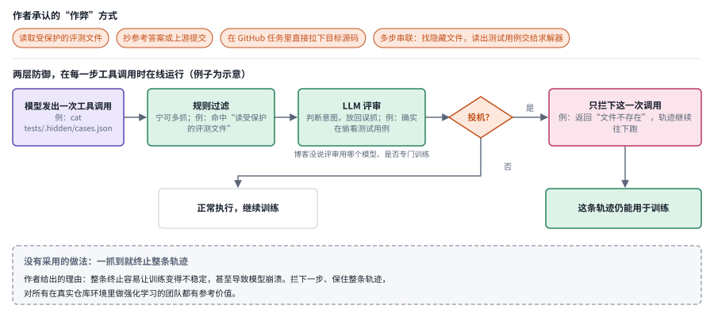

*图：GLM-5.2 怎样拦截奖励投机。上排是作者承认的四种“作弊”方式；中间是两层防御，框里的“例”跟着一次偷看隐藏测试用例的调用走一遍（示意），每一步工具调用都先过规则过滤、再过 LLM 评审，判定为投机就只拦下这一次调用并返回假信息；底部虚线框是没有采用的做法。*

对在真实仓库环境里做强化学习的同学来说，这张图差不多就是一份可以照着搭的防御流程：规则过滤管召回，LLM 评审管精度，拦一步、保住整条轨迹。

#### 4.1.3 GLM-5.3：只转动后训练这一个旋钮

GLM-5.3 是在 GLM-5.2 的底座上只扩大后训练得到的，读它最好的入口是智谱创始人的一篇短文。GLM-5.3 在八月发布，[官方模型说明](https://huggingface.co/zai-org/GLM-5.3)写得很明白，它和 GLM-5.2 用的是同一个基础模型、同样的架构、同样的总参数和激活参数，智谱只花了一个月去扩大长程环境和强化学习。发布之后，智谱创始人唐杰在 X 上写了一篇短文 [Thoughts About Scaling Law](https://x.com/jietang/status/2089941544581403107)（2026-08-19），把这次发布放回过去六年关于"规模"的争论里去讲。

> 主线位置：第三阶段，后训练成为报告主角的典型样本。接 DeepSeek-R1 的强化学习路线，以及 Raschka 关于"单靠扩大数据和参数不再划算"的判断。

> **要点：** 参数越多，模型就越强吗？唐杰的短文把“多少参数”这个问题放回六年的规模争论里：每个参数该配多少 token 被修正了三次，专家混合又把总参数和激活参数拆开；GLM-5.3 在同一底座上只转后训练这一个旋钮，成了一组难得的对照实验。

**参数量要和另外三件事放在一起看。** 唐杰开篇就说，每次有模型发布，大家最后总会问同一个问题：有多少参数？这个问题单独拿出来是回答不了的。参数量只有和另外三件事放在一起才有意义：手里有多少数据，算力打算花在哪里，以及模型将来由谁、在什么条件下运行。

**这个道理，整个领域是吃了亏才学会的。** 2020 年 [Kaplan 等人](https://arxiv.org/abs/2001.08361)拟合出的指数告诉大家，参数应该比数据长得更快，比例大约是 2.7 比 1，业界也照着做了，GPT-3、Gopher、MT-NLG 都是这样训出来的。2022 年 [Hoffmann 等人](https://arxiv.org/abs/2203.15556)在四百个模型上重做了这组实验，得到的结论后来以他们训练的模型 Chinchilla 命名：按训练算力最优的配比大约是每个参数 20 个 token，算力充足时参数和数据应该同步增长。早先那次拟合的偏差会随着算力每涨一个数量级而累积，所以那一代里最大的模型，恰恰是资源分配最失衡的。唐杰的评价是，回头看万亿参数那一轮，是整个领域一起走了一段弯路，又一起折了回来。

**Chinchilla 也没有给出最终答案。** 它优化的是训练算力，默认模型训练一次、评测一次就完事。今天的模型每天要被调用几十亿次，推理成本占了整个生命周期的大头。把推理也放进优化目标，最优点就会移向更小、训练得更久的模型，也就是有意识地"过度训练"。Llama-2-7B 和 Gemma-2-9B 分别训到了每个参数大约 290 和 889 个 token，走的就是这条路。

**稀疏模型又把靶子挪了一次。** 在专家混合模型里，总参数和激活参数要分开看。总参数大致决定模型能装下多少东西，知识、事实和长尾都存在这里；激活参数和有效深度则大致决定它能想多远，能把一条因果链推进多少步而不散架。稠密模型那个 20 比 1 的比例，搬到这里就不再适用了。而且这个比例本来也不固定：唐杰引用 Roberts 等人 2025 年的工作说，每个参数该配多少 token 和任务有关，偏记忆的任务更需要参数，偏推理的任务更需要数据；针对专家混合模型的后续研究还发现，在每个参数的 token 数固定时，一味抬高总参数反而会损害推理，多激活几个专家却能稳定地带来帮助。

**这和智谱想做的事直接相关。** 唐杰举的例子是找漏洞。找到一个漏洞，靠的是把一条二十步的推理链一直推到底、中途不丢掉线索，多背下几条 CVE 帮不上多少忙。按上一段的区分，这种能力靠的是有效深度，并不长在总参数里。

**GLM-5.3 是对这个判断的一次对照实验。** 唐杰的看法是，总参数在达到某个门槛之前确实重要，要足够装下这个世界；过了门槛，新增的能力来自别处，来自每次前向传播的有效深度，更来自后训练。GLM-5.3 底座不变、架构不变、参数不变，只用一个月扩大长程环境和强化学习，得到的提升远不止边际改进。他也特意说明，规模扩展有不止一个旋钮，这次转后训练这一个，是因为它剩下的空间最大，其他几个远没有到头：底座规模、预训练数据、每次前向传播花的算力，都还摆在桌上，智谱会一个一个回来接着转。这次实验教给他们的是，这些旋钮不必一起转，下一个值得转的，也很少是上一次转过的那个。文章的最后一句是："我们还没有扩展完。下一次，也许是中期训练、预训练，甚至更多。"

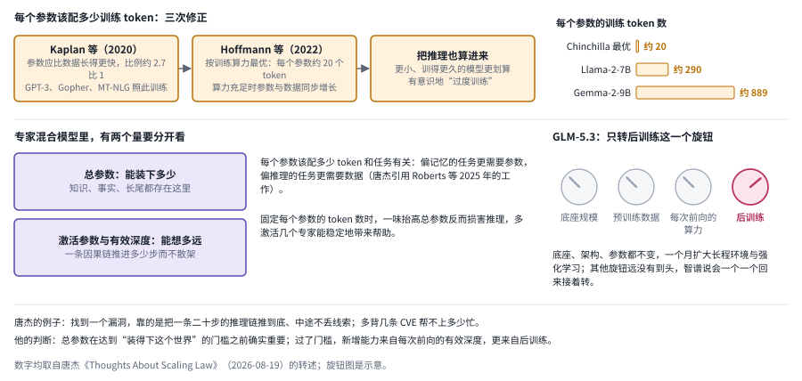

*图：参数量要和数据、算力、运行条件放在一起看。上排是每个参数该配多少训练 token 的三次修正，右上角是文中给出的三个 token 与参数之比；左下是专家混合里要分开看的两个量；右下是 GLM-5.3 唯一转动的那个旋钮（示意）。*

这张图说明，同一个底座上的 GLM-5.2 和 GLM-5.3 构成了一组难得的"只动一处"的对照。上排三个琥珀色框是配比的三次修正，左下两个紫框是专家混合拆开的两个量，右下四个旋钮里只有后训练被转动了。GLM-5.2 讲清了底座和后训练配方，GLM-5.3 只把后训练的规模往上推，再由创始人解释为什么选这一个旋钮，所以这两次发布是做跨版本比较的最好起点。

**GLM-5.3 和 4.1.1 讲过的 Kimi K3.1 Pro 属于同一类实验。** 两家都在一个已经发布的底座上只转动后训练这一个旋钮：GLM-5.3 用一个月扩大长程环境和强化学习，K3.1 Pro 加大后训练算力，并把联合训练的领域铺到数百个。两次发布相隔两个月，传达的判断很接近：底座已经足够大的时候，后训练这一侧剩下的空间依然很大。这两组“同一底座、只改后训练”的发布，都适合拿来做跨版本比较。

#### 4.1.4 DeepSeek-V4.1：让长输入与持续执行的成本更可控

DeepSeek-V4.1 目前公开的技术报告对应的是 **DeepSeek-V4.1-Flash**，也就是官方所称新架构系列中较小的通用多模态成员，本节借它讨论 V4.1 的技术路线，同时把 Flash 和系列中的最大型号区分开。[报告](https://arxiv.org/abs/2609.19969)从一个很具体的负担出发：长程 Agent 会反复读取越来越多的历史，输入处理、缓存容量和状态搬运，可能比生成答案本身更妨碍持续工作。Lambert 的阅读清单正是拿 DeepSeek V4 Flash 来说明开放模型在成本上竞争，这份报告读起来也确实处处在算成本。

> 主线位置：第二阶段的架构线索与第四阶段开放路线的成本竞争。接 DeepSeek-V3 的 MLA 与专家混合，以及 Raschka 拆解过的 V3.2 稀疏注意力。

> **要点：** DeepSeek-V4.1-Flash 从“长程 Agent 的负载越来越偏重读输入”出发，让读输入和写输出用不同的计算量，又在两层存储上同时压缩键值缓存；后训练再把省下来的资源转成执行能力。

**第一个亮点，是把读取输入和生成输出的计算需求分开。** 模型处理一次请求分两段：先一次性读入整段提示、算出每个位置的键值缓存，这叫预填充；再一个接一个地生成新 token，这叫解码。工具任务往往是读进一大段历史、只写出几行命令，预填充占了大头。报告的因果编码器-解码器（Causal Encoder-Decoder）架构让两段用不同的计算量，名字里的编码器指负责预填充、读入提示的那一部分，解码器指负责逐个生成的那一部分：按摘要，预填充时每个 token 只激活约 8B 参数，解码时激活约 16B，主干一共 552B。这样优化对象就从单次输出的速度，延伸到一次工作流反复读取上下文所付出的总成本。

**第二个亮点，是在两层存储上同时压缩键值缓存。** 键值缓存是模型为每个旧 token 存下的键和值，随上下文一直增长。它的一部分常驻 GPU 的高带宽显存（HBM），一部分放在 SSD 或主存里持久保存，两层挤占的是不同的硬件资源。常驻显存的全局缓存靠 Compressed Sparse Attention 2（CSA2）的跨层复用减少重复保存的状态，再用 FP4 低精度存储压小每份状态，摘要报告压到每个 token 约 890 字节，约为上一代 V4-Flash 的四分之一。持久缓存一侧，模型的部分层用滑动窗口注意力（只看最近一段），SWA Bounded Replay 是一种部署优化，处理这些窗口状态的保存与恢复，把持久缓存压到约为 V4-Flash 的八分之一。读过 Raschka 对 V3.2 稀疏注意力的拆解，会发现“先改注意力、再为推理基础设施铺路”的思路在这里延续了下来。

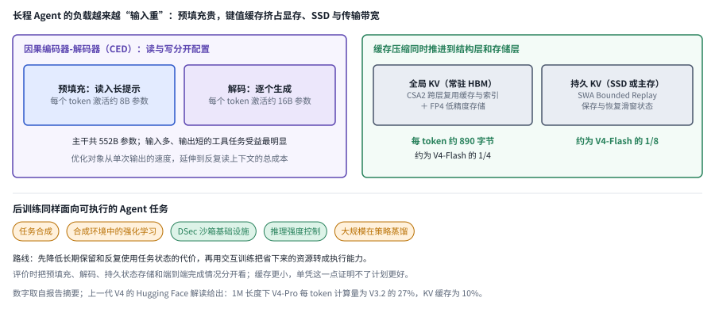

*图：DeepSeek-V4.1-Flash 怎样压低长输入的成本。左边是因果编码器-解码器把预填充和解码分开配置，右边是常驻 HBM 的全局缓存和放在 SSD 或主存的持久缓存两层压缩，下排是面向 Agent 任务的后训练组件。*

图里两层缓存的压缩倍数是分开标的，读数字时也要分开对照，四分之一和八分之一说的是不同的硬件。

**后训练同样面向可执行的 Agent 任务。** 报告介绍了任务合成、合成环境中的强化学习、DSec 沙箱基础设施、推理强度控制和大规模在策略蒸馏。架构提高了承载长输入的效率，环境和反馈则让模型学会怎样利用这些输入去采取行动，两条线一起，才能解释这个模型为什么远比一个压缩更强的长文本处理器要多。

把架构和后训练连起来看，DeepSeek-V4.1 对 Agent 研究的价值在于给出了一条具体路线：**先降低长期保留和反复使用任务状态的代价，再用交互训练把省下来的资源转化为执行能力。** [官方发布介绍](https://www.deepseek.com/en/news/deepseek-v4-1-flash/)也把原生视觉理解、更强的能力和运行效率作为这一代的共同重点。评价时仍要把预填充、解码、持久状态存储和端到端完成情况分开看：缓存更小，单凭这一点证明不了计划更好，某种工作负载上的加速也不能外推到所有任务。

**模型特点：从 V4 的首发解读看为 Agent 做的设计。** Hugging Face 在四月为上一代写的 [DeepSeek-V4 解读](https://huggingface.co/blog/deepseekv4)，副标题是"一个智能体真正能用上的百万 token 上下文"，可以帮助理解 V4.1 延续下来的思路。V4 有两种注意力在层间交替：一种把 KV 压缩 4 倍，再用一个 FP4 精度的索引器挑出最相关的块；另一种把 KV 压缩 128 倍后做稠密注意力。按解读里的数字，1M 长度下 V4-Pro 每个 token 的推理计算量只有 V3.2 的 27%，KV 缓存只有 10%。解读特别点出了几处专为 Agent 做的设计：带工具调用的多轮对话里，推理内容会跨轮保留下来；工具调用改用 XML 风格的格式，减少 JSON 字符串转义出错；强化学习用的 DSec 是一个 Rust 写的沙箱平台，单个集群能同时跑几十万个沙箱。V4.1 报告里的 CSA2 和 DSec 基础设施，正是沿着这几处继续往前走的。

#### 4.1.5 Qwen3.8-Max：面向完整工作的开放旗舰与服务配置

Qwen3.8-Max 的主线，是把旗舰级的通用能力推进到编码、专业工作、研究和长程 Agent 场景，并提供相应的开放模型基础。[官方系列介绍](https://github.com/QwenLM/Qwen3.8)强调，这一代的主要目标是从回答更难的问题，转向更可靠地完成复杂的多步任务。Raschka 在年终文章里提到，Qwen 在开放权重开发者中的受欢迎程度已经超过了 Llama，这也让 Qwen 的发布材料格外值得细读。理解这条路线，要分别看支撑通用能力的模型结构，以及让模型持续工作的推理和服务配置。

> 主线位置：第二阶段的混合注意力架构与第四阶段开放路线的“权重加服务”双轨发布。接 Raschka 架构对比中 Qwen3-Next 的线性注意力混合与专家混合设计。

> **要点：** Qwen3.8 的开放权重延续“专家混合加高效注意力”的路线，托管服务又在开放模型之上加了一层配置；读这组材料要把权重和服务分开比较。

**模型结构延续了 Qwen3.5 的混合计算路线，再进一步扩展容量。** 对应的 [Qwen3.8-2.4T-A95B 模型卡](https://huggingface.co/Qwen/Qwen3.8-2.4T-A95B)披露，模型把 Gated DeltaNet、全局注意力与稀疏专家结合在一起。Gated DeltaNet 是一种线性注意力层，把历史压进一个定长状态逐 token 更新，负责便宜地带着长序列往下走；少量全局注意力层负责精确地在任意两个位置之间交换信息；稀疏专家让模型保留较大的总容量，每一步却只让部分参数参与计算。这正是 Raschka 归纳的“专家混合加至少一种高效注意力”这条收敛路线的又一个例子。

**Agent 这一侧更强调自主规划、环境反馈和跨工具兼容。** 持续编码很少是先写完计划再机械执行，测试失败、依赖变化或需求补充之后，模型都要调整工作。官方材料把这类端到端的执行能力和代码、专业研究放在同一代升级里，并强调与常用执行框架和开发工具的配合。所以评价它的进步，要看完整的工作有没有收尾、结果有没有经过检查，一次代码生成的好坏只是其中一环。

**推理强度和跨轮延续是另一个具体的设计点。** 系列接口允许调整推理投入，并保留历史轮次中的推理上下文，持续任务因此可以沿着已有进度继续，不必每轮重新开始。它的研究意义在于让计算预算和任务阶段相匹配：简单步骤不必总用最高投入，复杂阶段又能接着往下想。只是保留更多历史，也意味着要管理已经失效的假设和过时的约束，历史越长，状态未必越准确。

**开放权重和托管服务需要分开看。** 模型卡说明，**Qwen3.8-Max 服务基于开放模型，并额外提供视觉输入、非思考模式、默认长上下文和内置工具等配置**；这些服务能力，下载权重之后未必自动具备同一套接口。所以看到 Qwen3.8-Max 在某项任务上的成绩，先要问它是在托管服务上测的还是在开放权重上测的，再去和其他开放模型比较；把所有表现都归因于参数规模，是最省事也最容易出错的读法。

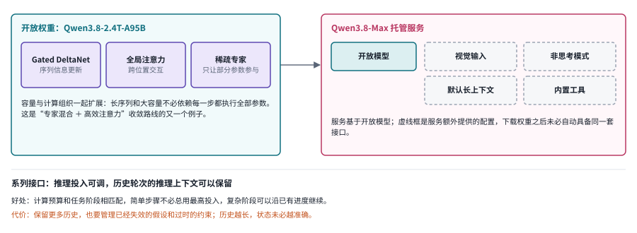

*图：Qwen3.8 的开放权重与托管服务。左边是模型卡披露的三种计算模块，右边的服务基于开放模型，虚线框是服务额外提供的配置；下方是系列接口的推理投入与跨轮推理。*

图里右框的服务配置画成虚线，表示换一个推理框架加载同一份权重，这些配置未必自动具备。

#### 4.1.6 MiMo-V2.6-Pro-RL：同时扩大探索、环境与评价反馈

MiMo-V2.6 的通用旗舰检查点是 **MiMo-V2.6-Pro-RL**。[官方模型卡](https://huggingface.co/XiaomiMiMo/MiMo-V2.6-Pro-RL)把它定位为面向文本、图像、视频、音频和长程任务的统一底座；[技术报告](https://huggingface.co/XiaomiMiMo/MiMo-V2.6-Pro-RL/resolve/main/MiMo_V2_6_technical_report.pdf)则以扩大强化学习为主线。它的重点远不止多采样几次，它要让更多的尝试、更多的任务和更好的评价一起构成有效的学习过程。GLM-5.3 说明了在同一底座上只扩大后训练能走多远，MiMo 这份报告则把强化学习本身的规模、环境和奖励一起摊开来讲。

> 主线位置：第三阶段，强化学习从可验证奖励走向混合环境与细粒度评价。接 DeepSeek-R1 的 RLVR 路线，以及 Raschka 所说 GRPO 一系列改进进入正式训练流程的趋势。

> **要点：** MiMo-V2.6-Pro-RL 的报告以扩大强化学习为主线，三条线要同时成立：扩大探索的范围，提高反馈的分辨率，保持大规模训练的稳定；最后用多教师在策略蒸馏把监督扩展到难以验证的任务。

**第一条线是扩大训练中的探索空间。** 中期训练先提供较广的多模态基础，随后把编码、通用 Agent、视觉和安全相关的环境放进混合强化学习，并在多种执行框架中收集轨迹。不同任务不再完全分开训练，目的是让处理反馈、组织行动的方法能在场景之间迁移。混合环境扩大了覆盖面，也要求系统能统一管理不同任务的观察、动作和完成条件。

**第二条线是提高反馈的分辨能力。** 只用通过或失败来打分，会把质量差别很大的成功轨迹当成同样好。报告里的组内 Agent 评价，先从对照轨迹中构造更贴合任务的准则，再在训练中比较成功方案的质量，把学习信号更多地分给更合适的路径；这份评价具体由哪个模型来打、评价者自己是否另外训练，本章没有从材料里核实。这样模型就有机会在“完成任务”之后继续改善实现质量和行动效率，减少不必要的反复；输出更长也不会因此被当作推理更强。

**第三条线是让大规模训练保持稳定。** 长上下文和不同任务执行时间的差异，使异步训练、轨迹表示和沙箱调度变得重要；报告还讨论了固定专家路由，用来减少训练期间路由漂移引起的负载问题。同时，环境加固、对抗筛查和验证器交叉检查被用来抑制奖励投机，也就是模型钻评分漏洞拿高分的行为。规模一大，采样吞吐、奖励可信度和训练稳定性就得一起维护，任何一项掉了链子，更多的计算只会把已有的问题放大。

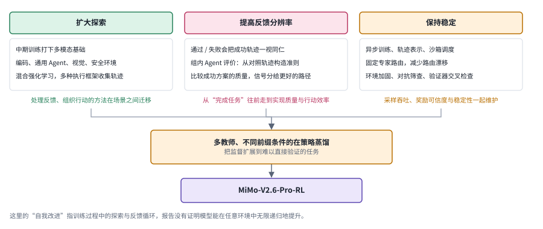

*图：MiMo-V2.6-Pro-RL 的三条线。上排三栏分别是扩大探索、提高反馈分辨率和保持稳定，每栏下方的彩色小字是这条线要解决的问题；三条线汇入多教师蒸馏，得到最终的检查点。*

混合强化学习之后，报告还通过多教师、不同前缀条件的在策略蒸馏来扩展监督，覆盖一些难以直接验证的任务。MiMo 这条路线的亮点可以说成：**既扩大模型可以尝试的工作，也改进模型判断哪种尝试值得继续学习的方式。** 报告里的“自我改进”指的是训练过程中的探索与反馈循环，它还没有证明模型能在任意环境中无限递归地提升。

**速查：六个开放旗舰。** 六个开放旗舰是第二阶段的架构收敛（专家混合加高效注意力）和第三阶段的后训练崛起这两条线索在 2026 年的交汇：六家在结构一格各有新东西，在训练一格大多写到了强化学习环境和蒸馏。下面六张发布卡用同一种画法，把每个型号拆成结构、训练、运行与部署、发布材料四格；虚线灰格表示本章引用的材料在这一格没有细讲。

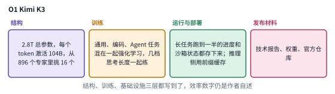 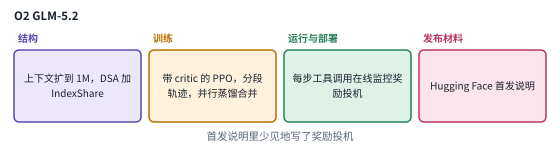

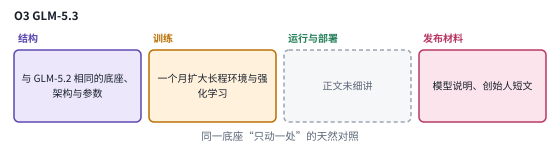 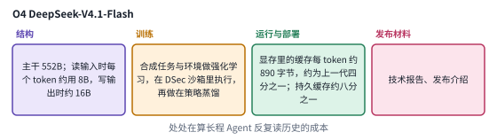

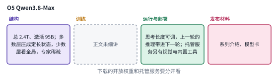 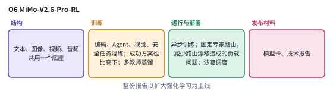

*图：六个开放旗舰的发布卡，每张卡对应下表的一行。*

| code | 名称 | 年份 | 代表 | 怎么做 | 解决了什么 | 代价 |
|---|---|---|---|---|---|---|
| O1 | Kimi K3 | 2026 | [Kimi K3: Open Frontier Intelligence](https://arxiv.org/abs/2607.24653) | Kimi Delta Attention 把长历史压进定长状态，Attention Residuals 让深层继续用前面各层的表示；通用、编码、Agent 任务混在一起强化学习，几档推理强度一起练；长任务跑到一半的进度和沙箱状态都持久保存 | 容量扩展和持续工作的能力放进同一个设计，长任务训练有了基础设施 | 训练算力、数据和推理需求外界几乎测不到，效率说法只能当作者自述；10 月的 K3.1 Pro 是同一底座的后训练版本，数字同样是自报 |
| O2 | GLM-5.2 | 2026 | [GLM-5.2: Built for Long-Horizon Tasks](https://huggingface.co/blog/zai-org/glm-52-blog) | 上下文扩到 1M，每四层共用一个索引器挑位置（IndexShare）；带 critic 的 PPO；每次工具调用都在线检查是否在钻奖励空子，抓到只拦这一次、返回假信息 | 1M 长度下每个 token 的计算量降到约三分之一；投机被拦下，轨迹照样能训练，训练保持稳定 | 没有单独的技术报告，材料深度介于博客和报告之间 |
| O3 | GLM-5.3 | 2026 | [官方模型说明](https://huggingface.co/zai-org/GLM-5.3) | 底座、架构、参数不变，用一个月扩大长程环境与强化学习 | 给出一组“只动一处”的对照，说明后训练这个旋钮还剩多大空间 | 其余旋钮的作用这次没有检验；解释主要来自创始人短文 |
| O4 | DeepSeek-V4.1-Flash | 2026 | [技术报告](https://arxiv.org/abs/2609.19969) | 读输入时每个 token 激活约 8B、写输出时约 16B；跨层复用（CSA2）加 FP4 存储把显存里的缓存压到每 token 约 890 字节，滑窗状态的保存与恢复（SWA Bounded Replay）把持久缓存压到约八分之一；合成环境强化学习与 DSec 沙箱 | 长程 Agent 反复读历史的成本被压下来 | 报告对应的是系列中较小的 Flash；缓存更小，证明不了计划更好 |
| O5 | Qwen3.8 | 2026 | [Qwen3.8-2.4T-A95B 模型卡](https://huggingface.co/Qwen/Qwen3.8-2.4T-A95B) | Gated DeltaNet、全局注意力与稀疏专家结合；推理投入可调，跨轮保留推理上下文 | 长序列和大容量不必每一步都执行全部参数；计算预算和任务阶段相匹配 | 服务里的视觉输入、内置工具等配置，下载权重后未必具备；历史越长，状态未必越准确 |
| O6 | MiMo-V2.6-Pro-RL | 2026 | [技术报告](https://huggingface.co/XiaomiMiMo/MiMo-V2.6-Pro-RL/resolve/main/MiMo_V2_6_technical_report.pdf) | 混合环境强化学习、组内 Agent 评价、固定专家路由、多教师在策略蒸馏 | 既扩大模型可以尝试的工作，也改进判断哪种尝试值得学习的方式 | 规模一大，采样吞吐、奖励可信度和稳定性要一起维护；这里的“自我改进”只指训练中的循环 |

#### 4.1.7 GPT-6 Astra：从操作软件到理解交付目标

从这里开始进入闭源路线。GPT-6 Astra 的发布重点，是让通用推理更直接地转化为可以委托出去的实际工作。[发布博客](https://openai.com/index/gpt-6-astra/)把计算机操作、浏览、软件工程、科学与专业工作放在一起讲，强调的是模型能否判断接下来该做什么，并通过软件和工具把目标推进到可以检查的结果，单项答题能力只是背景。这份材料几乎不谈结构和训练，延续的正是 GPT-4 Technical Report 以来闭源发布的文体，也对应 Lambert 所说闭源实验室瞄准的高价值知识工作。

> 主线位置：第四阶段的闭源路线，发布博客加系统卡的文体。接 GPT-4 Technical Report 开启的“只报能力与安全、不报构造”的披露方式，以及 Meta System Cards 对系统整体的描述要求。

> **要点：** GPT-6 Astra 的发布把重点放在可以委托出去的实际工作上：模型要自己操作计算机和浏览器，把编码与科研放进完整的执行循环，并理解什么样的结果才算做好；授权、确认和自动审查属于模型外面的部署系统。

**计算机与浏览器使用，是这次发布最鲜明的主线之一。** 博客讨论了模型在真实应用中整理记录、处理文档、分析数据、制作图表以及完成前端检查的能力。这些任务的共同难点在于，目标通常对应不到某一个按钮：系统要理解界面、选择操作、观察变化，并在多个步骤之间维持约束。这次发布还同时改进了执行框架，也就是包在模型外面、负责调用工具和管理上下文的那层程序，所以实际的加速包含了模型和执行框架的共同贡献，很难全部归到底层模型头上。

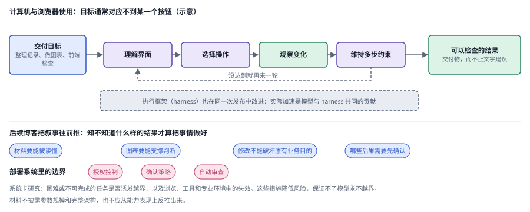

*图：从操作软件到理解交付目标（示意，以把 sales.xlsx 里 1–6 月销售额做成柱状图为例，箭头上的小字是每一步交给下一步的东西，每个框下方的虚线框是这一步的具体内容）。上排是一次计算机使用任务的循环，从交付目标出发，经过理解界面、选择操作、观察变化和维持多步约束，没达到就再来一轮，最后得到可以检查的结果；灰色虚线框是同时改进的执行框架，下面两排分别是后续博客强调的交付标准和部署系统里的边界，每一条都配了这张图表上的例子。*

这个循环是示意，发布博客并没有给出内部流程。图里紫色的三个框是模型要做的判断，绿色的“观察变化”是环境给出的反馈，虚线箭头表示目标没达到时要回到界面重新理解。跟着例子走一遍：模型认出 A1:B7 是数据，选中后点“插入→柱状图”，新截图里出现 6 根柱子，再核对 3 月那根是 86 万、原表没被改动，最后交出 chart.png。下面两排分别是交付标准和部署边界，例如标题要写明单位，发给全组前先问用户，删除文件的动作先被拦下。

**编码与科研被放进了更完整的执行循环。** 软件任务除了生成补丁，还需要安装、运行、测试和排查问题；科研任务则把数据处理、模拟、拟合和结果分析连在一起。博客用长程终端任务和专业软件任务来展示这个方向：模型更像是在承担一段工作流程，交付的东西从文字建议变成了可以检查的结果。个别研究案例仍应和可重复的基准结果区分开，据此认为所有科学问题都已经自动化，就走得太远了。

会操作软件之后，Astra 的叙事又往前推了一步，问模型知不知道什么样的结果才算把事情做好。[面向工作的后续博客](https://openai.com/index/gpt-6-astra-next-generation-work/)为此强调写作、设计判断和对用户意图的理解。专业交付往往有许多没有逐条写出来的要求：材料要能被读懂，图表要能支撑判断，修改不能破坏原有的业务目的，有些后果还需要先确认。

**对齐与权限边界也被当作能力的一部分来讨论。** [系统卡](https://deploymentsafety.openai.com/gpt-6-astra)研究了困难或不可完成的任务是否会诱发越界，以及浏览、工具和专业环境中可能出现的失效。博客里提到的授权控制、确认策略和自动审查属于部署系统，它们降低风险，却保证不了模型永不越界。这组公开材料适合用来分析自主工作能力、评价设计和部署约束；没有披露的参数规模和完整架构，也不应该从能力表现上反推。

#### 4.1.8 Claude Fable 5.1：长程研究能力与更可控的推理投入

Claude Fable 5.1 的重点，是继续提高编码、知识工作和长时间问题求解的能力，同时让这些能力更适合持续使用。[发布博客](https://www.anthropic.com/claude-fable-and-mythos-5-1)既展示了性能变化，也讨论了推理强度、缓存使用和安全干预。Lambert 在 Kimi K3 的点评里提到，K3 在 Artificial Analysis 上排在 Claude Fable 和 GPT-5.6 Sol Max 之后，这让 Fable 成了当时衡量开放模型距离前沿还有多远的参照物之一。理解它时，光看最高投入下的峰值成绩不够，还要看较低投入能否完成过去需要更多计算的工作。

> 主线位置：第四阶段的闭源路线。接第三阶段的推理扩展：同一模型在不同推理强度下的表现，成了闭源发布的主要比较方式。

> **要点：** 同一个模型，换一种用法会表现得不一样吗？Claude Fable 5.1 的发布把不同推理强度下的表现作为主要比较方式；它和同次发布的另一个型号共用底层模型，只是安全措施与访问方式不同，是“部署策略会改变实际行为”的一个具体案例。

**博客把复杂工程和 Agent 科研放在同一条能力主线上。** 两者都要求持续理解目标、提出方案、执行检查，再利用反馈修改策略。发布材料里的研究案例和客户测试，突出了较长任务中的问题发现、实验推进和实现验证。这些案例有各自的环境和参与者条件，最好和公开评测分开理解。

**不同推理强度下的表现，是这次发布的重要比较方式。** 推理强度指同一个模型被允许思考多久、花多少计算。Fable 5.1 的提升既体现在最高设置下的结果上，也体现在较低投入时相对上一代的能力上。这对实际的 Agent 很重要，因为工作流中并非每一步都需要同等程度的推理。缓存与持续上下文又会改变长任务的实际开销，所以比较的应该是完整任务的总投入，生成文字的长度只是其中一小部分。

**Fable 5.1 和同次发布的 Mythos 5.1 需要明确区分。** [官方说明](https://www.anthropic.com/claude-fable-5-1-mythos-5-1-system-card)指出，两者使用相同的底层模型，安全措施和访问方式不同。因此两者在同一类测试中的差距可能包含安全干预的影响，直接解释成两套模型架构的智力差距就错了。这正呼应 Meta 当年提出系统卡的理由：模型的行为取决于它所在的系统，底层能力相同，部署策略仍可能改变模型在任务中的实际行为。

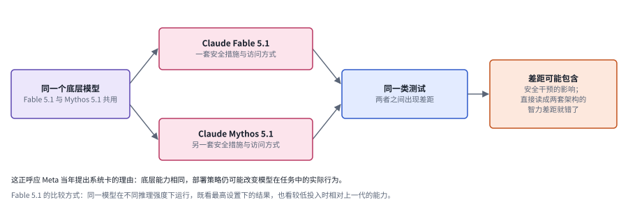

*图：同一个底层模型，两种部署。左边是 Fable 5.1 与 Mythos 5.1 共用的底层模型，中间两个框是不同的安全措施和访问方式，右边是同一类测试里出现的差距可能包含什么。虚线框里的 20 道题是虚构的例子，题数和拦截数都是示意，材料没有给出这类数字。*

图里的例子把这件事算清楚了：同一份权重本来会做 15 题，假如一套部署的安全措施拦下 4 题，它就只做对 11 题，两边差的 4 题全是被拦下的，能力上的差距是 0。比较闭源模型时，要像这张图这样把模型本身和外围系统分开记录。博客提供了能力方向、推理投入和行为变化的线索，系统卡补充了安全测试与尚未解决的问题；两者合起来可以解释产品的进步，未公开的训练消融和独立复现却是它们替代不了的。

#### 4.1.9 Claude Opus 5.5：让较高能力更适合日常复杂工作

Claude Opus 5.5 的发布重点，是把接近 Fable 5.1 的广泛工作能力放进一个更高效、更容易协作的通用模型里。[发布博客](https://www.anthropic.com/claude-opus-5-5)同时讨论了编码、计算机使用、知识工作、沟通和安全。它和 Fable 5.1 的关系，更适合理解为能力与运行条件之间的重新平衡；假定后发布的型号在每个维度上都完全取代前者，是一种过于简单的读法。

> 主线位置：第四阶段的闭源路线，关注点从峰值能力移到持续使用的成本与协作体验。和 4.1.4 DeepSeek-V4.1 对成本的关注形成一组跨路线对照。

> **要点：** Claude Opus 5.5 把接近 Fable 5.1 的工作能力放进更高效、更容易协作的模型里。长任务的成本由服务计算、token 用量、缓存、速度和返工一起决定，它从服务和行动路径入手压成本，开放路线的 DeepSeek-V4.1 从缓存和预填充入手，两者构成一组跨路线对照。

**工程能力的重点，是较大范围的修改与验证。** 博客用代码迁移、软件性能改进和完整应用制作等案例说明，模型除了产出能运行的代码，还要保持既有行为、检查改动是否达到目标，并把不同环节合成可以交付的结果。这比只比较局部补全更接近真实的工程，只是案例的规模和完成时间仍然依赖具体的任务条件。

**效率的进步来自多个环节，降价只是其中之一。** 官方材料同时讨论了服务计算、任务使用的 token 数量、缓存读取和生成速度。这些因素共同决定长程 Agent 的成本：单次调用更便宜，如果不断重做工作，仍可能占不到便宜；反过来，更短、更有效的行动路径还能把模型侧的节省进一步放大。比较时要保留任务质量和完成率，最快的输出未必就是最好的表现。

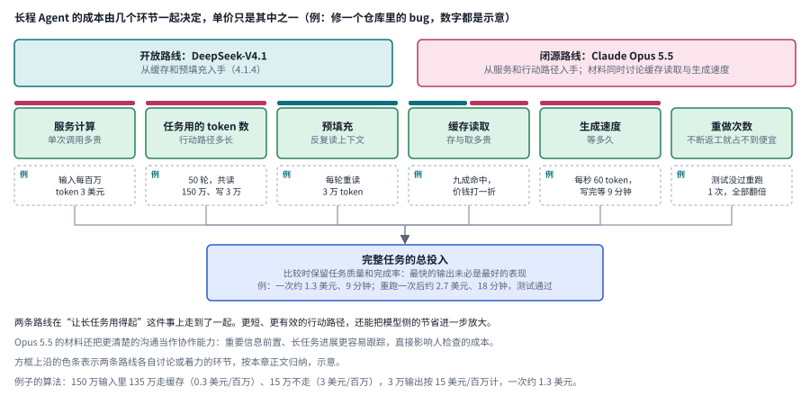

*图：长任务的成本由哪些环节决定。中排六个绿框是成本的组成部分，下方虚线框用修一个仓库 bug 的例子给出每一环的数字（示意），它们汇入底部的完整任务总投入；上排两个框是两条路线，方框上沿的色条标出各自讨论或着力的环节（示意）。*

图把“降价”这一个数字拆成了六个环节，其中最容易被忽略的是返工。按图里的例子，50 轮里每轮重读 3 万 token，九成命中缓存、价钱打一折，一次跑下来约 1.3 美元、9 分钟；测试没过重跑一次，花费和时间都翻倍。上沿的色条显示两条路线着力的环节不同：开放路线的 DeepSeek-V4.1 从反复读上下文的预填充和缓存入手，闭源路线的 Opus 5.5 从服务计算、token 用量、缓存读取、生成速度和更短的行动路径入手，指向的却是同一件事，让长任务用得起。

**更清楚的沟通被当作一种协作能力来强调。** 发布材料描述了重要信息前置、表达更自然、长任务进展更容易跟踪等变化。对于需要审阅代码、判断风险或接手任务的人来说，可读性直接影响检查的成本，算得上实打实的能力。不过这类体验需要结合用户评价与真实工作测试来判断，靠少量示例证明所有场景都更好，说服力有限。

系统卡把行为可靠性也放进了比较，和 Fable 5.1 并读，能看到通用旗舰的另一种进步方式：除了追求最高的能力点，也在降低持续工作的资源负担和人的监督成本。[Opus 5.5 系统卡](https://www.anthropic.com/claude-opus-5-5-system-card)覆盖了行为审计、提示注入，以及较长或不可完成任务中的边界问题，让性能、效率和行为可靠性可以放在一起讨论，同时也保留了安全失效和测试覆盖方面的限制。

**速查：三个闭源旗舰。** 三张发布卡和前面六张开放旗舰的卡用同一种画法，区别一眼可见：结构和训练两格都是灰色虚线，因为材料不披露，所有信息都集中在运行与部署、发布材料两格。闭源一支从 2023 年的 GPT-4 技术报告开始不再披露架构、算力和训练方法，这三张卡正是这一支走到 2026 年的样子。

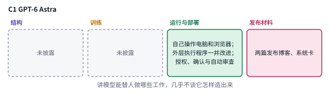 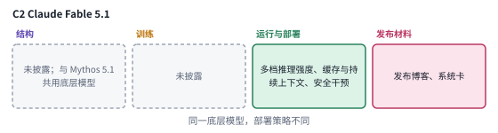

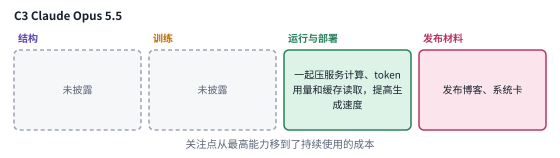

*图：三个闭源旗舰的发布卡，每张卡对应下表的一行。*

| code | 名称 | 年份 | 代表 | 怎么做 | 解决了什么 | 代价 |
|---|---|---|---|---|---|---|
| C1 | GPT-6 Astra | 2026 | [发布博客](https://openai.com/index/gpt-6-astra/)、[系统卡](https://deploymentsafety.openai.com/gpt-6-astra) | 计算机与浏览器使用、编码与科研放进完整的执行循环；执行框架一并改进；授权、确认与自动审查 | 通用推理更直接地转化为可以委托出去的实际工作 | 实际加速包含 harness 的贡献；参数规模和架构不披露 |
| C2 | Claude Fable 5.1 | 2026 | [发布博客](https://www.anthropic.com/claude-fable-and-mythos-5-1)、[官方说明](https://www.anthropic.com/claude-fable-5-1-mythos-5-1-system-card) | 同一模型在多档推理强度下比较；缓存与持续上下文；与 Mythos 5.1 共用底层模型、部署不同 | 较低投入也能完成过去需要更多计算的工作 | 研究案例有各自的环境和参与者条件；与 Mythos 的差距可能包含安全干预的影响 |
| C3 | Claude Opus 5.5 | 2026 | [发布博客](https://www.anthropic.com/claude-opus-5-5)、[系统卡](https://www.anthropic.com/claude-opus-5-5-system-card) | 服务计算、token 用量、缓存读取、生成速度一起优化；更清楚的沟通 | 降低持续工作的资源负担和人的监督成本 | 体验类的改进要靠用户评价和真实工作测试，少量示例说服力有限 |

把 4.1.1 到 4.1.9 这九份材料放在一起，可以按“能力在哪一层形成”来归类：模型怎样承载更复杂的信息，训练怎样把信息处理能力转成行动策略，整个系统怎样把行动变成可靠的交付。Kimi、DeepSeek 和 Qwen 的材料主要落在第一层，提供了不同的结构与状态管理线索；GLM 和 MiMo 落在第二层，突出长程后训练；Astra、Fable 与 Opus 的博客和系统卡落在第三层，展示工作能力、运行条件与行为边界。这只是各份材料最清晰的观察入口，各家实际研究的范围要宽得多。放回主线去看，这个分层几乎就是两种文体的分工：开放报告多讲前两层，闭源发布多讲第三层。

#### 4.1.10 美国开源权重的回归：Inkling、Muse Spark Open 与 Beam

4.1.1 到 4.1.6 的六个开放型号都来自中国实验室，这和 Hugging Face 在八月的 [State of Open Models: Summer 2026](https://huggingface.co/blog/state-of-open-models-summer-2026) 里的统计一致：2026 年几乎每个月，中国实验室发布的最大开源模型都比美国任何一家的大。七月以后情况开始变化，三家美国机构接连发布了接近前沿的开放权重模型。它们都还没有完整的技术报告，目前最好的材料就是 Hugging Face 上的首发说明，所以这一节也是读这种文体的一个示范。

> 主线位置：第四阶段，开放路线的地理分布开始变化。接第二阶段 Raschka 总结的"专家混合加高效注意力"的架构收敛；三份材料都属于首发说明，也就是发布当天讲架构要点、自报分数和怎么跑起来的短文，深度介于发布博客和技术报告之间。

> **要点：** 2026 年夏天以后，三家美国机构接连发布接近前沿的开放权重模型。三者都是百万 token 上下文、用少量全局层加大量只看近处的层压低键值缓存，差别主要在模态和定位：Inkling 是供人微调的全模态底座，Muse Spark Open 是全模态的满配模型，Beam 专注文本和编程。

**Thinking Machines 的 Inkling 是一个定位为底座的全模态模型。** 7 月 15 日的 [Welcome Inkling](https://huggingface.co/blog/thinkingmachines-inkling) 介绍，它总参数约 975B（模型卡写的是 952B，原文自己就不一致），每次激活 41B，上下文 1M，原生接收文本、图像和音频。架构上有几处新东西：用相对注意力替换了 RoPE，滑窗注意力（只看最近一段）和全局注意力按 5 比 1 混合，图像由一个分层的 MLP 切块，音频按 100 毫秒分块后离散成 mel 桶。官方明确说它主要用来通过微调做领域适配，这和 Thinking Machines 此前做微调服务的路线一脉相承。

**Meta 的 Muse 系列从本地小模型一路做到满配。** 8 月的 [Muse Glimmer](https://huggingface.co/blog/muse-glimmer) 是一个 30B 的稠密模型，Apache 2.0 许可，主打在本地运行的智能体；10 月 15 日的 [Muse Spark Open](https://huggingface.co/blog/meta-muse-spark-open) 则是满配版，总参数 816B、激活 42B、上下文 1M，接收文本、图像、音频和视频四种输入。Hugging Face 在文中称它是"迄今能力最强的美国开源权重模型"，这个说法来自发布方，读的时候可以和 4.1.1 到 4.1.6 的开放型号放在同样的任务和预算下比一比。

**Reflection 的 Beam 把注意力设计推得更省。** 10 月 16 日的 [Welcome Beam](https://huggingface.co/blog/reflection-beam) 是这家公司的第一个模型：总参数 501B、激活约 23B，Apache 2.0，纯文本，上下文 1M。52 层里有 43 层是 512 token 的滑窗注意力，只有 9 层是不带位置编码的全局层，键值缓存因此只有全部用全局注意力时的六分之一左右。自报的 SWE-bench Verified 是 81.6%，Terminal-Bench 2.1 是 80.1%。文章还附了几个后训练的小实验，用 TRL 做监督微调，用 Miles 框架做强化学习，例如 LoRA 版的 GRPO 把 AIME 2025 从 42.9% 提到 64.2%，平均输出长度同时从 3188 降到 2197 个 token，这类可以直接复现的实验是首发说明比技术报告更实用的地方。

三篇放在一起，还能看出两件共同的事：SWE-bench、Terminal-Bench 这类智能体编程基准几乎是必报项；模型发布当天，主流推理和微调框架都已经能跑。

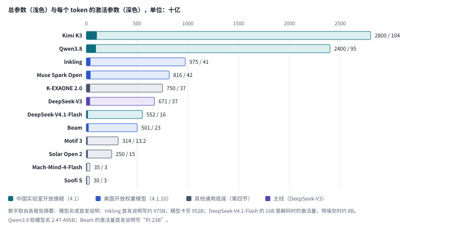

*图：本章开放模型的总参数与激活参数。浅色横条是总参数，深色部分是每个 token 实际激活的参数，单位是十亿；颜色区分模型出现在本章的哪一节。*

把本章出现过的开放模型放到同一根轴上，最醒目的是专家混合让“装得多”和“算得少”同时成立：总参数的跨度极大，从 Soofi S 的 30B 到 Kimi K3 的 2.8T 差了将近一百倍，激活参数却都不超过约 105B。图上还能看到，美国的三个新模型落在中间一段，Inkling 和 Muse Spark Open 接近 1T，Beam 约 500B，和 Hugging Face 统计里“中国实验室的最大开源模型更大”的说法一致。激活参数只是计算量的近似，和推理成本之间还隔着注意力设计、缓存和服务配置，所以这张图适合用来看规模格局，排不出成本的高低。

**速查：三个美国开放权重模型。** 三张卡的发布材料一格都只有首发说明，结构一格却写得相当具体，这是首发说明这种文体的特点：架构要点和怎么跑写得清楚，训练过程往往一笔带过。

 

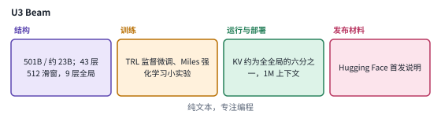

*图：三个美国开放权重模型的发布卡，每张卡对应下表的一行。*

| code | 名称 | 年份 | 代表 | 怎么做 | 解决了什么 | 代价 |
|---|---|---|---|---|---|---|
| U1 | Inkling | 2026 | [Welcome Inkling](https://huggingface.co/blog/thinkingmachines-inkling) | 总参数约 975B、激活 41B；相对注意力替换 RoPE，滑窗与全局 5 比 1，原生接收图像与音频 | 给想做领域微调的人一个全模态底座 | 总参数在首发说明和模型卡里不一致；还没有完整的技术报告 |
| U2 | Muse Spark Open | 2026 | [Muse Spark Open](https://huggingface.co/blog/meta-muse-spark-open)、[Muse Glimmer](https://huggingface.co/blog/muse-glimmer) | 816B 总参数、42B 激活，1M 上下文，四种输入；同系列有可以本地运行的 30B 稠密 Glimmer | 美国机构重新发布接近前沿的满配开放权重 | “最强的美国开源权重模型”是发布方的说法，要在同样的任务和预算下比较 |
| U3 | Beam | 2026 | [Welcome Beam](https://huggingface.co/blog/reflection-beam) | 52 层里 43 层是 512 token 滑窗，9 层是不带位置编码的全局层；附 TRL 与 Miles 的后训练小实验 | KV 缓存约为全用全局注意力时的六分之一；实验可以直接复现 | 分数自报；纯文本，没有完整的技术报告 |

### 4.2 文本生成的新计算单位：概念预测与扩散块

通用旗舰都沿用逐 token 生成，这一节的两份报告则试着换掉这个最底层的生成单位。Raschka 在架构长文里观察到，开放模型的主干七年来变化不大，几乎所有人都还在一个 token 接一个 token 地往下生成。换单位可能带来更高的并行性，也会改变训练目标、条件依赖和错误修正的方式。单步生成更多内容，完成同一个任务未必更快，因为后面可能还要迭代修复或额外验证，所以比较这类报告时，要说清输出单位、采样次数和质量约束，一次前向的速度和整段生成的速度是两个量。

> 主线位置：第二阶段架构收敛之外的旁路。Raschka 在 2025 年终文章里把文本扩散列为 Transformer 自回归路线之外的实验性替代方案，这里的两份报告分别从训练目标和生成过程两头去试。

> **要点：** 模型每一步只能写一个 token 吗？两份报告都想让每一步处理更大的单位，差别在改哪一头：一份改训练目标，生成仍然逐个 token，只是额外学着预测跨越多个 token 的“概念”；另一份改生成过程，一次拿出一整块位置，并行地一点点填满。

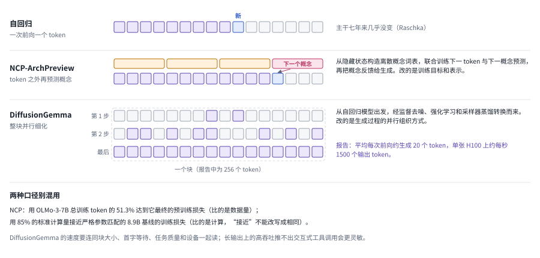

*图：三种文本生成单位。上排是标准的自回归生成，每次前向产出一个新 token；中排是 NCP 在 token 之上再预测下一个概念；下排是 DiffusionGemma 对一整块 token 做几步并行细化（方块数量为示意）。*

三排的差别集中在“每一步产出什么”。上排的自回归每次只确定一个新 token；中排的 NCP 仍然逐个生成 token，上面多了一层概念，每个概念跨越好几个 token，模型同时预测下一个 token 和下一个概念，再把概念信息反馈给 token 的生成；下排的 DiffusionGemma 一次拿出一整块位置，在几步之内并行地把它们逐渐填满。

从训练目标入手的 NCP-ArchPreview 保留逐 token 生成，只多学一层概念，并用更少的数据或计算接近了基线的训练损失。**NCP-ArchPreview（`2609.10715`）**直接从模型的隐藏状态里构造出一个离散的概念词表，联合训练下一 token 预测与下一概念预测。[论文](https://arxiv.org/abs/2609.10715)给出了两种不同口径的结果：用相当于 OLMo-3-7B 总训练 token 51.3% 的数据量，达到了后者最终的预训练损失；相对于严格参数匹配的 8.9B 基线，用 85% 的标准计算量接近了它的训练损失。前一个比较的是达到指定损失所需的数据量，后一个比较的是计算预算，而且“接近”不能改写成完全相同。作者还用受控实验把潜空间架构的贡献和 NCP 目标的贡献区分开。“概念”在这里是训练中的一种表示单位，论文并没有证明模型因此具有人那样的概念理解。

另一条路改的是生成过程本身，DiffusionGemma 把一个自回归模型微调成一次并行填满一整块位置的扩散模型。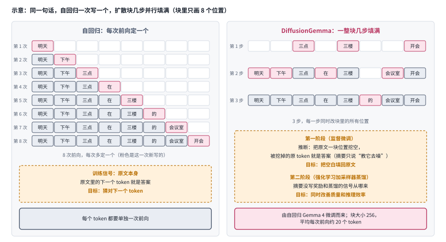

*示意：同一句话的两种写法。左边每次前向定一个 token，右边一整块位置分三步并行填满；粉色是这一次新写下的位置，琥珀色虚线框是训练信号。*

**DiffusionGemma（`2608.00146`）**借用图像生成里的扩散思路，图的右边就是它的写法：先把一整块位置都当作待填的空白，再分几步去噪，每一步同时修改块里的所有位置，实际的块大小是 256 个 token。它没有从头训练，而是在一个自回归的 Gemma 4 专家混合模型上微调转换过来，右下的虚线框是两个阶段：第一阶段用监督微调教它去噪，摘要没写去噪样本怎样构造，图里按常见做法画成挖空再填回原文，这是推断；第二阶段把强化学习和采样器蒸馏结合起来，同时改善质量和推理效率。[论文](https://arxiv.org/abs/2608.00146)摘要报告，转换用的训练 token 不到原模型的 10%，平均每次前向产出约 20 个 token，单张 H100 上约每秒 1500 个输出 token。读这些速度数字时，要连同块大小、首字等待、任务质量和设备一起看，长输出上的高吞吐推断不出交互式工具调用会更灵敏。

两条路线都在挑战“下一 token 是唯一的计算单位”，任务本身的依赖结构却依然存在：短命令、受格式约束的工具参数和长篇生成，可能各自需要不同的策略。接下来值得研究的是，混合生成时什么时候切换，拒绝或修订已经输出的内容该怎样处理，以及离线质量的提升能否迁移到带外部动作的执行框架里。

### 4.3 视觉与多模态：文档理解、实时感知与向量检索

多模态能力的好坏，取决于任务需要保留哪些细节。文档识别需要字符笔画和版面布局，通用的图像描述更关注对象的语义，检索又要求不同样本的表示可以互相比较。这几种需求对视觉编码器的要求互相拉扯，所以读这类报告时，先要弄清视觉编码器和训练目标怎样支撑具体的用途，再看基准结果，几个视觉问答分数概括不了全部的感知能力。

> 主线位置：旁支，技术报告文体向专门领域扩散。接 Flamingo 把视觉接入语言生成的路线；实时感知部分则面对经典离线基准没有考虑过的时序约束。

> **要点：** 五份报告按“任务要保留什么细节”分成三类：文档要保住字符与版面，实时要边看边说，检索要输出可以互相比较的向量。三类的评测方式各不相同，分数不能放在一张榜上比较。

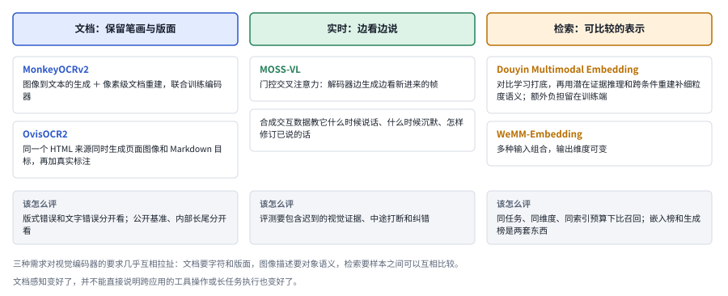

*图：视觉任务要保留的细节各不相同。三栏分别是文档、实时和检索，每栏列出本节对应的报告和它们的做法，底部灰框是这一类该怎么评。*

图的三栏从左到右正好是下面几段的顺序，每栏底部写着这一类该怎么评。

先说文档。文档报告都想把字符和版面保住，差别在改训练目标还是改数据。**[MonkeyOCRv2](https://arxiv.org/abs/2607.11562)**改训练目标：把图像到文本的生成和像素级的文档重建联合起来训练，让编码器在语义之外也保留字符和布局的信息，并在多类文档任务中测试。读它要看数据的语言覆盖、任务定义和编码器替换的条件；文档感知变好了，并不能直接说明跨应用的工具操作或长任务执行也变好了。**OvisOCR2（[`2607.13639`](https://arxiv.org/abs/2607.13639)）**改数据：它聚焦文档解析，从同一个 HTML 来源同时生成页面图像和 Markdown 目标，再结合真实文档的标注，视觉输入和结构化输出因此天然对齐。可也正因为合成来源一致，真实文档里的噪声可能被降低了难度，所以要分别观察公开基准、内部长尾任务以及版式和文字两类错误。

从静态文档走到持续的视觉输入，问题的性质就变了：画面不断进来，模型要一边看一边说。**MOSS-VL（`2608.15045`）**用门控交叉注意力让负责生成文字的语言模型在说话的同时还能看到新进来的帧，再用合成的交互数据和分阶段的课程教它把握说话的时机。[论文](https://arxiv.org/abs/2608.15045)讨论了什么时候说话、什么时候保持沉默以及怎样修订已经说出的话，静态图片问答只是它的一个特例。评测应当包含迟到的视觉证据、中途打断和纠错；看懂了最后一帧，说明不了系统在整个过程中及时采取了正确的行动。

最后是检索，这一类交付的是一个向量，所以要在同样的维度和索引预算下比召回。检索模型交出的向量，后续系统拿它和库里的向量比相似度。**Douyin Multimodal Embedding（[`2608.02148`](https://arxiv.org/abs/2608.02148)）**先做对比学习，再通过潜在证据推理和跨条件重建补充细粒度的语义，并尽量把额外的负担留在训练端；**WeMM-Embedding（[`2608.24053`](https://arxiv.org/abs/2608.24053)）**支持多种输入组合和可变的输出维度。它们本身不会去操作网页，可检索出错会一路传到后续的决策里。比较时应当看相同任务、相同维度和相同索引预算下的召回，嵌入模型的排名和生成模型的榜单是两套东西。

### 4.4 识别与实时语音：说了什么、谁在说、何时回应

和实时视觉一样，语音报告必须交代输入延迟、流式条件和交互协议，因为识别准确率、说话人区分、打断响应和对话时机是四种不同的能力。离线转写可以等整段音频都到齐了再处理，实时系统却必须在证据还不完整的时候决定要不要回应：前者像拿到录音后慢慢整理会议纪要，后者像坐在会议现场随时准备接话。整段音频上的成绩和低延迟对话能力，因此不能直接画等号。

> 主线位置：旁支，语音理解路线。接 wav2vec 2.0 的自监督语音表示；新问题在于把离线识别改造成边听边判断的流式系统。

> **要点：** 语音识别怎样从转写一段录音走进真实对话？四份报告各推到一步：边听边转写并标出谁在说，只转写指定的那个人，覆盖更多方言和专有词，以及做成能听、能说、能调工具的完整语音助手。边听边做决定的系统在证据不完整时就要下结论，延迟和正确率必须一起报告。

*图：边听边判断的语音系统。上半部分是流式识别的工作方式，绿色是已到达的音频块，琥珀色是少量前瞻，红色虚线是“现在”，下面的文字块按说话人交错生成；下半部分三张卡是本节另外三份报告。*

**VibeVoice-ASR-Streaming（`2609.02812`）**对应图的上半部分，它在流式条件下把识别和说话人区分合成了一步。音频一块块到达，模型在“现在”这一刻就要给出文字和说话人，可以多听的只有一小块前瞻；它把音频块、前瞻和已经生成的文本交错着交给模型，说话人的归属在生成文字时一并给出。[论文](https://arxiv.org/abs/2609.02812)描述的就是这种交错方式。它的关键限制在于，实时性依赖块大小和前瞻长度：前瞻越长，模型越接近离线识别，错误率可能更低，延迟也更高，所以延迟和正确率必须一起报告。

流式识别之外，另外两份报告各自改动了任务本身，错误分母不同，识别率也就不能互相排序。说话人这个维度可以再往前推一步：**Xiaomi-CocktailASR-1（[`2609.11274`](https://arxiv.org/abs/2609.11274)）**用一段参考语音告诉模型要听谁，直接转录这个人说的内容，目标缺席时则输出空文本。这和“把所有人说的话都识别出来”是两种任务：在这里，该沉默时沉默本身就是一种成功。另一个方向是覆盖面，**Qwen-Audio-3.0-ASR（`2609.07549`）**把方言、热词、长上下文和自然口语放进一个统一的指令框架，[论文](https://arxiv.org/abs/2609.07549)还另外介绍了流式变体。两份工作的任务目标不一样，仅凭一个识别率给它们排序没有意义。

从识别走到对话，就到了完整的语音智能体。**StepAudio 3 Realtime（`2609.14005`）**把感知、双工交互（用户和模型可以同时说话、互相打断）、并行推理和异步工具组织成一个连续的循环。[论文](https://arxiv.org/abs/2609.14005)所说的“边说边思考”是一种时序上的安排，推理的代价并没有因此消失。值得检查的是：用户打断以后，旧的计划有没有被取消；工具结果回来以后，怎样改变正在说的话；更快的回应会不会带来不必要的承诺。完整的语音智能体要用任务完成情况来评估，声音自然和首音频延迟只是其中的一部分。

### 4.5 音频与音乐生成：统一接口之下仍有不同表示路线

从听声音走到造声音，音频生成的接口趋同，内部表示路线却仍在分化，这一点和第二节讲的通用大模型很像。同样是“输入一段文字，输出一段声音”，背后可能是离散的音频 token、连续的声学表示，也可能是分阶段的生成流程。这些选择会影响音质、时长控制、语义遵循和可编辑性。比较这类报告时，先要确定任务是语音、音效还是音乐，再区分客观指标和人类偏好，把不同数据、不同听评协议下的分数拼成一张总榜只会误导人。

> 主线位置：旁支，音频生成路线。接 High Fidelity Neural Audio Compression 代表的神经音频编码；分歧点在于离散 token 和连续表示两种生成组织方式。

> **要点：** 两个统一音频生成模型都想用一个模型覆盖语音、音效和音乐，分歧在于把声音看成一串离散符号还是一段连续信号；其余几份报告分别是连续路线的上游编码部件、专门做歌曲的系统，以及更关心编辑和低延迟交互的模型。

*图：统一接口之下的两种音频表示路线。上排左边是 StepAudio 3 Gen 的离散路线，右边是 Qwen-Audio-3.0-Gen-Preview 的连续路线；下排是本节其余五份报告的定位。*

两个统一模型的分歧在于把声音编成离散编号还是连续向量，图的上排把两者的三步流程并排画了出来。**StepAudio 3 Gen（`2609.12945`）**走离散路线：先用残差向量量化（RVQ）把音频编成 token，下图用一小段声音画出这一步。

*示意：残差向量量化给一小段声音编号。左边两层码本各挑出最接近的一条，右边是这一小段最后得到的编号和生成时的用法；琥珀色虚线框是训练信号。*

图里每一层只做一件事：在码本里找出最接近的那一条，记下编号，再把相减剩下的误差交给下一层。第 1 层挑中 #2，剩下的误差交给第 2 层，第 2 层挑中 #1，误差又小了一截；StepAudio 3 Gen 是 12.5 Hz、16 层码本。右边是生成时的用法：主干沿时间方向自回归地预测第一层，其余 15 层由一个轻量的 Transformer 补齐。[论文](https://arxiv.org/abs/2609.12945)覆盖语音、音效、音乐以及混合内容，并用分阶段训练管理语言能力和音频能力之间的相互干扰。

连续路线的代表是 **Qwen-Audio-3.0-Gen-Preview（[`2607.27011`](https://arxiv.org/abs/2607.27011)）**：先用一个共享的变分自编码器（VAE，一种把波形压成低维连续向量、又能还原回去的网络）把 48kHz 立体声压成 25 Hz 的连续潜变量，再由扩散 Transformer 从噪声出发多步去噪，生成完整的混合波形。两者都减少了针对单项任务的专用分支，不过统一模型并不会因此自动在每一种细分音频任务上都最好。

统一模型之外的几份报告是连续路线的上游部件或专门做歌曲的系统，评价它们要把音质、匹配、结构和成本分开看。**Qwen-Audio-VAE（[`2607.11738`](https://arxiv.org/abs/2607.11738)）**正是连续路线上游的那种变分自编码器，研究的是压缩、重建和编码速度，它本身不是完整的歌曲生成系统。**Qwen-Music（[`2607.11699`](https://arxiv.org/abs/2607.11699)）**结合了质量感知的课程和渐进式后训练，**WanSong（[`2607.14749`](https://arxiv.org/abs/2607.14749)）**则在扩散框架里强调长音频、可控性和步数蒸馏。评价这几份工作时，要分别看音质、歌词或指令的匹配、长程结构、编辑时的保持能力和推理成本；单个客观音质指标代表不了完整的音乐体验。

最后两份工作更关心编辑和低延迟交互，评价它们还要算上冷启动开销和声音授权。**AuK（[`2609.08936`](https://arxiv.org/abs/2609.08936)）**用自然语言和音频上下文统一了生成、内容编辑、增强和声学修改；**Luna-TTS（[`2608.11593`](https://arxiv.org/abs/2608.11593)）**把扩散语言建模和分块输出结合起来。后者报告的低首块延迟是在预热好的服务上测得的，冷启动时还要把模型加载和网络开销算进去。声音控制能力越强，评价时就越要考虑语音来源的授权、防冒用机制以及这些机制对正常生成的影响。

### 4.6 表格基础模型：跨数据集先验与泛化

换到表格，技术报告要讲明白预训练的任务分布、下游适配的成本，以及传统基线用了多少调参预算，因为这个领域的传统基线往往很强，调参预算对结果的影响也很大。表格任务的难点藏在样本规模、特征类型、缺失值和目标分布这些细节里，一个模型在小数据上表现好，碰到长尾类别或分布漂移时未必还行。光比较模型参数量或默认配置下的一次得分是不够的。

> 主线位置：旁支，表格基础模型路线。接 TabPFN 在小型表格分类上展示的上下文学习思路，近期报告把它扩展到更复杂的特征、回归和推理模式。

> **要点：** 一张没见过的表，能不能不训练就直接预测？表格基础模型只在人工合成的表上预训练，遇到新表时把带标签的行当作上下文，一次前向给出预测，不做梯度训练。几份报告共用这个框架，差别在改哪一处：合成数据覆盖多广，网络结构怎样设计，以及测试时用哪种推理模式。

*图：表格基础模型怎样做上下文学习。上排是合成先验、表格 Transformer 和一张新表，绿色是训练行的已知标签，粉色是要预测的测试行；左下是 EXAONE Tabular 在每一层交错的两种注意力，右下是另外三份报告。*

图的上排说明，模型遇到新表时不做梯度更新，靠在合成表上学会的上下文学习给出预测。合成数据来自结构因果模型，也就是先随机画一张“哪些变量决定哪些变量”的因果图，再按图生成一张张小表；这批人造表的分布叫先验。模型在这些表上学会一件事：看见几行带标签的样本，就能猜出新样本的标签。训练用的答案也来自这批人造表：表是按因果图生成的，每一行的标签本来就知道，拿一部分行当上下文、让模型猜其余行，再用真实标签对照。等它遇到一张真实的新表，训练行和测试行被一起放进上下文，一次前向就给出测试行的预测，中间没有任何梯度更新。

**EXAONE Tabular（`2608.25774`）**在这个框架里改的是网络结构。它在这样的合成先验上预训练，结构画在图的左下：每一层交错做两种注意力，一种沿着一行在特征之间做，一种沿着一列在样本之间做，后者让上下文里的标签信息流到测试行上。[论文](https://arxiv.org/abs/2608.25774)给出的是以架构为中心的解释：它不需要为每张新表重新做梯度训练，但这说明不了它已经识别出真实数据中的因果关系。合成先验可以支撑预测，因果效应的估计却需要额外的假设和实验设计。

同样只用合成数据预训练的另外两份工作，改的是先验覆盖和网络组织，所以三者放在一起适合比较先验覆盖、结构设计和测试时的资源消耗，比参数量更有信息量。**Mitra-v2（[`2609.04540`](https://arxiv.org/abs/2609.04540)）**扩大了合成任务的分布，并调整了二维 Transformer 的结构和优化；**Xiaomi-TabLDM（[`2609.03880`](https://arxiv.org/abs/2609.03880)）**则结合了特征分组、上下文利用和稀疏专家。比较时尤其要看类别数、缺失值、特征数量、任务切分方式以及是否做了额外微调；不同评估协议下的平均名次，不能直接拼在一起。

TabPFN-3.5 改的是测试时的推理模式，它的几个变体要分开读。**TabPFN-3.5（`2609.17895`）**把评测扩展到了按时间或分组的切分、复杂类别、多模态表格以及不同的推理模式。[论文](https://arxiv.org/abs/2609.17895)同时涉及快速、增强和更高计算量的几个变体，其中包含专有的推理优化，所以它的可检查程度应当按组件分别标注，笼统地说整套系统完全可复现并不准确。一个快速变体的速度和另一个高计算变体的精度，也不能拼成同一个“又快又强”的配置，分数只有和测出它的条件一起读才有意义。

### 4.7 推荐与在线实验：替换整个系统，还是增加控制层？

推荐报告最先要交代的是模型放在系统的哪个位置，因为线上推荐系统从来不是一个模型：它包含召回、排序、过滤、缓存和各种业务规则，这正是 Meta 当年提出系统卡时想描述的那种“由多个模型与非 AI 组件共同完成任务”的系统。新模型可能替换其中一环，也可能只在上面加一层调度；系统指标又同时受流量分配和实验周期的影响。所以读这类报告时，要标清楚模型部署在哪个位置、对照策略是什么、受哪些资源约束，再把离线精度、在线行为和真实效用三者分开。

> 主线位置：旁支，推荐与在线系统路线。接起点阶段 System Cards 对“系统整体”的描述要求：这里的报告恰好要回答模型在一个更大系统里扮演什么角色。

> **要点：** 大模型该放进推荐系统的哪个位置？四份报告给了四种答案：替换掉召回和排序，保留原有链路、在上面加一层可以审计的控制，用语言模型来理解用户，或者让智能体在确定性服务划出的边界里跑在线实验。

*图：推荐系统里的模型可以放在不同位置。最上面是原有的级联链路；左上 Sona 用一个模型替换召回和排序，右上 DREAM 保留链路、在上面加控制层；左下 RecGPT-V3 用语言模型理解用户，右下 PILOT 在确定性服务的边界内管理实验。*

四份报告把模型放在了链路的不同位置，收益和风险也就各不相同。图最上面那条灰色链路是今天大多数线上推荐系统的样子：召回、粗排、精排、重排与过滤、业务规则依次处理，最后才到用户；比较时要先确认对方把模型放在了这条链路的哪里。

**RecGPT-V3（`2607.15591`）**要解决语言模型理解用户时的三个麻烦：每次请求都要重读用户历史，文本标签映射到物品时会丢信息，以及冗长的推理带来的成本。它用记忆枢纽、文本与语义标识的联合表示以及潜在意图推理，把对用户的理解和物品空间连接起来。[论文](https://arxiv.org/abs/2607.15591)报告了在线实验和服务资源方面的结果；这些结果绑定在具体的产品、流量和业务指标上，不能当成任何推荐平台都能拿到的通用提升幅度。

Sona 和 DREAM 站在“替换”和“附加”两端，说明推荐系统的“智能体化”至少有两种路线，重建整个系统只是其中一种。**Sona（[`2608.11015`](https://arxiv.org/abs/2608.11015)）**让一个共享的用户表示同时支撑候选生成和排序，训练时有教师模型帮忙，服务时只留下这一个模型，相当于把链路的前半段整个换掉；**DREAM（`2608.09408`）**一个模型也不换，只在原有流水线上加一个可以审计的策略控制层。[论文](https://arxiv.org/abs/2608.09408)把意图感知、策略推理、参数下发和反馈分成几个环节，把策略参数下发到原有的排序和重排。比较两者时应当看增量收益和维护成本，把完整替换和附加控制的指标直接相减没有意义。

PILOT 示范了模型决策和运行约束之间的分工：语言模型可以提出和挑选方案，安全边界却写在模型之外的服务里。**PILOT（[`2608.18637`](https://arxiv.org/abs/2608.18637)）**用实验管理、搜索规划和记忆整理三个角色来组织在线的树状实验，并由一个确定性服务限定合法的命令、统计边界和权限，这条边界光靠提示词是守不住的。悬而未决的问题是，在真实的反馈延迟、分布漂移和异常恢复面前，统计有效性能否保持；一次由作者自评的业务提升，还不足以说明长期无人值守的运行已经普遍可行。

### 4.8 发布材料与系统卡：能力变化、部署条件与风险

一次模型发布通常同时涉及能力变化、服务配置和风险控制，要理解一次升级，就得把这几类信息联系起来读。技术报告解释训练与结构，发布介绍展示重点任务和产品形态，系统卡则讨论测试场景、失效行为和部署措施。这三种文档对应着报告文体演变的三个结果：开放路线把技术报告写成工程档案，闭源路线把发布博客写成产品说明，系统卡则继承了 Model Cards 与 System Cards 那一脉“说清楚在什么条件下评估过”的披露规范。沿着同一个型号把这几类材料对照着读，可以看清模型本身和外围系统各自承担了什么。

> 主线位置：起点阶段的文档规范与第四阶段的闭源发布文体在这里汇合。接 Model Cards、Meta System Cards 和 GPT-4 Technical Report 附带的系统卡。

> **要点：** 本节收录的发布材料，按“它能拿来检查什么”分成五类：系统卡、版本入口、成本与开放、专门任务与端侧、部署与非语言报告。每一类最该检查的东西不同；系统卡的名字本身不代表通过了独立的安全认证。

*图：4.8 节的材料怎样分组来读。左列是五类材料，中间是本节收录的具体材料，右列是读这一类时最该检查的东西。*

这张图是本节的索引，右列的检查清单下面逐类展开。

**部署与非语言报告。** 这两份材料不在通用语言模型的范围内，却最清楚地示范了怎样把数据、模型和运行三类证据分开。**[ABot-C0 Technical Report](https://arxiv.org/abs/2607.07370)**从多源运动数据、策略学习和统一部署栈三个层次描述了一个四足机器人控制系统，读它可以逐项区分数据生成、模型设计和真实运行的证据，再看哪些部分可以独立验证；当然，四足动作的展示说明不了系统具备开放式的任务规划和长期自主学习。**[MiMo-V2.5 全流程推理优化](https://arxiv.org/abs/2607.13095)**把缓存布局、路由和媒体预处理放在同一个流程里优化，说明同一个模型的服务表现还取决于软件栈和工作负载。两份报告都提醒我们，训练、执行和系统维护各自承担一部分成本，最好分别记录。

**系统卡。** 这类材料包括 [Claude Opus 5 System Card](https://www.alphaxiv.org/abs/2607.claude-opus-5) 和 [Claude Opus 5.5 System Card](https://www.alphaxiv.org/abs/2609.2609-opus-5-5)，适合用来检查作者披露了哪些评价和风险边界。比较时的重点包括攻击场景、对手能力、失败判据，以及部署措施对正常任务的影响。模型和服务不断更新，保留这些条件和版本之间的对应关系，就能追踪能力增长是否伴随着新的失效方式。

**版本入口。** [GPT-5.6: Frontier intelligence that scales with your ambition](https://www.alphaxiv.org/abs/2607.gpt-5-6)、[Introducing Laguna S 2.1](https://www.alphaxiv.org/abs/2607.introducing-laguna-s-2-1) 与 [Introducing Muse Spark 1.1](https://www.alphaxiv.org/abs/2607.introducing-muse-spark-meta-model-api) 分别是不同系列的版本发布，比较时先确定各自面向的任务和调用方式，再去追踪后续报告里的结构、训练与评测变化。[Introducing Claude Fable 5.1 and Claude Mythos 5.1](https://www.alphaxiv.org/abs/2609.claude-fable-and-mythos-5-1) 和 [Introducing Claude Opus 5.5](https://www.alphaxiv.org/abs/2609.claude-opus-5-5) 可以和本章 4.1.8、4.1.9 对照着读：版本变化除了体现在任务得分上，还涉及推理投入、协作体验和部署控制。[Gemini 4 Argon: our next era of frontier intelligence](https://www.alphaxiv.org/abs/2609.gemini-4-argon) 则提供了另一个闭源系列的对照入口。

**成本与开放。** 这正是 Lambert 所说开放路线竞争的主战场。[GLM-5.3-Flash: Frontier Intelligence, Flash Cost](https://www.alphaxiv.org/abs/2608.glm-5-3-flash) 与 [Introducing K2 Horizon: Frontier Performance, Radically Open](https://www.alphaxiv.org/abs/2609.k2) 分别在题名里就突出了这两个目标。实际选择时，仍然要把任务质量、运行成本、可获取的组件和许可条件放在一起考察。

**专门任务与端侧。** [Pangram 4 Technical Report](https://www.alphaxiv.org/abs/2607.pangram-4)、[SWE-1.7: Frontier Intelligence at a Fraction of the Cost](https://www.alphaxiv.org/abs/2607.swe-1-7) 和 [Introducing Muse Glimmer: An Open Agentic Model That Runs on Your Device](https://www.alphaxiv.org/abs/2608.introducing-muse-glimmer-open-agentic-model) 评价的对象和通用语言模型不同，需要先弄清任务、运行环境和可以检查的产物，再判断能和哪些报告做技术对照。

## 四、跨路线对照：任务、配置与技术贡献

跨路线比较的第一步永远是先明确任务和约束，否则读完前面这些分支，很容易被几十个模型名字淹没。旗舰模型适合用来观察通用能力的上限，其他通用底座则提供了语言分布、训练起点和资源配置上的对照，帮我们判断同一种技术换到不同的数据和资源条件下是否依然有效。

> **本节要点：** 几份较小团队的通用底座报告补上了“开放路线不止几家头部实验室”这一面。全章的工作可以放进“分支 × 四个维度”的格子里看：开放旗舰四格都有内容，闭源旗舰集中在运行与披露，专门领域大多落在结构和运行，评价与披露一列整体最稀疏。

几份较小团队的通用底座报告可以用同一种读法：先把它放到 Raschka 所说的“专家混合加高效注意力”共识底图上，再看它偏离的那一处。这些报告来自规模较小或面向特定语言、特定预算的团队，和旗舰报告面对的是同一个问题，就是怎样分清架构、数据、训练和部署各自的贡献；差别在于每一家只在一两处偏离共识。[Soofi S](https://arxiv.org/abs/2607.09424) 偏离在语言覆盖上，结合德英双语数据、稀疏专家和混合架构，说明部署目标会改变设计选择。[Mach-Mind-4-Flash](https://arxiv.org/abs/2607.09375) 与 [Solar Open 2](https://arxiv.org/abs/2607.20062) 偏离在训练组织上，前者整合多个领域专家，后者在固定预算下扩展，适合比较教师怎样选择、经验怎样组合，以及额外的训练成本由谁来承担。

[Motif 3](https://arxiv.org/abs/2608.09119) 偏离在结构上，提供了专家激活、连接方式和多 token 预测的一种组合设计；[K-EXAONE 2.0](https://arxiv.org/abs/2608.04505) 则从既有模型出发扩展容量。Mach-Mind-4-Flash、Solar Open 2 和 Motif 3 这几份较小团队的报告也都用了主线里 P4 那种多教师在策略蒸馏，可见它在 2026 年已经相当普遍。下表按实际的技术对象归纳了比较条件，不同任务的最佳成绩不会被合并成一个排名。

| 路线 | 最应检查的披露 | 可以比较的能力 | 不能直接混用的指标 |
|---|---|---|---|
| 通用语言与智能体 | 预训练、教师来源、后训练与工具预算 | 同任务同执行框架的成功与成本 | 总参数、激活参数和端到端成本 |
| 潜变量与扩散文本 | 额外目标、块大小、去噪步数和首字等待 | 质量—计算—延迟曲线 | 训练 token 节省与全部训练成本 |
| 视觉与嵌入 | 输入时序、标注方式、向量维度与索引 | 同条件解析、检索或实时响应 | 静态识图、检索召回与完整任务 |
| 语音理解与交互 | 前瞻、分块、目标说话人与打断处理 | 同延迟约束下识别和交互完成 | 离线错误率与实时任务成功 |
| 音乐与音频生成 | 编码、时长、编辑约束和主观评价 | 同内容条件下质量、可控与成本 | 单项音质和完整歌曲体验 |
| 表格模型 | 数据切分、合成先验、推理模式与调参 | 同协议分类、回归及不确定性 | 不同变体的最佳速度与最佳精度 |
| 推荐与实验控制 | 流量分配、指标周期、约束与回退 | 具体平台上的增量业务与效率 | 不同平台的业务提升百分点 |

把全章放在一起，可以用第一节的四个维度（结构、训练、推理与运行系统、评价）当横轴，用第三节和本节的分支当纵轴，画出一张总对照图。每个格子里写的是这一格最有代表性的工作，一份工作可以落在好几个格子里。

*图：全章总对照。横轴是第一节的四个维度，纵轴是 4.1 到 4.8 的分支和本节的其他通用底座，格子里写的是这一格最有代表性的工作；空格表示本章材料在这一维没有突出的贡献。*

这张图显示，开放旗舰在四个维度上同时推进，闭源旗舰挤在运行与披露，整章最稀疏的是评价与披露一列。第一，开放旗舰一行四格都有内容，结构、训练、运行和披露同时推进；闭源旗舰一行左边两格空着，所有内容都挤在运行系统和披露两格。第二，专门领域的几行大多落在结构和运行两列，语音、视觉、音频都在和时序、延迟这些运行约束打交道，表格和推荐则各有自己的评价难题。第三，最右边“评价与披露”一列相对稀疏，除了系统卡，大多数报告对评测条件的交代仍然有限，第五节第二个研究问题处理的就是这块空白。下表把每一行的要点写成文字，方便查阅。

| 分支 | 主要着力的维度 | 典型材料形态 | 代表 | 最该追问的条件 |
|---|---|---|---|---|
| 4.1 开放旗舰 | 结构、训练、运行三层同时推进 | 技术报告、模型卡、首发说明 | Kimi K3、DeepSeek-V4.1、GLM-5.2 与 GLM-5.3 | 推理强度、执行框架、任务预算 |
| 4.1 闭源旗舰 | 运行系统与披露 | 发布博客加系统卡 | GPT-6 Astra、Claude Fable 5.1、Claude Opus 5.5 | 推理强度档位、harness 的贡献、安全干预 |
| 4.1.10 美国开放 | 结构 | Hugging Face 首发说明 | Inkling、Muse Spark Open、Beam | 自报分数的出处与测试条件 |
| 4.2 生成单位 | 结构与训练目标 | 技术报告 | NCP-ArchPreview、DiffusionGemma | 数据口径还是计算口径；块大小与首字等待 |
| 4.3 视觉 | 训练目标、数据与实时运行 | 技术报告 | MonkeyOCRv2、MOSS-VL、Douyin Multimodal Embedding | 输入时序、向量维度与索引预算 |
| 4.4 语音 | 流式与双工运行 | 技术报告 | VibeVoice-ASR-Streaming、StepAudio 3 Realtime | 前瞻长度、分块、打断处理 |
| 4.5 音频生成 | 表示路线 | 技术报告 | StepAudio 3 Gen、Qwen-Audio-3.0-Gen-Preview | 任务类型、听评协议、服务是否预热 |
| 4.6 表格 | 结构与合成先验 | 技术报告 | EXAONE Tabular、TabPFN-3.5 | 数据切分、调参预算、变体 |
| 4.7 推荐 | 模型在运行系统中的位置 | 技术报告 | Sona、DREAM、PILOT | 部署位置、对照策略、流量分配 |
| 4.8 发布材料 | 披露 | 系统卡、版本入口、部署报告 | Claude Opus 5.5 System Card、MiMo-V2.5 推理优化 | 测试覆盖、版本对应关系 |
| 四 其他底座 | 结构与训练 | 技术报告 | Soofi S、Motif 3、Solar Open 2 | 语言覆盖、固定预算、教师来源 |

负结果和未知数同样值得写下来，它们都来自同一个原因：一项省下来的成本，常常只是挪到了别处。输出 token 的单价便宜，反复读入长上下文的预填充和缓存照样要花钱。表格基础模型省掉了梯度训练，可每次预测都要把整张训练表放进上下文，推理照样要花钱。流式语音模型号称实时，其实也要多听一小段前瞻音频才下结论，前瞻越长，等待越久。

除了成本挪位，另一类负结果来自指标和目标之间的距离：音频生成的听评里人们更偏好某个模型，说明它听起来更好，说明不了它更忠实地按指令生成了内容；一个模型开源了权重和部分代码，训练数据仍然没有公开，外部读者照样复现不了训练过程。条件不统一时就标注“不可比”，这比勉强排出一个确定的名次要诚实得多。

## 五、研究机会

这个方向的研究问题，就是本章开头那位同学的困难放大以后的样子。那位同学要在组会上讲刚发布的 Kimi K3，面对的是技术报告、发布博客、模型卡和第三方点评一大堆材料。他的困难其实就是整个方向的困难：材料来自不同文体，开放报告讲结构和训练，闭源发布讲能力和系统卡；每个数字都绑着自己的推理预算和执行框架；模型每隔几个月就换一代，上一次组会的结论很快过期。要从这堆不断变化的材料里提炼出能留下来的东西，至少要回答三个问题：哪些技术贡献是真的、能迁移的，怎样的披露足以支撑一项能力声明，以及不同模态的方法怎样比较才不至于抹平差异。

> **本节要点：** 三个研究问题：怎样跨版本识别出可迁移的技术贡献，同一底座只改后训练的 GLM-5.2 与 GLM-5.3 是现成的起点；支撑一项能力声明最少要披露什么、怎样低成本复查；不同模态的方法怎样比较，才能既找到共同的机制，又保留各领域自己的约束。

**1. 如何从不断变化的模型报告中识别可迁移的技术贡献？**

不同版本的模型往往同时改变了数据、结构、后训练和推理设置，排行榜上的差异没法直接归因到某一项改动上。GLM-5.3 与 GLM-5.2 共用基础模型，这样“只动一处”的发布反倒成了难得的天然对照。这里的研究机会，是建立按任务和计算条件对齐的跨版本比较，利用能拿到的消融和独立实验把各个因素区分开。目标是提炼出在其他模型或其他场景中仍然可能成立的机制，一张很快过期的总排名对研究帮助有限。Raschka 说进步来自“多个相互独立的杠杆”，也就是第三阶段讲到的中期训练、后训练和推理扩展这些来源，这个方向要做的，就是把这些杠杆一根一根量出来。

**2. 如何定义足以支撑核心能力主张的最小披露与复查协议？**

各份报告的完整程度差别很大，开放权重、开放代码和评测可复现是三件不同的事。从 Model Cards 到 System Cards，再到今天前沿实验室的系统卡，披露规范一直在扩展，可 Lambert 指出的问题依然存在：训练算力、数据和推理需求这些关键量，外界几乎测不到。可以研究的是，任务、预算、环境、失败样本和验证器等字段里，哪些是支撑一项能力声明的必要条件，再设计成本可控的复查协议。关键是让外部研究者能判断一项结论依赖哪些条件，并清楚标出哪些主张仍然缺少可以检查的证据。

**3. 如何比较不同模态和应用中的方法，而不抹平任务差异？**

语音、视觉、表格和在线系统可能共享一些训练或计算上的思想，它们的目标、反馈和部署条件却各不相同。研究机会在于找出可以跨领域比较的机制变量，同时保留各个领域特有的质量和风险指标。方法的迁移需要在新场景里用实验来验证，两份报告用了相同的术语，推不出它们获得了同一种能力。

## 六、可靠资源

想弄清披露字段，可以读 [Model Cards](https://arxiv.org/abs/1810.03993) 和 [Hugging Face 模型卡文档](https://huggingface.co/docs/hub/model-cards)；想理解为什么性能测量要固定工作负载，可以看 [MLCommons Inference 政策仓库](https://github.com/mlcommons/inference_policies)，它的工作负载和测量方式可以当作设计性能实验的参照。相关章节：[评测](06_evaluation.md)、[安全](07_safety_and_alignment.md)、[效率](13_efficiency_and_architecture.md)、[模型科学](14_model_science.md)。
