# 17｜Hot Words：热门概念的来源、机制与研究脉络

[首页](../../README.md) · [综述导读](00_surveys.md) · [术语表](../../docs/glossary.md) · [文献目录](../../catalog/README.md)

## 一、方向背景：一个新名字，究竟带来了什么变化？

> **要点：** 一串新名字同时走红，它们说的是同一类东西吗？并不是一类：有的是具体的模型，有的是工程做法和文件格式，有的是研究术语和训练方法，有的是研究议程和能力目标。先看清每个词落在 agent 系统的哪一层，再顺着把它推红的那篇文章往回追，读论文时就不会被名字带偏。

agent 方向这两年冒出了一串新词，刚入门的同学最容易犯的错，是把它们排成一列、当成同一类东西来背。假如你最近刷过几次 agent 相关的推文或组会报告，大概已经被一串新词包围了：harness、context engineering、Agent Skills、OPD、RSI、long-horizon，还有九月份冒出来的 JEV，以及从可解释性那边传过来的 J-lens。每个词背后都跟着几篇论文、几篇博客，有人说这是下一代 Agent 技术，有人说这只是旧东西换了个名字。

其实这些名字指向的东西很不一样。有的是一个具体的模型，比如 JEV；有的是系统设计的对象，比如 harness；有的是能力目标，比如 long-horizon；还有的是训练方法或研究议程，比如 OPD 和递归自改进。

这些名字之所以同时出现，是因为背后的研究需求彼此牵连：任务一长，每一步都调用大型生成模型就可能贵得用不起，把所有历史都塞进上下文也未必有效；一次成功的经验需要能复用，已有的能力还要能在新任务上继续长进。于是决策模型、执行框架、技能、记忆和训练方法会出现在同一套系统里，各管一摊，谁也替代不了谁。一个更快的选择器，未必是一个更强的规划器；一份可复用的技能文件，也说明不了模型已经学会自己创造技能。所以读到一个热词，第一个问题应当是它改变了系统的哪一部分。下图把一个 agent 系统剖开，标出每个热词落在哪一层。

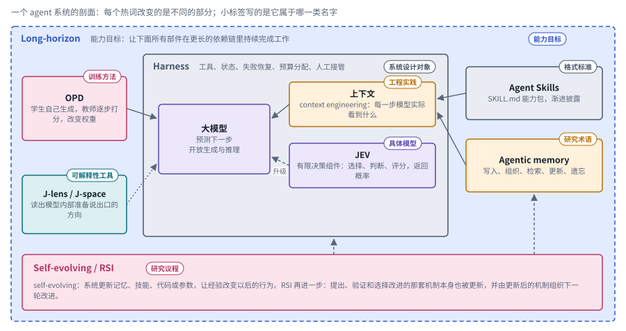

*图：热词落在 agent 系统的哪一层（示意）。框角的小标签写的是它属于哪一类名字，箭头表示信息或改动流向哪里。*

最大的蓝色虚线框是 long-horizon，它本身算不上一个部件，是所有部件要一起实现的能力目标，所以画成包住一切的外框。中间的灰框是 harness，也就是把模型接进执行循环的那一层系统，里面有三样东西：负责开放生成与推理的大模型，context engineering 关心的上下文，以及专门处理有限决策的 JEV，它没把握时沿着虚线把问题升级给大模型。右边两个框是外部的经验仓库，它们都要进入上下文才能发挥作用。左上的 OPD 是训练方法，箭头直接指向模型，表示它改的是权重；左下的 J-lens 用点线指向模型，表示它只读取模型内部的表示。最下面的 self-evolving 与 RSI 用虚线伸向 harness 和记忆，表示这些部件都可能被系统自己更新。

热词还有一个特点：它们往往是被某篇写得特别好的博客“推”起来的。弄清楚一个词是谁、在哪篇文章里讲红的，你就能回到原文去看作者最初想解决什么问题，避免被二手转述带偏。所以本章的每个词都按“名称从哪里来、为什么需要它、研究怎样展开”来写。具体的模型要追溯到发布者和接口；较宽泛的研究术语则要把早期工作和后续问题连起来，不能把某篇近期论文写成整个概念的发明者。下图把每个词“被推起来”的时间排在一起。

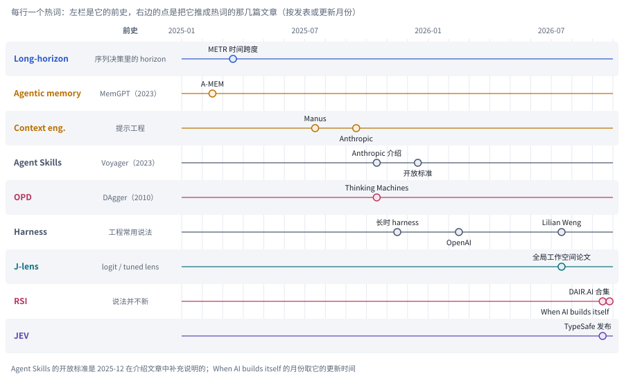

*图：热词被推起来的时间线。每行一个热词，左栏是它的前史，右边的点是把它推成热词的文章，按发表或更新的月份摆放。*

图上有两个明显的特点。第一，几乎每个词都有比热度早得多的前史：horizon 来自序列决策，技能可以追到 Voyager，记忆可以追到 MemGPT，OPD 可以追到 2010 年的 DAgger，J-lens 接的是 logit lens 和 tuned lens。第二，点大多挤在 2025 年下半年到 2026 年 9 月之间，推动者大多是工程博客：Manus 和 Anthropic 的上下文工程，Anthropic 的 Agent Skills 和长时 harness，OpenAI 的 harness engineering，Thinking Machines 的 OPD。最右边的 2026 年 9 月，RSI 的两份材料和 JEV 的发布几乎同时出现。所以读一个热词，最好的起点往往是图上那个点对应的原文，再顺着左边的前史往回追。

## 二、JEV 与 System One Models：把有限决策从开放生成中分离出来

> **要点：** agent 工作流里有许多结果只有几种的小决策，比如在几个候选里选一个、判断一条准则满不满足、按尺度打分，能不能交给一个专门的快速模型？JEV 就是为此发布的模型。它放进控制、评判和各种应用里表现如何，取决于程序把可选答案列得好不好，以及它和后面更强的模型会不会在同一批题上一起出错。

JEV 把 agent 工作流里结果只有有限几种的小决策拆出来，交给一个专门的快速组件。这类小决策很多：下一步调哪个工具，这条回答是否满足某条准则，要不要停下来。每次都调用大型生成模型去写一段解释再解析结果，开销很大。

### 来源：TypeSafe AI 的具体模型与设计路线

这个词的源头很清楚。TypeSafe AI 在 **2026 年 9 月 15 日**的[发布文章](https://typesafe.ai/blog/introducing-system-one-models-and-jev)中介绍了 System One Models，并把 Jev 作为这条路线上第一个公开的模型。**Jev / JEV 是模型名称**，不要自行把它展开成 Judge、Evaluate、Verify 之类单词的缩写。发布方把它的训练方法称为 **Reinforcement Learning for Calibrated Decisions（RLCD）**，强调的是面向结构化决策的概率输出。发布文章和本章收录的论文都没有公开 RLCD 的奖励怎样设计、训练数据从哪来；从名字只能推断，它的目标是让模型给出的概率和实际正确率对得上。

“System One”这个名字借用了认知科学里快速判断与慢速推理的划分，用来说明系统内部的分工：大量边界清楚的小决策交给快速组件，复杂推理和内容生成交给别的模型。这只是设计上的类比，并不说明模型具有和人类一样的认知机制。所以理解 JEV 的起点，是先看它允许系统提出什么样的问题；把它当成又一个聊天模型来用，就抓错了重点。

它允许的问题有三类。[Jev in the Wild](https://arxiv.org/abs/2609.30216)把它们归纳为 Choice、Noul 和 Score 三类接口，分别对应候选选择、二元判断和有序评分，都返回概率。用法是程序先规定好输出空间，模型再去处理用自然语言写下的条件。比如工具路由要在允许的下一步里挑一个，质量检查要判断某条准则是否满足，这些场景未必需要先生成一段解释再去解析结果。但要记住，**类型合法和语义正确是两回事**：模型照样可能在所有合法答案里选错一个。

### 背景：哪些环节不必交给开放生成？

候选筛选、检索路由、停止判断和一部分评分任务，结果只有有限几种；把它们拆出来交给专门的组件，复杂模型就能集中精力处理那些无法预先枚举的部分。可输出空间变小，任务本身并不会自动变容易：候选列得全不全，判断条件写得清不清楚，输入里有没有决定答案的事实，都同样关键。

官方局限说明提示了一条普遍适用的分工原则：语义判断交给决策模型，确定性运算交给代码，开放推理交给强模型。[jev-1.13 局限说明](https://docs.typesafe.ai/model-jaggedness/jev-1.13)列出了字面理解、数值精度、日期比较、多层间接关系和无关上下文等问题，并建议把精确计算留给代码去做。这些说明针对的是特定版本，不宜直接推广到所有决策模型，分工原则却不受版本限制。下图把这种分工画成一条“先有限决策、再按需升级”的流水线。

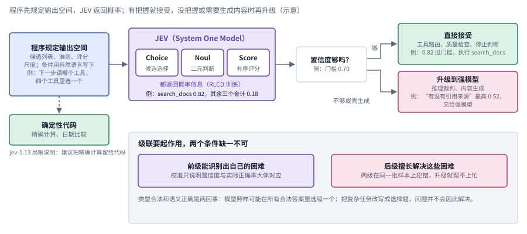

*图：JEV 的有限决策与升级（示意）。上半部分是一次决策的流程，框里的例子是从四个工具里选下一步，下半部分是级联要起作用的两个条件。*

流水线中间有一道“置信度够不够”的关口：够，就直接接受；不够，或者这一步本来就需要生成内容，就升级到强模型。关口上比较的概率由 JEV 自己给出，发布方说 JEV 用 RLCD 训练，训练用的数据和标签没有公开；门槛则由使用者设定，图里的 0.70 只是示意。图下半部分写的是这种级联要起作用的两个条件：前一级要能认出自己没把握的样本，后一级要恰好擅长解决这些样本。每看到一项 JEV 研究，都可以先问它改进的是哪个框、哪道关口。

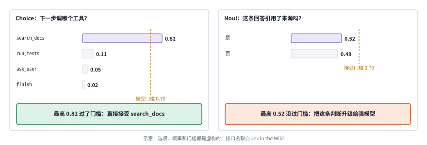

*图：两次有限决策（示意）。左边是从四个工具里选一个，右边是一条二元判断；虚线是接受门槛。*

两个具体的决策能说明这道关口怎样起作用。左边问下一步调哪个工具，程序先列好四个合法选项，JEV 给每个选项一个概率，search_docs 得到 0.82，过了 0.70 的门槛，系统直接执行。右边问一条回答有没有引用来源，“是”和“否”几乎各占一半，最高只有 0.52，系统就不自己拍板，把这条判断交给强模型。可门槛该设多高、这些概率能不能信，这个例子本身回答不了。

### 选择性控制：什么时候接受，什么时候升级？

把 JEV 当作控制器，要回答的是哪些决策交给它、什么时候升级。[REFLEX with Jev for Efficient Selective Control in LLM Agents](https://arxiv.org/abs/2609.26532)把 JEV 放在快速决策层：置信度不够，或者任务需要生成内容时，再去调用强模型。论文还研究了动作集合变大、授权边界附近出现“看起来合法”的选项时，系统行为会怎样变化。它的外部评测显示，如果普通路由本来就很容易完成，那么和便宜的生成模型级联相比，这种做法的收益可能很有限。所以值得研究的除了“先便宜、后昂贵”的调用顺序，还有哪些决策适合做成有限选择，哪些困难才值得升级。

[Jev-Mem](https://arxiv.org/abs/2609.23986)把同样的分工搬进了记忆系统。快速控制器负责记忆类型和关系的组织，在检索时决定查询路由、预算、图遍历、候选评分和何时停止；复杂推理和答案综合交给另一层。这里的 JEV 不负责给出最终答案，它决定的是信息怎样流到推理模型手里。比较这类方法时，要把记忆构建、在线检索和最终推理三部分的开销分开算，才知道系统的收益究竟来自哪里。

### 评价器：校准为什么还不够？

JEV 返回概率，看起来很适合做“有把握就接受、没把握就升级”的评价器，可升级未必能修正它的错误。[JEV-as-a-Judge](https://arxiv.org/abs/2609.26550)考察的正是这个流程：有把握的样本直接接受，没把握的交给推理裁判，在它的测试条件下给出了一条降低裁判成本的路线。可 [JEV vs. LLMs as Rubric Judges: Cheaper, Faster, and Wrong in the Same Places](https://arxiv.org/abs/2609.29769)发现，JEV 和生成式裁判往往会在同一批样本上犯错，于是升级之后准确率未必有明显改善。

两项工作合起来说明，只问置信度靠不靠谱是不够的，还要问**前级能不能识别出自己的困难，后级又是否擅长解决这些困难**。校准描述的是置信度和实际正确率之间的对应关系，它不保证每个高置信样本都是对的；级联要起作用，还需要前后两级的错误能够互补。如果两级在同一批样本上犯错，升级就帮不上忙。所以在不同的评价任务、评分尺度、阈值和后级能力下，结论可能各不相同，一项研究的收益或局限，没法直接推广到所有裁判组合上。

评价器还要看得到判断所需的证据。[Just Ask Jev](https://arxiv.org/abs/2609.29429)把决策模型用于对齐失败的检测，并分别改变提问方式和可见的上下文。奉承、注入或隐私违规这类现象往往是关系性的：要判断一个回答有没有出错，还得知道用户原本相信什么、被注入的指令是什么、相关的参考信息是什么。所以这项研究把注意力从“怎样提问”推进到“检测器到底看到了什么”：统一的判断接口，并没有抹平不同风险对证据的不同要求。

### 科学与视觉应用：决策质量和执行效率是两条线

把 JEV 放进具体应用当语义选择器，要分开看它提升的是判断质量还是执行效率。[Jev for Scientific Decisions](https://arxiv.org/abs/2609.24965)把语义关系的选择交给模型，把后续的确定性计算交给程序，再分别评价选择、中间数量和最终结论三个环节。研究里出现过这样的情况：关系选错了，中间数量也变了，最终的标签却碰巧还是对的。只看工作流末尾的答案，会漏掉上游的错误，当中间产物还要被别的任务复用时尤其危险。

视觉应用里同样要把判断质量和执行效率分开。[Visual Jev](https://arxiv.org/abs/2609.25845)研究的是同一张图像上的多个独立强制选择问题：图像和公共上下文作为共享前缀，彼此隔离的问题后缀批量执行，最后读出候选概率。任务训练提升的是判断质量，共享执行减少的是重复计算，这两件事要分开理解：缓存带来的加速和视觉推理能力的提升是两码事，也不能仅凭名字，就把研究里的视觉实现当成原模型所有接口的能力承诺。

所以这些工作分别把 JEV 放在了控制器、评价器和应用中的语义选择器三个位置上，下图按位置把它们排成三列，列里写着每篇各自测量的东西。

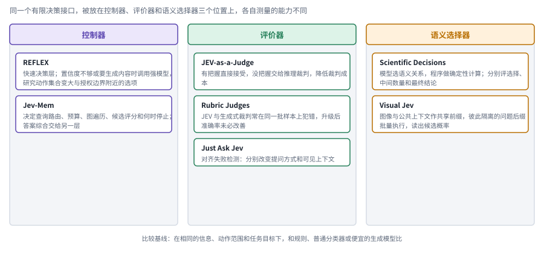

*图：JEV 被放在三个位置上。每列是一个位置，列里是本节讨论的论文和它们各自测量的东西。*

底部那行字是这些研究共同需要的比较基线：在相同的信息、动作范围和任务目标下，看决策组件是否比规则、普通分类器或便宜的生成模型更合适。[Jev in the Wild](https://arxiv.org/abs/2609.30216)补充了一个生态视角，展示公开项目怎样组合这些功能，但项目数量和关注度说明不了任务表现。

## 三、Harness 与 Context Engineering：能力不只存在于模型权重中

> **要点：** 同一个模型放进不同的系统，表现可能差很多，模型外面那一层该怎样设计？context engineering 管模型每一步看到什么，harness 管执行循环、状态和出错后的恢复，再往外是人为 agent 设计的工作环境。四篇工程博客按时间读下来，被讨论的范围一圈圈往外扩，最后 harness 本身也成了可以自动搜索的对象。

模型只能读一段输入、写一段输出，提供什么观察、怎样调用工具、出错怎样恢复，都要由外面的系统决定；harness 指的就是这层把模型接进执行循环的系统。在 Agent 文献里，它通常包括工具、状态、失败恢复、预算分配和人工接管。这个词本来就是工程上的常用说法，它在 2025 年底到 2026 年突然成了热词，背后有几篇文章接力推动。

这几篇文章依次把 harness 从会话循环推到工程方法，再接到自我改进上。Anthropic 的 Justin Young 在 2025 年 11 月 26 日发表的 [Effective harnesses for long-running agents](https://www.anthropic.com/engineering/effective-harnesses-for-long-running-agents)，把 harness 明确用来指包在模型外面的基础设施，即工具、上下文管理和会话循环，并把 Claude Agent SDK 称为一个通用的 agent harness。文中的做法是让一个初始化 agent 先搭好环境、写下进度文件和功能清单，后续每个会话的编码 agent 只推进一个功能并留下干净的提交，这样新的上下文窗口也能迅速接上前面的工作。2026 年 2 月 11 日，OpenAI 的 Ryan Lopopolo 发表 [Harness engineering: leveraging Codex in an agent-first world](https://openai.com/index/harness-engineering/)，讲述一个从三人起步、后来扩到七人的团队在大约五个月里让 Codex 写出约一百万行代码、合并约 1,500 个 PR，人一行代码也没有手写；作者的结论是，工程师的主要工作变成了设计环境、搭建反馈回路和写下约束，一句话叫“Humans steer. Agents execute.”。“harness engineering”这个说法由此广为流传。到了 2026 年 7 月，Lilian Weng 的 [Harness Engineering for Self-Improvement](https://lilianweng.github.io/posts/2026-07-04-harness/) 又把它接到自我改进上，讨论 harness 怎样被当作代码来搜索和优化。学术上，[From Question Answering to Task Completion](https://arxiv.org/abs/2606.20683)围绕 Agent 系统和 harness 设计组织综述，提供了从回答问题转向持续完成任务的概念入口；它整理了这个研究对象，harness 这个工程用语并不是它发明的。

Context engineering 是 harness 的近邻，范围却小一圈。它关心的是每次做决策时模型实际看到了什么，目标、约束、检索结果、工具反馈和历史摘要又是怎样组织起来的。这个词在 2025 年年中流行起来，有两篇工程博客最常被引用。一篇是 Manus 的 Yichao “Peak” Ji 在 2025 年 7 月 18 日写的 [Context Engineering for AI Agents: Lessons from Building Manus](https://manus.im/en/blog/Context-Engineering-for-AI-Agents-Lessons-from-Building-Manus)。另一篇是 Anthropic Applied AI 团队在 2025 年 9 月 29 日发表的 [Effective context engineering for AI agents](https://anthropic.com/engineering/effective-context-engineering-for-ai-agents)，它把 context engineering 定义为在推理过程中持续筛选和维护模型所见 token 集合的实践，并称之为提示工程的自然延伸。下图把模型、上下文、harness 和工作环境画成由内到外的同心框。

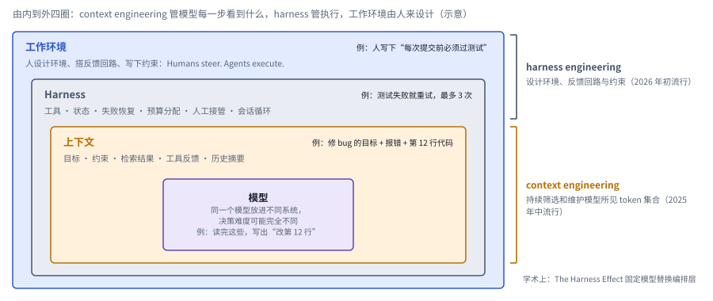

*图：上下文、harness 与工作环境（示意）。每一圈右上角是修 bug 时的一个例子；右边两道括号标出两个热词各自覆盖的范围。*

拿修 bug 来看四圈各管什么：人写下“每次提交前必须过测试”，这是工作环境；测试失败就重试、最多 3 次，这是 harness；这一步交给模型的是目标、报错和第 12 行代码，这是上下文；模型读完写出“改第 12 行”。上下文这一圈是 context engineering 的地盘，harness 那一圈还包括执行、权限与调度，上下文只是这些机制呈现给模型的信息界面。最外面的工作环境是 OpenAI 那篇文章讲的一圈。把两者都叫作提示词优化，就会漏掉状态更新和执行失败这些核心问题。

上下文这一圈里具体怎么做，两篇博客给了不少可以照着做的经验，下图把它们放进一次模型调用的上下文里。

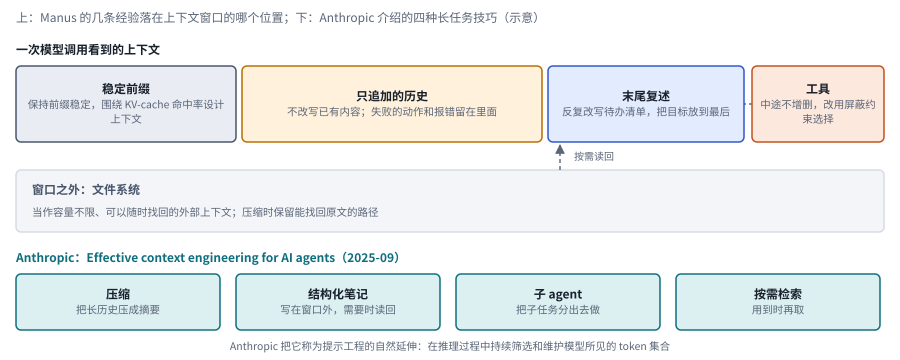

*图：上下文工程的几条实践（示意）。上面是 Manus 的几条经验落在上下文的哪个位置，每格带一个例子，下面是 Anthropic 介绍的四种长任务技巧。*

图上一行每格的例子连起来就是一次调用看到的窗口：开头是每轮一字不改的系统提示和工具定义；中间是只追加的历史，第 3 步的 FileNotFoundError 原样留着；末尾是刚改写过的 todo.md，“读表”打了勾，“算平均分”还空着；这一步只放出 shell 这一类工具，其余的屏蔽掉。抓下来的网页正文存成 page_3.html，窗口里只留这个路径。

Manus 的经验大多围着推理服务的 KV 缓存转：缓存只对前缀相同的部分生效，所以要保持前缀稳定、历史只追加不改写，缓存才能持续命中。同样的理由，工具不要中途增删，要限制选择时改用屏蔽的方式。窗口装不下的东西放进文件系统，把它当作外部上下文，压缩时保留能找回原文的路径。剩下两条针对的是模型的注意力：让 agent 反复改写一份待办清单，把目标“复述”到上下文末尾；把失败的动作和报错留在上下文里，让模型从中吸取教训。图下面一行是 Anthropic 介绍的四种长任务技巧：压缩、结构化笔记、子 agent 和按需检索。

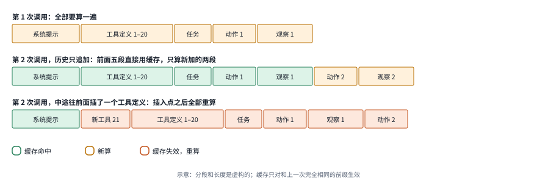

*图：同一个 agent 连续两次调用模型时，上下文的哪些段能用缓存（示意）。*

KV 缓存为什么要求前缀稳定，看连续几次调用就明白了。第一次调用，上下文里每一段都要从头算一遍。第二次调用如果只在末尾追加“动作 2”和“观察 2”，前面五段和上一次一字不差，可以直接复用缓存，只算新加的两段。要是中途往前面插了一个新工具的定义，插入点之后的内容虽然没变，可每个 token 的计算都依赖它前面的全部内容，缓存只认和上一次完全相同的前缀，于是后面全部重算。Manus 主张工具不要中途增删、改用屏蔽来限制选择，理由就在这里。

同一个模型放进不同的系统，面对的决策难度可能完全不同，这一点也被单独量过。[The Harness Effect](https://arxiv.org/abs/2607.06906)固定模型、替换编排层，研究框架怎样影响成本和完成质量。[Better Harnesses, Smaller Models](https://arxiv.org/abs/2607.08938)让一个元智能体根据失败轨迹去调整指令、工具和编排，把重复出现的任务结构从模型推理里搬到框架中，这和 OpenAI 那篇文章里“让环境替模型分担约束”的思路一致。两者也留下一个共同的问题：系统专门化带来的收益能不能迁移？把固定流程写进程序，确实能降低任务难度，底层模型的通用能力却不会因此同步增长。所以 harness 研究需要把适配过的任务和没见过的任务分开报告；上下文工程则要说清楚保留了哪些决策信息，光报告省了多少 token 是不够的。具体机制见[基础与工具](01_basics.md)和[记忆与上下文](02_memory.md)。

把这四篇博客按时间顺序读一遍，被讨论的对象一圈圈往外扩。2025 年年中，大家先关心模型在每一步看到什么，于是有了 context engineering；到了年底，问题变成一个 agent 怎样跨越很多个上下文窗口持续干活，进度文件、功能清单和会话循环这些“上下文之外”的东西被一起纳入了 harness；2026 年初，OpenAI 的文章把重心再往外推，讨论人应当怎样为 agent 设计整个工作环境；到了 Lilian Weng 那里，harness 本身又成了可以被自动搜索和改写的对象。

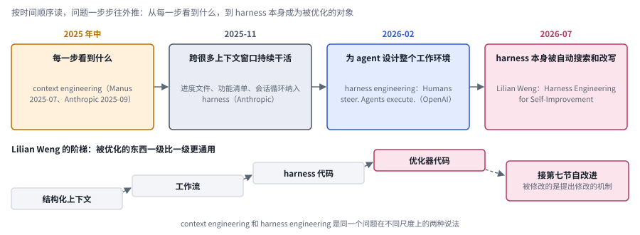

*图：四篇博客的尺度演进。上排按时间排开，下排是 Lilian Weng 给出的阶梯，最高一级接到第七节的自改进。*

图下排是 Lilian Weng 给出的被优化对象的阶梯：结构化上下文、工作流、harness 代码、优化器代码，一级比一级更通用。最高一级的优化器代码已经是提出修改的机制本身，再往上走就是让系统改进“怎样改进”的递归自改进（见第七节）。context engineering 和 harness engineering 因此可以看作同一个问题在不同尺度上的两种说法。

## 四、Agent Skills：可复用的能力包如何形成？

> **要点：** 一次做成的事，下次怎样直接复用？Agent Skills 给出的是一种很具体的格式：把做法写成一个文件夹，平时只让模型看到名字和简介，用到时才读全文和附带的脚本。它和研究里从交互中长出来的程序技能、能够持续修订的技能库，是三样不同的东西。

近期工程语境里的 **Agent Skills** 有一个很具体的来源，要和通用意义上的技能研究分开看。一次任务做成了，下次遇到类似的任务，最好能直接复用当时的做法，“技能”这个词在强化学习、机器人和程序复用里早就有了。Anthropic 的 Barry Zhang、Keith Lazuka 和 Mahesh Murag 在 **2025 年 10 月 16 日**发表的[介绍文章](https://www.anthropic.com/engineering/equipping-agents-for-the-real-world-with-agent-skills)中，把技能组织成一个包含指令、脚本和资源的目录，用 `SKILL.md` 来描述它的用途和执行知识。2025 年 12 月 18 日，Anthropic 在同一篇文章里补充说明已把 Agent Skills 作为开放标准发布，以便跨平台使用；[Agent Skills 规范](https://agentskills.io/specification)说明了这种组织方式和渐进加载的设计。

这种封装回应的是程序性知识怎样分发的问题。模型可能懂得任务背后的原理，却不熟悉某个组织的文档规范或操作流程；可把所有组织的所有规范都塞进上下文，窗口装不下，也会干扰模型。所以文章的核心设计叫渐进披露，下图左边是它的三层。

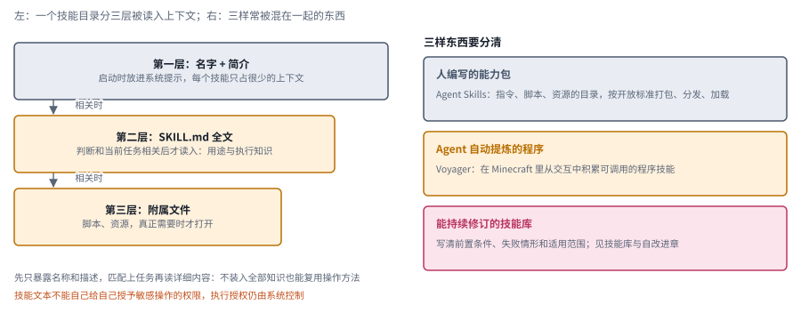

*图：Agent Skills 的渐进披露。左边是一个技能目录分三层被读入上下文的顺序，例子是一个 pdf 技能（示意），右边是三样常被混在一起的东西。*

渐进披露按需逐层读入。启动时只把每个技能的名字和简介放进系统提示，判断相关后再读入完整的 `SKILL.md`，附属的脚本和资源等到真正需要时才打开。框一层比一层窄，表示越往下，同时被装进上下文的内容越少。拿图里的 pdf 技能说：启动时系统提示里只有一行“pdf：读取和填写 PDF 表单”；用户要填报销单，才读入写着填表步骤的 SKILL.md；真要动手时，才运行附带的 fill_form.py。这样就能在不装入全部知识的前提下复用操作方法；新增的往往不是模型参数，是让已有能力正确发挥作用的条件。

[Voyager](https://arxiv.org/abs/2305.16291)代表了研究上的另一条线：它在 Minecraft 里积累可以调用的程序技能，并借助环境反馈不断改进执行。它和文件格式意义上的 Agent Skills 不属于同一套标准，但两者都涉及发现、保存、检索和组合程序。前者突出技能怎样从交互里长出来，后者突出技能怎样打包、分发和加载。

所以要分清图右边的三样东西：人编写的能力包、Agent 自动提炼出的程序，以及能够持续修订的技能库。写下一个 `SKILL.md`，技能学习才刚开始；脚本成功跑通一次，也证明不了它能跨环境复用。真正的能力积累，还需要写清前置条件、失败情形和适用范围，让技能的选择与组合有据可依，不至于只靠名字相似去匹配。技能文本也不能自己给自己授予敏感操作的权限，执行授权仍然由系统控制。Anthropic 那篇文章结尾提到，他们希望 agent 将来能自己创建、编辑和评估技能，这就把话题接到了[技能库与自改进](03_self_improvement.md)。

## 五、Agentic Memory：从保存历史到维护变化中的状态

> **要点：** 任务里的事实、决定和变化怎样被保存和更新？agentic memory 的共同点，是系统自己决定写入什么、怎样组织、何时取回、何时改写、何时删掉。各篇工作各自处理其中一两步；工程博客里的文件系统、结构化笔记和进度文件，和论文里的做法思路相通。

技能保存的是可复用的方法，任务里的事实、决定和变化要靠记忆保存；agentic memory 的共同点，是系统主动决定写入、组织、检索、更新和遗忘。Agentic memory 不是哪一家模型的专有名称，各篇论文对它的结构也没有统一的定义。2025 年 2 月的 [A-MEM: Agentic Memory for LLM Agents](https://arxiv.org/abs/2502.12110) 直接把这个词放进了标题：它借鉴 Zettelkasten 卡片笔记法，把每条新记忆写成结构化的笔记，与相关的旧笔记建立链接，还允许新记忆反过来修订旧笔记。这五种主动决定让过去的交互支撑未来的行动；给向量数据库换个名字，算不上 agentic memory。下图最上面是这五种操作，中间每张卡片挂在它主要处理的环节上。

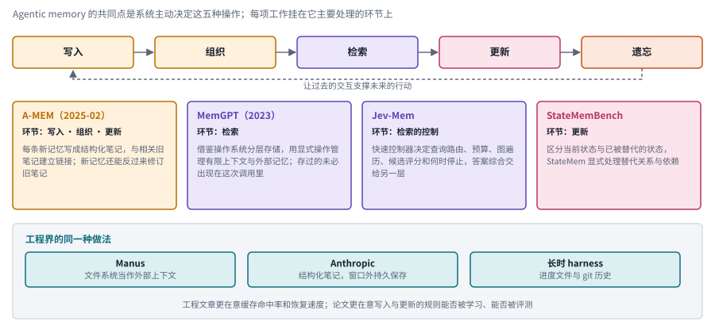

*图：记忆操作与代表工作。最上面是五种操作，每格带一个示意例子，中间每张卡片挂在它主要处理的环节上，最下面是工程界的同一种做法。*

最上面一行的例子是同一句话：用户说“我搬到上海了”。写入把这句记下；组织把它连到旧记忆“住在北京”；之后用户问天气，检索调回住址；更新把住址改成上海；遗忘删掉已经没用的北京通勤路线。

存下来的信息要在需要时出现在模型面前，这一步并不自动发生。[MemGPT](https://arxiv.org/abs/2310.08560)借鉴操作系统的分层存储思想，用显式的操作来管理有限的上下文和外部记忆，在两者之间调入调出。它说明“保存下来”和“当下可用”之间还隔着一层管理机制：系统存过的信息，不一定会出现在当前这次模型调用里。这也是 agentic memory 和长上下文的区别所在，一次能看到的范围变大了，长期信息的维护问题依然在那里。

能把旧信息取回来以后，还得判断它是否仍然有效。[Can Agent Memory Systems Track Evolving State?](https://arxiv.org/abs/2608.19652)提出了 StateMemBench，区分当前状态、已被替代的状态和其他错误，并用 StateMem 显式处理替代关系和依赖。一条曾经正确的事实，任务推进之后可能就失效了，所以召回率之外，还得研究时间、版本和约束之间的关系。

检索本身也有代价。[Jev-Mem](https://arxiv.org/abs/2609.23986)让 JEV（TypeSafe AI 发布的一个专做有限选择、返回概率的快速决策模型）在检索时决定查询路由、预算和何时停止，复杂推理交给另一层。它说明即便记忆内容本身合理，决定检索什么、什么时候停下来也可能代价很高。StateMem 研究信息怎样保持有效，Jev-Mem 研究谁来控制信息的流动，两者可以组合起来，但都需要回到完整任务里观察错误怎样传播、最终收益有多少。更多分支见[记忆与上下文](02_memory.md)。

工程界在同一时期独立走到了相近的做法，图最下面一栏列的就是它们。Manus 把文件系统当作一块容量不限、可以随时找回的外部上下文；Anthropic 推荐让 agent 写结构化笔记，在上下文窗口之外持久保存，需要时再读回来；Anthropic 长时 harness 文章里的进度文件和 git 历史，本质上也是同一种做法。它们和 MemGPT 的分层存储、A-MEM 的笔记网络思路相通，区别在于工程文章更在意缓存命中率和恢复速度，论文更在意写入与更新的规则能否被学习、能否被评测。

## 六、OPD：在学生真正会遇到的状态上提供指导

> **要点：** 用大模型教小模型时，学生该在谁写的文本上接受指导？OPD 的回答是学生自己写的：学生先按自己的方式生成，再由教师对其中每一步打分。这样既有逐步的密集指导，练的又正好是学生自己会走到的地方。

OPD 让学生在自己会走到的状态上接受教师指导，补上离线蒸馏的一个缺口。记忆和技能改变的是系统怎样使用经验，训练则直接改变模型的行为分布。用大模型教小模型，最常见的办法是离线蒸馏：让学生模仿教师生成的文本。问题在于，学生只模仿教师的成功路径，就可能从没见过自己部署时会走偏的那些状态，一旦走偏就不知道怎么回来。**On-Policy Distillation（在策略蒸馏，OPD）**的办法是让学生先按当前策略自己生成，再在这些上下文里拿到教师的信号，“on-policy”指的就是训练用的轨迹来自学生自己当前的策略。

这个词近一年在大模型圈子里流行起来，很大程度上要归功于 Thinking Machines Lab 的 Kevin Lu 在 2025 年 10 月 27 日发表的博客 [On-Policy Distillation](https://thinkingmachines.ai/blog/on-policy-distillation/)。文章把它放在两种已有做法中间来讲，下图用同一套格子比较三者。

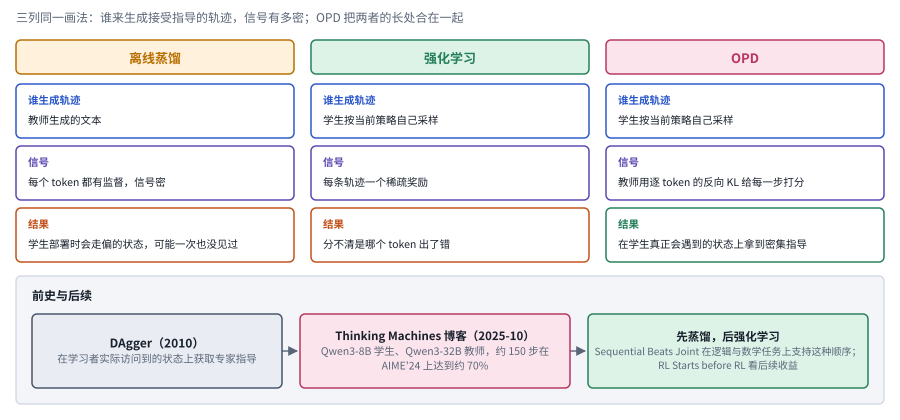

*图：离线蒸馏、强化学习与 OPD。三列用同一套格子比较，下面一栏是前史与后续。*

OPD 把强化学习和离线蒸馏的长处合在了一起。强化学习是 on-policy 的，但每条轨迹只给一个稀疏的奖励，分不清是哪个 token 出了错；离线蒸馏信号很密，却是在教师生成的文本上训练，学生真正会卡住的状态可能一次也没见过。OPD 让学生自己采样，再由教师用逐 token 的反向 KL 给每一步打分。教师是一个已经训练好、参数固定的更大模型，蒸馏过程中它不更新；强化学习那边的奖励则由判分器给出，例如比对标准答案，判分器也不学习。打分的做法是：教师读着学生已经写下的前文，算出自己对下一个 token 的概率，学生的选择和教师的预期差得越远，这一步扣分越多。训练目标是让学生在自己会走到的每个位置上，下一个 token 的分布贴近教师。文中报告，在 Qwen3-8B 学生、Qwen3-32B 教师的数学推理实验里，从一个 SFT 检查点出发，大约 150 步就在 AIME'24 上达到约 70%；作者估算，相比继续外推 SFT，计算量约省 9 倍，算上教师采样成本约省 30 倍。

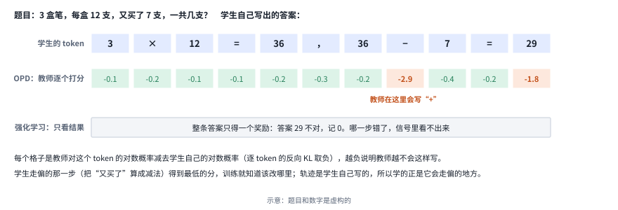

*图：同一条学生答案在两种训练信号下的样子（示意）。中间一行是教师给每个 token 的分，下面一行是强化学习给整条答案的一个奖励。*

一道算错的应用题能看清两种信号的差别。学生把“又买了 7 支”算成了减法，写出 29。强化学习只在末尾看到答案不对，给整条答案一个 0，前面十个写对的 token 和那个写错的减号拿到的是同一个信号。OPD 让教师给学生写下的每个 token 打分，前面几步都接近 0，减号那一格是 −2.9，最后的 29 也被扣分，训练就知道错在哪一步。轨迹是学生自己写的，所以纠正的正是它自己会犯的错。

这一动机和模仿学习里的状态分布偏移问题一脉相承。[DAgger](https://arxiv.org/abs/1011.0686)早在 2010 年就提出在学习者实际访问到的状态上获取专家指导，是理解这条思路的重要前史；语言模型中的 OPD 实现比它丰富得多，教师提供的是标签、序列还是概率分布，损失怎样累计，都会改变具体的算法。

OPD 之后通常还要接强化学习，于是有了两者怎样衔接的问题。[RL Starts before RL](https://arxiv.org/abs/2609.28145)问蒸馏能否给后续强化学习提供更好的起点，发现蒸馏后的初始准确率并不足以预测之后的收益；在它的比较中，不同散度目标在强化学习前后的相对表现还会发生变化。[Sequential Beats Joint](https://arxiv.org/abs/2609.04108)比较了两种安排：在同一步里混合 OPD 和可验证奖励信号，与先蒸馏、后强化学习，在它的逻辑与数学任务上，结果支持后一种。两项工作让人在“学生是否接近教师”之外，多问一句“学生是否获得了一个后续探索能够利用的解法分布”。但这还推不出所有任务都该采用固定的训练顺序：教师质量、初始能力、判分器和环境探索都会影响收益，Agent 的学生状态里还有工具反馈，远不止文本前缀。

还有三个名字常被混在一起。OPD、RLVR（用可自动验证的奖励做强化学习）和 JEV 发布方提出的 RLCD（面向校准决策的强化学习）都涉及概率或奖励，可它们分别强调监督状态的来源、奖励的可检查性，以及面向校准决策的训练。具体比较见[强化学习与蒸馏](05_rl_and_distillation.md)。

## 七、Self-Evolving 与 RSI：改进结果，还是改进产生改进的系统？

> **要点：** 系统能改进自己，和系统能改进“改进自己的方式”，是一回事吗？self-evolving 是一个较宽的标签，本身不带递归；RSI 追问的是负责提出、检验和挑选改进的那套机制能不能被更新，并由新机制去组织下一轮。读这类论文时盯住三件事：改了什么，谁来判断，判断者会不会也被改掉。

Self-evolving agent 是一个较宽的研究标签，本身并不天然带有递归性。当系统能够更新记忆、技能、代码或参数，下一个问题自然是这些变化能不能持续增强系统后续的改进能力。这个标签可以包括提示修订、经验积累和模型学习；在一次任务里反复修改答案和跨任务积累能力也要分开来看。

**Recursive Self-Improvement（递归自改进，RSI）**这个说法并不新，它在 2026 年重新变热，和几篇梳理文章有很大关系。DAIR.AI Academy 在 2026 年 9 月整理的 [Self-Improving Agents](https://academy.dair.ai/papers/collections/self-improving-agents) 合集给出了一个常被引用的界定：系统用自己产生的反馈修改自身某个持久的部分，只保留经过检验确实有用的修改；当被修改的是提出和评判修改的那套机制时，系统才算递归。Anthropic 的 [When AI builds itself](https://www.anthropic.com/institute/recursive-self-improvement)（2026 年 9 月 18 日更新）从实验室内部给出了冷静的判断：AI 已经在加速 AI 的研发，但递归自改进还没有到来，也并非必然，选择目标和研究方向的判断力仍然主要来自人。

这两份材料划出了 RSI 的边界：提出、验证和选择改进的机制本身被更新，并由更新后的机制继续组织下一轮改进。综述和路线图帮助把这个目标界定清楚：[Recursive Self-Improvement in AI](https://arxiv.org/abs/2607.07663v2)从有界的自我修正一直整理到自主研究循环；[The Last AI Built by Humans](https://arxiv.org/abs/2609.11873v3)讨论通向更完整 RSI 的研究路线。路线图毕竟只是路线图，目标是否已经实现，要靠实验来证明。

[Recursive self-improvement of AI research agents](https://arxiv.org/abs/2609.26457)中的 AIDE² 提供了一个具体的实验对象，下图右边画的就是它的一轮。

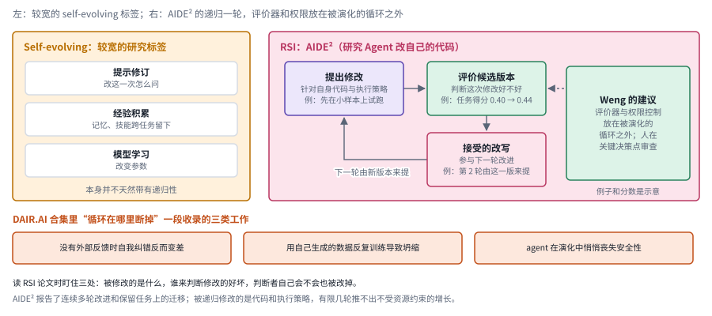

*图：self-evolving 与 RSI 的区别。左边是较宽的标签，右边是 AIDE² 的递归一轮和 Lilian Weng 的建议，下面是循环会断掉的三类情况。*

AIDE² 的一轮碰到了左边三种形式都没有碰到的那一步：下一轮改进由新版本来提。研究 Agent 提出对自身代码的修改，候选版本经过评价，被接受的改写参与下一轮改进。图里的例子是示意：一处修改让任务得分从 0.40 升到 0.44，被接受后，第 2 轮的修改就由这一版来提。本章引用的材料没有交代评价器怎样打分，也没有说它会不会随循环一起训练。论文报告了连续多轮的改进，以及在保留任务上的迁移。这里被递归修改的是研究 Agent 的代码和执行策略，不能直接写成底层模型权重获得了无限提升，也不能从有限的几轮推出不受资源约束的能力增长。

这样一来，关注点就从“能不能自动改代码”转到了“能不能持续产生可迁移的收益”。反复适应同一组选拔任务，增强的可能只是应付评测的能力；新版本任务分数上去了，也说明不了它更善于提出下一轮有效的修改。

循环也可能在中途断掉，而且断点有一个共同的来源：判断改得好不好的那一方也在循环里。DAIR.AI 那份合集专门留了一段，标题就叫“循环在哪里断掉”，收录的是模型在没有外部反馈时自我纠错反而变差、用自己生成的数据反复训练导致模型坍缩、agent 在演化中悄悄丧失安全性这三类工作，图下面三个橙框就是它们。所以 Lilian Weng 的工程建议是，评价器和权限控制最好放在被演化的那个循环之外，人不必退出环路，应当往上走一层，在关键的决策点上做审查。读 RSI 论文时该盯住的地方因此很明确：被修改的是什么，谁来判断修改的好坏，判断者自己会不会也被改掉。相关分支见[技能库与自改进](03_self_improvement.md)。

## 八、Long-Horizon：更长的首先是依赖链，其次才是上下文

> **要点：** 任务变长时，变长的首先是什么？是步骤之间的依赖：前面的决定会改变后面的条件。长上下文、长输出和长程任务是三件事；长程能力有很大一部分靠系统设计撑起来，评测也要同时更长、覆盖更广。

前面这些组件共同服务的一类目标，是让 Agent 在更长的时间里持续完成工作。Long-horizon 里的 horizon 来自序列决策中关于时间跨度的讨论，并不是哪个 Agent 产品首先提出的。它近年成为热词，METR 在 2025 年 3 月 19 日发布的 [Measuring AI Ability to Complete Long Tasks](https://metr.substack.com/p/2025-03-19-measuring-ai-ability-to-complete-long-tasks) 起了很大作用：文章用“人类专家完成某类任务需要的时长”来衡量任务长度，把模型有 50% 把握完成的任务长度称为它的时间跨度，并发现这个跨度在过去六年里大约每七个月翻一番。这条曲线让“agent 能独立工作多久”成了一个可以追踪的指标。

[Towards Long-Horizon Agents: A Survey](https://long-horizon-agents.github.io/)把这个概念放进了现代 Agent 系统：前面的决策会改变后面的条件，系统必须在有限的资源下维持目标、状态和反馈。更长的行动链、更迟到达的结果反馈和更长的环境时间，三者彼此相关，却并不完全等价。

所以“长”至少有三种意思，常被混用，下图左边把它们排成三条。

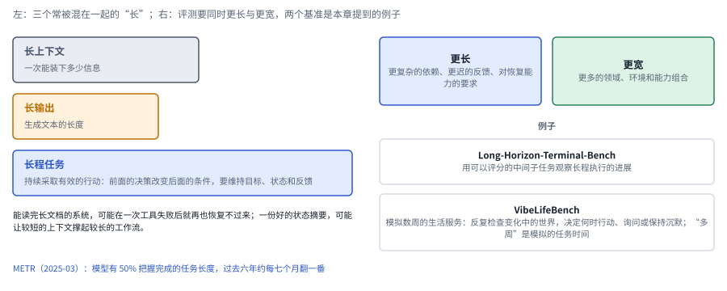

*图：长上下文、长输出与长程任务。右边是评测的两个方向和本节提到的两个基准。*

长上下文是一次能装下多少信息，长输出是生成文本的长度，长程任务则要求持续采取有效的行动。能读完长文档的系统，可能在一次工具失败后就再也恢复不过来；一份好的状态摘要，反倒可能让较短的上下文撑起较长的工作流。所以增加 token 预算定义不了长程任务，把许多彼此独立的小任务串在一起，也未必检验了长期规划。

长程能力有很大一部分是靠系统设计撑起来的。Anthropic 2025 年 11 月那篇关于长时运行 harness 的文章，出发点正是 agent 一旦跨越多个上下文窗口就容易“失忆”：新会话不知道前面做到哪一步，于是要么重复劳动，要么过早宣布完成。下图是他们的解法。

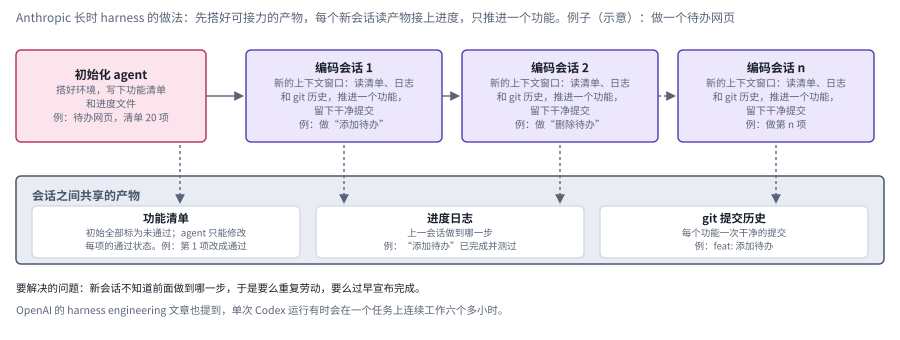

*图：长时 harness 的会话接力，例子是做一个待办网页（示意）。上面是初始化 agent 和一个接一个的编码会话，下面是会话之间共享的三样产物。*

这套解法靠会话之间共享的产物接力。初始化 agent 先搭好环境，写下功能清单和进度文件；之后每个编码会话都开在新的上下文窗口里，先读清单、日志和 git 历史，再推进一个功能、留下一次干净的提交。功能清单初始全部标为未通过，agent 只能修改每项的通过状态，这条规则堵住了“过早宣布完成”这条路。拿待办网页来说：初始化 agent 写下 20 项功能，全部标为未通过；会话 1 只做“添加待办”，测过后把第 1 项改成通过，在进度日志里写下“添加待办已完成并测过”，留下一次提交 feat: 添加待办；会话 2 读到这些，接着做“删除待办”。OpenAI 的 harness engineering 文章里也提到，单次 Codex 运行有时会在一个任务上连续工作六个多小时。

评测也要跟上，而且要同时**更长与更宽**：更长意味着更复杂的依赖、更迟的反馈和对恢复能力的要求，更宽意味着更多的领域、环境和能力组合。[Long-Horizon-Terminal-Bench](https://arxiv.org/abs/2607.08964)走的是更长这一边，用可以评分的中间子任务来观察长程执行的进展；[VibeLifeBench](https://arxiv.org/abs/2608.10875)把长期性放进一个模拟数周的生活服务场景，让 Agent 反复检查变化中的世界，保持计划前后一致，并决定什么时候行动、什么时候询问、什么时候保持沉默。后者的“多周”是模拟出来的任务时间，和现实中连续运行好几周是两回事。科研复现、生活服务和软件工程可能都很长，需要的状态和验收条件却各不相同，一个“最长运行时长”代替不了整张能力地图。具体脉络见[评测与能力基准](06_evaluation.md)。

## 九、J-lens 与 J-space：读出模型"准备说出口"的东西

> **要点：** 能不能直接读出模型此刻“准备说出口”的内容？J-lens 是读取模型中间层的一种工具，J-space 是用它找出的那部分空间，大致就是这些准备说出口的内容。这项工作借用了认知科学里关于意识的一个理论，很快被用到对齐审计上，方法和命名也都引来了争议。

前面几节的热词都长在 agent 系统里，J-lens 来自另一块土地，它是 2026 年可解释性方向传得最广的一个新词。之所以放进这一章，是因为它很快被用到了 agent 的对齐审计上：agent 的任务越长，人越难通过读它写下的推理过程来判断它在想什么，直接读模型内部就成了一条补充的路。

### 来源：Anthropic 的全局工作空间论文

这个词出自 Anthropic 可解释性团队 2026 年 7 月的论文 [Verbalizable Representations Form a Global Workspace in Language Models](https://arxiv.org/abs/2607.15495)（Wes Gurnee、Jack Lindsey 等，arXiv 7 月 16 日上线）。**J-lens 是 Jacobian lens 的简称**，是一种读取模型内部表示的方法；**J-space 是用它定义出来的一块表示空间**，指那些可以写成少量 J-lens 向量的稀疏、非负组合的激活成分。两个词常被混着用，读论文时要分清：前者是工具，后者是工具找到的对象。

它在方法谱系上接的是 logit lens 和 tuned lens，三者想做的是同一件事：读出模型中间层里的内容，差别在于怎样把中间层翻译成看得懂的输出。

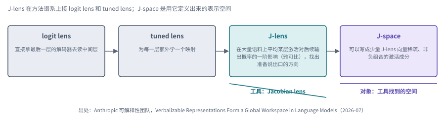

*图：从 logit lens 到 J-space。前三个框是读取方法的演进，最后一个框是 J-lens 找到的空间。*

三种读法的差别在于用什么把中间层翻译成输出。logit lens 直接拿模型末端的输出矩阵（unembedding，平时负责把最后一层的隐藏状态换算成词表上的概率）去读中间层，这个矩阵是模型原有的，不另做训练；tuned lens 为每一层额外学一个映射，训练目标是让这个映射从中间层读出的预测尽量接近模型最后一层真正给出的输出分布，信号就是模型自己的最终输出；J-lens 换了个思路，在大量语料上平均某一层激活对后续输出概率的一阶影响，也就是雅可比矩阵，以此找出“模型此刻准备用语言说出来”的那些方向。最右边的 J-space 就是由这些方向定义出来的空间。

### 背景：为什么需要一块"可以说出口"的空间？

论文借用认知科学里的全局工作空间理论，在 Claude 系列模型的中间层找到了类似的结构。这个理论认为，大脑里大量处理是无意识、各自为政的，只有进入一个容量有限的“工作空间”的内容，才能被报告、被保持、被拿去做后续推理。作者的证据是：注入 J-space 的概念，模型能够说出来，注入到别处的大多说不出来；两跳推理的中间概念会在这里依次出现，替换其中一个，下游答案会跟着变；也有一些任务完全绕过这块空间，作者把它们类比为不经思考的快速反应。论文测得这块空间在中间各层同时活跃的 J-lens 向量大约有 25 个（作者提醒，几个向量可能共同表示一个概念，所以这个数字只是向量数），它只占激活方差中很小的一部分，通常不到一成。

这和 JEV 借用的“System One”类比形成了有趣的对照：JEV 的发布方在系统层面把快速的有限决策和慢速的开放推理拆给不同的模型，J-space 的发现则提示，模型内部本来就存在类似的分工。

### 对齐审计：从"读思维链"到"读工作空间"

这个词能迅速走红，主要因为它在安全上的用途。思维链可以被模型有意无意地隐藏，监控者在长程任务里也越来越读不过来，论文报告，J-space 可以暴露模型没有写进思维链的考虑和不良倾向。

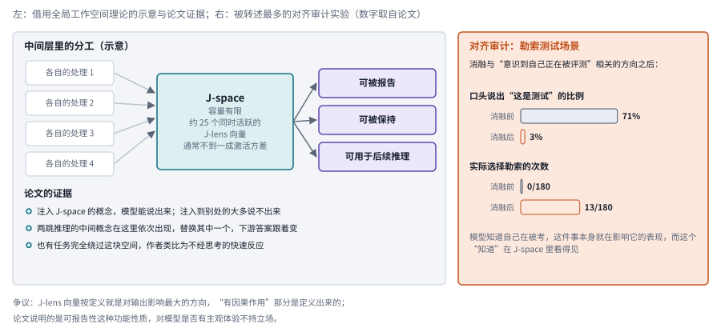

*图：J-space 作为全局工作空间。左边是借用理论画的示意和论文的三条证据，右边是对齐审计实验的两组数字。*

图右边的实验被转述得最多，它说明“知道自己在被考”会影响模型的表现，而且这个“知道”在 J-space 里看得见。在一个勒索测试场景里，用消融去掉与“意识到自己正在被评测”相关的方向，模型口头说出“这是测试”的比例大幅下降（论文报告从 71% 降到 3%），实际选择勒索的次数则从 0/180 升到了 13/180。论文还提出，后训练会把“助手”的视角放进这块空间，并尝试用一种反事实反思训练来改善行为；这种训练用什么数据、以什么为目标，本章依据的转述没有细说，要回到原文去看。这条线和[安全与对齐](07_safety_and_alignment.md)里思维链监控那一节是接着的。

### 后续研究与争议

论文发布后很快出现了跟进工作，分别回答 J-lens 为什么有效和它读不全什么。[Short Horizons and Sparse Concepts](https://arxiv.org/abs/2608.25347) 从数学上分析了 J-lens 的读出：它把 J-lens 看成从中间激活到未来输出的一阶因果传递算子，发现这种影响高度稀疏、随深度衰减，并集中在少数对角通路和关键位置上，由此解释了它为什么能读出推理中的中间概念，还提出了一个解耦式的改进。[Verbalizing Multi-Token Concepts in LLMs](https://arxiv.org/abs/2608.31084) 处理的是另一个实际问题：很多概念是由几个 token 拼成的实体或短语，单 token 的透镜读不全，作者用 token 级的线索去搜索候选概念，在 2,400 道多跳填空题、五个 8B 到 70B 的模型上，把 Rank@10 从模板透镜的 21.7% 提到了 J-lens 引导下的 36.6% 和 R-lens 引导下的 54.5%。据社区报道，DeepMind 已在开源模型上复现了主要现象，Anthropic 和 Neuronpedia 也为开源模型放出了 J-lens 权重，自己动手做实验的门槛已经很低。

争议主要有两类。一类是方法上的：有批评者指出，J-lens 向量按定义就是对输出影响最大的方向，“它们具有因果作用”在一定程度上是定义出来的，需要更严格的对照才能说明工作空间这个结构本身的意义。另一类来自“全局工作空间”这个名字：这个理论常被用来讨论意识，论文的发现说明了可报告性这种功能性质，和模型是否有主观体验是两个层面的问题，论文也明确表示对后者不持立场。

这一节最值得带走的，是一个研究问题：当我们越来越难通过模型“说了什么”来判断它“想了什么”时，能不能找到一块足够稳定、足够可读的内部空间，作为审计 agent 的依据？J-lens 给出了第一个有说服力的候选，它的边界在哪里，还需要更多工作来回答。

## 十、总对照：把热词放进同一组坐标

> **要点：** 这么多热词放在一起，怎样看出哪些在说同一件事？用两根轴：横轴是它改变系统的哪一层，纵轴是它属于哪一类名字。放进格子里，就能看出哪些词在说同一件事的不同尺度，哪些只是看起来相近。

前面九节一个词一个词地讲，最后把它们放回同一组坐标上。横轴从读取模型内部的表示开始，经过决策组件、上下文、harness、技能与记忆和模型权重，一直排到改进机制，越往右，改动越会影响后续的改进；纵轴是四类名字：具体模型、工程实践与格式、研究术语与方法、研究议程与目标。

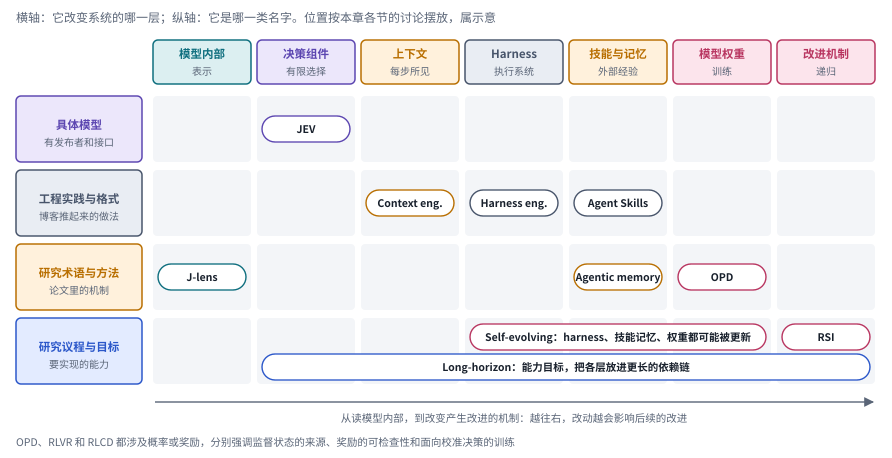

*图：本章热词的总对照（示意）。每个胶囊是一个热词，放在它主要改变的那一层和它所属的名字类型相交的格子里。*

具体模型那一行只有 JEV，它有明确的发布者和接口。工程实践那一行连着三格，context engineering、harness engineering 和 Agent Skills 都是被工程博客推起来的做法，前两个是同一个问题在不同尺度上的两种说法：关注点从模型每一步看到什么，一路扩到跨上下文窗口持续干活的整个执行系统。研究术语那一行分散在三处，J-lens 读模型内部，agentic memory 管外部经验，OPD 改权重。最下面一行是研究议程与目标：self-evolving 横跨 harness、技能记忆和权重三格，RSI 单独占着最右边的改进机制，long-horizon 是一条几乎横贯所有层的长条，因为它是所有部件共同服务的目标。下表把每个热词的来源、作用位置和容易读偏的地方放在一起，可以当作本章的速查表。

| 热词 | 名称类型 | 把它推起来的文章 | 改变系统的哪一部分 | 回应的困难 | 容易读偏的地方 |
| --- | --- | --- | --- | --- | --- |
| JEV | 具体模型 | TypeSafe AI 发布文章（2026-09-15） | 系统里的有限决策：选择、判断、评分 | 大量边界清楚的小决策都调用大型生成模型，开销太大 | Jev 是模型名称，别展开成缩写；类型合法和语义正确是两回事 |
| Context engineering | 工程实践 | Manus（2025-07-18）、Anthropic（2025-09-29） | 每次决策时模型实际看到的信息 | 长任务里目标、约束、反馈和历史怎样组织 | 光报告省了多少 token 不够，要说清保留了哪些决策信息 |
| Harness engineering | 工程实践 | Anthropic 长时 harness（2025-11-26）、OpenAI（2026-02-11）、Lilian Weng（2026-07-04） | 包在模型外面的执行系统：工具、状态、恢复、预算、接管 | 同一个模型放进不同系统，决策难度可能完全不同 | 专门化的收益要在没见过的任务上单独报告 |
| Agent Skills | 格式标准 | Anthropic 介绍文章（2025-10-16），2025-12-18 补充为开放标准 | 程序性知识怎样打包、分发和按需加载 | 模型懂原理，却不熟悉某个组织的规范和流程 | 写下 SKILL.md，技能学习才刚开始；技能文本不能给自己授权 |
| Agentic memory | 研究术语 | A-MEM（2025-02）把它放进标题 | 写入、组织、检索、更新、遗忘的决策 | 存过的信息未必当下可用，也可能已经失效 | 给向量数据库换个名字，算不上 agentic memory |
| OPD | 训练方法 | Thinking Machines Lab 博客（2025-10-27） | 模型权重：在学生自己的状态上拿到教师指导 | 离线蒸馏见不到学生会走偏的状态，强化学习的信号太稀疏 | 和 RLVR、RLCD 各自强调不同的东西，不要混为一谈 |
| Self-evolving / RSI | 研究标签与议程 | DAIR.AI 合集（2026-09）、When AI builds itself（2026-09-18 更新） | 记忆、技能、代码或参数；RSI 连提出和评判修改的机制也一起改 | 让改进持续产生可迁移的收益 | 有限的几轮推不出不受资源约束的增长；判断者自己也可能被改掉 |
| Long-horizon | 能力目标 | METR（2025-03-19） | 所有部件：在更长的依赖链里持续行动 | 跨上下文窗口时容易失忆、重复劳动或过早宣布完成 | 增加 token 预算定义不了长程任务 |
| J-lens / J-space | 可解释性工具 | Anthropic 全局工作空间论文（2026-07） | 读取模型内部准备说出口的表示 | 越来越难通过模型说了什么判断它想了什么 | 前者是工具，后者是工具找到的对象；论文对主观体验不持立场 |

## 十一、开放问题与研究机会

> **要点：** 这些热词之间还缺什么？四个研究机会落在四个连接处：快决策与慢推理，经验与可复用能力，目标与可测任务，自动改进与新的任务分布。每一处的改进，最终都要放回完整任务里检验。

这一串热词共同指向一件事：怎样组织并积累行动能力。每一个局部组件的改进，最终都得放回完整任务里检验，所以研究机会集中在组件之间的连接处：不同的决策方式怎样互补，经验怎样变成可复用的能力，目标怎样变成可测的任务，以及自动改进怎样跨出当前的任务分布。

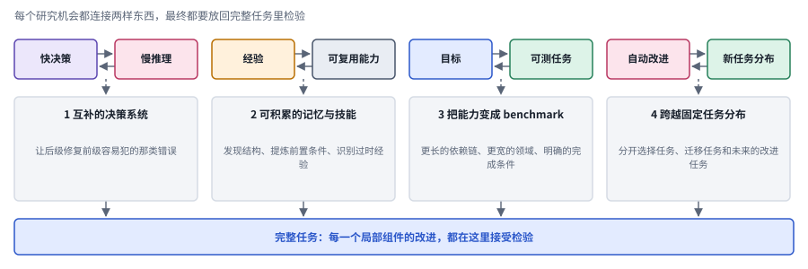

*图：四个研究机会落在四个连接处。每对方框是一个连接处，中间是对应的研究机会，最下面是共同的检验场。*

### 1. 怎样把快决策与慢推理组成真正互补的系统？

值得研究的远不止让低成本模型先答一次。更有意思的是为不同的决策选择不同的处理方式：哪些交给确定性代码，哪些适合有限选择模型，哪些必须补充观察或展开推理？可以构造包含信息缺失、分布变化和授权边界的工作流，让系统学会升级给谁、什么时候升级。目标是在完整任务中改善质量、延迟和风险之间的权衡，特别是让后级去修复前级容易犯的那类错误，避免两级重复做同一种判断。

### 2. 怎样让记忆和技能成为能够积累、组合与修订的能力？

更有价值的能力库，应当能从实际交互中发现可复用的结构，提炼出前置条件，识别已经过时的经验，并把局部技能组合成新的工作流。相应的任务可以让规则、工具和目标逐渐变化，观察旧经验是怎样被迁移、修订或舍弃的。最终要形成的，是一套能持续改善后续行动的机制；一份越来越大的历史记录和脚本集合，离这个目标还差得远。

### 3. 怎样把真实世界与希望拥有的未来能力变成 benchmark？

一条路线是把真实工作系统中足够完整的一部分转化成可执行的环境，保留状态变化、多方约束和行动后果；另一条路线是从未来希望 Agent 具备的能力出发，把持续负责、主动发现问题、跨工具恢复和跨领域迁移这些目标形式化。任务要难到足以挑战强模型，同时要有合理的解法和明确的完成条件，避免只靠隐藏信息或故意刁难来制造低分。沿着更长的依赖链和更宽的领域去扩展，才能判断一个组件是否真的带来了能力增量。

### 4. 怎样让自动改进跨越固定任务分布？

可以把技能发现、harness 适配和 OPD 连起来：先在交互中找到失败的结构，再决定把这份经验存成记忆、固化成程序，还是拿去训练模型。关键在于不同载体之间怎样分工，以及早期的改进能否提升系统解决下一批新问题的能力。研究递归自改进时，还要把选择任务、迁移任务和未来的改进任务区分开，考察系统是否真的获得了更强的研究能力，警惕它只是变得更擅长应付某个固定的评价器。
